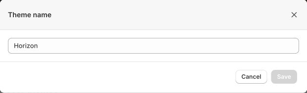
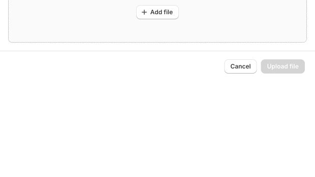
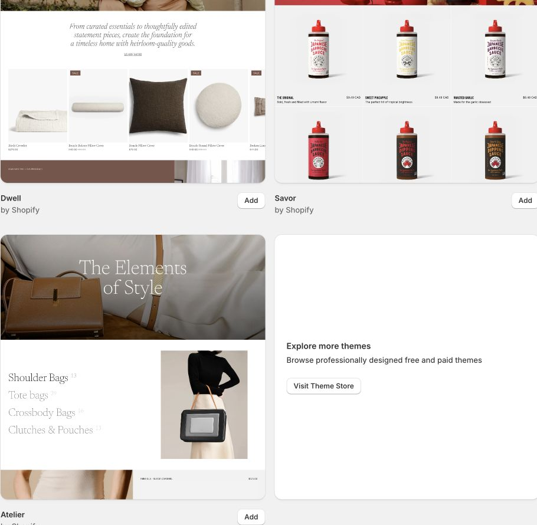
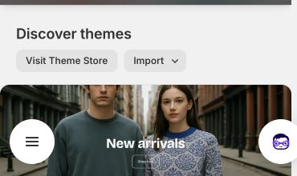

# Shopify Themes Page Detailed Reference

**LIVE / MEASURED — 22 October 2026.** This is the Online Store channel in the user's India trial store, with Horizon **4.3.0** active. It documents the current-theme preview, discovery, import, visibility and editor entry points. It does not claim that every paid theme, installed-library state or Canvas workflow was exercised.

Measurements use CSS pixels. The principal desktop capture is **1440 × 1000, DPR 1**; an earlier native capture was 1144 × 778, DPR 2. The narrow capture is **390 × 844, DPR 1**. Embedded-frame coordinates below are **local to the channel iframe**, not the global browser origin.

## Composition and hierarchy

The page is a channel workspace inside the black admin shell:

1. A stable Online Store header identifies the channel and exposes visibility, Preview store and channel actions.
2. A large current-theme preview region is intended to represent the storefront; the captured region still displayed a loading spinner.
3. A dark gradient footer over the preview holds the store/domain context, theme metadata, plan prerequisite and Edit theme.
4. Discover themes provides visual alternatives and import/create actions.
5. Individual theme examples pair a preview image with name, author and Add.
6. An Explore more themes tile leads to the full Theme Store.

The currently used theme receives much more space than suggested alternatives. This makes the page a management workspace first and a discovery catalog second.

The crop omits personal store/domain labels. Despite the historical filename, it is a **loading-state exhibit**, not completed storefront artwork or a complete current-theme card. A final [preview probe](evidence/deep-dive-02/themes-current-preview-probe.png) also showed the spinner while surrounding controls and discovery images were available. No exact duration or failure cause was established.

## Desktop geometry

At 1440 px, the expanded global sidebar occupies 220 px. The embedded channel body measured 1216 px wide and 992 px high, inside the outer workspace. Its gray background was `#F1F1F1`; inherited text was `#303030`, 13/20 px, weight 450.

| Element | Measured rectangle or value | Interpretation |
| --- | --- | --- |
| Current preview visible region | x 117, y 76, w 966, h 550 | Local iframe coordinates |
| Underlying screenshot image | w 966, h 749.48 | Taller than its visible clipping region |
| Preview frame corners | 12 px | Rounded frame around screenshot |
| Preview clipping | Ancestor `overflow: hidden` | Explains the difference between image and visible card height |
| Discovery grid | x 117, y 694, w 966 | Aligned with the preview |
| Grid column gap | 16 px | Explicit computed grid gap |
| Desktop discovery columns | Approximately 311.33 px each, three columns | At this 1440 px viewport |
| Discovery image | 311.33 × 311.33 px | Square preview tile |
| Earlier 1144 px grid | Two columns, 428 px images, 16 px gap | Another observed responsive composition |
| Discover themes title | 18/24 px, weight 600 | Embedded channel typography |
| Theme name | 13/20 px, weight 600 | Smaller repeated-card label |
| Explore-more title | 14/20 px, weight 600 | Secondary discovery tile |

Sources: [1440 page metrics](evidence/deep-dive-02/themes-page-1440-metrics.json), [preview/grid ancestor measurements](evidence/deep-dive-02/themes-preview-and-grid-ancestry.json), [earlier native measurements](evidence/deep-dive-02/themes-page-frame-metrics.json).

The screenshot image's 749.48 px height must **not** be used as the card height. A 550 px ancestor clips it. This is a concrete example of why “pixel by pixel” inspection needs the paint/container hierarchy, not just the image element's bounding box.

The inner content is centered within a wider workspace. The measured grid widths describe these viewport states; they do not establish every breakpoint or a universal fixed card width.

## Color and depth

The embedded channel uses an older-looking neutral foundation than the refreshed native admin:

| Layer | Observed treatment |
| --- | --- |
| Outer navigation | Near-black refreshed admin shell |
| Channel canvas | `#F1F1F1` |
| Embedded body text | `#303030`, 13/20 px, weight 450 |
| Current preview | Clipped, rounded preview region; spinner present in saved image probes |
| Preview footer | Dark gradient for metadata/actions over the image |
| Discovery imagery | Theme-specific photography and typography |
| Controls | Compact actions, including an outlined/light Edit theme action over the dark footer |

The page's artwork and storefront colors belong to the theme/demo, while the channel controls belong to Shopify. They are separate systems. The white native Domains workspace and this gray embedded channel should not be forced into one extracted token table.

The preview frame used layered shadows, including broad low-opacity elevation and a fine edge. The dark footer makes the small white editing action legible without requiring a saturated brand-colored button.

## Theme identity visibility and launch readiness

The observed theme was active while the storefront remained private and the store had no selected plan. The UI exposes these as separate concepts:

| State | Where it appears | Meaning to the operator |
| --- | --- | --- |
| Theme identity/version | Theme metadata and action menu | Which implementation is being edited |
| Active theme | Editor badge / current preview | Which theme is the current storefront theme |
| Storefront Private/Public | Channel header control | Whether the storefront is publicly available |
| Plan prerequisite | Preview footer launch action | Commercial prerequisite for launch in this account |

**ANALYSIS.** “Theme active” must not be treated as “business launched.” A successful editor save also does not establish domain readiness, public visibility or checkout readiness.

Opening Private revealed a storefront-visibility selector, a password-page preview, a password field and an Update action. No choice, credential or visibility was changed. Credential values are excluded from the saved textual evidence, and no image of the credential control is included.

## Two action menus with different scopes

The channel header's **More actions** menu contained:

- Manage app.
- Unpin from your navigation.
- Uninstall.

These actions affect the installed Online Store channel/navigation integration. They are not the current theme's edit actions. Manage app opened an administrative detail page, documented in [Apps reference](12_APPS_AND_EXTENSION_SURFACES.md).

The current theme's own action menu contained:

- Duplicate in Canvas.
- Preview, opening another window/tab.
- Rename.
- Duplicate.
- Edit code.
- Edit default theme content.
- Download theme file.
- Version 4.3.0 / theme-information link.

Menu presence is not execution. No duplication, download, unpin or uninstall was performed.

**ANALYSIS.** Two ellipsis controls can look identical while acting on different objects. Placement, nearby context and accessible names must make the scope clear. A design review should explicitly distinguish channel actions from theme actions.

## Rename is a focused modal

Rename opened a single-field dialog with the existing Horizon name. It measured **620 × 189 px**, with **8 px corners** in the captured native state. Save was initially disabled; Cancel returned to the channel.

The dialog's radius and shadow differ from the refreshed native app-recommendation dialog. This is live evidence that Shopify's current product contains multiple composed UI generations, not proof of one radius for every modal.

## Import is a menu followed by a file task

Import exposed **Upload zip file** and **Connect from GitHub**. Upload opened a dialog that explained ZIP format, the observed **50 MB** limit and that uploaded themes would start unpublished. It provided an Add file drop area, Cancel and a disabled Upload file action before selection.

The crop shows the drop area and action footer; the format/size/unpublished explanation is preserved in the companion [dialog role inventory](evidence/deep-dive-02/theme-upload-dialog-dom.txt).

No file was selected. The GitHub entry was observed without beginning authorization or connecting a repository.

**ANALYSIS.** The import dialog separates choosing a file from uploading it, and uploading from publishing. Those are distinct states and commitments. A complete import evaluation would also cover invalid format, size, processing, failure, retry and the resulting unpublished record.

## Discovery cards

The observed suggestions were Horizon, Tinker, Dwell, Savor and Atelier. Their image previews carried very different merchant-facing art direction, while the surrounding Shopify card controls stayed consistent.

At 1440 px the catalog used three columns; the earlier native width used two. Cards paired a large square preview with a compact name/author row and Add. The Explore more tile used similar real estate as a preview card, keeping the final discovery action in the same visual rhythm.

The Add buttons were not selected. These observations do not establish installation latency, trial-theme restrictions, paid purchase, publish confirmation or rollback.

## Narrow Themes page

At 390 × 844, the main navigation was replaced by floating access controls, and the channel header retained Preview store and its action menu. The current preview and footer stacked more tightly; Edit theme and the plan action occupied separate rows.

The measured discovery grid became **one 363 px column** with a 16 px gap. The embedded body measured 379 px wide in that capture; scrollbar/container geometry accounts for its difference from the requested 390 px viewport. These are recorded dimensions, not a claim of a 379 px breakpoint.

The narrow screenshot demonstrates composition, not complete mobile usability. Keyboard overlap, focus order, horizontal reflow at 320 px and touch behavior were not certified.

## Dedicated destinations from this page

| Action | Observed destination/container |
| --- | --- |
| Edit theme | Dedicated visual editor replacing the global admin shell |
| Edit code | Separate tab with a code workbench |
| Edit default theme content | Full wording editor within the admin/channel |
| Manage app | Administrative detail page for the Online Store channel |
| Rename | Focused modal |
| Upload ZIP | File-task modal |
| Import | Anchored command menu first |
| Theme preview | Separate preview entry |
| Theme Store | External catalog entry |
| New / Duplicate in Canvas | Canvas-related entry controls; not executed |

Current documentation distinguishes themes that open in the classic theme editor from those carrying a Canvas badge. The New button's accessible name also referred to Canvas in this account. No Canvas editing or theme creation is claimed here. [Theme-editor overview](https://help.shopify.com/en/manual/online-store/themes/customizing-themes/theme-editor/features-overview).

## Wording editor

Edit default theme content opened a full page titled **Theme content**, preserving an Online Store return route. It exposed categories for Accessibility, Actions, Blocks, Blogs, Content, Fields, Gift cards, Placeholders, Products, Checkout & system and Customer accounts.

The initial Accessibility category included individual labeled strings, some containing interpolation placeholders such as count or product-name variables. Search and filter results switched the header into query/filter controls with Cancel and Add filter.

**ANALYSIS.** Many related strings benefit from a categorized page, rather than a modal with hundreds of inputs. Wording configuration also differs from the visual editor's typography and from installing a translation app. No strings were changed.

## Coverage and remaining states

Direct inspection covers the current-theme page, two menus, Rename, import choices, ZIP dialog, visibility entry, desktop/narrow grid, visual editor, code-workbench entry, wording categories/filter and installed-channel management.

Unexecuted outcomes include adding/purchasing themes, duplication, ZIP processing, repository authorization, downloading private theme source, changing visibility/password, publication, version upgrades, failed saves and rollback. The existing-theme library is not populated with extra drafts, so its multi-theme bulk management states remain OPEN.
