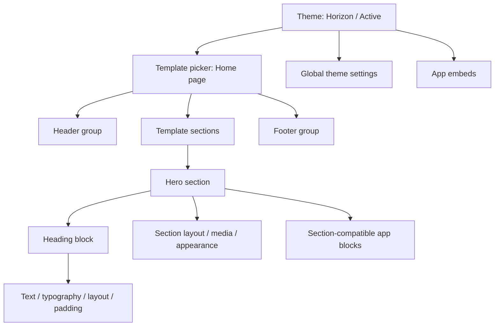
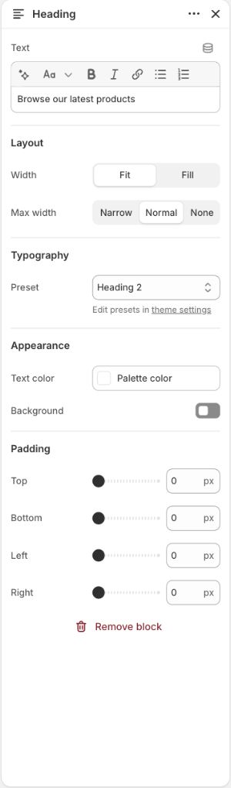
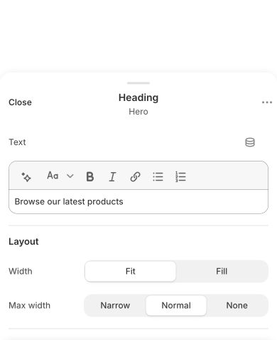
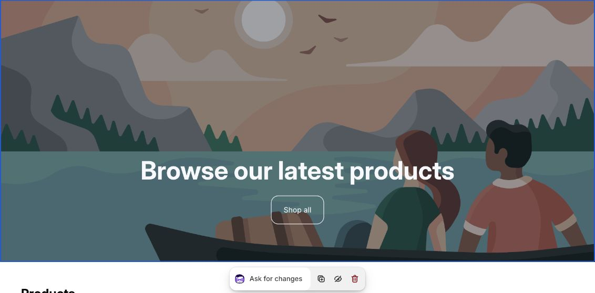
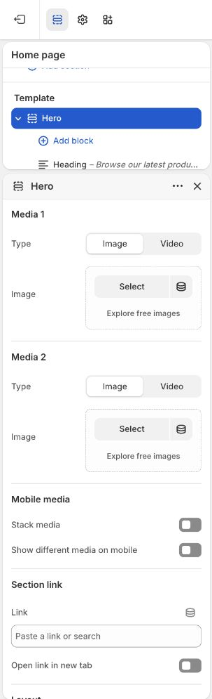
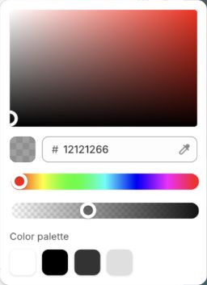
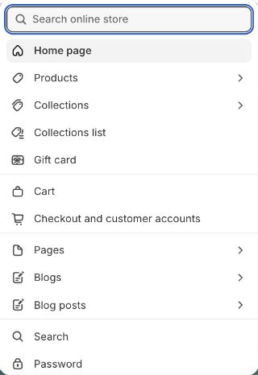
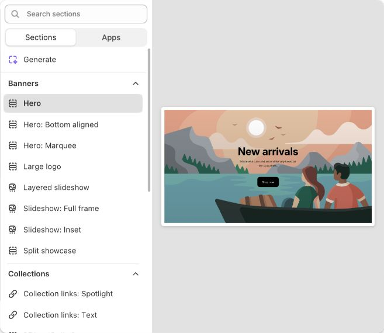
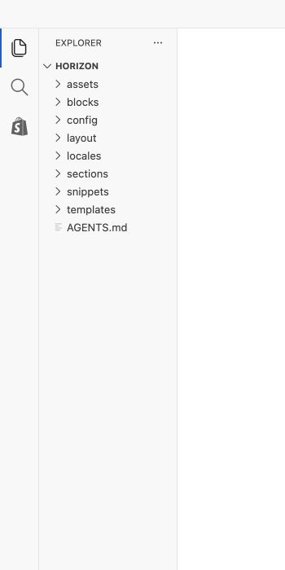

# Shopify Theme Editor: Detailed Interaction and Visual Reference

Snapshot: **22 October 2026**, authenticated India trial store, **Horizon 4.3.0**. This chapter records the visual editor, its component catalogs, theme settings, contextual tools and code-workbench entry. Measurements use CSS pixels. Theme configuration is specific to this theme/version; it is not the specification for every Shopify theme.

All inspection was unsaved. No section/block was inserted, reordered, hidden, removed or duplicated; no theme setting, source file or wording string was changed. Save, undo and redo remained disabled at the final no-change check. Visible controls establish availability, not successful execution of their mutations.

## The editor is a dedicated workspace

Entering Edit theme replaces the merchant navigation shell with a task-focused editor. The important context becomes **theme → template → section → block → setting**, with the storefront preview beside the controls.

The outline and preview are two views of the same selection. Selecting Hero exposed its settings, a blue preview boundary and contextual actions. Selecting its Heading block changed the property controls and the Sidekick context chip. The interface makes the current editing scope explicit instead of opening an unrelated form with no visual location.

## Persistent header

The header measured **56 px high**. The Exit link occupied **56 × 56 px**; individual icon actions measured **32 × 32 px**, with **8 px radius**, positioned at y = 12 in the desktop capture.

| Header area | Observed controls | Purpose |
| --- | --- | --- |
| Left | Exit; Sections; Theme settings; App embeds | Leave the editor or change the control domain |
| Center | Horizon, Active badge; Home page picker | Maintain theme and template identity |
| Right | Sidekick; inspector; mobile preview; undo; redo; View actions; Save and Save as | Inspect, simulate, recover, navigate related tools and commit changes |

Save is visually persistent, but was disabled without changes. A disabled Save is not evidence of permission denial or a failed request. Undo/redo were likewise unavailable because no edit had been made.

The View actions menu exposed Edit code, Edit default theme content, View, Documentation, Keyboard shortcuts and Support, alongside version/developer information. These destinations serve different work: rendered composition, source, language strings and preview should not be conflated into one editor mode.

## Responsive workspace geometry

| Captured viewport | Observed composition | Measured details |
| --- | --- | --- |
| **1920 × 1080, DPR 1** | Outline left, preview center, properties right | Each outer side rail 300 px; each white panel 296 px; preview x = 304, y = 60, width = 1312, height = 1016 |
| **1440 × 1000, DPR 1** | Outline and selected properties stack in the left rail | Rail width 300 px; card width 296 px; internal panel body padding 12 px; outline/properties separated by a divider |
| **390 × 844, DPR 1** | Compact header, preview, expandable bottom sheet | Available inner width 379 px; expanded sheet y ≈ 365.73, height ≈ 478.27, width 379; top corners 16 px |
| **Desktop mobile-preview mode** | Phone-width preview inside the desktop editor | Preview iframe measured 375 × 936 at x = 682.5, y = 60 in the 1440 × 1000 capture |

The wide layout has a **4 px top workspace inset** after the 56 px header, **4 px gaps** between panels and preview, and a 4 px outer bottom inset. The left white panel starts x = 4; the right panel's outer rail starts x = 1620. Cards have **12 px radius** and a subtle layered shadow.

At 1440, one geometry read caught a sliding panel mid-transition, with a negative x coordinate. Its width is useful; that transient x is not a stable alignment rule. At 390, 379 px is the measured content width after the observed container/scrollbar allocation, not a universal mobile design token.

Shopify's documentation describes dual sidebars from 1600 px and stacked panels below that width. The tested 1440/1920 layouts corroborate those modes; the exact boundary was not swept experimentally. The document also describes a resizable stacked divider; dragging it was not tested. [Theme editor features](https://help.shopify.com/en/manual/online-store/themes/customizing-themes/theme-editor/features-overview).

The desktop phone preview and the actual narrow editor are different tests. A 375 px storefront simulation does not prove that the surrounding editor supports a 375 px device.

The saved mobile-preview-area crops were blank at capture, while the outline/property controls were available. They establish the preview allocation and sheet geometry, not successful storefront rendering or mobile parity. The desktop selected-Hero crop did show its artwork and contextual toolbar. No cause or exact duration for the blank mobile area was established.

The expanded mobile sheet is white with a **16 / 16 / 0 / 0 px** corner treatment and `0 -1px 8px rgba(0,0,0,.06)` shadow. Its drag/header region measured 64 px high; the content beneath it scrolls. A peek state identifies the selected object before expansion. The compact toolbar retains Exit, current template/theme context, overflow and disabled Save.

## The editor's own visual system

The embedded editor uses a different neutral/type treatment from the refreshed native merchant pages measured in chapter 07:

| Role | Live editor measurement | Interpretation |
| --- | --- | --- |
| Workspace | `#F1F1F1` | Separates preview and white control panels |
| Panel | `#FFFFFF` | Local editing surface |
| Default control text | `#303030` | Dark neutral, distinct from native admin `#101010` |
| Base type | 13 px / 20 px, weight 450 | Dense controls; weight read from computed style |
| Selected outline row | `#005BD3` blue treatment | Local object selection, separate from storefront palette |
| Outline row | 30 px high; 8 px radius | Compact hierarchy navigation |
| Panel card | 12 px radius | Continuous workspace framing |
| Section catalog | 12 px radius | Elevated local chooser |

The measured panel shadow contains six layers, including a 1 px low-opacity outline and small graduated vertical shadows. It should not be replaced in the research by one invented universal elevation value. Full declarations are retained in [wide editor geometry](evidence/deep-dive-02/editor-wide-1920-geometry.json).

The storefront preview has its own colors, typography and component radii. Editing the storefront's Popovers and modals group does **not** configure the admin's Rename modal or the editor's catalog popup.

Calculated opaque-pair contrast is **13.20:1** for `#303030` on white, **11.69:1** on `#F1F1F1`, and **6.11:1** for white on `#005BD3`. These calculations describe the listed pairs, not every text/icon/disabled/overlaid state or a complete accessibility pass. [Pair calculations](evidence/deep-dive-02/editor-opaque-contrast.json).

## Outline, preview and selection

The initial outline showed Header with Announcement bar and Header; Template with Hero and Featured collection; Footer with Footer and Utilities. Nested blocks are indented. Add section controls appear in the relevant groups; Add block belongs to the selected compatible parent.

The selected Hero had a preview outline and a floating toolbar for Ask for changes, duplicate, hide and remove. Drag handles and structural controls were present. Their existence was recorded; reorder constraints, collision handling, keyboard movement and persistence were not executed.

The inspector connects a preview element to its controls. Documentation also describes inspecting elements and a mobile two-tap navigation interaction; the latter is DOC coverage, not a completed touch-device test. [Preview inspector](https://help.shopify.com/en/manual/online-store/themes/customizing-themes/theme-editor/preview-inspector).

## Hero section controls

The section form combines content selection, composition and appearance in a single scrollable panel. The observed controls were:

| Group | Exposed controls and observed values |
| --- | --- |
| Media 1 and Media 2 | Image/Video choice; Select; device/media/free-image entry points |
| Mobile media | Stack media and use different media options |
| Section link | Destination field, dynamic source and new-tab option |
| Layout | Vertical/horizontal direction; alignment controls; top/center/bottom/space-between positioning |
| Gap | Slider plus numeric field with px unit; observed 24 |
| Width / height | Page/Full width; Auto, Small, Medium, Large, Full screen and Custom height options |
| Background | Transparent appearance in the inspected state |
| Overlay | Enabled media overlay; Solid/Gradient; color including alpha; image-only blurred reflection option |
| Padding | Top 100 and bottom 72 in this section instance |
| Advanced / scope | Theme settings shortcut; section Custom CSS; Remove section |

The numeric fields supplement sliders for precision. Repeated unit suffixes communicate whether the number represents pixels rather than a percentage or abstract scale. Values above describe this existing Hero instance, not recommended defaults for all themes.

The selected overlay was displayed as `#121212` with alpha 0.4, equivalent to the eight-digit field value `12121266`. Its picker measured **256 × 353 px**, with **12 px radius** and layered elevation. It included a color canvas, hue, alpha, hex, palette and eyedropper affordance. The picker was opened and closed without changing the color; no device color sampling was invoked.

The dynamic-source entry opened a focused popup with search, Metaobjects, Knowledge Base Facts and Add definition. No source was bound. The UI exposes a relationship between a setting and data, but a visible candidate does not prove compatibility with every setting or record.

The section Custom CSS editor explicitly scoped its effect to that section and linked to global theme settings for broader CSS. Example text such as `h2 { font-size: 32px; }` was a placeholder, not evidence of applied code.

## Heading block controls

The inspected Heading block included a small rich-text toolbar: Generate text, Paragraph, bold, italic, link and bulleted/numbered lists. The existing heading text was visible, but no text or formatting was changed.

Layout included Fit/Fill width and Narrow/Normal/None maximum width. Typography exposed Default, Paragraph, Heading 1–6 and Custom presets, with **Heading 2** selected, plus a route to global preset configuration. Appearance included a palette text color and background toggle. Four numeric/slider padding controls were all 0 in the inspected instance. Remove block remained a separate structural action.

This demonstrates three related scopes: block content, block layout and shared typography presets. A local field can inherit a shared system while allowing an explicit override. The presence of rich text here does not mean every text field accepts arbitrary HTML; the product description editor's HTML mode is separately recorded in chapter 04.

## Global theme settings: all 19 visible groups

Each visible group was opened. Most expand controls in the rail; **Theme style opens a secondary Change theme style panel**. The settings below belong to Horizon 4.3.0 and the inspected configuration.

| Group | Observed system and representative values |
| --- | --- |
| Logo and favicon | Default/inverse logo and favicon selectors; inverse logo guidance for transparent headers; media sources and store-name management entry |
| Color palette | Four existing swatches and Add color; palette references reused by component controls; direct color selection also available |
| Typography | Body Inter, Subheading Inter Medium, Heading/Accent Inter Bold; paragraph 14 px; H1 56, H2 48, H3 32, H4 24, H5 14, H6 12 px; family role, line height, tracking and case controls |
| Page | Background color; Narrow/Normal/Wide page width |
| Animations | Page transition; product-card-to-product-page transition; Add to cart enabled; card-hover choices None/Lift/Scale/Zoom |
| Badges | Position, 100 px radius, sale/sold-out color roles, typography; inspected sold-out background `#EEF1EA` |
| Buttons | Primary/secondary background, text and border roles; primary border 0, secondary 1; both inspected radii 14; font/case; separate Pill radius 40 |
| Cart | Page/Drawer presentation; title/price typography; auto-open; notes, discounts, installments and accelerated-checkout options; empty-cart link; media border/radius |
| Drawers | Background, text and border colors |
| Icons | Thin/Default/Heavy stroke choices for the storefront icon family |
| Input fields | Background/text/border; inspected border 1, radius 4; Paragraph text preset |
| Popovers and modals | Background/text, radius 14, border thickness 1; enabled drop shadow and shadow color |
| Prices | Currency-code visibility controls separately for product page, cards, cart items and cart total; cart-total option enabled |
| Product cards | Quick add enabled; mobile quick-add option; color roles; second image on hover and carousel enabled |
| Search | Empty-state collection selection; product radius 0; card radius 4; title case |
| Swatches | Variant images; inspected width/height 34; radius 32; border style/thickness 1 and opacity 10 |
| Variant pickers | Normal/selected color roles; border 1; radius 14; Fit/Fill width |
| Custom CSS | Entire-storefront CSS scope, separate from section CSS; example code is a placeholder |
| Theme style | Secondary panel warns that style changes affect appearance/settings while retaining content; Cancel and disabled Change style in the inspected state |

Typography includes copy about responsive size scaling and contrast-dependent text color. This is evidence of communicated behavior, not an audit of its scaling or contrast algorithm. Likewise, storefront animation options are distinct from the admin's route-loading indicator; no timing curve is inferred from their labels.

The complete redacted control inventories are the `theme-setting-*-dom.txt` files and [color palette inventory](evidence/deep-dive-02/editor-color-palette-dom.txt). The type scale above was read from selected options, not extrapolated from the preview's screenshot.

## Templates are navigation context

The Home page picker opened an anchored searchable chooser rather than sending the user to another merchant index. It exposed Home, Products, Collections, Collections list, Gift card, Cart, Checkout/customer accounts, Pages, Blogs, Blog posts, Search, Password, 404 and Create metaobject template.

The Products drill-in displayed Default product assigned to **0 products** and a disabled Create template in this account/state. That disabled state is not a universal limit on Shopify template creation. No template was created or assigned.

## Section catalog: choose with a preview

Add section opened a local, elevated catalog measured **657 × 570 px**, x = 304, y = 154 in the captured desktop state. Its **12 px radius** and layered shadow distinguish it from both a full page and a centered blocking confirmation. It combines category/list navigation with an isolated preview pane.

Generate, Sections and Apps routes were visible. The initial Generate state offered a prompt; switching to Sections showed a Hero preview. No candidate was inserted.

| Visible family | Examples from the inspected catalog |
| --- | --- |
| Banners | Hero; bottom-aligned Hero; Hero marquee; Large logo; Layered slideshow; full-frame/inset Slideshow; Split showcase |
| Collections | Spotlight/text links; Bento, Carousel, Editorial and Grid collection lists |
| Forms | Contact; Email signup |
| Layout | Custom Liquid; Custom section; Divider |
| Products | Featured collection carousel |

This is a stronger selection surface than a bare menu when candidates differ in composition. Catalog content is still dependent on theme, parent and available features. The captured list is not a promise that every preset fits every insertion point.

## Block catalog and app blocks

Add block exposed Generate, Blocks and Apps, search, and Show all. The expanded catalog contained:

| Family | Visible choices |
| --- | --- |
| Basic | Button, Heading, Icon, Image, Logo, Page, Text, Video |
| Collection | Collection card and title |
| Code | Custom Liquid |
| Decorative | Comparison slider, Jumbo text, Marquee |
| Footer | Copyright, Follow on Shop, payment icons, policy links, social links |
| Forms | Contact, Email signup |
| Layout | Accordion, Group, Spacer |
| Links | Menu, Popup link |
| Product | Buy buttons, Description, Disclosures, Price, Product card, Inventory, Quantity, Recommended products, Review stars, SKU, Special instructions, Swatches, Title, Variant picker |

The Apps tab said no app blocks were available for this section and recommended Shopify Forms with an Install action. This is a **section-specific availability state**, not proof that the entire Shopify marketplace has no compatible extensions. No app was installed.

The AI generator entry displayed an illustrative product-card prompt. No generation was submitted in this follow-up. The product-description AI acceptance/discard experiment is separately documented in chapter 08; it must not be reused as proof that AI-generated theme code is correct or safe.

## App embeds are a separate activation surface

The top-level App embeds panel initially showed only search while resolving. Its stable state said no apps with embeds were installed and recommended Forms and Inbox with ratings and Install actions. The initial sparse panel is retained as a loading observation; the stable capture is the empty-state evidence.

App blocks participate in compatible section composition; app embeds have a dedicated theme-level panel. Shopify's extension documentation describes those placement/activation mechanisms. The live empty states establish their separation, but activation, persistence and storefront impact were not tested. [Theme app-extension configuration](https://shopify.dev/docs/apps/build/online-store/theme-app-extensions/configuration).

## Keyboard discovery and recovery visibility

The Keyboard shortcuts action opened a categorized modal with General, Tools, Navigation and Sections/Blocks. Live hints included Save `⌘S`, Undo `⌘Z`, Redo `⌘Y`, inspector `⌘⇧I`, panels `⌘⌃1/2/3`, Hide `⌘⇧H` and Remove `⇧Delete`. The generic help reference showed a different Save combination in the reviewed material, so the live editor hint is the dated UI observation. No mutation shortcut was executed.

This provides shortcut discovery inside the task, but does not establish keyboard accessibility end to end. Focus restoration after popups, outline arrow-key behavior, screen-reader announcement of preview selection, touch dragging and unsaved-exit recovery remain OPEN.

## Code editing is a different workbench

Edit code opened a separate browser tab with a VS Code-style workbench, not a textarea modal. The rendered structure included a `vscode-web` container and a code-editor iframe. That observation does not establish the full implementation stack or release architecture.

At **1185 × 1034**, its activity rail was **48 px** wide, Files Explorer **296.25 px**, and main editor **840.75 px** starting x = 344.25. The top workbench strip measured 35 px; the status bar was **22 px** high. Measured body colors were `#F3F3F3` and `#3B3B3B`, with 13 px / 18.2 px system type; the status background was `#F8F8F8`.

The tree exposed Assets, Blocks, Config, Layout, Locales, Sections, Snippets and Templates. Outline, Timeline, References, Dependencies, search and command-discovery hints were present. A theme-file instruction filename was visible in the tree; it was not opened or treated as repository authority. No source file was opened, copied or edited.

The Themes page, visual editor, wording editor and code workbench each optimize for a different task. Their shared theme context matters more than forcing identical page structure, font metrics or component dimensions.

## Coverage boundary

Direct evidence covers three responsive layouts, preview mode, object selection, Hero/Heading controls, all 19 visible global groups, template navigation, section/block catalogs, app-block/embed empty states, contextual AI entry, shortcuts and code-workbench composition.

OPEN outcomes include mutation persistence, drag/drop rules, multiple-template assignment, generated theme code, media upload/crop, preview parity across devices, failed Save, conflicting edits, undo after a real change, unsaved exit, draft/publish/version rollback and accessible interaction under assistive technology. The editor was left without unsaved changes and the user tab returned to Themes.
