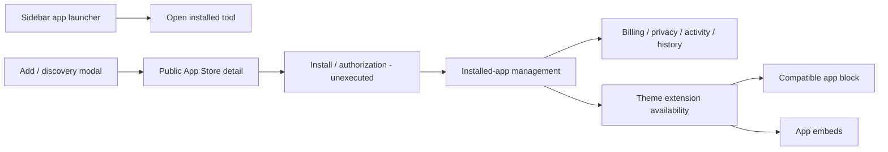
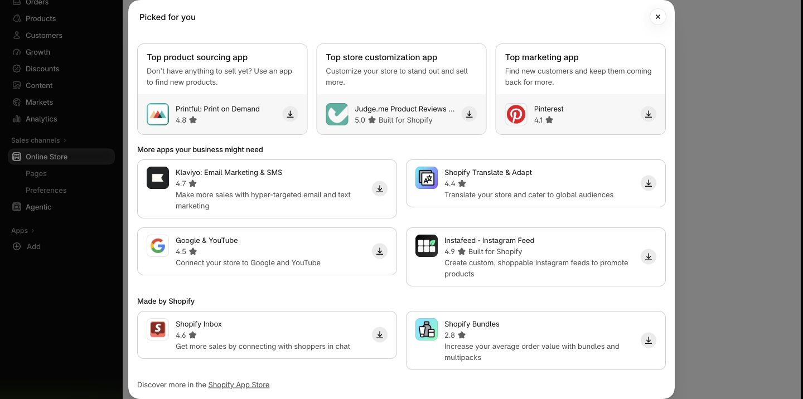
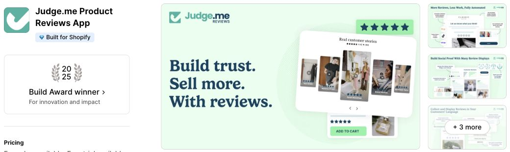
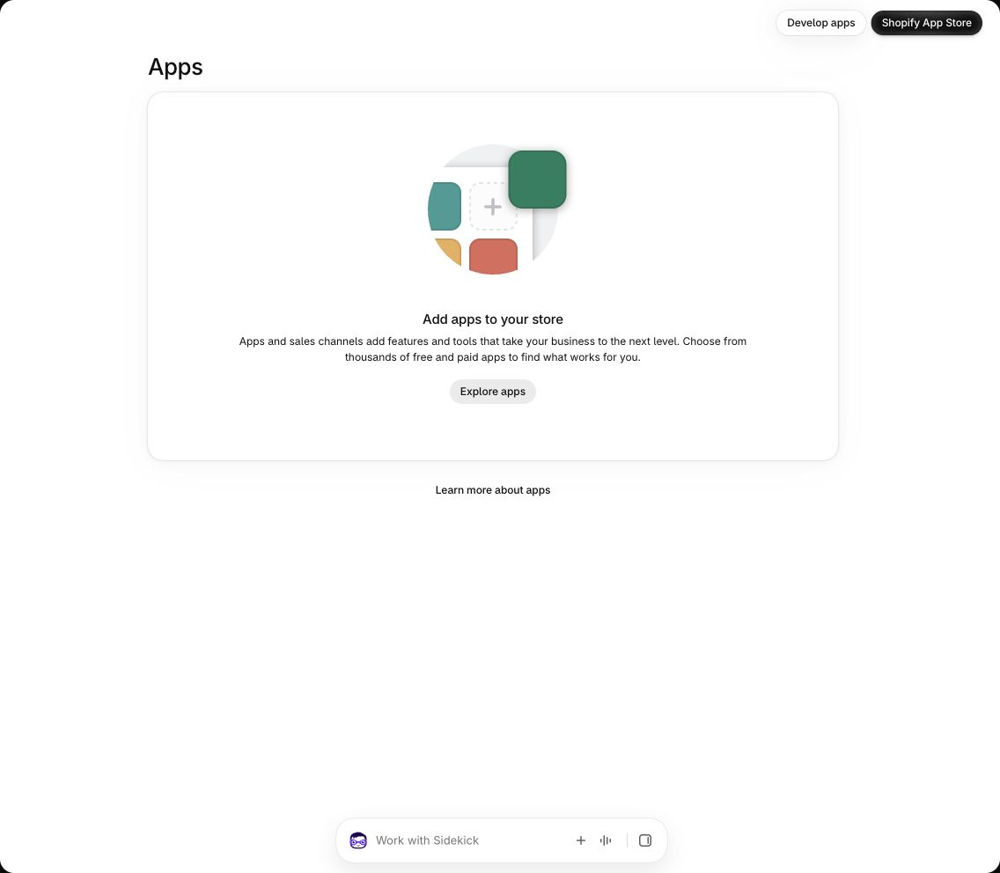
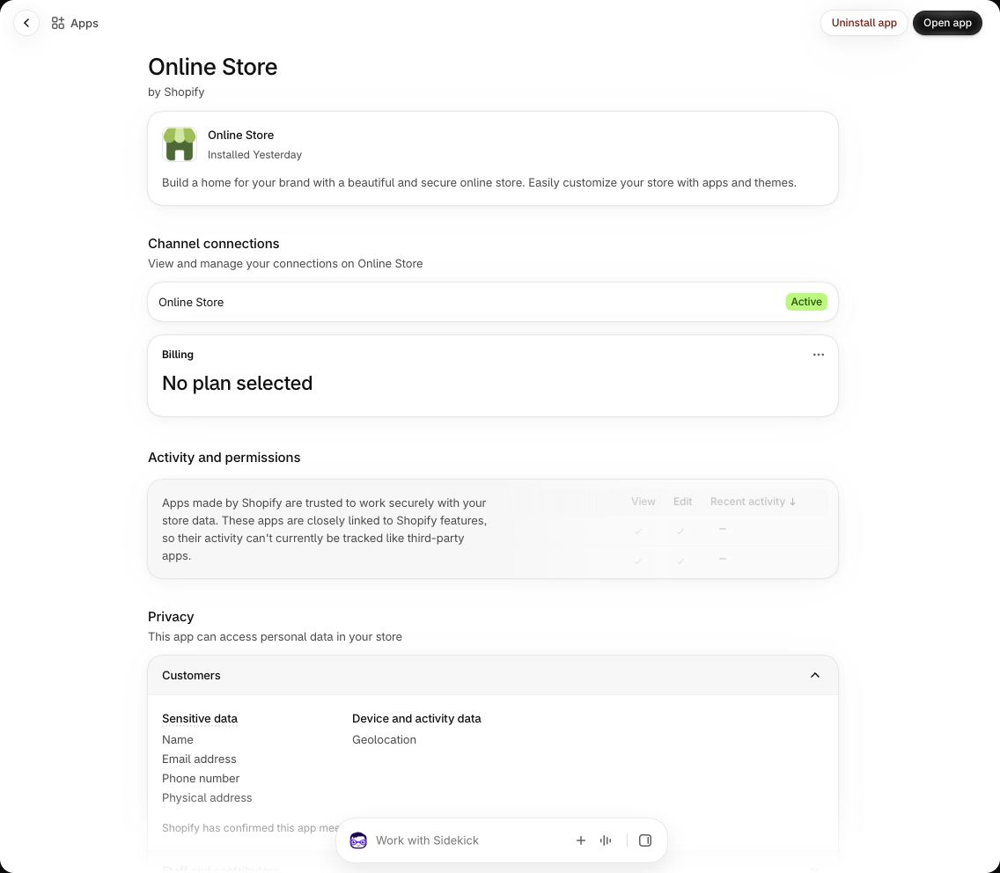

# Shopify Apps: Discovery, Management and Extension Surfaces

Snapshot: **22 October 2026**, authenticated India trial store and one public App Store listing. Apps are distributed across several task surfaces. A sidebar launcher, recommendation modal, public listing, installed-app index, app-management detail and theme-extension panel solve different problems.

No app was installed, authorized, uninstalled or charged. No extension was activated. Marketplace ratings and commercial terms in captures are dated display observations, not recommendations or verified product-quality claims.

## Surface and navigation map

| Entry / surface | Observed destination | Why this container fits the task — ANALYSIS |
| --- | --- | --- |
| Sidebar Apps | Global search with an Apps scope chip and remove-chip action | Find/open a tool without first visiting administration settings |
| Sidebar Add | Centered Picked for you modal | Browse a short set of suggestions while retaining merchant context |
| App recommendation details | Separate App Store tab | Evaluate a product using a large, linkable commercial detail page |
| Settings → Apps | Full installed-app index; empty in this test store | Manage the store's app estate rather than browse marketing cards |
| Existing Online Store channel → Manage app | Full administrative detail page under Settings Apps | Review connection, billing, data access, activity and history in one object context |
| Settings Apps → Develop apps | Development landing page with Dev Dashboard destination | Hand off to a separate developer workspace |
| Editor → Add block → Apps | Section-local extension chooser | Place a compatible component in the current composition |
| Editor → App embeds | Theme-level embeds panel | Inspect theme-wide integration availability/activation separately from blocks |

The same app can appear in discovery, installation management and a storefront placement flow. Those appearances are not equivalent states. Discoverable, installed, authorized, billed, active as a channel and enabled in a theme should be tracked separately.

The unexecuted links in this conceptual flow are not recorded as completed tests.

## Discovery modal composition

The Picked for you modal led with three purpose-oriented cards: product sourcing, store customization and marketing. The observed examples were Printful, Judge.me and Pinterest. Below them, a more-apps group included Klaviyo, Translate & Adapt, Google & YouTube and Instafeed, followed by a Made by Shopify group with Inbox and Bundles.

The hierarchy moves from **merchant problem → candidate app → supporting signals → action**. Cards combined app icon, name, rating, optional Built for Shopify badge, short description and a separate install/download-style icon. A footer linked to the broader App Store. The quality badge is a displayed platform signal; this research did not audit its qualification criteria.

At the **1440 px** viewport, the visible white modal was **980 px wide**, centered at x = 230, with **24 px corner radius**. The semantic dialog wrapper spanned the viewport and was transparent; measuring that wrapper alone would incorrectly describe the visible modal as 1440 px wide.

The captures include different loading/resolution moments: the panel measured approximately 596 px high earlier and 716 px in the resolved screenshot. Height is content/state dependent. The geometry inventory includes skeleton slots, so those slots must not be reported as completed app-card content.

Measured card construction included **12 px radius**, a **1 px `#D0D0D0` border**, **12 px vertical / 16 px horizontal padding**, 40 px icon slots and 12 px icon-to-text gaps in sampled rows. The lower two-column grid measured **466 + 466 px** with a **16 px gap** within a 948 px inner content region. These are local measurements of the discovery surface, not universal native-admin card tokens.

The modal close action retains the underlying merchant page. Opening an app's details instead opened a separate browser tab; details were not another nested layer in this modal.

## Public App Store detail

The inspected public listing was [Judge.me Product Reviews](https://apps.shopify.com/judgeme). The browser view exposed a fuller evaluation surface:

| Region | Observed information architecture |
| --- | --- |
| Site navigation | Shopify App Store identity, search, browse and store context |
| Summary column | App icon/name, platform badge, award signal, pricing availability, rating, developer, Install and demo entry |
| Media | Large visual with adjacent gallery thumbnails and more-media affordance |
| Product explanation | Description and feature claims, languages, integrations and categories |
| Commercial evaluation | Pricing tiers and related billing information |
| Social/support evidence | Aggregate reviews, review content/summary, support resources and related apps |

This page gives the merchant room to compare evidence before crossing the installation boundary. App marketing screenshots are vendor-provided illustrations, not proof that their depicted functions work in this test store. No demo was launched, review posted or install selected. The saved role inventory records structure rather than reproducing review bodies.

## Settings Apps index and empty state

The installed-app index showed Develop apps and Shopify App Store actions, a large Add apps to your store empty-state card, a small modular-app illustration, explanatory copy, Explore apps and a help link.

The centered illustration explains extensibility using a small assembly of colored rounded components, a dashed container and plus sign. Its subdued green/yellow/coral artwork supplies personality without making every operational control a saturated brand color. The meaningful recovery action sits beneath the explanation.

The store's first-party Online Store channel nevertheless had a management detail reachable through the channel's Manage app action. Therefore the empty Apps index must not be interpreted as “the store has no channel or extension-related system whatsoever.” The observed navigation has different inventories and entry points.

Develop apps opened a full landing page explaining the Dev Dashboard destination. The external dashboard was not explored. Numeric account identifiers in saved links are redacted.

## Installed-channel management detail: directly observed

Manage app on Online Store opened a Settings Apps detail page with an Apps breadcrumb, Online Store title, author, installed-time context, **Open app** and **Uninstall app**. Open app led back to Themes. Uninstall was not selected.

| Section | Live state | Meaning and limitation |
| --- | --- | --- |
| Identity | Shopify author, channel icon, installed Yesterday | Provides provenance and installation context |
| Channel connections | Online Store, Active | Connection state; does not establish public storefront visibility |
| Billing | No plan selected, local overflow action | Billing is a separate concern from installed/active status |
| Activity and permissions | Area, View, Edit and Recent activity columns | Access is organized by area with activity alongside authority |
| First-party disclosure | Shopify-made apps' activity is not tracked like third-party apps | Empty/disabled recent-activity rows are qualified by this explicit limitation |
| Privacy | Customers expanded; Staff and contributors expandable | Separates personal-data categories from broad feature permissions |
| History | Installation by Shopify and relative date/time | Timeline of lifecycle events, distinct from ongoing API activity |

The Customers privacy panel named contact-data categories and geolocation. Those are **access-category labels**, not actual customer records. Expanding Staff and contributors inspected additional disclosure; it did not grant permission or reveal a staff database.

The visual hierarchy combines a concise object header, grouped cards, small state badges, a permission table and collapsible privacy details. This is appropriate for repeated inspection and deeper content. A one-shot modal would provide less space for comparing authority, activity, billing and lifecycle history.

This is direct evidence for a first-party channel's management page. A populated third-party app's requests, recurring charge, usage cap, API logs and uninstall consequences were not exercised.

## Current documented management capabilities

Shopify's management guidance distinguishes opening an installed app from inspecting its details, and describes billing, access, privacy, extension/function information and app history. The available sections depend on the app. Its current guidance also directs new custom-app development to the Dev Dashboard rather than creating new legacy custom apps in admin. These branches are DOC coverage, beyond the live first-party detail inspected here. [Manage apps](https://help.shopify.com/en/manual/apps/managing-apps).

The 2026 releases separately introduced visibility into app activity/permissions and extension/function usage. These strengthen the distinction between what an app can access, what it has recently done and where its integrations are used. [Activity and permissions release](https://changelog.shopify.com/posts/track-app-activity-and-permissions-from-settings), [extension and function visibility release](https://changelog.shopify.com/posts/see-which-apps-use-extensions-and-functions-to-power-your-checkout-online-store-and-more).

Installation management and approval of app charges have separate documented permissions. A visible Install entry in this account does not prove the same action is authorized for all staff roles. No restricted staff role was used for this research. [Store permissions](https://help.shopify.com/en/manual/your-account/users/roles/permissions/store-permissions).

## Extension placement and recovery boundaries

The theme editor adds two more useful empty states:

- Add block → Apps: no app blocks available **for the current section**, with a Forms recommendation.
- App embeds: after loading resolved, no apps with embeds installed, with Forms/Inbox recommendations.

These states each explain absence in the relevant scope. “Install an app” is only one possible prerequisite; placement compatibility and activation also matter. Documentation describes app blocks and app embeds as different extension targets. [Extension configuration](https://shopify.dev/docs/apps/build/online-store/theme-app-extensions/configuration). The full live editor controls are recorded in [chapter 11](11_THEME_EDITOR_DETAILED_REFERENCE.md).

Research scenarios still OPEN: permission-denied installation, OAuth scope review, app charge approval, partial authorization, setup interruption/resume, populated app search/sort/filter, extension enablement, theme compatibility, billing caps, uninstall effects, retained-data disclosure and reinstall recovery. No marketplace capability is proposed for LetBuyy by this research; its deferred ecosystem scope remains governed by the Constitution.
