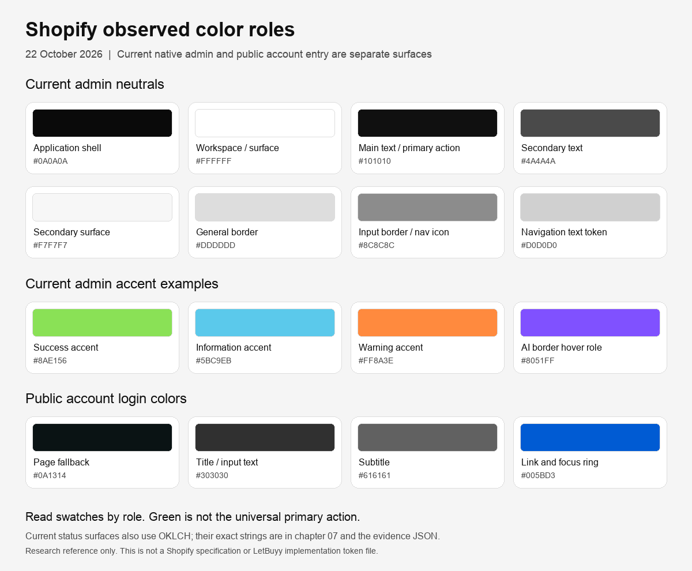

# Shopify UI UX Research October 2026

Research snapshot: **22 October 2026, Asia Kolkata**. Scope: account identity, returning login, signup, onboarding and the authenticated merchant admin, including all 20 visible Settings destinations. Particular emphasis: color roles, contrast, geometry, sidebar behavior, forms and HTML editing, tables, empty states, AI, illustrations, motion and observed navigation speed. This is product research, subordinate to LetBuyy governance; it does not authorize a redesign, new authentication capability or platform expansion.

The deeper follow-up adds measured Themes and Horizon editor layouts at 1440, 1920 and 390 px, all 19 visible theme-settings groups, section/block catalogs, app discovery/management, and route-loading states. The first Settings inventory contained 20 destinations; a later snapshot contained 19 without Markets, so the inventory is recorded by state rather than asserted as permanent.

Shopify's interface is a family of task-specific systems. The observed account login, trial signup, merchant admin, merchant storefront and buyer account experience do not share one universal page template. Their coherence comes from clear action hierarchy, semantic color, predictable recovery and continuity of account and business context. Copying a green logo color and a sidebar would miss most of that system.

## Read the research

The [canonical UI systems follow-up](canonical-system/README.md) adds fresh evidence on shared headers/actions, the floating dirty-form bar across Products and Settings, form/widget composition, modal anatomy and32 mapped patterns. It separates rendered shared behavior from claims about private implementation and links the updated LetBuyy plan.

| Document | What it answers |
| --- | --- |
| [Identity visual system](01_VISUAL_SYSTEM.md) | Exact public account colors, geometry, typography, spacing and historical Polaris token reference |
| [Identity and existing login](02_IDENTITY_AND_LOGIN_FLOWS.md) | Login methods, returning users, account context, MFA, recovery, store switching, staff invitations and identity boundaries |
| [Signup and onboarding](03_SIGNUP_AND_ONBOARDING.md) | Account creation, existing-account entry, optional setup, activation dependencies, first sale and alternate entry paths |
| [Admin and commerce patterns](04_ADMIN_AND_COMMERCE_PATTERNS.md) | Navigation, search, forms, lists, tables, overlays, feedback, operational workflows and platform coverage map |
| [Findings and evaluation](05_FINDINGS_AND_EVALUATION.md) | What to learn, observed friction, accessibility limits and concrete scenarios for evaluating an implementation |
| [Evidence and coverage](06_EVIDENCE_AND_COVERAGE.md) | Sources, evidence strength, captures, unresolved branches and the boundary of completeness |
| [Current admin visual reference](07_CURRENT_ADMIN_VISUAL_REFERENCE.md) | Refreshed authenticated colors, semantic roles, contrast, type, navigation geometry, action sizing and shadows |
| [AI motion and performance](08_AI_MOTION_AND_PERFORMANCE.md) | Sidekick, generated-description preview, Agentic channel, illustration families, measured motion declarations and timing limits |
| [Surface containers and navigation loading](09_SURFACE_CONTAINERS_AND_NAVIGATION_LOADING.md) | Modal versus page versus picker; the 2 px route strip; sparse workspaces, retained old content and readiness layers |
| [Themes page detailed reference](10_THEMES_PAGE_DETAILED_REFERENCE.md) | Preview clipping, responsive grid, menus, Rename/import, visibility, launch prerequisites and wording editor |
| [Theme editor detailed reference](11_THEME_EDITOR_DETAILED_REFERENCE.md) | Exact pane geometry, mobile sheet, Hero/Heading forms, 19 settings groups, catalogs, templates, extensions and code workbench |
| [Apps and extension surfaces](12_APPS_AND_EXTENSION_SURFACES.md) | Launcher, discovery modal, public listing, installed index, channel management, privacy/activity and theme integrations |

The `evidence/` directory contains public screenshots, privacy-safe authenticated crops, redacted role inventories, computed styles, contrast calculations, a color atlas and a machine-readable **archived** Polaris base-token reference. These files are research exhibits, never application token authority.

## Findings that change how to interpret Shopify

1. **Login and signup are visibly different.** The live login uses a 476 px maximum-width card, 40 px desktop padding, a 24 px heading and an 8 px button radius. The observed signup uses a 375 px card with a 343 px form, a 32 px heading outside the card, a 56 px email component and a 48 px pill action. These measurements are surface-specific.
2. **The primary action is nearly black.** Green is visible in Shopify's mark, provider artwork and semantic status families; it is not the observed identity form's universal action color. Blue signals links and focus in login. White cards and muted text organize the form.
3. **Identity, membership and merchant setup are different tasks.** A person can authenticate, choose a store, join a staff invitation or create another store. Merchant signup is not the only valid outcome of login.
4. **A familiar option can be a compatibility path.** Facebook is visible on login, absent from the observed signup, and documented as unavailable for new login-service connections. SMS two-step authentication is also documented as an existing-user method that cannot be newly configured.
5. **A dark identity backdrop does not establish user-selectable dark mode.** No appearance switch was observed on these public screens.
6. **Polaris references need a date and surface.** The public React repository is archived. Current Shopify developer guidance uses Polaris web components. Archived numeric values remain useful historical evidence, not proof of the current native admin's exact CSS.
7. **Admin navigation is in transition.** Current help explicitly describes both top-bar and refreshed-sidebar locations for search, store switching and alerts. A fixed claim about one permanent shell would be inaccurate.
8. **The refreshed admin is denser than identity entry.** The live sidebar measured 220 px expanded and 60 px collapsed. Settings added a roughly 240 px local pane. Domains actions were 28 px high, compared with 44 px login actions.
9. **Current semantic roles differ from the archive.** The admin uses `#101010` text, `#4A4A4A` secondary text and `#DDDDDD` borders. Its primary button has a dedicated `#101010` role; the current token named brand fill is `#F7F7F7`.
10. **AI acceptance and record saving are separate.** A product-description preview offered Add/Discard. The test output added unsupported durability/environmental claims; it was discarded and no product was saved.
11. **There is no single modal size or radius.** The theme Rename dialog measured 620 × 189 px with 8 px corners; app discovery used a 980 px white panel with 24 px corners; the editor color picker used 12 px corners.
12. **Navigation readiness is layered.** A 2 px top loading element and a sparse Themes workspace were captured, while other transitions briefly retained the old page. A heading arriving does not establish chart or embedded-editor readiness.
13. **The theme editor changes its layout, not just its scale.** At 1920 px it used 300 px side rails around the preview; at 1440 px controls stacked; at 390 px properties used an expandable bottom sheet.
14. **The merchant shell and embedded editor have different neutral systems.** Native text was `#101010`; the embedded Themes/editor body was `#303030`, 13/20 px, weight 450 over a `#F1F1F1` workspace. Storefront theme colors are another scope.
15. **Apps have separate discovery, management and placement journeys.** Recommendations opened a modal, app details a separate App Store tab, management a Settings page, and app blocks/embeds separate editor panels.

Sources for findings 4, 6 and 7: [login services](https://help.shopify.com/en/manual/your-account/logging-in/login-services), [two-step authentication](https://help.shopify.com/en/manual/your-account/logging-in/secure-sign-in), [archived Polaris React](https://github.com/Shopify/polaris-react-archive), [current Polaris](https://shopify.dev/docs/api/polaris), [admin navigation](https://help.shopify.com/en/manual/shopify-admin/shopify-admin-overview). Findings 1–3 and 5 combine direct public-screen observations with the flow analysis in the linked chapters.

## Evidence labels

| Label | Meaning |
| --- | --- |
| **LIVE** | Seen in the browser in this research session |
| **MEASURED** | Read from rendered DOM/computed styles at the stated viewport and state |
| **USER** | Observed in one of the eight screenshots supplied by the user |
| **DOC** | Supported by a current first-party document; its private UI was not necessarily exercised |
| **ARCHIVE** | Pinned public Polaris React source, retained for historical comparison |
| **PRIOR** | Existing June 2026 repository research; not a fresh authenticated observation |
| **ANALYSIS** | Original interpretation, evaluation criterion or proposed research scenario |
| **OPEN** | Requires a particular account, plan, device, permission, region or further testing |

The coverage register deliberately retains unobserved branches: recovery, native passkey enrollment, alternate MFA, personalized signup questions, populated order operations and paid/role-dependent variants. A listed scenario is not a passed test. This snapshot must not be described as every Shopify feature having been exercised.

## Relationship to earlier research

The parent [research index](../README.md), [platform map](../SHOPIFY_PLATFORM_MAP.md), [navigation analysis](../SHOPIFY_NAVIGATION_ARCHITECTURE.md), [page records](../pages/) and [settings records](../settings/) preserve the June study. This dated study supplies new live identity and authenticated-admin evidence and corrects how historical design-system observations should be interpreted. It does not silently refresh the date or confidence of those earlier records.

For LetBuyy, adoption decisions remain governed by the Constitution, canonical identity authority and shared UI token source. Shopify's passkeys, enterprise SSO, marketplace and financial products are research subjects; documenting them does not reopen deferred LetBuyy capabilities.
