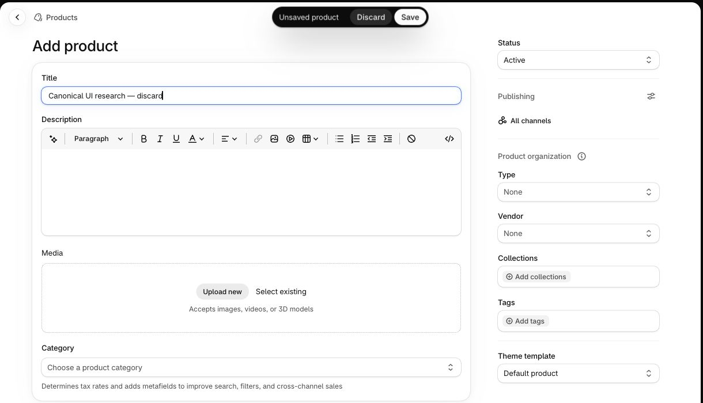

# Headers actions and contextual bars

## Header families and measured hierarchy

Measurements are CSS pixels from fresh 1440 × 1000, DPR 1 observations unless stated otherwise. A visible DOM heading is not by itself proof of the accessible outline; shadow ancestors, hidden/ARIA state and the accessibility tree must be considered together.

| Family/example | Context heading | Task heading | Action relationship |
| --- | --- | --- | --- |
| Products index | 13 px, weight 500, 28 px line box; x264/y16 | No second large title in inspected empty index | View as in header; Add product/Import in first-use content |
| Orders index | Same 13 px compact heading | No second title in inspected trial gate | Subscription CTA belongs to gate; no populated order actions available |
| Customers index | Same compact heading | No second title in inspected empty workspace | Export/Import/Add customer at right; 28 px actions |
| Discounts index | Same compact heading | Empty-state task text below | Disabled Export and Create discount; repeated contextual create entry |
| Analytics | Same compact heading | Metric/reporting workspace below | Period/report actions belong to data scope |
| Add product | 13 px context row at x375.25/y24 | 26/32 px, weight 500, x276/y64 | Parent/back context above grouped main/aside form |
| New customer | 13 px context row at x387.23/y24 | 26/32 px, weight 500, x276/y64 | Overview/address/tax groups; notes/tags supporting area |
| General settings | Separate Settings shell/context | 26/32 px, x468/y64 | Actions depend on changed configuration |
| Domains overview | 13 px context heading x344/y24 | 26/32 px, x468/y64 | Connect/Transfer/Buy actions at task scope |
| Domain detail | Parent Domains navigation plus compact record context | 26/32 px record name | Visit domain and status; target/type below |
| Theme editor | Dedicated toolbar, no merchant sidebar | Theme/template/selected object hierarchy | Persistent Save/Save as, undo/redo and preview tools |

Sources: exhibits `02`, `03`, `06`–`09`, `11`, `12`, `14`, `17`, `26`; [registry](pattern-registry.json) PAT-02/PAT-09. Compact context and task heading are different roles. A globally mandated 13 px title would lose the distinction.

Native Page DOM exposed a heading wrapper, breadcrumbs/accessory region and header-content row. The compact Products wrapper used an 8 px gap. Custom elements with `display:contents` had zero rectangles; measure the painted child/wrapper rather than infer zero padding or missing content from the host.

## Public contract and observed pattern

The public Page contract separates one primary-action slot, secondary actions, breadcrumb actions, main content, supplemental content and an aside. The native title-bar API is a related but separate integration choice. These support the interpretation that identity/actions/layout are composed roles rather than one enormous page-specific header. They do not establish native private React props. [Page](https://shopify.dev/docs/api/app-home/latest/web-components/layout-and-structure/page).

**LetBuyy consequence:** keep PageHeader and its title adornment, action rendering and explicit visibility flags. Complete task recipes/variants and action metadata at that owner. Preserve 24/32 merchant task titles, accessible names and the purple system. Do not add `ShopifyPageHeader` or a second shell.

## Action grammar

| Action family | Fresh example | Transferable rule |
| --- | --- | --- |
| Decisive action | Add customer; Create discount; Save dirty product | One main commitment per task scope |
| Supporting action | Export/Import; Connect/Transfer alongside Buy | Quieter surface can preserve availability without equal emphasis |
| First-use action | Add product inside empty content | The next task can live in the empty state instead of duplicating a large header |
| Disabled due to state | Product empty-index filters; customer view Save unchanged | Unavailable control is not necessarily permission denial |
| Editor disabled | Save/Save as and undo/redo unchanged | Clean editor does not need an enabled commit |
| Contextual object action | Hero Duplicate/Hide/Remove/Ask for changes | Target is the selected schema object |
| Destructive/financial action | Visible entries only | Effect, confirmation and recovery were not executed in Shopify |

The public Button distinguishes variant/tone, loading and disabled behavior, as well as navigation/link uses. Busy state and rejected state still require actual request handling; styling does not establish exactly-once mutation. [Button](https://shopify.dev/docs/api/app-home/latest/web-components/actions/button).

Observed header controls included compact 28 px pill actions, with native button typography differing from body text. Product save-bar labels inherited a measured 13.3333 px browser button font size; a sampled native header secondary used 12/16 px. These are scoped samples, not a universal Shopify typography scale. Do not copy visual target dimensions as LetBuyy's accessibility floor.

Hover/pressed/busy/error timing was not systematically triggered for every action. Root role declarations in earlier research remain available-role evidence, not proof that each interaction occurred.

## The dirty-form floating bar

The product test entered the synthetic title “Canonical UI research — discard.” The resulting bar read **Unsaved product**. General settings used **Unsaved changes** after temporary suffix input. Both edits were discarded through the UI, restoring their prior state.

| Measurement | Product | General settings |
| --- | --- | --- |
| Bar rectangle | x692.07/y12, 271.85 × 36 | x729.63/y12, 276.73 × 36 |
| Fill/radius | `#0A0A0A`, pill/9999 px | Same |
| Padding | 4 px top/right/bottom, 12 px left | Same |
| Content/action spacing | 20 px between label and action group; 4 px between actions | Same |
| Discard | 72.92 × 28, translucent white fill, light text | Same rendered class family |
| Save | 55.41 × 28, `#FCFCFC` fill, `#121212` text | Same |
| Position owner | Absolute bar container, z517, in absolute main overlay z510 | Same family; Settings work area changes alignment |

Painted bar: one fine light edge plus contact/broad shadow layers, including a large low-opacity shadow below. The shadow belongs to overlay elevation, not every form card. The bar itself is not `position:fixed`; its containing workspace and scroll ownership explain persistent placement.

The after-scroll probe retained the bar at y12. Exact scroll delta was not separately instrumented, so the stronger evidence is the inspected overlay ancestry and stable position, not a fabricated sticky threshold.

### Mobile transformation

At 390 × 844, DPR 1, the bar became a top action row with **Discard as a close icon** at x16/y12 and **Save as a check icon** at x331/y12. Each measured visual button was 28 × 28. Their accessible names remained Discard/Save. The form task heading started at x32/y60. Bottom Menu and Sidekick quick links occupied another layer.

This is a composition change, not simply a scaled-down pill. LetBuyy can use an appropriate mobile action layout while retaining clearer labels/hit areas and its existing successful mobile editor tabs.

### Navigation protection

With the product dirty, clicking Orders left the browser on Add product and moved focus to Save. No separate confirmation dialog was observed in that tested departure. Clicking Discard exited to the empty Products index. The temporary product was not created. General Discard cleared the temporary suffix and removed the bar.

This does not prove browser Back/reload/store-switch/session-expiry protection or save/conflict recovery. Those branches remain OPEN. Do not document a universal “Leave changes?” modal based on this run.

The public Save Bar API supports automatic form tracking or programmatic control and a leave-confirmation method; its documentation warns against two independent visibility controllers on the same form. The app-facing contract corroborates protection as a responsibility, not the exact native departure animation. [Save Bar API](https://shopify.dev/docs/api/app-home/latest/apis/user-interface-and-interactions/save-bar-api).

## Several bars with different owners

| Bar/tool | Trigger | Scope and completion |
| --- | --- | --- |
| Dirty-form bar | Unsaved input | Form draft, save/discard and protected departure |
| Bulk-selection bar | Selected population | Specific IDs/page or supported all-matching population; fresh populated Shopify branch OPEN |
| Editor toolbar | Persistent editor workspace | Theme/template, undo/redo and saved-state commit |
| Selected-section toolbar | Hero selection | Object operations and scoped assistance |
| Sticky footer | Layout-dependent form/panel | Reachable actions and reserved content inset; not automatically a dirty controller |
| Trial promotion | Subscription/trial state | Commercial navigation; not mutation success or form save |
| Toast | Transient event | Notification, with durable record evidence elsewhere |

**Implementation implication:** a canonical system needs common action/control semantics and explicit placement/state owners. It does not need one universal floating-bar component to own bulk commands, promotions and theme publication.
