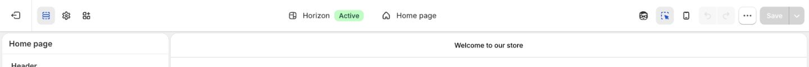

# Containers loading and editor scope

## Container decision matrix

| Task | Observed/documented container | Why the scope matters |
| --- | --- | --- |
| Product/customer creation | Fresh durable full-page form | Main object definition with related sections and supporting data |
| Choose discount kind | Fresh Select discount type dialog | A short task choice before entering a larger editor |
| Connect existing domain | Fresh focused dialog with `/settings/domains/connect` route | Modal presentation and addressability can coexist |
| Domain detail | Fresh durable Settings record route | Target/type/status are independently retrievable |
| General configuration | Fresh Settings page and contextual save bar | Shared dirty behavior within a different navigation context |
| Small theme rename/import | PRIOR focused dialogs | Bounded local task, validation/cancel/commit; rename differs from editor |
| Resource/color/font choice | Fresh product affordances and PRIOR editor pickers | Local value selection keeps parent context |
| Add section/block | PRIOR catalog with preview | Browse permitted schema types in insertion context |
| Visual customization | Fresh dedicated editor | Theme/template/selection tools replace global merchant navigation |
| Code/wording | PRIOR separate workbench/detail | Extensive authoring deserves its own tools and space |
| App discovery | PRIOR larger modal, then external listing | Evaluate without losing parent, deepen through separate detail |
| App/channel management | Fresh Apps Settings empty state, PRIOR channel detail | Management and discovery are different tasks |
| AI content preview | PRIOR contextual preview; fresh entry/context controls | Review/accept is distinct from record save/publication |

Container selection follows task depth, history, relationships, return context and commitment. Field count alone is insufficient. Native domain connection was addressable while looking modal; LetBuyy can preserve wizard/detail state without requiring a particular modal or full-page appearance.

Public Modal documents centered presentation, user-triggered opening and scrolling when content exceeds available height. It is an app-facing component scope, not a proof of every private native overlay rule. [Modal](https://shopify.dev/docs/api/app-home/latest/web-components/overlays/modal).

## Native dialog anatomy

Connect existing domain measured **620 × 180 px** before validation, with **24 px outer radius**, native `<dialog>`, `position:fixed`, z519. Header measured 620 × 60 px, padding 16 px top/right/bottom and 20 px left; its heading was 15/22 px, weight500. The header-content row was 584 px wide and 28 px tall. Validation added an inline message, so the pre-validation height is not a fixed task-height token.

A first measurement routine looking only for `[role=dialog]` missed the semantic native `<dialog>`. The corrected ancestor probe captured it. Likewise, the native page header lived inside open shadow DOM. Tooling that sees only light DOM would misclassify both as absent.

The earlier embedded theme Rename had different corners; app discovery had a much wider visible panel. Neither observation is superseded by this native dialog. Preserve task/surface/version with each measurement.

## Scroll and layer ownership

The native floating save bar sits in an absolute workspace overlay; the modal uses a fixed dialog layer; content scrolls under stable chrome. These are separate placement owners. The captured z510/z517/z519 values describe that DOM state, not a general Shopify z-index specification to copy into LetBuyy.

A robust host needs explicit page scroll ports, overlay roots, panel scroll, sticky insets and focus ownership. A sticky bar inside the wrong overflow ancestor can stop being useful even with correct colors. Fixed trial/promotion panels can compete with form actions. Mobile keyboard, safe-area and enlarged-text conditions require their own acceptance; the screenshots do not certify them.

## Navigation readiness

| Stage | Evidence | LetBuyy requirement |
| --- | --- | --- |
| Activation | Fresh route probes showed an interval retaining previous context/content in some immediate tool snapshots | Immediate pointer/keyboard acknowledgement, without claiming destination readiness |
| Route pending | PRIOR preserved 2 px Page loading bar; current official API supports start/stop | Thin indeterminate feedback tied to actual pending ownership |
| Host committed | Fresh Themes host and independent iframe visible | Stable shell and meaningful destination context |
| Data ready | Native indexes/Analytics have their own results or specific absence | Scoped loading/error/empty handling rather than fake success |
| Preview ready | Fresh theme editor rendered a storefront preview | Version/scope-aware preview acknowledgement independent of save |
| Failed/superseded | No fresh Shopify fault injection | LetBuyy must explicitly test cancellation, timeout, retry and latest intent |

The file named `24-themes-transition-ax.txt` had already resolved by its saved observation; it is **not** a preserved blank-frame timing trace. The immediate sparse/retained-content states appeared in tool output. Prior chapter09 retains the actual strip/early-transition exhibits. No new exact strip duration, fill or p50/p95 is asserted.

The public Loading API exposes a header indicator controlled by start/stop. That contract does not establish native router internals or true percentage completion. [Loading API](https://shopify.dev/docs/api/app-home/latest/apis/user-interface-and-interactions/loading-api).

For LetBuyy, investigate the owner's repeated delay report at two boundaries: visible acknowledgement and actual time to useful data. Retain existing private prefetch limits, request-scoped authorization/cache behavior and tenant-safe reads. Never insert an artificial blank interval, remove membership checks or share cached merchant content across users to improve a benchmark.

## Editor is another canonical workspace

Fresh editor entry replaced the merchant shell with a toolbar containing Exit, Sections/Theme settings/App embeds, Horizon/Active, template picker, Sidekick/inspector/device mode, undo/redo and Save/Save as. Selecting Hero exposed its layout/media/padding controls and contextual object actions. No field or section was changed; Save and undo/redo remained disabled at the final clean-state inspection.

The fresh preview rendered announcement/header, placeholder product cards and footer. Earlier saved captures had blank/spinning preview states. This follow-up establishes a later successfully rendered state and does not rewrite those earlier observations. Placeholder cards do not prove a populated product catalog.

Prior measured layouts remain explicitly PRIOR: 1920 dual rails, 1440 stacked controls and 390 mobile sheet, each from chapter11's stated viewport/theme version. The fresh 1440 toolbar capture corroborates the dedicated workspace but does not independently remeasure every pane/breakpoint.

The selected-object toolbar, persistent editor commands and dirty merchant-form bar are different patterns. Their shared action semantics can be canonical while their placement, scope and lifecycle differ. Preserve LetBuyy's schema renderer, draft client, preview protocol and saved-release publication; refine their composition and statuses instead of replacing those systems.
