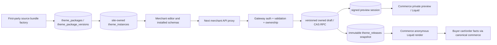

# LetBuyy Theme Editor ownership and trust map

## Source of truth and data flow

**LETBUYY SOURCE VERIFIED** at `develop` `a72196c6`; no current database/runtime/public readback. Root `AGENTS.md:280-287` (`THEME-R1…R6`) and Constitution `ART-17` make Liquid and `theme-engine` canonical, with one schema/draft/compose path, data-only merchant settings, and a frozen React compatibility path. `NEVER-R3` keeps third-party app blocks dormant. `packages/theme-engine/AGENTS.md:21-27` explicitly says a published store reads a captured `theme_releases.template_snapshot.liquidBundle`, not a newly built source fixture.

`packages/theme-engine/src/first-party-theme-catalog.ts:54-90,169` builds distribution input, not persisted installation. Merchant editor `page.tsx:501-630` normalizes the loaded document and serializes template/header/footer plus settings. Merchant `app/api/themes/[themeId]/editor/route.ts:40-82`, `editor/draft/route.ts:33-99`, and `preview-session/route.ts` proxy through the typed API client. Gateway `routes/themes.ts:552-703` mounts authenticated editor, draft, preview, publish, release and rollback endpoints. `theme-execution.adapter.ts:293-309,311-334,933-1101` validates the document, checks store ownership, reads/updates drafts through the RPC, and builds a release from the saved server document. Commerce `store-service.ts:572-725` resolves release snapshot and compiles its portable configuration; `composition-engine.tsx:568-768` renders Liquid when selected. A runtime fallback path exists in source; its safety and parity need mounted verification.

| Boundary | Current source owner | Responsibility and non-equivalence |
| --- | --- | --- |
| Merchant theme library | `apps/merchant/web/src/components/theme-library/*`, Merchant theme routes | Catalog/install/current selection; a library card is not a persisted package or release. |
| Editor state/widgets | Merchant editor page, `src/components/theme-editor/*`, `src/lib/theme-schemas.ts` | Present installed schema, typed controls, tree, preview bridge, draft intents; app-local fallback definitions are not a second canonical schema. |
| Theme definitions/validation | `packages/theme-engine/src/{first-party-theme-catalog,theme-bundle,theme-document,theme-renderer}.ts` | Portable bundle, template/section/block schema and canonical Liquid rendering. |
| Gateway/publication | `services/api-gateway/src/routes/themes.ts`, `src/execution/theme-execution.adapter.ts`, owned draft/publisher RPCs | Actor/store auth, shape and semantic validation, CAS, release capture and cache purge. |
| Content and references | Merchant `app/api/stores/[store]/{pages,posts,products,collections,policies,resource-search}/`; gateway `routes/themes/{media-library,resource-search}` and storefront preview-content | Tenant-owned content and picker/search. A selected preview resource is not a template assignment. |
| Commerce preview/public | `apps/commerce/web/src/lib/{store-service,theme-preview-server}.ts`, `src/lib/theme-engine/*`, `src/app/store/[subdomain]/...` | Signed draft preview and anonymous published release, data binding and Liquid output. Buyer cart/order remain canonical commerce concerns. |

## API/trust table

| Route (gateway unless noted) | Input and validation | Auth/tenant/CAS | Current caller/result | Evidence |
| --- | --- | --- | --- | --- |
| `GET /v1/themes/:slug/editor` | `ThemeStoreQuerySchema`, store UUID, template key | Auth middleware; `loadEditor` → owned draft RPC | Merchant editor gets package-derived schemas, template config, draft and version | `routes/themes.ts:552-575`; adapter `:933-1035` |
| `PUT /v1/themes/:slug/editor/draft` | `SaveThemeDraftSchema`; document, template, base version, retry key | Actor resolved; `validateTemplateConfig`; `mutate_owned_theme_draft_v1` | Merchant draft proxy → version acknowledgement | `routes/themes.ts:577-589`; adapter `:1038-1049` |
| `DELETE /v1/themes/:slug/editor/draft` | Query with base version and key | Owned RPC discard | Merchant discard | `routes/themes.ts:600-626`; adapter `:1068-1076` |
| `POST /v1/themes/:slug/preview-session` | `PreviewTokenSchema`, bounded TTL/template | Actor and owned draft required; session tied to draft version | Merchant requests signed token; Commerce private read | `routes/themes.ts:651-663`; adapter `:1202-1274` |
| `POST /v1/themes/:slug/publish` | `PublishThemeSchema`, saved version/key | Owner, optional domain readiness, CAS RPC; cache purge | Merchant explicit publication → release/current pointer | `routes/themes.ts:628-649`; adapter `:1079-1101` |
| `GET /v1/themes/:slug/releases` | Store UUID | Owned read | Merchant version panel | `routes/themes.ts:665-687`; adapter `:1104-1120` |
| `POST /v1/themes/:slug/releases/:id/rollback` | `RollbackThemeReleaseSchema` | Actor, owner, RPC; cache purge | Merchant creates a new release from old snapshot | `routes/themes.ts:689-703`; migration `354_atomic_theme_release_rollback.sql` |
| Merchant Next proxies | Store name, actor/store context and JSON | Session and resolved store checked before gateway call | Same-origin browser API | `apps/merchant/web/src/app/api/themes/[themeId]/editor/route.ts:90-150` and draft route |

The exact server validator is `collectThemeTemplateValidationIssues`, called by adapter `:293-309`; do not assume every requested section/block constraint is covered without adversarial tests. `theme-document.ts:159-169,195-229,236-280,425-458` has recursive ID/depth/child checks. Its reusable-block acceptance at `:437-447` appears broad and requires a forged wrong-parent test, rather than a static claim of server rejection.

## Database schema and lifecycle (migration/source verified only)

| Table/owner | Writer → reader | Lifecycle and controls to verify in applied DB | Source anchor |
| --- | --- | --- | --- |
| `themes`, `theme_packages`, `theme_package_versions` | Catalog migration/publisher → schema registry/editor | Captured package/version versus latest listing; immutable package bytes | migrations `372`, `389`; adapter `:819-871` |
| `theme_instances`, `store_themes` | Install RPC → editor/library | Site-bound installation/status/version; does not imply publication | migrations `373`, `387`; adapter `:1343-1403` |
| `theme_instance_drafts`, `theme_editor_drafts`, `theme_draft_patches` | `mutate_owned_theme_draft_v1` → editor/preview | Versioned CAS, idempotent receipt, template key, shared groups; historical compatibility table remains | migrations `344`, `384`, `391` |
| `theme_preview_sessions` | Preview API → private storefront resolver | Signed/expiring store/theme/draft/template binding; stale token denial | adapter `:1202-1274`; Commerce `theme-preview-server.ts` |
| `theme_releases` and `sites.current_theme_release_id` | Publish/rollback RPC → anonymous Commerce | Immutable snapshot, one current public release, rollback creates new release; RLS/grants must be checked against applied DB | migrations `189`, `354`, `376`, `393`; Commerce `store-service.ts:572-725` |
| Content: `storefront_pages`, blog/article, products, collections, menus, media, policies, SEO | Tenant-owned content APIs → preview/published renderer | Selected preview resource must be owned and visible in context; assignment separate from preview | gateway `routes/storefront/theme-preview-content.ts:7-39`; Commerce `data-binding-engine.ts:91-184` |

Schema migration files are **not** applied-state evidence. No `pg_catalog`, RLS policy, row or release query was run in this task.

The source contains tenant-scoped page/article/blog preview reads (`theme-preview-content.ts:7-39`), product and collection loading (`data-binding-engine.ts:91-184`), menu/policy assembly (`composition-engine.tsx:352-367,517-565`), and media/resource picker routes. Each must be tested with a real owned record, an empty store, a missing record and a second tenant. Metadata and SEO output need a separate head/canonical/noindex assertion, not just a visual screenshot.

## Preview versus published render

| Dimension | Private editor preview | Anonymous storefront |
| --- | --- | --- |
| Input | Saved draft and signed preview session (`page.tsx:1150-1168`) | Current release snapshot (`store-service.ts:572-725`) |
| URL/token | Preview token and optional resource/page context; must expire and remain store/template bound | No preview token; uses public host and current release |
| Resource | Page/article/blog via tenant-scoped preview content route; product/collection through storefront preview APIs | Published resource/content and cache/public routing |
| Inspector | Commerce `liquid-preview-inspector.ts`, editor bridge identity/context | No editor inspection behavior |
| Renderer | Liquid if plan selects valid bundle; source fallback path needs real qualification | Liquid when release/plan selects it; exact public result unverified |
| Failure | Expired token, context mismatch, unavailable draft/resource | Missing release/resource, cache/version mismatch, render fallback |

## Error and recovery matrix

| Condition | Current source response/behavior | Required audit acceptance |
| --- | --- | --- |
| Missing/unauthorized store | Adapter ownership query returns forbidden or unavailable (`:311-334`) | Cross-tenant 404/403 without data leak at mounted gateway/DB. |
| Invalid schema or forged block | Gateway validator returns validation error (`:293-309`) | Wrong group/parent/type/depth/count/settings refused with zero writes. |
| Lost network/save response | Draft client retains retry intent; editor reports failure | Retry same key yields one version and readback of exact document. |
| Two-session conflict | CAS RPC and `ThemeDraftConflictError`; editor recovery UI `page.tsx:1255-1275` | Stale write refused; both drafts retained without silent overwrite. |
| Stale preview | Session expiry and context checks in source | Old token cannot show newer/other-store draft; Retry creates a current session. |
| Failed publish | Editor reports “not confirmed” and supports retry (`page.tsx:1213-1253`) | Ambiguous response recovery identifies one release/current pointer. |
| Rollback | New release from older snapshot | Original releases unchanged; new current release exact public readback. |
| Missing content | Preview content route validates UUID/tenant and returns absent | Clear resource empty state; no fallback to another tenant. |

Security review must cover Liquid `ownPropertyOnly`/drop scrubbing, URL/CSS/HTML sanitization, render budgets, signed token origin/source/context, and RLS under the actual deployed role. Source presence of safeguards is not a security certificate. The `app-block-slot` source definition and Commerce app-block render helpers are frozen-seam concerns under `NEVER-R3`; do not expose them through a new editor catalog without an ARB decision.
