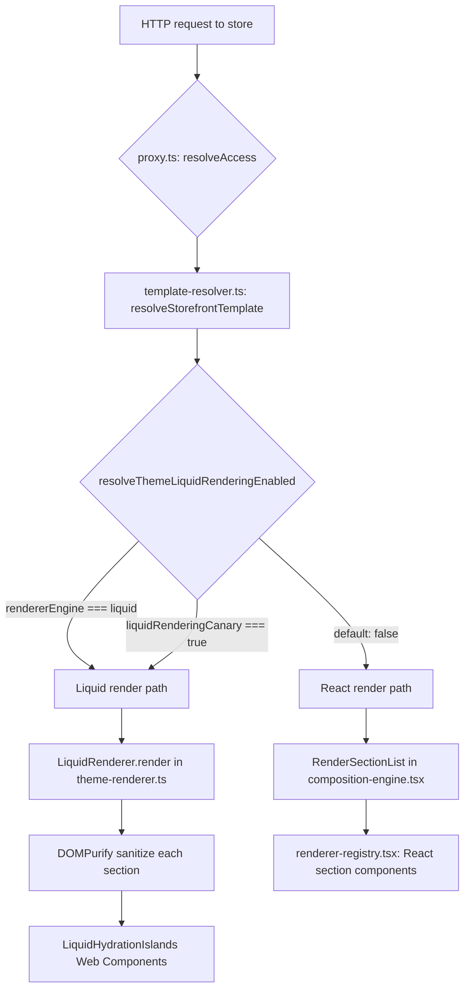
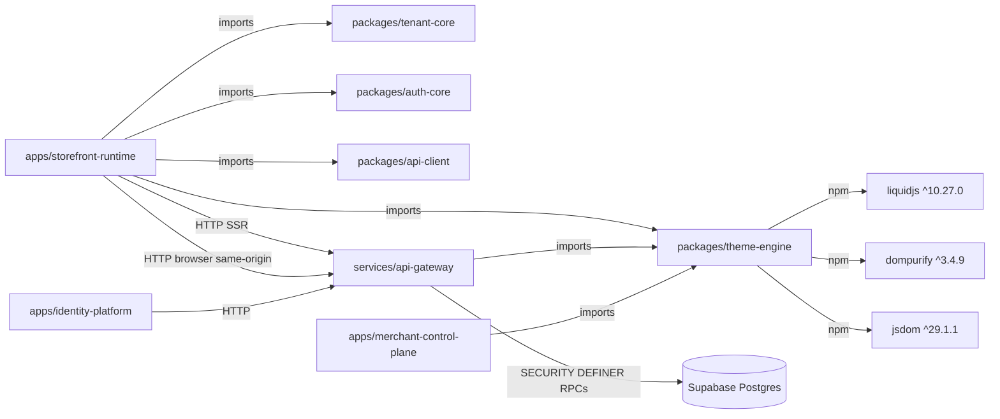

# 01 — Repository Discovery: Storefront Liquid Theme Platform

**Document type:** Discovery (read-only; no implementation decisions)
**Audit date:** 2026-07-03
**Branch audited:** `stepup/main`
**Last verified commit:** `742192cf feat(theme-engine): make Urban Kicks a first-class Liquid theme`
**Auditors:** Subagent fleet (static code analysis; no LCIS live probe)
**Status:** VERIFIED — all factual claims in §6 checked against repo files

---

## Table of Contents

1. [Architecture Overview](#1-architecture-overview)
2. [Current Implementation](#2-current-implementation)
3. [Repository Inventory](#3-repository-inventory)
4. [Runtime Flow](#4-runtime-flow)
5. [Dependency Graph](#5-dependency-graph)
6. [Missing Features](#6-missing-features)
7. [Partial Implementations](#7-partial-implementations)
8. [Technical Debt](#8-technical-debt)
9. [Enterprise Gap Analysis](#9-enterprise-gap-analysis)
10. [Risk Analysis](#10-risk-analysis)
11. [Recommended Migration Order](#11-recommended-migration-order)

---

## 1. Architecture Overview

LetBuyy's storefront is a **dual-engine hybrid**: React (JSON-contract) is the production default; a full LiquidJS rendering path is implemented behind a hard feature flag. Both engines are live in the codebase simultaneously and share the same data pipeline.

```
THEME_LIQUID_RENDERING_DEFAULT_ENABLED = false   (packages/theme-engine/src/theme-governance.ts:14)
THEME_LIQUID_PLATFORM_WIDE_FLIP_DECISION.status = 'deferred', authority = 'ARB'
```

The Liquid engine is powered by the **LiquidJS npm package v10.27.0** — this is a JavaScript-native implementation, not Shopify's Ruby engine. It is activated per-store via `rendererEngine: 'liquid'` in the release manifest (set by database migration 180 for the `urban-kicks` theme) or via a `liquidRenderingCanary: true` flag. The only production subdomain actively running Liquid is `urban-kicks-demo`.

### Dual-engine decision path



### Package topology



---

## 2. Current Implementation

### 2.1 Rendering engines

| Engine | Status | Activation |
|--------|--------|-----------|
| React JSON-contract | **Production default** | Always on; no flag required |
| LiquidJS | **Canary, off by default** | `rendererEngine='liquid'` in release manifest OR `liquidRenderingCanary: true` in templateConfig |

Migration 180 (`database/supabase/migrations/180_urban_kicks_liquid_theme.sql`) set `rendererEngine='liquid'` directly inside `themes.default_template` for the `urban-kicks` theme row. `resolveThemeLiquidRenderingEnabled` treats this as an explicit override that bypasses the global `THEME_LIQUID_RENDERING_DEFAULT_ENABLED=false` constant. Urban Kicks stores therefore render Liquid.

### 2.2 Theme engine library

- **LiquidJS** (`liquidjs ^10.27.0`) — JavaScript-native, open-source Liquid renderer
- **DOMPurify** (`dompurify ^3.4.9`) + **jsdom** (`jsdom ^29.1.1`) — server-side HTML sanitizer
- **Zod** — bundle schema validation (`LiquidThemePackageBundleSchema`)
- Engine config (confirmed at `packages/theme-engine/src/theme-renderer.ts` lines 425–446):
  - `outputEscape: 'escape'` — auto-escapes all `{{ }}` output (primary XSS defense)
  - `strictFilters: true` — unknown filter throws, not silently passes
  - `strictVariables: false` — undefined variable renders as empty string
  - `ownPropertyOnly: true` — prototype chain not traversed
  - `cache: false` — every request re-parses templates
  - `dynamicPartials: false` — no variable-based partial resolution
  - `parseLimit: 300_000`, `renderLimit: 250`, `memoryLimit: 2_000_000` (DoS limits)

### 2.3 Theme identity layer

Commit `742192cf` introduced a canonical `letbuyy-core` alias over the existing `urban-kicks` theme:

- `LETBUYY_CORE_THEME_SLUG = 'letbuyy-core'` (`packages/theme-engine/src/theme-bundle-core.ts:31`)
- `URBAN_KICKS_THEME_SLUG = 'urban-kicks'` (legacy; DB still stores this slug)
- `resolveCanonicalThemeSlug()` resolves the alias in TypeScript; **no DB migration exists yet** to rename the slug in the `themes` table

### 2.4 Template storage

All Liquid template sources are stored as **TypeScript string literals** inside `createUrbanKicksLiquidThemeBundleFixture()` in `packages/theme-engine/src/theme-bundle.ts`. There are **zero `.liquid` files on disk** in this repository (confirmed: `find . -name "*.liquid"` returns no results).

The bundle is persisted into `themes.default_template.liquidBundle` (JSONB) via migrations 171–172, and validated against `LiquidThemePackageBundleSchema` (Zod) at every gateway publish.

### 2.5 Experience (preset) system

Ten named "Experiences" are fully defined in `packages/theme-engine/src/theme-presets.ts` (confirmed at lines 167–403):

| ID | Name | Industry | Heading Font |
|----|------|----------|-------------|
| `forge` | Forge | electronics | Inter |
| `sense` | Sense | fashion | Playfair Display |
| `aura` | Aura | beauty | Cormorant Garamond |
| `craft` | Craft | furniture | Libre Baskerville |
| `refresh` | Refresh | food | Inter |
| `ride` | Ride | sports | Inter |
| `dawn` | Dawn | books | Libre Baskerville |
| `bloom` | Bloom | pet | Inter |
| `nova` | Nova | D2C / versatile | Inter |
| `summit` | Summit | general (fallback) | Inter |

Industry-to-experience mapping lives in `packages/theme-engine/src/industry-experience-map.ts` with 9 canonical industry keys and 18+ synonym aliases (confirmed at lines 23–55).

---

## 3. Repository Inventory

### 3.1 packages/theme-engine/src (13 source files)

| File | Lines | Role | Status |
|------|-------|------|--------|
| `theme-bundle.ts` | 2970 | Zod schemas; Urban Kicks Liquid fixture; `LiquidThemePackageBundleSchema` | IMPLEMENTED |
| `theme-renderer.ts` | 932 | `LiquidRenderer`; `JsonContractThemeRenderer`; DOMPurify config; LiquidJS engine config; custom filters | IMPLEMENTED |
| `index.ts` | ~1248 | Barrel exports; `StoreTemplateConfig`; `DEFAULT_THEME_SETTINGS`; `BuiltInSectionType` union | IMPLEMENTED |
| `theme-governance.ts` | 368 | Canary flag; ARB gate; parity tracking; `resolveThemeLiquidRenderingEnabled`; schema migration engine | IMPLEMENTED |
| `portable-to-liquid.ts` | ~202 | L3 compiler: portable JSON → `LiquidThemePackageBundle` | IMPLEMENTED |
| `theme-registry.ts` | ~734 | 12 base section schemas; `THEME_SETTINGS_SCHEMA`; `getDefaultStorefrontThemeTemplate` (governance-frozen) | IMPLEMENTED |
| `built-in-section-schemas.ts` | ~338 | 13 additional section schemas; `BUILT_IN_SECTION_SCHEMAS` (Object.freeze merge); 25 types total | IMPLEMENTED |
| `theme-presets.ts` | ~523 | 10 Experience definitions; Zod schemas; apply engine; registry integrity check | IMPLEMENTED |
| `industry-experience-map.ts` | ~150 | 9 industry keys; 18+ aliases; `resolveExperienceForIndustry` | IMPLEMENTED |
| `theme-bundle-core.ts` | ~83 | `letbuyy-core` alias layer; `createLetbuyyCoreLiquidThemeBundleFixture` | IMPLEMENTED |
| `experience-fonts.ts` | ~83 | 6-font registry; `buildGoogleFontsHref` (built but not yet called by storefront) | IMPLEMENTED (not wired) |
| `execution-runtime.ts` | ~487 | `composeStorefrontTheme`; section/block registries; hydration manifests | IMPLEMENTED |
| `jsdom-runtime.d.ts` | ~15 | Type shim for server-side jsdom | STUB/SHIM |

### 3.2 packages/theme-engine/test (16 test files)

Test coverage spans L2–L13 (12 Liquid-specific tests) plus 4 general/preset tests:

| File | Coverage layer |
|------|---------------|
| `liquid-l2-assets.test.ts` | CSS token injection; sanitizer integrity |
| `liquid-l3-compiler.test.ts` | Portable → Liquid compilation; round-trip |
| `liquid-l4-chrome.test.ts` | Header/footer chrome; `javascript:` URL blocking |
| `liquid-l5-product.test.ts` | Product template; add-to-cart island; XSS |
| `liquid-l6-collection.test.ts` | Collection template |
| `liquid-l7-search.test.ts` | Search template |
| `liquid-l8-cart.test.ts` | Cart template |
| `liquid-l9-auth.test.ts` | Login/register templates |
| `liquid-l10-account.test.ts` | Account template |
| `liquid-l11-orders.test.ts` | Orders template |
| `liquid-l12-tracking.test.ts` | Tracking template |
| `liquid-l13-authoring.test.ts` | Compile-on-publish; desync guard |
| `theme-engine.test.ts` | General theme engine |
| `theme-bundle-core.test.ts` | Core alias layer |
| `theme-presets.test.ts` | Experience registry; integrity |
| `experience-fonts.test.ts` | Font system integrity |

### 3.3 apps/storefront-runtime/src/lib/theme-engine (9 files)

| File | Lines | Role | Status |
|------|-------|------|--------|
| `composition-engine.tsx` | ~516 | SSR compositor; `renderLiquidPlan()`; `buildLiquidCommerceContext()` | IMPLEMENTED |
| `liquid-hydration-islands.tsx` | 1306 | 9 Web Component custom elements (`lb-*`); `registerLiquidHydrationIslands()` | IMPLEMENTED |
| `template-resolver.ts` | ~309 | `resolveStorefrontTemplate()`; `resolveLiquidBundle()`; dev engine override | IMPLEMENTED |
| `renderer-registry.tsx` | ~287 | React section registry; 21 registered renderers | IMPLEMENTED |
| `data-binding-engine.ts` | ~107 | `buildSectionDataPlan()`; product fetch per section | IMPLEMENTED |
| `types.ts` | ~95 | `StorefrontRenderPlan`; `StorefrontRouteType`; `SectionRenderData` | IMPLEMENTED |
| `content-route.ts` | ~18 | CMS content route fallback section | IMPLEMENTED |
| `product-route.ts` | ~38 | Product listing/detail fallback sections | IMPLEMENTED |
| `editor-preview-section-frame.tsx` | ~93 | Editor preview section highlight (postMessage) | IMPLEMENTED |

### 3.4 apps/storefront-runtime/src/lib/demo (1 file)

- `urban-kicks-demo.ts` (~342 lines): demo store factory; sets `liquidRenderingCanary: true` (confirmed at line 313) and returns `createUrbanKicksLiquidThemeBundleFixture()` as the Liquid bundle

### 3.5 apps/storefront-runtime other relevant files

| File | Lines | Role | Status |
|------|-------|------|--------|
| `src/proxy.ts` | ~300 | Next.js 16 middleware; multi-tenant host routing; access enforcement | IMPLEMENTED |
| `src/lib/store-service.ts` | ~744 | `mapSupabaseToStore()`; Liquid bundle resolution; appearance bridge | IMPLEMENTED |
| `src/lib/customer-drop.ts` | ~245 | `getStorefrontCustomerDrop()`; `LiquidCustomerDrop` builder | IMPLEMENTED |
| `src/app/store/[subdomain]/layout.tsx` | ~270 | CSS variable injection; React-vs-Liquid chrome bypass | IMPLEMENTED |
| `src/app/demo/urban-kicks/page.tsx` | ~15 | Redirect to `/preview?demo=urban-kicks` | IMPLEMENTED |

### 3.6 Database migrations affecting Liquid

| Migration | Effect | Status |
|-----------|--------|--------|
| `171_liquid_bundle_persistence.sql` | Inserts Urban Kicks Liquid bundle into `themes.default_template.liquidBundle` | APPLIED |
| `172_liquid_bundle_refresh.sql` | Refreshes bundle with complete template set (all 13 route keys) | APPLIED |
| `180_urban_kicks_liquid_theme.sql` | Sets `rendererEngine='liquid'` in `themes.default_template`; adds `appearance` settings_schema group | APPLIED |
| `181_urban_kicks_settings_schema_complete.sql` | Adds `surfaceColor` and `isDark` to DB settings_schema | APPLIED |
| `185_v1_site_domains.sql` | `site_domains` + `site_domain_verifications` tables; multi-domain support | APPLIED |
| `187_v1_sites_site_settings.sql` | Adds `sites.site_settings` jsonb column (appearance bridge) | APPLIED |

### 3.7 Liquid template coverage table

| Route type | Template key | Liquid template | React fallback |
|-----------|-------------|----------------|----------------|
| Home/index | `index` | **Yes** | Yes |
| Product detail | `product` | **Yes** | Yes |
| Collection | `collection` | **Yes** | Yes |
| Blog listing | `blog` | **Yes** | Yes |
| Article | `article` | **Yes** | Yes |
| Generic page | `page` | **Yes** | Yes |
| Cart | `cart` | **Yes** | Yes |
| Login | `customers/login` | **Yes** | Yes |
| Register | `customers/register` | **Yes** | Yes |
| Account | `customers/account` | **Yes** | Yes |
| Orders list | `customers/orders` | **Yes** | Yes |
| Order detail | `customers/order` | **Yes** | Yes |
| Order tracking | `track` | **Yes** | Partial |
| Password gate | `password` | **No** | Yes |
| 404 / not found | `not_found` | **No** | Yes |
| Search results | `search` | **No** | Yes |

**Coverage: 13 of 16 route types have Liquid templates (81%). Missing: `password`, `not_found`, `search`.**

---

## 4. Runtime Flow

The numbered flow below describes a published store request to a Liquid-enabled storefront (e.g., `urban-kicks-demo.letbuyy.com`):

1. **Browser** sends `GET https://urban-kicks-demo.letbuyy.com/`
2. **Vercel/Cloudflare** routes to `apps/storefront-runtime` Next.js 16 app.
3. **`apps/storefront-runtime/src/proxy.ts`** (Next.js middleware) fires:
   - Extracts host; calls `resolveStorefrontHost()` from `@letbuyy/tenant-core`
   - Calls `GET /v1/internal/store-access/resolve?host=...` at api-gateway with `INTERNAL_API_SECRET`
   - Returns `StorefrontAccessContext`; rewrites URL internally to `/store/urban-kicks-demo/`
   - Sets observability header `X-Lb-Render-Engine: react` (reflects global env var only, **not** actual engine)
4. **`apps/storefront-runtime/src/app/store/[subdomain]/layout.tsx`**:
   - `StoreService.getStoreBySubdomain('urban-kicks-demo')` → api-gateway → Supabase via Hyperdrive
   - `mapSupabaseToStore()` normalizes: sets `rendererEngine='liquid'`, `liquidBundle` from release manifest, `themeSettings` from appearance bridge (`sites.site_settings`)
   - `resolveStorefrontTemplate(store, { type: 'index', ... })` → `resolveThemeLiquidRenderingEnabled` finds `templateConfig.rendererEngine === 'liquid'` → returns Liquid render plan
   - `liquidPage = true` — layout renders `{children}` directly; React header/footer `StorefrontSectionGroupRenderer` is NOT mounted
   - Emits inline `<style>` with CSS custom properties (`--primary`, `--font-main`, etc.)
5. **`apps/storefront-runtime/src/app/store/[subdomain]/page.tsx`** (ISR `revalidate = 60`):
   - Calls `buildSectionDataPlan()` → fetches products from api-gateway
   - Returns `<StorefrontCompositionEngine store plan sectionData />`
6. **`apps/storefront-runtime/src/lib/theme-engine/composition-engine.tsx`** (`renderLiquidPlan`):
   - `getStorefrontCustomerDrop()` — reads HS256 cookie; calls gateway if session present
   - `buildLiquidCommerceContext()` — assembles `LiquidCommerceDrops`: `shop`, `product`, `collection`, `cart` (null at SSR), `customer`, `order`
   - `createThemeRenderer('liquid').render(...)` — calls `LiquidRenderer` in `packages/theme-engine/src/theme-renderer.ts`
   - LiquidJS parses and renders each section sequentially; DOMPurify (jsdom, server-side) sanitizes each section HTML
   - Logs structured event `lb:canary:render` to stdout
   - Returns `header + contentForLayout + footer` as concatenated HTML string
7. **Browser** receives full HTML. `<LiquidHydrationIslands>` mounts 9 Web Component custom elements:
   - `lb-add-to-cart`, `lb-cart-drawer`, `lb-search`, `lb-variant-picker`, `lb-review-form`, `lb-wishlist-toggle`, `lb-cart`, `lb-customer-settings`, `lb-address-manager`
   - `lb-cart-drawer` calls `/api/storefront/urban-kicks-demo/cart` (same-origin → Next.js rewrite → api-gateway) to hydrate cart totals

---

## 5. Dependency Graph

### 5.1 Package-level dependencies

| Dependent | Dependency | Nature |
|-----------|-----------|--------|
| `apps/storefront-runtime` | `packages/theme-engine` | Liquid renderer, governance, bundle schema, section schemas, Experience engine |
| `apps/storefront-runtime` | `packages/tenant-core` | Host resolution, StoreModel, `resolveStorefrontHost` |
| `apps/storefront-runtime` | `packages/auth-core` | Customer HS256 session; gate/preview tokens |
| `apps/storefront-runtime` | `packages/api-client` | HTTP client factory; URL normalization |
| `apps/storefront-runtime` | `packages/shared-types` | `AppBlockInstance`; `resolvePlatformDomain` |
| `apps/storefront-runtime` | `packages/commerce-core` | `ProductModel` |
| `apps/storefront-runtime` (SSR) | `services/api-gateway` | All data (HTTP; ISR cache; 60-second revalidate) |
| `apps/storefront-runtime` (browser) | `services/api-gateway` | Rewritten via `/api/storefront/{subdomain}/...` (same-origin proxy) |
| `apps/merchant-control-plane` | `packages/theme-engine` | Editor draft/publish; Experience picker; schema validation |
| `apps/identity-platform` | `services/api-gateway` | Store creation (POST /stores) |
| `services/api-gateway` | `packages/theme-engine` | `LiquidThemePackageBundleSchema`; publish validation; Experience apply at store creation |
| `services/api-gateway` | `packages/auth-core` | `verifyCustomerSession`; `verifyStorefrontGateToken` |
| `packages/theme-engine` | `liquidjs ^10.27.0` | LiquidJS template rendering engine |
| `packages/theme-engine` | `dompurify ^3.4.9` + `jsdom ^29.1.1` | Server-side HTML sanitization |
| `packages/theme-engine` | `zod` | `LiquidThemePackageBundleSchema` validation |

### 5.2 Internal theme-engine module dependencies

| Source module | Depends on |
|--------------|-----------|
| `built-in-section-schemas.ts` | `theme-registry.ts` (imports `SECTION_SCHEMAS`, `SectionSchema`) |
| `theme-governance.ts` | `built-in-section-schemas.ts` (`BUILT_IN_SECTION_SCHEMAS`); `index.ts` (`SectionModel`) |
| `theme-presets.ts` | `built-in-section-schemas.ts` (`BUILT_IN_SECTION_TYPES`) |
| `industry-experience-map.ts` | `theme-presets.ts` (`EXPERIENCE_REGISTRY`, `FALLBACK_EXPERIENCE_ID`, `getExperience`) |
| `theme-bundle-core.ts` | `theme-bundle.ts` (`createUrbanKicksLiquidThemeBundleFixture`, `LiquidThemePackageBundleSchema`) |
| `experience-fonts.ts` | `theme-presets.ts` (`listExperiences`, `ThemeExperience`) |
| `index.ts` | All other modules (barrel re-export) |

### 5.3 Data flow: Liquid bundle resolution chain

`resolveLiquidBundle()` in `template-resolver.ts` tries four candidate locations in order:

1. `store.templateConfig.liquidBundle` (from `sites.template_config.liquidBundle`)
2. `releaseManifest.liquidBundle` (from `theme_releases.release_manifest`)
3. `releaseManifest.themeBundle`
4. `releaseManifest.bundle` (raw JSON, parsed by `LiquidThemePackageBundleSchema.safeParse`)

If none is valid, `store-service.ts:673` falls back to `createUrbanKicksLiquidThemeBundleFixture()`.

---

## 6. Missing Features

The following capabilities are absent from the codebase as of the audited commit. Each claim has been verified against the actual repository.

| # | Feature | Evidence | Gap type |
|---|---------|----------|----------|
| 1 | **`search` Liquid drop never populated** | `buildLiquidCommerceContext()` in `composition-engine.tsx` assembles all drops but never sets `LiquidCommerceDrops.search`; `{{ search.results }}` always resolves to null | Liquid drop gap |
| 2 | **Navigation menus not exposed to Liquid** | `StoreModel.navigation.main/footer/policies` is fetched by `StoreService` but never passed to `buildLiquidScope` or `buildLiquidCommerceContext`; Liquid templates cannot access dynamic nav menus | Liquid drop gap |
| 3 | **Liquid `password` template absent** | No `password` key in Urban Kicks `LiquidThemePackageBundleSchema` template map; confirmed by template coverage table in §3.7 | Template gap |
| 4 | **Liquid `not_found` template absent** | Same as above; 404 pages always fall back to React | Template gap |
| 5 | **Font loading not wired into storefront** | `experience-fonts.ts` exports `buildGoogleFontsHref` and `buildExperienceFontLinkHref` but no code in `apps/storefront-runtime` calls them; Experiences `Aura`, `Craft`, `Dawn`, `Sense` render with system-font fallbacks | Integration gap |
| 6 | **FONT_MAP missing 4 experience fonts** | `apps/storefront-runtime/src/app/store/[subdomain]/layout.tsx` `FONT_MAP` lacks entries for `Cormorant Garamond`, `Libre Baskerville`, `Source Sans Pro`, `Lato` — used by Aura, Craft, Dawn | Mapping gap |
| 7 | **`letbuyy-core` DB row not yet created** | `theme-bundle-core.ts:44` comment: "callers must keep accepting the legacy `urban-kicks` slug in DB lookups until a `letbuyy-core` catalog row exists (deferred migration)"; `themes` table still stores slug `urban-kicks` | DB gap |
| 8 | **No concrete schema migrations registered** | `ThemeSectionSchemaMigration` interface fully implemented in `theme-governance.ts:77–96`; zero migration objects exist anywhere in the codebase | Infrastructure gap |
| 9 | **`` tag not implemented** | LiquidJS supports the standard tag set but no `` handler is registered; pagination of product lists requires client-side or new section logic | Liquid tag gap |
| 10 | **`` Shopify helper absent** | No `form` tag registered in LiquidJS engine; Liquid forms rely on standard `<form>` HTML instead of the Shopify Liquid helper | Liquid tag gap |
| 11 | **`settings` Liquid object partial** | `buildLiquidScope()` at `theme-renderer.ts:573–576` passes `bundle.config.settings_data.current` as the `settings` Liquid object; however the TypeScript 5-group schema (`colors`, `typography`, `layout`, `header`, `footer`) diverges from the DB flat `appearance` group (migrations 180–181), so merchant-configured values may not resolve under expected key paths — a structural divergence, not an absence | Parity gap |
| 12 | **`linklists` object absent** | No navigation link list drop; Shopify-style `{{ linklists.main-menu.links }}` patterns not supported | Parity gap |
| 13 | **Shopify color filters absent** | `color_to_rgb`, `color_modify`, `color_lighten`, `color_darken` not registered as custom filters | Parity gap |
| 14 | **`img_tag`, `script_tag`, `stylesheet_tag` filters absent** | Shopify HTML helper filters not registered | Parity gap |
| 15 | **OIDC/ES256 merchant auth dormant** | `oidc-jwks` verifier in `services/api-gateway/src/identity-foundation/auth-verifier-registry.ts` is `activeByDefault: false`, gated by `FEATURE_OIDC_CLIENT`; not in production flow | Auth gap |

---

## 7. Partial Implementations

| # | Feature | What exists | What is missing |
|---|---------|------------|-----------------|
| 1 | **letbuyy-core identity** | `theme-bundle-core.ts` alias layer; `createLetbuyyCoreLiquidThemeBundleFixture()`; `resolveCanonicalThemeSlug()` | DB `themes` row for slug `letbuyy-core`; `store-service.ts:673` still calls `createUrbanKicksLiquidThemeBundleFixture()` (not the Core fixture) |
| 2 | **Experience / preset system** | 10 Experiences fully defined and Zod-validated; `applyExperienceToTemplateConfig()`; `resolveExperienceForIndustry()`; apply wired at store creation (gateway `stores.ts:659–673`) and in Theme Editor | Font loading (§6 #5–6); `defaultSections` array on each Experience is defined but never consumed by apply path; no standalone REST endpoint for applying an Experience |
| 3 | **Schema migration engine** | Full `ThemeSectionSchemaMigration` interface; `migrateThemeTemplateSchemas()` chain-walk; loop detection; 20-step maximum | Zero concrete migration objects registered; migration function never called in production code paths |
| 4 | **Liquid rendering (Urban Kicks)** | Engine real and sound; 13 of 16 route templates implemented; DOMPurify defense-in-depth; 9 hydration islands | `password`, `not_found`, `search` templates absent; `cache: false` not sustainable at scale; `search` drop never populated |
| 5 | **`surfaceColor` token** | `ThemeSettings.surfaceColor?: string` in `index.ts`; required by `ExperienceTokens`; migration 181 adds it to DB schema | Type mismatch: optional in `ThemeSettings`, required in `ExperienceTokensSchema`; `store-service.ts:597–605` does not explicitly normalize it |
| 6 | **Onboarding industry capture** | `ONBOARDING_INDUSTRIES` display array in `apps/identity-platform/src/app/onboarding/page.tsx`; sends `survey: { industry }` in store creation payload | `ONBOARDING_INDUSTRIES` is a hardcoded array literal, not imported from `INDUSTRY_OPTIONS` in `industry-experience-map.ts` — divergence risk |
| 7 | **Cart in Liquid path** | `lb-cart-drawer` Web Component calls gateway for cart data client-side | Cart money totals always `null` at SSR (`source: 'browser_hydrated'`); no server-side cart total in initial HTML |
| 8 | **Section parity (Liquid ↔ React)** | 20 entries in `THEME_LIQUID_PORTABLE_SECTION_PARITY`; parity count meets the required minimum | `collectionFilter`, `contentPage`, `videoHero`, `faqAccordion`, `instagramFeed` sections have no Liquid parity; 5 section types unusable on Liquid stores |
| 9 | **`newsletter` ↔ `newsletter-signup` type reconciliation** | Parity map documents the split: React type `newsletter` → Liquid type `newsletter-signup` | Stored template configs with `type: 'newsletter'` will not match Liquid bundle section key `newsletter-signup` directly; requires type normalization at read time |

---

## 8. Technical Debt

| # | Item | Severity | Evidence |
|---|------|----------|----------|
| 1 | **Urban Kicks branding leak into all Liquid stores** | HIGH | `apps/storefront-runtime/src/lib/store-service.ts:673` still imports and calls `createUrbanKicksLiquidThemeBundleFixture()` as fallback; `createLetbuyyCoreLiquidThemeBundleFixture()` exists in `theme-bundle-core.ts` but is not wired |
| 2 | **`theme_id = 'modern'` ghost reference** | HIGH | `apps/identity-platform/src/app/api/auth/create-store/route.ts:90`: writes `theme_id: templateId || 'modern'` to `sites`; no `modern` slug confirmed in `themes` table |
| 3 | **`X-Lb-Render-Engine` header decoupled from actual engine** | MEDIUM | `proxy.ts` sets header based on `THEME_LIQUID_RENDERING_DEFAULT_ENABLED` global env; actual engine resolved per-release in `template-resolver.ts`; header reports `react` when Liquid is active per-release |
| 4 | **LiquidJS sections rendered sequentially** | MEDIUM | `LiquidRenderer.render()` awaits each section sequentially; no `Promise.all`; latency scales linearly with section count |
| 5 | **DOMPurify JSDOM singleton: no rejection handler** | MEDIUM | `sanitizeRenderedHtml()` in `theme-renderer.ts` lazy-initializes a process-global JSDOM window with no rejection handler on the promise; failure silently leaves sanitizer uninitialized |
| 6 | **No try/catch around `engine.parseAndRender()`** | MEDIUM | Liquid render errors propagate uncaught and crash the Next.js render; no fallback to the React path on Liquid render failure |
| 7 | **`ONBOARDING_INDUSTRIES` duplicates `INDUSTRY_OPTIONS`** | LOW | `apps/identity-platform/src/app/onboarding/page.tsx:201–214` defines its own hardcoded array; drift risk if new Experiences are added to `theme-presets.ts` |
| 8 | **`experienceId` stored in JSONB, not indexed** | LOW | Applied experience ID is in `sites.template_config.experienceId` (jsonb); no DB index; analytics queries require full JSONB scan |
| 9 | **`defaultSections` on Experiences defined but not consumed** | LOW | Each Experience defines `defaultSections: string[]` for UI display; `applyExperienceToTemplateConfig` writes only design tokens; section structure is unchanged on Experience apply |
| 10 | **Two draft tables exist with unclear migration path** | LOW | `theme_editor_drafts` and `theme_instance_drafts` both exist in baseline; `theme_preview_sessions.theme_instance_draft_id` references the latter; no deprecation path evident |
| 11 | **`resolveAccess()` in proxy.ts is `cache: 'no-store'`** | HIGH | Every storefront pageview sends an uncached gateway fetch for tenant resolution; no edge-level TTL; gateway tenant endpoint is a single point of failure under traffic spikes |
| 12 | **`heroBanner` parity gap between JSON-contract and Liquid** | HIGH | JSON-contract `heroBanner` settings include `overlay`, `height`, `textAlign`, `image`; Liquid `hero-banner` schema uses `eyebrow`, `heading`, `subheading`, `ctaText`, `ctaLink` — different schemas, same conceptual section |

---

## 9. Enterprise Gap Analysis

This section maps LetBuyy's Liquid implementation against Shopify Liquid capabilities commonly expected in an enterprise theme platform.

### 9.1 Template coverage

| Capability | Shopify standard | LetBuyy status |
|------------|-----------------|----------------|
| Product templates | Full | Implemented |
| Collection templates | Full | Implemented |
| Cart templates | Full | Implemented (SSR totals null) |
| Customer auth templates | Full | Implemented (login, register, account, orders) |
| Search results page | Full | **Missing (`search` template absent)** |
| Password-protected store | Full | **Missing (`password` template absent)** |
| Blog + articles | Full | Implemented |
| Custom pages | Full | Implemented |
| 404 / not found | Full | **Missing** |
| Checkout | Full (Shopify-owned) | React-only; Liquid not applicable |

### 9.2 Liquid language coverage

| Capability | Shopify standard | LetBuyy status |
|------------|-----------------|----------------|
| Core control flow tags | Full | LiquidJS built-in; fully available |
| `` with `limit`/`offset`/`reversed` | Full | LiquidJS built-in; available |
| `` tag | Full | **Not implemented** |
| `` tag | Full | **Not implemented** |
| `` / `` | Full | **Explicitly blocked** (security; `ThemeLiquidSourceSchema`) |
| `` tag | Full | **Not implemented** (sections assembled programmatically) |
| `` / `` | Full | **Not implemented** |
| Standard string/math/array filters | Full | LiquidJS built-in; available |
| `money` / `money_with_currency` filters | Shopify-specific | **Custom registered** |
| `json` / `asset_url` / `image_url` / `t` filters | Shopify-specific | **Custom registered** |
| Shopify color filters | Shopify-specific | **Not registered** |
| `img_tag` / `script_tag` / `stylesheet_tag` | Shopify-specific | **Not registered** |
| `metafield_tag` / `metafields` | Shopify-specific | **Not implemented** (no metafields system) |

### 9.3 Commerce drop coverage

| Liquid object | Shopify standard | LetBuyy status |
|--------------|-----------------|----------------|
| `shop` | Full | Implemented (`name`, `description`, `currency`, `domain`, `locale`) |
| `product` | Full | Implemented; paise-integer money (use `\| money` filter) |
| `collection` | Full | Implemented; missing title/description on home page (only on `/collections/[slug]`) |
| `customer` | Full | Implemented (null if unauthenticated) |
| `cart` | Full | **Stub at SSR** — all money totals null; hydrated browser-side |
| `search` | Full | **Never populated** — always null |
| `page` | Full | Implemented on page/account routes only |
| `blog` / `article` | Full | Implemented |
| `order` | Full | Implemented on order-detail routes |
| `linklists` / navigation | Full | **Not exposed to Liquid** |
| `settings` | Full | **PARTIAL** — `settings_data.current` passed at `theme-renderer.ts:573–576`; key-path parity with Shopify unmet due to TypeScript vs DB schema divergence |
| `product.metafields` | Full | **Not implemented** (no metafields system) |
| `recommendations` | Full | **Not implemented** |
| `predictive_search` | Full | **Not implemented** |
| `gift_card` / `discount` / `checkout` | Full | **Not implemented** as Liquid objects |

### 9.4 Theme authoring infrastructure gap

| Capability | Shopify standard | LetBuyy status |
|------------|-----------------|----------------|
| On-disk `.liquid` files | Yes (file tree) | **No — TypeScript string literals only** |
| Snippet / partial system | Yes (``) | **Blocked** (`` forbidden; no partial system) |
| Shopify Theme Check | Yes | **Not applicable** (no `.liquid` files on disk; no `.theme-check.yml`) |
| Section schema editor UI | Yes | Partial (Theme Editor exposes settings; Liquid section schemas are TypeScript) |
| Font loading (Google Fonts) | Yes | **Deferred** (`experience-fonts.ts` built but not integrated) |

---

## 10. Risk Analysis

| Risk | Level | Description | Evidence |
|------|-------|-------------|----------|
| `resolveAccess()` is `cache: 'no-store'` on every request | **CRITICAL** | Every storefront pageview sends an uncached gateway fetch; under traffic spikes the gateway tenant resolution endpoint is a single point of failure for all stores | `apps/storefront-runtime/src/proxy.ts` `resolveAccess()` |
| `newsletter` ↔ `newsletter-signup` type name split | **MEDIUM** | `PORTABLE_TO_LIQUID_TYPE_OVERRIDES` in `portable-to-liquid.ts` (line 43) maps `newsletter → newsletter-signup` inside `compilePortableToLiquidBundle`, which actively prevents the silent-lookup-miss for any Liquid bundle produced by the compiler. The risk applies only to a Liquid bundle persisted outside the compiler path (e.g. a manual DB patch): such a bundle could contain `type: newsletter`, which the renderer would not find in `bundle.sections`. | `THEME_LIQUID_PORTABLE_SECTION_PARITY` at `theme-governance.ts:35`; `portable-to-liquid.ts:43–46` |
| `heroBanner` parity gap | **HIGH** | Liquid `hero-banner` schema lacks `overlay`, `height`, `textAlign`, `image` present in React `heroBanner`; merchants who configured these fields on the React theme would silently lose them on Liquid | `theme-governance.ts` parity map; `theme-bundle.ts` Liquid section schema |
| `cache: false` on all Liquid renders | **HIGH** | Every request re-parses and re-renders templates from source; at non-trivial traffic volumes this will be a significant CPU/latency bottleneck | `packages/theme-engine/src/theme-renderer.ts:437` |
| No try/catch around Liquid render | **HIGH** | An error in `engine.parseAndRender()` propagates uncaught and crashes the Next.js server render; no graceful React fallback | `packages/theme-engine/src/theme-renderer.ts` (no error boundary around render loop) |
| Urban Kicks branding leak | **HIGH** | All Liquid stores with an invalid or missing bundle fall back to `createUrbanKicksLiquidThemeBundleFixture()`, not `createLetbuyyCoreLiquidThemeBundleFixture()` | `apps/storefront-runtime/src/lib/store-service.ts:673` |
| `letbuyy-core` slug alias is code-only, not DB-migrated | **MEDIUM** | Any DB query using `LETBUYY_CORE_THEME_SLUG` constant directly will return 0 rows; must pass through `resolveCanonicalThemeSlug()` | `theme-bundle-core.ts:44` comment |
| Cart money always null at SSR | **MEDIUM** | If JavaScript is disabled or `lb-cart-drawer` fails to hydrate, users see no cart totals on the initial HTML; affects accessibility and no-JS scenarios | `composition-engine.tsx:291–307` |
| No navigation drop in Liquid | **MEDIUM** | Dynamic navigation menus (`StoreModel.navigation`) are never passed to `buildLiquidScope`; Liquid templates cannot render dynamic nav menus | `buildLiquidScope` in `theme-renderer.ts` — no `navigation` key |
| `search` drop permanently null | **MEDIUM** | No implementation populates `LiquidCommerceDrops.search`; any Liquid section using `{{ search.results }}` receives null | `composition-engine.tsx` — `search` never set |
| Font loading gap for 4 of 10 Experiences | **MEDIUM** | Experiences Aura, Craft, Dawn, and Sense use non-system fonts (`Cormorant Garamond`, `Libre Baskerville`, `Source Sans Pro`, `Lato`) that are not loaded by the storefront; these render with system-font fallbacks | `experience-fonts.ts` built; `layout.tsx` FONT_MAP missing 4 entries |
| DOMPurify JSDOM singleton | **MEDIUM** | `sanitizeRenderedHtml()` in `theme-renderer.ts` lazy-initializes a process-global JSDOM window with no rejection handler; concurrent Next.js requests may race on initialization | `theme-renderer.ts` `domPurifyPromise` singleton pattern |
| `strictVariables: false` silently swallows undefined drops | **LOW** | Undefined Liquid variables render as empty string; template debugging is difficult since no error is emitted for typos in drop key names | LiquidJS engine config in `theme-renderer.ts:440` |
| `toLiquidDrop()` depth truncation is silent | **LOW** | Drops exceeding `MAX_LIQUID_DROP_DEPTH = 4` or `MAX_LIQUID_DROP_KEYS = 80` are silently truncated; no warning emitted | `theme-renderer.ts:599–648` |
| `BLOCKED_DROP_KEYS` incomplete | **LOW** | `BLOCKED_DROP_KEYS` at `theme-renderer.ts:602` blocks 9 keys but omits `api_key`, `secret_key`, `private_key`, `webhook_secret`; if an over-permissive model passes an object containing these keys to the Liquid scope they would not be filtered out | `theme-renderer.ts:602` |
| No concrete schema migrations | **LOW** | Settings schema changes have no automated upgrade path for stored section configs in `theme_releases.template_snapshot` | `theme-governance.ts:77–96` (interface exists; zero implementations) |

---

## 11. Recommended Migration Order

> **Scope of this section:** This section describes the observed partial implementation sequence and the logical order for completing missing capabilities, based on the dependency structure discovered above. It is discovery-only — no implementation is initiated here. Actual work sequencing is subject to ARB review and the two-lane merge rule.

### Phase order observed in codebase

Based on the test file naming convention (`liquid-l2` through `liquid-l13`) and migration numbering, the following implementation sequence can be inferred:

| Layer | Files | Description |
|-------|-------|-------------|
| L2 | `liquid-l2-assets.test.ts` | CSS token injection; sanitizer integrity |
| L3 | `liquid-l3-compiler.test.ts`; `portable-to-liquid.ts` | Portable JSON → Liquid bundle compiler |
| L4 | `liquid-l4-chrome.test.ts` | Header/footer chrome templates |
| L5 | `liquid-l5-product.test.ts` | Product detail page |
| L6 | `liquid-l6-collection.test.ts` | Collection page |
| L7 | `liquid-l7-search.test.ts` | Search page |
| L8 | `liquid-l8-cart.test.ts` | Cart page |
| L9 | `liquid-l9-auth.test.ts` | Login / register templates |
| L10 | `liquid-l10-account.test.ts` | Account page |
| L11 | `liquid-l11-orders.test.ts` | Orders list page |
| L12 | `liquid-l12-tracking.test.ts` | Order tracking page |
| L13 | `liquid-l13-authoring.test.ts` | Authoring guard; compile-on-publish |

### Remaining capability gaps (discovery order only)

The following gaps are ordered by their dependency chains; closing earlier gaps unblocks later ones:

1. **Urban Kicks → letbuyy-core fallback swap** — unblocks branding correctness for all stores; change confined to `store-service.ts:673`
2. **Font loading integration** — `experience-fonts.ts` is complete; integration point is storefront layout `<head>`; blocked by FONT_MAP gap in `layout.tsx`
3. **`search` Liquid drop population** — requires a gateway search endpoint and population of `LiquidCommerceDrops.search` in `composition-engine.tsx`
4. **Navigation drop exposure** — requires passing `StoreModel.navigation` into `buildLiquidCommerceContext` and `buildLiquidScope`
5. **`password` and `not_found` Liquid templates** — new template keys in `LiquidThemePackageBundleSchema`; test coverage at L14+ (not yet present)
6. **Liquid render error boundary** — try/catch around `engine.parseAndRender()` with React path fallback
7. **Template cache strategy** — `cache: false` is correct for correctness; a caching layer (edge cache by bundle slug + store ID) would address latency at scale
8. **`letbuyy-core` DB row** — deferred migration; documented in `theme-bundle-core.ts:18–20`
9. **`newsletter` / `newsletter-signup` type normalization** — add a read-time normalization step at bundle load or section render dispatch
10. **`heroBanner` ↔ `hero-banner` schema reconciliation** — align fields between JSON-contract and Liquid schemas (requires ARB sign-off per ART-17 governance)
11. **Schema migration objects** — first concrete `ThemeSectionSchemaMigration` objects should be registered when any breaking section schema change lands
12. **ARB review for platform-wide Liquid flip** — `THEME_LIQUID_PLATFORM_WIDE_FLIP_DECISION.status = 'deferred'`; the 20-section parity count is currently met; the flip decision requires Architecture Review Board approval

---

*End of discovery document. All factual claims in §§2–8 were verified against repository source files at the audit commit. No implementation was initiated or prescribed by this document.*
