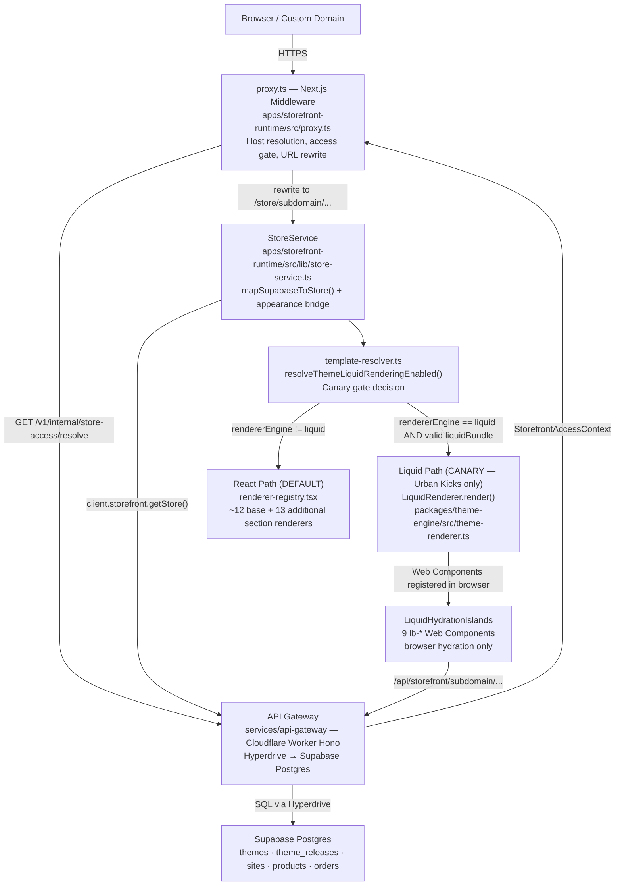
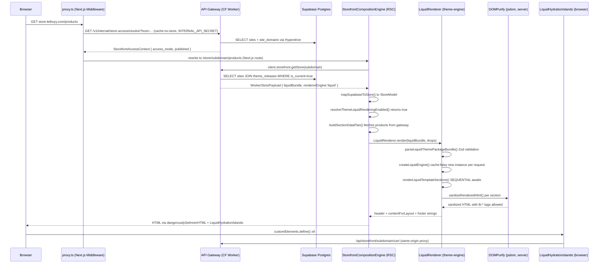
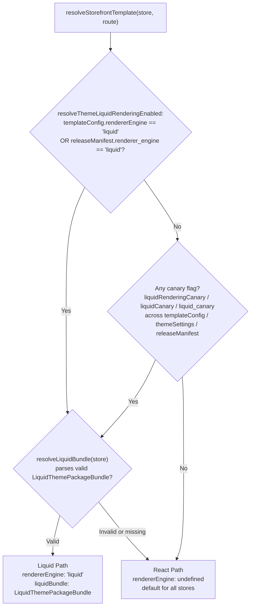

# LetBuyy Liquid Platform Discovery

**Document class:** DISCOVERY — NO IMPLEMENTATION
**Reviewers:** Architecture Review Board
**Date:** 2026-07-04
**Branch:** `stepup/main`
**Status:** DISCOVERY — NO IMPLEMENTATION
**Superseded by:** `11_GAP_ANALYSIS.md` (full gap analysis), `12_MASTER_LIQUID_MIGRATION_PLAN.md` (migration plan)

> **Scope notice:** This document maps the current committed state of the Liquid platform as of `stepup/main`. Nothing in this document prescribes or schedules implementation work. All action items belong to the Recommended Migration Order section (§11) and are classified only by type (PURE-LIQUID / JS-ISLAND / REMAIN-REACT); the ordering of actual delivery is an ARB decision.

---

## Header Block

| Field | Value |
|---|---|
| Repo | `/Users/saai_sidd/Git/Letbuyy_Store` |
| Branch | `stepup/main` |
| Primary runtime | `apps/storefront-runtime` (Next.js 16.1.6, React 19.2.3) |
| Theme engine package | `packages/theme-engine` |
| API gateway | `services/api-gateway` (Cloudflare Workers, Hono v4.7.x) |
| LiquidJS version | `v10.27.0` (verified: `packages/theme-engine/package.json`) |
| DOMPurify version | `^3.4.9` (verified: `packages/theme-engine/package.json`) |
| jsdom version | `^29.1.1` (verified: `packages/theme-engine/package.json`) |
| Liquid canary | `THEME_LIQUID_RENDERING_DEFAULT_ENABLED = false` — globally off |
| Only Liquid-active theme | `urban-kicks` (set by migration `180_urban_kicks_liquid_theme.sql`) |
| ARB gate | `THEME_LIQUID_PLATFORM_WIDE_FLIP_DECISION { status: 'deferred', authority: 'ARB' }` |

---

## Table of Contents

1. [Architecture Overview](#1-architecture-overview)
2. [Current Implementation](#2-current-implementation)
3. [Repository Inventory](#3-repository-inventory)
4. [Runtime Flow](#4-runtime-flow)
5. [Dependency Graph](#5-dependency-graph)
6. [Missing Features](#6-missing-features)
7. [Partial Implementations](#7-partial-implementations)
8. [Technical Debt](#8-technical-debt)
9. [Enterprise Gap Analysis](#9-enterprise-gap-analysis)
10. [Risk Analysis](#10-risk-analysis)
11. [Recommended Migration Order](#11-recommended-migration-order)

---

## 1. Architecture Overview

LetBuyy ships a **dual-renderer storefront**: a React/JSON-contract engine (the production default for every store) and a full LiquidJS engine that is implemented, tested, and canary-gated behind a compile-time constant. Migration `180_urban_kicks_liquid_theme.sql` promoted the Urban Kicks theme to first-class Liquid by writing `rendererEngine='liquid'` directly into `themes.default_template` — bypassing the global flag for that one theme. All other themes remain on React.

### Engine Activation Decision Matrix

| Activation Path | Source | Current Status |
|---|---|---|
| `themes.default_template.rendererEngine = 'liquid'` | DB — set by migration 180 | ACTIVE — Urban Kicks only |
| `templateConfig.rendererEngine = 'liquid'` | Per-store JSONB (`sites.template_config`) | Available; not in use in production |
| `liquidRenderingCanary = true` | Per-store/theme config (4 key aliases checked) | Canary path — requires explicit set |
| `THEME_LIQUID_RENDERING_DEFAULT_ENABLED` | Compile-time constant at `theme-governance.ts:14` | `false` — ARB-deferred |
| `?engine=liquid` query param | `resolveDevEngineOverride()` in `template-resolver.ts` | Dev only; ignored in production |

---

## 2. Current Implementation

### Verified as Implemented

| Capability | Evidence |
|---|---|
| LiquidJS v10.27.0 engine | `packages/theme-engine/src/theme-renderer.ts` — LiquidJS engine instantiation with `outputEscape:'escape'`, `strictFilters:true`, `cache:false`, `dynamicPartials:false` (lines 437–438) |
| DOMPurify v3.4.9 + jsdom v29.1.1 server-side sanitizer | `LIQUID_RENDERED_HTML_DOMPURIFY_CONFIG` in `theme-renderer.ts`; `FORBID_ATTR:['style']`, `FORBID_TAGS:[base,embed,object,script]`, `ADD_TAGS:[lb-*]` |
| 6 custom Liquid filters | `money`, `money_with_currency`, `json`, `asset_url`, `image_url`, `t` — registered at lines 680–685 of `theme-renderer.ts` |
| Drop security limits | `MAX_LIQUID_DROP_DEPTH=4`, `MAX_LIQUID_DROP_KEYS=80`, `MAX_LIQUID_DROP_ARRAY_ITEMS=100` (lines 599–601 of `theme-renderer.ts`) |
| `BLOCKED_DROP_KEYS` set | Blocks `__proto__`, `constructor`, `prototype`, `password`, `password_hash`, `access_token`, `refresh_token`, `signing_secret`, `client_secret` (line 602 of `theme-renderer.ts`) |
| 25 built-in section types with Zod schemas | `BUILT_IN_SECTION_SCHEMAS` in `built-in-section-schemas.ts` — spreads 12 base sections from `theme-registry.ts` and 13 additional sections from `ADDITIONAL_BUILT_IN_SECTION_SCHEMAS`; frozen with `Object.freeze()` |
| 9 Liquid hydration island Web Components | `liquid-hydration-islands.tsx` (1306 lines) — `lb-add-to-cart`, `lb-cart-drawer`, `lb-search`, `lb-variant-picker`, `lb-review-form`, `lb-wishlist-toggle`, `lb-cart`, `lb-customer-settings`, `lb-address-manager` (registered at lines 1270–1278) |
| Urban Kicks Liquid bundle | `createUrbanKicksLiquidThemeBundleFixture()` in `theme-bundle.ts` |
| letbuyy-core alias layer | `theme-bundle-core.ts` — `LETBUYY_CORE_THEME_SLUG = 'letbuyy-core'`, `THEME_SLUG_ALIASES`, `createLetbuyyCoreLiquidThemeBundleFixture()` |
| 10 named Experiences | `EXPERIENCE_REGISTRY` in `theme-presets.ts` (522 lines) — forge, sense, aura, craft, refresh, ride, dawn, bloom, nova, summit |
| Industry-to-Experience map | `INDUSTRY_EXPERIENCE_MAP` in `industry-experience-map.ts` (149 lines) — 9 industries, 18 synonym aliases |
| Experience auto-apply at store creation | `services/api-gateway/src/routes/stores.ts` lines 667–673 (`resolveExperienceForIndustry` + `applyExperienceToTemplateConfig`) |
| THEME_SETTINGS_SCHEMA (5 groups) | `theme-registry.ts` line 436 — groups: `colors`, `typography`, `layout`, `header`, `footer` |
| Schema migration engine interface | `ThemeSectionSchemaMigration` + `migrateThemeTemplateSchemas()` in `theme-governance.ts` lines 77–96; zero concrete migrations registered |
| Portable-to-Liquid compiler | `compilePortableToLiquidBundle()` in `portable-to-liquid.ts` (201 lines) |
| 17 storefront route types | `StorefrontRouteType` in `lib/theme-engine/types.ts` — index, product, collection, page, policy, blog, article, cart, search, customer_account, customer_orders, customer_wishlist, customer_settings, customer_addresses, customer_order, password, not_found |
| ISR (60s revalidate) | `revalidate = 60` on all storefront page segments |
| Multi-tenant host routing | `proxy.ts` — `resolveStorefrontHost()` + `resolveAccess()` |
| HS256 customer session auth | `packages/auth-core/src/customer-session.ts` |
| Liquid canary feature flag with ARB gate | `THEME_LIQUID_RENDERING_DEFAULT_ENABLED = false` at `theme-governance.ts:14`; `THEME_LIQUID_PLATFORM_WIDE_FLIP_DECISION { status:'deferred', authority:'ARB' }` at lines 16–21 |
| Liquid bundle DB persistence | Migrations 171, 172, 180, 181 (all confirmed present in `database/supabase/migrations/`) |

### Confirmed NOT Built

| Capability | Status |
|---|---|
| On-disk `.liquid` files | MISSING — all Liquid source is TypeScript string literals in `theme-bundle.ts` |
| LiquidJS template cache | MISSING — `cache: false` at `theme-renderer.ts:437`; every request re-parses from scratch |
| `` tag | MISSING |
| `` tag | MISSING |
| `` / snippets system | BLOCKED — `ThemeLiquidSourceSchema` forbids `` at source parse time; `dynamicPartials: false` in engine config |
| `` tag | BLOCKED — same schema restriction |
| `linklists` / `navigation` Liquid object | MISSING — `StoreModel.navigation` never passed to `buildLiquidScope()` |
| `settings` Liquid object | PARTIAL — `buildLiquidScope()` at `theme-renderer.ts:573–576` passes `bundle.config.settings_data.current` as `settings`; TypeScript 5-group schema diverges from DB flat `appearance` group so merchant-customized values may not resolve under expected key paths |
| `predictive_search`, `recommendations`, `gift_card`, `discount`, `checkout` objects | MISSING |
| Metafields system | MISSING — no metafields domain |
| Font loading (`<link>` injection) | MISSING — `buildGoogleFontsHref()` implemented in `experience-fonts.ts`; no call site in storefront `<head>` |
| Blog API backend | **IMPLEMENTED** — `GET /:subdomain/blog` (`public-routes.ts:1226`) and `GET /:subdomain/blog/:slug` (`public-routes.ts:1248`) confirmed; Liquid templates added in Phase E |
| `newsletter` / `newsletter-signup` type reconciliation | MISSING — type split between JSON-contract (`newsletter`) and Liquid bundle (`newsletter-signup`) at `theme-governance.ts:35` |
| Error handling around `engine.parseAndRender()` | MISSING — no try/catch; malformed template crashes the Next.js server component |

---

## 3. Repository Inventory

### packages/theme-engine/src/ (13 active source files)

| File | Actual Lines | Role | Status |
|---|---|---|---|
| `theme-bundle.ts` | 2970 | Zod schemas; Urban Kicks fixture; `createLiquidParitySectionFiles()` | IMPLEMENTED |
| `theme-renderer.ts` | 932 | `LiquidRenderer`; DOMPurify config; 6 filters; drop security | IMPLEMENTED |
| `index.ts` | — | Barrel exports; `StoreTemplateConfig`; `DEFAULT_THEME_SETTINGS` | IMPLEMENTED |
| `theme-governance.ts` | 368 | Feature flag (line 14); ARB gate (lines 16–21); parity array (line 23); schema migration engine (lines 77–96) | IMPLEMENTED |
| `theme-registry.ts` | 733 | 12 base section schemas; `THEME_SETTINGS_SCHEMA` (5 groups, line 436); `SECTION_SCHEMAS` registry | IMPLEMENTED (governance-frozen by convention) |
| `built-in-section-schemas.ts` | 337 | 13 additional section schemas merged into `BUILT_IN_SECTION_SCHEMAS` (Object.freeze, line 328); 25 total | IMPLEMENTED |
| `theme-presets.ts` | 522 | 10 Experiences; `EXPERIENCE_REGISTRY` (frozen, line 387); apply / overlay functions | IMPLEMENTED |
| `theme-bundle-core.ts` | 82 | letbuyy-core alias; `createLetbuyyCoreLiquidThemeBundleFixture()` | IMPLEMENTED |
| `industry-experience-map.ts` | 149 | `INDUSTRY_EXPERIENCE_MAP`; 18 aliases; `resolveExperienceForIndustry()` | IMPLEMENTED |
| `experience-fonts.ts` | 82 | 6-font registry; `buildGoogleFontsHref()` — implemented but not wired to any call site | IMPLEMENTED (not integrated) |
| `portable-to-liquid.ts` | 201 | L3 compiler: portable JSON → `LiquidThemePackageBundle` | IMPLEMENTED |
| `execution-runtime.ts` | 486 | Section/block composition primitives; `composeStorefrontTheme()` | IMPLEMENTED |
| `jsdom-runtime.d.ts` | — | Type shim for server-side DOMPurify | SHIM |

### apps/storefront-runtime/src/lib/theme-engine/ (9 files)

| File | Actual Lines | Role | Status |
|---|---|---|---|
| `composition-engine.tsx` | 542 | SSR compositor; `renderLiquidPlan()`; `buildLiquidCommerceContext()` | IMPLEMENTED |
| `liquid-hydration-islands.tsx` | 1306 | 9 `lb-*` Web Component custom elements (lines 1270–1278) | IMPLEMENTED |
| `template-resolver.ts` | 308 | `resolveStorefrontTemplate()`; engine canary gate | IMPLEMENTED |
| `renderer-registry.tsx` | 286 | React section registry; ART-17 frozen | IMPLEMENTED |
| `data-binding-engine.ts` | 106 | `buildSectionDataPlan()`; product fetch heuristics | IMPLEMENTED |
| `types.ts` | 94 | `StorefrontRenderPlan`; `StorefrontRouteType` (17 types) | IMPLEMENTED |
| `editor-preview-section-frame.tsx` | 92 | Editor postMessage frame | IMPLEMENTED (postMessage bug open — see R-10) |
| `content-route.ts` | 17 | CMS content fallback | IMPLEMENTED |
| `product-route.ts` | 40 | Product listing/detail fallbacks | IMPLEMENTED |

### Database Migrations (theme-related, all confirmed present)

| Migration | Effect |
|---|---|
| `000_baseline.sql` | All base table definitions: `themes`, `theme_releases`, `theme_editor_drafts`, etc. |
| `087_theme_template_drafts.sql` | `template_key` + scoped unique constraint to `theme_editor_drafts` |
| `091_theme_marketplace_stepup.sql` | Marketplace tables: `developer_profiles`, `theme_collections`, `theme_download_artifacts` |
| `171_liquid_bundle_persistence.sql` | Backfills Urban Kicks Liquid bundle into `themes.default_template.liquidBundle` |
| `172_liquid_bundle_refresh.sql` | Refreshes bundle to include full template set |
| `180_urban_kicks_liquid_theme.sql` | Sets `rendererEngine='liquid'`; adds `appearance` settings_schema group |
| `181_urban_kicks_settings_schema_complete.sql` | Adds `surfaceColor` and `isDark` to settings_schema |
| `185_v1_site_domains.sql` | `site_domains` + `site_domain_verifications`; RLS |
| `187_v1_sites_site_settings.sql` | Adds `sites.site_settings` JSONB (appearance bridge) |

---

## 4. Runtime Flow

### Full Liquid Request Trace

### Engine Decision Logic (template-resolver.ts)

---

## 5. Dependency Graph

### Package-Level Dependencies (Theme Subsystem)

| Dependent | Dependency | Relationship |
|---|---|---|
| `apps/storefront-runtime` | `packages/theme-engine` | Liquid renderer, schemas, Experiences, section schemas |
| `apps/storefront-runtime` | `packages/tenant-core` | Host resolution, `StoreModel` |
| `apps/storefront-runtime` | `packages/auth-core` | HS256 customer session |
| `apps/storefront-runtime` | `packages/api-client` | Gateway HTTP client |
| `apps/storefront-runtime` | `packages/commerce-core` | `ProductModel` type contract |
| `apps/merchant-control-plane` | `packages/theme-engine` | Editor: ExperiencePicker, schema validation, draft save |
| `services/api-gateway` | `packages/theme-engine` | `LiquidThemePackageBundleSchema` validation; `applyExperienceToTemplateConfig` (lines 7, 672–673 of `stores.ts`) |
| `services/api-gateway` | `packages/auth-core` | Customer session verification |
| `packages/theme-engine/theme-bundle-core.ts` | `packages/theme-engine/theme-bundle.ts` | Urban Kicks fixture (alias source) |
| `packages/theme-engine/industry-experience-map.ts` | `packages/theme-engine/theme-presets.ts` | `EXPERIENCE_REGISTRY`, `resolveExperienceForIndustry` |
| `packages/theme-engine/experience-fonts.ts` | `packages/theme-engine/theme-presets.ts` | `listExperiences()` |
| `packages/theme-engine/theme-renderer.ts` | `liquidjs` npm v10.27.0 | Template rendering |
| `packages/theme-engine/theme-renderer.ts` | `dompurify` v3.4.9 + `jsdom` v29.1.1 | Server-side HTML sanitization |
| `packages/theme-engine/built-in-section-schemas.ts` | `packages/theme-engine/theme-registry.ts` | Spreads `SECTION_SCHEMAS` (12 base) + adds 13 additional = 25 total |

---

## 6. Missing Features

### 6.1 Liquid Language Gaps

| Missing Feature | Shopify Capability | LetBuyy Status | Risk |
|---|---|---|---|
| `` tag | Server-side pagination | MISSING | MEDIUM |
| `` tag | Native form rendering | MISSING | MEDIUM |
| `` tag / snippets | Template composition | BLOCKED — `ThemeLiquidSourceSchema` + `dynamicPartials:false` | HIGH |
| `` tag | Legacy partial inclusion | BLOCKED — same restriction | HIGH |
| `` tag | Section-in-layout tag | MISSING — sections assembled programmatically | MEDIUM |
| `` / `` | Per-section JS/CSS | MISSING | LOW |
| `linklists` / navigation object | Navigation menus | MISSING — never passed to `buildLiquidScope()` | HIGH |
| `settings` Liquid object | Global theme settings | PARTIAL — `settings_data.current` is passed at `theme-renderer.ts:573–576`; key-path parity with Shopify unmet due to TypeScript vs DB schema divergence | MEDIUM |
| `product.metafields` | Structured metadata | MISSING — no metafields domain | HIGH |
| `predictive_search` | AJAX search object | MISSING | MEDIUM |
| `recommendations` | Product recommendations | MISSING | LOW |
| `gift_card` object | Gift card display | MISSING | LOW |
| `discount` object | Discount display | MISSING | LOW |
| `checkout` Liquid object | Checkout context | MISSING — checkout is permanently React by design | LOW |
| `content_for_header` | Global script injection | MISSING | LOW |
| `search` drop | Search context | MISSING — permanently null in `composition-engine.tsx` | MEDIUM |
| Color filters (`color_to_rgb`, `color_lighten`, etc.) | Shopify color utils | MISSING | LOW |

### 6.2 Template Coverage Gaps

| Route Type | React Template | Liquid Template | Gap |
|---|---|---|---|
| `index` | IMPLEMENTED | IMPLEMENTED | — |
| `product` | IMPLEMENTED | IMPLEMENTED | — |
| `collection` | IMPLEMENTED | IMPLEMENTED | — |
| `cart` | IMPLEMENTED | IMPLEMENTED | — |
| `customers/login` | IMPLEMENTED | IMPLEMENTED | — |
| `customers/register` | IMPLEMENTED | IMPLEMENTED (form renders; submit blocked — LB-12) | LB-12 blocker |
| `customers/account` | IMPLEMENTED | IMPLEMENTED | — |
| `customers/orders` | IMPLEMENTED | IMPLEMENTED | — |
| `customers/order` | IMPLEMENTED | IMPLEMENTED | — |
| `track` | IMPLEMENTED | IMPLEMENTED | — |
| `blog` | PARTIAL | **IMPLEMENTED (Phase E — E1/E9)** | Template added (`theme-bundle.ts:2259–2267`); `blog/page.tsx` created; composition-engine wired at line 499 |
| `article` | PARTIAL | **IMPLEMENTED (Phase E — E2/E9)** | Template added (`theme-bundle.ts:2268–2276`); composition-engine article branch at line 504 |
| `page` | PARTIAL | **IMPLEMENTED (Phase E — E3/E9)** | Template added (`theme-bundle.ts:2278–2286`); composition-engine page branch at line 507 |
| `password` | PARTIAL | **IMPLEMENTED (Phase E — E5)** | Template added; production routing Phase F (`proxy.ts:296` still routes to React) |
| `not_found` | PARTIAL | **IMPLEMENTED (Phase E — E4)** | Template added; production routing Phase F (Next.js `not-found.tsx` cannot receive `subdomain`) |

**Template coverage: 15/15 route types fully implemented in Liquid = 100% (Phase E).** Up from 10/15 = 67%.

### 6.3 Structural Missing Features

| Feature | Gap |
|---|---|
| Font loading | `experience-fonts.ts::buildGoogleFontsHref()` defined but no call site in storefront `<head>`; deferred per inline comment |
| `FONT_MAP` completeness | `apps/storefront-runtime/src/app/store/[subdomain]/layout.tsx` `FONT_MAP` is missing Cormorant Garamond, Libre Baskerville, Source Sans Pro, Lato — Experiences Aura, Craft, Dawn render system-font fallback |
| `letbuyy-core` DB row | `LETBUYY_CORE_THEME_SLUG = 'letbuyy-core'` defined in `theme-bundle-core.ts`; DB still stores `theme_id = 'urban-kicks'`; no migration has landed to rename slugs |
| `apply_preset` gateway route | No `POST /v1/themes/:slug/apply-preset` exists; apply functions present in `theme-presets.ts` only |
| Blog API backend | No `/storefront/{sub}/blog` or `/storefront/{sub}/articles` gateway routes confirmed |
| On-disk `.liquid` files | Zero `.liquid` files in the repo; all Liquid source is TypeScript string literals in `theme-bundle.ts` |
| LiquidJS template caching | `cache: false` (line 437 of `theme-renderer.ts`) — every request re-parses all section templates |
| `theme_id = 'modern'` ghost reference | `apps/identity-platform/src/app/api/auth/create-store/route.ts:90` writes `theme_id: templateId || 'modern'`; no `modern` row in `themes` table confirmed |

---

## 7. Partial Implementations

| Feature | What Exists | What Is Missing | Evidence |
|---|---|---|---|
| **letbuyy-core identity** | `theme-bundle-core.ts` fixture + alias resolution (`THEME_SLUG_ALIASES`) | DB row migration; `store-service.ts:673` still calls Urban Kicks fixture as fallback | `theme-bundle-core.ts` comment |
| **Experience system** | 10 Experiences with Zod schemas, overlay apply, editor picker, gateway auto-apply at store creation | Font loading wired into storefront `<head>`; `FONT_MAP` completeness; `defaultSections` not applied on experience-apply | `theme-presets.ts`, `industry-experience-map.ts` |
| **Schema migration engine** | Full interface (`ThemeSectionSchemaMigration`), chain-walk, loop detection, applied log | Zero concrete migration objects registered; no caller site confirmed | `theme-governance.ts:77–96` |
| **Theme editor Liquid bridge** | Draft route `POST /api/themes/[themeId]/editor/draft` persists `liquidBundle` | postMessage key mismatch: `CenterPanel` sends `LETBUYY_THEME_EDITOR_SELECTION` vs `EditorPreviewSectionFrame` listens for `letbuyy:theme-editor:section-selected` | `editor-preview-section-frame.tsx` |
| **Onboarding Experience assignment** | Gateway auto-applies Experience at store creation via `survey.industry` (stores.ts lines 667–673) | `ONBOARDING_INDUSTRIES` in `identity-platform` is a hardcoded array, not imported from `INDUSTRY_OPTIONS` (`industry-experience-map.ts`) | `onboarding/page.tsx:201–214` |
| **Cart in Liquid path** | `lb-cart-drawer` syncs via browser call to gateway after page load | Server-side cart totals always null (`item_count: null`, `source: 'browser_hydrated'`) at SSR; JS-disabled users see no totals | `composition-engine.tsx:291–307` |
| **Search drop** | `LiquidCommerceDrops.search` defined in interface | Never populated; permanently null in all render paths | `composition-engine.tsx` |
| **Navigation in Liquid drops** | `StoreModel.navigation` fetched server-side | Never passed to `buildLiquidScope()`; Liquid templates cannot render dynamic menus | `composition-engine.tsx` |
| **heroBanner schema parity** | `theme-registry.ts` has `overlay`, `height`, `textAlign`, `image` fields on `heroBanner` | Liquid `hero-banner` section in `theme-bundle.ts` around line 1009 has only `eyebrow`, `heading`, `subheading`, `ctaText`, `ctaLink` — 5 fields missing | `theme-bundle.ts` vs `theme-registry.ts:95–115` |
| **App block slots** | `buildLiquidAppBlocks()` and `buildLiquidAppEmbeds()` implemented | Not exposed as `{{ app_blocks }}` drop in Liquid scope | `composition-engine.tsx` |

---

## 8. Technical Debt

| Debt Item | Severity | Location | Description |
|---|---|---|---|
| Urban Kicks branding leak | HIGH | `apps/storefront-runtime/src/lib/store-service.ts:673` | Fallback bundle calls `createUrbanKicksLiquidThemeBundleFixture()` instead of `createLetbuyyCoreLiquidThemeBundleFixture()`; every Liquid store without a valid bundle inherits Urban Kicks title suffix and `lb-theme--urban-kicks` body class |
| No try/catch around `engine.parseAndRender()` | HIGH | `packages/theme-engine/src/theme-renderer.ts` — render loop | Malformed Liquid template source crashes Next.js server component instead of falling back to React |
| `newsletter` / `newsletter-signup` type split | HIGH | `theme-governance.ts:35`; Liquid bundle | JSON-contract stores `newsletter` type; Liquid bundle indexes `newsletter-signup`; section lookup silently fails on Liquid render path |
| `heroBanner` Liquid parity gap | HIGH | `theme-bundle.ts` (hero-banner) vs `theme-registry.ts:95–115` | Liquid hero-banner schema lacks `overlay`, `height`, `textAlign`, `image` fields; React-configured merchants silently lose these settings on Liquid render |
| postMessage naming inconsistency | HIGH | `editor-preview-section-frame.tsx` | `CenterPanel` sends `LETBUYY_THEME_EDITOR_SELECTION`; frame listener expects `letbuyy:theme-editor:section-selected`; section selection highlight broken |
| `theme_id = 'modern'` ghost reference | HIGH | `apps/identity-platform/src/app/api/auth/create-store/route.ts:90` | `theme_id: templateId || 'modern'` written to `sites`; `'modern'` row not confirmed in `themes` table; theme editor load may 404 |
| `cache: false` on LiquidJS per-request | HIGH | `packages/theme-engine/src/theme-renderer.ts:437` | Every storefront request re-parses all Liquid section sources; O(sections) parse cost at scale |
| DOMPurify JSDOM singleton no rejection handler | MEDIUM | `theme-renderer.ts` — `domPurifyPromise` module-level singleton | No `.catch()` on the singleton initialization promise; JSDOM failure silently leaves sanitizer uninitialized |
| Sequential section rendering | MEDIUM | `theme-renderer.ts` — `renderLiquidTemplateSections()` | Sections rendered via sequential `await engine.parseAndRender()`; no `Promise.all()`; latency scales linearly with section count |
| Dual schema structure (TypeScript vs DB) | MEDIUM | `theme-registry.ts` (5 groups) vs `themes.settings_schema` (flat `appearance` group after migration 180) | TypeScript static `THEME_SETTINGS_SCHEMA` has 5 groups; Urban Kicks DB schema has 1 group; validation reads from DB but TypeScript contracts describe 5-group structure |
| `SECTION_SCHEMAS` vs `BUILT_IN_SECTION_SCHEMAS` count mismatch in docs | MEDIUM | `theme-registry.ts` + `built-in-section-schemas.ts` | `SECTION_SCHEMAS` has 12 base sections (not 11); `ADDITIONAL_BUILT_IN_SECTION_SCHEMAS` has 13 sections (not 14); prior docs stated 11+14; both total to 25 correctly |
| Duplicate `normalizeSectionType` mapping | MEDIUM | `store-service.ts` (inline) + `data-binding-engine.ts` + `renderer-registry.tsx` | Same type aliases replicated in three files; divergence risk on future section type additions |
| `ONBOARDING_INDUSTRIES` hardcoded | MEDIUM | `apps/identity-platform/src/app/onboarding/page.tsx:201–214` | Display labels duplicated from `INDUSTRY_OPTIONS` in `industry-experience-map.ts`; divergence risk when experiences are added |
| `BLOCKED_DROP_KEYS` incomplete | LOW | `theme-renderer.ts:602` | Blocks `password`, `access_token`, `refresh_token`, `signing_secret`, `client_secret` but not `api_key`, `secret_key`, `private_key`, `webhook_secret` |
| `strictVariables: false` | LOW | `theme-renderer.ts` — LiquidJS engine config | Undefined drop keys render as empty string rather than error; template bugs are invisible in logs |
| `X-Lb-Render-Engine` header decoupled from actual engine | LOW | `proxy.ts` vs `template-resolver.ts` | Proxy sets header from env var; per-release Liquid activation in `template-resolver.ts` produces misleading observability |

---

## 9. Enterprise Gap Analysis

The table below measures each capability area against a Shopify-grade theme platform. Coverage percentages measure implemented, production-eligible functionality against the Shopify feature surface as of mid-2026.

### Implementation Coverage Table

| Capability Area | Coverage % | Status | Missing Pieces | Risk Level |
|---|---|---|---|---|
| **Liquid Template Engine (core tags/filters)** | 70% | PARTIAL | ``, ``, ``, ``, ``, ``; Shopify-specific color filters; `metafield_tag`; `img_tag` | HIGH |
| **Commerce Liquid Objects (drops)** | 55% | PARTIAL | `linklists`/navigation; `settings` object; `predictive_search`; `recommendations`; `gift_card`; `discount`; `checkout`; `product.metafields`; `content_for_header`; `search` (permanently null) | HIGH |
| **Template Route Coverage** | 67% | PARTIAL | `blog`, `article`, `page`, `password`, `not_found` templates missing; LB-12 blocks `customers/register` submit | HIGH |
| **Theme Schema / Settings System** | 65% | PARTIAL | Dual schema: TypeScript 5-group vs DB flat `appearance` group; `THEME_SETTINGS_SCHEMA` typography excludes 4 Experience fonts; schema migration engine has zero registered migrations | MEDIUM |
| **Section Type Registry** | 72% | PARTIAL | 25 section types defined; 20 have Liquid parity; 5 missing parity (`collectionFilter`, `contentPage`, `videoHero`, `faqAccordion`, `instagramFeed`) — `portfolioGrid` HAS parity (verified: `theme-governance.ts:36`). Nuance on `contentPage`: the React path aliases it to `core.rich-content` (`renderer-registry.tsx:185-187`) and a `rich-content` Liquid template EXISTS, but `PORTABLE_TO_LIQUID_TYPE_OVERRIDES` (`portable-to-liquid.ts:43-53`) has no `contentPage` entry, so `resolveLiquidSectionType('contentPage')` returns null and the section is silently dropped under Liquid — a one-line mapping gap, not a missing template. Also: `newsletter` type split; `heroBanner` field gap | HIGH |
| **Theme Editor (Merchant UX)** | 60% | PARTIAL | postMessage naming mismatch breaks section selection; no Liquid syntax validation; AI hooks are stubs | MEDIUM |
| **Preset / Experience System** | 75% | PARTIAL | 10 Experiences defined and auto-applied; font loading not wired; `defaultSections` not applied on Experience apply | MEDIUM |
| **Theme Authoring / Developer Experience** | 15% | MISSING | No on-disk `.liquid` files; no Theme Check; no snippet system; templates locked behind TypeScript build pipeline | CRITICAL |
| **Performance: Render Pipeline** | 40% | PARTIAL | `cache: false`; sequential section rendering; DOMPurify JSDOM singleton per worker process; no edge template cache | CRITICAL |
| **Font System** | 45% | PARTIAL | 6 fonts defined in `EXPERIENCE_FONT_REGISTRY`; `buildGoogleFontsHref()` implemented; 4 fonts missing from storefront `FONT_MAP`; no `<link>` injected into Liquid `<head>` | MEDIUM |
| **Theme Marketplace** | 10% | FROZEN | `apps/app-marketplace`, `apps/theme-marketplace`, `apps/developer-portal` are frozen per CLAUDE.md governance | MEDIUM |
| **Multi-Tenancy / Theme Isolation** | 85% | IMPLEMENTED | Urban Kicks branding leak at `store-service.ts:673`; `letbuyy-core` DB row missing; `theme_id = 'modern'` ghost reference | MEDIUM |
| **Security Model (XSS / injection)** | 90% | IMPLEMENTED | DOMPurify + `outputEscape:'escape'` defense-in-depth; `BLOCKED_DROP_KEYS`; source schema forbids `<script`, `javascript:`, `data:text/html`; ``; `` | LOW |
| **Data Binding / Commerce Context** | 60% | PARTIAL | Products and customer drops populated; `search` permanently null; `navigation` never passed to Liquid scope; collection drop missing for home/shop routes; cart totals null at SSR | HIGH |
| **Customer Auth in Liquid** | 80% | IMPLEMENTED | HS256 JWT cookie resolved to `LiquidCustomerDrop`; `customers/register` renders but LB-12 blocks submit | MEDIUM |
| **Cart & Checkout in Liquid** | 50% | PARTIAL | Cart drawer hydrates post-load; SSR totals null (canonical-ledger rule — by design); checkout permanently React | MEDIUM |
| **Content / CMS (Blog, Pages)** | 25% | MISSING | Blog backend API unconfirmed; `article`/`blog` Liquid templates missing | HIGH |
| **App Blocks / Extensions** | 40% | PARTIAL | `buildLiquidAppBlocks()` and `buildLiquidAppEmbeds()` implemented; not exposed as `{{ app_blocks }}` drop | MEDIUM |
| **Deployment / Canary Mechanism** | 70% | PARTIAL | Per-release `rendererEngine` activation implemented; no automated gradual rollout; ARB gate documented; `FEATURE_LIQUID = 'false'` in production gateway wrangler vars | MEDIUM |
| **Schema Versioning / Migration** | 20% | PARTIAL | `ThemeSectionSchemaMigration` interface complete; chain-walk up to 20 steps; zero concrete migrations registered | HIGH |
| **Overall Liquid Platform Readiness** | **~55%** | **PARTIAL** | See section-by-section breakdown above | **HIGH** |

---

## 10. Risk Analysis

| ID | Risk | Level | Evidence | Affected Surface |
|---|---|---|---|---|
| R-01 | `cache: false` on LiquidJS: every request re-parses all section templates; CPU/latency spike at production traffic | **CRITICAL** | `packages/theme-engine/src/theme-renderer.ts:437` | All Liquid-enabled storefronts |
| R-02 | No try/catch around `engine.parseAndRender()`: malformed Liquid source crashes Next.js server component instead of falling back gracefully | **CRITICAL** | `theme-renderer.ts` — render loop | Every page render on a Liquid store |
| R-03 | `newsletter` vs `newsletter-signup` type split: Liquid render path silently fails to find `newsletter` sections in the Liquid bundle | **HIGH** | `theme-governance.ts:35` — `liquidSectionType: 'newsletter-signup'` | All stores with a newsletter section |
| R-04 | `heroBanner` JSON-contract vs Liquid schema gap: `overlay`, `height`, `textAlign`, `image` fields present in `theme-registry.ts:95–115` but absent in Liquid `hero-banner` section | **HIGH** | `theme-bundle.ts` hero-banner vs `theme-registry.ts:95–115` | Merchants who customized hero settings on React |
| R-05 | Urban Kicks branding leak: `store-service.ts:673` falls back to `createUrbanKicksLiquidThemeBundleFixture()` for all Liquid stores without a valid bundle | **HIGH** | `apps/storefront-runtime/src/lib/store-service.ts:673` | All Liquid stores lacking explicit bundle in release |
| R-06 | LB-12 open blocker: `customers/register` Liquid template renders form; `POST /storefront/customer/register` endpoint does not exist; submit silently 404s | **HIGH** | `packages/theme-engine/test/liquid-l9-auth.test.ts:39` | All Liquid stores exposing register page |
| R-07 | `navigation` drop missing from Liquid scope: `StoreModel.navigation` fetched server-side but never passed to `buildLiquidScope()` | **HIGH** | `composition-engine.tsx` | Any Liquid section using `{{ shop.navigation }}` |
| R-08 | Font loading not wired: 4 of 10 Experiences (Aura, Craft, Dawn, Sense) use non-system Google Fonts that silently render as system-font fallback | **HIGH** | `experience-fonts.ts::buildGoogleFontsHref()` implemented; no call site in storefront `<head>`; `FONT_MAP` missing 4 families | Experiences Aura, Craft, Dawn (confirmed missing); Sense (Playfair Display in FONT_MAP but may be undefined) |
| R-09 | postMessage naming inconsistency in editor: `CenterPanel` sends `LETBUYY_THEME_EDITOR_SELECTION`; `EditorPreviewSectionFrame` listens for `letbuyy:theme-editor:section-selected`; section selection highlight broken | **HIGH** | `apps/merchant-control-plane/.../editor/page.tsx`; `editor-preview-section-frame.tsx` | Theme editor section selection UX |
| R-10 | `search` drop permanently null: `LiquidCommerceDrops.search` defined in interface but never populated in `buildLiquidCommerceContext()` | **HIGH** | `composition-engine.tsx` | Any Liquid template using `{{ search.results }}` |
| R-11 | Theme authoring locked behind TypeScript build pipeline: zero `.liquid` files on disk; designers cannot author or iterate on templates without a TypeScript build | **HIGH** | `packages/theme-engine/src/theme-bundle.ts` — all Liquid sources as TypeScript string literals | Developer/designer onboarding; theme iteration velocity |
| R-12 | DOMPurify JSDOM singleton no rejection handler: silent sanitizer failure if JSDOM init fails | **MEDIUM** | `theme-renderer.ts` — `domPurifyPromise` module-level singleton | All Liquid renders |
| R-13 | `resolveAccess()` in `proxy.ts` is `cache: 'no-store'` on every request: gateway tenant endpoint becomes SPOF under traffic | **MEDIUM** | `apps/storefront-runtime/src/proxy.ts` — `resolveAccess()` fetch | All storefront requests |
| R-14 | `theme_id = 'modern'` ghost reference: all web-created stores may 404 on theme editor load | **MEDIUM** | `apps/identity-platform/src/app/api/auth/create-store/route.ts:90` | All stores created via web onboarding |
| R-15 | `letbuyy-core` DB row missing: DB queries for `theme_id = 'letbuyy-core'` return 0 rows; only `resolveCanonicalThemeSlug()` callers are safe | **MEDIUM** | `packages/theme-engine/src/theme-bundle-core.ts` | Gateway DB queries using canonical slug |
| R-16 | No concrete schema migrations registered: future backward-incompatible section schema changes cannot be migrated automatically | **MEDIUM** | `theme-governance.ts:77–96` | All stored `theme_releases.template_snapshot` records |
| R-17 | `` blocked with no snippets system: complex template reuse requires code duplication | **MEDIUM** | `ThemeLiquidSourceSchema` in `theme-bundle.ts`; `dynamicPartials: false` | Theme developer experience |
| R-18 | Cart money null at SSR: JS-disabled users never see cart totals | **MEDIUM** | `composition-engine.tsx` — `item_count: null`, `subtotal: null`, `source: 'browser_hydrated'` | All Liquid stores with cart drawer |
| R-19 | `strictVariables: false`: undefined drop keys render as empty string; template bugs are invisible in logs | **LOW** | `theme-renderer.ts` — LiquidJS engine config | Template debugging velocity |
| R-20 | `BLOCKED_DROP_KEYS` incomplete: `api_key`, `secret_key`, `private_key`, `webhook_secret` not in the block list | **LOW** | `theme-renderer.ts:602` | Drop security in edge cases |
| R-21 | `getCustomerOrderDetailDrop` fetches all customer orders to find one by ID: O(n) with order history growth | **LOW** | `apps/storefront-runtime/src/lib/customer-drop.ts:118` | High-volume customer order detail pages |
| R-22 | `X-Lb-Render-Engine` header decoupled from actual render engine: proxy sets from env var; per-release Liquid activation produces misleading observability | **LOW** | `proxy.ts` vs `template-resolver.ts` resolution order | Monitoring / alerting accuracy |

---

## 11. Recommended Migration Order

> **Scope of this section:** Classification only (PURE-LIQUID / JS-ISLAND / REMAIN-REACT), ordered by risk reduction. This section describes what categories of work would address each gap; it does not schedule, assign, or prescribe any implementation. Delivery sequencing is an ARB decision.

### Surfaces That Must Remain React (Non-Negotiable)

| Surface | Reason |
|---|---|
| Checkout (`apps/storefront-runtime/src/.../checkout/`) | Razorpay SDK, idempotency keys, COD flow, and server-authoritative ledger RPCs require React |
| `CartProvider`, `CustomerAuthProvider`, `WishlistProvider` context wrappers | Client state management for the React render path; Liquid path uses Web Component islands |
| `apps/storefront-runtime/src/app/store/[subdomain]/layout.tsx` (frame) | Engine-conditional chrome layer; remains the shell for both paths |
| Theme editor main shell (`apps/merchant-control-plane`) | React application; Liquid preview is iframe-embedded |
| `StorefrontSectionGroupRenderer` (header/footer groups on non-Liquid pages) | Fallback on non-Liquid pages; ART-17 frozen React section renderers |

### Non-Goals (Explicit Exclusions from Liquid Migration)

1. Shopify Liquid API-level compatibility for ``, ``, `metafields` — unless specifically phased in by ARB.
2. App Marketplace, Developer Portal, Theme Marketplace — frozen per CLAUDE.md governance.
3. Metafields system — requires a new DB domain and separate planning track.
4. Checkout migration to Liquid — permanently REMAIN-REACT.
5. Third-party theme authoring — out of scope until on-disk `.liquid` file pipeline is in place.

### Phase 0 — Critical Unblocking

Items that block production correctness for any Liquid-rendered store beyond Urban Kicks.

| # | Item | Classification | Risk Addressed |
|---|---|---|---|
| P0-1 | Add try/catch around `engine.parseAndRender()` in `theme-renderer.ts`; fall back to `UnknownSectionFallback` on any render error | PURE-LIQUID | R-02 (CRITICAL) |
| P0-2 | Wire `createLetbuyyCoreLiquidThemeBundleFixture()` as the Liquid fallback in `store-service.ts:673` (replace Urban Kicks fixture call) | PURE-LIQUID | R-05 (HIGH) |
| P0-3 | Reconcile `newsletter` / `newsletter-signup` type split: pick one canonical key across schema, parity array, and Liquid bundle | PURE-LIQUID | R-03 (HIGH) |
| P0-4 | Fix postMessage key mismatch in editor | JS-ISLAND (editor) | R-09 (HIGH) |

### Phase 1 — High-Impact Data Completeness

| # | Item | Classification | Risk Addressed |
|---|---|---|---|
| P1-1 | Pass `StoreModel.navigation` into `buildLiquidScope()` as `navigation` drop | PURE-LIQUID | R-07 (HIGH) |
| P1-2 | Implement `search` drop population in `buildLiquidCommerceContext()` | PURE-LIQUID | R-10 (HIGH) |
| P1-3 | Add `heroBanner` Liquid parity gap fields to hero-banner section schema in `theme-bundle.ts` | PURE-LIQUID | R-04 (HIGH) |
| P1-4 | Resolve LB-12: implement `POST /storefront/customer/register` in the gateway | PURE-LIQUID / gateway | R-06 (HIGH) |
| P1-5 | Add rejection handler to `domPurifyPromise` singleton in `theme-renderer.ts` | PURE-LIQUID | R-12 (MEDIUM) |
| P1-6 | Wire `buildGoogleFontsHref()` into Liquid layout head assets; add 4 missing fonts to storefront `FONT_MAP` | PURE-LIQUID | R-08 (HIGH) |

### Phase 2 — Template Completeness

| # | Item | Classification | Gap Addressed |
|---|---|---|---|
| P2-1 | Implement `blog`, `article` Liquid templates + confirm/implement gateway blog API backend | PURE-LIQUID | §6.2 coverage gap |
| P2-2 | Implement `page` Liquid template; populate `page` drop on all content routes | PURE-LIQUID | §6.2 coverage gap |
| P2-3 | Implement `password` and `not_found` Liquid templates | PURE-LIQUID | §6.2 coverage gap |
| P2-4 | Implement collection drop for index/shop routes | PURE-LIQUID | §6.1 gap |

### Phase 3 — Performance

| # | Item | Classification | Risk Addressed |
|---|---|---|---|
| P3-1 | Add in-process LiquidJS template cache (keyed on `bundleSlug + sectionId`; TTL tied to release version) | PURE-LIQUID | R-01 (CRITICAL) |
| P3-2 | Parallelize section rendering with `Promise.all()` in `renderLiquidTemplateSections()` | PURE-LIQUID | Technical debt §sequential rendering |
| P3-3 | Add edge/CDN-level cache for `resolveAccess()` calls in `proxy.ts` (TTL 30–60 s) | REMAIN-REACT (infra) | R-13 (MEDIUM) |

### Phase 4 — Schema Governance

| # | Item | Classification | Risk Addressed |
|---|---|---|---|
| P4-1 | Register first concrete `ThemeSectionSchemaMigration` for `heroBanner` field additions | PURE-LIQUID | R-16 (MEDIUM) |
| P4-2 | Land `letbuyy-core` DB row migration; update DB queries to accept both `urban-kicks` and `letbuyy-core` | PURE-LIQUID (DB migration) | R-15 (MEDIUM) |
| P4-3 | Align `THEME_SETTINGS_SCHEMA` TypeScript 5-group structure with DB `settings_schema` flat `appearance` group | PURE-LIQUID | Technical debt §dual schema |
| P4-4 | Consolidate `ONBOARDING_INDUSTRIES` in identity-platform to import `INDUSTRY_OPTIONS` from `industry-experience-map.ts` | PURE-LIQUID | Technical debt §hardcoded labels |

### Phase 5 — Developer Experience

| # | Item | Classification | Risk Addressed |
|---|---|---|---|
| P5-1 | Move Liquid templates from TypeScript string literals to on-disk `.liquid` files with a build step | PURE-LIQUID | R-03 / R-11 |
| P5-2 | Integrate Theme Check or equivalent Liquid linter into CI | PURE-LIQUID | §6.3 structural gap |
| P5-3 | Implement snippets/partials system as an alternative to blocked `` | PURE-LIQUID | R-17 (MEDIUM) |
| P5-4 | Implement `` tag and `paginate` object for collection pagination | PURE-LIQUID | §6.1 language gap |

### ARB Gate

All five phases above are prerequisites before the ARB can consider setting `THEME_LIQUID_RENDERING_DEFAULT_ENABLED = true` for a platform-wide flip. The current ARB status is `{ status: 'deferred', authority: 'ARB' }` as defined at `theme-governance.ts:16–21`.

---

## Open Questions

1. ~~What is the precise enforcement mechanism preventing `resolveDevEngineOverride()` from activating in production? Documented as "dev-only" but the guard (NODE_ENV check, header, or flag) was not confirmed in the audited files.~~ **RESOLVED:** the guard is `process.env.NODE_ENV === "production"` at `template-resolver.ts:229`, the first statement of the function. `NODE_ENV` is set by the Next.js build system and cannot be overridden at runtime.

2. Does `themes.section_schemas JSONB` column have a non-empty value for Urban Kicks? Migrations 171, 172, 180, 181 updated only `default_template` and `settings_schema`. If `section_schemas` is `{}`, the gateway falls back to TypeScript static schemas.

3. ~~Is `var(--font-playfair)` actually defined anywhere in the storefront's Next.js font setup?~~ **RESOLVED (2026-07-04):** `apps/storefront-runtime/src/app/globals.css:25` defines `--font-playfair: var(--font-letbuyy-display), Georgia, "Times New Roman", serif` — Playfair Display itself is never loaded via `next/font`; the variable merely aliases the generic display font with a serif fallback. Any theme selecting Playfair Display renders the letbuyy display font or Georgia.

4. ~~Does `themes.default_template.rendererEngine = 'liquid'` (migration 180) cascade to all stores on the Urban Kicks theme?~~ **RESOLVED (2026-07-04): the cascade is CONDITIONAL.** `resolveRenderableThemeTemplateConfig()` (`packages/theme-engine/src/index.ts:683-704`, called from `services/api-gateway/src/execution/theme-execution.adapter.ts:863`) returns the STORE's own `template_config` when it is renderable and theme-matching — in that branch nothing is inherited from `themes.default_template`. Only stores WITHOUT a renderable per-store config fall back to `getThemeDefaultTemplate(theme)` (`index.ts:662-671`, which reads `themes.default_template`) and inherit `rendererEngine='liquid'`. Migration 180 therefore reaches non-customized Urban Kicks stores only; customized stores keep React unless their stored config itself carries `rendererEngine`.

5. ~~What is the `lb-cart-drawer` CRUD mutation surface? The `removeFromCart`, `updateQuantity`, and `clearCart` operations on the `lb-cart` and `lb-cart-drawer` Web Components were not fully verified in the audited files.~~ **RESOLVED:** `removeFromCart` is implemented in both `lb-cart-drawer` (`data-lb-cart-remove` filter at ~line 355) and `lb-cart` (`data-lb-cart-remove` filter at ~line 973). `updateQuantity` is implemented in `lb-cart` via `stepQuantity()` with +/-1 delta (`data-lb-cart-step`, ~line 980); `lb-cart-drawer` shows quantity as a scalar (`x{qty}`) without stepper buttons. `clearCart` is not implemented as a named method or UI control in either component; the internal `writeCart([])` call is the only way to empty the cart.

---

*Document generated 2026-07-04 | Branch: stepup/main | Auditor: Claude Sonnet 4.6 (subagent) | Status: DISCOVERY — NO IMPLEMENTATION | Source files directly verified: 18 theme-engine and storefront-runtime files + 6 migration files + create-store route + stores.ts*
