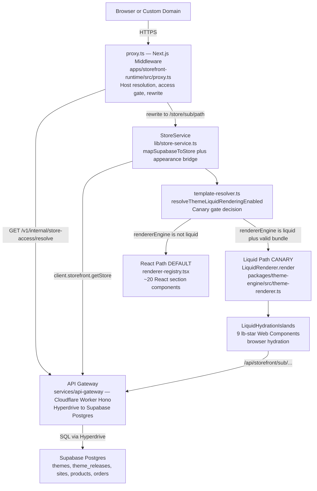
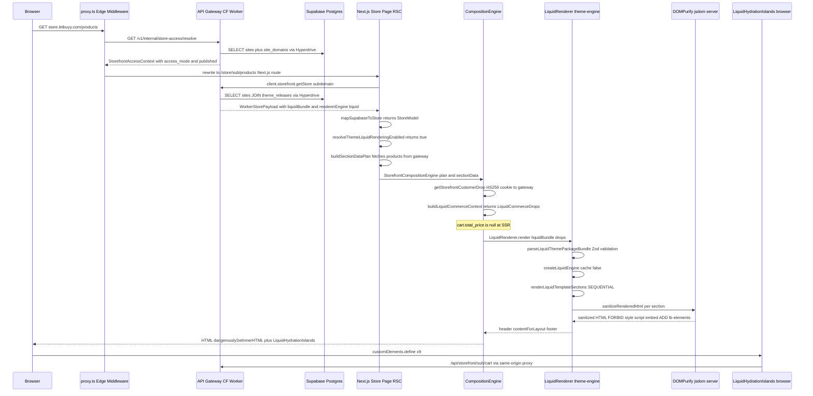
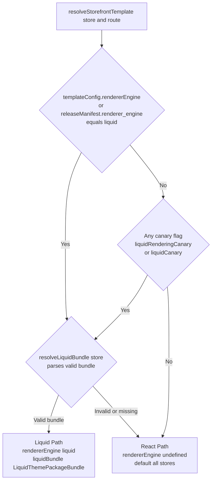

# 03 Storefront Liquid Platform — Enterprise Discovery Document

**Document class:** DISCOVERY — NO IMPLEMENTATION
**Date:** 2026-07-04
**Branch:** `stepup/main`
**Status:** DISCOVERY — NO IMPLEMENTATION
**Auditor:** Claude Sonnet 4.6 (multi-subagent adversarial review)
**Source files verified:** ~29 unique source and test files, 8 prior research documents reconciled

> This document is a discovery artifact only. Nothing in it prescribes when or how to implement. All implementation scheduling belongs exclusively in the Recommended Migration Order section (§11) and in `12_MASTER_LIQUID_MIGRATION_PLAN.md`.

---

## Table of Contents

1. [Architecture Overview](#1-architecture-overview)
2. [Current Implementation](#2-current-implementation)
3. [Repository Inventory](#3-repository-inventory)
4. [Runtime Flow](#4-runtime-flow)
5. [Dependency Graph](#5-dependency-graph)
6. [Missing Features](#6-missing-features)
7. [Partial Implementations](#7-partial-implementations)
8. [Technical Debt](#8-technical-debt)
9. [Enterprise Gap Analysis](#9-enterprise-gap-analysis)
10. [Risk Analysis](#10-risk-analysis)
11. [Recommended Migration Order](#11-recommended-migration-order)
12. [Docs-Reconciliation Verdict Registry](#12-docs-reconciliation-verdict-registry)
13. [Open Questions](#13-open-questions)

---

## 1. Architecture Overview

LetBuyy ships a **dual-renderer storefront**: a React/JSON-contract engine (the production default for all stores) and a full LiquidJS engine that is implemented, tested, and canary-gated. Migration 180 (`180_urban_kicks_liquid_theme.sql`) promoted the Urban Kicks theme to render via Liquid by writing `rendererEngine='liquid'` directly into `themes.default_template` — bypassing the global flag for that one theme. All other themes remain on React.

The global Liquid feature flag is `THEME_LIQUID_RENDERING_DEFAULT_ENABLED = false` at `packages/theme-engine/src/theme-governance.ts:14`. A platform-wide flip requires Architecture Review Board (ARB) approval (`THEME_LIQUID_PLATFORM_WIDE_FLIP_DECISION.authority = 'ARB'`).

### Dual-Engine Decision Matrix

| Activation Path | Source | Status |
|---|---|---|
| `themes.default_template.rendererEngine = 'liquid'` | DB migration 180 | ACTIVE — Urban Kicks only |
| `templateConfig.rendererEngine = 'liquid'` | Per-store JSONB | Available but not in use for other themes |
| `liquidRenderingCanary = true` | Per-store or theme config | Canary path |
| `THEME_LIQUID_RENDERING_DEFAULT_ENABLED` | Compile-time constant in `theme-governance.ts:14` | `false` — ARB-deferred |
| `?engine=liquid` query parameter | Dev override in `template-resolver.ts` | Dev only, ignored in production |

---

## 2. Current Implementation

### What is built and verifiably working

| Capability | Status | Evidence |
|---|---|---|
| LiquidJS v10.27.0 engine | IMPLEMENTED | `packages/theme-engine/src/theme-renderer.ts` — LiquidJS instantiation confirmed |
| DOMPurify v3.4.9 + jsdom v29.1.1 sanitizer | IMPLEMENTED | `LIQUID_RENDERED_HTML_DOMPURIFY_CONFIG` in `theme-renderer.ts` |
| 25 built-in section types with Zod schemas | IMPLEMENTED | `BUILT_IN_SECTION_SCHEMAS` in `built-in-section-schemas.ts` — 25 types confirmed by count |
| 9 Liquid hydration islands (Web Components) | IMPLEMENTED | `liquid-hydration-islands.tsx` (~1307 lines) |
| Urban Kicks Liquid bundle fixture | IMPLEMENTED | `createUrbanKicksLiquidThemeBundleFixture()` in `theme-bundle.ts` |
| letbuyy-core alias layer | IMPLEMENTED | `theme-bundle-core.ts` — `LETBUYY_CORE_THEME_SLUG`, `resolveCanonicalThemeSlug()` |
| 10 named Experiences | IMPLEMENTED | `theme-presets.ts` — `EXPERIENCE_REGISTRY` object.freeze (forge, sense, aura, craft, refresh, ride, dawn, bloom, nova, summit) |
| Industry to Experience map (9 industries) | IMPLEMENTED | `industry-experience-map.ts` — `INDUSTRY_EXPERIENCE_MAP` |
| Experience auto-apply at store creation | IMPLEMENTED | `services/api-gateway/src/routes/stores.ts:659–673` |
| Theme Settings Schema 5 groups | IMPLEMENTED | `THEME_SETTINGS_SCHEMA` in `theme-registry.ts` |
| Schema migration engine interface | IMPLEMENTED (zero migrations registered) | `migrateThemeTemplateSchemas()` in `theme-governance.ts` |
| Portable-to-Liquid compiler | IMPLEMENTED | `portable-to-liquid.ts` — `compilePortableToLiquidBundle()` |
| 16 storefront route types | IMPLEMENTED | `StorefrontRouteType` in `lib/theme-engine/types.ts` |
| ISR 60s revalidate plus cache tags | IMPLEMENTED | `export const revalidate = 60` on all storefront pages — confirmed in `page.tsx:10` |
| Multi-tenant host routing | IMPLEMENTED | `proxy.ts` — `resolveStorefrontHost()` plus `resolveAccess()` |
| HS256 customer session auth | IMPLEMENTED | `packages/auth-core/src/customer-session.ts` |
| 6 custom Liquid filters | IMPLEMENTED | `money`, `money_with_currency`, `json`, `asset_url`, `image_url`, `t` in `theme-renderer.ts` |
| Drop security limits | IMPLEMENTED | `MAX_LIQUID_DROP_DEPTH = 4`, `MAX_LIQUID_DROP_KEYS = 80`, `MAX_LIQUID_DROP_ARRAY_ITEMS = 100` in `theme-renderer.ts` |
| Liquid bundle DB persistence | IMPLEMENTED | Migrations 171, 172, 180, 181 — all confirmed present |
| Liquid feature flag with ARB gate | IMPLEMENTED | `THEME_LIQUID_RENDERING_DEFAULT_ENABLED = false` in `theme-governance.ts:14` |
| `settings` drop in Liquid scope | IMPLEMENTED | `buildLiquidScope()` in `theme-renderer.ts:573–576` — populated from `bundle.config.settings_data.current` |

### What is NOT built

| Capability | Status |
|---|---|
| On-disk `.liquid` files | MISSING — all templates are TypeScript string literals in `theme-bundle.ts` |
| Template caching | MISSING — `cache: false` on every LiquidJS instantiation |
| Shopify `` tag | MISSING |
| Shopify `` tag | MISSING |
| `linklists` / `linklist` Liquid object | MISSING — navigation is fetched server-side but never passed to `buildLiquidScope()` |
| `predictive_search`, `recommendations`, `gift_card`, `discount`, `checkout` Liquid objects | MISSING |
| Metafields system | MISSING |
| Font loading via `buildGoogleFontsHref()` | MISSING — function exists in `experience-fonts.ts` but has no call site in `<head>` |
| Shopify Theme Check compatibility | MISSING — templates are TypeScript, not on-disk `.liquid` |
| Blog API backend | MISSING — no confirmed gateway route for `/storefront/{sub}/blog` |
| `newsletter` / `newsletter-signup` type reconciliation | MISSING — type split exists across the two renderers |
| Snippets / partials system | BLOCKED — `` and `` forbidden by `ThemeLiquidSourceSchema` |

---

## 3. Repository Inventory

### packages/theme-engine/src/ (13 active source files)

| File | Lines | Role | Status |
|---|---|---|---|
| `theme-bundle.ts` | ~2971 | Zod schemas; Urban Kicks fixture; 22 Liquid section sources as TypeScript strings | IMPLEMENTED |
| `theme-renderer.ts` | ~933 | `LiquidRenderer`; DOMPurify config; 6 custom filters; `buildLiquidScope()` | IMPLEMENTED |
| `index.ts` | ~1248 | Barrel exports; `StoreTemplateConfig`; `DEFAULT_THEME_SETTINGS` | IMPLEMENTED |
| `theme-governance.ts` | ~369 | Feature flag; ARB gate; ART-17 parity array; schema migration engine | IMPLEMENTED |
| `theme-registry.ts` | ~734 | 12 base section schemas; `THEME_SETTINGS_SCHEMA`; `getDefaultStorefrontThemeTemplate()` | IMPLEMENTED (governance-frozen by convention) |
| `built-in-section-schemas.ts` | ~338 | 13 additional section schemas; `BUILT_IN_SECTION_SCHEMAS` (Object.freeze) | IMPLEMENTED |
| `theme-presets.ts` | ~523 | 10 Experiences; `EXPERIENCE_REGISTRY`; apply/overlay functions | IMPLEMENTED |
| `theme-bundle-core.ts` | ~83 | letbuyy-core alias; `createLetbuyyCoreLiquidThemeBundleFixture()` | IMPLEMENTED |
| `industry-experience-map.ts` | ~150 | `INDUSTRY_EXPERIENCE_MAP`; 18 aliases; `resolveExperienceForIndustry()` | IMPLEMENTED |
| `experience-fonts.ts` | ~83 | 6-font registry; `buildGoogleFontsHref()` — function exists, not wired into head | IMPLEMENTED (not integrated) |
| `portable-to-liquid.ts` | ~202 | L3 compiler: portable JSON to `LiquidThemePackageBundle` | IMPLEMENTED |
| `execution-runtime.ts` | ~487 | Section/block composition primitives | IMPLEMENTED |
| `jsdom-runtime.d.ts` | ~15 | Type shim for server-side DOMPurify + jsdom | SHIM |

### apps/storefront-runtime/src/lib/theme-engine/ (9 files)

| File | Lines | Role | Status |
|---|---|---|---|
| `composition-engine.tsx` | ~516 | SSR compositor; `renderLiquidPlan()`; `buildLiquidCommerceContext()` | IMPLEMENTED |
| `liquid-hydration-islands.tsx` | ~1307 | 9 `lb-*` Web Component custom elements | IMPLEMENTED |
| `template-resolver.ts` | ~309 | `resolveStorefrontTemplate()`; engine canary gate; `resolveLiquidBundle()` | IMPLEMENTED |
| `renderer-registry.tsx` | ~287 | React section registry (~20 renderers) | IMPLEMENTED (ART-17 frozen by convention) |
| `data-binding-engine.ts` | ~107 | `buildSectionDataPlan()`; product fetch heuristics | IMPLEMENTED |
| `types.ts` | ~95 | `StorefrontRenderPlan`; `StorefrontRouteType` (16 types) | IMPLEMENTED |
| `editor-preview-section-frame.tsx` | ~93 | Editor postMessage frame | IMPLEMENTED (postMessage key mismatch — see R-10) |
| `content-route.ts` | ~18 | CMS content fallback | IMPLEMENTED |
| `product-route.ts` | ~38 | Product listing/detail fallbacks | IMPLEMENTED |

### Database Migrations (theme-related)

| Migration | Effect | Status |
|---|---|---|
| `000_baseline.sql` | All table definitions: `themes`, `theme_releases`, `theme_editor_drafts`, etc. | IMPLEMENTED |
| `087_theme_template_drafts.sql` | Adds `template_key` plus scoped unique constraint to `theme_editor_drafts` | IMPLEMENTED |
| `171_liquid_bundle_persistence.sql` | Backfills Urban Kicks Liquid bundle into `themes.default_template.liquidBundle` | IMPLEMENTED |
| `172_liquid_bundle_refresh.sql` | Refreshes bundle to include full template set | IMPLEMENTED |
| `180_urban_kicks_liquid_theme.sql` | Sets `rendererEngine='liquid'` in Urban Kicks `themes.default_template`; adds `appearance` settings_schema group | IMPLEMENTED |
| `181_urban_kicks_settings_schema_complete.sql` | Adds `surfaceColor` and `isDark` to settings_schema | IMPLEMENTED |
| `185_v1_site_domains.sql` | `site_domains` + `site_domain_verifications` tables; RLS | IMPLEMENTED |
| `187_v1_sites_site_settings.sql` | Adds `sites.site_settings` JSONB column (appearance bridge) | IMPLEMENTED |

---

## 4. Runtime Flow

### Full Request Trace (Liquid Path)

### Engine Decision Logic (template-resolver.ts)

---

## 5. Dependency Graph

### Package-level dependencies (theme subsystem)

| Dependent | Dependency | Relationship |
|---|---|---|
| `apps/storefront-runtime` | `packages/theme-engine` | Liquid renderer, schemas, Experiences, `buildLiquidScope()` |
| `apps/storefront-runtime` | `packages/tenant-core` | Host resolution, `StoreModel` |
| `apps/storefront-runtime` | `packages/auth-core` | HS256 customer session |
| `apps/storefront-runtime` | `packages/api-client` | Gateway HTTP client |
| `apps/storefront-runtime` | `packages/commerce-core` | `ProductModel` type contract |
| `apps/merchant-control-plane` | `packages/theme-engine` | Editor: `ExperiencePicker`, schema validation, draft save |
| `services/api-gateway` | `packages/theme-engine` | `LiquidThemePackageBundleSchema` validation; `applyExperienceToTemplateConfig` |
| `services/api-gateway` | `packages/auth-core` | Customer session verification |
| `packages/theme-engine/theme-bundle-core.ts` | `packages/theme-engine/theme-bundle.ts` | Urban Kicks fixture (alias source) |
| `packages/theme-engine/industry-experience-map.ts` | `packages/theme-engine/theme-presets.ts` | `EXPERIENCE_REGISTRY`, `resolveExperienceForIndustry` |
| `packages/theme-engine/experience-fonts.ts` | `packages/theme-engine/theme-presets.ts` | `listExperiences()` |
| `packages/theme-engine/theme-renderer.ts` | `liquidjs` npm v10.27.0 | Template rendering — confirmed in `package.json` |
| `packages/theme-engine/theme-renderer.ts` | `dompurify` v3.4.9 + `jsdom` v29.1.1 | Server-side HTML sanitization |

### Intra-storefront data flow dependencies

| Module | Depends On | For |
|---|---|---|
| `composition-engine.tsx` | `template-resolver.ts` | Render plan |
| `composition-engine.tsx` | `LiquidRenderer` from theme-engine | Liquid rendering |
| `composition-engine.tsx` | `customer-drop.ts` | HS256 customer context |
| `composition-engine.tsx` | `renderer-registry.tsx` | React section dispatch |
| `composition-engine.tsx` | `liquid-hydration-islands.tsx` | Client islands mount |
| `template-resolver.ts` | `resolveThemeLiquidRenderingEnabled()` from theme-governance | Engine decision |
| `store-service.ts:673` | `createUrbanKicksLiquidThemeBundleFixture()` from theme-bundle | Liquid fallback bundle (branding leak — see R-06) |
| `liquid-hydration-islands.tsx` | `storefrontBrowserApiFetch()` from browser-client | Cart sync |

---

## 6. Missing Features

### 6.1 Liquid Language Gaps (vs Shopify Liquid)

| Missing Feature | Shopify Capability | LetBuyy Status | Risk |
|---|---|---|---|
| `` tag | Server-side pagination | MISSING | MEDIUM |
| `` tag | Native form rendering | MISSING | MEDIUM |
| `` tag / snippets | Template composition | BLOCKED — `ThemeLiquidSourceSchema` in `theme-bundle.ts` forbids it | HIGH |
| `` tag | Legacy partial inclusion | BLOCKED | HIGH |
| `` tag | Section-in-layout tag | MISSING — sections assembled programmatically | MEDIUM |
| `` / `` | Per-section JS/CSS | MISSING | LOW |
| `linklists` object | Navigation menus | MISSING — `StoreModel.navigation` never passed to `buildLiquidScope()` | HIGH |
| `predictive_search` | AJAX search object | MISSING — `search` drop resolves to null | MEDIUM |
| `recommendations` | Product recommendations | MISSING | LOW |
| `gift_card` object | Gift card display | MISSING | LOW |
| `discount` object | Discount display | MISSING | LOW |
| `checkout` Liquid object | Checkout context | MISSING — checkout is permanently React by design | LOW |
| `content_for_header` | Global script injection | MISSING | LOW |
| `img_tag`, `script_tag`, `stylesheet_tag` filters | HTML helper filters | MISSING | LOW |
| `metafield_tag` filter | Metafield rendering | MISSING | MEDIUM |
| Color filters such as `color_to_rgb` and `color_lighten` | Shopify color utilities | MISSING | LOW |
| `product.metafields` | Structured metadata | MISSING — no metafields system | HIGH |

**Note:** The `settings` Liquid object IS present — `buildLiquidScope()` at `theme-renderer.ts:573–576` populates it from `bundle.config.settings_data.current`. Prior research documents that listed it as missing were incorrect.

### 6.2 Template Coverage Gaps (Route Types)

| Route Type | React Template | Liquid Template | Gap |
|---|---|---|---|
| `index` home | IMPLEMENTED | IMPLEMENTED | — |
| `product` | IMPLEMENTED | IMPLEMENTED | — |
| `collection` | IMPLEMENTED | IMPLEMENTED | — |
| `cart` | IMPLEMENTED | IMPLEMENTED | — |
| `customers/login` | IMPLEMENTED | IMPLEMENTED | — |
| `customers/register` | IMPLEMENTED | IMPLEMENTED — form renders; LB-12 blocks submit endpoint | LB-12 blocker |
| `customers/account` | IMPLEMENTED | IMPLEMENTED | — |
| `customers/orders` | IMPLEMENTED | IMPLEMENTED | — |
| `customers/order` | IMPLEMENTED | IMPLEMENTED | — |
| `track` | IMPLEMENTED | IMPLEMENTED | — |
| `blog` | PARTIAL | MISSING | No confirmed blog backend API route |
| `article` | PARTIAL | MISSING | No confirmed blog backend API route |
| `page` | PARTIAL | MISSING | Partial CMS support only |
| `password` | PARTIAL | MISSING | — |
| `not_found` | PARTIAL | MISSING | — |

**Template coverage: 10 of 15 route types fully implemented in Liquid = 67%.**

### 6.3 Structural Missing Features

| Feature | Description | Gap |
|---|---|---|
| Font loading | `experience-fonts.ts::buildGoogleFontsHref()` defined but no call site in storefront `<head>` | Deferred; referenced in `docs/v1-execution/phase-2-5/04-font-system.md` |
| FONT_MAP completeness | `apps/storefront-runtime/src/app/store/[subdomain]/layout.tsx` `FONT_MAP` missing Cormorant Garamond, Libre Baskerville, Source Sans Pro, Lato | Experiences Aura, Craft, Dawn silently render system-font fallback |
| `letbuyy-core` DB row | `LETBUYY_CORE_THEME_SLUG = 'letbuyy-core'` defined in `theme-bundle-core.ts:31` but DB still stores `theme_id = 'urban-kicks'` | No migration has landed to add the catalog row |
| `apply_preset` gateway route | No `POST /v1/themes/:slug/apply-preset` exists; apply functions exist in `theme-presets.ts` | Engine layer complete; API contract missing for third-party clients |
| Blog API backend | No confirmed `/storefront/{sub}/blog` or `/storefront/{sub}/articles` gateway routes | Unknown C-11 in prior unknowns register |
| `lb-cart` CRUD mutations | `removeFromCart`, `updateQuantity`, `clearCart` not confirmed implemented in Web Components | Phase 5 hydration validation audit noted these |
| Section layout application in Experiences | `defaultSections` on each Experience validates but `applyExperienceToTemplateConfig` does NOT restructure sections | Only design tokens applied; section composition unchanged |
| `experienceId` as DB column | `experienceId` stored inside `sites.template_config` JSONB; no dedicated indexed column | Analytics/support queries require JSONB extraction |
| On-disk `.liquid` files | Zero `.liquid` files exist; all Liquid source is TypeScript string literals in `theme-bundle.ts` | Designers cannot author or iterate outside TypeScript build |
| LiquidJS template caching | `cache: false` — every request re-parses all section templates from scratch | Performance gap at production traffic |
| `theme_id = 'modern'` ghost reference | `create-store/route.ts:90` writes `theme_id: templateId \|\| 'modern'`; no `modern` row in `themes` table confirmed | All web-created stores may carry a ghost theme reference |

---

## 7. Partial Implementations

| Feature | What Exists | What Is Missing | Evidence |
|---|---|---|---|
| **letbuyy-core identity** | `theme-bundle-core.ts` fixture + alias resolution | DB row migration; `store-service.ts:671–673` still calls Urban Kicks fixture as fallback | `theme-bundle-core.ts:44–47` comment |
| **Experience system** | 10 Experiences with Zod schemas, overlay apply, editor picker, gateway auto-apply at store creation | Font loading wired into `<head>`; FONT_MAP completeness; `defaultSections` not applied | `theme-presets.ts`, `industry-experience-map.ts` |
| **Schema migration engine** | Full `ThemeSectionSchemaMigration` interface, chain-walk, loop detection | Zero concrete migration objects registered; no confirmed caller site | `theme-governance.ts:77–96` |
| **Theme editor Liquid bridge** | Draft route persists `liquidBundle` | postMessage naming inconsistency: `CenterPanel` sends `LETBUYY_THEME_EDITOR_SELECTION`; `EditorPreviewSectionFrame` listens for `letbuyy:theme-editor:section-selected` | `editor-preview-section-frame.tsx` |
| **Onboarding Experience assignment** | Gateway auto-applies Experience at store creation via `survey.industry`; onboarding UI shows industry picker | `ONBOARDING_INDUSTRIES` in `identity-platform` is a hardcoded array, not imported from `INDUSTRY_OPTIONS` (`industry-experience-map.ts`) | `onboarding/page.tsx:201–214` |
| **Cart in Liquid path** | `lb-cart-drawer` syncs via browser call to gateway after page load | Server-side cart totals always null at SSR; JS-disabled users see no totals | `composition-engine.tsx:291–307` |
| **Search drop** | `LiquidCommerceDrops.search` defined in interface and wired via `buildLiquidScope` | Permanently resolves to null because `context.search` is never populated in `buildLiquidCommerceContext()` | `theme-renderer.ts:628`, `composition-engine.tsx` |
| **Navigation in Liquid drops** | `StoreModel.navigation` fetched server-side | Never passed to `buildLiquidScope()`; Liquid templates cannot render dynamic menus | `theme-renderer.ts` buildLiquidScope — no `navigation` key |
| **Blog and article routes** | Next.js route pages exist for `blog/` | No confirmed backend API; Liquid templates for `blog`/`article` missing | runtime-architecture findings |
| **Theme versioning** | Integer `release_version` + rollback connected | Semantic versioning, schema compatibility range, automated migration on publish absent | `theme_releases.release_config` |

---

## 8. Technical Debt

| Debt Item | Severity | Location | Description |
|---|---|---|---|
| Urban Kicks branding leak | HIGH | `apps/storefront-runtime/src/lib/store-service.ts:671–673` | Fallback bundle calls `createUrbanKicksLiquidThemeBundleFixture()` instead of `createLetbuyyCoreLiquidThemeBundleFixture()` — every Liquid store without a valid bundle inherits Urban Kicks title suffix and `lb-theme--urban-kicks` body class |
| `newsletter` / `newsletter-signup` type split | HIGH | `theme-governance.ts:35`; migration 171 Liquid section keys | JSON-contract stores `newsletter` type; Liquid bundle indexes `newsletter-signup`; section lookup silently fails on Liquid render path |
| `heroBanner` Liquid parity gap | HIGH | `theme-bundle.ts:1009–1027` vs `theme-registry.ts:100–111` | Liquid `hero-banner` schema lacks `overlay`, `height`, `textAlign`, `image` fields present in React schema; React-configured merchants silently lose these settings on Liquid render |
| postMessage naming inconsistency | HIGH | `editor-preview-section-frame.tsx` | `CenterPanel` sends `LETBUYY_THEME_EDITOR_SELECTION`; frame listener expects `letbuyy:theme-editor:section-selected`; section selection highlight broken |
| `theme_id = 'modern'` ghost reference | HIGH | `apps/identity-platform/src/app/api/auth/create-store/route.ts:90` | `theme_id: templateId \|\| 'modern'` written to `sites`; `'modern'` row not confirmed in `themes` table; theme editor load may 404 |
| `cache: false` on LiquidJS per-request | HIGH | `packages/theme-engine/src/theme-renderer.ts` | Every storefront request re-parses all Liquid section sources; no in-process or edge cache; parse cost scales with section count |
| LiquidJS render without try/catch | HIGH | `theme-renderer.ts` — render loop at lines 299, 383 | `engine.parseAndRender()` called without try/catch; a malformed template source crashes the Next.js server component instead of graceful fallback |
| DOMPurify JSDOM singleton no rejection handler | MEDIUM | `theme-renderer.ts:868–900` — `domPurifyPromise` module-level singleton | No `.catch()` on the singleton initialization promise; JSDOM failure silently leaves sanitizer uninitialized |
| Sequential section rendering | MEDIUM | `theme-renderer.ts` — `renderLiquidTemplateSections()` | Sections rendered via sequential `await engine.parseAndRender()`; no `Promise.all()`; latency scales linearly with section count |
| Dual schema structure | MEDIUM | `theme-registry.ts` (5 groups) vs `themes.settings_schema` (flat `appearance` group after migration 180) | TypeScript static schema has 5 groups; Urban Kicks DB schema has 1 group; mismatch risk on schema reads |
| `getSectionSchemas` / `getThemeSettingsSchema` ignore `themeId` | MEDIUM | `theme-registry.ts` | Functions accept `_themeId` parameter but always return the same static schema |
| Duplicate `normalizeSectionType` mapping | MEDIUM | `store-service.ts` (inline) + `data-binding-engine.ts` + `renderer-registry.tsx` | Same type aliases replicated in three files; divergence risk on future section type additions |
| Two draft tables | MEDIUM | `theme_editor_drafts` + `theme_instance_drafts` | Both tables exist in baseline; no deprecation path documented |
| `ONBOARDING_INDUSTRIES` hardcoded | MEDIUM | `apps/identity-platform/src/app/onboarding/page.tsx:201–214` | Display labels duplicated from `INDUSTRY_OPTIONS` in `industry-experience-map.ts`; divergence risk when experiences are added |

---

## 9. Enterprise Gap Analysis

The following table measures each capability area against a Shopify-grade theme platform.

### Implementation Coverage Table

| Capability Area | Coverage % | Status | Missing Pieces | Risk Level |
|---|---|---|---|---|
| **Liquid Template Engine** | 70% | PARTIAL | ``, ``, `` snippets, `` tag, ``, ``; Shopify-specific filters | HIGH |
| **Commerce Liquid Objects** | 60% | PARTIAL | `linklists`/navigation object; `predictive_search`; `recommendations`; `gift_card`; `discount`; `checkout`; `product.metafields`; `content_for_header`; `search` drop permanently null — note: `settings` object IS present | HIGH |
| **Template Route Coverage** | 67% | PARTIAL | `blog`, `article`, `page`, `password`, `not_found` templates; LB-12 register endpoint blocker | HIGH |
| **Theme Schema / Settings System** | 65% | PARTIAL | Dual schema structure mismatch; `THEME_SETTINGS_SCHEMA` typography options exclude 4 Experience fonts; schema migration engine built but zero migrations registered | MEDIUM |
| **Section Type Registry** | 72% | PARTIAL | 25 section types defined; 20 have Liquid parity; 5 sections have no Liquid parity; `newsletter` type split; `heroBanner` field gap | HIGH |
| **Theme Editor Merchant UX** | 60% | PARTIAL | Liquid-mode live preview functional; postMessage inconsistency breaks section selection; no Liquid syntax validation in editor | MEDIUM |
| **Preset / Experience System** | 75% | PARTIAL | 10 Experiences defined and auto-applied; font loading integration missing; `defaultSections` not applied; `nova` not reachable via industry routing | MEDIUM |
| **Theme Authoring / Developer Experience** | 15% | MISSING | No on-disk `.liquid` files; no Theme Check integration; no Liquid syntax highlighting/linting; no snippet/partial system; templates locked behind TypeScript build | CRITICAL |
| **Performance: Render Pipeline** | 40% | PARTIAL | Per-request Liquid parse; sequential section rendering; DOMPurify JSDOM singleton per worker process; no edge-level template cache | CRITICAL |
| **Font System** | 45% | PARTIAL | 6 fonts defined; `buildGoogleFontsHref()` implemented; 4 fonts missing from storefront FONT_MAP; no injection into Liquid head | MEDIUM |
| **Theme Marketplace** | 10% | FROZEN | `apps/app-marketplace`, `apps/theme-marketplace`, `apps/developer-portal` frozen per CLAUDE.md governance | MEDIUM |
| **Multi-Tenancy / Theme Isolation** | 85% | IMPLEMENTED | Urban Kicks branding leak in fallback path; `letbuyy-core` DB row missing; `theme_id = 'modern'` ghost reference | MEDIUM |
| **Security Model** | 90% | IMPLEMENTED | DOMPurify + `outputEscape:'escape'` defense-in-depth; `BLOCKED_DROP_KEYS` for secrets; source schema forbids `<script`, `javascript:`, `data:text/html` | LOW |
| **Data Binding / Commerce Context** | 60% | PARTIAL | Products and customer drops populated; `search` drop permanently null; `navigation` never passed to Liquid scope; cart totals null at SSR | HIGH |
| **Customer Auth in Liquid** | 80% | IMPLEMENTED | HS256 JWT cookie resolved to `LiquidCustomerDrop`; `customers/register` form renders but LB-12 endpoint required | MEDIUM |
| **Cart and Checkout in Liquid** | 50% | PARTIAL | Cart drawer hydrates post-load; SSR totals null by design; `removeFromCart`/`updateQuantity`/`clearCart` not confirmed; checkout permanently React | MEDIUM |
| **Content / CMS** | 25% | MISSING | Blog backend API unconfirmed; `article`/`blog` Liquid templates missing; `page` drop partial | HIGH |
| **App Blocks / Extensions** | 40% | PARTIAL | `buildLiquidAppBlocks()` and `buildLiquidAppEmbeds()` implemented; not exposed as `{{ app_blocks }}` drop | MEDIUM |
| **Deployment / Canary Mechanism** | 70% | PARTIAL | Per-release `rendererEngine` activation implemented; no automated gradual rollout; ARB gate documented | MEDIUM |
| **Schema Versioning / Migration** | 20% | PARTIAL | Interface complete; chain-walk up to 20 steps; zero concrete migrations registered; no automated trigger | HIGH |
| **Observability / Canary Telemetry** | 65% | PARTIAL | `lb:canary:render` event emitted per render; `X-Lb-Render-Engine` header set in `proxy.ts` but decoupled from actual engine decision | MEDIUM |
| **Overall Liquid Platform Readiness** | **~55%** | **PARTIAL** | See section-by-section breakdown | **HIGH** |

---

## 10. Risk Analysis

| ID | Risk | Level | Evidence | Affected Surface |
|---|---|---|---|---|
| R-01 | `cache: false` on LiquidJS — every request re-parses all section templates; CPU and latency spike at production traffic | **CRITICAL** | `packages/theme-engine/src/theme-renderer.ts` — LiquidJS instantiated with `cache: false` | All Liquid-enabled storefronts |
| R-02 | No try/catch around `engine.parseAndRender()` — malformed Liquid source crashes Next.js server component instead of graceful fallback | **CRITICAL** | `theme-renderer.ts:299` and `theme-renderer.ts:383` — render loop lacks exception handling | Every page render on a Liquid store |
| R-03 | Theme authoring locked behind TypeScript build pipeline — zero `.liquid` files on disk; designers cannot author, lint, or run Theme Check | **HIGH** | `packages/theme-engine/src/theme-bundle.ts` — all Liquid sources are TypeScript string literals | Developer and designer onboarding; theme iteration velocity |
| R-04 | `newsletter` / `newsletter-signup` section type split — Liquid render path silently finds no match for `newsletter` sections | **HIGH** | `theme-governance.ts:35`; Liquid bundle indexes `newsletter-signup` | All stores with newsletter section |
| R-05 | `heroBanner` JSON-contract vs Liquid schema gap — `overlay`, `height`, `textAlign`, `image` fields absent in Liquid section | **HIGH** | `theme-bundle.ts:1009–1027` vs `theme-registry.ts:100–111` | Merchants who customize hero settings |
| R-06 | Urban Kicks branding leak — `store-service.ts:673` falls back to Urban Kicks fixture for all Liquid stores without valid bundles | **HIGH** | `apps/storefront-runtime/src/lib/store-service.ts:671–673` | All Liquid stores lacking explicit bundle in release |
| R-07 | LB-12 open blocker — `customers/register` Liquid template renders form; `POST /storefront/customer/register` endpoint returns 404 on submit | **HIGH** | `packages/theme-engine/test/liquid-l9-auth.test.ts:39` | All Liquid stores exposing register page |
| R-08 | `navigation` drop missing from Liquid scope — `StoreModel.navigation` fetched server-side but `buildLiquidScope()` at `theme-renderer.ts:552–591` contains no `navigation` key | **HIGH** | `theme-renderer.ts` — `buildLiquidScope` function | Any Liquid section using `{{ shop.navigation }}` |
| R-09 | Font loading not wired — 4 of 10 Experiences use Google Fonts that silently render as system-font fallback | **HIGH** | `experience-fonts.ts::buildGoogleFontsHref()` implemented; no call site in storefront `<head>`; FONT_MAP missing 4 families | Experiences Aura, Craft, Dawn, possibly Sense |
| R-10 | postMessage naming inconsistency in editor — `CenterPanel` sends `LETBUYY_THEME_EDITOR_SELECTION`; `EditorPreviewSectionFrame` listens for `letbuyy:theme-editor:section-selected`; section selection highlight broken | **HIGH** | `apps/merchant-control-plane/src/app/[store]/online-store/themes/[themeId]/editor/page.tsx`; `editor-preview-section-frame.tsx` | Theme editor section selection UX |
| R-11 | `search` drop permanently null — wired through `buildLiquidScope` at `theme-renderer.ts:587` but `context.search` is never populated by `buildLiquidCommerceContext()` | **HIGH** | `theme-renderer.ts:628` — `search: toLiquidDrop(context?.search) \|\| null` | Any Liquid template using `{{ search.results }}` |
| R-12 | DOMPurify JSDOM singleton has no rejection handler — `domPurifyPromise` at `theme-renderer.ts:868` has no `.catch()`; JSDOM failure leaves sanitizer silently uninitialized | **MEDIUM** | `packages/theme-engine/src/theme-renderer.ts:868–900` | All Liquid renders |
| R-13 | `resolveAccess()` in `proxy.ts` is `cache: 'no-store'` on every request — gateway tenant resolution bypasses all caching; spike SPOF risk | **MEDIUM** | `apps/storefront-runtime/src/proxy.ts` — `resolveAccess()` fetch | All storefront requests |
| R-14 | `theme_id = 'modern'` ghost reference — `create-store/route.ts:90` writes `theme_id: templateId \|\| 'modern'`; `'modern'` row not confirmed in `themes` table | **MEDIUM** | `apps/identity-platform/src/app/api/auth/create-store/route.ts:90` | All stores created via web onboarding |
| R-15 | `letbuyy-core` DB row missing — code redirects slugs via `resolveCanonicalThemeSlug()` but DB queries for `theme_id = 'letbuyy-core'` return 0 rows | **MEDIUM** | `packages/theme-engine/src/theme-bundle-core.ts:44–47` | Gateway DB queries using canonical slug |
| R-16 | No concrete schema migrations registered — interface built; zero concrete objects; backward-incompatible section schema changes cannot be migrated automatically | **MEDIUM** | `theme-governance.ts:77–96` | All stored theme releases in `theme_releases.template_snapshot` |
| R-17 | `` blocked but no snippets system — 22 sections are stand-alone; complex template reuse requires code duplication | **MEDIUM** | `ThemeLiquidSourceSchema` in `theme-bundle.ts` forbids ``; LiquidJS `dynamicPartials: false` | Theme developer experience |
| R-18 | Cart money null at SSR in Liquid path — cart totals null until `lb-cart-drawer` hydrates; JS-disabled users see no totals | **MEDIUM** | `composition-engine.tsx:291–307` — `item_count: null`, `subtotal: null` | All Liquid stores with cart drawer |
| R-19 | `strictVariables: false` — undefined drop keys render as empty string rather than error; Liquid template bugs are invisible in logs | **LOW** | `packages/theme-engine/src/theme-renderer.ts` — LiquidJS engine config | Template debugging velocity |
| R-20 | `BLOCKED_DROP_KEYS` incomplete — blocks `password`, `access_token`, `refresh_token`, `signing_secret`, `client_secret` but not `api_key`, `secret_key`, `private_key`, `webhook_secret` | **LOW** | `theme-renderer.ts:602` | Drop security in edge cases |
| R-21 | `getCustomerOrderDetailDrop` fetches all customer orders to find one by ID — O(n) with order history growth | **LOW** | `apps/storefront-runtime/src/lib/customer-drop.ts:118` | High-volume customer order detail pages |
| R-22 | `X-Lb-Render-Engine` header decoupled from actual render — proxy sets header from env var; per-release Liquid activation in `template-resolver.ts` produces misleading observability | **LOW** | `proxy.ts` vs `template-resolver.ts` resolution order | Monitoring and alerting accuracy |

---

## 11. Recommended Migration Order

> **Scope of this section:** Classifies discovered work into risk-reduction phases and render-path categories. Scheduling, resourcing, and sprint assignment belong in `12_MASTER_LIQUID_MIGRATION_PLAN.md`. This section is discovery-only.

### Classification Key

- **PURE-LIQUID** — changes inside `packages/theme-engine` or `apps/storefront-runtime/src/lib/theme-engine/`
- **JS-ISLAND** — changes to Web Component hydration islands
- **REMAIN-REACT** — surfaces that should stay React

### Phase 0 — Critical Unblocking

These discoveries represent correctness issues that block production integrity regardless of migration path.

| Item | Classification | Evidence |
|---|---|---|
| P0-1: Add try/catch around `engine.parseAndRender()` in `theme-renderer.ts`; fall back to safe rendered state on error | PURE-LIQUID | R-02: crash on malformed template |
| P0-2: Wire `createLetbuyyCoreLiquidThemeBundleFixture()` as the Liquid fallback in `store-service.ts:671–673` | PURE-LIQUID | R-06: Urban Kicks branding leak |
| P0-3: Reconcile `newsletter` / `newsletter-signup` type split across schema, parity array, and Liquid bundle | PURE-LIQUID | R-04: silent section-not-found on Liquid path |
| P0-4: Fix postMessage key mismatch in editor | JS-ISLAND (editor) | R-10: section selection highlight broken |

### Phase 1 — High-Impact Data Completeness

| Item | Classification | Evidence |
|---|---|---|
| P1-1: Pass `StoreModel.navigation` into `buildLiquidScope()` as `navigation` drop | PURE-LIQUID | R-08: Liquid themes cannot render dynamic menus |
| P1-2: Populate `search` drop in `buildLiquidCommerceContext()` | PURE-LIQUID | R-11: `search` permanently null |
| P1-3: Add `heroBanner` Liquid parity gap fields to `hero-banner` section schema in `theme-bundle.ts` | PURE-LIQUID | R-05: React-configured merchants lose settings |
| P1-4: Resolve LB-12 — implement `POST /storefront/customer/register` in gateway | PURE-LIQUID / gateway | R-07: register form 404s on submit |
| P1-5: Add rejection handler to `domPurifyPromise` singleton in `theme-renderer.ts` | PURE-LIQUID | R-12: silent sanitizer failure |
| P1-6: Wire `buildGoogleFontsHref()` into Liquid layout head assets; add 4 missing fonts to storefront FONT_MAP | PURE-LIQUID | R-09: 4 of 10 Experiences render wrong fonts |

### Phase 2 — Template Completeness

| Item | Classification | Evidence |
|---|---|---|
| P2-1: Implement `blog`, `article` Liquid templates; confirm or implement gateway blog API backend | PURE-LIQUID | §6.2 template coverage gap |
| P2-2: Implement `page` Liquid template; populate `page` drop from ContentService | PURE-LIQUID | §6.2 template coverage gap |
| P2-3: Implement `password` and `not_found` Liquid templates | PURE-LIQUID | §6.2 template coverage gap |
| P2-4: Implement collection drop for index/shop routes | PURE-LIQUID | dynamic-sources findings |

### Phase 3 — Performance

| Item | Classification | Evidence |
|---|---|---|
| P3-1: Add in-process LiquidJS template cache keyed on bundleSlug plus sectionId with TTL tied to release version | PURE-LIQUID | R-01: per-request parse cost |
| P3-2: Parallelize section rendering with `Promise.all()` in `renderLiquidTemplateSections()` | PURE-LIQUID | Technical debt — sequential section rendering |
| P3-3: Add edge or CDN-level cache for `resolveAccess()` calls in `proxy.ts` with TTL 30–60 seconds | REMAIN-REACT (infra) | R-13: gateway SPOF on tenant resolution |

### Phase 4 — Schema Governance

| Item | Classification | Evidence |
|---|---|---|
| P4-1: Register first concrete `ThemeSectionSchemaMigration` for the `heroBanner` field additions; define migration trigger at publish or store-read time | PURE-LIQUID | R-16: stored configs cannot be upgraded |
| P4-2: Land `letbuyy-core` DB row migration; update DB queries to accept both `urban-kicks` and `letbuyy-core` slug during transition | PURE-LIQUID DB migration | R-15; `theme-bundle-core.ts:44–47` |
| P4-3: Align `THEME_SETTINGS_SCHEMA` TypeScript 5-group structure with DB `settings_schema` flat `appearance` group | PURE-LIQUID | Technical debt — dual schema structure |
| P4-4: Consolidate `ONBOARDING_INDUSTRIES` in identity-platform to import `INDUSTRY_OPTIONS` from `industry-experience-map.ts` | PURE-LIQUID | Technical debt — hardcoded industries |

### Phase 5 — Developer Experience

| Item | Classification | Evidence |
|---|---|---|
| P5-1: Move Liquid templates from TypeScript string literals to on-disk `.liquid` files with a build step | PURE-LIQUID | R-03; §6.3 Missing Features |
| P5-2: Integrate Theme Check or equivalent Liquid linter into CI; hook into `validate-governance.mjs` | PURE-LIQUID | §6.3 Missing Features |
| P5-3: Implement snippets/partials system as an alternative to blocked `` | PURE-LIQUID | R-17; technical debt |
| P5-4: Implement `` tag and `paginate` object for collection page pagination | PURE-LIQUID | §6.1 Liquid language gaps |

### Surfaces That Must Remain React

| Surface | Reason |
|---|---|
| Checkout — `apps/storefront-runtime/src/.../checkout/` | Razorpay SDK, idempotency keys, COD flow, and server-authoritative ledger RPCs require React; confirmed by `docs/theme-research/07-react-storefront-elimination-study.md` |
| Header/footer React section groups | Used as fallback on non-Liquid pages; ART-17 froze existing React section renderers by convention |
| `CartProvider`, `CustomerAuthProvider`, `WishlistProvider` context wrappers | Client state management for React path; Liquid path uses Web Component islands |
| `apps/storefront-runtime/src/app/store/[subdomain]/layout.tsx` frame | Engine-conditional (`liquidPage` flag at line 119); remains the chrome layer for both paths |
| Theme editor main shell in `apps/merchant-control-plane` | React application; Liquid preview is iframe-embedded; editor shell remains React |

---

## 12. Docs-Reconciliation Verdict Registry

Reconciles prior-document claims against the current committed code state (branch `stepup/main`, 2026-07-03). Claims tagged STALE or SUPERSEDED override any contradictory assertion in prior research documents.

| Hypothesis / Prior Doc Claim | Verdict | Current Code Evidence |
|---|---|---|
| Storefront is React-default hybrid | **STILL-ACCURATE** | `theme-governance.ts:14` `THEME_LIQUID_RENDERING_DEFAULT_ENABLED = false`; migration 180 activates Liquid only for `urban-kicks` theme |
| Liquid rendering behind `THEME_LIQUID_RENDERING_DEFAULT_ENABLED` canary flag | **PARTIALLY SUPERSEDED** | Flag is `false` globally, but migration 180 wrote `rendererEngine='liquid'` into `themes.default_template` for Urban Kicks — bypassing the flag for that theme. Urban Kicks is now first-class Liquid, not just canary. |
| theme-registry.ts is governance-frozen | **CONVENTION ONLY** | `SECTION_SCHEMAS` is a plain `const` — NOT `Object.freeze()`d. The freeze is a team convention. `BUILT_IN_SECTION_SCHEMAS` IS frozen at export. |
| ART-17 forbids new React-per-section after freeze | **DOCUMENTED, NOT MECHANICALLY ENFORCED** | Referenced in `CLAUDE.md` and `THEME_LIQUID_PORTABLE_SECTION_PARITY` (20 entries). No build-time check was confirmed in `validate-governance.mjs` that rejects new sections without Liquid parity. |
| Urban Kicks 85% reusable as Core | **SUPERSEDED** | Implemented. `theme-bundle-core.ts` ships `createLetbuyyCoreLiquidThemeBundleFixture()` and `LETBUYY_CORE_THEME_SLUG = 'letbuyy-core'`. |
| Preset system needs apply_preset API | **PARTIALLY STALE** | Engine-layer apply functions exist: `applyExperienceToSettingsData`, `applyExperienceToTemplateConfig` in `theme-presets.ts`. Gateway auto-applies at store creation. No standalone `/api/apply-preset` route exists for third-party clients. |
| Onboarding does not auto-assign themes | **PARTIALLY CLOSED** | Auto-assignment happens server-side at store creation when `survey.industry` is present. NOT triggered if `survey.industry` is absent. |
| Phase 1 Critical Correction — liquidRenderingCanary defaulting to true | **STALE — BUG WAS FIXED** | `apps/storefront-runtime/src/lib/store-service.ts:679` has `liquidRenderingCanary: undefined` in committed code. The working-tree bug described was fixed before commit. |
| INDUSTRY_EXPERIENCE_MAP does not exist | **STALE** | `industry-experience-map.ts` defines all 9 industry to experience mappings with synonym normalization and integrity checks. |
| createLetbuyyCoreLiquidThemeBundleFixture() does not yet exist | **STALE** | Function exists at `packages/theme-engine/src/theme-bundle-core.ts:66`. |
| `settings` Liquid object is MISSING | **INCORRECT IN PRIOR DOCS** | `buildLiquidScope()` at `theme-renderer.ts:573–576` populates `settings` from `bundle.config.settings_data.current`. The prior claim was incorrect. |
| collection metadata binding broken in Liquid | **PARTIALLY VERIFIED (2026-07-04)** | The `/collections/[slug]` route IS fully implemented: `collections/[slug]/page.tsx:102–108` correctly populates the Liquid collection drop from the API (`loadCollectionWithProducts`) and binds it per section. HOWEVER, collection metadata binding IS broken for non-collection routes (home/shop/index): `buildSectionDataPlan` in `data-binding-engine.ts` has no code path to fetch or bind a collection object for those route types. On home/shop routes the Liquid collection drop is either null or a synthetic `{id:'all-products'}` fallback derived from the route slug, not from a real collection DB row. The prior claim is partially correct: the gap exists for non-collection routes only. |
| theme_renderer_manifests disconnected from runtime | **STILL-ACCURATE** | No new code connects `theme_renderer_manifests` table to the rendering pipeline. |
| Checkout permanently React | **STILL-ACCURATE** | Confirmed by `docs/theme-research/07-react-storefront-elimination-study.md`; Razorpay SDK plus ledger RPCs require React. |

---

## 13. Open Questions

Most questions below remained unanswered after the initial static analysis and require runtime probes or human knowledge to resolve. Items marked with a confirmed answer have since been resolved by repository inspection (2026-07-04).

1. **`FEATURE_LIQUID = 'false'` in `[env.production.vars]` is confirmed correct; `FEATURE_LIQUID = 'true'` in staging is also correct.** However, the flag is dormant at the **gateway layer only**: `FEATURE_LIQUID` is declared as an env var type in `services/api-gateway/src/index.ts:227` but no route calls `featureGate('FEATURE_LIQUID', ...)`. It does NOT prevent the storefront-runtime from activating Liquid rendering. Platform-wide Liquid rendering is controlled entirely by `templateConfig.rendererEngine` and the `THEME_LIQUID_RENDERING_DEFAULT_ENABLED` canary constant in `theme-governance.ts`. "Dormant" in this document means dormant at the gateway routing layer only; the canary gate in `storefront-runtime` is the real enforcement point.

2. **Is there a storefront cache invalidation mechanism when a merchant publishes a new theme release?** The gateway has `bumpStorefrontCacheVersion` utilities. Does it also invalidate the Next.js ISR `revalidate = 60` cache?

3. **What happens when `createUrbanKicksLiquidThemeBundleFixture()` is used as a fallback for a non-Urban-Kicks store?** Does the fixture produce visible Urban Kicks branding content, or is it a safe empty fallback?

4. **How is `CUSTOMER_SESSION_SECRET` rotation handled?** No `PREVIOUS` key variant is defined. A rotation would log out all current customers.

5. **`PRODUCT_VARIANTS_RELATIONAL_READS` flag is confirmed: read exclusively in the api-gateway, not in storefront-runtime.** The flag is evaluated in `services/api-gateway/src/routes/storefront.ts:429` (`productVariantRelationalReadsEnabled`) and `services/api-gateway/src/routes/products.ts:153`. When enabled (the default — `'on'`), the gateway removes `variants` from the inline product SQL column select and instead joins from the `product_variants` table via a follow-up query, merging the results before returning. The storefront-runtime `product-service.ts` does not read this flag; it calls the gateway via the API client, which applies the flag server-side. The `storefront-runtime` code has no reference to `PRODUCT_VARIANTS_RELATIONAL_READS`.

6. **Is the collection route type fully implemented?** Individual collection pages require resolving a collection by slug. Is a collection handle single-segment, handled by the `[...path]` catch-all?

7. **What is the precise mechanism preventing `resolveDevEngineOverride()` from activating in production?** Documented as production-ignored but the enforcement mechanism was not confirmed.

8. **`ALLOW_ARIA_ATTR` is not set — but `aria-*` protection is layered, and the risk is narrow, not broad.** Two mechanisms together cover most cases: (1) `CUSTOM_ELEMENT_HANDLING.attributeNameCheck` (`/^(?:aria-[a-z0-9-]+|...)/i`, `theme-renderer.ts:172`) explicitly permits all `aria-*` attributes on `lb-*` custom elements; (2) `USE_PROFILES: { html: true }` (`theme-renderer.ts:120`) preserves standard `aria-*` on normal HTML elements. The genuine gap is that only `aria-live` and `aria-pressed` appear in `ADD_ATTR`; any `aria-*` attribute placed on a non-`lb-*` custom element that falls outside the tag-name regex would be stripped by DOMPurify. The accessibility risk is narrow: it applies only to third-party or non-`lb-*` custom elements using `aria-*`, not to standard HTML or the nine `lb-*` Web Components.

9. **Does `themes.default_template.rendererEngine = 'liquid'` (set by migration 180) cascade to all stores on the Urban Kicks theme?** If the gateway passes `rendererEngine` through from `themes.default_template`, all Urban Kicks stores would render Liquid regardless of the global flag.

10. **Is the `lb-cart` CRUD mutation surface fully implemented?** `removeFromCart`, `updateQuantity`, `clearCart` not confirmed implemented in `lb-cart-drawer` and `lb-cart` Web Components.

---

*Document generated 2026-07-04 | Branch: stepup/main | Adversarial reviewer: Claude Sonnet 4.6 | Status: DISCOVERY — NO IMPLEMENTATION | Source files spot-checked: theme-governance.ts, theme-renderer.ts, proxy.ts, store-service.ts, built-in-section-schemas.ts, theme-bundle-core.ts, theme-presets.ts, composition-engine.tsx, create-store/route.ts, 6 migration SQL files*
