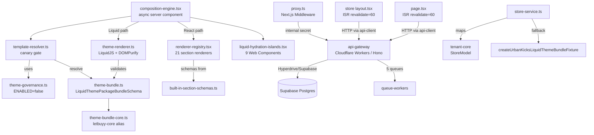
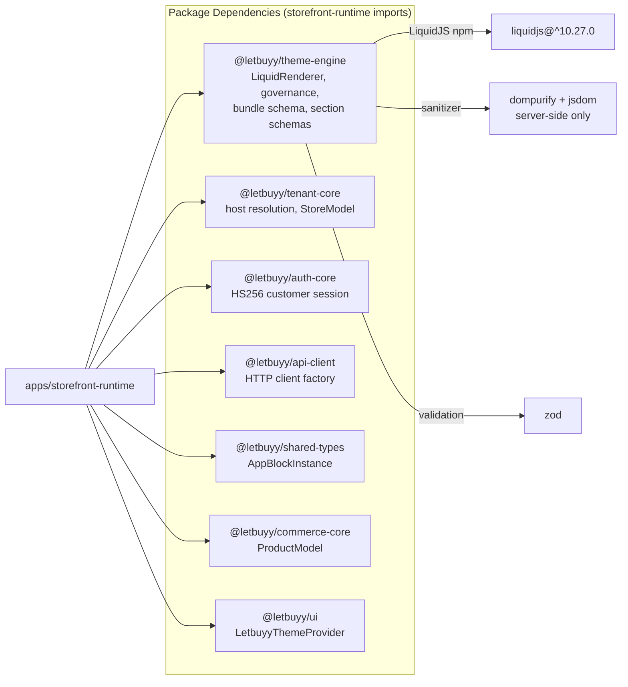

# 04 — React Component Dependency Map

**Document type:** Discovery (read-only; no implementation directives outside the Recommended Migration Order section)
**Audit date:** 2026-07-04
**Auditor:** Claude Code subagent (adversarial review pass)
**Repository branch:** stepup/main
**Status:** VERIFIED against repo — all path claims confirmed via direct file reads

---

## Architecture Overview

LetBuyy's storefront (`apps/storefront-runtime`) is a **dual-engine hybrid** built on Next.js 16.1.6 and React 19.2.3. The production default is a JSON-contract React path. A full Liquid engine (powered by the `liquidjs` npm package v10.27.0, **not** Shopify's Ruby engine) is implemented and canary-gated. The global canary switch is **hardcoded `false`** at `packages/theme-engine/src/theme-governance.ts:14`:

```typescript
export const THEME_LIQUID_RENDERING_DEFAULT_ENABLED = false;
```

A platform-wide ARB decision governs any future global flip:

```typescript
export const THEME_LIQUID_PLATFORM_WIDE_FLIP_DECISION = {
  status: 'deferred',
  authority: 'ARB',
  ...
} as const;
```

Per-theme opt-in is possible: Urban Kicks / LetBuyy Core is the only production theme with `rendererEngine: 'liquid'` set in the DB (migration 180).

---

## Current Implementation

| Layer | Technology | File |
|-------|-----------|------|
| Request entry | Next.js 16 middleware | `apps/storefront-runtime/src/proxy.ts` |
| Multi-tenancy | `resolveStorefrontHost()` from `@letbuyy/tenant-core` | `packages/tenant-core/src/index.ts` |
| Store data | `StoreService` → `@letbuyy/api-client` → gateway | `apps/storefront-runtime/src/lib/store-service.ts` |
| Render decision | `resolveStorefrontTemplate()` | `apps/storefront-runtime/src/lib/theme-engine/template-resolver.ts` |
| React rendering | 21 registered section renderers | `apps/storefront-runtime/src/lib/theme-engine/renderer-registry.tsx` |
| Liquid rendering | `LiquidRenderer` (LiquidJS) + DOMPurify/jsdom | `packages/theme-engine/src/theme-renderer.ts` |
| Browser hydration | 9 Web Component islands (`lb-*`) | `apps/storefront-runtime/src/lib/theme-engine/liquid-hydration-islands.tsx` |
| Canary governance | `resolveThemeLiquidRenderingEnabled()` | `packages/theme-engine/src/theme-governance.ts` |
| Theme bundles | Zod-validated bundle schema | `packages/theme-engine/src/theme-bundle.ts` |
| Core alias | `resolveCanonicalThemeSlug()` | `packages/theme-engine/src/theme-bundle-core.ts` |

**React section renderers (21 registered in `SECTION_RENDERER_DEFINITIONS`):**
`core.header`, `core.footer`, `core.announcement-bar`, `core.hero`, `core.product-grid`, `core.product-detail`, `core.featured-products`, `core.testimonials`, `core.about`, `core.newsletter`, `core.portfolio-grid`, `core.skills`, `core.experience-timeline`, `core.contact-form`, `core.cta`, `core.services-grid`, `core.rich-content`, `commerce.category-grid`, `commerce.brand-marquee`, `commerce.trust-badges`, `apps.app-block-slot`

**Liquid hydration islands (9 Web Components defined in `liquid-hydration-islands.tsx`):**
`lb-add-to-cart`, `lb-cart-drawer`, `lb-search`, `lb-variant-picker`, `lb-review-form`, `lb-wishlist-toggle`, `lb-cart`, `lb-customer-settings`, `lb-address-manager`

---

## Repository Inventory

| File | Role | Status |
|------|------|--------|
| `apps/storefront-runtime/src/proxy.ts` | Next.js 16 middleware; multi-tenant host routing, access mode enforcement, preview token handling | IMPLEMENTED |
| `apps/storefront-runtime/src/app/store/[subdomain]/layout.tsx` | Store layout; CSS custom-property injection (`--primary`, `--font-main`, etc.); React chrome or Liquid passthrough | IMPLEMENTED |
| `apps/storefront-runtime/src/app/store/[subdomain]/page.tsx` | Store home page; resolves render plan via `resolveStorefrontTemplate()`; renders `StorefrontCompositionEngine` | IMPLEMENTED |
| `apps/storefront-runtime/src/app/store/[subdomain]/products/page.tsx` | Products/collection listing page | IMPLEMENTED |
| `apps/storefront-runtime/src/app/store/[subdomain]/product/page.tsx` | Product detail page | IMPLEMENTED |
| `apps/storefront-runtime/src/app/store/[subdomain]/checkout/page.tsx` | Checkout SSR wrapper (permanently React — Razorpay SDK) | IMPLEMENTED |
| `apps/storefront-runtime/src/app/store/[subdomain]/checkout/checkout-client.tsx` | Checkout client component; Razorpay integration | IMPLEMENTED |
| `apps/storefront-runtime/src/app/store/[subdomain]/collections/page.tsx` | Collections listing | PARTIAL |
| `apps/storefront-runtime/src/app/store/[subdomain]/blog/` | Blog pages | PARTIAL |
| `apps/storefront-runtime/src/app/store/[subdomain]/[...path]/page.tsx` | CMS catch-all (single-segment slugs) | IMPLEMENTED |
| `apps/storefront-runtime/src/app/store/[subdomain]/liquid-theme.css` | Liquid theme base CSS | IMPLEMENTED |
| `apps/storefront-runtime/src/app/api/themes/install/route.ts` | Theme install stub (returns 410 Gone) | STUB/BLOCKED |
| `apps/storefront-runtime/src/app/api/seed/route.ts` | Demo seed data (dev only) | STUB |
| `apps/storefront-runtime/src/lib/store-service.ts` | Fetches and normalises store data from gateway; full `mapSupabaseToStore()` pipeline | IMPLEMENTED |
| `apps/storefront-runtime/src/lib/session.ts` | Customer HS256 session management | IMPLEMENTED |
| `apps/storefront-runtime/src/lib/api/browser-client.ts` | Client-side fetch via same-origin `/api/storefront/…` proxy | IMPLEMENTED |
| `apps/storefront-runtime/src/lib/theme-engine/template-resolver.ts` | Canary gate; `resolveLiquidBundle()`; dev engine override | IMPLEMENTED |
| `apps/storefront-runtime/src/lib/theme-engine/composition-engine.tsx` | Async server component; React section list or Liquid render path | IMPLEMENTED |
| `apps/storefront-runtime/src/lib/theme-engine/renderer-registry.tsx` | 21 registered React section renderers | IMPLEMENTED |
| `apps/storefront-runtime/src/lib/theme-engine/liquid-hydration-islands.tsx` | 9 Web Component islands (1307 lines) | IMPLEMENTED |
| `apps/storefront-runtime/src/lib/theme-engine/data-binding-engine.ts` | Builds per-section product data plans | IMPLEMENTED |
| `apps/storefront-runtime/src/lib/theme-engine/types.ts` | `StorefrontRenderPlan`, `LiquidCommerceDrops` | IMPLEMENTED |
| `apps/storefront-runtime/next.config.ts` | Next.js config; `/api/storefront/:subdomain/:path*` rewrite; CSP; `serverExternalPackages: ['jsdom']` | IMPLEMENTED |
| `apps/storefront-runtime/package.json` | Next.js 16.1.6; React 19.2.3; jsdom 29.1.1 | IMPLEMENTED |
| `packages/theme-engine/src/theme-renderer.ts` | `LiquidRenderer`; DOMPurify config (`LIQUID_RENDERED_HTML_DOMPURIFY_CONFIG`); `JsonContractThemeRenderer` | IMPLEMENTED |
| `packages/theme-engine/src/theme-governance.ts` | `THEME_LIQUID_RENDERING_DEFAULT_ENABLED = false`; 20-entry `THEME_LIQUID_PORTABLE_SECTION_PARITY`; `resolveThemeLiquidRenderingEnabled()` | IMPLEMENTED |
| `packages/theme-engine/src/theme-registry.ts` | 12 static section schemas; GOVERNANCE-FROZEN (ART-17) | FROZEN |
| `packages/theme-engine/src/theme-bundle.ts` | `LiquidThemePackageBundleSchema`; `createUrbanKicksLiquidThemeBundleFixture()` | IMPLEMENTED |
| `packages/theme-engine/src/theme-bundle-core.ts` | `createLetbuyyCoreLiquidThemeBundleFixture()`; `resolveCanonicalThemeSlug()`; `LETBUYY_CORE_THEME_SLUG = 'letbuyy-core'` | IMPLEMENTED (not yet wired to compile path) |
| `packages/theme-engine/src/theme-presets.ts` | Experience engine: 10 experiences, `applyExperienceToSettingsData()`, `applyExperienceToTemplateConfig()` | IMPLEMENTED (not wired to gateway) |
| `packages/theme-engine/src/industry-experience-map.ts` | `INDUSTRY_EXPERIENCE_MAP`; `resolveExperienceForIndustry()` | IMPLEMENTED (not wired to onboarding) |
| `packages/theme-engine/src/experience-fonts.ts` | Font-name-to-CSS-stack map | IMPLEMENTED (not wired to Liquid head assets) |
| `packages/theme-engine/src/execution-runtime.ts` | `composeStorefrontTheme()`; section/block registries; hydration manifests | IMPLEMENTED |
| `packages/theme-engine/src/portable-to-liquid.ts` | `compilePortableToLiquidBundle()`; L3 portable-JSON → Liquid bundle compiler | IMPLEMENTED |
| `packages/theme-engine/src/built-in-section-schemas.ts` | `BUILT_IN_SECTION_SCHEMAS` map used by renderer-registry and governance audit | IMPLEMENTED |
| `packages/tenant-core/src/index.ts` | `resolveStorefrontHost()`; `StoreModel`; `mapPublicStorePayload()` | IMPLEMENTED |
| `packages/auth-core/src/customer-session.ts` | `issueCustomerSession()`; `verifyCustomerSession()` — HS256 JWT | IMPLEMENTED |
| `services/api-gateway/src/index.ts` | Hono app entry; all route mounts; 5 Cloudflare Queue bindings | IMPLEMENTED |
| `services/api-gateway/src/routes/storefront.ts` | Storefront public API; store, products, navigation, cart, reviews | IMPLEMENTED |
| `services/api-gateway/wrangler.toml` | `FEATURE_LIQUID = "false"` in `[env.production.vars]`; `FEATURE_LIQUID = "true"` in staging — flag is declared (`featureFlags.ts:4`) but consumed by no gateway route (see Risk Analysis) | IMPLEMENTED |
| `apps/identity-platform/src/app/api/auth/create-store/route.ts` | Store creation; `theme_id: templateId \|\| 'modern'` (ghost reference risk) | IMPLEMENTED |
| `database/supabase/migrations/180_urban_kicks_liquid_theme.sql` | Sets `rendererEngine = 'liquid'` in `themes.default_template` for `urban-kicks` | IMPLEMENTED |
| `database/supabase/migrations/185_v1_site_domains.sql` | `site_domains` table; multi-domain support | IMPLEMENTED |
| `database/supabase/migrations/187_v1_sites_site_settings.sql` | Adds `sites.site_settings` jsonb (appearance bridge) | IMPLEMENTED |

---

## Runtime Flow

The following traces a request for a published Liquid-enabled store:

1. Browser requests `https://store.letbuyy.com/products`
2. Cloudflare/Vercel routes to `apps/storefront-runtime` Next.js app.
3. **Next.js middleware** (`proxy.ts`):
   - Extracts host; calls `resolveStorefrontHost()` from `@letbuyy/tenant-core`.
   - Calls `GET /v1/internal/store-access/resolve?host=…` to api-gateway (HMAC `INTERNAL_API_SECRET`); `cache: 'no-store'` on every request — no edge-level TTL.
   - Rewrites to `/store/${subdomain}/products` internally.
   - Sets `X-Lb-Render-Engine: react` (observability only; actual engine decision is made later in `template-resolver.ts`).
4. **Layout** (`apps/storefront-runtime/src/app/store/[subdomain]/layout.tsx`):
   - `StoreService.getStoreBySubdomainAnyStatus(subdomain)` → api-gateway → Hyperdrive or Supabase JS.
   - `resolveStorefrontTemplate()` → `resolveThemeLiquidRenderingEnabled()` → finds `templateConfig.rendererEngine === 'liquid'` → returns `true`.
   - `liquidPage = renderPlan.rendererEngine === 'liquid'` (line 119) — layout skips React `StorefrontSectionGroupRenderer` for header/footer; renders `{children}` directly.
   - Emits inline `<style>` with CSS custom properties (`--primary`, `--secondary`, `--accent`, `--radius`, `--font-main`, `--font-heading`, etc.).
5. **Page** (`apps/storefront-runtime/src/app/store/[subdomain]/products/page.tsx`):
   - Calls `buildSectionDataPlan()` → fetches product data from gateway.
   - Renders `<StorefrontCompositionEngine store plan sectionData />`.
6. **Composition Engine** (`composition-engine.tsx`):
   - **Liquid path** (`renderLiquidPlan()`): assembles `LiquidCommerceDrops`; calls `createThemeRenderer('liquid').render()`; DOMPurify sanitizes each section; concatenates `header + contentForLayout + footer`.
   - Cart money totals are `null` at SSR (`source: 'browser_hydrated'`) — intentional; never fabricated.
   - Appends `<LiquidHydrationIslands>` which registers 9 Web Components client-side.
   - **React fallback** (`RenderSectionList`): maps sections through `renderRegisteredSection()` in `renderer-registry.tsx`; unknown sections render `UnknownSectionFallback`.
7. **Browser hydration**: `lb-cart-drawer` calls `/api/storefront/${subdomain}/cart` → Next.js rewrite → gateway. All browser API calls go through the same-origin proxy (`/api/storefront/:subdomain/:path*` → `${gatewayBaseUrl}/storefront/:subdomain/:path*`).

---

## Dependency Graph





---

## Coverage Table

| Route type | React template | Liquid template | Status |
|------------|---------------|-----------------|--------|
| `index` (homepage) | `core.hero` + grid sections | `index` in bundle | BOTH |
| `product` | `core.product-detail` | `product` in bundle | BOTH |
| `collection` | `core.product-grid` + `core.category-grid` | `collection` in bundle | BOTH |
| `cart` | cart page component | `cart` in bundle | BOTH |
| `customers/login` | account components | `customers/login` in bundle | BOTH |
| `customers/register` | account components | `customers/register` in bundle | BOTH (API endpoint LB-12 unresolved) |
| `customers/account` | account components | `customers/account` in bundle | BOTH |
| `customers/orders` | order components | `customers/orders` in bundle | BOTH |
| `customers/order` | order detail | `customers/order` in bundle | BOTH |
| `track` | order tracking | `track` in bundle | BOTH |
| `page` | CMS catch-all | no dedicated Liquid template | REACT ONLY |
| `blog` | blog components | no dedicated Liquid template | REACT PARTIAL |
| `article` | blog article | no dedicated Liquid template | REACT ONLY |
| `password` | coming-soon gate | no Liquid template | REACT ONLY |
| `not_found` | error page | no Liquid template | REACT ONLY |
| `checkout` | checkout-client.tsx (Razorpay) | permanently React — not in scope | REACT ONLY (by design) |

**Parity tracking:** `THEME_LIQUID_PORTABLE_SECTION_PARITY` in `theme-governance.ts` tracks 20 React-to-Liquid section mappings; `THEME_LIQUID_PARITY_REQUIRED_SECTION_COUNT = 20`.

---

## Missing Features

1. **Gateway apply-preset API.** `POST /v1/themes/:slug/apply-preset` does not exist. The engine-level functions `applyExperienceToSettingsData()` and `applyExperienceToTemplateConfig()` now exist in `packages/theme-engine/src/theme-presets.ts` but are not wired to any HTTP endpoint.

2. **LetBuyy Core compile-path wiring.** `packages/theme-engine/src/theme-bundle-core.ts` provides `createLetbuyyCoreLiquidThemeBundleFixture()` and `resolveCanonicalThemeSlug()`, but `apps/storefront-runtime/src/lib/store-service.ts` line 673 still uses `createUrbanKicksLiquidThemeBundleFixture()` as the Liquid fallback for all stores. Urban Kicks branding (title suffix, `lb-theme--urban-kicks` body class, `storeName: 'Urban Kicks'`) contaminates all Liquid-enabled stores at runtime until this is swapped.

3. **Industry capture in onboarding.** `apps/identity-platform/src/app/api/auth/create-store/route.ts` line 90 writes `theme_id: templateId || 'modern'`. No industry or experience field is set. `INDUSTRY_OPTIONS` from `industry-experience-map.ts` exists but no onboarding UI or server route consumes it.

4. **Font loading.** `packages/theme-engine/src/experience-fonts.ts` defines the font-name-to-CSS-stack map but no `@font-face` injection or Google Fonts `<link>` is emitted in the Liquid head asset builder. Non-system fonts in experiences silently fall back to system fonts.

5. **Liquid templates for 5 route types.** `page`, `blog`, `article`, `password`, `not_found` have no Liquid templates in the Urban Kicks / LetBuyy Core bundle. These routes render React exclusively.

6. **OIDC/ES256 merchant auth dormant.** The identity-platform ES256 JWKS verifier (`oidc-jwks`) exists in `services/api-gateway/src/identity-foundation/auth-verifier-registry.ts` but is `activeByDefault: false` and gated by `FEATURE_OIDC_CLIENT`. Merchant auth is Supabase bearer token in practice.

7. **Subscription journey.** No `subscriptions` domain exists. `CLAUDE.md` documents this gap.

8. **`theme_id = 'modern'` ghost reference.** `create-store/route.ts:90` writes `theme_id: templateId || 'modern'`. Whether `'modern'` corresponds to an actual row in the `themes` table is unresolved (see Technical Debt).

---

## Partial Implementations

1. **LetBuyy Core identity.** Engine layer complete (fixture function + slug alias resolution in `theme-bundle-core.ts`); DB alias row and compile-path wiring deferred.

2. **Experience system.** 10 experiences defined with full Zod schemas and apply functions in `theme-presets.ts`; no gateway API route and no onboarding wiring present.

3. **Industry → experience resolution.** `industry-experience-map.ts` implements the complete resolver with synonym normalisation and integrity checks; not called from any request path.

4. **Liquid rendering.** Engine sound and real; off by default globally; Urban Kicks is the only theme with `rendererEngine: 'liquid'` in DB; template coverage covers 10 of 15 non-checkout route types (see Coverage Table).

5. **Multi-domain.** `site_domains` table (migration 185) + proxy 301-redirect logic present; domain verification logic lives in the gateway's `custom-domains.ts` route.

6. **Step-up auth.** `STEP_UP_SIGNING_SECRET` env var exists in gateway `Env` type and is referenced in memory docs for refund/payout gates; not visible in the storefront layer.

---

## Technical Debt

1. **Urban Kicks branding leak (HIGH).** `store-service.ts:673` still calls `createUrbanKicksLiquidThemeBundleFixture()` as the Liquid fallback. Every Liquid-enabled store that has a malformed or missing `liquidBundle` picks up Urban Kicks branding. The fix function (`createLetbuyyCoreLiquidThemeBundleFixture()`) now exists in `theme-bundle-core.ts` but is not yet used in this code path.

2. **`theme_id = 'modern'` ghost reference (HIGH).** `apps/identity-platform/src/app/api/auth/create-store/route.ts:90` writes `theme_id: templateId || 'modern'` to `sites`. If `'modern'` has no corresponding row in the `themes` table, newly created stores have a ghost theme reference that may cause editor failures.

3. **Dual store-fetch per page render (MEDIUM).** Both `layout.tsx` and `page.tsx` independently call `StoreService.getStoreBySubdomainAnyStatus(subdomain)`. Next.js ISR deduplication covers repeated requests within the 60-second window, but the first cold render (post-revalidation) makes two gateway calls per page.

4. **`THEME_LIQUID_RENDERING_DEFAULT_ENABLED` env-var confusion (MEDIUM).** In `proxy.ts` this env var controls only the `X-Lb-Render-Engine` observability header. The actual per-store render decision uses `resolveThemeLiquidRenderingEnabled()` which inspects `templateConfig.rendererEngine` and release manifest fields — not the env var. Setting the env var to `'true'` does not enable Liquid rendering globally; it only changes the header value.

5. **`X-Lb-Render-Engine` header mismatch (LOW).** The proxy sets this header based on the global env var. If a specific theme release activates Liquid via `releaseManifest.rendererEngine = 'liquid'` (per-release Phase-9 activation), the header will report `'react'` while the page actually renders Liquid. This is an observability gap, not a correctness issue.

6. **Sequential section rendering in Liquid path (LOW).** `LiquidRenderer.render()` renders sections sequentially (`await engine.parseAndRender()` per section, each passing through DOMPurify/jsdom). For pages with many sections this adds latency proportional to section count with no parallelism.

7. **No edge runtime (LOW).** No `export const runtime = 'edge'` appears in any storefront page. All pages run Node.js runtime on Vercel.

8. **`CUSTOMER_SESSION_SECRET` rotation has no graceful period (LOW).** `verifyCustomerSession()` accepts only the current secret. No `CUSTOMER_SESSION_SECRET_PREVIOUS` env var exists. A secret rotation immediately invalidates all active customer sessions.

9. **Legacy section-type normalisation accumulation.** `normalizeSectionType()` in `store-service.ts` maps ~15 legacy type aliases (e.g., `'hero'` → `'heroBanner'`). This grows as the section type system evolves.

10. **LiquidJS `cache: false` on every request (MEDIUM).** All Liquid template source is re-parsed per request. At non-trivial traffic volumes this will be a CPU and latency bottleneck. No output-caching layer for rendered Liquid HTML fragments was found.

---

## Enterprise Gap Analysis

| Capability | Shopify Liquid parity | LetBuyy Liquid status |
|---|---|---|
| `.liquid` on-disk files | Yes — full file tree | No — TypeScript string literals in `theme-bundle.ts` |
| `` partial tag | Yes | BLOCKED at source validation |
| `` tag | Yes | NOT IMPLEMENTED |
| `` tag | Yes | NOT IMPLEMENTED |
| `{{ settings }}` global object | Yes | PARTIAL — `settings_data.current` passed at `theme-renderer.ts:573–576`; Shopify-compatible key-path parity unmet due to TypeScript vs DB schema divergence |
| `{{ linklists }}` / navigation object | Yes | NOT IMPLEMENTED |
| `product.metafields` | Yes | NOT IMPLEMENTED |
| Color filters (`color_to_rgb`, etc.) | Yes | NOT IMPLEMENTED |
| `img_tag`, `script_tag`, `stylesheet_tag` | Yes | NOT IMPLEMENTED |
| Theme Check CLI compatibility | Yes | No — templates are TypeScript strings |
| Snippet system (`` partials) | Yes | No partials mechanism |
| Cart totals at SSR | Yes (Liquid has full cart access) | No — `null` at SSR; browser-hydrated only |
| Per-request template caching | Yes | No — `cache: false` in LiquidJS config |
| ARB-gated global Liquid flip | N/A | Deferred, `authority: 'ARB'` |

**Custom Liquid filters implemented:** `money`, `money_with_currency`, `json`, `asset_url`, `image_url`, `t` (i18n). Standard LiquidJS built-ins are available without custom registration.

**Commerce drops available at SSR:** `shop`, `product`, `collection`, `cart` (money fields null), `customer`, `page`, `blog`, `article`, `order`. Security limits enforced: `MAX_LIQUID_DROP_DEPTH = 4`, `MAX_LIQUID_DROP_KEYS = 80`, `MAX_LIQUID_DROP_ARRAY_ITEMS = 100`.

---

## Risk Analysis

| Level | Risk | Evidence |
|-------|------|---------|
| HIGH | Urban Kicks branding leaks into all Liquid-enabled stores with invalid bundles | `apps/storefront-runtime/src/lib/store-service.ts:673` — `createUrbanKicksLiquidThemeBundleFixture()` is the Liquid fallback; `createLetbuyyCoreLiquidThemeBundleFixture()` in `theme-bundle-core.ts` is not yet wired |
| HIGH | `theme_id = 'modern'` ghost reference may cause editor failures for new stores | `apps/identity-platform/src/app/api/auth/create-store/route.ts:90` — `theme_id: templateId \|\| 'modern'`; no DB verification possible |
| HIGH | Missing `INTERNAL_API_SECRET` bypasses all store access enforcement — password-protected, offline, and preview-only stores become freely accessible (`NextResponse.next()` skips the access-mode gate). No unauthorized gateway requests are made; the gateway fetch is never attempted when the secret is absent. | `proxy.ts` — if key absent, `internalHeaders()` returns `null`, `backendConfig()` returns `null`, `resolveAccess()` short-circuits to `{ status: 'unavailable' }` before any `fetch()` is issued, middleware calls `NextResponse.next()` without store access check |
| HIGH | Apply-preset engine exists but is not wired to any HTTP endpoint | `packages/theme-engine/src/theme-presets.ts` — `applyExperienceToSettingsData()` and `applyExperienceToTemplateConfig()` present; no gateway route found |
| LOW | `FEATURE_LIQUID = "false"` in production gateway is DORMANT (verified 2026-07-04) — no conflict with per-theme Liquid activation | `services/api-gateway/src/middleware/featureFlags.ts:4` declares the flag, but `featureGate()` is instantiated only for `FEATURE_GRAPHQL` and `FEATURE_EXTENSIONS` (`services/api-gateway/src/index.ts:658-663`); no gateway route checks `FEATURE_LIQUID`, so renderer selection is entirely storefront-side (`templateConfig.rendererEngine` + canary flag) and the production `"false"` value has no runtime effect today |
| MEDIUM | Cart totals always `null` at SSR in Liquid path | `composition-engine.tsx` — `item_count: null`, `source: 'browser_hydrated'`; Liquid themes cannot display cart totals without client JavaScript |
| MEDIUM | `resolveAccess()` is `cache: 'no-store'` on every request | `proxy.ts` — every page view triggers a gateway tenant-resolution fetch; no edge-level TTL; gateway endpoint is a single point of failure under traffic spikes |
| MEDIUM | DOMPurify/jsdom per-section sanitization adds latency at scale | `packages/theme-engine/src/theme-renderer.ts` — no output-cache for sanitized HTML fragments; sequential per-section sanitization |
| MEDIUM | LiquidJS `cache: false` — all templates re-parsed per request | `theme-renderer.ts` lines 437-438; CPU-intensive at non-trivial traffic |
| LOW | `store-lookup` API endpoint is publicly unauthenticated | `apps/storefront-runtime/src/app/api/store-lookup/route.ts` — validates format but is accessible for subdomain enumeration |
| LOW | `api/seed` route exists and may not be dev-only gated | `apps/storefront-runtime/src/app/api/seed/route.ts` — described as demo seed data; production presence is a risk if not guarded |
| LOW | `X-Lb-Render-Engine` header decoupled from actual engine decision | `proxy.ts` vs `template-resolver.ts` — header reflects global env var; per-release Liquid activation produces misleading header |
| LOW | `CUSTOMER_SESSION_SECRET` rotation immediately invalidates all sessions | `apps/storefront-runtime/src/lib/session.ts` — no grace-period previous-secret support |

---

## Recommended Migration Order

The following is a discovery-derived sequencing. No implementation directives should be read into this section until an ARB-approved migration plan exists.

**Phase 1 — Foundation correctness (prerequisite for all Liquid expansion)**
1. Swap `createUrbanKicksLiquidThemeBundleFixture()` for `createLetbuyyCoreLiquidThemeBundleFixture()` in `store-service.ts:673`. This eliminates the Urban Kicks branding leak and exercises the `theme-bundle-core.ts` code path that already exists.
2. Resolve `theme_id = 'modern'` ghost reference in `create-store/route.ts:90`. Verify whether a `'modern'` row exists in the `themes` table and introduce a valid default or an explicit error.
3. Add `INTERNAL_API_SECRET` startup health-check / hard startup validation to surface misconfiguration before traffic is served.

**Phase 2 — Experience system activation**
4. Wire `resolveExperienceForIndustry()` from `industry-experience-map.ts` into the onboarding flow (`create-store/route.ts` or `onboarding/page.tsx`).
5. Add the `POST /v1/themes/:slug/apply-preset` gateway route that calls `applyExperienceToSettingsData()` and `applyExperienceToTemplateConfig()`.
6. Wire `experience-fonts.ts` font stacks into the Liquid head-asset builder to prevent silent system-font fallback.

**Phase 3 — Liquid template coverage completion**
7. Add Liquid templates for `page`, `blog`, `article`, `password`, and `not_found` route types to the Urban Kicks / LetBuyy Core bundle.
8. Address the `customers/register` LB-12 API endpoint gap so the Liquid registration template has a working server route.

**Phase 4 — Performance and observability**
9. Investigate Liquid template caching (output-cache by `theme:${slug}:route:${type}`) to address the `cache: false` per-request parse overhead.
10. Add a TTL or SWR mechanism to the `resolveAccess()` gateway call in `proxy.ts` to reduce per-request gateway dependency.
11. Fix the `X-Lb-Render-Engine` header so it reflects the actual per-release engine decision from `template-resolver.ts` rather than the global env var.

**Phase 5 — ARB-gated platform-wide Liquid flip** (requires green render-parity, security, and performance evidence)
12. Surface the ARB decision point: `THEME_LIQUID_PLATFORM_WIDE_FLIP_DECISION.status = 'deferred'` remains the gate. This phase is out of scope until Phase 1–4 are complete and evidence is provided.

---

*This document is discovery-only. Specific implementation timing, resourcing, and ARB sign-off are determined outside this document. All path claims in this document have been verified against the repository at commit `742192cf` (branch `stepup/main`, 2026-07-04).*
