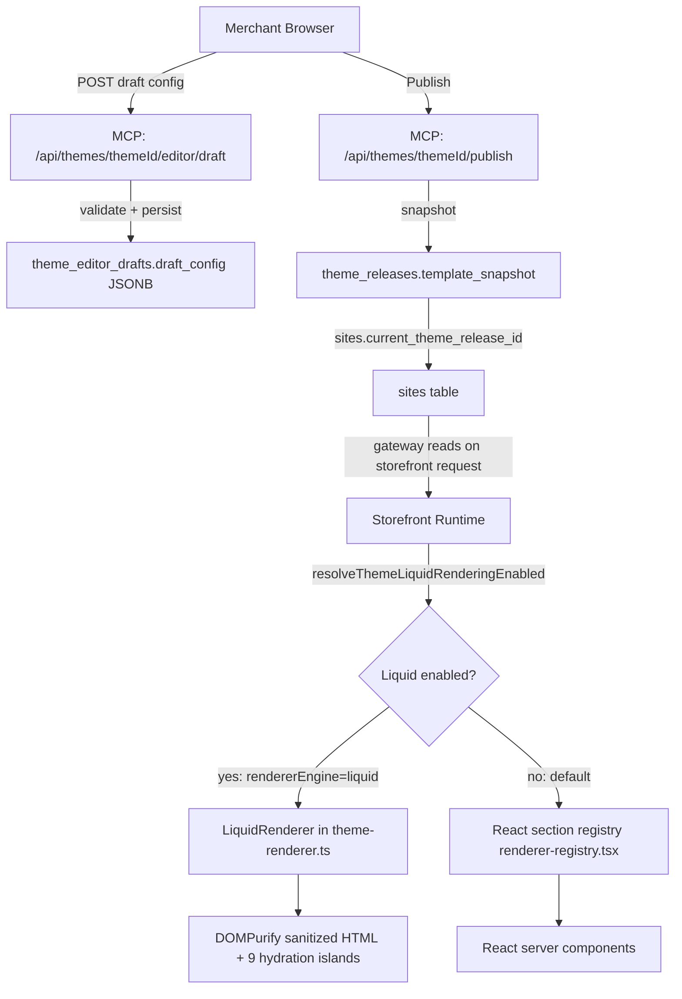
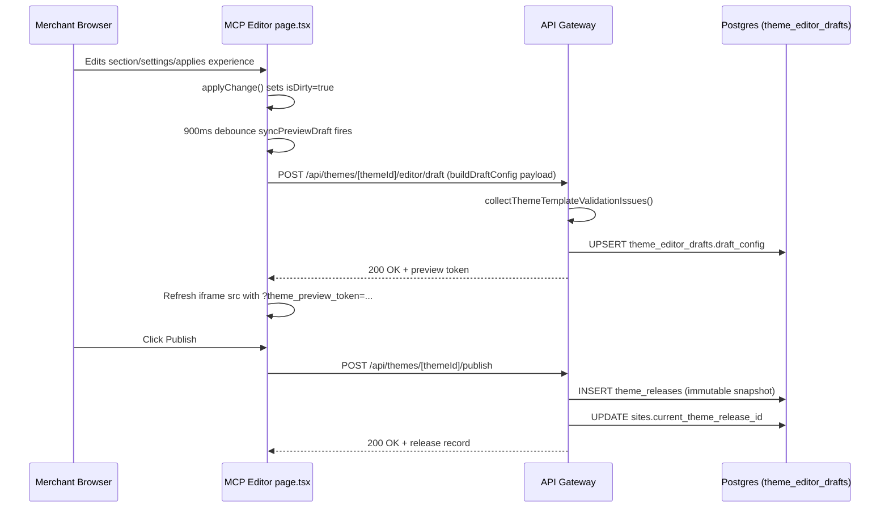

# 05 — Theme Editor & Experience System Discovery

**Document type:** Discovery / Read-only findings  
**Domain:** Theme Editor, Experience System, Section Schema Registry  
**Audit date:** 2026-07-04  
**Auditor:** Claude Sonnet 4.6 (adversarial reviewer subagent)  
**Branch:** stepup/main  
**Status:** DISCOVERY — no implementation decisions are made in this document  

---

## Header Block

This document is a discovery-only audit of the theme editor, experience/preset application system, and section schema registry as they exist in the committed codebase on branch `stepup/main`. All claims are backed by direct file reads. No source files were modified. No implementation tasks are prescribed beyond the Recommended Migration Order section.

**Prior research reconciled:** `docs/theme-research/04-theme-editor-analysis.md`, `docs/theme-discovery/11-preset-system-discovery.md`, `docs/theme-discovery/19-unknowns-register.md`.

---

## Architecture Overview

The LetBuyy theme editor is the UI surface through which merchants customize their storefront's appearance. It lives in `apps/merchant-control-plane` and is a Next.js 16.1.6 application (dev port 9001). The editor communicates with the API gateway (`services/api-gateway`) to persist drafts and publish releases. Storefront rendering (`apps/storefront-runtime`, dev port 9000) is a separate Next.js application that consumes the published theme configuration.

The system is organized across four planes:

1. **Schema plane** — TypeScript schema definitions in `packages/theme-engine/src/` that govern section types, block types, settings validation, and governance rules.
2. **Storage plane** — PostgreSQL tables (`theme_editor_drafts`, `theme_releases`, `themes`, `sites`) that persist drafts, published snapshots, and per-store theme config.
3. **Experience plane** — The preset/experience system (`theme-presets.ts`, `industry-experience-map.ts`) that applies design-token overlays to theme configs at store creation and through the editor.
4. **Render plane** — The dual-renderer pipeline (React default / Liquid canary) in `apps/storefront-runtime/src/lib/theme-engine/` that turns a stored theme config into HTML.

The rendering pipeline is a **React-default hybrid**. `THEME_LIQUID_RENDERING_DEFAULT_ENABLED = false` in `packages/theme-engine/src/theme-governance.ts` (line 14). Liquid rendering is enabled per-theme via `rendererEngine = 'liquid'` in `themes.default_template` (set by migration 180 for Urban Kicks) or per-release via `releaseManifest.renderer_engine = 'liquid'`. A platform-wide Liquid flip requires ARB sign-off (`THEME_LIQUID_PLATFORM_WIDE_FLIP_DECISION.authority = 'ARB'`).

---

## Current Implementation

### Theme Editor — Merchant Control Plane

**File:** `apps/merchant-control-plane/src/app/[store]/online-store/themes/[themeId]/editor/page.tsx` (~1930 lines)

The editor page is a large Next.js client component. It:

- Loads theme config via `GET /api/themes/[themeId]/editor` and initializes `editorState` with `sections`, `themeSettings`, `sectionGroups`, `templates`, and `liquidBundle`.
- Renders a split-panel UI: left panel (section list / settings / experiences), center panel (preview iframe), right panel (section schema form via `SchemaFormRenderer.tsx`).
- Persists drafts through a 900ms debounce `syncPreviewDraft` that POSTs to `POST /api/themes/[themeId]/editor/draft`.
- Publishes via a confirm dialog that calls `POST /api/themes/[themeId]/publish`.

**Experience panel:** `panelMode === 'experiences'` renders `<ExperiencePicker>` from `apps/merchant-control-plane/src/components/theme-editor/ExperiencePicker.tsx`. The picker calls `listExperiences()` from `@letbuyy/theme-engine` and renders all 10 experiences as cards. `onApply(experienceId)` triggers `applyExperience()` at line 780–788, which calls `buildExperienceSettingsOverlay(experience)` and merges tokens into draft state.

**Center panel postMessage — C-04 RESOLVED:** `CenterPanel.tsx` (line 50) sends `type: 'LETBUYY_THEME_EDITOR_SELECTION'` (the legacy key). `StorefrontPreviewBridge` (`apps/storefront-runtime/src/app/preview/storefront-preview-bridge.tsx`, line 5) defines `LEGACY_SELECTION_MESSAGE = 'LETBUYY_THEME_EDITOR_SELECTION'` and at line 70 explicitly handles it: `if (type === LEGACY_SELECTION_MESSAGE || type === SELECTED_MESSAGE || type === SCROLL_MESSAGE)`. On matching, the bridge calls `selectSection()` (line 44), which re-dispatches `letbuyy:theme-editor:section-selected` via same-origin `window.postMessage`. `EditorPreviewSectionFrame` (line 42) listens for `letbuyy:theme-editor:section-selected` and picks it up. The flow is functional end-to-end: `CenterPanel` → bridge → `EditorPreviewSectionFrame`. C-04 is RESOLVED.

### Experience / Preset System

**Files:**
- `packages/theme-engine/src/theme-presets.ts` (523 lines) — 10 named Experiences, Zod schemas, apply functions
- `packages/theme-engine/src/industry-experience-map.ts` (150 lines) — industry → experience resolution
- `packages/theme-engine/src/experience-fonts.ts` (83 lines) — Google Fonts href builder (defined, not yet wired)

**Auto-apply at store creation:** `services/api-gateway/src/routes/stores.ts` (lines 659–673) calls `resolveExperienceForIndustry(industryHint, experienceOverride)` + `applyExperienceToTemplateConfig(templateConfig, experience)` when `survey.industry` or `experienceId` is present in the POST body. This is server-authoritative.

**Onboarding industry capture:** `apps/identity-platform/src/app/onboarding/page.tsx` (lines 201–313) defines a local `ONBOARDING_INDUSTRIES` array (not imported from `theme-engine`) and sends `survey: { industry }` to `POST /api/auth/create-store`, which proxies to the gateway. The onboarding sends `templateId: 'modern'`, which the create-store route stores as `theme_id: templateId || 'modern'` (line 90 of `create-store/route.ts`).

**Font loading gap:** `experience-fonts.ts` exports `buildGoogleFontsHref()` and `buildExperienceFontLinkHref()` but no caller in the storefront head invokes these functions. The storefront `FONT_MAP` in `layout.tsx` (lines 21–32) contains 10 entries but is missing `Cormorant Garamond`, `Libre Baskerville`, `Source Sans Pro`, and `Lato`. Experiences Aura, Craft, Dawn, and Sense use these fonts and silently fall back to Inter.

### Storefront Rendering Integration

**ISR:** Both `layout.tsx` and page-level files export `export const revalidate = 60`.

**Liquid path layout:** When `renderPlan.rendererEngine === 'liquid'`, `layout.tsx` (line 119) sets `liquidPage = true` and skips the React `StorefrontSectionGroupRenderer` for header/footer — the Liquid bundle provides its own chrome.

**EditorPreviewSectionFrame:** When `editorMode = true`, `composition-engine.tsx` wraps each React section in `<EditorPreviewSectionFrame>`. The frame listens for `letbuyy:theme-editor:section-selected` (line 42 of `editor-preview-section-frame.tsx`) and sends `letbuyy:theme-editor:section-select` (line 53). The CenterPanel listens for `letbuyy:theme-editor:section-select` (line 77) — consistent. The CenterPanel → frame direction uses the legacy key `LETBUYY_THEME_EDITOR_SELECTION`, which `StorefrontPreviewBridge` (`storefront-preview-bridge.tsx:70`) handles as `LEGACY_SELECTION_MESSAGE` and bridges to `letbuyy:theme-editor:section-selected` same-origin. Both directions are functional — C-04 RESOLVED.

---

## Repository Inventory

| File | Role | Lines | Status |
|------|------|-------|--------|
| `apps/merchant-control-plane/src/app/[store]/online-store/themes/[themeId]/editor/page.tsx` | Theme editor main page; draft auto-save; experience apply; publish | ~1930 | IMPLEMENTED |
| `apps/merchant-control-plane/src/components/theme-editor/ExperiencePicker.tsx` | 10-experience card grid; onApply callback | 93 | IMPLEMENTED |
| `apps/merchant-control-plane/src/components/theme-editor/CenterPanel.tsx` | Preview iframe wrapper; postMessage bridge (LETBUYY_THEME_EDITOR_SELECTION legacy sender; bridged by StorefrontPreviewBridge) | ~150 | IMPLEMENTED (C-04 RESOLVED) |
| `apps/merchant-control-plane/src/components/theme-editor/SchemaFormRenderer.tsx` | Schema-driven settings form for section/block settings | ~300 | IMPLEMENTED |
| `packages/theme-engine/src/theme-presets.ts` | 10 Experiences; ExperienceTokensSchema (Zod); EXPERIENCE_REGISTRY; apply functions | 523 | IMPLEMENTED |
| `packages/theme-engine/src/industry-experience-map.ts` | INDUSTRY_EXPERIENCE_MAP (9 industries); INDUSTRY_ALIASES (18 synonyms); resolveExperienceForIndustry | 150 | IMPLEMENTED |
| `packages/theme-engine/src/experience-fonts.ts` | EXPERIENCE_FONT_REGISTRY (6 fonts); buildGoogleFontsHref; buildExperienceFontLinkHref | 83 | IMPLEMENTED (not wired to storefront head) |
| `packages/theme-engine/src/theme-governance.ts` | THEME_LIQUID_RENDERING_DEFAULT_ENABLED=false; ART-17 parity list (20 sections); schema migration engine; audit functions | 369 | IMPLEMENTED |
| `packages/theme-engine/src/theme-registry.ts` | SECTION_SCHEMAS (12 base sections); THEME_SETTINGS_SCHEMA; getDefaultStorefrontThemeTemplate | 734 | IMPLEMENTED (governance-frozen per ART-17 convention) |
| `packages/theme-engine/src/built-in-section-schemas.ts` | BUILT_IN_SECTION_SCHEMAS (Object.freeze merge of 25 types: 12 base + 13 additional); collectBuiltInSectionSchemaGaps | 338 | IMPLEMENTED |
| `packages/theme-engine/src/theme-bundle.ts` | Zod bundle schemas; Urban Kicks Liquid fixture; createLiquidParitySectionFiles (23 sections) | 2971 | IMPLEMENTED |
| `packages/theme-engine/src/theme-bundle-core.ts` | letbuyy-core alias layer; LETBUYY_CORE_THEME_SLUG; createLetbuyyCoreLiquidThemeBundleFixture | 83 | IMPLEMENTED (DB alias row deferred) |
| `packages/theme-engine/src/theme-renderer.ts` | LiquidRenderer; JsonContractThemeRenderer; DOMPurify config; LiquidJS engine config; 6 custom filters | ~933 | IMPLEMENTED |
| `packages/theme-engine/src/index.ts` | Barrel export; ThemeSettings; DEFAULT_THEME_SETTINGS; Zod API schemas | 1248 | IMPLEMENTED |
| `packages/theme-engine/src/execution-runtime.ts` | composeStorefrontTheme; in-memory section/block registries; hydration manifests | 487 | IMPLEMENTED |
| `packages/theme-engine/src/portable-to-liquid.ts` | L3 compiler: portable JSON-contract → LiquidThemePackageBundle | 202 | IMPLEMENTED |
| `apps/storefront-runtime/src/lib/theme-engine/template-resolver.ts` | resolveStorefrontTemplate; resolveLiquidBundle (4 candidate fields); dev engine override | 309 | IMPLEMENTED |
| `apps/storefront-runtime/src/lib/theme-engine/composition-engine.tsx` | Async server component; dual-path render; buildLiquidCommerceContext; lb:canary:render log | ~516 | IMPLEMENTED |
| `apps/storefront-runtime/src/lib/theme-engine/renderer-registry.tsx` | React section renderer registry (~19 renderers; core.*, commerce.*, apps.*) | ~150 | IMPLEMENTED |
| `apps/storefront-runtime/src/lib/theme-engine/liquid-hydration-islands.tsx` | 9 Web Component custom elements (lb-*); registerLiquidHydrationIslands; ensureLiquidCartDrawer | 1307 | IMPLEMENTED |
| `apps/storefront-runtime/src/lib/theme-engine/editor-preview-section-frame.tsx` | Section frame; receives letbuyy:theme-editor:section-selected; sends letbuyy:theme-editor:section-select | ~30 | IMPLEMENTED |
| `apps/storefront-runtime/src/app/store/[subdomain]/layout.tsx` | Per-store CSS vars injection; FONT_MAP (10 entries); Liquid-skip logic (line 119) | ~300 | PARTIAL (4 experience fonts missing from FONT_MAP) |
| `apps/storefront-runtime/src/lib/store-service.ts` | Theme config normalization; mapSupabaseToStore; still uses createUrbanKicksLiquidThemeBundleFixture as fallback | ~780 | PARTIAL (Urban Kicks fixture not yet swapped to letbuyy-core) |
| `services/api-gateway/src/routes/stores.ts` | POST /stores: Experience auto-apply at store creation (lines 659–673) | large | IMPLEMENTED |
| `services/api-gateway/src/routes/themes.ts` | Theme CRUD; draft persist; publish; LiquidBundle validation via Zod | ~500+ | IMPLEMENTED |
| `apps/identity-platform/src/app/onboarding/page.tsx` | ONBOARDING_INDUSTRIES (hardcoded, not imported from theme-engine); sends survey.industry | ~580 | PARTIAL (hardcoded list not in sync with INDUSTRY_OPTIONS) |
| `apps/identity-platform/src/app/api/auth/create-store/route.ts` | Proxies to gateway POST /stores; writes theme_id: templateId \|\| 'modern' | 153 | PARTIAL ('modern' ghost theme_id) |
| `database/supabase/migrations/087_theme_template_drafts.sql` | Adds template_key column; scoped unique constraint on theme_editor_drafts | 36 | IMPLEMENTED |
| `database/supabase/migrations/091_theme_marketplace_stepup.sql` | Marketplace tables (developer_profiles, theme_collections, etc.) | 349 | IMPLEMENTED |
| `database/supabase/migrations/171_liquid_bundle_persistence.sql` | Persists Urban Kicks Liquid bundle into themes.default_template | ~17 | IMPLEMENTED |
| `database/supabase/migrations/172_liquid_bundle_refresh.sql` | Refreshes Liquid bundle with complete template set | ~19 | IMPLEMENTED |
| `database/supabase/migrations/180_urban_kicks_liquid_theme.sql` | Sets rendererEngine='liquid'; adds appearance settings_schema group | 52 | IMPLEMENTED |
| `database/supabase/migrations/181_urban_kicks_settings_schema_complete.sql` | Adds surfaceColor and isDark to settings_schema appearance group | 32 | IMPLEMENTED |
| `packages/theme-engine/test/theme-presets.test.ts` | Full behavioral tests for Experience system | 175 | IMPLEMENTED |
| `packages/theme-engine/test/experience-fonts.test.ts` | Font system integrity tests | 57 | IMPLEMENTED |
| `packages/theme-engine/test/liquid-l2-assets.test.ts` through `liquid-l13-authoring.test.ts` | 12-layer Liquid parity test suite | varies | IMPLEMENTED |

---

## Runtime Flow

### Theme Editor Save Flow

### Experience Auto-Apply at Store Creation

1. Merchant completes onboarding in `apps/identity-platform/src/app/onboarding/page.tsx` and selects an industry from `ONBOARDING_INDUSTRIES` (a local array, not imported from `@letbuyy/theme-engine`).
2. Onboarding POSTs `{ siteType, storeName, subdomain, templateId: 'modern', survey: { industry } }` to `/api/auth/create-store`.
3. `create-store/route.ts` proxies to gateway POST `/stores` with `template_config: { templateId, survey }`. The `theme_id` written to `sites` is `templateId || 'modern'` — the value `'modern'` does not correspond to a verified row in the `themes` table.
4. Gateway `stores.ts` (lines 659–673): extracts `industryHint` from `templateConfig.survey.industry`, calls `resolveExperienceForIndustry(industryHint)`, then `applyExperienceToTemplateConfig(templateConfig, experience)`. This writes color/font tokens into `templateConfig.themeSettings` and `templateConfig.config.settings_data.current`. Persists to `sites.template_config`.
5. Auto-apply only runs when `industryHint || experienceOverride` is truthy. If both are absent, `templateConfig` is stored unchanged.

### Storefront Render Flow (theme config → HTML)

1. Request enters `apps/storefront-runtime/src/proxy.ts` (Next.js middleware via `config.matcher`; the exported function is named `proxy`, not `middleware`).
2. Proxy calls `GET /v1/internal/store-access/resolve` on the gateway with `cache: 'no-store'` on every request.
3. Page resolves to `apps/storefront-runtime/src/app/store/[subdomain]/layout.tsx` (ISR `revalidate = 60`).
4. `StoreService.getStoreBySubdomain()` fetches from gateway, which queries `sites` + `theme_releases` via Hyperdrive.
5. `mapSupabaseToStore()` normalizes the payload: resolves `liquidBundle`, parses `LiquidThemePackageBundleSchema` (falls back to `createUrbanKicksLiquidThemeBundleFixture()` if parse fails — Urban Kicks branding, not letbuyy-core).
6. Layout emits inline CSS vars (`--primary`, `--font-main`, etc.) from `FONT_MAP` lookup on `themeSettings.fontFamily`.
7. `resolveStorefrontTemplate()` in `template-resolver.ts` calls `resolveThemeLiquidRenderingEnabled()`:
   - Checks `templateConfig.rendererEngine === 'liquid'` (set by migration 180 for Urban Kicks).
   - Falls back to `THEME_LIQUID_RENDERING_DEFAULT_ENABLED = false`.
8. React path: `composition-engine.tsx` calls `renderRegisteredSection()` for each section.
9. Liquid path: `LiquidRenderer.render()` processes bundle templates with LiquidJS (v10.27.0, `cache: false`, `outputEscape: 'escape'`, `parseLimit: 300_000`, `renderLimit: 250`). DOMPurify sanitizes each section (`FORBID_ATTR: ['style']`, `FORBID_TAGS: ['base','embed','object','script']`, allowlists 9 `lb-*` custom elements). Output rendered as `dangerouslySetInnerHTML`.
10. `LiquidHydrationIslands` registers 9 Web Components: `lb-add-to-cart`, `lb-cart-drawer`, `lb-search`, `lb-variant-picker`, `lb-review-form`, `lb-wishlist-toggle`, `lb-cart`, `lb-customer-settings`, `lb-address-manager`.

---

## Dependency Graph

| Dependent | Dependency | Nature |
|-----------|------------|--------|
| `editor/page.tsx` | `@letbuyy/theme-engine` | buildExperienceSettingsOverlay, getSectionSchemas, getThemeSettingsSchema, hasRenderableThemeTemplate |
| `ExperiencePicker.tsx` | `@letbuyy/theme-engine` | listExperiences |
| `services/api-gateway/src/routes/stores.ts` | `@letbuyy/theme-engine` | resolveExperienceForIndustry, applyExperienceToTemplateConfig |
| `services/api-gateway/src/routes/themes.ts` | `@letbuyy/theme-engine` | LiquidThemePackageBundleSchema, collectThemeTemplateValidationIssues |
| `apps/storefront-runtime` | `@letbuyy/theme-engine` | resolveThemeLiquidRenderingEnabled, LiquidRenderer, SECTION_SCHEMAS, createUrbanKicksLiquidThemeBundleFixture |
| `theme-presets.ts` | `built-in-section-schemas.ts` | BUILT_IN_SECTION_TYPES (used in defaultSections integrity check) |
| `industry-experience-map.ts` | `theme-presets.ts` | EXPERIENCE_REGISTRY, getExperience, isThemeExperienceId, FALLBACK_EXPERIENCE_ID |
| `experience-fonts.ts` | `theme-presets.ts` | listExperiences, ThemeExperience |
| `theme-bundle-core.ts` | `theme-bundle.ts` | createUrbanKicksLiquidThemeBundleFixture, LiquidThemePackageBundleSchema |
| `theme-governance.ts` | `built-in-section-schemas.ts` | BUILT_IN_SECTION_SCHEMAS (for audit registry) |
| `composition-engine.tsx` | `theme-renderer.ts` (via `@letbuyy/theme-engine`) | createThemeRenderer('liquid').render() |
| `liquid-hydration-islands.tsx` | browser DOM APIs | customElements.define for 9 lb-* elements |
| `editor-preview-section-frame.tsx` | browser postMessage API | letbuyy:theme-editor:section-select / letbuyy:theme-editor:section-selected |
| `CenterPanel.tsx` | browser postMessage API | LETBUYY_THEME_EDITOR_SELECTION (legacy key; bridged to letbuyy:theme-editor:section-selected by StorefrontPreviewBridge — C-04 RESOLVED) |
| `store-service.ts` | `@letbuyy/theme-engine` | createUrbanKicksLiquidThemeBundleFixture (Urban Kicks branding leak; letbuyy-core fixture available but not used) |

---

## Coverage Table

| Capability | Status | Notes |
|------------|--------|-------|
| Draft save (React sections) | COMPLETE | theme_editor_drafts UPSERT via gateway |
| Draft save (Liquid bundle) | COMPLETE | LiquidThemePackageBundleSchema validated before write |
| Theme publish | COMPLETE | theme_releases snapshot; sites.current_theme_release_id updated |
| Experience picker UI | COMPLETE | ExperiencePicker.tsx; all 10 experiences rendered |
| Experience auto-apply at creation | COMPLETE | stores.ts lines 659–673 |
| Experience manual apply (editor) | COMPLETE | buildExperienceSettingsOverlay + applyChange + auto-save |
| Section schema form | COMPLETE | SchemaFormRenderer.tsx |
| Section selection highlight (editor → iframe) | COMPLETE | CenterPanel sends LETBUYY_THEME_EDITOR_SELECTION (legacy key); StorefrontPreviewBridge accepts it as LEGACY_SELECTION_MESSAGE and re-dispatches letbuyy:theme-editor:section-selected same-origin; EditorPreviewSectionFrame picks it up — C-04 RESOLVED |
| Font loading for non-Inter experiences | NOT WIRED | experience-fonts.ts exists; FONT_MAP missing 4 font families; no Google Fonts link injection |
| letbuyy-core alias (TypeScript layer) | COMPLETE | theme-bundle-core.ts |
| letbuyy-core alias (storefront fallback path) | NOT WIRED | store-service.ts still imports createUrbanKicksLiquidThemeBundleFixture |
| letbuyy-core DB catalog row | DEFERRED | Comment in theme-bundle-core.ts; migration not yet authored |
| 9 Liquid hydration islands | COMPLETE | lb-* custom elements defined and registered |
| Schema validation on draft save | COMPLETE | collectThemeTemplateValidationIssues in gateway |
| Liquid section parity (20 sections) | COMPLETE | THEME_LIQUID_PORTABLE_SECTION_PARITY has 20 entries |
| Schema migration engine | INFRASTRUCTURE ONLY | Interface + chain-walk implemented; zero concrete migration objects registered |
| Industry picker in onboarding UI | DISPLAY ONLY | ONBOARDING_INDUSTRIES is a local hardcoded array; canonical source is INDUSTRY_OPTIONS in industry-experience-map.ts |
| apply_preset REST endpoint | NOT NEEDED | Apply is done at creation (gateway) and in-session (editor draft) — no standalone route is required |
| Theme rollback | PARTIAL | release_version int exists; rollback RPC referenced but not independently verified in this audit |

---

## Missing Features

1. **Font loading not wired into storefront head.** `experience-fonts.ts` provides `buildGoogleFontsHref()` and `buildExperienceFontLinkHref()` but no code in the storefront `<head>` calls them. Four of the six experience fonts — Cormorant Garamond (Aura), Libre Baskerville (Craft, Dawn), Source Sans Pro (Craft, Dawn), Lato (Aura) — are absent from `FONT_MAP` in `layout.tsx` (lines 21–32). Experiences Aura, Craft, and Dawn silently fall back to Inter for body/heading fonts. Sense uses `Playfair Display` as its intended heading font, but no `next/font` loader for Playfair Display exists. The `FONT_MAP` entry points to `var(--font-playfair)`, which IS defined in `apps/storefront-runtime/src/app/globals.css:25` as `var(--font-letbuyy-display), Georgia, "Times New Roman", serif`. The CSS variable chain is intact: the heading font resolves first to `--font-letbuyy-display` (Geist Sans Latin Ext local font), then Georgia, then serif. No actual Playfair Display typeface loads, but Sense does not fall back to a bare system font — it falls back to the platform's local display font (Geist) and then Georgia.

2. **letbuyy-core DB catalog row deferred.** `theme-bundle-core.ts` (line 44–47 comment) explicitly notes that adding a `letbuyy-core` DB alias row is deferred. DB queries for `theme_id = 'letbuyy-core'` return 0 rows. All stores persist `theme_id = 'urban-kicks'` in `sites`. Callers must use `resolveCanonicalThemeSlug()` to resolve the alias.

3. **store-service.ts uses Urban Kicks fixture as Liquid fallback.** `store-service.ts` line 3 imports `createUrbanKicksLiquidThemeBundleFixture` and line 673 uses it as fallback. `createLetbuyyCoreLiquidThemeBundleFixture` exists in `theme-bundle-core.ts` but is not imported here. This means the Liquid fallback path produces `lb-theme--urban-kicks` body class and `storeName: 'Urban Kicks'` defaults.

   **`createLetbuyyCoreLiquidThemeBundleFixture` details (OQ-17):** The fixture is a branding-only JSON transform of the Urban Kicks bundle — no structural changes; the same section schemas and Liquid templates are used. After the transform: the `<title>` element renders as `{{ shop.name }} - LetBuyy Core` (Liquid — shop name is dynamic at runtime); the `<body>` class is `lb-theme lb-theme--letbuyy-core`; the section set matches Urban Kicks exactly (hero-banner, featured-products, brand-marquee, category-grid, trust-badges, newsletter-signup, product-detail, product-grid, collection-banner, collection-product-list, search-box, cart-summary, plus supporting sections) and is commerce-appropriate. The header and footer `storeName` section settings default to the literal string `'LetBuyy Core'` rather than `{{ shop.name }}` — these defaults are baked into the JSON settings blob during the transform (the `liquidSetting` schema allows `{{ shop.name }}` as a default but the section `settings` override writes `'LetBuyy Core'`). Merchants will see `'LetBuyy Core'` rendered in the header and footer until they customize the setting in the theme editor.

4. **`theme_id: 'modern'` ghost reference.** `create-store/route.ts` line 90: `theme_id: templateId || 'modern'`. `'modern'` does not correspond to a verified row in the `themes` table. Any store created without an explicit `templateId` receives a ghost theme_id that may cause editor load failures.

5. **Hardcoded `ONBOARDING_INDUSTRIES` not imported from engine.** `apps/identity-platform/src/app/onboarding/page.tsx` line 201–214 defines its own array. The canonical source is `INDUSTRY_OPTIONS` in `packages/theme-engine/src/industry-experience-map.ts`. These arrays can diverge when new experiences are added.

6. **No concrete schema migration objects.** `ThemeSectionSchemaMigration` interface and `migrateThemeTemplateSchemas()` are fully implemented in `theme-governance.ts` (lines 258–310). Zero concrete migration objects are registered anywhere. Schema changes so far have been additive; this will become a liability when breaking settings changes are needed.

7. **Section layout not overridden by experience apply.** `applyExperienceToTemplateConfig()` applies design tokens only (colors, fonts, radius). Each `ThemeExperience` defines a `defaultSections` array but this array has no downstream consumer in the apply path. The ExperiencePicker card shows a section count that is not actually applied.

8. **`nova` experience unreachable via industry routing.** The `nova` experience (D2C/versatile, `industry: null`) is not in `INDUSTRY_EXPERIENCE_MAP`. It can only be applied via explicit `experienceId` override or through the editor picker. There is no industry string that routes to it automatically.

9. **`blog`, `article`, `page`, `password`, `not_found` Liquid templates.** These five route types have no Liquid parity templates in the Urban Kicks bundle. Stores on the Liquid render path fall back to React for these routes, or receive no-content pages.

10. **`surfaceColor` not explicitly normalized in store-service.** `store-service.ts` lines 597–605 explicitly normalizes `primaryColor`, `secondaryColor`, `accentColor`, `fontFamily`, and `borderRadius` with fallbacks. `surfaceColor` passes through only via `...themeSettingsRecord` spread. If an experience overlay wrote `surfaceColor` but the spread round-trip loses it, layout falls back to the Summit default `#F9FAFB` rather than the experience's distinctive surface color.

---

## Partial Implementations

1. **letbuyy-core identity layer.** TypeScript fixture and slug alias are complete in `theme-bundle-core.ts`. DB catalog row and storefront fallback wiring are deferred. Status: ENGINE COMPLETE / DB + WIRING PARTIAL.

2. **Experience system apply flow.** Engine functions (`applyExperienceToSettingsData`, `applyExperienceToTemplateConfig`) are complete. Auto-apply at creation is wired. Editor apply is wired. Font loading and `defaultSections` apply are not wired. Status: TOKEN APPLY COMPLETE / FONT LOADING AND SECTION LAYOUT PARTIAL.

3. **Section selection highlight in editor — RESOLVED.** `CenterPanel.tsx` sends `LETBUYY_THEME_EDITOR_SELECTION` (legacy key). `StorefrontPreviewBridge` (`storefront-preview-bridge.tsx:70`) accepts it as `LEGACY_SELECTION_MESSAGE` and re-dispatches `letbuyy:theme-editor:section-selected` same-origin, which `EditorPreviewSectionFrame` then picks up. The flow is functional end-to-end. C-04 is RESOLVED. The frame → CenterPanel direction (frame emits `letbuyy:theme-editor:section-select`; CenterPanel line 77 listens for it) remains consistent and was always correct.

4. **Schema migration engine.** Interface (`ThemeSectionSchemaMigration`), chain-walk function (`migrateThemeTemplateSchemas`), and loop-detection are fully implemented. No concrete migration objects registered. Status: INFRASTRUCTURE COMPLETE / ZERO MIGRATIONS.

5. **`surfaceColor` field.** Added to `ThemeSettings` in `index.ts` (`surfaceColor?: string`, optional) and to `themes.settings_schema` via migration 181. `ExperienceTokensSchema` in `theme-presets.ts` requires `surfaceColor` as a non-optional hex color. The optional/required mismatch exists; experience overlay always provides it.

---

## Technical Debt

1. **Urban Kicks branding in storefront Liquid fallback.** `store-service.ts:3` still imports `createUrbanKicksLiquidThemeBundleFixture`. Every Liquid-enabled store that falls back to the fixture receives Urban Kicks branding. The fix function exists (`createLetbuyyCoreLiquidThemeBundleFixture`).

2. **`theme_id = 'modern'` ghost reference.** Mentioned above. Risk: editor load failure for all web-created stores if `themes` table has no `modern` row.

3. **Sequential Liquid section rendering.** `LiquidRenderer.render()` renders header + body sections + footer sequentially (not `Promise.all`). Under load, latency scales with section count. This is a candidate for parallelization once the canary is promoted.

4. **LiquidJS `cache: false` — per-request re-parse.** Every storefront request re-parses Liquid templates from source strings. At non-trivial traffic, this is a latency bottleneck. `cache: false` is intentional during canary for correctness; a caching strategy will be needed at promotion.

5. **postMessage legacy key in CenterPanel — RESOLVED via bridge.** `CenterPanel.tsx` sends the legacy key `LETBUYY_THEME_EDITOR_SELECTION`. `StorefrontPreviewBridge` bridges it to `letbuyy:theme-editor:section-selected` same-origin. No remaining inconsistency: the forward direction (editor triggering a section highlight in the iframe) is functional end-to-end through the bridge. C-04 is RESOLVED. The bridge legacy-key handling (`LEGACY_SELECTION_MESSAGE`) may be cleaned up once CenterPanel is updated to send the canonical key directly.

6. **`ONBOARDING_INDUSTRIES` duplicates `INDUSTRY_OPTIONS`.** Two hardcoded arrays; divergence risk for new experience additions.

7. **`defaultSections` in ThemeExperience defined but not consumed.** Causes documentation/UX confusion: the picker shows "7 sections" for Craft but applying it does not restructure sections.

8. **`experienceId` stored in JSONB, not a DB column.** Analytics on experience adoption requires a Postgres expression index on `(sites.template_config->>'experienceId')` or a materialized column.

9. **Two draft tables — RESOLVED (2026-07-04): both are active, in different flows.** The editor save path UPSERTs `theme_editor_drafts` (this document's Runtime Flow), while the gateway theme-execution adapter reads/writes `theme_instance_drafts` (`services/api-gateway/src/execution/theme-execution.adapter.ts:427-529`) and bridges legacy drafts from `theme_editor_drafts` via a compat replace operation (`theme-execution.adapter.ts:482`, `source: 'theme_editor_drafts.compat'`). Both are registered tenant tables (`services/api-gateway/src/tenant/tenant-tables.registry.ts:2774` and `:2786`). Neither is deprecated; the compat bridge indicates `theme_instance_drafts` is the successor model.

10. **`themes.settings_schema` structure divergence.** The DB `settings_schema` for Urban Kicks (after migrations 180+181) has a single flat `appearance` group. The TypeScript `THEME_SETTINGS_SCHEMA` has 5 groups (colors, typography, layout, header, footer). Validation at the gateway reads from the DB row — the TypeScript schema is a fallback contract for older clients only.

---

## Enterprise Gap Analysis

| Gap | Business Impact | Affected Experiences |
|-----|----------------|---------------------|
| Font loading not wired | Merchants pick typography-forward experiences (Aura=Cormorant Garamond, Craft=Libre Baskerville, Dawn=Source Sans Pro) but see system-font fallback; Sense uses Playfair Display as intended heading font but CSS variable chain resolves to platform local display font + Georgia via `--font-playfair` (no bare system font fallback; no actual Playfair Display typeface loads) | Aura, Craft, Dawn, Sense (partial) |
| letbuyy-core DB row missing | Stores created via new code paths that use letbuyy-core slug for DB lookup return no results | All stores post-rebranding |
| theme_id = 'modern' ghost | Editor load failure for stores created via onboarding if no 'modern' themes row | All web-created stores |
| Section layout not applied by experience | Merchant applies "Craft" expecting a curated 8-section layout but only gets color/font tokens | All 10 experiences |
| nova experience unreachable by industry | D2C brand merchants cannot get the Nova experience automatically; must discover it via editor | nova |
| 5 Liquid route types missing templates | blog, article, page, password, not_found pages are React-only for Urban Kicks Liquid stores | All Liquid stores |
| Sequential Liquid rendering | Latency risk at scale (estimated: proportional to section count × per-section render time) | All Liquid stores |
| postMessage legacy key bridged via StorefrontPreviewBridge | Section selection highlight is functional end-to-end (C-04 RESOLVED); no user impact | N/A (RESOLVED) |

---

## Risk Analysis

| Risk | Level | Evidence | Status |
|------|-------|----------|--------|
| CenterPanel sends `LETBUYY_THEME_EDITOR_SELECTION` (legacy key); `StorefrontPreviewBridge` bridges it to `letbuyy:theme-editor:section-selected` same-origin; `EditorPreviewSectionFrame` picks it up — section-selection highlighting is functional end-to-end | RESOLVED | `CenterPanel.tsx:50`; `storefront-preview-bridge.tsx:5,70`; `editor-preview-section-frame.tsx:42` | CLOSED (C-04 RESOLVED) |
| `theme_id = 'modern'` ghost reference causes editor 404 for web-created stores | HIGH | `create-store/route.ts:90`; no `themes` row verified for 'modern' | OPEN (C-08) |
| Urban Kicks branding leaks into all Liquid stores (fallback fixture not swapped to letbuyy-core) | HIGH | `store-service.ts:3,673` | OPEN — fix function exists but not applied |
| Non-Inter experience fonts silently fall back to system fonts (4 fonts missing from FONT_MAP) | HIGH | `layout.tsx:21–32`; `experience-fonts.ts` not called | OPEN |
| `FONT_MAP` includes `Playfair Display: 'var(--font-playfair)'` but no next/font loader for Playfair Display exists — `--font-playfair` is defined in `globals.css:25` as `var(--font-letbuyy-display), Georgia, "Times New Roman", serif`; the CSS variable chain is intact and resolves to the platform local display font, then Georgia (not a bare system font) | LOW | `layout.tsx:27`; `apps/storefront-runtime/src/app/globals.css:25` | VERIFIED — CSS variable chain intact; no Playfair Display typeface loads but graceful fallback is correct |
| `letbuyy-core` DB row missing — code paths that query by theme slug `letbuyy-core` return 0 rows | MEDIUM | `theme-bundle-core.ts:44–47` comment | OPEN — documented deferred migration |
| `surfaceColor` not explicitly normalized in store-service.ts — experience distinctive surface colors may not render | MEDIUM | `store-service.ts:597–605` | OPEN |
| `ONBOARDING_INDUSTRIES` in identity-platform can diverge from `INDUSTRY_OPTIONS` in theme-engine | MEDIUM | `onboarding/page.tsx:201`; `industry-experience-map.ts:69–81` | OPEN |
| Liquid sections rendered sequentially — latency risk at scale | MEDIUM | `theme-renderer.ts` section rendering loop | OPEN (L-01 in unknowns register) |
| LiquidJS `cache: false` — per-request re-parse cost | MEDIUM | `theme-renderer.ts:437` | OPEN (design choice for canary; requires resolution before promotion) |
| `defaultSections` on experiences defined but never applied — UX mismatch | MEDIUM | `theme-presets.ts`; `ExperiencePicker.tsx` shows section count | OPEN |
| `nova` experience not reachable via industry onboarding | LOW | `industry-experience-map.ts` — nova has `industry: null` | OPEN |
| `experienceId` stored in JSONB with no DB index | LOW | `stores.ts`; no expression index migration found | OPEN |
| No concrete schema migrations registered | LOW (now) / HIGH (future) | `theme-governance.ts:258–310`; zero migration objects | INFRASTRUCTURE READY |
| `theme_instance_drafts` table alongside `theme_editor_drafts` — unclear deprecation path | LOW | `database/supabase/migrations/000_baseline.sql` | OPEN |

---

## Recommended Migration Order

The following is a prioritized sequence of areas to address, derived from the risk and gap analysis. This is a discovery ordering — the actual scope, approach, and timing of each item requires human-approved ARB or engineering decisions before any implementation begins.

1. **P0 — Ghost `theme_id = 'modern'` resolution.** Determine whether a `themes` row with slug `modern` needs to be seeded, or whether `create-store/route.ts` should default to `urban-kicks`/`letbuyy-core`. Affects all web-created stores.

2. **~~P0 — postMessage inconsistency fix (C-04 RESOLVED).~~** `StorefrontPreviewBridge` already bridges `LETBUYY_THEME_EDITOR_SELECTION` to `letbuyy:theme-editor:section-selected` same-origin, making the flow functional end-to-end. A follow-up cleanup to update `CenterPanel.tsx` to emit the canonical key directly (removing the bridge's `LEGACY_SELECTION_MESSAGE` path) is a nice-to-have (P3) once the legacy key is no longer needed.

3. **P1 — swap store-service.ts Liquid fallback to letbuyy-core fixture.** Replace `createUrbanKicksLiquidThemeBundleFixture` import with `createLetbuyyCoreLiquidThemeBundleFixture` from `theme-bundle-core.ts`. One-line change; eliminates Urban Kicks branding leak.

4. **P1 — Font loading integration.** Wire `buildExperienceFontLinkHref()` from `experience-fonts.ts` into the storefront `<head>` (React layout and/or Liquid `layout.theme` template). Add `Cormorant Garamond`, `Libre Baskerville`, `Source Sans Pro`, `Lato` to `FONT_MAP`. Verify `Playfair Display` has a `next/font` loader entry.

5. **P1 — letbuyy-core DB catalog row.** Author a migration to insert a `themes` row with `slug = 'letbuyy-core'` that aliases to the Urban Kicks bundle, as documented in `theme-bundle-core.ts` comment.

6. **P1 — import ONBOARDING_INDUSTRIES from theme-engine.** Replace the hardcoded array in `onboarding/page.tsx` with `INDUSTRY_OPTIONS` from `packages/theme-engine/src/industry-experience-map.ts`.

7. **P2 — surfaceColor explicit normalization in store-service.ts.** Add `surfaceColor` to the explicit normalization block at lines 597–605 alongside the other token fields.

8. **P2 — experience defaultSections apply (optional mode).** If the product decision is to apply section layout when an experience is applied, implement a separate "apply with section reset" mode distinct from the current token-only apply. This is a product decision, not a bug fix.

9. **P2 — Liquid section rendering parallelization.** Change sequential `await` loop in `LiquidRenderer.render()` to `Promise.all` for body sections. Header and footer should remain ordered. Blocked on canary promotion scope.

10. **P3 — register concrete schema migration objects.** Author the first `ThemeSectionSchemaMigration` objects for any settings fields that have changed shape since initial deployment. Establish a convention for where migration arrays are registered and called.

11. **P3 — Liquid template coverage for missing route types.** Author Liquid section templates for `blog`, `article`, `page`, `password`, and `not_found` route types in the Urban Kicks / letbuyy-core bundle. Requires product decision on template design.

12. **P3 — letbuyy-core Liquid template caching strategy.** Before the Liquid canary is promoted ARB-wide, author a caching strategy for LiquidJS parsed templates (keyed by bundle slug + section source hash). Currently `cache: false` is the safe default for canary correctness.

13. **P4 — resolve two draft table ambiguity.** Determine whether `theme_instance_drafts` is deprecated in favor of `theme_editor_drafts`, or whether each serves a distinct purpose. Document or migrate.

---

*End of discovery document. All factual claims are backed by direct reads of files in the repository at branch `stepup/main`. No source files were modified during this audit.*
