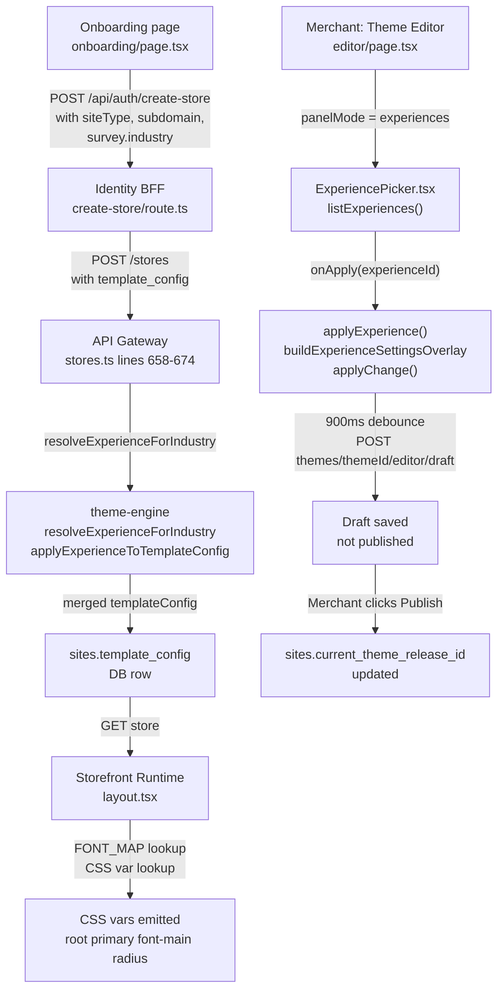
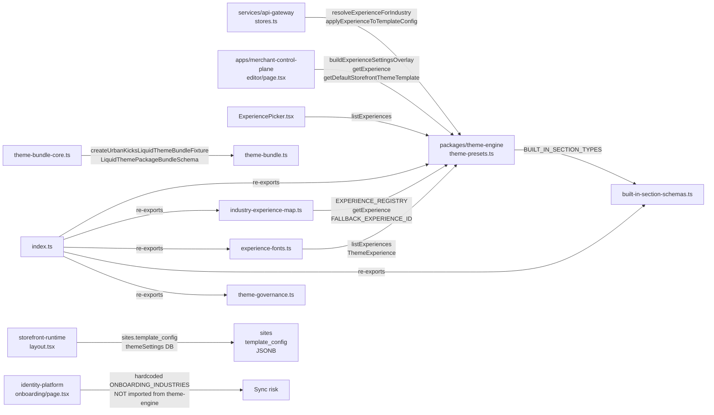

# 06 — Preset Library & Experiences: Discovery Document

**Document type:** Discovery (read-only analysis; no implementation directives)
**Domain:** `preset-library` / `theme-presets`
**Audit date:** 2026-07-04
**Branch audited:** `stepup/main`
**Authored by:** adversarial review subagent (READ-ONLY)

---

## Architecture Overview

The Preset Library & Experiences subsystem is built entirely inside `packages/theme-engine/src/` and is materially complete. Ten named "Experiences" (industry-tuned design-token presets) are defined, Zod-validated, and shipped as frozen in-memory data. There is one first-party Core theme; merchants never interact with a raw theme object — they interact with Experiences.

Two apply paths exist:

- **Server-authoritative, automatic:** `services/api-gateway/src/routes/stores.ts` (lines 658–674) calls `resolveExperienceForIndustry` and `applyExperienceToTemplateConfig` at store creation and persists the result into `sites.template_config`.
- **Post-creation, merchant self-service:** The Theme Editor's "Experiences" panel (`ExperiencePicker.tsx`) calls `applyExperience()` in the editor page, which merges design tokens into the draft via `buildExperienceSettingsOverlay`, triggering the 900 ms debounce auto-save.

The older research finding "apply_preset gap" was closed in Phase-2.5 Stream C. No standalone `/api/apply-preset` route exists and none is required for the current apply paths.

**Key unresolved gaps (discovery findings, not directives):**
1. `experience-fonts.ts` builds Google Fonts `<link>` hrefs correctly but no code in the storefront calls it; four experience fonts (`Cormorant Garamond`, `Libre Baskerville`, `Source Sans Pro`, `Lato`) are absent from the storefront `FONT_MAP`. Experiences `Aura`, `Craft`, and `Dawn` silently serve system-font fallback at runtime.
2. `surfaceColor` is not explicitly normalised in `store-service.ts` lines 597–605; it arrives only via the `...themeSettingsRecord` spread.
3. Onboarding does not auto-assign a preset when `survey.industry` is absent or the industry resolves to nothing — Summit fallback is silent/implicit.
4. `ONBOARDING_INDUSTRIES` in `apps/identity-platform/src/app/onboarding/page.tsx` is a hardcoded array literal; it is not imported from `@letbuyy/theme-engine`.

---

## Current Implementation

The preset engine is fully implemented in-memory. All ten Experiences are Zod-validated at import time. The apply flow exists end-to-end for both server-side (creation) and client-side (editor) paths. The remaining gaps are in runtime font loading and in the onboarding → engine data synchronisation.

| Capability | Status |
|---|---|
| 10 named Experience definitions with Zod validation | IMPLEMENTED |
| Industry → Experience mapping with aliases | IMPLEMENTED |
| Server-side auto-apply at store creation | IMPLEMENTED |
| Editor "Experiences" picker + in-session apply | IMPLEMENTED |
| Google Fonts href builder (`experience-fonts.ts`) | IMPLEMENTED (but not called by storefront) |
| Storefront FONT_MAP covers all experience fonts | PARTIAL — 4 of 6 fonts missing |
| `surfaceColor` explicitly normalised in store-service | PARTIAL — passes through spread only |
| `defaultSections` consumed by the apply flow | NOT IMPLEMENTED |
| Standalone `/api/experiences` REST endpoint | NOT IMPLEMENTED (by design) |

---

## Repository Inventory

| File | Role | Lines | Status |
|---|---|---|---|
| `packages/theme-engine/src/theme-presets.ts` | 10 Experience definitions, Zod schemas, `EXPERIENCE_REGISTRY`, engine functions (`getExperience`, `listExperiences`, `buildExperienceSettingsOverlay`, `applyExperienceToSettingsData`, `applyExperienceToTemplateConfig`, `exportExperience`, `importExperience`, `collectExperienceRegistryIssues`) | 522 | IMPLEMENTED |
| `packages/theme-engine/src/industry-experience-map.ts` | `INDUSTRY_EXPERIENCE_MAP` (9 industries), `INDUSTRY_ALIASES` (18 synonyms), `INDUSTRY_OPTIONS`, `normalizeIndustry`, `resolveExperienceForIndustry`, `collectIndustryMapIssues` | 149 | IMPLEMENTED |
| `packages/theme-engine/src/experience-fonts.ts` | `EXPERIENCE_FONT_REGISTRY` (6 fonts), `buildGoogleFontsHref`, `buildExperienceFontLinkHref`, `fontFamilyWithFallback`, `collectExperienceFontFamilies`, `collectExperienceFontIssues` | 82 | IMPLEMENTED (not integrated into storefront head) |
| `packages/theme-engine/src/built-in-section-schemas.ts` | 25 built-in section types (`BUILT_IN_SECTION_TYPES`), `ADDITIONAL_BUILT_IN_SECTION_SCHEMAS` (13 schemas), `collectBuiltInSectionSchemaGaps` | 337 | IMPLEMENTED |
| `packages/theme-engine/src/theme-registry.ts` | `SECTION_SCHEMAS` (12 schemas with `presets[]`), `THEME_SETTINGS_SCHEMA`, `getDefaultStorefrontThemeTemplate` (Urban Kicks default), `hasRenderableThemeTemplate`, `collectThemeTemplateValidationIssues` | 733 | IMPLEMENTED (section schema additions governed by ART-17 parity) |
| `packages/theme-engine/src/theme-governance.ts` | `THEME_LIQUID_RENDERING_DEFAULT_ENABLED=false`, canary flag resolver, ART-17 Liquid parity list (20 sections), schema migration engine, `auditThemeRendererRegistry` | 368 | IMPLEMENTED |
| `packages/theme-engine/src/theme-bundle-core.ts` | `letbuyy-core` slug alias, `createLetbuyyCoreLiquidThemeBundleFixture` | 82 | IMPLEMENTED |
| `packages/theme-engine/src/index.ts` | Package barrel — re-exports all modules, `ThemeSettings`, `DEFAULT_THEME_SETTINGS`, Zod schemas for draft/publish/install/rollback | 1247 | IMPLEMENTED |
| `packages/theme-engine/test/theme-presets.test.ts` | Full behavioral tests for Streams B/C/D | 174 | IMPLEMENTED |
| `packages/theme-engine/test/experience-fonts.test.ts` | Font system integrity tests | 56 | IMPLEMENTED |
| `services/api-gateway/src/routes/stores.ts` (lines 658–674) | POST /stores: reads `survey.industry` + `experienceId` override, calls `resolveExperienceForIndustry` + `applyExperienceToTemplateConfig`, stores result in `sites.template_config` | ~842 total | IMPLEMENTED |
| `apps/merchant-control-plane/src/app/[store]/online-store/themes/[themeId]/editor/page.tsx` (lines 780–788, 1426–1431) | Theme Editor: `applyExperience()` callback, `ExperiencePicker` mount in `panelMode === 'experiences'` panel, debounced auto-save of draft | 1929 | IMPLEMENTED |
| `apps/merchant-control-plane/src/components/theme-editor/ExperiencePicker.tsx` | UI card list of all 10 Experiences with color swatches, heading font, section count, Apply button | 92 | IMPLEMENTED |
| `apps/identity-platform/src/app/onboarding/page.tsx` (lines 201–215) | `ONBOARDING_INDUSTRIES` array (display + recommended experience name), industry picker UI, sends `survey: { industry }` in store creation payload | 609 | IMPLEMENTED (display-only; real resolution is server-side) |
| `apps/identity-platform/src/app/api/auth/create-store/route.ts` | Identity BFF: proxies to api-gateway POST /stores; passes `template_config: { templateId, survey }` | 153 | IMPLEMENTED |
| `apps/storefront-runtime/src/app/store/[subdomain]/layout.tsx` (lines 20–32, 107, 121–122) | `FONT_MAP` (10 entries), reads `ts.fontFamily` / `ts.headingFontFamily` from themeSettings, emits CSS vars | 270 | PARTIAL — FONT_MAP missing 4 experience fonts |
| `apps/storefront-runtime/src/lib/store-service.ts` (lines 592–605) | Normalises `themeSettings` from `templateConfig`; `surfaceColor` passes through via spread but is not explicitly normalised | 776 | PARTIAL — `surfaceColor` not explicitly guaranteed |
| `apps/storefront-runtime/src/app/preview/page.tsx` | Preview page — separate `FONT_MAP` copy (10 entries), normalises `fontFamily` from draft config | 409 | PARTIAL (same FONT_MAP gap as layout.tsx) |

---

## Runtime Flow

### A. At Store Creation (server-authoritative, automatic)

1. Merchant completes onboarding, selects an industry from the picker. The UI shows a recommended experience name as a display hint only.
2. Onboarding POSTs `{ siteType, storeName, subdomain, templateId: 'modern', survey: { industry } }` to `/api/auth/create-store`.
3. `create-store/route.ts` proxies to gateway POST `/stores` with `template_config: { templateId, survey: { industry } }`.
4. Gateway lines 658–674 extract `industryHint` from `templateConfig.survey.industry` (or `templateConfig.industry`) and optional `experienceOverride` from `templateConfig.experienceId`. If either is truthy, `resolveExperienceForIndustry` + `applyExperienceToTemplateConfig` run and merge the Experience tokens into `templateConfig`.
5. The merged `templateConfig` is persisted to `sites.template_config`. The new store opens already styled.

**Condition:** only runs when `industryHint || experienceOverride` is truthy. If both are falsy, `templateConfig` is stored unchanged.

### B. Post-Creation — Theme Editor "Experiences" Tab

1. Merchant opens `/{store}/online-store/themes/{themeId}/editor`. The `ExperiencePicker` renders in `panelMode === 'experiences'`.
2. `ExperiencePicker.tsx` calls `listExperiences()` and renders all 10 as cards with color swatches, heading font, and section count.
3. Merchant clicks "Apply {ExperienceName}" → `onApply(experienceId)` → `applyExperience(experienceId)` in `editor/page.tsx` lines 780–788.
4. `applyChange` sets `isDirty = true`, which triggers the 900 ms debounce `syncPreviewDraft` → POSTs the draft to `POST /api/themes/[themeId]/editor/draft`.
5. The storefront iframe refreshes with the preview token showing the experience's colors and fonts (subject to FONT_MAP gaps).
6. Merchant clicks "Publish" to promote the draft to a release.

### C. Storefront Rendering

1. `layout.tsx` reads `store.templateConfig.themeSettings` (normalised by `store-service.ts` lines 592–605).
2. `ts.fontFamily` and `ts.headingFontFamily` are looked up in `FONT_MAP`; if not found, Inter fallback is used silently.
3. CSS variables `--primary`, `--accent`, `--font-main`, `--font-heading`, `--radius`, etc. are emitted in an inline `<style>` block.

---

## Dependency Graph

| Dependent | Depends On | Nature |
|---|---|---|
| `services/api-gateway/src/routes/stores.ts` | `@letbuyy/theme-engine` (`resolveExperienceForIndustry`, `applyExperienceToTemplateConfig`) | Import at store creation |
| `apps/merchant-control-plane/.../editor/page.tsx` | `@letbuyy/theme-engine` (`buildExperienceSettingsOverlay`, `getExperience`, `getDefaultStorefrontThemeTemplate`, `hasRenderableThemeTemplate`, `getSectionSchemas`, `getThemeSettingsSchema`) | Imports at editor runtime |
| `apps/merchant-control-plane/.../ExperiencePicker.tsx` | `@letbuyy/theme-engine` (`listExperiences`) | Import for rendering |
| `packages/theme-engine/src/theme-presets.ts` | `packages/theme-engine/src/built-in-section-schemas.ts` (`BUILT_IN_SECTION_TYPES`) | Validates `defaultSections` |
| `packages/theme-engine/src/industry-experience-map.ts` | `packages/theme-engine/src/theme-presets.ts` (`EXPERIENCE_REGISTRY`, `getExperience`, `isThemeExperienceId`, `FALLBACK_EXPERIENCE_ID`) | Core dependency |
| `packages/theme-engine/src/experience-fonts.ts` | `packages/theme-engine/src/theme-presets.ts` (`listExperiences`, `ThemeExperience`) | Core dependency |
| `packages/theme-engine/src/theme-bundle-core.ts` | `packages/theme-engine/src/theme-bundle.ts` | Alias transform |
| `packages/theme-engine/src/index.ts` | All other modules in `packages/theme-engine/src/` | Re-export barrel |
| `apps/storefront-runtime/src/app/store/[subdomain]/layout.tsx` | `sites.template_config.themeSettings` (DB) | Runtime read; no theme-engine import for fonts |
| `apps/identity-platform/src/app/onboarding/page.tsx` | Hardcoded `ONBOARDING_INDUSTRIES` array (NOT imported from theme-engine) | Divergence risk |

---

## Missing Features

1. **Font loading integration (critical for non-Inter experiences):** `experience-fonts.ts` builds the correct Google Fonts `<link>` href via `buildExperienceFontLinkHref`, but no code in the storefront `<head>` (React layout or Liquid head) calls it. Experiences `Aura` (Cormorant Garamond / Lato), `Craft` and `Dawn` (Source Sans Pro / Libre Baskerville), and `Sense` (Playfair Display heading — present in `FONT_MAP` but not confirmed loaded via `next/font`) render with system-font fallback at runtime. The deferred status is documented in `theme-presets.ts` lines 18–21.

2. **`FONT_MAP` completeness in storefront layout and preview:** Four experience fonts (`Cormorant Garamond`, `Libre Baskerville`, `Source Sans Pro`, `Lato`) have no entry in `FONT_MAP` in either `apps/storefront-runtime/src/app/store/[subdomain]/layout.tsx` or `apps/storefront-runtime/src/app/preview/page.tsx`. Even after the Google Fonts link is wired, the CSS variable for those families would not be emitted.

3. **No `/api/apply-preset` or `/api/experiences` endpoint:** There is no standalone REST route for listing or applying Experiences. The only gateway-side apply is at store creation. Post-creation apply goes through the theme draft route. This is a deliberate design choice (editor/page.tsx line 779: "No page refresh, no new API") but it means third-party integrations cannot apply Experiences without going through the full theme-draft flow.

4. **`nova` experience is not in `INDUSTRY_EXPERIENCE_MAP`:** The D2C/versatile Experience has `industry: null` and maps to no industry key. It is reachable only via an explicit `experienceId` override or through the editor's Experiences picker.

5. **Section layout NOT overridden by experience application:** `buildExperienceSettingsOverlay` emits only design tokens (colors, fonts, border radius). The `defaultSections` list on each Experience is NOT applied by `applyExperienceToTemplateConfig`. Applying an Experience changes visual tokens only; section composition is frozen to whatever the store already has. The `layout.sectionOrder` / `defaultSections` fields are defined and exported but have no downstream consumer in the apply path.

6. **`experienceId` is not a top-level DB column:** The applied experience id is stored inside `sites.template_config.experienceId` (a JSONB field), not a dedicated column. There is no DB index or query path to "find all stores using experience X" without a JSONB scan.

7. **Theme Settings Schema font options do not include experience fonts:** `THEME_SETTINGS_SCHEMA.settings.typography.fields.fontFamily.options` (theme-registry.ts line ~454) lists `['Inter', 'Outfit', 'Poppins', 'DM Sans', 'Open Sans', 'Montserrat', 'Nunito', 'Space Grotesk']`. None of `Playfair Display`, `Cormorant Garamond`, `Libre Baskerville`, `Source Sans Pro`, `Lato` appear in the body font options. Those fonts can only arrive via Experience application, not via the Theme Settings panel.

---

## Partial Implementations

1. **`surfaceColor` normalisation gap (`store-service.ts` lines 597–605):** `primaryColor`, `secondaryColor`, `accentColor`, `fontFamily`, and `borderRadius` are explicitly normalised with fallback values. `surfaceColor`, `textColor`, `headingFontFamily`, `enableAnimations`, and `enableShadows` are picked up only via `...themeSettingsRecord` spread. If the experience overlay wrote `surfaceColor` but the JSONB round-trip loses the key, `DEFAULT_THEME_SETTINGS.surfaceColor` (`#F9FAFB`, the Summit value) will be used — potentially flattening distinctive surface colors such as Aura's `#FFF8F9` or Craft's `#FFF8F0`.

2. **`ONBOARDING_INDUSTRIES` is hardcoded, not imported from `theme-engine`:** `apps/identity-platform/src/app/onboarding/page.tsx` lines 201–215 define their own array literal with experience names as strings. If a new Experience is added to `theme-presets.ts`, this hardcoded list will become stale. The canonical source is `INDUSTRY_OPTIONS` exported from `industry-experience-map.ts`.

3. **Theme Editor reads schemas from static functions, not live experience tokens:** `editor/page.tsx` lines 692–693 initialise `settingsSchema` and `sectionSchemas` from `getThemeSettingsSchema(themeId)` and `getSectionSchemas(themeId)` — the same schemas for all themes. The editor does not present per-experience schema differences (there are currently none, but this is a consideration for future multi-theme support).

---

## Technical Debt

1. **Experience fonts not wired into storefront head.** Documented as deferred. Blocks polished rendering for 4 of 10 Experiences.
2. **Storefront `FONT_MAP` is a 10-entry subset.** Experience fonts such as `Cormorant Garamond` and `Source Sans Pro` are not Google-Fonts-preloaded by the Next.js font loader either, compounding the gap.
3. **Hardcoded `ONBOARDING_INDUSTRIES` duplicates `INDUSTRY_OPTIONS`.** Single source of truth is broken; a divergence risk for future Experience additions.
4. **`experienceId` stored in JSONB, not indexed.** Analytics on experience adoption would require a Postgres expression index on `(template_config->>'experienceId')` or a materialised column.
5. **`defaultSections` in `ThemeExperience` is defined and validated but not consumed in the apply flow.** Could mislead documentation or future contributors who see the "7 sections" count on the picker card and expect the apply to restructure sections.
6. **`nova` has `industry: null` and is unreachable via industry routing.** This is intentional but worth documenting for any support or analytics flow that tries to map experience back to industry.
7. **`theme-registry.ts` static `SECTION_SCHEMAS` noted as "shared fallback contract for older clients and migrations"** — there is no migration story for existing deployed schema versions if section fields change.
8. **Theme Editor "AI hooks" are stub placeholders.** `applyAiHook` in `editor/page.tsx` lines 1246–1293 contains hardcoded heuristics, not real AI calls.

---

## Enterprise Gap Analysis

| Gap | Affected Surfaces | Business Impact |
|---|---|---|
| Non-Inter experience fonts render as system fallback | All storefronts using Aura, Craft, Dawn, Sense | Brand quality gap; Experience visual identity not delivered |
| `ONBOARDING_INDUSTRIES` not imported from engine | Onboarding UX, future Experience additions | Silent drift risk; new Experiences won't appear in onboarding |
| `experienceId` not indexed in DB | Analytics, support, A/B testing | Cannot efficiently query experience adoption across stores |
| `defaultSections` not consumed in apply | All experience apply paths | Section layout not curated per experience; picker preview misleads |
| No REST endpoint for Experiences | Third-party integrations, mobile app, headless clients | Cannot apply Experiences programmatically outside the editor |
| `surfaceColor` normalisation not explicit | Storefront rendering, store-service | Potential surface color regression on JSONB round-trip |
| `nova` not reachable via industry routing | Onboarding, gateway auto-apply | D2C/versatile experience is invisible to the auto-assign path |
| ART-17 new-React-section gate is enforced by `no-new-react-sections-validator.mjs` (called by `validate-governance.mjs`); the validator maintains an allowlist of 20 frozen `.tsx` section files and fails the gate if any unlisted `.tsx` file appears in the sections directory | Governance | Adding a new React section file to `apps/storefront-runtime/src/components/sections/` will fail the validator gate; the ART-17 Liquid-parity `warn` mode applies separately to Liquid renderer parity checking in `theme-governance.ts` |

---

## Risk Analysis

| Risk | Level | Evidence |
|---|---|---|
| Non-Inter experience fonts render as system-font fallback in all storefronts | HIGH | `experience-fonts.ts` builds hrefs but `apps/storefront-runtime/src/app/store/[subdomain]/layout.tsx` lines 20–32 never call it; `FONT_MAP` is missing `Cormorant Garamond`, `Libre Baskerville`, `Source Sans Pro`, `Lato`. Affects Aura, Craft, Dawn, and (partially) Sense. |
| `surfaceColor` may not render correctly | MEDIUM | `store-service.ts` lines 597–605 do not explicitly cast `surfaceColor`. If JSONB round-trip loses the key, layout falls back to Summit value `#F9FAFB`. |
| `ONBOARDING_INDUSTRIES` diverges from `INDUSTRY_OPTIONS` | MEDIUM | Two hardcoded arrays; onboarding labels could drift from the engine's canonical map (`apps/identity-platform/src/app/onboarding/page.tsx` lines 201–215 vs `packages/theme-engine/src/industry-experience-map.ts` lines 69–81). |
| `defaultSections` on Experiences is not applied | MEDIUM | Merchants applying an Experience get only color/font tokens. The picker card advertises a section count, but applying does not restructure sections. |
| `experienceId` is not a DB column | LOW | Analytics/support queries require `template_config->>'experienceId'` JSONB extraction. No direct runtime impact. |
| `nova` not reachable via industry onboarding | LOW | D2C experience has no industry key and no alias. Only obtainable via explicit `experienceId` override or editor picker. |
| No rate-limiting concern on theme draft POST (separate audit domain) | LOW | The draft route (`/api/themes/[themeId]/editor/draft`) is the only write path for post-creation Experience apply. Rate-limiting is out of scope for this domain. |

---

## Recommended Migration Order

The following is a discovery-derived sequencing suggestion only. No implementation is prescribed here; all decisions are subject to ARB approval and the two-lane merge rule.

1. **Font loading integration** — wire `buildExperienceFontLinkHref` (from `experience-fonts.ts`) into `apps/storefront-runtime/src/app/store/[subdomain]/layout.tsx` and the Liquid head template. Add the four missing families to `FONT_MAP`. Affects 4 of 10 Experiences. Referenced deferred doc: `docs/v1-execution/phase-2/03-experience-registry-report.md`.

2. **`ONBOARDING_INDUSTRIES` import from engine** — replace the hardcoded array in `apps/identity-platform/src/app/onboarding/page.tsx` with a call to `INDUSTRY_OPTIONS` exported from `@letbuyy/theme-engine/src/industry-experience-map`. Eliminates the divergence risk at low risk.

3. **`surfaceColor` explicit normalisation in `store-service.ts`** — add `surfaceColor` alongside `primaryColor`, `secondaryColor`, etc. in the explicit normalisation block (lines 597–605) so it does not silently fall back to the Summit value on JSONB round-trip.

4. **`experienceId` DB index** — add a Postgres expression index `(template_config->>'experienceId')` on the `sites` table to enable analytics and support queries. Migration only; no app-layer change.

5. **`defaultSections` apply mode (optional, post-launch)** — if the curated section layout is to be delivered by Experiences, a separate "apply with section reset" mode would be needed, distinct from the current token-only apply. This is a significant UX decision requiring design review.

6. **`nova` industry entry consideration (optional)** — if D2C stores should be auto-assigned `nova` at onboarding, a suitable industry alias (e.g. `d2c`, `brand`) could be added to `INDUSTRY_ALIASES`. Requires agreement on whether `nova` should displace `summit` as the generic fallback.

---

## Coverage Table

| Area | Covered by Discovery | Verified Against Repo |
|---|---|---|
| 10 Experience definitions | Yes | Yes — `theme-presets.ts` lines 166–383 |
| Industry → Experience map (9 industries, 18 aliases) | Yes | Yes — `industry-experience-map.ts` lines 23–60 |
| Gateway auto-apply at store creation | Yes | Yes — `stores.ts` lines 658–674 |
| Editor `applyExperience()` callback | Yes | Yes — `editor/page.tsx` lines 780–788 |
| `ExperiencePicker.tsx` rendering | Yes | Yes — 92-line component confirmed |
| Storefront `FONT_MAP` gap | Yes | Yes — `layout.tsx` lines 20–32 confirm 4 fonts absent |
| `store-service.ts` normalisation gap | Yes | Yes — lines 597–605 confirmed |
| `experience-fonts.ts` integration status | Yes | Yes — no call site found in storefront |
| Onboarding hardcoded array | Yes | Yes — `onboarding/page.tsx` lines 201–215 |
| `BUILT_IN_SECTION_TYPES` count | Yes | Yes — 25 entries confirmed |
| `SECTION_SCHEMAS` count | Yes | Yes — 12 entries in `theme-registry.ts` line 419 |
| `THEME_LIQUID_RENDERING_DEFAULT_ENABLED` | Yes | Yes — `theme-governance.ts` line 14 |
| ART-17 Liquid parity list | Yes | Yes — 20 entries in `theme-governance.ts` lines 23–44 |
| ART-17 new-React-section enforcement | Yes | Yes — `no-new-react-sections-validator.mjs` in `scripts/validators/`, called by `validate-governance.mjs` (line 113); allowlist of 20 frozen `.tsx` files; gate fails on any unlisted `.tsx` in the sections directory |
| Test coverage | Yes | Yes — 174 + 56 lines of tests confirmed |

