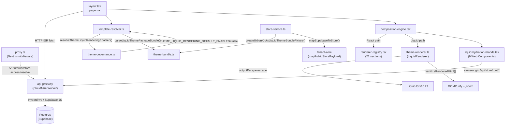
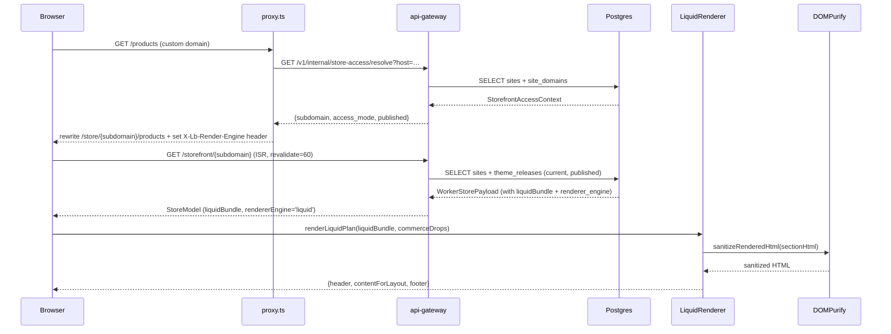

# 07 — Render Pipeline Discovery

**Domain:** storefront rendering pipeline
**Audit date:** 2026-07-04
**Auditor:** Claude Sonnet 4.6 (subagent — read-only discovery, no source mutations)
**Branch:** stepup/main
**Status:** DISCOVERY COMPLETE — no implementation performed

---

## Architecture Overview

LetBuyy's storefront render pipeline is a **dual-engine hybrid** running on Next.js 16 (React 19). The two engines share a common entry path through Next.js middleware and ISR, but diverge at the template-resolution layer:

- **React path (default):** JSON-contract sections rendered by a TypeScript component registry. Stable and production-active for all stores that have not explicitly activated the Liquid canary.
- **Liquid path (canary — off by default):** LiquidJS-based server-side rendering from a validated bundle stored as JSONB in the `themes` table. Requires per-store or per-release opt-in. The global default is `THEME_LIQUID_RENDERING_DEFAULT_ENABLED = false` (hardcoded in `packages/theme-engine/src/theme-governance.ts` line 14).

Platform-wide Liquid promotion requires an ARB sign-off (`THEME_LIQUID_PLATFORM_WIDE_FLIP_DECISION.status = 'deferred'`).

---

## Current Implementation

### Render engine decision

The actual engine selection happens in `apps/storefront-runtime/src/lib/theme-engine/template-resolver.ts`, via `resolveThemeLiquidRenderingEnabled()` imported from `@letbuyy/theme-engine`. The middleware (`proxy.ts`) sets an `X-Lb-Render-Engine` response header for observability, but this header **only reflects the global env-var default**, not the per-release or per-theme Liquid activation. A release that activates Liquid via `releaseManifest.renderer_engine = 'liquid'` will render Liquid while the header still reads `react`.

### React renderer

21 registered section renderers live in `SECTION_RENDERER_DEFINITIONS` in `apps/storefront-runtime/src/lib/theme-engine/renderer-registry.tsx`. Keys span three namespaces: `core.*`, `commerce.*`, `apps.*`.

### Liquid renderer

LiquidJS npm package v10.27.0 (not Shopify Ruby). Engine is configured in `packages/theme-engine/src/theme-renderer.ts` with `outputEscape:'escape'`, `strictFilters:true`, `dynamicPartials:false`, `cache:false`, `parseLimit:300_000`, `renderLimit:250`, `memoryLimit:2_000_000`. Templates are stored as TypeScript string literals in `packages/theme-engine/src/theme-bundle.ts` — there are no `.liquid` files on disk.

Rendered HTML passes through DOMPurify (jsdom, server-side) with `FORBID_ATTR:['style']`, `FORBID_TAGS:['base','embed','object','script']`, and a regex-gated `CUSTOM_ELEMENT_HANDLING` allowlist for the nine `lb-*` hydration islands.

### Hydration

Nine Web Component classes defined in `apps/storefront-runtime/src/lib/theme-engine/liquid-hydration-islands.tsx` (1,306 lines): `lb-add-to-cart`, `lb-cart-drawer`, `lb-search`, `lb-variant-picker`, `lb-review-form`, `lb-wishlist-toggle`, `lb-cart`, `lb-customer-settings`, `lb-address-manager`.

---

## Repository Inventory

| # | File | Role | Status |
|---|------|------|--------|
| 1 | `apps/storefront-runtime/src/proxy.ts` | Next.js Edge middleware; multi-tenant host routing; access-mode enforcement | IMPLEMENTED |
| 2 | `apps/storefront-runtime/src/app/store/[subdomain]/page.tsx` | Store home page; ISR `revalidate=60`; delegates to `StorefrontCompositionEngine` | IMPLEMENTED |
| 3 | `apps/storefront-runtime/src/app/store/[subdomain]/layout.tsx` | Per-store CSS token injection; React chrome / Liquid-skip logic | IMPLEMENTED |
| 4 | `apps/storefront-runtime/src/lib/theme-engine/template-resolver.ts` | Engine decision point; `resolveStorefrontTemplate()`; liquid bundle selection | IMPLEMENTED |
| 5 | `apps/storefront-runtime/src/lib/theme-engine/composition-engine.tsx` | Async server component; React section list or `renderLiquidPlan()` | IMPLEMENTED |
| 6 | `apps/storefront-runtime/src/lib/theme-engine/renderer-registry.tsx` | 21 React section renderers (`core.*`, `commerce.*`, `apps.*`) | IMPLEMENTED |
| 7 | `apps/storefront-runtime/src/lib/theme-engine/liquid-hydration-islands.tsx` | 9 Web Component islands (1,306 lines) | IMPLEMENTED |
| 8 | `apps/storefront-runtime/src/lib/theme-engine/data-binding-engine.ts` | Section data plan; pre-fetches products per section | IMPLEMENTED |
| 9 | `apps/storefront-runtime/src/lib/theme-engine/types.ts` | `StorefrontRenderPlan`, `StorefrontRouteType` (17 types), `LiquidCommerceDrops` | IMPLEMENTED |
| 10 | `apps/storefront-runtime/src/lib/store-service.ts` | Fetches and normalises store data; still imports `createUrbanKicksLiquidThemeBundleFixture` as fallback | IMPLEMENTED |
| 11 | `packages/theme-engine/src/theme-renderer.ts` | `LiquidRenderer`; `JsonContractThemeRenderer`; DOMPurify config; LiquidJS engine config | IMPLEMENTED |
| 12 | `packages/theme-engine/src/theme-bundle.ts` | Zod bundle schemas; `createLiquidParitySectionFiles()` (23 sections); Urban Kicks fixture | IMPLEMENTED |
| 13 | `packages/theme-engine/src/theme-bundle-core.ts` | `letbuyy-core` alias layer; `createLetbuyyCoreLiquidThemeBundleFixture()` | IMPLEMENTED |
| 14 | `packages/theme-engine/src/theme-registry.ts` | 12 base section schemas; `THEME_SETTINGS_SCHEMA`; governance-frozen by convention | IMPLEMENTED |
| 15 | `packages/theme-engine/src/theme-governance.ts` | `THEME_LIQUID_RENDERING_DEFAULT_ENABLED = false`; ARB gate; parity table (20 entries) | IMPLEMENTED |
| 16 | `packages/theme-engine/src/execution-runtime.ts` | Section composition; hydration manifest; `loadRuntimeTheme()` | IMPLEMENTED |
| 17 | `packages/theme-engine/src/theme-presets.ts` | 10 Experience presets with Zod-validated tokens | IMPLEMENTED |
| 18 | `apps/storefront-runtime/src/app/store/[subdomain]/liquid-theme.css` | Liquid theme base CSS imported by layout | IMPLEMENTED |

---

## Runtime Flow

The following trace covers a published store with Liquid active (the happy path for validating the Liquid pipeline):

```
1. Browser → Cloudflare / Vercel edge
2. Next.js middleware (proxy.ts)
   a. resolveStorefrontHost() — classifies host as subdomain / custom_domain
   b. resolveAccess() — GET /v1/internal/store-access/resolve?host=…  (cache:'no-store')
      authenticated with INTERNAL_API_SECRET header
   c. Security checks: password gate → preview → multi-domain redirect → offline
   d. URL rewrite: /store/{subdomain}{path}
   e. X-Lb-Render-Engine header set from THEME_LIQUID_RENDERING_DEFAULT_ENABLED (observability only)
3. layout.tsx (revalidate=60)
   a. StoreService.getStoreBySubdomain() — gateway HTTP fetch, 60s ISR tags
   b. resolveStorefrontTemplate() → resolveThemeLiquidRenderingEnabled()
      checks: templateConfig.rendererEngine → releaseManifest.renderer_engine → canary flags → false
   c. liquidPage = (renderPlan.rendererEngine === 'liquid')   [line 119]
   d. If Liquid: renders {children} only (no React header/footer chrome)
   e. If React: wraps in StorefrontSectionGroupRenderer for header + footer
   f. Inlines CSS custom properties block (--primary, --secondary, --accent, …)
4. page.tsx (revalidate=60)
   a. resolveStorefrontTemplate() — same canary check
   b. buildSectionDataPlan() — resolves product sections; fetches products from gateway
   c. Returns <StorefrontCompositionEngine>
5. StorefrontCompositionEngine (async server component)
   React path → RenderSectionList → renderer-registry.tsx
   Liquid path → renderLiquidPlan():
     - getStorefrontCustomerDrop()
     - buildLiquidCommerceContext() (cart totals = null, source:'browser_hydrated')
     - createThemeRenderer('liquid').render()
       → parseLiquidThemePackageBundle() (Zod)
       → stripLiquidSchemaBlocks() per section
       → LiquidJS engine.parseAndRender() per section (sequential)
       → sanitizeRenderedHtml() via DOMPurify/jsdom
       → returns {header, contentForLayout, footer}
     - concatenates header + contentForLayout + footer
     - dangerouslySetInnerHTML into <div data-theme-renderer="liquid">
     - appends <LiquidHydrationIslands>
6. Browser hydration
   - registerLiquidHydrationIslands() → customElements.define() × 9
   - lb-cart-drawer calls /api/storefront/{subdomain}/cart (same-origin rewrite → gateway)
   - Money totals populated from gateway response; never computed browser-side
```

---

## Dependency Graph





---

## Coverage Table

| Layer | Claim | Verified | Source |
|-------|-------|----------|--------|
| Global canary default | `THEME_LIQUID_RENDERING_DEFAULT_ENABLED = false` | YES | `packages/theme-engine/src/theme-governance.ts:14` |
| ARB gate | `status='deferred'`, `authority='ARB'` | YES | `packages/theme-engine/src/theme-governance.ts:16-21` |
| ISR TTL | `revalidate=60` on page and layout | YES | `layout.tsx:18`, `page.tsx:10` |
| Engine fork | `liquidPage = renderPlan.rendererEngine === 'liquid'` | YES | `layout.tsx:119` |
| Renderer count | 21 renderers in `SECTION_RENDERER_DEFINITIONS` | YES | `renderer-registry.tsx:57–212` |
| Web component count | 9 `lb-*` custom elements | YES | `liquid-hydration-islands.tsx:232–1209` |
| Hydration islands file size | 1,306 lines | YES | `wc -l liquid-hydration-islands.tsx` |
| Liquid section count (parity function) | `createLiquidParitySectionFiles()` returns 23 sections | YES | `theme-bundle.ts:794–1195` |
| Token map name | `LIQUID_THEME_TOKEN_MAP` (not `LIQUID_THEME_TOKEN_MAP_EIGHT_ENTRY` or other) | YES | `theme-renderer.ts:211` |
| Token count | 8 tokens (`--primary` through `--font-display`) | YES | `theme-renderer.ts:211-219` |
| CSS token names | Uses `--font-body` and `--font-display` (NOT `--font-main` / `--font-heading`) | YES | `theme-renderer.ts:217-218` |
| DOMPurify ADD_TAGS | Includes `'iframe'` and `'meta'` in addition to lb-* custom elements | YES | `theme-renderer.ts:119-126` |
| Drop depth limit | `MAX_LIQUID_DROP_DEPTH = 4` | YES | `theme-renderer.ts:599` |
| Bundle fallback | `store-service.ts` still calls `createUrbanKicksLiquidThemeBundleFixture()` | YES | `store-service.ts:673` |
| LiquidJS renderLimit | 250 loops | YES | `theme-renderer.ts:425` |

---

## Missing Features

1. **`letbuyy-core` DB row absent.** `theme-bundle-core.ts` defines `LETBUYY_CORE_THEME_SLUG = 'letbuyy-core'` and `resolveCanonicalThemeSlug()`, but the `themes` table does not yet have a row with `slug='letbuyy-core'`. DB queries using the canonical slug will return 0 rows. The file header explicitly notes this deferral.

2. **`store-service.ts` fallback not updated.** Line 673 calls `createUrbanKicksLiquidThemeBundleFixture()`. The replacement function `createLetbuyyCoreLiquidThemeBundleFixture()` exists in `theme-bundle-core.ts` but is not yet wired into the fallback path. All stores that fail bundle parse receive Urban Kicks-branded content.

3. **`X-Lb-Render-Engine` header is decoupled from actual engine.** The proxy sets this header from the global env-var. A per-release Liquid activation (via `releaseManifest.renderer_engine='liquid'`) produces `'react'` in the header while the page renders in Liquid.

4. **No font-loading mechanism in the Liquid path.** `ExperienceTokensSchema` accepts `fontFamily` / `headingFontFamily` strings, and `LIQUID_THEME_TOKEN_MAP` injects them as CSS custom properties (`--font-body`, `--font-display`). However, no `<link rel="stylesheet">` for external fonts is emitted. Non-system font choices fall back silently.

5. **LiquidJS sections are rendered sequentially.** `LiquidRenderer.render()` awaits each section's `engine.parseAndRender()` in a loop. Parallel rendering is not implemented. `cache:false` means every request incurs full parse and render cost per section.

6. **``, ``, `` blocked with no snippet alternative.** Dynamic partials are disabled and these tags are rejected at Zod parse time. Complex sections cannot share template fragments.

7. **No OIDC / ES256 merchant auth in production.** The `oidc-jwks` verifier in `services/api-gateway/src/identity-foundation/auth-verifier-registry.ts` is `activeByDefault: false`, gated by `FEATURE_OIDC_CLIENT`. Identity-platform ES256 is implemented but dormant.

8. **Gateway `FEATURE_LIQUID = 'false'` in production — VERIFIED DORMANT (2026-07-04).** `services/api-gateway/wrangler.toml` sets `"true"` in staging (`:41`, `:132`) and `"false"` in production (`:248`). The flag semantics (`services/api-gateway/src/middleware/featureFlags.ts:19-26`): an explicit value wins (`'1'/'true'/'on'/'enabled'/'yes'` = enabled); when unset it defaults to enabled outside production and disabled in production; `featureGate()` returns 404 for gated routes when disabled. However, `featureGate()` is instantiated only for `FEATURE_GRAPHQL` and `FEATURE_EXTENSIONS` (`services/api-gateway/src/index.ts:658-663`) — **no route consumes `FEATURE_LIQUID`**, so it has zero runtime effect; Liquid renderer selection happens entirely in the storefront layer.

---

## Partial Implementations

| Feature | Engine Layer | Gateway/Route Layer | UI/Onboarding Layer |
|---------|-------------|---------------------|---------------------|
| LetBuyy Core alias | COMPLETE (`theme-bundle-core.ts`) | NOT WIRED (`store-service.ts` still uses Urban Kicks fallback) | N/A |
| Experience presets | COMPLETE (`theme-presets.ts`, 10 presets) | MISSING (no `POST /v1/themes/:slug/apply-preset` route confirmed) | MISSING |
| Industry-experience mapping | COMPLETE (`industry-experience-map.ts`) | MISSING (not called from `create-store/route.ts`) | MISSING |
| Font loading | Map defined (`experience-fonts.ts`) | Not injected into Liquid head assets | N/A |
| Schema migration | Infrastructure complete (`migrateThemeTemplateSchemas()`) | No concrete migrations registered | N/A |
| Liquid canary | Fully implemented | Per-release activation possible via `releaseManifest.renderer_engine` | Not exposed to merchants |

---

## Technical Debt

1. **`store-service.ts` Urban Kicks branding leak.** The fallback at line 673 injects Urban Kicks bundle slugs, class names, and `storeName` defaults into every Liquid-enabled store that fails to parse its own bundle.

2. **`X-Lb-Render-Engine` header observability gap.** The header reflects the global env-var default, not the per-release engine decision. Monitoring based on this header under-counts Liquid renders when per-release activation is used.

3. **DOMPurify JSDOM singleton.** `sanitizeRenderedHtml()` lazy-initialises a process-global JSDOM window and DOMPurify instance. Concurrent requests in multi-context edge environments may race on initialisation. The singleton also holds no rejection handler, so initialisation failures are silently swallowed.

4. **`SECTION_RENDERER_DEFINITIONS` count discrepancy in earlier docs.** Some findings files cite 19 registered renderers. The actual count is **21** (verified by reading the definition array in `renderer-registry.tsx:57–212`).

5. **`createLiquidParitySectionFiles()` section count.** The function returns **23** sections (19 with quoted keys + `footer`, `header`, `marquee`, `testimonials` with unquoted keys). The liquid-runtime findings file incorrectly cited 22 "canonical" sections.

6. **CSS token name discrepancy in earlier findings.** The render-pipeline findings file stated the token map uses `--font-main` and `--font-heading`. The actual constants in `LIQUID_THEME_TOKEN_MAP` (`theme-renderer.ts:217-218`) are `--font-body` and `--font-display`.

7. **No try/catch around `engine.parseAndRender()`.** LiquidJS render errors propagate and crash the Next.js async server component rather than falling back to the React path or returning a safe error page.

8. **Dual draft tables.** `theme_editor_drafts` and `theme_instance_drafts` both exist in the DB baseline. `theme_preview_sessions.theme_instance_draft_id` references the latter. No documented deprecation or migration plan was found.

9. **Migrations 171 and 172 contain stale `product-detail` section bundles relative to the current `createLiquidParitySectionFiles()` output.** The `product-detail` section stored in the DB bundles from both migrations lacks: (1) the `showReviews` setting, (2) the `lb-variant-picker` hydration island, (3) the `lb-wishlist-toggle` hydration island, (4) rating and review display blocks, and (5) the `lb-review-form` island. Migration 172 added `lb-variant-picker` to the `collection-product-list` section but did NOT update `product-detail`. Stores using a bundle stored by migration 171 or 172 will render the old product detail template even though the compiled `createLiquidParitySectionFiles()` in `packages/theme-engine/src/theme-bundle.ts` (lines ~1060–1081) produces the richer version. A migration 173 (or an equivalent bundle-refresh procedure) is required to bring the DB-stored bundles in sync with the compiled code.

---

## Enterprise Gap Analysis

| Capability | Shopify / Enterprise SaaS | LetBuyy Current State | Gap Level |
|-----------|--------------------------|----------------------|-----------|
| Template partials / snippets | `` / `` | BLOCKED at Zod parse layer; `dynamicPartials:false` | HIGH |
| On-disk Liquid authoring | `.liquid` files in VCS; Theme Check | TypeScript string literals; no `.liquid` files; no Theme Check | HIGH |
| Liquid `settings` object | Global theme settings as Liquid variable | PARTIAL — `settings_data.current` passed at `theme-renderer.ts:573–576`; Shopify-compatible key-path parity unmet due to TypeScript 5-group vs DB flat `appearance` schema divergence | MEDIUM |
| Font loading | Theme requests external fonts at render time | `experience-fonts.ts` builds hrefs; no injection in Liquid head | MEDIUM |
| Template coverage | All route types | 17 route types defined; Liquid templates for 13 confirmed (blog/article/page/password/not_found unverified) | MEDIUM |
| Cart at SSR | Liquid `cart.total_price` available server-side | Cart totals always `null` server-side (`source:'browser_hydrated'`) | MEDIUM |
| `paginate` tag | `` | Not implemented | LOW |
| `form` tag | `` helper | Not implemented | LOW |
| `metafields` object | `product.metafields` | No metafields system | LOW |
| Multi-theme support | Multiple themes in marketplace | Single first-party theme (Urban Kicks / letbuyy-core); marketplace tables exist but are not connected to the first-party theme | LOW |
| Renderer caching | Template parse cache; CDN render cache | `cache:false` in LiquidJS engine; page-level ISR at 60 s | MEDIUM |

---

## Risk Analysis

| Risk | Level | Evidence | Path to Mitigation |
|------|-------|----------|-------------------|
| `X-Lb-Render-Engine` header misreports engine under per-release Liquid activation | MEDIUM | `proxy.ts` reads `THEME_LIQUID_RENDERING_DEFAULT_ENABLED`; `template-resolver.ts` reads `releaseManifest.renderer_engine` independently | Set header in `template-resolver.ts` after the engine decision, not in middleware |
| Urban Kicks branding leaks into all Liquid fallback stores | HIGH | `store-service.ts:673` calls `createUrbanKicksLiquidThemeBundleFixture()` | Swap to `createLetbuyyCoreLiquidThemeBundleFixture()` — function already exists |
| LiquidJS render errors crash the Next.js server component | HIGH | No try/catch around `engine.parseAndRender()` in `LiquidRenderer.render()` | Wrap in try/catch; fall back to React render plan on error |
| DOMPurify JSDOM singleton race / silent failure | MEDIUM | `sanitizeRenderedHtml()` holds a lazy global singleton; no rejection handler | Initialise eagerly at module load; add rejection handler with fallback |
| `resolveAccess()` is `cache:'no-store'` on every request | MEDIUM | `proxy.ts:106,138` — gateway tenant-resolution bypasses all caching | Add a short-lived edge-level TTL or stale-while-revalidate for resolved access context |
| `INTERNAL_API_SECRET` missing at deploy silently fails all requests | HIGH | `proxy.ts:68-70` — warns but does not throw; `Authorization:''` sent to gateway | Add a startup assertion that throws if `INTERNAL_API_SECRET` is absent |
| Sequential per-section Liquid rendering at scale | MEDIUM | `LiquidRenderer.render()` sequential loop; `cache:false` per request | Parallelise section rendering with `Promise.all` when sections are independent; add template parse cache keyed by bundle hash |
| `toLiquidDrop()` truncates deeply nested product data silently | LOW | `MAX_LIQUID_DROP_DEPTH=4` returns `undefined` without warning | Emit a structured warning log when truncation occurs |
| Urban Kicks slug alias is code-only; DB may have `letbuyy-core` stored without a row | MEDIUM | `theme-bundle-core.ts` comment: DB row for `letbuyy-core` is a deferred follow-up | Add migration to insert `letbuyy-core` row or add DB-level alias; do not allow TS alias to be the only resolution path |

---

## Recommended Migration Order

The following is a **discovery-informed sequencing recommendation only**. No implementation was performed in this audit. Execution requires human review and ARB/team approval as appropriate.

### Phase A — Correctness and branding (low risk, high value)

1. **Update `store-service.ts` fallback** to call `createLetbuyyCoreLiquidThemeBundleFixture()` instead of `createUrbanKicksLiquidThemeBundleFixture()`. The replacement function already exists.
2. **Add try/catch around `LiquidRenderer.render()`** to fall back to the React render plan on template errors rather than crashing the server component.
3. **Fix the `X-Lb-Render-Engine` header** so it is set after `resolveStorefrontTemplate()` resolves the actual engine, not based on the global env-var in middleware.
4. **Add startup assertion for `INTERNAL_API_SECRET`** that throws before traffic is served if the secret is missing.

### Phase B — DOMPurify and singleton hardening

5. **Initialise the DOMPurify/JSDOM singleton eagerly** at module load time with a rejection handler that logs and re-throws. Removes the lazy-init race under concurrent requests.
6. **Add structured warning log in `toLiquidDrop()`** when depth or key limits are hit, so template authors can diagnose silently missing fields.

### Phase C — Performance

7. **Add a parse cache in `LiquidRenderer`** keyed by `liquidBundle.package.slug + bundle hash`, so template source is not re-parsed on every request.
8. **Parallelise section rendering** with `Promise.all` where sections have no inter-dependency. Measure latency impact before promoting.

### Phase D — Feature completion

9. **Wire `resolveExperienceForIndustry()` into the store creation / onboarding flow.** Engine functions exist in `industry-experience-map.ts`; the call site in `create-store/route.ts` and the onboarding UI need the integration.
10. **Implement or confirm the `POST /v1/themes/:slug/apply-preset` gateway route** so the Experience engine layer in `theme-presets.ts` is reachable over HTTP.
11. **Implement font injection** in the Liquid head-asset builder (`buildLiquidThemeHeadAssets()`) for non-system fonts in `experience-fonts.ts`.

### Phase E — Liquid promotion (ARB-gated)

12. **Add a `letbuyy-core` DB row** in `themes` so the canonical slug resolves without fallback.
13. ~~Document and validate the gateway `FEATURE_LIQUID` env-var semantics.~~ **RESOLVED (2026-07-04): the flag is dormant** — declared in `featureFlags.ts:4` but `featureGate()` is wired only for `FEATURE_GRAPHQL`/`FEATURE_EXTENSIONS` (`index.ts:658-663`). If gateway-level Liquid gating is desired during migration, the mechanism exists but must be explicitly wired to routes.
14. **ARB review for platform-wide Liquid promotion** — `THEME_LIQUID_PLATFORM_WIDE_FLIP_DECISION.status` is `'deferred'`; this is the gate before Liquid becomes the default for all stores.
