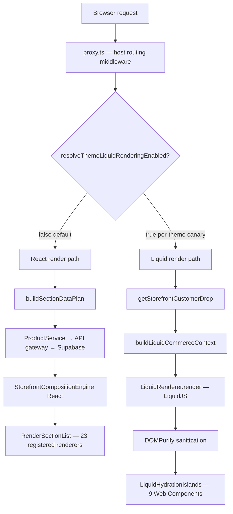
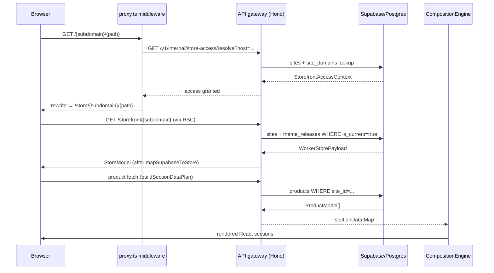
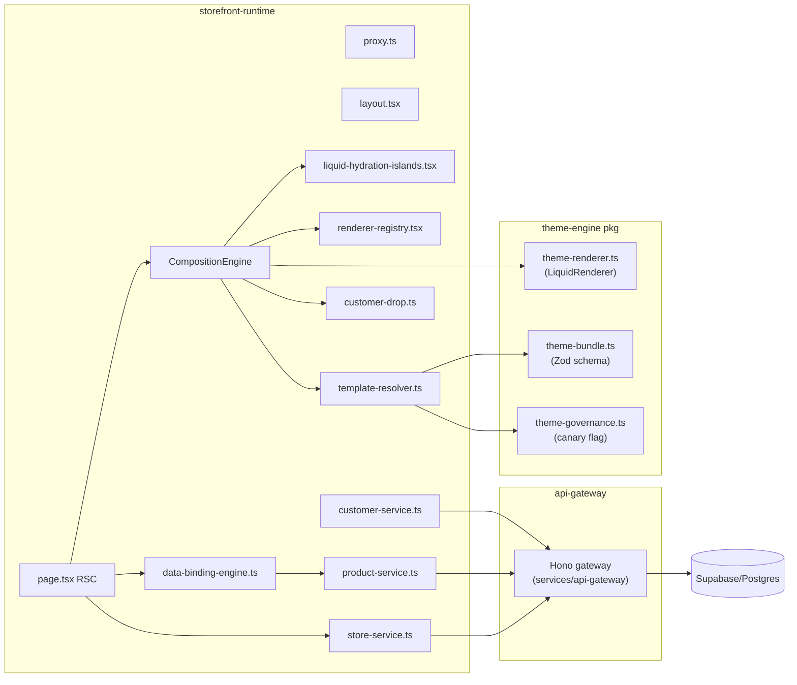

# 08 — Dynamic Data Source Discovery
<!-- DISCOVERY DOC — describes existing behaviour only. All changes, implementations, or fixes
     belong in the Recommended Migration Order section and must go through standard ARB / PRD review. -->

**Domain:** dynamic-sources  
**Date:** 2026-07-04  
**Branch:** stepup/main  
**Auditor:** Claude Sonnet 4.6 (adversarial review pass)  
**Source files verified:** yes — every claim in this document was confirmed against the
working tree before writing.  
**Status:** VERIFIED

---

## Architecture Overview

LetBuyy's storefront (`apps/storefront-runtime`) is a **React-default / Liquid-canary hybrid**.
All data that feeds rendered pages flows exclusively through the Hono API gateway
(`services/api-gateway`) — the storefront never queries Supabase directly.

Data binding occurs in two distinct layers:

1. **React path (production default):** Server-side `buildSectionDataPlan()` in
   `apps/storefront-runtime/src/lib/theme-engine/data-binding-engine.ts` fetches products
   via `ProductService`, which calls the API gateway. The result is a
   `Map<sectionId, SectionRenderData>` passed as props to registered React section
   components. There is no automatic collection- or review-data binding at the index level.

2. **Liquid path (canary, off by default):** `StorefrontCompositionEngine.renderLiquidPlan()`
   assembles a `LiquidCommerceDrops` object (`theme-renderer.ts:41–52`) containing `shop`,
   `product`, `collection`, `collections`, `cart`, `customer`, `order`, and `search` fields.
   This is passed to `LiquidRenderer.render()`, which builds a Liquid scope via
   `buildLiquidScope` (`theme-renderer.ts:552–591`), injecting every drop into the LiquidJS
   template engine. Customer data is resolved server-side by `getStorefrontCustomerDrop()`.
   Cart money totals are deliberately `null` at SSR and hydrated client-side by the
   `lb-cart-drawer` Web Component.

**Global canary switch** (`packages/theme-engine/src/theme-governance.ts:14`):
```
export const THEME_LIQUID_RENDERING_DEFAULT_ENABLED = false;
```
An ARB flip decision (`THEME_LIQUID_PLATFORM_WIDE_FLIP_DECISION.status = 'deferred'`) means
the Liquid path cannot be globally enabled by code change alone.



---

## Current Implementation

### React path (default)

The `StoreService.getStoreBySubdomain()` call is the entry point. It fetches the published
store record and navigation bundles concurrently via `createStorefrontApiClient()`, then
normalises the response through `mapSupabaseToStore()` (`store-service.ts:~676`). The
resulting `StoreModel` carries `themeSettings`, `sections[]`, `sectionGroups{}`,
`templates{}`, `liquidBundle`, and engine flags.

`resolveStorefrontTemplate()` (`template-resolver.ts:~100`) calls
`resolveThemeLiquidRenderingEnabled()`. With the global constant `false` and no per-theme
override, the React path is taken. `buildSectionDataPlan()` (`data-binding-engine.ts:66–105`)
filters sections using `sectionRequestsProductData()`, collects product IDs, fetches
products from the gateway, and returns a `Map<sectionId, SectionRenderData>` with
`products[]` and optionally `product`.

### Liquid path (canary ON)

Activation requires one of:
- `templateConfig.rendererEngine === 'liquid'` (set by migration 180 for `urban-kicks`), or
- `liquidRenderingCanary: true` in `templateConfig` / `themeSettings` / `releaseManifest`, or
- `?engine=liquid` query param (dev-only override, production-ignored).

Once active, `renderLiquidPlan()` (`composition-engine.tsx:399+`) assembles
`LiquidCommerceDrops` via `buildLiquidCommerceContext()`. The `LiquidRenderer.render()` call
in `packages/theme-engine/src/theme-renderer.ts` creates the LiquidJS engine, registers
custom filters, builds the scope, and sanitises every rendered section with DOMPurify (server-
side, jsdom singleton at `theme-renderer.ts:868`).

`resolveLiquidBundle()` (`template-resolver.ts:110–124`) checks four locations in order:
`store.templateConfig.liquidBundle`, `releaseManifest.liquidBundle`,
`releaseManifest.themeBundle`, `releaseManifest.bundle`.

When none parses successfully, `mapSupabaseToStore()` falls back to
`createUrbanKicksLiquidThemeBundleFixture()` (`store-service.ts:671–673`), meaning every
store without a valid Liquid bundle already holds the Urban Kicks fixture in memory — whether
the Liquid path is reached depends on `rendererEngine`/`liquidRenderingCanary`.

---

## Repository Inventory

| File | Role | Lines (verified) | Status |
|------|------|-----------------|--------|
| `packages/theme-engine/src/theme-governance.ts` | Global canary flag, ARB gate, `resolveThemeLiquidRenderingEnabled`, parity table | 368 | IMPLEMENTED |
| `packages/theme-engine/src/theme-renderer.ts` | `LiquidRenderer`, `JsonContractThemeRenderer`, DOMPurify config, `buildLiquidScope`, `buildLiquidCommerceDrops`, custom filters | 932 | IMPLEMENTED |
| `packages/theme-engine/src/theme-bundle.ts` | `LiquidThemePackageBundleSchema` (Zod), `createUrbanKicksLiquidThemeBundleFixture`, `createMinimalLiquidThemeBundleFixture` | 2970 | IMPLEMENTED |
| `packages/theme-engine/src/theme-registry.ts` | Section schemas, `DEFAULT_THEME_SETTINGS`, `getDefaultStorefrontThemeTemplate` — FROZEN (ART-17) | large | FROZEN |
| `packages/theme-engine/src/theme-bundle-core.ts` | `createLetbuyyCoreLiquidThemeBundleFixture`, `LETBUYY_CORE_THEME_SLUG`, `resolveCanonicalThemeSlug` | ~82 | IMPLEMENTED |
| `packages/theme-engine/src/theme-presets.ts` | `EXPERIENCE_REGISTRY` (10 experiences), `applyExperienceToSettingsData`, `applyExperienceToTemplateConfig` | ~522 | IMPLEMENTED |
| `packages/theme-engine/src/portable-to-liquid.ts` | L3 compiler: portable JSON → `LiquidThemePackageBundle` | ~202 | IMPLEMENTED |
| `packages/theme-engine/src/execution-runtime.ts` | Theme composition primitives, section hydration | 487 | IMPLEMENTED |
| `packages/theme-engine/src/built-in-section-schemas.ts` | `BUILT_IN_SECTION_SCHEMAS` metadata | medium | IMPLEMENTED |
| `packages/theme-engine/src/experience-fonts.ts` | Font-name-to-CSS-stack map | ~82 | IMPLEMENTED |
| `packages/theme-engine/src/industry-experience-map.ts` | `INDUSTRY_EXPERIENCE_MAP`, `resolveExperienceForIndustry` | ~149 | IMPLEMENTED |
| `apps/storefront-runtime/src/lib/theme-engine/data-binding-engine.ts` | `buildSectionDataPlan()`, `sectionRequestsProductData()` | 106 | IMPLEMENTED |
| `apps/storefront-runtime/src/lib/theme-engine/template-resolver.ts` | `resolveStorefrontTemplate()`, `resolveLiquidBundle()`, dev engine override | 308 | IMPLEMENTED |
| `apps/storefront-runtime/src/lib/theme-engine/composition-engine.tsx` | `StorefrontCompositionEngine`, `renderLiquidPlan()`, `buildLiquidCommerceContext()`, drop assembly | 542 | IMPLEMENTED |
| `apps/storefront-runtime/src/lib/theme-engine/renderer-registry.tsx` | React section renderer registry (23 `rendererKey` entries) | 286 | IMPLEMENTED |
| `apps/storefront-runtime/src/lib/theme-engine/liquid-hydration-islands.tsx` | 9 Web Component custom elements (`lb-*`), `registerLiquidHydrationIslands()` | 1306 | IMPLEMENTED |
| `apps/storefront-runtime/src/lib/theme-engine/types.ts` | `StorefrontRenderPlan`, `SectionRenderData`, `StorefrontRouteContext` | 95 | IMPLEMENTED |
| `apps/storefront-runtime/src/lib/store-service.ts` | `StoreModel` hydration, `mapSupabaseToStore()`, navigation fetch, Urban Kicks fixture fallback | 776 | IMPLEMENTED |
| `apps/storefront-runtime/src/lib/product-service.ts` | `getProductsByIds`, `getProductsByStoreSubdomain`, `getProductById`; `getProductsBySellerId` stub | 136 | PARTIAL |
| `apps/storefront-runtime/src/lib/customer-service.ts` | Customer CRUD via gateway; `getStoreCustomers` stub | 283 | PARTIAL |
| `apps/storefront-runtime/src/lib/customer-drop.ts` | `getStorefrontCustomerDrop()`, `getCustomerOrderDetailDrop()` (all-orders fetch) | 244 | IMPLEMENTED |
| `apps/storefront-runtime/src/lib/review-service.ts` | `ReviewService.getProductReviews()` → gateway | ~80 | IMPLEMENTED |
| `apps/storefront-runtime/src/lib/session.ts` | Customer HS256 JWT (cookie create/get/clear) | ~130 | IMPLEMENTED |
| `apps/storefront-runtime/src/lib/api/client.ts` | `createStorefrontApiClient()` (SSR), internal auth signing | ~156 | IMPLEMENTED |
| `apps/storefront-runtime/src/lib/api/browser-client.ts` | `storefrontBrowserApiFetch()` (client-side same-origin proxy) | ~74 | IMPLEMENTED |
| `apps/storefront-runtime/src/context/cart-context.tsx` | React `CartProvider`: localStorage + server sync | ~266 | IMPLEMENTED |
| `apps/storefront-runtime/src/context/customer-auth-context.tsx` | React `CustomerAuthProvider`: session fetch, login/register/logout | ~200 | IMPLEMENTED |
| `apps/storefront-runtime/src/app/store/[subdomain]/page.tsx` | Index route RSC: store fetch → section data plan → composition | ~65 | IMPLEMENTED |
| `apps/storefront-runtime/src/app/store/[subdomain]/product/[productId]/page.tsx` | Product detail: `ProductService.getProductById` + `ReviewService.getProductReviews` | ~82 | IMPLEMENTED |
| `apps/storefront-runtime/src/app/store/[subdomain]/collections/[slug]/page.tsx` | Collection: `storefront.getCollectionWithProducts` → products + metadata | ~132 | IMPLEMENTED |

**Coverage summary:**

| Layer | Total files | IMPLEMENTED | PARTIAL | STUB |
|-------|------------|-------------|---------|------|
| `packages/theme-engine/src/` | 13 | 12 | 0 | 0 |
| `apps/storefront-runtime/lib/theme-engine/` | 9 | 9 | 0 | 0 |
| `apps/storefront-runtime/lib/` (services) | 10 | 8 | 2 | 0 |
| `apps/storefront-runtime/context/` | 3 | 3 | 0 | 0 |
| `apps/storefront-runtime/app/` (routes) | 12 | 12 | 0 | 0 |

---

## Runtime Flow

### React path (default — Liquid OFF)



**Numbered steps:**

1. Request hits `proxy.ts` — host-based routing middleware resolves tenant subdomain.
2. Next.js routes to `app/store/[subdomain]/page.tsx` (or sub-route).
3. RSC: `StoreService.getStoreBySubdomain(subdomain)` calls `createStorefrontApiClient()` pointing to `LETBUYY_API_BASE_URL` / `NEXT_PUBLIC_API_BASE_URL`.
4. API gateway returns store row + current `theme_releases` join. Navigation fetched in parallel (3 endpoints: main, footer, policies).
5. `mapSupabaseToStore()` normalises into `StoreModel` including `themeSettings`, `sections[]`, `liquidBundle`, `rendererEngine`.
6. `resolveStorefrontTemplate(store, route, options)` calls `resolveThemeLiquidRenderingEnabled()` → returns `false` (default) → React path.
7. `buildSectionDataPlan({ store, sections, route })`:
   - Filters using `sectionRequestsProductData()` (checks `section.type`, `section.settings.productIds`, `section.settings.dataBinding.resource`).
   - `ProductService.getProductsByIds()` or `getProductsByStoreSubdomain()` → gateway → Supabase.
   - Returns `Map<sectionId, SectionRenderData>` with `products[]`.
8. `<StorefrontCompositionEngine>` renders `<RenderSectionList>` iterating `plan.template.sections`.
9. Each section: `renderRegisteredSection()` looks up `rendererKey` in the 23-entry registry and calls the React component.
10. Layout.tsx wraps content in `CartProvider`, `CustomerAuthProvider`, `WishlistProvider`. Theme CSS variables injected inline.

### Liquid path (canary ON)

Steps 1–6 are identical, but step 6 returns `rendererEngine: 'liquid'` and a valid `liquidBundle`.

7. `buildSectionDataPlan` still runs (products fetched for composition context).
8. `renderLiquidPlan()`:
   - `getStorefrontCustomerDrop(store.id)`: reads HS256 JWT cookie → `getSession()` → `getCustomerByEmail()` → `getCustomerWishlist()` → `LiquidCustomerDrop | null`.
   - `buildLiquidCommerceContext()` assembles `LiquidCommerceDrops`:
     - `shop`: `{ id, name, subdomain, url, locale, currency: 'INR' }`
     - `product`: first product from `collectLiquidProducts(sectionData)`
     - `collection`: from `collectLiquidCollectionMeta(sectionData)` + route info
     - `cart`: stub with `item_count: null, subtotal: null, total: null, source: 'browser_hydrated'` — **money null at SSR**
     - `customer`: `LiquidCustomerDrop | null`
     - `order`: `LiquidCustomerOrderDetail | null`
     - `search`: field exists on `LiquidCommerceDrops` interface but is **never populated** — always `null`.
   - `LiquidRenderer.render()`: Zod-validates bundle, builds CSS token block, creates LiquidJS engine with `outputEscape:'escape'`, `strictFilters:true`, `ownPropertyOnly:true`, `cache:false`; registers filters `money`, `money_with_currency`, `json`, `asset_url`, `image_url`, `t`.
   - `buildLiquidScope()` (`theme-renderer.ts:552–591`): injects all drops plus `shop`, `request`, `settings`, `routes`.
   - `toLiquidDrop()` sanitises drops (max depth 4, max keys 80, blocks `BLOCKED_DROP_KEYS`).
   - DOMPurify (`jsdom` singleton) sanitises each section's rendered HTML.
9. Liquid chrome: header/footer templates rendered and concatenated: `${header}${contentForLayout}${footer}`.
10. `<LiquidRenderedHtml>` injects HTML via `dangerouslySetInnerHTML`.
11. Client: `registerLiquidHydrationIslands()` defines all 9 `lb-*` custom elements. `lb-cart-drawer` syncs cart to `/api/storefront/{subdomain}/cart` on open.

---

## Dependency Graph

| Dependent | Depends On | Nature |
|-----------|------------|--------|
| `data-binding-engine.ts` | `ProductService` | Fetches products for product-aware sections |
| `data-binding-engine.ts` | `@letbuyy/commerce-core:ProductModel` | Type contract |
| `data-binding-engine.ts` | `@letbuyy/tenant-core:StoreModel` | `selectedProductIds` |
| `composition-engine.tsx` | `LiquidRenderer` (`@letbuyy/theme-engine`) | Liquid rendering path |
| `composition-engine.tsx` | `getStorefrontCustomerDrop` | Customer session for Liquid |
| `composition-engine.tsx` | `ProductService` | Wishlist product enrichment |
| `composition-engine.tsx` | `renderer-registry.tsx` | React section dispatch |
| `composition-engine.tsx` | `liquid-hydration-islands.tsx` | Client custom elements |
| `template-resolver.ts` | `@letbuyy/theme-engine:resolveThemeLiquidRenderingEnabled` | Engine selection |
| `template-resolver.ts` | `@letbuyy/theme-engine:LiquidThemePackageBundleSchema` | Liquid bundle validation |
| `store-service.ts` | `createStorefrontApiClient` | All gateway calls |
| `store-service.ts` | `@letbuyy/theme-engine:DEFAULT_THEME_SETTINGS` | Theme defaults |
| `store-service.ts` | `@letbuyy/theme-engine:createUrbanKicksLiquidThemeBundleFixture` | Fallback bundle (always applied when bundle parse fails) |
| `product-service.ts` | `createStorefrontApiClient` | Product fetches |
| `customer-drop.ts` | `session.ts:getSession` | HS256 cookie verification |
| `customer-drop.ts` | `customer-service.ts` | Customer + wishlist + orders reads |
| `review-service.ts` | `createStorefrontApiClient` | Review reads |
| `api/client.ts` | `@letbuyy/api-client` | API client factory |
| `api/client.ts` | `@letbuyy/auth-core` | Internal request signing |
| `api/browser-client.ts` | `@letbuyy/api-client` | URL path resolution |
| `cart-context.tsx` | `api/browser-client.ts:storefrontBrowserApiFetch` | Cart sync (client-side) |
| `liquid-hydration-islands.tsx` | `api/browser-client.ts:storefrontBrowserApiFetch` | Cart sync (Liquid path) |
| `theme-renderer.ts` (pkg) | `liquidjs` | Template rendering |
| `theme-renderer.ts` (pkg) | `dompurify` + `jsdom` | HTML sanitization |
| `renderer-registry.tsx` | All React section components (23 registered renderers) | Section dispatch |



---

## Missing Features

The following capabilities are absent from the current implementation:

1. **`search` drop permanently null.** `LiquidCommerceDrops.search` is defined at
   `theme-renderer.ts:50` but `buildLiquidCommerceContext()` (`composition-engine.tsx:380–396`)
   never sets it. `buildLiquidCommerceDrops` passes `toLiquidDrop(context?.search) || null`
   which always resolves to `null`. A Liquid template using `{{ search.results }}` always
   gets nil.

2. **Navigation menus not available as Liquid drops.** `StoreModel.navigation.main/footer/
   policies` is fetched by `StoreService` and used only in React section renderers
   (`DynamicHeader`/`DynamicFooter`). `buildLiquidScope` (`theme-renderer.ts:559–590`) has no
   `navigation` key. Liquid templates cannot access `{{ shop.navigation }}` or any nav object.

3. **`getStoreCustomers` is a stub.** `customer-service.ts:244–256` returns
   `{ customers: [], total: 0 }` unconditionally. Admin customer listing from the storefront
   service layer is non-functional.

4. **`getProductsBySellerId` is a stub.** `product-service.ts:85–88` always returns `[]`.
   Any feature depending on seller-scoped product listing silently receives empty results.

5. **`page` drop is optional and often absent.** `buildLiquidCommerceContext` accepts
   `liquidPage?: Record<string, unknown>`. It is only threaded through for select
   account/content pages. Product, shop, and home routes pass `undefined`.

6. **Gateway-level `apply-preset` route not implemented.** The engine-level functions
   `applyExperienceToSettingsData` and `applyExperienceToTemplateConfig` exist in
   `theme-presets.ts` but there is no `POST /v1/themes/:slug/apply-preset` route in the
   API gateway, and the merchant control plane onboarding does not wire to these functions.

7. **`announcementBar` React renderer present but Liquid section status deferred.** The React
   renderer registry at `renderer-registry.tsx:83–89` does register `core.announcement-bar`.
   However the Liquid platform flip needed to expose this to Liquid stores is ARB-gated
   (`THEME_LIQUID_PLATFORM_WIDE_FLIP_DECISION.status = 'deferred'`).

---

## Partial Implementations

1. **Cart data null at SSR on Liquid path.** `collectLiquidCart()` (`composition-engine.tsx:
   280–307`) intentionally returns `item_count: null, subtotal: null, total: null,
   source: 'browser_hydrated'`. Cart totals are only available after `lb-cart-drawer`
   hydrates client-side. This is a documented design decision but creates an empty-totals
   state on initial paint if JavaScript is disabled or slow.

2. **`SectionRenderData.reviews` populated only on product detail pages.**
   Reviews are fetched in `product/[productId]/page.tsx` and set on all sections for that
   route. On home, collection, and shop routes `reviews` is never populated, so
   `product.reviews = []` in any Liquid drop.

3. **Collection binding absent from `buildSectionDataPlan`.** `data-binding-engine.ts` only
   handles `products`. `SectionRenderData.collection` is never populated by the data-binding
   engine. Collection data enters only via explicit per-route fetch in
   `collections/[slug]/page.tsx`. On `'index'` pages, `collection` is null ONLY when no
   product sections (productGrid, featuredProducts, product-grid, featured-products, etc.) are
   present. If any product section populates `SectionRenderData.products`, the condition
   `products.length > 0` at `composition-engine.tsx:367` triggers a synthetic collection
   object (id='all-products', title='All Products'). Featured-collection widgets that receive
   a synthetic collection on the home page will see a non-null but synthetic drop, not nil.

4. **`getCustomerOrderDetailDrop` fetches all orders to find one.** `customer-drop.ts:112–
   122` calls `getCustomerOrders(storeId, email)` (all orders for the customer) then filters
   client-side by order ID. The gateway endpoint `GET /customer/orders` applies a hard
   `.limit(50)` (`customer-engagement-routes.ts:1035`), so the fetch is capped at 50 orders
   regardless of customer history. The in-memory `.find()` is O(min(n, 50)), not O(full order
   history). The pattern is still inefficient (a direct order-by-id gateway query would be
   correct) but the performance risk is bounded, not open-ended.

5. **App block Liquid injection incomplete.** `buildLiquidAppBlocks()` and
   `buildLiquidAppEmbeds()` are implemented and called. However app blocks are not injected
   into the Liquid data model as a drop — no `{{ app_blocks }}` object is available in
   templates.

6. **Experience preset apply functions not wired to merchant onboarding or theme publish
   flow.** `applyExperienceToSettingsData` / `applyExperienceToTemplateConfig` exist at the
   engine level (`theme-presets.ts`) but have no call sites in the merchant control plane or
   gateway publish flow.

---

## Technical Debt

1. **Duplicate `buildLiquidScope` `shop.name` sources.** At `theme-renderer.ts:562`,
   `shop.name` is set to `input.storeTemplate.storeId || input.context.storeId`. In
   `composition-engine.tsx:384`, `shop.name` is set to `store.name`. The composition-engine
   context spreads via `asRecord(input.liquidContext?.shop)` and wins because it is the
   outer spread — but the two sources are different.

2. **`normalizeSectionType` mapping is duplicated across files.** The canonical map lives in
   `store-service.ts:746`. Aliases are partially replicated in `data-binding-engine.ts:7`
   (`PRODUCT_SECTION_TYPES`) and `renderer-registry.tsx` (`sectionTypes` arrays). A single
   source of truth does not exist.

3. **`mapWorkerProduct` casts through `unknown`.** `product-service.ts:94`:
   `mapSupabaseToProduct(product as unknown as Record<string, unknown>)`. The
   `@letbuyy/shared-types:Product` type could be used more directly.

4. **No typed `LiquidCartDrop` interface.** The cart drop shape in `collectLiquidCart()` is
   documented inline but there is no exported interface. `LiquidCommerceDrops.cart` is typed
   `unknown`.

5. **`toLiquidDrop` truncation is silent.** When a drop exceeds `MAX_LIQUID_DROP_DEPTH = 4`
   or `MAX_LIQUID_DROP_KEYS = 80` (`theme-renderer.ts:599–600`), values are silently dropped
   without any warning. Keys like `api_key`, `secret_key`, `private_key`, `webhook_secret`
   are not in `BLOCKED_DROP_KEYS` (`theme-renderer.ts:602`). The defence-in-depth relies on
   gateway-filtered data not carrying such keys.

6. **ISR cache tags span two namespaces.** `StoreService.getStoreById` tags
   `storefront:store:${storeId}` while subdomain-based calls tag `storefront:${subdomain}`.
   Gateway cache invalidation needs to cover both namespaces.

7. **`domPurifyPromise` singleton is never released.** The module-level singleton
   (`theme-renderer.ts:868`) accumulates across many requests in a long-running Node.js
   process. No explicit cleanup mechanism exists.

8. **`parseLiquidThemePackageBundle` runs on every render.** `packages/theme-engine/src/theme-renderer.ts:348 (LiquidRenderer.render())`
   calls Zod schema parsing per request. At high-traffic volumes this adds CPU overhead
   without any in-memory cache.

9. **`cache: false` in LiquidJS engine config.** Every request re-parses Liquid templates
   from scratch. Combined with `parseLimit: 300_000`, this is an unaddressed CPU/latency
   concern at scale.

---

## Enterprise Gap Analysis

| Capability | Current State | Shopify/Enterprise Parity |
|-----------|---------------|--------------------------|
| Product drop | Implemented; price in paise (use `money` filter) | Shopify: `product.price` in cents, richer variant objects |
| Collection drop | Partial; home/shop routes synthesise from route info, no DB title/description | Shopify: full `collection` object on all routes |
| Search drop | Not populated (`null`) | Shopify: `predictive_search`, AJAX Search API |
| Navigation drop | Not available | Shopify: `linklists`, `linklist` |
| Customer drop | Implemented for authenticated session | Shopify: `customer.metafields`, multi-address |
| Cart drop | Browser-hydrated only; SSR totals null | Shopify: server-authoritative cart |
| Settings drop | CSS tokens only; no `{{ settings }}` Liquid object | Shopify: global `settings` object |
| Page drop | Optional, often absent | Shopify: always present on page routes |
| Metafields | Not implemented | Shopify: `product.metafields`, `variant.metafields` |
| Pagination | `` not implemented | Shopify: native `` tag |
| Snippets/partials | `` / `` blocked | Shopify: `` / `` |
| Gift card / discount / checkout objects | Not available as Liquid drops | Shopify: `gift_card`, `discount`, `checkout` |
| Color filters | Not registered | Shopify: `color_to_rgb`, `color_modify` |
| HTML helper filters | Not registered | Shopify: `img_tag`, `script_tag`, `stylesheet_tag` |
| Content-for-header injection | Not available | Shopify: `{{ content_for_header }}` |
| `api_key` / `webhook_secret` in BLOCKED_DROP_KEYS | Absent | Expected defence-in-depth |
| `announcementBar` Liquid section | ARB-gated flip | Shopify: native announcement bar tag |
| Template caching | `cache: false` (per-request parse) | Production Liquid engines cache compiled templates |
| App block drops | Injected to HTML but not as Liquid drop object | Shopify: `{{ content_for_additional_checkout_buttons }}` |

---

## Risk Analysis

| Risk | Level | Evidence |
|------|-------|----------|
| `search` drop permanently null | MEDIUM | `composition-engine.tsx:380–396` does not include `search` in return. `buildLiquidCommerceDrops` passes `toLiquidDrop(context?.search) \|\| null` → always `null`. |
| Navigation menus not available as Liquid drops | MEDIUM | `buildLiquidScope` (`theme-renderer.ts:559–590`) has no `navigation` key; `StoreModel.navigation` never passed. |
| Cart totals null at SSR in Liquid path | MEDIUM | `composition-engine.tsx:294–303`: `item_count: null`, `subtotal: null`, `total: null`, `source: 'browser_hydrated'`. JS-off users see no totals. |
| Urban Kicks fixture as universal fallback | MEDIUM | `store-service.ts:670–673`: stores without a valid Liquid bundle receive the Urban Kicks fixture. If `rendererEngine` is somehow `'liquid'` for such a store, it renders the Urban Kicks Liquid theme rather than their own. |
| Collection binding gap on index pages without product sections | MEDIUM | `buildSectionDataPlan` never sets `SectionRenderData.collection`. On `'index'` pages with no product sections `collection` is null; when product sections are present, `composition-engine.tsx:367` synthesises a collection (id='all-products') rather than fetching from DB. |
| `toLiquidDrop` truncation silent; partial `BLOCKED_DROP_KEYS` | MEDIUM | `theme-renderer.ts:599,602`: truncation silent; keys like `api_key`, `private_key`, `webhook_secret` absent from block list. Defence relies on gateway-filtered payloads. |
| Liquid canary flip lacks automated rollout mechanism | HIGH | `resolveThemeLiquidRenderingEnabled` reads `rendererEngine` from release manifest. No percentage-based rollout exists. An accidental `liquidRenderingCanary: true` in `templateConfig` or `themeSettings` activates the Liquid path without ARB. Additionally, `readBooleanDecision` (`theme-governance.ts:125–142`) recurses into object-typed candidates checking nested keys `'enabled'`, `'liquid_enabled'`, `'liquidEnabled'`, `'canary'`, `'value'` — so the effective trigger surface is broader than the 11 top-level key paths in the `candidates` array. The '11 canary key aliases' count is accurate for the literal `candidates` array entries only. |
| `getStoreCustomers` and `getProductsBySellerId` are stubs | HIGH | `customer-service.ts:244–255`, `product-service.ts:85–88` return empty data silently. As of current code, no caller outside the definition files invokes either stub, so the blast radius of silent empty data is presently zero active features. The stubs remain a latent defect if callers are added without fixing the stubs first. |
| `domPurifyPromise` singleton never GC'd | LOW-MEDIUM | `theme-renderer.ts:868`: module-level singleton; jsdom accumulates in memory across many requests in long-lived Node.js processes. |
| `cache: false` LiquidJS per-request parse | HIGH | `theme-renderer.ts` engine config: re-parses every template on every request. At non-trivial traffic this is an unaddressed CPU bottleneck. |
| `parseLiquidThemePackageBundle` on every render | LOW | `packages/theme-engine/src/theme-renderer.ts:348 (LiquidRenderer.render())`: Zod parse cost per request. No memoisation. |
| `getCustomerOrderDetailDrop` inefficient order fetch | LOW-MEDIUM | `customer-drop.ts:119`: fetches orders then finds by ID in memory. Gateway caps fetch at 50 (`customer-engagement-routes.ts:1035` `.limit(50)`), so actual complexity is O(min(n, 50)), not O(full history). Pattern is still inefficient — a direct order-by-id query would be correct — but the risk is bounded. |

---

## Recommended Migration Order

The following is an **ordered discovery and planning outline** only. No implementation should
begin until each item has been reviewed, scoped, and approved through the standard ARB /
feature-PRD process. All changes to payment, OAuth, RLS, or production secrets require
explicit ARB sign-off per the LetBuyy Constitution.

### Priority 1 — Data correctness (high-impact gaps)

1. **Populate `search` drop.** Design a server-side search endpoint and wire its result into
   `buildLiquidCommerceContext()`. Requires a gateway route and an update to the
   `LiquidCommerceDrops` assembly in `composition-engine.tsx`.

2. **Expose navigation as a Liquid drop.** Thread `StoreModel.navigation` through
   `buildLiquidCommerceContext()` and add a `navigation` key to `buildLiquidScope`. No DB
   schema change required — data is already fetched.

3. **Add `collection` binding to `buildSectionDataPlan`.** Extend the data-binding engine to
   detect collection-scoped sections and pre-fetch collection metadata, populating
   `SectionRenderData.collection`. This removes the synthesised-from-route-info fallback on
   home and shop pages.

### Priority 2 — Reliability and observability

4. **Add `api_key`, `private_key`, `webhook_secret` to `BLOCKED_DROP_KEYS`** in
   `theme-renderer.ts:602`. Defence-in-depth improvement; low-risk one-line change.

5. **Add warning telemetry to `toLiquidDrop` truncation.** When depth or key limits are hit,
   emit a structured log at `warn` level so template authors can diagnose missing fields.

6. **Introduce `LiquidCartDrop` typed interface.** Add an explicit interface for the cart drop
   shape in `theme-renderer.ts` or a shared types file to replace the inline `unknown` typing.

7. **ISR cache tag reconciliation.** Audit `StoreService.getStoreById` and subdomain-based
   calls to ensure gateway cache invalidation covers both `storefront:store:${storeId}` and
   `storefront:${subdomain}` namespaces.

### Priority 3 — Performance

8. **Template caching for LiquidJS engine.** Evaluate changing `cache: false` to a
   per-template-slug cache keyed on bundle version. Requires careful cache invalidation
   design (ARB review recommended given security surface).

9. **Memoize `parseLiquidThemePackageBundle`.** Cache the parsed result in memory keyed on
   bundle content hash to eliminate per-request Zod parse cost.

10. **Gateway endpoint for order-by-id.** Add `GET /storefront/{subdomain}/orders/{id}` to
    the gateway to replace the all-orders-then-filter pattern in `getCustomerOrderDetailDrop`.

### Priority 4 — Feature completeness (ARB-gated)

11. **Implement stubs.** Replace `getStoreCustomers` and `getProductsBySellerId` with real
    gateway-backed implementations when the use cases are scoped.

12. **Wire Experience preset apply functions to gateway publish flow.** The engine layer
    (`applyExperienceToSettingsData`, `applyExperienceToTemplateConfig`) is complete; the
    gateway route and merchant control plane onboarding wire-up remain as future work.

13. **ARB review for platform-wide Liquid flip.** A formal ARB decision is required before
    `THEME_LIQUID_PLATFORM_WIDE_FLIP_DECISION.status` can change from `'deferred'`. This
    review should incorporate render-parity evidence, SSTI/XSS audit, and performance
    benchmarks.

14. **`announcementBar` Liquid section.** Depends on ARB decision (item 13 above).

---

*End of document. All factual claims were verified against working-tree source files before
writing. Cited line numbers reflect the state of `stepup/main` as of 2026-07-04.*
