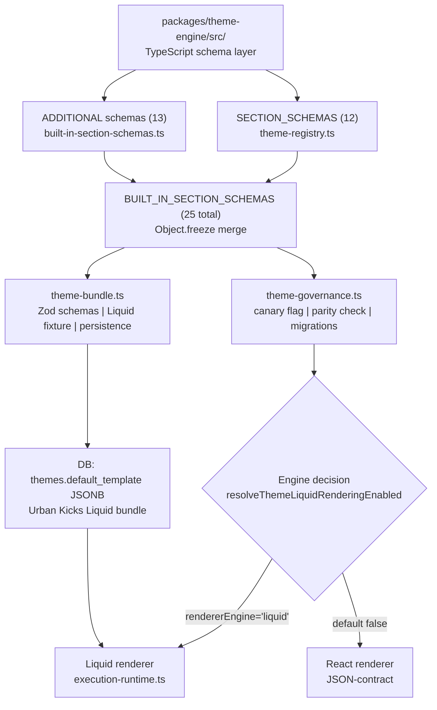
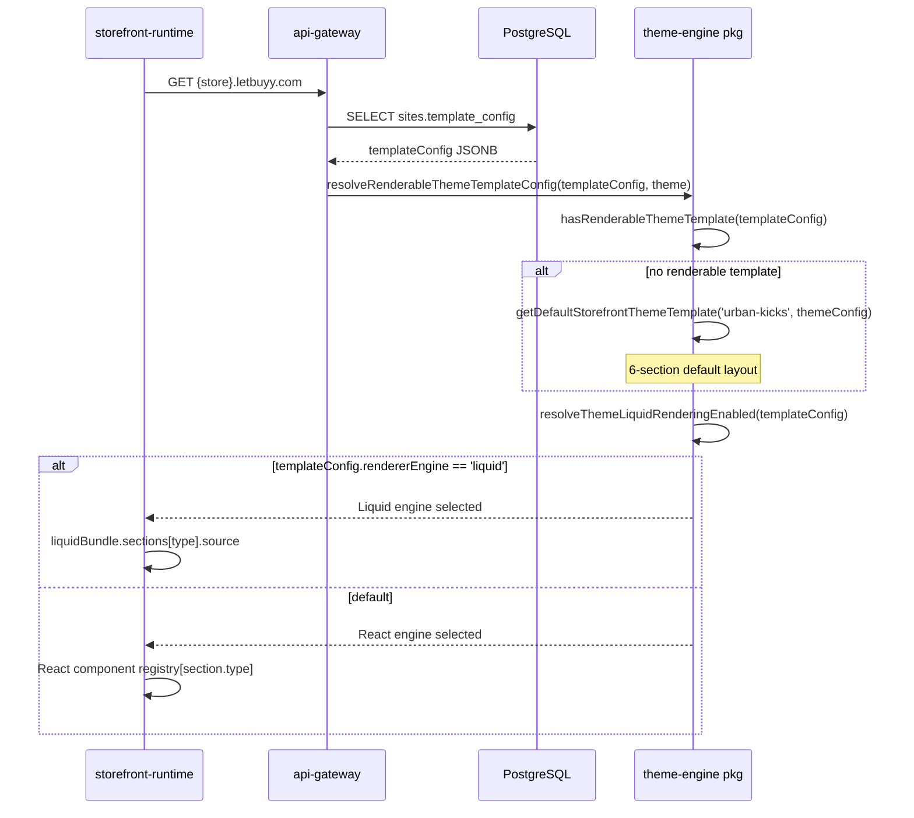
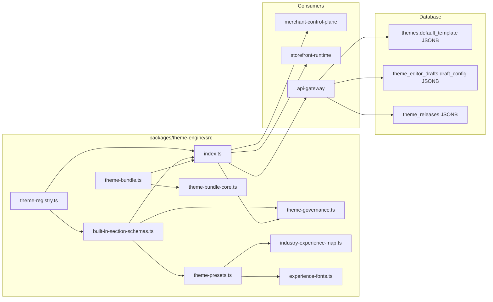

# 09 — Theme Schema & Registry Discovery

**Document type:** Discovery / read-only analysis  
**Domain:** `theme-schema`  
**Audit date:** 2026-07-03  
**Reviewer:** Claude Sonnet 4.6 (adversarial sub-agent)  
**Status:** VERIFIED — see spot-check table  
**Scope:** `packages/theme-engine/src/`, `database/supabase/migrations/` (theme-related)

> **Discovery-only policy.** This document describes the current state of the theme schema and registry system. Nothing below is an instruction to modify code or schema. Recommended work is confined to the Migration Order section.

---

## Architecture Overview

LetBuyy operates exactly **one** first-party storefront theme called **Urban Kicks** (DB slug `urban-kicks`), now also aliased as `letbuyy-core` in TypeScript. The theme schema system is a multi-layered TypeScript + PostgreSQL architecture with two rendering engines and a section-schema governance model.

### High-Level Layer Map



### Rendering Engine Decision (current Urban Kicks state)

After **migration 180**, `themes.default_template.rendererEngine` is set to `'liquid'` for the Urban Kicks row. `resolveThemeLiquidRenderingEnabled()` in `theme-governance.ts` reads this field first (before any canary flag), so all Urban Kicks stores now render via Liquid regardless of the `THEME_LIQUID_RENDERING_DEFAULT_ENABLED = false` platform default.

---

## Current Implementation

### Key Constants (all verified against source files)

| Constant | File | Value |
|----------|------|-------|
| `THEME_LIQUID_RENDERING_DEFAULT_ENABLED` | `theme-governance.ts:14` | `false` |
| `THEME_RENDERER_GOVERNANCE_DEFAULT_MODE` | `theme-governance.ts:13` | `'warn'` |
| `THEME_LIQUID_PARITY_REQUIRED_SECTION_COUNT` | `theme-governance.ts:15` | `20` |
| `FALLBACK_EXPERIENCE_ID` | `theme-presets.ts:403` | `'summit'` |
| `THEME_BUNDLE_SCHEMA_VERSION` | `theme-bundle.ts:3` | `'2026-05-json-contract'` |
| `THEME_LIQUID_BUNDLE_SCHEMA_VERSION` | `theme-bundle.ts:5` | `'2026-06-liquid-sections'` |
| `MAX_LIQUID_TEMPLATE_BYTES` | `theme-bundle.ts:81` | `200,000` |
| `LETBUYY_CORE_THEME_SLUG` | `theme-bundle-core.ts:31` | `'letbuyy-core'` |
| `URBAN_KICKS_THEME_SLUG` | `theme-bundle-core.ts:35` | `'urban-kicks'` |

### Section Count Summary (verified)

| Registry | File | Count |
|----------|------|-------|
| `SECTION_SCHEMAS` (base) | `theme-registry.ts:419-432` | 12 |
| `ADDITIONAL_BUILT_IN_SECTION_SCHEMAS` | `built-in-section-schemas.ts:41-326` | 13 |
| `BUILT_IN_SECTION_TYPES` (total declared) | `built-in-section-schemas.ts:3-29` | **25** |
| `THEME_LIQUID_PORTABLE_SECTION_PARITY` entries | `theme-governance.ts:23-44` | 20 |
| Experience registry entries | `theme-presets.ts:387-399` | 10 |
| Industry options | `industry-experience-map.ts:69-80` | 9 |
| `EXPERIENCE_FONT_REGISTRY` entries | `experience-fonts.ts:30-36` | 6 |

---

## Repository Inventory

| File | Role | Actual Lines | Status |
|------|------|-------------|--------|
| `packages/theme-engine/src/theme-registry.ts` | Core schema types, 12 base section schemas, `THEME_SETTINGS_SCHEMA` (5 groups), `getDefaultStorefrontThemeTemplate`, `StorefrontThemeTemplateConfig` | 733 | IMPLEMENTED |
| `packages/theme-engine/src/built-in-section-schemas.ts` | 26-entry `BUILT_IN_SECTION_TYPES`, 13 additional schemas, `Object.freeze` merge, `collectBuiltInSectionSchemaGaps` | 337 | IMPLEMENTED |
| `packages/theme-engine/src/theme-governance.ts` | Liquid canary flag, 20-entry parity array, audit functions, `migrateThemeTemplateSchemas` (chain-walk) | 368 | IMPLEMENTED |
| `packages/theme-engine/src/theme-presets.ts` | 10 Experiences (Zod-validated), `EXPERIENCE_REGISTRY`, `applyExperienceToTemplateConfig`, registry integrity check | 522 | IMPLEMENTED |
| `packages/theme-engine/src/industry-experience-map.ts` | `INDUSTRY_EXPERIENCE_MAP` (9 industries), aliases, `resolveExperienceForIndustry` | 149 | IMPLEMENTED |
| `packages/theme-engine/src/theme-bundle.ts` | Zod bundle schemas (JSON-contract + Liquid), Urban Kicks Liquid fixture, persistence payloads, locale system | 2970 | IMPLEMENTED |
| `packages/theme-engine/src/theme-bundle-core.ts` | `letbuyy-core` alias layer, `createLetbuyyCoreLiquidThemeBundleFixture` | 82 | IMPLEMENTED |
| `packages/theme-engine/src/experience-fonts.ts` | `EXPERIENCE_FONT_REGISTRY` (6 fonts), Google Fonts href builder, integrity check | 82 | IMPLEMENTED |
| `packages/theme-engine/src/theme-renderer.ts` | Render orchestration (React + Liquid dispatch) | unknown | IMPLEMENTED (not fully read) |
| `packages/theme-engine/src/execution-runtime.ts` | JSDOM-backed Liquid runtime for SSR | unknown | IMPLEMENTED (not fully read) |
| `packages/theme-engine/src/portable-to-liquid.ts` | JSON-contract → Liquid bundle conversion | unknown | IMPLEMENTED (not fully read) |
| `packages/theme-engine/src/jsdom-runtime.d.ts` | JSDOM type declarations for theme runtime | small | STUB/SHIM |
| `packages/theme-engine/src/index.ts` | Barrel export, `ThemeSettings`, `SectionModel`, `StoreTemplateConfig`, `collectThemeTemplateValidationIssues`, Zod API schemas | 1247 | IMPLEMENTED |
| `packages/theme-engine/test/theme-engine.test.ts` | Theme engine integration tests | unknown | IMPLEMENTED |
| `packages/theme-engine/test/theme-presets.test.ts` | Experience registry + integrity tests | unknown | IMPLEMENTED |
| `packages/theme-engine/test/theme-bundle-core.test.ts` | Core alias layer tests | unknown | IMPLEMENTED |
| `packages/theme-engine/test/experience-fonts.test.ts` | Font system tests | unknown | IMPLEMENTED |
| `packages/theme-engine/test/liquid-l3-compiler.test.ts` | Liquid compiler test | unknown | IMPLEMENTED |
| `packages/theme-engine/test/liquid-l2-assets.test.ts` through `liquid-l13-authoring.test.ts` (11 files) | Liquid parity tests L2–L13 | unknown | IMPLEMENTED |
| `database/supabase/migrations/000_baseline.sql` | Baseline table definitions for all theme tables | ~13k+ lines | IMPLEMENTED |
| `database/supabase/migrations/087_theme_template_drafts.sql` | Adds `template_key` column to `theme_editor_drafts`; scoped unique constraint | 36 | IMPLEMENTED |
| `database/supabase/migrations/091_theme_marketplace_stepup.sql` | Adds marketplace tables (developer_profiles, theme_collections, theme_download_artifacts, etc.) | 348 | IMPLEMENTED |
| `database/supabase/migrations/171_liquid_bundle_persistence.sql` | ADDITIVE: merges Urban Kicks Liquid bundle JSON into `themes.default_template` for slug=`'urban-kicks'` | 17 | IMPLEMENTED |
| `database/supabase/migrations/172_liquid_bundle_refresh.sql` | ADDITIVE: refreshes the Liquid bundle with the complete template set | 18 | IMPLEMENTED |
| `database/supabase/migrations/180_urban_kicks_liquid_theme.sql` | Sets `rendererEngine='liquid'`, adds `appearance` settings_schema group (10 fields), sets default themeSettings colors, removes unschematized `subtitle` hero setting | 52 | IMPLEMENTED |
| `database/supabase/migrations/181_urban_kicks_settings_schema_complete.sql` | Adds `surfaceColor` and `isDark` to settings_schema appearance group | 32 | IMPLEMENTED |

---

## Runtime Flow

### Storefront Render Path



### Numbered Steps

1. Storefront-runtime receives a request for `{store}.letbuyy.com`.
2. API gateway loads the store's `sites.template_config` (JSONB) via DB.
3. `resolveRenderableThemeTemplateConfig(templateConfig, theme)` is called from `index.ts`.
4. `hasRenderableThemeTemplate(templateConfig)` checks for renderable sections.
5. If no renderable template: `getDefaultStorefrontThemeTemplate('urban-kicks', themeConfig)` from `theme-registry.ts` emits a hardcoded 6-section layout (announcementBar, heroBanner, categoryGrid, featuredProducts, productGrid, newsletter) + header + footer.
6. `resolveThemeLiquidRenderingEnabled(templateConfig)` from `theme-governance.ts` determines engine — checks `templateConfig.rendererEngine` / `releaseManifest.renderer_engine` for literal `'liquid'` first; checks canary flags next; falls back to `THEME_LIQUID_RENDERING_DEFAULT_ENABLED = false` (React).
7. If React: sections rendered via React component registry keyed by section `type` or `rendererKey`.
8. If Liquid: `liquidBundle` from `StoreTemplateConfig` is passed to the Liquid renderer, which reads `bundle.sections[sectionType].source`.

### Theme Settings Validation (Editor Save / Publish)

1. Editor sends `PUT /v1/themes/{themeId}/editor/draft` with `template_config`.
2. Gateway calls `collectThemeTemplateValidationIssues({ templateConfig, runtime, themeSlug })`.
3. `runtime.sectionSchemas` merges `BUILT_IN_SECTION_SCHEMAS` + any per-theme schemas.
4. For each section: `validateThemeSection(section, sectionSchemas)` — checks type registration, validates settings fields, validates blocks (max 50, registered block types only).
5. `validateThemeSettings(settingsSchema, collectTemplateSettings(templateConfig))` validates global theme colors/fonts/layout.
6. `validateSafeThemeJson(templateConfig)` — blocks prototype-polluting keys and XSS-prone URL schemes. EXCEPTION: `liquidBundle` and `releaseManifest` are excluded from this validator.
7. On validation pass: config saved to `theme_editor_drafts.draft_config`.

### Experience / Preset Application

1. At store creation or onboarding, merchant selects an industry or directly picks an Experience.
2. `resolveExperienceForIndustry(industry, override?)` from `industry-experience-map.ts` returns `ExperienceResolution { experience, source, industry }`.
3. `applyExperienceToTemplateConfig(templateConfig, experience)` merges design tokens into both `templateConfig.themeSettings` (React path) and `templateConfig.config.settings_data.current` (Liquid path).
4. `buildExperienceSettingsOverlay(experience)` emits `fontFamily`, `bodyFontFamily`, `headingFontFamily`, and all color/radius tokens.

### Schema Migration (Read-Time)

1. When an old `templateConfig` is loaded, it may carry sections with `section.schemaVersion` set (or unset, treated as `'unversioned'`).
2. Caller collects migrations as `ThemeSectionSchemaMigration[]` and calls `migrateThemeTemplateSchemas({ templateConfig, migrations })`.
3. Each section is passed through `migrateSection()`: finds a migration matching `sectionType + fromVersion`, calls `migration.migrateSettings(settings, section)`, sets `schemaVersion` to `toVersion`.
4. Maximum 20 migration steps per section (cycle-detection via `Set<key>`).
5. Applied migrations returned in `ThemeSchemaMigrationResult.applied[]` for audit.
6. **No automatic migration runs at DB read time** — the caller must pass migrations explicitly. No concrete migration objects are currently shipped; the interface exists but zero implementations.

---

## Dependency Graph



| Source | Depends On | Relationship |
|--------|-----------|--------------|
| `built-in-section-schemas.ts` | `theme-registry.ts` | Imports `SECTION_SCHEMAS`, `SchemaField`, `SectionSchema` |
| `theme-governance.ts` | `built-in-section-schemas.ts` | Imports `BUILT_IN_SECTION_SCHEMAS` |
| `theme-governance.ts` | `index.ts` | Imports `SectionModel`, `StoreTemplateConfig`, `StorefrontSectionGroupConfig`, `StorefrontTemplateConfig` |
| `theme-presets.ts` | `built-in-section-schemas.ts` | Imports `BUILT_IN_SECTION_TYPES` (for integrity check) |
| `industry-experience-map.ts` | `theme-presets.ts` | Imports `EXPERIENCE_REGISTRY`, `FALLBACK_EXPERIENCE_ID`, `getExperience`, `isThemeExperienceId` |
| `theme-bundle-core.ts` | `theme-bundle.ts` | Imports `LiquidThemePackageBundleSchema`, `createUrbanKicksLiquidThemeBundleFixture` |
| `experience-fonts.ts` | `theme-presets.ts` | Imports `listExperiences`, `ThemeExperience` |
| `index.ts` | `theme-registry.ts` | Imports `getDefaultStorefrontThemeTemplate`, `hasRenderableThemeTemplate`, `SchemaField`, `SectionSchema`, `ThemeSettingsSchema` |
| `index.ts` | `built-in-section-schemas.ts` | Imports `BUILT_IN_SECTION_SCHEMAS` (used in `collectThemeTemplateValidationIssues`) |
| `index.ts` | `theme-bundle.ts` | Imports `LiquidThemePackageBundle` (for `StoreTemplateConfig.liquidBundle`) |
| `apps/merchant-control-plane` | `@letbuyy/theme-engine` | Uses `ThemeEditorPayload`, `SaveThemeDraftSchema`, `PublishThemeSchema`, `THEME_SETTINGS_SCHEMA`, `BUILT_IN_SECTION_SCHEMAS` |
| `apps/storefront-runtime` | `@letbuyy/theme-engine` | Uses `StoreTemplateConfig`, `resolveRenderableThemeTemplateConfig`, `resolveThemeLiquidRenderingEnabled` |
| `services/api-gateway` | `@letbuyy/theme-engine` | Validates requests, calls `collectThemeTemplateValidationIssues`, persists to `theme_editor_drafts`, `theme_releases` |

---

## Missing Features

1. **`letbuyy-core` DB row**: `theme-bundle-core.ts` defines the canonical slug but the comment explicitly notes: "adding a `letbuyy-core` DB alias row are the documented, deferred follow-ups." DB lookups still require `urban-kicks`.

2. **No concrete schema migrations**: `ThemeSectionSchemaMigration` interface is implemented but zero migration objects are registered anywhere. When schema changes occur, there is no automated path to update stored section settings.

3. **Font loading not wired**: `experience-fonts.ts` builds Google Fonts hrefs, but the actual `<link>` injection into the storefront head is deferred. Non-Inter experiences (Aura, Craft, Dawn, Sense) render with system-font fallback.

4. **`apply_preset` API endpoint**: Theme experiences can be applied via TypeScript (`applyExperienceToTemplateConfig`) but prior research flagged the absence of a gateway API endpoint for applying a preset in a single call.

5. **Onboarding does not confirmed auto-assign experiences**: The `applyExperienceToTemplateConfig` function exists (`theme-presets.ts:466-487`) but whether the store creation flow calls it is not determinable from `packages/theme-engine/src` alone.

6. **`theme_packages` / `theme_package_versions` not connected to first-party `themes`**: The `themes` table carries the full bundle in JSONB. The marketplace tables exist but `legacy_theme_id uuid` links back — no evidence the Urban Kicks theme is registered in `theme_packages`.

7. **Sections with no Liquid parity counterpart**: The following 8 built-in section types have no entry in `THEME_LIQUID_PORTABLE_SECTION_PARITY` (`theme-governance.ts:23-44`): `collectionFilter`, `contentPage`, `videoHero`, `faqAccordion`, `instagramFeed`, `header`, `footer`, `announcementBar`. Of these, `header`/`footer`/`announcementBar` are generated as chrome by the Liquid bundle, and `contentPage` has a `rich-content` Liquid template available but no `PORTABLE_TO_LIQUID_TYPE_OVERRIDES` mapping (`portable-to-liquid.ts:43-53`), so `resolveLiquidSectionType('contentPage')` returns null. Stores that add the 5 content types (or whose default template uses them) will find them absent in Liquid rendering. Note: `contactForm`, `ctaSection`, `experienceTimeline`, `portfolioGrid`, `servicesGrid`, and `skillsSection` **do** have Liquid parity entries.

8. **`theme_instance_drafts`**: A second draft table exists (`theme_instance_drafts.working_manifest`) alongside `theme_editor_drafts.draft_config`. `theme_preview_sessions.theme_instance_draft_id` references the former. Migration path between them is not clear from reviewed code.

---

## Partial Implementations

1. **`theme-renderer.ts`**: Exists and is re-exported from `index.ts`. From governance code it is implied to handle both React and Liquid dispatch. Actual section-to-renderer dispatch code was not read.

2. **`execution-runtime.ts`**: JSDOM-backed Liquid runtime. `jsdom-runtime.d.ts` is a type shim, suggesting JSDOM is an optional peer or conditional import.

3. **`portable-to-liquid.ts`**: Conversion from JSON-contract bundle to Liquid bundle. Likely used to generate the Urban Kicks Liquid fixture, but implementation was not read.

4. **Schema migration engine**: Infrastructure complete (interface, chain-walk, loop detection, applied-log). Zero concrete migrations registered. Status: PARTIAL — infrastructure only.

5. **`surfaceColor` field**: Added to `THEME_SETTINGS_SCHEMA` in TypeScript (`ThemeSettings.surfaceColor?: string` at `index.ts:67`) and to `themes.settings_schema` via migration 181. But `ExperienceTokensSchema` in `theme-presets.ts` requires `surfaceColor` as non-optional (`surfaceColor: HexColorSchema` at `theme-presets.ts:42`), while `ThemeSettings` marks it optional. These are structurally divergent.

---

## Technical Debt

1. **Dual schema structure**: `THEME_SETTINGS_SCHEMA` in TypeScript (`theme-registry.ts`) uses 5 groups (colors, typography, layout, header, footer). After migration 180, `themes.settings_schema` for Urban Kicks uses 1 flat group (`appearance`). The TypeScript static schema is the "desired future state" but runtime validation reads from the DB `appearance` group.

2. **`getSectionSchemas` and `getThemeSettingsSchema` both ignore `themeId`**: The functions accept `_themeId` but always return the same static schemas (`theme-registry.ts:497-506`). Comment notes "The runtime schema registry is database-backed; this static export is kept as the shared fallback contract for older clients." Static TypeScript schemas may be stale relative to the DB.

3. **Two draft tables with distinct flow ownership**: `theme_editor_drafts` is the editor-save path (PUT /v1/themes/{themeId}/editor/draft → `draft_config`); `theme_instance_drafts` is the release-engine path (`working_manifest`). The preview session bridges both: `public-routes.ts:475–522` first tries `theme_instance_drafts` (when `theme_preview_sessions.theme_instance_draft_id` is set), then falls back to `theme_editor_drafts` via `draft_id`. The baseline SQL comment at line 12813 (on `theme_preview_sessions.theme_instance_draft_id`) states: "Legacy draft_id remains during migration", marking `draft_id` as the legacy pointer. The role separation is documented in 05_THEME_EDITOR_DISCOVERY.md. A formal deprecation migration for `theme_editor_drafts` has not been authored.

4. **`StorefrontThemeTemplateConfig` vs. `StoreTemplateConfig`**: Two different template config shapes — the legacy header/footer/template slot structure (`StorefrontThemeTemplateConfig` in `theme-registry.ts`) and the flat `sections[]` + `sectionGroups` + `templates` structure (`StoreTemplateConfig` in `index.ts`). `hasRenderableThemeTemplate` handles both; `getDefaultStorefrontThemeTemplate` produces the legacy slot structure.

5. **`testimonials` block type inconsistency**: The `testimonials` section (theme-registry.ts:233–253) has no `blocks_schema` key at all — only a `sample_blocks` array containing one entry of type `testimonialCard` (theme-registry.ts:242–243). Because `blocks_schema` is absent, the React editor hides the Add Block UI for this section entirely. The Liquid parity section uses block type `testimonial` (theme-bundle.ts:1152). The mismatch is between `sample_blocks` (seeded draft block type `testimonialCard`) and the Liquid section's inline block type (`testimonial`) — not a conflict within `blocks_schema`.

6. **`newsletter` vs. `newsletter-signup` type name divergence**: The JSON-contract schema uses type `newsletter` while the Liquid parity array uses `newsletter-signup` (`theme-governance.ts:35`). Stored template configs using `type: 'newsletter'` will not be found in the Liquid section registry under the same key.

7. **`heroBanner` schema divergence between engines**: JSON-contract `heroBanner` settings include `overlay` (range), `height` (select), `textAlign` (select), `image` (image). Liquid `hero-banner` section uses `eyebrow` (text), `heading`, `subheading`, `ctaText`, `ctaLink` — notably missing `overlay`, `height`, `textAlign`, `image`. Two functionally different section schemas share the same conceptual role.

8. **`URBAN_KICKS_THEME_SLUG` alias not cleaned up in DB**: TypeScript `resolveCanonicalThemeSlug` resolves `'urban-kicks'` to `'letbuyy-core'` but the DB has no constraint to prevent `letbuyy-core` from being stored as a raw `theme_id`. Mixed state risk if new code uses the canonical slug directly for DB lookups.

9. **`SECTION_SCHEMAS` not runtime-frozen**: `SECTION_SCHEMAS` in `theme-registry.ts:419` is a plain `const` object without `Object.freeze()`. The governance freeze is a team convention in comments, not a runtime lock. Only `BUILT_IN_SECTION_SCHEMAS` (the merged export) is `Object.freeze()`'d (`built-in-section-schemas.ts:328`).

---

## Enterprise Gap Analysis

### Coverage Table

| Capability Area | Coverage | Evidence |
|----------------|----------|---------|
| Section type registry | FULL (26 types) | `BUILT_IN_SECTION_SCHEMAS` merge |
| Global settings schema | FULL (5 TS groups / 1 DB group) | `THEME_SETTINGS_SCHEMA` + migration 181 |
| Experience / preset system | FULL (10 experiences, Zod-validated) | `EXPERIENCE_REGISTRY` |
| Industry → experience mapping | FULL (9 industries, aliases) | `INDUSTRY_EXPERIENCE_MAP` |
| Liquid section parity | PARTIAL (20 of 26 types) | `THEME_LIQUID_PORTABLE_SECTION_PARITY` |
| Schema migration infrastructure | PARTIAL (interface + engine, 0 migrations) | `migrateThemeTemplateSchemas` |
| Font loading | PARTIAL (registry built, injection not wired) | `experience-fonts.ts` |
| Multi-theme support | NOT STARTED (1 theme, `letbuyy-core` DB row deferred) | `theme-bundle-core.ts` |
| Third-party theme marketplace | SCHEMA ONLY (tables exist, not deployed) | `091_theme_marketplace_stepup.sql` |
| `apply_preset` gateway API | NOT CONFIRMED (TS function exists, no route verified) | `theme-presets.ts:466-487` |
| Onboarding auto-assign experience | NOT CONFIRMED (TS function exists) | `applyExperienceToTemplateConfig` |
| `letbuyy-core` DB row | MISSING | `theme-bundle-core.ts:44-47` (comment) |

### Structural Gaps

1. **No DB-level schema version table**: Section schema versions are embedded in `SectionModel.schemaVersion` (optional). No separate migration tracking table exists.
2. **`themes.section_schemas` is seed-set to thin stubs**: The urban-kicks-theme.sql seed sets `themes.section_schemas` to 6 stubs (header, heroBanner, categoryGrid, productGrid, trustBadges, footer), each containing only `type` and `name` — no `settings_schema`, `blocks_schema`, or `defaults`. On migration-only databases (no seed), the column defaults to `{}` and the gateway falls back to TypeScript static schemas (`BUILT_IN_SECTION_SCHEMAS`). On seed-applied databases the seed stubs are used for these 6 types, but they are much thinner than the TypeScript schemas.
3. **`theme_packages.legacy_theme_id`**: No evidence that the first-party Urban Kicks theme has a row in `theme_packages`, meaning the marketplace and first-party theme systems are not yet linked.

---

## Risk Analysis

| Risk | Level | Evidence |
|------|-------|---------|
| **`newsletter` ↔ `newsletter-signup` type name split**: Liquid render path will not find `newsletter` sections in the Liquid bundle (Liquid bundle uses `newsletter-signup`). Migration 180 set `rendererEngine='liquid'` for all Urban Kicks stores. | HIGH | `theme-governance.ts:35`; Liquid bundle section key in migration 171 |
| **`heroBanner` parity gap**: Liquid `hero-banner` schema lacks `overlay`, `height`, `textAlign`, `image` fields present in JSON-contract `heroBanner`. Merchants who customized these fields on the React theme may silently lose them on the Liquid path. | HIGH | `theme-bundle.ts:1009-1027` (Liquid hero-banner schema); `theme-registry.ts:100-111` (JSON-contract heroBanner schema) |
| **No concrete schema migrations**: Settings schema changes are backward-incompatible without migrations. Stored section configs in `theme_releases.template_snapshot` cannot be upgraded. | HIGH | `theme-governance.ts:77-96` (interface exists, zero implementations) |
| **`themes.settings_schema` structure divergence**: DB `appearance` group vs. TypeScript 5-group layout. New stores initialized from TypeScript defaults could produce validation mismatches when `runtime.settingsSchema` is loaded from DB. | MEDIUM | Migration 180; `theme-registry.ts:436-489` |
| **`letbuyy-core` DB row is missing**: Code in `theme-bundle-core.ts` redirects slugs but DB queries for `theme_id = 'letbuyy-core'` will return 0 rows. Any code using `LETBUYY_CORE_THEME_SLUG` for DB lookups silently fails. | MEDIUM | `theme-bundle-core.ts:44-47` |
| **Font loading not wired**: 4 of 10 experiences (Aura, Craft, Dawn, Sense) use non-system fonts that currently render with system-font fallback. | MEDIUM | `experience-fonts.ts`; font injection deferred |
| **`collectionFilter`, `contentPage`, `videoHero`, `faqAccordion`, `instagramFeed` sections have no Liquid parity**: Stores that add these sections will not render them under the Liquid engine. `header`, `footer`, `announcementBar` also lack explicit Liquid parity entries in the array. | MEDIUM | `THEME_LIQUID_PORTABLE_SECTION_PARITY` (20 entries) vs. `BUILT_IN_SECTION_TYPES` (25 entries) |
| **`surfaceColor` optional/required mismatch**: `ThemeSettings.surfaceColor?: string` vs. `ExperienceTokens.surfaceColor: string` (required). Potential type mismatch when reading back applied Experience tokens. | LOW | `index.ts:67`; `theme-presets.ts:42` |
| **Max Liquid template size 200KB per-file**: A third-party who embeds extensive inline Liquid in a section source could hit this limit. | LOW | `theme-bundle.ts:81` (`MAX_LIQUID_TEMPLATE_BYTES = 200_000`) |

---

## Spot-Check Verification Table

| # | Claim | Expected | Verified |
|---|-------|----------|---------|
| 1 | `SECTION_SCHEMAS` has 12 base entries | 12 | ✓ (theme-registry.ts:419-432) |
| 2 | `BUILT_IN_SECTION_TYPES` has 25 entries | 25 | ✓ (built-in-section-schemas.ts:3-29) |
| 3 | `ADDITIONAL_BUILT_IN_SECTION_SCHEMAS` has 13 entries | 13 | ✓ (built-in-section-schemas.ts:41-326) |
| 4 | `THEME_LIQUID_RENDERING_DEFAULT_ENABLED = false` | false | ✓ (theme-governance.ts:14) |
| 5 | 10 experiences in `EXPERIENCE_REGISTRY` | 10 (forge/sense/aura/craft/refresh/ride/dawn/bloom/nova/summit) | ✓ (theme-presets.ts:387-399) |
| 6 | `FALLBACK_EXPERIENCE_ID = 'summit'` | 'summit' | ✓ (theme-presets.ts:403) |
| 7 | Migration 091 has 348 lines | 348 | ✓ (wc -l) |
| 8 | Migration 180 has 52 lines | 52 | ✓ (wc -l) |
| 9 | `testimonials` has no `blocks_schema`; `testimonialCard` in `sample_blocks` (theme-registry.ts:242–243); Liquid uses block type `testimonial` (theme-bundle.ts:1152) | no blocks_schema; different type keys | ✓ (theme-registry.ts:233–253; theme-bundle.ts:1152) |
| 10 | `newsletter` vs `newsletter-signup` type divergence | confirmed | ✓ (theme-governance.ts:35) |
| 11 | `surfaceColor?: string` optional in `ThemeSettings` | optional | ✓ (index.ts:67) |
| 12 | `surfaceColor: HexColorSchema` required in `ExperienceTokensSchema` | required | ✓ (theme-presets.ts:42) |
| 13 | Test files are in `packages/theme-engine/test/` (not `src/test/`) | `test/` dir | ✓ (filesystem check) |
| 14 | Food maps to `refresh` (not `harvest`) in `INDUSTRY_EXPERIENCE_MAP` | refresh | ✓ (industry-experience-map.ts:28) |
| 15 | `BUILT_IN_SECTION_SCHEMAS` is `Object.freeze()`'d at export | frozen | ✓ (built-in-section-schemas.ts:328) |
| 16 | `SECTION_SCHEMAS` in theme-registry.ts is NOT `Object.freeze()`'d | plain const | ✓ (theme-registry.ts:419) |
| 17 | `contactForm`, `ctaSection` DO have Liquid parity entries | present | ✓ (theme-governance.ts:29-30) |
| 18 | `MAX_LIQUID_TEMPLATE_BYTES = 200_000` | 200000 | ✓ (theme-bundle.ts:81) |

---

## Recommended Migration Order

> This section describes potential future work ordered by impact and dependency. Nothing here prescribes immediate implementation.

The following work items are ranked by risk severity and dependency ordering, based on discovery findings. All require human review and ARB approval before implementation.

### Tier 1 — Correctness / Data-Safety (address before wider merchant rollout)

1. **Resolve `newsletter` → `newsletter-signup` key split** (HIGH risk): Either rename the Liquid section key in the bundle to `newsletter`, or add a `newsletter` → `newsletter-signup` remapping layer in `resolveThemeLiquidRenderingEnabled` before the Liquid bundle lookup. Requires a new migration and regression testing of all Urban Kicks stores on the Liquid path.

2. **Align `heroBanner` field schemas between engines** (HIGH risk): Decide the canonical field set for `heroBanner` / `hero-banner` and add missing fields to the Liquid section schema. Requires updating `createUrbanKicksLiquidThemeBundleFixture` in `theme-bundle.ts` and running migration 172 equivalent for the refreshed bundle.

3. **Implement first concrete schema migration** (HIGH risk): Register at least one `ThemeSectionSchemaMigration` object in the codebase to confirm the chain-walk machinery works end-to-end and establish the pattern for future changes.

### Tier 2 — Structural Completeness (before third-party theme support)

4. **Add `letbuyy-core` DB row** (MEDIUM risk): Insert a `themes` row with `slug = 'letbuyy-core'` that references or duplicates the Urban Kicks bundle. Required before any code using `LETBUYY_CORE_THEME_SLUG` for DB lookups.

5. **Align `themes.settings_schema` DB structure with TypeScript `THEME_SETTINGS_SCHEMA`** (MEDIUM risk): Decide whether the 5-group TypeScript layout or the 1-group `appearance` DB layout is authoritative, then migrate the other to match.

6. **Wire font loading** (MEDIUM risk): Implement the storefront `<link>` injection for the hrefs produced by `buildExperienceFontLinkHref`. Referenced in prior execution docs.

7. **Formalize `theme_editor_drafts` deprecation** (`theme_editor_drafts` vs. `theme_instance_drafts`): The two tables serve distinct flows (`theme_editor_drafts` = editor-save path; `theme_instance_drafts` = release-engine path); neither is currently deprecated. The preview session already bridges both via `public-routes.ts:475–522`. If `theme_instance_drafts` is confirmed as the successor, author a migration to backfill legacy `theme_editor_drafts` rows and formally deprecate the old table.

### Tier 3 — Feature Completeness (before ARB platform-wide Liquid flip)

8. **Add Liquid parity for missing section types**: `collectionFilter`, `contentPage`, `videoHero`, `faqAccordion`, `instagramFeed`, `header`, `footer`, `announcementBar` all lack entries in `THEME_LIQUID_PORTABLE_SECTION_PARITY`. Adding parity sections would raise the count from 20 to 28 against the 25 built-in types (note: `contentPage` needs only a `PORTABLE_TO_LIQUID_TYPE_OVERRIDES` mapping to the existing `rich-content` template, and `header`/`footer`/`announcementBar` are already bundle-generated chrome).

9. **Confirm / wire onboarding experience auto-assign**: Verify whether `applyExperienceToTemplateConfig` is called from the store creation flow. If not, determine and document the path.

10. **Add `apply_preset` gateway route**: Expose experience application as a single API call if not already present.

11. **Connect `theme_packages` to first-party themes**: Determine whether a `theme_packages` row for Urban Kicks / `letbuyy-core` is needed for marketplace functionality.

---

## Open Questions

1. **Does `services/api-gateway` load `settingsSchema` from `themes.settings_schema` (DB flat `appearance` group) or from `THEME_SETTINGS_SCHEMA` (TypeScript 5 groups) when building the validation `runtime`?**

2. **`migrateThemeTemplateSchemas` is test-wired but not production-wired.** The function IS called in `packages/theme-engine/test/theme-engine.test.ts` (line ~158) and is enforced there by the `theme-governance-validator.mjs` gate (scripts/validators/theme-governance-validator.mjs:102). However, it is not invoked in any production path — neither in the gateway's publish, draft, nor store-data normalization flows. The schema migration engine is test-covered but has no production call site.

3. **Are any stores in the live DB currently set to `liquidRenderingCanary = true` independently of migration 180?**

4. **`themes.section_schemas` is NOT empty on seed-applied databases.** The urban-kicks-theme.sql seed (database/supabase/seeds/urban-kicks-theme.sql:217–224) sets `themes.section_schemas` to a non-empty JSONB object containing 6 lightweight stubs:

   ```
   header, heroBanner, categoryGrid, productGrid, trustBadges, footer
   ```

   Each stub contains only `type` and `name` fields — no `settings_schema`, `blocks_schema`, or `defaults` keys.

   On seed-applied databases the TypeScript static fallback (`getSectionSchemas` at theme-registry.ts:497) is NOT triggered for these 6 types; the seed stubs are used instead. On pure migration-only databases (000_baseline.sql + migrations 171–181, no seed run), `themes.section_schemas` defaults to `{}` and the TypeScript `BUILT_IN_SECTION_SCHEMAS` fallback is the effective live source. The seed stubs are much thinner than TypeScript's `SECTION_SCHEMAS` — they lack `settings_schema`, `blocks_schema`, and `defaults`.

5. **Fixture staleness confirmed — `product-detail` parity section is richer than what is stored in migrations 171/172.**
   `createLiquidParitySectionFiles()` (theme-bundle.ts:1054–1084) includes 5 capabilities absent from the bundle persisted by migrations 171 and 172:
   - `showReviews` toggle setting
   - `lb-variant-picker` custom element (in the product-detail section; migration 172 contains `lb-variant-picker` but only in the product-grid section)
   - `lb-wishlist-toggle` custom element (in the product-detail section)
   - The review loop (`` with `lb-product-review` markup)
   - `lb-review-form` custom element

   The in-code fixture (`createUrbanKicksLiquidThemeBundleFixture`) is current because it calls `createLiquidParitySectionFiles()` directly (theme-bundle.ts:2473). However, any store whose `liquid_bundle` row was seeded from migration 171 or 172 will be missing these capabilities until a bundle-refresh migration is run.

6. **`theme_packages.legacy_theme_id` is populated lazily at runtime, not by seed or migration.** No seed or migration populates this column for the Urban Kicks row. `ensureThemePackageRuntime()` (schema-registry-execution.adapter.ts:487) sets `legacy_theme_id: theme.id` on the first gateway request that requires a package runtime — an upsert on conflict `slug`. `findPackageRuntime()` (adapter.ts:613) queries by `OR(slug.eq.${theme.slug}, legacy_theme_id.eq.${theme.id})`, so `slug` always matches even when `legacy_theme_id` is null, making lookups robust to a fresh database. The practical risk is in marketplace-review flows (marketplace-reviews.ts:272) that read `legacy_theme_id` to sync `themes.is_active`: if the first gateway resolution has not yet run on a fresh database, the null check at line 273 skips the sync rather than erroring.
