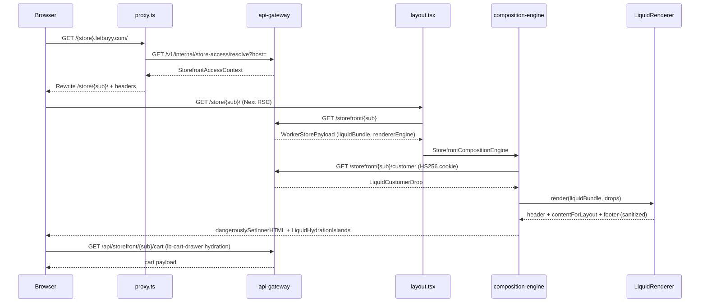
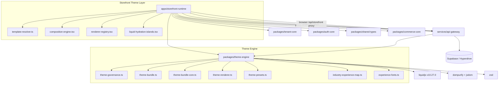

# 10 — Asset Pipeline Discovery
## LetBuyy Storefront Liquid Theme System

| Field | Value |
|---|---|
| **Domain** | Storefront / Liquid Theme Engine |
| **Audit date** | 2026-07-03 |
| **Auditor** | Claude Code subagent (read-only discovery) |
| **Repo branch** | `stepup/main` |
| **Scope** | `apps/storefront-runtime`, `packages/theme-engine`, `services/api-gateway` (theme routes) |
| **Status** | DISCOVERY ONLY — no source mutations made |

> **Discovery-only document.** All findings below are observational. Recommended next steps are grouped in the [Recommended Migration Order](#recommended-migration-order) section and require explicit human or ARB approval before any implementation begins.

---

## Architecture Overview

LetBuyy operates a **dual-renderer storefront**: a React/JSON-contract path (the production default) and a LiquidJS server-side rendering path (canary, currently activated only for stores whose `templateConfig.rendererEngine` equals `'liquid'`).

The platform uses **Next.js 16.1.6** (React 19.2.3) deployed on Vercel. All store data flows exclusively through the Cloudflare Workers Hono API gateway (`services/api-gateway`) — the storefront never queries Supabase directly. LiquidJS templates are stored as validated TypeScript string literals inside `packages/theme-engine/src/theme-bundle.ts`, not as on-disk `.liquid` files.

```
┌──────────────────────────────────────────────────────────────────────────┐
│ LetBuyy Storefront Asset & Rendering Pipeline                            │
│                                                                          │
│  Browser Request                                                         │
│       │                                                                  │
│       ▼                                                                  │
│  proxy.ts (Next.js middleware, Edge)                                     │
│  · host resolution (subdomain / custom domain)                           │
│  · resolveAccess → api-gateway /v1/internal/store-access/resolve         │
│  · security gates: password, preview, redirect, offline                  │
│  · URL rewrite: /store/{subdomain}{path}                                 │
│  · X-Lb-Render-Engine header (env var, observability only)               │
│       │                                                                  │
│       ▼                                                                  │
│  page.tsx / layout.tsx (Next.js RSC, Node.js runtime)                   │
│  · revalidate = 60 (ISR)                                                 │
│  · getStoreBySubdomain → api-gateway → Supabase (Hyperdrive)             │
│  · resolveStorefrontTemplate → engine decision                           │
│       │                                                                  │
│       ├──────────────────────────────────────────────────────┐           │
│       │ React path (default)                                 │ Liquid    │
│       ▼                                                      │ path      │
│  StorefrontCompositionEngine                                 │           │
│  → renderer-registry.tsx (21 renderers, core./commerce./)   ▼           │
│  → React section components                    LiquidRenderer.render()  │
│                                                → LiquidJS (^10.27.0)    │
│                                                → DOMPurify + jsdom       │
│                                                → header+body+footer HTML │
│       │                                                      │           │
│       └──────────────────────┬───────────────────────────────┘           │
│                              ▼                                           │
│                     Browser receives HTML                                │
│                     Liquid: 9 Web Component islands (lb-*)               │
│                     React: client context providers (cart, auth)         │
└──────────────────────────────────────────────────────────────────────────┘
```

---

## Current Implementation

### Rendering Engines

| Engine | Status | Activation |
|--------|--------|-----------|
| React / JSON-contract | **Production default** | Always active unless Liquid is explicitly enabled |
| LiquidJS (^10.27.0) | **Canary, ARB-gated** | `templateConfig.rendererEngine === 'liquid'` or `liquidRenderingCanary: true` |

The global constant `THEME_LIQUID_RENDERING_DEFAULT_ENABLED = false` lives at `packages/theme-engine/src/theme-governance.ts:14`. A platform-wide Liquid flip requires Architecture Review Board sign-off (`THEME_LIQUID_PLATFORM_WIDE_FLIP_DECISION.status = 'deferred'`, `authority: 'ARB'`).

Migration 180 (`database/supabase/migrations/180_urban_kicks_liquid_theme.sql`) set `rendererEngine = 'liquid'` directly in `themes.default_template` for the `urban-kicks` theme, causing `resolveThemeLiquidRenderingEnabled` to activate Liquid for stores on that theme without requiring the canary flag.

### Theme Identity

The sole first-party theme is **Urban Kicks** (DB slug `urban-kicks`). A TypeScript-level alias introduced by the most recent commit makes `letbuyy-core` resolve to the same bundle:

- `LETBUYY_CORE_THEME_SLUG = 'letbuyy-core'` — canonical branding
- `URBAN_KICKS_THEME_SLUG = 'urban-kicks'` — legacy DB slug (still persisted in `sites.theme_id`)
- `THEME_SLUG_ALIASES` resolves `urban-kicks → letbuyy-core` and `urban-kicks-liquid → letbuyy-core-liquid` at runtime

A `letbuyy-core` row in the `themes` table is deferred (per code comment in `packages/theme-engine/src/theme-bundle-core.ts`).

### Experience / Preset System

Ten named "Experiences" are implemented in `packages/theme-engine/src/theme-presets.ts`:

| Experience | Industry | Key Fonts |
|-----------|---------|-----------|
| `forge` | electronics | Inter / Inter |
| `sense` | fashion | Inter / Playfair Display |
| `aura` | beauty | Lato / Cormorant Garamond |
| `craft` | furniture | Source Sans Pro / Libre Baskerville |
| `refresh` | food | Inter / Inter |
| `ride` | sports | Inter / Inter |
| `dawn` | books | Source Sans Pro / Libre Baskerville |
| `bloom` | pet | Inter / Inter |
| `nova` | (D2C, versatile) | Inter / Inter |
| `summit` | general (fallback) | Inter / Inter |

Experiences are applied at store creation (`services/api-gateway/src/routes/stores.ts:659–673`) via `resolveExperienceForIndustry` + `applyExperienceToTemplateConfig`, and post-creation via the Theme Editor's Experiences panel (`ExperiencePicker.tsx`).

---

## Repository Inventory

### Core Engine Files

| File | Role | Approx Lines | Status |
|------|------|-------------|--------|
| `packages/theme-engine/src/theme-governance.ts` | Canary flag, ARB gate, `resolveThemeLiquidRenderingEnabled`, ART-17 parity array (20 entries), schema migration engine | 369 | IMPLEMENTED |
| `packages/theme-engine/src/theme-bundle.ts` | Zod bundle schemas, `ThemeLiquidSourceSchema`, `createUrbanKicksLiquidThemeBundleFixture`, `createMinimalLiquidThemeBundleFixture` | ~2971 | IMPLEMENTED |
| `packages/theme-engine/src/theme-bundle-core.ts` | `letbuyy-core` alias layer, `createLetbuyyCoreLiquidThemeBundleFixture` | ~83 | IMPLEMENTED |
| `packages/theme-engine/src/theme-renderer.ts` | `LiquidRenderer`, `JsonContractThemeRenderer`, `LIQUID_RENDERED_HTML_DOMPURIFY_CONFIG`, `LIQUID_THEME_TOKEN_MAP`, `buildLiquidThemeHeadAssets`, custom filters | ~933 | IMPLEMENTED |
| `packages/theme-engine/src/theme-registry.ts` | 12 base section schemas in `SECTION_SCHEMAS`, `THEME_SETTINGS_SCHEMA`, `getDefaultStorefrontThemeTemplate` | ~734 | IMPLEMENTED (governance-frozen) |
| `packages/theme-engine/src/built-in-section-schemas.ts` | 25 `BUILT_IN_SECTION_TYPES` (12 base + 13 additional), `BUILT_IN_SECTION_SCHEMAS` (Object.freeze), `collectBuiltInSectionSchemaGaps` | ~338 | IMPLEMENTED |
| `packages/theme-engine/src/theme-presets.ts` | 10 Experiences, `EXPERIENCE_REGISTRY`, `buildExperienceSettingsOverlay`, `applyExperienceToTemplateConfig` | ~523 | IMPLEMENTED |
| `packages/theme-engine/src/industry-experience-map.ts` | 9-industry map, 18 synonym aliases, `resolveExperienceForIndustry` | ~150 | IMPLEMENTED |
| `packages/theme-engine/src/experience-fonts.ts` | `EXPERIENCE_FONT_REGISTRY` (6 fonts), `buildGoogleFontsHref`, `buildExperienceFontLinkHref` | ~83 | IMPLEMENTED (not wired to storefront head) |
| `packages/theme-engine/src/execution-runtime.ts` | `composeStorefrontTheme`, section/block hydration, `injectRuntimeSections` | ~487 | IMPLEMENTED |
| `packages/theme-engine/src/portable-to-liquid.ts` | `compilePortableToLiquidBundle`, L3 portable→Liquid compiler | ~202 | IMPLEMENTED |
| `packages/theme-engine/src/index.ts` | Barrel exports, `ThemeSettings`, `DEFAULT_THEME_SETTINGS`, Zod API schemas | ~1248 | IMPLEMENTED |

### Storefront Runtime Files

| File | Role | Approx Lines | Status |
|------|------|-------------|--------|
| `apps/storefront-runtime/src/proxy.ts` | Next.js middleware: host routing, tenant resolution, security gates, URL rewrite, render engine header | ~300 | IMPLEMENTED |
| `apps/storefront-runtime/src/app/store/[subdomain]/layout.tsx` | CSS custom property injection, `FONT_MAP` (10 entries), context providers, Liquid chrome bypass | ~300 | IMPLEMENTED |
| `apps/storefront-runtime/src/app/store/[subdomain]/page.tsx` | ISR page (revalidate=60), render plan resolution, section data plan, `StorefrontCompositionEngine` | ~65 | IMPLEMENTED |
| `apps/storefront-runtime/src/app/store/[subdomain]/liquid-theme.css` | Liquid theme base CSS loaded by layout | ~30 | IMPLEMENTED |
| `apps/storefront-runtime/src/lib/theme-engine/template-resolver.ts` | `resolveStorefrontTemplate`, `resolveLiquidBundle` (4 candidate fields), dev engine override | ~309 | IMPLEMENTED |
| `apps/storefront-runtime/src/lib/theme-engine/composition-engine.tsx` | Async server component: React `RenderSectionList` + Liquid `renderLiquidPlan` | ~516 | IMPLEMENTED |
| `apps/storefront-runtime/src/lib/theme-engine/renderer-registry.tsx` | 21 React section renderers (`core.*`, `commerce.*`, `apps.*` namespaces) | ~287 | IMPLEMENTED |
| `apps/storefront-runtime/src/lib/theme-engine/liquid-hydration-islands.tsx` | 9 `lb-*` Web Component custom elements + `registerLiquidHydrationIslands` | ~1307 | IMPLEMENTED |
| `apps/storefront-runtime/src/lib/theme-engine/data-binding-engine.ts` | `buildSectionDataPlan`: product fetch per section | ~107 | IMPLEMENTED |
| `apps/storefront-runtime/src/lib/theme-engine/types.ts` | `StorefrontRenderPlan`, `StorefrontRouteType` (16 types), `LiquidCommerceDrops` | ~95 | IMPLEMENTED |
| `apps/storefront-runtime/src/lib/store-service.ts` | `getStoreBySubdomain`, `mapSupabaseToStore`, Liquid bundle fallback | ~780 | IMPLEMENTED |

### Database Migrations

| Migration | Purpose | Status |
|-----------|---------|--------|
| `171_liquid_bundle_persistence.sql` | Inserts Urban Kicks Liquid bundle into `themes.default_template.liquidBundle` | IMPLEMENTED |
| `172_liquid_bundle_refresh.sql` | Refreshes bundle with complete page template set | IMPLEMENTED |
| `180_urban_kicks_liquid_theme.sql` | Sets `rendererEngine='liquid'` in `themes.default_template`; adds appearance settings schema | IMPLEMENTED |
| `181_urban_kicks_settings_schema_complete.sql` | Adds `surfaceColor`, `isDark` to settings schema | IMPLEMENTED |
| `185_v1_site_domains.sql` | `site_domains` + `site_domain_verifications` tables; multi-domain support | IMPLEMENTED |
| `187_v1_sites_site_settings.sql` | Adds `sites.site_settings` JSONB column (appearance bridge) | IMPLEMENTED |

---

## Runtime Flow

The numbered steps below trace a production request for a published store on the Urban Kicks / Liquid path.

1. Browser requests `https://{store}.letbuyy.com/`.
2. Next.js middleware (`apps/storefront-runtime/src/proxy.ts`) fires:
   - Extracts host, classifies as `subdomain` or `custom_domain` via `resolveStorefrontHost`.
   - Calls `GET /v1/internal/store-access/resolve?host=...` to api-gateway (`cache: 'no-store'`).
   - Enforces security gates (password, preview, redirect, offline).
   - Rewrites URL to `/store/{subdomain}/`.
   - Sets `X-Lb-Render-Engine` header based on env var (observability only; does not drive actual rendering).
3. `apps/storefront-runtime/src/app/store/[subdomain]/layout.tsx` fetches store via `StoreService`:
   - api-gateway queries `sites` + `theme_releases` (Hyperdrive / Supabase fallback).
   - `mapSupabaseToStore` normalises payload: resolves `liquidBundle`, `rendererEngine`, `themeSettings` (with appearance bridge from `sites.site_settings`).
   - Calls `resolveStorefrontTemplate` → `resolveThemeLiquidRenderingEnabled` checks `templateConfig.rendererEngine` = `'liquid'` → returns `true`.
   - Layout emits inline `<style>` with CSS custom properties (`--primary`, `--secondary`, `--accent`, `--surface`, `--background`, `--foreground`, `--font-body`, `--font-display`).
   - `liquidPage = true`: layout renders `{children}` only (no React header/footer).
4. `apps/storefront-runtime/src/app/store/[subdomain]/page.tsx`:
   - `buildSectionDataPlan` fetches products for product-aware sections.
   - Renders `<StorefrontCompositionEngine>`.
5. `StorefrontCompositionEngine.renderLiquidPlan`:
   - Fetches `LiquidCustomerDrop` from HS256 session cookie.
   - Builds `LiquidCommerceDrops`: `shop`, `product`, `collection`, `cart` (money = null, `source: 'browser_hydrated'`), `customer`, `order`.
   - Calls `createThemeRenderer('liquid').render(...)`.
6. `LiquidRenderer.render` (`packages/theme-engine/src/theme-renderer.ts`):
   - Validates `liquidBundle` via `LiquidThemePackageBundleSchema`.
   - Calls `buildLiquidThemeHeadAssets` → emits `:root` token block + `LIQUID_THEME_BASE_CSS`.
   - Creates `LiquidEngine` (LiquidJS, `outputEscape:'escape'`, `parseLimit:300_000`, `renderLimit:250`, `memoryLimit:2_000_000`, `cache:false`).
   - Registers custom filters: `money`, `money_with_currency`, `json`, `asset_url`, `image_url`, `t`.
   - Strips `...` blocks from section sources via `stripLiquidSchemaBlocks`.
   - Renders header, body sections (sequentially), footer via `engine.parseAndRender()`.
   - Each section HTML sanitized by DOMPurify (jsdom, server-side):
     - `FORBID_ATTR: ['style']`
     - `FORBID_TAGS: ['base', 'embed', 'object', 'script']`
     - `ADD_TAGS`: all 9 `lb-*` custom elements.
   - Returns `{ header, contentForLayout, footer }`.
7. `LiquidRenderedHtml` component renders concatenated HTML via `dangerouslySetInnerHTML`.
8. `<LiquidHydrationIslands>` mounts 9 Web Component custom elements client-side:
   `lb-add-to-cart`, `lb-cart-drawer`, `lb-search`, `lb-variant-picker`, `lb-review-form`, `lb-wishlist-toggle`, `lb-cart`, `lb-customer-settings`, `lb-address-manager`.
9. Browser hydrates: `lb-cart-drawer` fetches real cart from `/api/storefront/{subdomain}/cart` (same-origin proxy → api-gateway).



---

## Dependency Graph



---

## Missing Features

The following capabilities are absent from the current codebase as confirmed by direct file inspection.

| # | Missing Feature | Evidence |
|---|----------------|---------|
| M-1 | **Font loading not wired** — `experience-fonts.ts` builds the correct Google Fonts `<link>` href but no storefront code calls it. Experiences `Aura`, `Craft`, `Dawn`, `Sense` use non-system fonts that silently fall back. | `experience-fonts.ts` exports `buildGoogleFontsHref` with no callers; `packages/theme-engine/src/theme-presets.ts:18–21` documents the gap |
| M-2 | **`FONT_MAP` in `layout.tsx` is missing 4 experience fonts** — `Cormorant Garamond`, `Libre Baskerville`, `Source Sans Pro`, `Lato` are absent. CSS variable mapping for those fonts cannot succeed even after Google Fonts is wired. | `apps/storefront-runtime/src/app/store/[subdomain]/layout.tsx:21–32` — 10 entries; none of the 4 fonts above appear |
| M-3 | **`letbuyy-core` DB row deferred** — `theme-bundle-core.ts` defines the canonical slug but the `themes` table still carries only `urban-kicks`. DB lookups by `letbuyy-core` return 0 rows. | `packages/theme-engine/src/theme-bundle-core.ts:31` comment: "callers must keep accepting the legacy `urban-kicks` slug" |
| M-4 | **`search` drop permanently null** — `LiquidCommerceDrops.search` is typed but `buildLiquidCommerceContext` never populates it. Liquid templates using `{{ search.results }}` receive nil. | `apps/storefront-runtime/src/lib/theme-engine/composition-engine.tsx` — no `search` assignment in `buildLiquidCommerceContext` |
| M-5 | **Navigation menus not available as Liquid drops** — `StoreModel.navigation` is fetched but never passed to `buildLiquidScope`. Liquid themes cannot access `{{ shop.navigation }}`. | `packages/theme-engine/src/theme-renderer.ts` — `buildLiquidScope` has no `navigation` key |
| M-6 | **No concrete schema migrations** — `ThemeSectionSchemaMigration` interface and chain-walk engine exist in `theme-governance.ts` but zero migration objects are registered anywhere. | `packages/theme-engine/src/theme-governance.ts:77–96` — interface only |
| M-7 | **Cart money totals null at SSR in Liquid path** — `collectLiquidCart` returns `item_count: null, subtotal: null, total: null` with `source: 'browser_hydrated'`. Liquid templates cannot display cart totals on initial paint. | `apps/storefront-runtime/src/lib/theme-engine/composition-engine.tsx` — `collectLiquidCart` intentionally returns null money |
| M-8 | **`getStoreCustomers` and `getProductsBySellerId` are stubs** — both return empty data, silently breaking any feature depending on them. | `apps/storefront-runtime/src/lib/customer-service.ts:252–255`; `apps/storefront-runtime/src/lib/product-service.ts:87–88` |
| M-9 | **`apply_preset` standalone API** — no `POST /v1/themes/:slug/apply-preset` route. Apply-experience flow is embedded in store creation and theme editor draft paths only. | `services/api-gateway/src/routes/stores.ts` — experience applied inline at POST /stores; no separate endpoint |
| M-10 | **`defaultSections` in Experience definitions not consumed** — each `ThemeExperience` carries a `defaultSections` list but `applyExperienceToTemplateConfig` emits only token overlays; section layout is not restructured. | `packages/theme-engine/src/theme-presets.ts` — `buildExperienceSettingsOverlay` emits tokens only |

---

## Partial Implementations

| # | Feature | What Exists | What Is Missing |
|---|---------|------------|-----------------|
| P-1 | **LetBuyy Core identity** | Fixture function + alias resolver in `theme-bundle-core.ts` | DB row, `store-service.ts` still calls `createUrbanKicksLiquidThemeBundleFixture` as fallback |
| P-2 | **Experience font system** | `experience-fonts.ts` with `buildGoogleFontsHref`; 6 fonts defined | Storefront head integration; 4 fonts absent from `FONT_MAP` |
| P-3 | **Schema migration engine** | Interface, chain-walk (up to 20 steps), loop detection, applied-log | Zero concrete migration objects; infrastructure unused |
| P-4 | **`surfaceColor` normalisation** | Token emitted by `buildExperienceSettingsOverlay`; picked up via spread | Not explicitly listed in `store-service.ts:597–605` normalisation; relies on spread pass-through |
| P-5 | **Onboarding industry wiring** | `ONBOARDING_INDUSTRIES` display array; server-side `resolveExperienceForIndustry` called at POST /stores | Hardcoded UI list in `onboarding/page.tsx` is not imported from `industry-experience-map.ts`; drift risk |
| P-6 | **`theme_renderer_manifests` table** | Table created in baseline migration | Not read during storefront render requests. The api-gateway reads it via `resolveThemeRuntime()` (schema-registry-execution.adapter.ts:448) during theme install, editor schema load, and publish operations, and embeds the resulting `approvedRendererKeys` into `theme_releases.release_manifest`. The render path therefore uses a pre-baked snapshot, not a live read of this table. |
| P-7 | **Liquid `` sections** | `stripLiquidSchemaBlocks` strips at render time correctly | No guard against malformed `` with missing `` — strip may consume extra content |

---

## Technical Debt

| # | Issue | Severity | Evidence |
|---|-------|----------|---------|
| T-1 | **Urban Kicks branding in Liquid fallback** — `store-service.ts:673` uses `createUrbanKicksLiquidThemeBundleFixture()` as fallback for ALL stores without a valid bundle. Every Liquid store picks up Urban Kicks branding artifacts (`lb-theme--urban-kicks` CSS class, `storeName: 'Urban Kicks'` shop defaults). `createLetbuyyCoreLiquidThemeBundleFixture` exists but is not wired. | HIGH | `apps/storefront-runtime/src/lib/store-service.ts:673` |
| T-2 | **`X-Lb-Render-Engine` header decoupled from actual engine** — `proxy.ts:175` sets the header from `THEME_LIQUID_RENDERING_DEFAULT_ENABLED` (env var). The actual engine is decided per-release in `template-resolver.ts`. A store with `rendererEngine='liquid'` in its release manifest will render in Liquid but the header says `react`. | MEDIUM | `apps/storefront-runtime/src/proxy.ts:175`; `apps/storefront-runtime/src/lib/theme-engine/template-resolver.ts` |
| T-3 | **`cache: false` for all Liquid renders** — LiquidJS engine is configured with `cache: false` (no template caching). Every request re-parses all Liquid templates. Under load this is a CPU bottleneck. | MEDIUM | `packages/theme-engine/src/theme-renderer.ts:437` |
| T-4 | **DOMPurify JSDOM singleton** — `domPurifyPromise` is a module-level singleton (`theme-renderer.ts`). Under concurrent Next.js server environments or edge-worker multi-context deployments, initialization races may occur. Across many requests in one process, jsdom accumulates in memory with no explicit cleanup. | MEDIUM | `packages/theme-engine/src/theme-renderer.ts` — singleton promise pattern |
| T-5 | **`newsletter` vs. `newsletter-signup` type name split** — JSON-contract schema uses type `newsletter`; Liquid bundle uses `newsletter-signup`. Stores with `type:'newsletter'` sections cannot find their counterpart in the Liquid section registry. | HIGH | `packages/theme-engine/src/theme-governance.ts:35` — parity map; Liquid bundle key `newsletter-signup` in migration 171 |
| T-6 | **`heroBanner` settings parity gap** — Liquid `hero-banner` schema lacks `overlay`, `height`, `textAlign`, `image` present in JSON-contract `heroBanner`. Merchants who configured these fields in React will silently lose them on Liquid. Additionally, the Liquid `hero-banner` schema defines an extra `eyebrow` field (`type: text, default: 'New season essentials'`) that does not exist in the React `heroBanner` schema; if the React section is later updated to match the Liquid schema, this field represents a forward-compatibility gap that must be explicitly added to the JSON-contract schema as well. | HIGH | `packages/theme-engine/src/theme-bundle.ts` (Liquid hero-banner schema) vs. `packages/theme-engine/src/theme-registry.ts` (JSON-contract heroBanner) |
| T-7 | **`toLiquidDrop` silent truncation** — depth limit (4), key limit (80), array limit (100) silently drop values. No warning emitted. Liquid template debugging is hindered. | LOW | `packages/theme-engine/src/theme-renderer.ts:599–601` |
| T-8 | **Liquid sections rendered sequentially** — `LiquidRenderer.render()` awaits each section serially. For a 7-section page, latency scales linearly with section count. | MEDIUM | `packages/theme-engine/src/theme-renderer.ts` — section render loop |
| T-9 | **`resolveAccess()` is `cache: 'no-store'` on every request** — every storefront pageview sends a gateway fetch before rendering. No edge TTL. Under traffic spikes the gateway tenant endpoint is a SPOF. | MEDIUM | `apps/storefront-runtime/src/proxy.ts:106` |
| T-10 | **Dual draft tables** — `theme_editor_drafts` is the editor-save path (merchant UI draft UPSERTs); `theme_instance_drafts` is the release-engine draft path (theme-execution.adapter.ts:427–529). The preview session resolves `theme_instance_draft_id` first, then falls back to `draft_id` (`theme_editor_drafts`) via public-routes.ts:475–522. `theme_instance_drafts` is the successor model per the baseline column comment (000_baseline.sql:12813) and the compat bridge at theme-execution.adapter.ts:482. No deprecation migration for `theme_editor_drafts` has been authored. Status: PARTIALLY DOCUMENTED — roles are now understood; a formal deprecation migration remains open. | LOW | `database/supabase/migrations/000_baseline.sql`; `services/api-gateway/src/execution/theme-execution.adapter.ts`; `services/api-gateway/src/routes/storefront/public-routes.ts` |

---

## Enterprise Gap Analysis

### Coverage Table

| Shopify Liquid Feature | LetBuyy Status | Notes |
|----------------------|---------------|-------|
| Core control-flow tags (`if`, `for`, `assign`, `capture`) | COVERED | Standard LiquidJS |
| `{{ variable }}` auto-escaped output | COVERED | `outputEscape: 'escape'` |
| ` / ` metadata | COVERED | Stripped at render time by `stripLiquidSchemaBlocks` |
| `` partials | NOT SUPPORTED | Explicitly blocked in `ThemeLiquidSourceSchema` |
| `` partials | NOT SUPPORTED | Explicitly blocked in `ThemeLiquidSourceSchema` |
| `` tag | NOT SUPPORTED | Explicitly blocked |
| `` helper | NOT SUPPORTED | No Shopify form helper |
| `` tag | NOT SUPPORTED | No server-side pagination tag |
| `` tag | NOT SUPPORTED | Sections assembled programmatically |
| `{{ product }}` drop | COVERED | `productToLiquidDrop()` in composition-engine |
| `{{ collection }}` drop | PARTIAL | Populated only on collection routes; null on home/shop pages |
| `{{ cart }}` drop | PARTIAL | Money totals null at SSR; browser-hydrated only |
| `{{ customer }}` drop | COVERED | From HS256 session; null if unauthenticated |
| `{{ shop }}` drop | COVERED | id, name, subdomain, url, locale, currency |
| `{{ search }}` drop | NOT SUPPORTED | Always null |
| `{{ page }}` / `{{ blog }}` / `{{ article }}` drops | PARTIAL | Present on their respective routes only |
| `linklists` / `navigation` drop | NOT SUPPORTED | Navigation not exposed to Liquid scope |
| `{{ settings }}` global settings object | PARTIAL | `settings_data.current` passed at `theme-renderer.ts:573–576`; Shopify-compatible key-path parity unmet due to TypeScript 5-group vs DB flat `appearance` schema divergence |
| `product.metafields` | NOT SUPPORTED | No metafields system |
| `content_for_header` | NOT SUPPORTED | No global header scripts injection |
| `predictive_search` / `recommendations` | NOT SUPPORTED | No implementation |
| `money` filter | COVERED | Custom: integer paise → INR string |
| `money_with_currency` filter | COVERED | Custom: paise → "₹X.XX INR" |
| `json` filter | COVERED | Custom: JSON serialize |
| `asset_url` / `image_url` filters | COVERED | Custom: bundle asset resolution |
| `t` (i18n) filter | COVERED | Custom: falls back to key on missing translation |
| `color_to_rgb`, `color_modify`, Shopify color filters | NOT SUPPORTED | Not registered |
| `img_tag`, `script_tag`, `stylesheet_tag` HTML helpers | NOT SUPPORTED | Not registered |
| Shopify Theme Check (`.theme-check.yml`) | PARTIAL | **Phase H:** On-disk `.liquid` files now exist as read-only view exports in `packages/theme-engine/examples/urban-kicks-liquid/files/sections/` (42+ files). Theme Check tooling can be pointed at these paths. The TypeScript string literals in `theme-bundle.ts` remain the authoritative source; `generate-examples.mjs` regenerates the on-disk files when the bundle changes. The `lintThemeBundle` function in `theme-linter.ts` provides an in-process equivalent. Full Theme Check CI integration is P5-2 (open). |
| On-disk `.liquid` source files (for authoring) | **PARTIAL (Phase H)** | **Phase H — H2/H3:** Read-only `.liquid` exports committed to `packages/theme-engine/examples/`. Not yet an authoring pipeline (P5-1 open). TypeScript string literals remain the source of truth; on-disk files are views for tooling only. |

### Section Parity

25 built-in section types exist in `BUILT_IN_SECTION_TYPES`. 20 have React↔Liquid parity tracked in `THEME_LIQUID_PORTABLE_SECTION_PARITY`. Five section types have no Liquid counterpart: `collectionFilter`, `contentPage`, `videoHero`, `faqAccordion`, `instagramFeed`.

---

## Risk Analysis

| Risk | Level | Description | Evidence |
|------|-------|-------------|---------|
| `newsletter` ↔ `newsletter-signup` type name split causes silent render failure | HIGH | Stores whose sections carry `type:'newsletter'` will not find the matching section in the Liquid bundle. The Liquid bundle uses `newsletter-signup`. | `packages/theme-engine/src/theme-governance.ts:35`; migration 171 |
| `heroBanner` parity gap causes silent settings loss | HIGH | 4 JSON-contract settings fields (`overlay`, `height`, `textAlign`, `image`) absent from Liquid `hero-banner` schema | `packages/theme-engine/src/theme-bundle.ts` vs. `packages/theme-engine/src/theme-registry.ts` |
| Urban Kicks branding in Liquid fallback for all stores | HIGH | `store-service.ts:673` provides Urban Kicks fixture as fallback; `createLetbuyyCoreLiquidThemeBundleFixture` is not wired | `apps/storefront-runtime/src/lib/store-service.ts:673` |
| LiquidJS `cache: false` is a CPU bottleneck at scale | HIGH | Per-request template parse on every render; no in-memory cache or memoization | `packages/theme-engine/src/theme-renderer.ts:437` |
| No concrete schema migrations | HIGH | Interface is complete but zero migrations are registered; schema changes accumulate as silent breakage | `packages/theme-engine/src/theme-governance.ts:77–96` |
| Non-Inter experience fonts render as system fallback | HIGH | 4 of 10 experiences use fonts absent from `FONT_MAP` and from the font-loading integration | `apps/storefront-runtime/src/app/store/[subdomain]/layout.tsx:21–32` |
| `resolveAccess()` no-store cache every request — SPOF | MEDIUM | Gateway tenant endpoint is uncached; traffic spikes degrade all storefronts | `apps/storefront-runtime/src/proxy.ts:106` |
| Cart totals null at SSR — JS-dependent | MEDIUM | Cart amount display requires browser JavaScript; no-JS users see empty totals | `apps/storefront-runtime/src/lib/theme-engine/composition-engine.tsx` — `collectLiquidCart` |
| Navigation drop not available in Liquid | MEDIUM | Menus cannot be rendered via Liquid templates | `packages/theme-engine/src/theme-renderer.ts` — `buildLiquidScope` |
| `search` drop always null | MEDIUM | Liquid templates using `{{ search.results }}` always receive nil | `apps/storefront-runtime/src/lib/theme-engine/composition-engine.tsx` |
| DOMPurify JSDOM singleton accumulates memory | MEDIUM | No explicit GC; module-level promise; multi-context workers | `packages/theme-engine/src/theme-renderer.ts` — singleton pattern |
| `letbuyy-core` DB row missing | MEDIUM | DB lookups for `theme_id='letbuyy-core'` return 0 rows | `packages/theme-engine/src/theme-bundle-core.ts:31` |
| `toLiquidDrop` silent truncation | LOW | Values at depth >4 or >80 keys dropped without warning | `packages/theme-engine/src/theme-renderer.ts:599–601` |
| `ONBOARDING_INDUSTRIES` diverges from `INDUSTRY_OPTIONS` | LOW | Hardcoded display list in identity-platform not imported from theme-engine; drift risk | `apps/identity-platform/src/app/onboarding/page.tsx:206–214` |

---

## Recommended Migration Order

> These recommendations are **planning candidates only**. No implementation should begin without human confirmation and, where noted, ARB approval. Items are sequenced to respect governance constraints and minimize risk.

### Phase A — Code correctness (no DB changes, no ARB)

1. **A-1: Swap Liquid fallback to `letbuyy-core` fixture** — in `store-service.ts:673`, replace `createUrbanKicksLiquidThemeBundleFixture()` with `createLetbuyyCoreLiquidThemeBundleFixture()` (already implemented in `theme-bundle-core.ts`). Eliminates Urban Kicks branding leak. No DB change needed.

2. **A-2: Wire `FONT_MAP` to experience fonts** — add `Cormorant Garamond`, `Libre Baskerville`, `Source Sans Pro`, `Lato` to `FONT_MAP` in `layout.tsx` and the `preview/page.tsx` copy. Blocked by Next.js `next/font` loader availability for those families.

3. **A-3: Wire font-loading integration** — call `buildExperienceFontLinkHref` or `buildGoogleFontsHref` from `experience-fonts.ts` in the storefront `<head>` (React layout and Liquid head assets). Prerequisite: A-2.

4. **A-4: Fix `newsletter` / `newsletter-signup` type name split** — normalise section type lookup in the Liquid section registry to resolve `newsletter` → `newsletter-signup` (or rename the Liquid section type). Requires migration or runtime alias.

5. **A-5: Fix `heroBanner` parity gap** — add `overlay`, `height`, `textAlign`, `image` settings to the Liquid `hero-banner` section schema in `theme-bundle.ts`. Requires coordinating with template authors for matching Liquid template changes.

### Phase B — Data layer (DB changes, human approval)

6. **B-1: Add `letbuyy-core` row to `themes` table** — write a migration that inserts a `letbuyy-core` catalog row (or aliases the existing urban-kicks row). Unblocks any code path that queries by `letbuyy-core` slug.

7. **B-2: Populate navigation drop** — pass `store.navigation` into `buildLiquidScope` in `theme-renderer.ts` and define a `navigation` / `linklists` drop shape. Enables dynamic nav menus in Liquid templates.

8. **B-3: Register concrete schema migrations** — implement the first `ThemeSectionSchemaMigration` objects for any known schema changes (e.g., `heroBanner` field additions from A-5). Wire `migrateThemeTemplateSchemas` into the gateway's store-data normalization path.

### Phase C — Performance and observability (ARB review recommended)

9. **C-1: Introduce Liquid template caching** — add a per-request or per-release in-memory template cache keyed by `bundle.package.slug + release_id`. Evaluate thread-safety before enabling. Requires ARB review.

10. **C-2: Parallelize Liquid section rendering** — change the sequential section loop in `LiquidRenderer.render()` to `Promise.all` after confirming that LiquidJS engine instances are safe for concurrent use. Requires load testing.

11. **C-3: Edge-level tenant resolution cache** — evaluate adding a short TTL (e.g., 5s) to `resolveAccess()` via Cloudflare KV or Vercel Edge Config to reduce gateway load per pageview. Requires ARB sign-off on cache invalidation semantics.

### Phase D — ARB-gated platform decisions

12. **D-1: Platform-wide Liquid flip** — promote `THEME_LIQUID_RENDERING_DEFAULT_ENABLED` to `true` after all Phase A–C items are resolved. Requires ARB approval (`THEME_LIQUID_PLATFORM_WIDE_FLIP_DECISION.status = 'deferred'`).

13. **D-2: Implement `search` drop** — design and implement a server-side search drop for Liquid templates. Likely requires a new gateway endpoint and Liquid scope integration. ARB approval for new capability scope.

---

## Phase H Amendment — Developer Experience Layer (2026-07-05)

Phase H delivered the theme SDK facade, artifact exporter, linter, packager, CLI, example artifacts, and developer docs. No render-path code was changed; zero regressions.

### New files added to packages/theme-engine/src/

| File | Purpose | Status |
|------|---------|--------|
| `theme-sdk.ts` | Public facade: 6 functions wrapping real internals (H1) | IMPLEMENTED |
| `theme-artifact-exporter.ts` | Pure deterministic bundle→files export (H2) | IMPLEMENTED |
| `theme-linter.ts` | 5-rule linter importing deny-lists from DOMPurify config (H4) | IMPLEMENTED |
| `theme-packager.ts` | Deterministic SHA-256 manifest via `node:crypto` (H5) | IMPLEMENTED |
| `theme-cli.ts` | `COMMANDS` map + `main()` wrapping SDK; 4 commands (H6) | IMPLEMENTED (TS errors pre-existing, fixed) |

### On-disk .liquid artifacts

`packages/theme-engine/examples/urban-kicks-liquid/files/sections/` and the matching `letbuyy-core-liquid/files/sections/` now each contain 42+ `.liquid` files. These are read-only view exports — byte-identical to the TypeScript string literals in `theme-bundle.ts`. Drift-detection CI (`theme-examples.test.ts`, 7 tests) fails immediately when `theme-bundle.ts` changes without regenerating these files. The TypeScript source remains the authoring surface; P5-1 (on-disk authoring pipeline where `.liquid` files are the primary source) remains open.

### Repository inventory additions (Phase H)

| File | Lines | Role | Status |
|------|-------|------|--------|
| `packages/theme-engine/src/theme-sdk.ts` | ~200 | Public SDK facade (H1) | IMPLEMENTED |
| `packages/theme-engine/src/theme-artifact-exporter.ts` | ~125 | Bundle→files export (H2) | IMPLEMENTED |
| `packages/theme-engine/src/theme-linter.ts` | ~150 | 5-rule linter (H4) | IMPLEMENTED |
| `packages/theme-engine/src/theme-packager.ts` | ~60 | SHA-256 packager (H5) | IMPLEMENTED |
| `packages/theme-engine/examples/` | — | Committed `.liquid` artifacts + drift tests (H3) | IMPLEMENTED |
| `docs/storefront-liquid-discovery/developer/` | — | 5 developer docs: SDK API, CLI, authoring, examples, README | IMPLEMENTED |

### Test gate

`pnpm --filter @letbuyy/theme-engine typecheck test` → **198/198 pass, 0 fail** (baseline 157; +41 new Phase H tests). 0 regressions.

*Phase H amendment 2026-07-05 | Implementation by subagent | Evidence: docs/storefront-liquid-discovery/phase-h/PHASE_H_REPORT.md*
