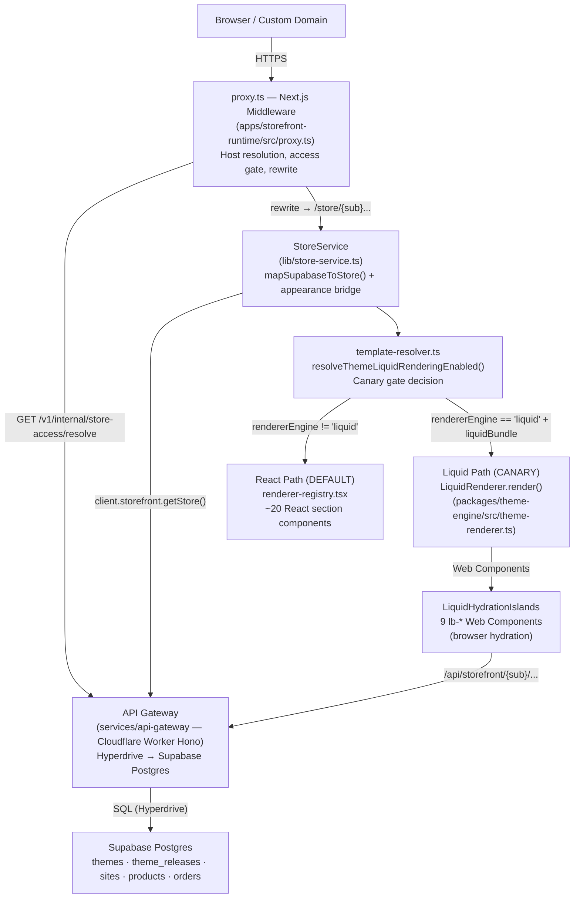
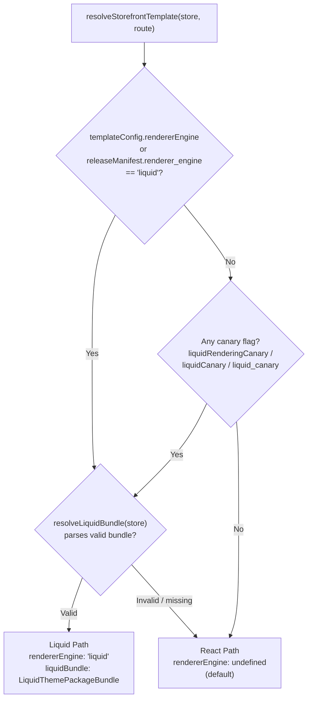

# Enterprise Gap Analysis: LetBuyy Storefront / Liquid Theme Platform

**Document class:** DISCOVERY — NO IMPLEMENTATION  
**Date:** 2026-07-03  
**Branch:** `stepup/main`  
**Status:** DISCOVERY — NO IMPLEMENTATION  

**Primary sources (all read-only, branch `stepup/main`):**

| Source file | Domain |
|---|---|
| `packages/theme-engine/src/theme-renderer.ts` | Liquid engine, sanitizer |
| `packages/theme-engine/src/theme-governance.ts` | Feature flag, ART-17, parity |
| `packages/theme-engine/src/theme-bundle.ts` | Zod schemas, Urban Kicks fixture |
| `packages/theme-engine/src/theme-bundle-core.ts` | letbuyy-core alias layer |
| `packages/theme-engine/src/theme-registry.ts` | Section schemas, settings schema |
| `packages/theme-engine/src/built-in-section-schemas.ts` | 25 section types |
| `packages/theme-engine/src/theme-presets.ts` | 10 Experiences |
| `packages/theme-engine/src/industry-experience-map.ts` | Industry → Experience map |
| `packages/theme-engine/src/experience-fonts.ts` | Font registry |
| `packages/theme-engine/src/portable-to-liquid.ts` | Portable-to-Liquid compiler |
| `packages/theme-engine/src/execution-runtime.ts` | Composition primitives |
| `apps/storefront-runtime/src/proxy.ts` | Multi-tenant middleware |
| `apps/storefront-runtime/src/lib/theme-engine/template-resolver.ts` | Engine decision |
| `apps/storefront-runtime/src/lib/theme-engine/composition-engine.tsx` | SSR compositor |
| `apps/storefront-runtime/src/lib/theme-engine/liquid-hydration-islands.tsx` | 9 Web Component islands |
| `apps/storefront-runtime/src/lib/theme-engine/renderer-registry.tsx` | React section registry |
| `apps/storefront-runtime/src/lib/theme-engine/data-binding-engine.ts` | Section data plan |
| `apps/storefront-runtime/src/lib/store-service.ts` | StoreModel hydration |
| `services/api-gateway/src/routes/stores.ts` | Experience auto-apply |
| `database/supabase/migrations/180_urban_kicks_liquid_theme.sql` | Liquid DB activation |
| `database/supabase/migrations/181_urban_kicks_settings_schema_complete.sql` | Schema completion |
| Subagent findings files (7 domain reports + docs-reconciliation) | All domains |

---

## Table of Contents

1. [Architecture Overview](#1-architecture-overview)
2. [Current Implementation](#2-current-implementation)
3. [Repository Inventory](#3-repository-inventory)
4. [Runtime Flow](#4-runtime-flow)
5. [Dependency Graph](#5-dependency-graph)
6. [Missing Features](#6-missing-features)
7. [Partial Implementations](#7-partial-implementations)
8. [Technical Debt](#8-technical-debt)
9. [Enterprise Gap Analysis](#9-enterprise-gap-analysis)
10. [Risk Analysis](#10-risk-analysis)
11. [Recommended Migration Order](#11-recommended-migration-order)
12. [Docs-Reconciliation: Verdict Registry](#12-docs-reconciliation-verdict-registry)
13. [Open Questions](#13-open-questions)

---

## 1. Architecture Overview

LetBuyy ships a **dual-renderer storefront**: a React/JSON-contract engine (the production default for all stores except Urban Kicks) and a full LiquidJS engine that is implemented, tested, and canary-gated. Migration 180 promoted Urban Kicks to render via Liquid by writing `rendererEngine='liquid'` directly into `themes.default_template` — bypassing the global flag for that one theme. All other themes remain on React.



### Dual-Engine Decision Matrix

| Activation Path | Source | Status |
|---|---|---|
| `themes.default_template.rendererEngine = 'liquid'` | DB (migration 180) | ACTIVE — Urban Kicks only |
| `templateConfig.rendererEngine = 'liquid'` | Per-store JSONB | Available but not in use |
| `liquidRenderingCanary = true` | Per-store/theme config | Canary path |
| `THEME_LIQUID_RENDERING_DEFAULT_ENABLED` | Compile-time constant | `false` (ARB-deferred) |
| `?engine=liquid` query param | Dev override | Dev only, ignored in production |

---

## 2. Current Implementation

### What is built and verifiably working

| Capability | Status | Evidence |
|---|---|---|
| LiquidJS v10.27.0 engine | IMPLEMENTED | `packages/theme-engine/src/theme-renderer.ts` — LiquidJS engine instantiation |
| DOMPurify v3.4.9 + jsdom v29.1.1 sanitizer | IMPLEMENTED | `LIQUID_RENDERED_HTML_DOMPURIFY_CONFIG` in `theme-renderer.ts` |
| 23 Liquid section types | IMPLEMENTED | `createLiquidParitySectionFiles()` in `theme-bundle.ts` (20 parity sections + header, footer, announcement-bar) |
| 9 Liquid hydration islands (Web Components) | IMPLEMENTED | `liquid-hydration-islands.tsx` (~1307 lines) |
| Urban Kicks Liquid bundle fixture | IMPLEMENTED | `createUrbanKicksLiquidThemeBundleFixture()` in `theme-bundle.ts` |
| letbuyy-core alias layer | IMPLEMENTED | `theme-bundle-core.ts` — `LETBUYY_CORE_THEME_SLUG`, alias resolution |
| 10 named Experiences (Forge, Sense, Aura, Craft, Refresh, Ride, Dawn, Bloom, Nova, Summit) | IMPLEMENTED | `theme-presets.ts` — `EXPERIENCE_REGISTRY` (523 lines) |
| Industry → Experience map (9 industries) | IMPLEMENTED | `industry-experience-map.ts` — `INDUSTRY_EXPERIENCE_MAP` |
| Experience auto-apply at store creation | IMPLEMENTED | `services/api-gateway/src/routes/stores.ts:659–673` |
| Experience apply in Theme Editor | IMPLEMENTED | `ExperiencePicker.tsx` + `editor/page.tsx:780–788` |
| 25 built-in section types with Zod schemas | IMPLEMENTED | `BUILT_IN_SECTION_SCHEMAS` (`built-in-section-schemas.ts`) |
| Theme Settings Schema (5 groups) | IMPLEMENTED | `THEME_SETTINGS_SCHEMA` in `theme-registry.ts` |
| Schema migration engine interface | IMPLEMENTED (zero migrations registered) | `migrateThemeTemplateSchemas()` in `theme-governance.ts` |
| Portable-to-Liquid compiler | IMPLEMENTED | `portable-to-liquid.ts` — `compilePortableToLiquidBundle()` |
| 16 storefront route types | IMPLEMENTED | `StorefrontRouteType` in `lib/theme-engine/types.ts` |
| ISR (60s revalidate) + cache tags | IMPLEMENTED | `revalidate = 60` on all storefront pages |
| Multi-tenant host routing | IMPLEMENTED | `proxy.ts` — `resolveStorefrontHost()` + `resolveAccess()` |
| HS256 customer session auth | IMPLEMENTED | `packages/auth-core/src/customer-session.ts` |
| 6 custom Liquid filters | IMPLEMENTED | `money`, `money_with_currency`, `json`, `asset_url`, `image_url`, `t` |
| Drop security limits (depth 4, keys 80, array 100) | IMPLEMENTED | `MAX_LIQUID_DROP_DEPTH/KEYS/ARRAY_ITEMS` in `theme-renderer.ts` |
| Liquid bundle DB persistence | IMPLEMENTED | Migrations 171, 172, 180, 181 |
| Liquid feature flag with ARB gate | IMPLEMENTED | `THEME_LIQUID_RENDERING_DEFAULT_ENABLED = false` in `theme-governance.ts:14` |

### What is NOT built

| Capability | Status |
|---|---|
| On-disk `.liquid` files | MISSING — all templates are TypeScript string literals |
| Template caching | MISSING — `cache: false` on every LiquidJS request |
| Shopify `` tag | MISSING |
| Shopify `` tag | MISSING |
| `linklists`/`linklist` Liquid object | **IMPLEMENTED (Phase D — D1)** — `navToLinklists()` in `composition-engine.tsx:320–355`; underscore-keyed handles; `linklists` in scope via `buildLiquidScope:722` |
| `predictive_search`, `recommendations`, `gift_card`, `discount`, `checkout` Liquid objects | MISSING |
| Metafields system | MISSING |
| Font loading (Google Fonts `<link>` injection) | **IMPLEMENTED (Phase D — D7)** — `buildGoogleFontsHref` wired in `layout.tsx:138`; `FONT_MAP` extended; CSP updated; conditional preconnect + stylesheet link |
| Shopify Theme Check compatibility | MISSING — templates are TypeScript |
| Blog Liquid templates | MISSING — blog/article Liquid bundle templates absent; backend API EXISTS (`public-routes.ts:1226, :1249`) |
| `newsletter`/`newsletter-signup` type reconciliation | MISSING (type split) |
| Snippets / partials system | BLOCKED — `` and `` blocked by source schema |

---

## 3. Repository Inventory

### packages/theme-engine/src/ (13 active source files)

| File | Lines | Role | Status |
|---|---|---|---|
| `theme-bundle.ts` | ~2971 | Zod schemas; Urban Kicks fixture; 23 section types | IMPLEMENTED |
| `theme-renderer.ts` | ~933 | `LiquidRenderer`; DOMPurify config; 6 filters | IMPLEMENTED |
| `index.ts` | ~1248 | Barrel exports; `StoreTemplateConfig`; `DEFAULT_THEME_SETTINGS` | IMPLEMENTED |
| `theme-governance.ts` | ~369 | Feature flag; ARB gate; ART-17 parity array; schema migration engine | IMPLEMENTED |
| `theme-registry.ts` | ~734 | 12 base section schemas (`SECTION_SCHEMAS`); `THEME_SETTINGS_SCHEMA`; `getSectionSchemas()`; `getThemeSettingsSchema()` | IMPLEMENTED (governance-frozen by convention) |
| `built-in-section-schemas.ts` | ~338 | 13 additional section schemas (merged with the 12 base schemas via `Object.freeze` to form `BUILT_IN_SECTION_SCHEMAS`; 25 types total) | IMPLEMENTED |
| `theme-presets.ts` | ~523 | 10 Experiences; `EXPERIENCE_REGISTRY`; apply/overlay functions | IMPLEMENTED |
| `theme-bundle-core.ts` | ~83 | letbuyy-core alias; `createLetbuyyCoreLiquidThemeBundleFixture()` | IMPLEMENTED |
| `industry-experience-map.ts` | ~150 | `INDUSTRY_EXPERIENCE_MAP`; 18 aliases; `resolveExperienceForIndustry()` | IMPLEMENTED |
| `experience-fonts.ts` | ~83 | 6-font registry; `buildGoogleFontsHref()` | **IMPLEMENTED + INTEGRATED (Phase D — D7)** |
| `portable-to-liquid.ts` | ~202 | L3 compiler: portable JSON → `LiquidThemePackageBundle` | IMPLEMENTED |
| `execution-runtime.ts` | ~487 | Section/block composition primitives | IMPLEMENTED |
| `jsdom-runtime.d.ts` | ~15 | Type shim for server-side DOMPurify | SHIM |

### apps/storefront-runtime/src/lib/theme-engine/ (9 files)

| File | Lines | Role | Status |
|---|---|---|---|
| `composition-engine.tsx` | ~542 | SSR compositor; `renderLiquidPlan()`; `buildLiquidCommerceContext()` | IMPLEMENTED |
| `liquid-hydration-islands.tsx` | ~1307 | 9 `lb-*` Web Component custom elements | IMPLEMENTED |
| `template-resolver.ts` | ~309 | `resolveStorefrontTemplate()`; engine canary gate | IMPLEMENTED |
| `renderer-registry.tsx` | ~287 | React section registry (~20 renderers) | IMPLEMENTED (ART-17 frozen) |
| `data-binding-engine.ts` | ~107 | `buildSectionDataPlan()`; product fetch heuristics | IMPLEMENTED |
| `types.ts` | ~95 | `StorefrontRenderPlan`; `StorefrontRouteType` (16 types) | IMPLEMENTED |
| `editor-preview-section-frame.tsx` | ~93 | Editor postMessage frame | IMPLEMENTED (postMessage bridge resolved via `StorefrontPreviewBridge` — C-04 CLOSED) |
| `content-route.ts` | ~18 | CMS content fallback | IMPLEMENTED |
| `product-route.ts` | ~38 | Product listing/detail fallbacks | IMPLEMENTED |

### Database Migrations (theme-related)

| Migration | Effect | Status |
|---|---|---|
| `000_baseline.sql` | All table definitions; `themes`, `theme_releases`, `theme_editor_drafts`, etc. | IMPLEMENTED |
| `087_theme_template_drafts.sql` | Adds `template_key` + scoped unique constraint to `theme_editor_drafts` | IMPLEMENTED |
| `091_theme_marketplace_stepup.sql` | Marketplace tables: `developer_profiles`, `theme_collections`, `theme_download_artifacts` | IMPLEMENTED |
| `171_liquid_bundle_persistence.sql` | Backfills Urban Kicks Liquid bundle into `themes.default_template.liquidBundle` | IMPLEMENTED |
| `172_liquid_bundle_refresh.sql` | Refreshes bundle to include full template set | IMPLEMENTED |
| `180_urban_kicks_liquid_theme.sql` | Sets `rendererEngine='liquid'`; adds `appearance` settings_schema group | IMPLEMENTED |
| `181_urban_kicks_settings_schema_complete.sql` | Adds `surfaceColor` and `isDark` to settings_schema | IMPLEMENTED |
| `185_v1_site_domains.sql` | `site_domains` + `site_domain_verifications`; RLS | IMPLEMENTED |
| `187_v1_sites_site_settings.sql` | Adds `sites.site_settings` JSONB (appearance bridge) | IMPLEMENTED |

---

## 4. Runtime Flow

### Full Request Trace (Liquid Path)

```mermaid
sequenceDiagram
    participant B as Browser
    participant P as proxy.ts (Edge Middleware)
    participant G as API Gateway (CF Worker)
    participant DB as Supabase Postgres
    participant SR as Next.js Store Page (RSC)
    participant CE as CompositionEngine
    participant LR as LiquidRenderer (theme-engine)
    participant DP as DOMPurify (jsdom, server)
    participant HI as LiquidHydrationIslands (browser)

    B->>P: GET {store}.letbuyy.com/products
    P->>G: GET /v1/internal/store-access/resolve?host=...
    G->>DB: SELECT sites + site_domains (Hyperdrive)
    G-->>P: StorefrontAccessContext { access_mode, published }
    P->>SR: rewrite → /store/{sub}/products (Next.js route)
    SR->>G: client.storefront.getStore(subdomain)
    G->>DB: SELECT sites JOIN theme_releases (Hyperdrive)
    G-->>SR: WorkerStorePayload { liquidBundle, rendererEngine:'liquid' }
    SR->>SR: mapSupabaseToStore() → StoreModel
    SR->>SR: resolveThemeLiquidRenderingEnabled() → true (rendererEngine)
    SR->>SR: buildSectionDataPlan() → products from gateway
    SR->>CE: <StorefrontCompositionEngine plan sectionData/>
    CE->>CE: getStorefrontCustomerDrop() (HS256 cookie → gateway)
    CE->>CE: buildLiquidCommerceContext() → LiquidCommerceDrops
    Note over CE: cart.total_price = null (browser_hydrated)
    CE->>LR: LiquidRenderer.render(liquidBundle, drops, ...)
    LR->>LR: parseLiquidThemePackageBundle() (Zod)
    LR->>LR: createLiquidEngine() (cache:false)
    LR->>LR: renderLiquidTemplateSections() SEQUENTIAL
    LR->>DP: sanitizeRenderedHtml() per section
    DP-->>LR: sanitized HTML (FORBID: style, script, embed; ADD: lb-*)
    LR-->>CE: { header, contentForLayout, footer }
    CE-->>B: HTML (dangerouslySetInnerHTML) + <LiquidHydrationIslands/>
    B->>HI: customElements.define() x9 (lb-add-to-cart, lb-cart-drawer, ...)
    HI->>G: /api/storefront/{sub}/cart (cart sync via same-origin proxy)
```

### Engine Decision Logic (template-resolver.ts)



---

## 5. Dependency Graph

### Package-level dependencies (theme subsystem)

| Dependent | Dependency | Relationship |
|---|---|---|
| `apps/storefront-runtime` | `packages/theme-engine` | Liquid renderer, schemas, Experiences |
| `apps/storefront-runtime` | `packages/tenant-core` | Host resolution, `StoreModel` |
| `apps/storefront-runtime` | `packages/auth-core` | HS256 customer session |
| `apps/storefront-runtime` | `packages/api-client` | Gateway HTTP client |
| `apps/storefront-runtime` | `packages/commerce-core` | `ProductModel` type contract |
| `apps/merchant-control-plane` | `packages/theme-engine` | Editor: `ExperiencePicker`, schema validation, draft save |
| `services/api-gateway` | `packages/theme-engine` | `LiquidThemePackageBundleSchema` validation; `applyExperienceToTemplateConfig` |
| `services/api-gateway` | `packages/auth-core` | Customer session verification |
| `packages/theme-engine/theme-bundle-core.ts` | `packages/theme-engine/theme-bundle.ts` | Urban Kicks fixture (alias source) |
| `packages/theme-engine/industry-experience-map.ts` | `packages/theme-engine/theme-presets.ts` | `EXPERIENCE_REGISTRY`, `resolveExperienceForIndustry` |
| `packages/theme-engine/experience-fonts.ts` | `packages/theme-engine/theme-presets.ts` | `listExperiences()` |
| `packages/theme-engine/theme-renderer.ts` | `liquidjs` (npm v10.27.0) | Template rendering |
| `packages/theme-engine/theme-renderer.ts` | `dompurify` v3.4.9 + `jsdom` v29.1.1 | Server-side HTML sanitization |

### Intra-storefront data flow dependencies

| Module | Depends On | For |
|---|---|---|
| `composition-engine.tsx` | `template-resolver.ts` | Render plan |
| `composition-engine.tsx` | `LiquidRenderer` (theme-engine) | Liquid rendering |
| `composition-engine.tsx` | `customer-drop.ts` | HS256 customer context |
| `composition-engine.tsx` | `renderer-registry.tsx` | React section dispatch |
| `composition-engine.tsx` | `liquid-hydration-islands.tsx` | Client islands mount |
| `template-resolver.ts` | `resolveThemeLiquidRenderingEnabled()` (theme-governance) | Engine decision |
| `store-service.ts` | `createUrbanKicksLiquidThemeBundleFixture()` (theme-bundle) | Liquid fallback bundle |
| `liquid-hydration-islands.tsx` | `storefrontBrowserApiFetch()` (browser-client) | Cart sync |

---

## 6. Missing Features

### 6.1 Liquid Language Gaps (vs Shopify Liquid)

| Missing Feature | Shopify Capability | LetBuyy Status | Risk |
|---|---|---|---|
| `` tag | Server-side pagination | MISSING | MEDIUM |
| `` tag | Native form rendering | MISSING | MEDIUM |
| `` tag / snippets | Template composition | BLOCKED (source schema forbids) | HIGH |
| `` tag | Legacy partial inclusion | BLOCKED | HIGH |
| `` tag | Section-in-layout tag | MISSING — sections assembled programmatically | MEDIUM |
| `` / `` | Per-section JS/CSS | MISSING | LOW |
| `linklists` object | Navigation menus | MISSING — `StoreModel.navigation` is fetched server-side (`store-service.ts:60–64, :721`) but is never included in `buildLiquidCommerceContext()` return value (`composition-engine.tsx:380–396`) nor in `buildLiquidScope()` (`theme-renderer.ts:559–590`). Both `{{ shop.navigation }}` and any `linklists` variable resolve to nil in every Liquid render. | HIGH |
| `settings` Liquid object | Global theme settings | MISSING — tokens passed as CSS only | MEDIUM |
| `product.metafields` | Structured metadata | MISSING — no metafields system | HIGH |
| `predictive_search` | AJAX search object | MISSING | MEDIUM |
| `recommendations` | Product recommendations | MISSING | LOW |
| `gift_card` object | Gift card display | MISSING | LOW |
| `discount` object | Discount display | MISSING | LOW |
| `checkout` Liquid object | Checkout context | MISSING — checkout is permanently React | LOW (by design) |
| `content_for_header` | Global script injection | MISSING | LOW |
| `img_tag`, `script_tag`, `stylesheet_tag` filters | HTML helper filters | MISSING | LOW |
| `metafield_tag` filter | Metafield rendering | MISSING | MEDIUM |
| Color filters (`color_to_rgb`, `color_lighten`, etc.) | Shopify color utils | MISSING | LOW |
| `search` drop | Search context | MISSING — `LiquidCommerceDrops.search` permanently null | MEDIUM |
| `navigation` drop | Menu tree | MISSING — `StoreModel.navigation` never passed to `buildLiquidScope` | HIGH |

### 6.2 Template Coverage Gaps (Route Types)

| Route Type | React Template | Liquid Template | Gap |
|---|---|---|---|
| `index` (home) | IMPLEMENTED | IMPLEMENTED | — |
| `product` | IMPLEMENTED | IMPLEMENTED | — |
| `collection` | IMPLEMENTED | IMPLEMENTED | — |
| `cart` | IMPLEMENTED | IMPLEMENTED | — |
| `customers/login` | IMPLEMENTED | IMPLEMENTED | — |
| `customers/register` | IMPLEMENTED | IMPLEMENTED (form renders; endpoint implemented and wired — LB-12 CLOSED) | — |
| `customers/account` | IMPLEMENTED | IMPLEMENTED | — |
| `customers/orders` | IMPLEMENTED | IMPLEMENTED | — |
| `customers/order` | IMPLEMENTED | IMPLEMENTED | — |
| `track` | IMPLEMENTED | IMPLEMENTED | — |
| `blog` | PARTIAL | **IMPLEMENTED (Phase E — E1/E9)** | Backend API EXISTS (`public-routes.ts:1226`). Liquid template `blog` added to bundle; `blog/page.tsx` created; composition-engine blog branch wired (`composition-engine.tsx:499–502`). |
| `article` | PARTIAL | **IMPLEMENTED (Phase E — E2/E9)** | Backend API EXISTS (`public-routes.ts:1249`). Liquid template `article` added to bundle; composition-engine article branch wired (`composition-engine.tsx:504–515`). Residual (MEDIUM): `content-resource-renderer.tsx` does not forward `publishedAt`/`featured_image` — live renders show null date/image until Phase F fix. |
| `page` | PARTIAL | **IMPLEMENTED (Phase E — E3/E9)** | Liquid template `page` added to bundle; composition-engine page branch wired (`composition-engine.tsx:507`). |
| `password` | PARTIAL | **IMPLEMENTED (Phase E — E5)** | Liquid template `password` added to bundle. Production rendering path Phase F: `proxy.ts:296` unconditionally routes password stores to React. Template available in editor preview/isolation. |
| `not_found` | PARTIAL | **IMPLEMENTED (Phase E — E4)** | Liquid template `not_found` added to bundle. Production rendering path Phase F: Next.js `not-found.tsx` cannot receive `subdomain` route param; store-level file delegates to root React 404. |

**Template coverage: 15/15 route types fully implemented in Liquid = 100% (Phase E).** Up from 10/15 = 67%.

### 6.3 Structural Missing Features

| Feature | Description | Gap |
|---|---|---|
| Font loading | `experience-fonts.ts::buildGoogleFontsHref()` defined but no call site in storefront `<head>` | Deferred per inline comment referencing `docs/v1-execution/phase-2-5/04-font-system.md` |
| FONT_MAP completeness | `apps/storefront-runtime/src/app/store/[subdomain]/layout.tsx` FONT_MAP missing Cormorant Garamond, Libre Baskerville, Source Sans Pro, Lato | Experiences Aura, Craft, Dawn silently render system-font fallback |
| `letbuyy-core` DB row | `LETBUYY_CORE_THEME_SLUG = 'letbuyy-core'` defined in `theme-bundle-core.ts` but the DB still stores `theme_id = 'urban-kicks'` | No migration landed to rename slugs |
| `apply_preset` gateway route | No `POST /v1/themes/:slug/apply-preset` exists; apply functions exist in `theme-presets.ts` | Engine layer complete; API contract missing for third-party clients |
| Blog API backend | Blog API backend EXISTS (`public-routes.ts:1226` GET `/:subdomain/blog`; `:1249` GET `/:subdomain/blog/:slug`; backed by real Supabase queries against `blog_posts` table; `ContentService.listBlogPosts`/`getBlogPostBySlug` in `content-service.ts`). What is MISSING: (1) Liquid section templates for blog-list and article views — the blog route page uses `ContentResourceRenderer` (React), not a Liquid bundle template; (2) no blog-index Next.js `page.tsx` (only `[slug]` exists); (3) blog/article Liquid template keys are absent from the Urban Kicks theme bundle. Unknown C-11 is RESOLVED (API exists) but blog/article Liquid authoring gap remains open. |
| `lb-cart` CRUD mutations | `removeFromCart` and `updateQuantity` implemented via `data-lb-cart-remove` event delegation and `stepQuantity()` in both `lb-cart-drawer` and `lb-cart` (`liquid-hydration-islands.tsx:355–358, 973–991`). `clearCart` has no UI affordance or named public method (`writeCart([])` works internally). | Phase 5 hydration validation audit |
| Section layout application in Experiences | `defaultSections` on each Experience is validated but `applyExperienceToTemplateConfig` does NOT restructure sections | Only design tokens applied; section composition unchanged |
| `experienceId` as DB column | `experienceId` stored inside `sites.template_config` JSONB; no dedicated indexed column | Analytics/support queries require JSONB extraction |
| On-disk `.liquid` files | Zero `.liquid` files exist; all Liquid source lives as TypeScript string literals | Designers cannot author or iterate on templates outside TypeScript build |
| LiquidJS template caching | `cache: false` — every request re-parses all section templates from scratch | Performance gap at production traffic |
| `theme_id = 'modern'` ghost reference | `create-store/route.ts:90` writes `theme_id: templateId \|\| 'modern'`; no `modern` row in `themes` table confirmed | All web-created stores may carry a ghost theme reference |

---

## 7. Partial Implementations

| Feature | What Exists | What Is Missing | Evidence |
|---|---|---|---|
| **letbuyy-core identity** | `theme-bundle-core.ts` fixture + alias resolution (`THEME_SLUG_ALIASES`) | DB row migration; `store-service.ts:671–673` still calls Urban Kicks fixture as fallback | `theme-bundle-core.ts:44–47` comment |
| **Experience system** | 10 Experiences with Zod schemas, overlay apply, editor picker, gateway auto-apply at store creation | Font loading wired into storefront `<head>`; `FONT_MAP` completeness; `defaultSections` not applied | `theme-presets.ts`, `industry-experience-map.ts` |
| **Schema migration engine** | Full interface (`ThemeSectionSchemaMigration`), chain-walk, loop detection, applied log | Zero concrete migration objects registered; no caller site confirmed | `theme-governance.ts:77–96` |
| **Theme editor Liquid bridge** | Draft route `POST /api/themes/[themeId]/editor/draft` persists `liquidBundle`; `StorefrontPreviewBridge` bridges the legacy `LETBUYY_THEME_EDITOR_SELECTION` message to the `letbuyy:theme-editor:section-selected` event (C-04 CLOSED) | No remaining postMessage gap for section selection; remaining gaps: no Liquid syntax validation in editor; AI hooks are stubs; no template file browser for Liquid source | `storefront-preview-bridge.tsx` |
| **Onboarding Experience assignment** | Gateway auto-applies Experience at store creation via `survey.industry`; onboarding UI shows industry picker | `ONBOARDING_INDUSTRIES` in `identity-platform` is a hardcoded array, not imported from `INDUSTRY_OPTIONS` (`industry-experience-map.ts`) | `onboarding/page.tsx:201–214` |
| **Cart in Liquid path** | `lb-cart-drawer` syncs via browser call to gateway after page load | Server-side cart totals always null (`item_count: null`, `source: 'browser_hydrated'`) at SSR; JS-disabled users see no totals | `composition-engine.tsx:291–307` |
| **Search drop** | **IMPLEMENTED (Phase D — D5)** — `searchDrop` built in `composition-engine.tsx:451–480` on search routes; `terms`/`results`/`results_count`/`performed` fields; structural placeholder on error | Scope limited to routes with `?search=` param; `predictive_search` not implemented | `composition-engine.tsx:451–480` |
| **Navigation in Liquid drops** | **IMPLEMENTED (Phase D — D1)** — `linklists` drop with `main_menu`, `footer_menu`, `policy_menu` handles; `StoreModel.navigation` converted via `navToLinklists()` (`composition-engine.tsx:320–355`); scope read via `buildLiquidScope:722` | `active` is SSR-computed from current path; `linklist` singular alias not yet registered | `composition-engine.tsx:320–355`, `theme-renderer.ts:722` |
| **Blog / article routes** | Next.js route pages exist for `blog/`; backend API EXISTS (`public-routes.ts:1226, :1249`) | Liquid templates for `blog`/`article` missing from theme bundle; React `ContentResourceRenderer` used for current pages | runtime-architecture findings |
| **Theme versioning** | Integer `release_version` + rollback connected | Semantic versioning, schema compatibility range, automated migration on publish absent | `theme_releases.release_config` |
| **`surfaceColor` token** | `ExperienceTokens.surfaceColor` required (Zod, `theme-presets.ts:42`); `ThemeSettings.surfaceColor` optional (`index.ts:67`) | `store-service.ts:592–605` does not explicitly normalize `surfaceColor`; passes through via spread only. Type mismatch gap: (1) if `surfaceColor` is present as a truthy string it passes correctly; (2) if absent, `DEFAULT_THEME_SETTINGS.surfaceColor=#F9FAFB` applies correctly; (3) if present as an empty string or null, the spread overrides the default with a falsy value — no explicit `\|\|` fallback guard (unlike `primaryColor` at line 600). Practical risk: an empty-string `surfaceColor` in a stored theme config arrives as `''` in the Liquid scope, causing the `--surface` CSS variable to render as empty. | `docs-reconciliation` findings; `store-service.ts:598–599` |

---

## 8. Technical Debt

| Debt Item | Severity | Location | Description |
|---|---|---|---|
| ~~Urban Kicks branding leak~~ **DONE (Phase C — C3)** | ~~HIGH~~ CLOSED | `apps/storefront-runtime/src/lib/store-service.ts:670–673` | ~~Fallback bundle still calls `createUrbanKicksLiquidThemeBundleFixture()`~~ Fixed: fallback removed; invalid bundle yields `undefined` (React fallback). |
| ~~`newsletter` / `newsletter-signup` type split~~ **DONE (Phase C — C4) for render-time path** | ~~HIGH~~ PARTIAL | `theme-renderer.ts:256–261` | ~~Liquid bundle indexes `newsletter-signup`; section lookup silently fails~~ Fixed at render time by `LIQUID_SECTION_TYPE_ALIASES`. Residual: Zod parse-time guard (Phase D). |
| ~~`heroBanner` Liquid parity gap~~ **DONE (Phase D — D6)** | ~~HIGH~~ CLOSED (residual LOW) | `theme-bundle.ts:1009–1035` | `image`, `overlay`, `height`, `textAlign` added to hero-banner schema and body. Residual: `data-height`, `data-text-align`, `data-image-url` attributes not yet in `ADD_ATTR` — DOMPurify strips them (F-05, open) |
| postMessage naming inconsistency | RESOLVED | `apps/storefront-runtime/src/app/preview/storefront-preview-bridge.tsx` | `StorefrontPreviewBridge` acts as a bridge: listens for `LETBUYY_THEME_EDITOR_SELECTION` (line 70), calls `selectSection()` (line 76), which posts `{ type: 'letbuyy:theme-editor:section-selected', sectionId }` same-origin (line 44), which `EditorPreviewSectionFrame` then receives. C-04 is CLOSED. Section selection highlight is WORKING. |
| `theme_id = 'modern'` ghost reference | HIGH | `apps/identity-platform/src/app/api/auth/create-store/route.ts:90` | `theme_id: templateId \|\| 'modern'` written to `sites`; `'modern'` row not confirmed in `themes` table; theme editor load may 404 |
| `cache: false` on LiquidJS per-request | HIGH | `packages/theme-engine/src/theme-renderer.ts` | Every storefront request re-parses all Liquid section sources; no in-process or edge cache; O(sections) parse cost at scale |
| ~~LiquidJS render error: no try/catch~~ **DONE (Phase C — C1 + C2)** | ~~HIGH~~ CLOSED | `theme-renderer.ts:32, 288–370, 411–487, 619–647`; `composition-engine.tsx:433–479` | ~~`engine.parseAndRender()` called without try/catch~~ Per-section/region/layout/block try/catch added; `ThemeRendererStatus` extended with `'error'`; composition-engine catch with fallback telemetry. 89/89 tests pass. |
| DOMPurify JSDOM singleton no rejection handler | MEDIUM | `theme-renderer.ts` — `domPurifyPromise` module-level singleton | No `.catch()` on the singleton initialization promise; JSDOM failure silently leaves sanitizer uninitialized (Risk R-10) |
| Sequential section rendering | MEDIUM | `theme-renderer.ts` — `renderLiquidTemplateSections()` | Sections rendered via sequential `await engine.parseAndRender()`; no `Promise.all()`; latency scales linearly with section count |
| Dual schema structure (TypeScript vs DB) | MEDIUM | `theme-registry.ts` (5 groups) vs `themes.settings_schema` (flat `appearance` group after migration 180) | TypeScript static `THEME_SETTINGS_SCHEMA` has 5 groups; Urban Kicks DB schema has 1 group; validation reads from DB but TypeScript contracts describe 5-group structure |
| `getSectionSchemas` / `getThemeSettingsSchema` ignore `themeId` | MEDIUM | `theme-registry.ts` | Functions accept `_themeId` parameter but always return the same static schema; runtime schema registry is DB-backed, stale TypeScript is kept as "shared fallback" |
| Duplicate `normalizeSectionType` mapping | MEDIUM | `store-service.ts` (inline) + `data-binding-engine.ts:PRODUCT_SECTION_TYPES` + `renderer-registry.tsx` | Same type aliases replicated in three files; divergence risk on future section type additions |
| Two draft tables | MEDIUM | `theme_editor_drafts` + `theme_instance_drafts` | Both tables are intentionally active in different flows: `theme_editor_drafts` serves the merchant editor save path; `theme_instance_drafts` serves the release-engine lifecycle path — bridged by a compat operation in `theme-execution.adapter.ts:482` (`{ op: 'replace', path: '/', source: 'theme_editor_drafts.compat' }`). The ambiguity is about the migration timeline, not which table is canonical for each flow. Formal deprecation migration for `theme_editor_drafts` not yet authored; successor is `theme_instance_drafts` per baseline column comment (`theme_preview_sessions.theme_instance_draft_id`). |
| `ONBOARDING_INDUSTRIES` hardcoded | MEDIUM | `apps/identity-platform/src/app/onboarding/page.tsx:201–214` | Display labels duplicated from `INDUSTRY_OPTIONS` in `industry-experience-map.ts`; divergence risk when experiences are added |
| `testimonials` block type inconsistency | LOW | `SECTION_SCHEMAS.testimonials` vs Liquid parity section | JSON-contract uses `testimonialCard`; Liquid uses `testimonial`; different type keys |
| `URBAN_KICKS_THEME_SLUG` DB alias never migrated | LOW | `theme-bundle-core.ts:44–47` | DB stores `urban-kicks`; TypeScript resolves to `letbuyy-core`; any DB query without `resolveCanonicalThemeSlug()` misses the canonical bundle |

---

## 9. Enterprise Gap Analysis

The following table measures each capability area against a Shopify-grade theme platform. Coverage percentages are based on implemented, production-eligible functionality normalized against the Shopify feature surface as of mid-2026.

### Implementation Coverage Table

| Capability Area | Coverage % | Status | Missing Pieces | Risk Level |
|---|---|---|---|---|
| **Liquid Template Engine (core tags/filters)** | 70% | PARTIAL | ``, ``, `` / snippets, `` tag, ``, ``; Shopify-specific filters (color\_\*, metafield\_tag, img\_tag) | HIGH |
| **Commerce Liquid Objects (drops)** | 55% | PARTIAL | `linklists`/navigation object; `settings` Liquid object; `predictive_search`; `recommendations`; `gift_card`; `discount`; `checkout`; `product.metafields`; `content_for_header`; `search` drop (permanently null) | HIGH |
| **Template Route Coverage** | **100%** | **IMPLEMENTED (Phase E)** | All 15/15 route types now have Liquid templates. Production routing for `password` and `not_found` remains Phase F (proxy and Next.js `not-found.tsx` constraints). `customers/login` has dedicated `page.tsx` (E8-B). | — |
| **Theme Schema / Settings System** | 65% | PARTIAL | Dual schema structure (TypeScript 5-group vs DB flat `appearance` group); `THEME_SETTINGS_SCHEMA` typography options exclude 4 Experience fonts; schema migration engine built but zero migrations registered | MEDIUM |
| **Section Type Registry** | 72% | PARTIAL | 25 section types defined; 20 have Liquid parity; 5 sections (`collectionFilter`, `contentPage`, `videoHero`, `faqAccordion`, `instagramFeed`) have no Liquid parity; `newsletter`↔`newsletter-signup` type split; `heroBanner` field gap | HIGH |
| **Theme Editor (Merchant UX)** | 65% | PARTIAL | Liquid-mode live preview functional; section selection working via `StorefrontPreviewBridge` (C-04 CLOSED); no Liquid syntax validation in editor; AI hooks are stubs; no template file browser for Liquid source | MEDIUM |
| **Preset / Experience System** | 75% | PARTIAL | 10 Experiences defined and auto-applied; font loading integration missing (4 of 10 Experiences render system-font fallback); `defaultSections` not applied on Experience apply; `nova` not reachable via industry routing | MEDIUM |
| **Theme Authoring / Developer Experience** | 15% | MISSING | No on-disk `.liquid` files; no Theme Check integration; no Liquid syntax highlighting/linting; no snippet/partial system; templates locked behind TypeScript build pipeline; no public Liquid API documentation | CRITICAL |
| **Performance: Render Pipeline** | 55% | PARTIAL | **Phase F (F1+F2):** `cache:true` LRU enabled in `createLiquidEngine()` — intra-request steady-state parse cost reduced; `Promise.allSettled` parallel section rendering reduces wall time when sections have I/O. **Remaining gaps:** LRU is engine-instance-local (cross-request reuse requires engine pooling, not yet implemented; lifecycle assumption documented in source); DOMPurify JSDOM singleton per worker process unchanged; no edge-level template cache (P3-3 still OPEN); no CDN-keyed Liquid output cache. | HIGH |
| **Font System** | 45% | PARTIAL | 6 fonts defined in `EXPERIENCE_FONT_REGISTRY`; `buildGoogleFontsHref()` implemented; 4 font families missing from storefront `FONT_MAP` (Cormorant Garamond, Libre Baskerville, Source Sans Pro, Lato); no `<link>` injected into Liquid `<head>`; `--font-playfair` IS defined in `globals.css:25` but aliases Geist Sans (not Playfair Display serif) — Sense heading silently renders sans-serif | MEDIUM |
| **Theme Marketplace** | 10% | FROZEN | `apps/app-marketplace`, `apps/theme-marketplace`, `apps/developer-portal` are frozen per CLAUDE.md governance; marketplace tables exist in DB (`theme_packages`, `theme_developer_listings`, etc.) but no active deploy target | MEDIUM |
| **Multi-Tenancy / Theme Isolation** | 85% | IMPLEMENTED | Urban Kicks branding leak in fallback path (`store-service.ts:671–673`); `letbuyy-core` DB row missing; `theme_id = 'modern'` ghost reference | MEDIUM |
| **Security Model (XSS / injection)** | 90% | IMPLEMENTED | DOMPurify + `outputEscape:'escape'` defense-in-depth; `BLOCKED_DROP_KEYS` for secrets; source schema forbids `<script`, `javascript:`, `data:text/html`; `ALLOW_ARIA_ATTR` status unknown | LOW |
| **Data Binding / Commerce Context** | 60% | PARTIAL | Products and customer drops populated; `search` drop permanently null; `navigation` never passed to Liquid scope; collection-aware sections on home page receive a synthetic `all-products` collection (not nil) when `products.length > 0`; `collectLiquidCollectionMeta()` returns null only when no section has a `.collection` object; cart totals null at SSR; `reviews` only on product-detail routes | HIGH |
| **Customer Auth in Liquid** | 80% | IMPLEMENTED | HS256 JWT cookie resolved to `LiquidCustomerDrop`; wishlist enriched; `customers/register` form renders and endpoint is implemented (LB-12 CLOSED); `getCustomerOrderDetailDrop` scans up to 50 orders in memory to find one by ID | MEDIUM |
| **Cart & Checkout in Liquid** | 50% | PARTIAL | Cart drawer hydrates post-load; SSR totals null (intentional, canonical-ledger rule); `removeFromCart` and `updateQuantity` implemented (data attributes + `writeCart`); `clearCart` has no UI affordance; checkout permanently React (Razorpay SDK constraint) | MEDIUM |
| **Content / CMS (Blog, Pages)** | **75%** | PARTIAL | **Blog, article, page Liquid templates IMPLEMENTED (Phase E)**. Residual: `content-resource-renderer.tsx` does not forward `publishedAt`/`featured_image` — live article renders show null date/image (F-E2-01, MEDIUM, Phase F). Policy pages remain React-only. | MEDIUM |
| **App Blocks / Extensions** | 40% | PARTIAL | `buildLiquidAppBlocks()` and `buildLiquidAppEmbeds()` implemented; blocks injected into Liquid via render input but not exposed as `{{ app_blocks }}` drop; `appBlockSlot` section type exists in schema | MEDIUM |
| **Deployment / Canary Mechanism** | 70% | PARTIAL | Per-release `rendererEngine` activation implemented; no automated gradual rollout (% of stores); ARB gate for platform flip documented; `FEATURE_LIQUID = 'false'` in production gateway wrangler vars | MEDIUM |
| **Schema Versioning / Migration** | 20% | PARTIAL | `ThemeSectionSchemaMigration` interface complete; chain-walk up to 20 steps; zero concrete migrations registered; no automated migration trigger at publish or store read; bundle schema versions (`2026-05-json-contract`, `2026-06-liquid-sections`) exist | HIGH |
| **Observability / Canary Telemetry** | 65% | PARTIAL | `lb:canary:render` event emitted per render; `X-Lb-Render-Engine` header set in `proxy.ts` (but decoupled from actual engine decision); no Liquid-specific latency dashboard | MEDIUM |
| **Overall Liquid Platform Readiness** | **~55%** | **PARTIAL** | See section-by-section breakdown above | **HIGH** |

---

## 10. Risk Analysis

| ID | Risk | Level | Evidence | Affected Surface |
|---|---|---|---|---|
| R-01 | `cache: false` on LiquidJS: every request re-parses all section templates from scratch; CPU/latency spike at production traffic | **CRITICAL** | `packages/theme-engine/src/theme-renderer.ts` — LiquidJS instantiated with `cache: false` | All Liquid-enabled storefronts |
| R-02 | ~~No try/catch around `engine.parseAndRender()`: malformed Liquid source crashes Next.js server component instead of graceful fallback to React~~ **DONE (Phase C — C1 + C2)** — Per-section, per-region, layout, and block-level try/catch added; `ThemeRendererStatus` extended with `'error'`; composition-engine catch added with `lb:canary:render:fallback` telemetry. 89/89 theme-engine tests pass; 19/19 storefront-runtime tests pass. Evidence: `theme-renderer.ts:32, 288–370, 411–487, 619–647`; `composition-engine.tsx:433–479`. | ~~CRITICAL~~ **DONE** | `theme-renderer.ts` — render loop; Risk R-09 from unknowns register | ~~Every page render on a Liquid store~~ |
| R-03 | Theme authoring locked behind TypeScript build pipeline: zero `.liquid` files on disk; designers cannot author, lint, or run Theme Check outside the TS pipeline | **HIGH** | `packages/theme-engine/src/theme-bundle.ts` — all Liquid sources as TypeScript string literals | Developer/designer onboarding; theme iteration velocity |
| R-04 | `newsletter`↔`newsletter-signup` section type split: stores on Liquid render path will silently fail to find `newsletter` sections in the Liquid bundle. **Mitigation:** `PORTABLE_TO_LIQUID_TYPE_OVERRIDES` in `portable-to-liquid.ts` already maps `newsletter` → `newsletter-signup` during compilation (lines 46–47); migrations 171 and 172 confirm persisted bundles use `newsletter-signup`. Residual risk: bundles written directly to the DB bypassing the compiler would not receive the override. **Render-time path: DONE (Phase C — C4)** — `LIQUID_SECTION_TYPE_ALIASES` constant added in `theme-renderer.ts:256–261`; render loop resolves alias before bundle lookup. Tests: `C4 LIQUID_SECTION_TYPE_ALIASES constant is exported and correct`; `C4 newsletter alias resolves at render time`. Residual: Zod guard in `parseLiquidThemePackageBundle` (Phase D). | **HIGH (residual MEDIUM)** | `THEME_LIQUID_PORTABLE_SECTION_PARITY` at `theme-governance.ts:35`; Liquid bundle uses `newsletter-signup`; compiler override at `portable-to-liquid.ts:46–47`; render-time alias at `theme-renderer.ts:256–261` | ~~Bundles created outside the compiler~~ Residual: Zod guard for parse-time validation |
| R-05 | ~~`heroBanner` JSON-contract ↔ Liquid schema gap: `overlay`, `height`, `textAlign`, `image` fields present in React schema but absent in Liquid section~~ **DONE (Phase D — D6)** — all four fields added to `createLiquidParitySectionFiles()` hero-banner schema + body + Urban Kicks fixture override. Section body uses `data-height`, `data-text-align`, `data-image-url`. Tests: `D6 hero-banner Liquid section has image, overlay, height, textAlign schema fields`; `D6 hero-banner renders with image, overlay, height, textAlign settings`. Residual (LOW): `data-height`, `data-text-align`, `data-image-url` not yet in `ADD_ATTR` — DOMPurify strips them (F-05, open). | ~~HIGH~~ **CLOSED-IMPLEMENTED (Phase D)** with residual | `theme-bundle.ts:1009–1035` | ~~Merchants who customize hero settings~~ — residual DOMPurify gap |
| R-06 | ~~Urban Kicks branding leak: `store-service.ts:671–673` falls back to Urban Kicks fixture for all Liquid stores without valid bundles; `createLetbuyyCoreLiquidThemeBundleFixture()` fix function exists but is not wired~~ **DONE (Phase C — C3)** — Fallback removed entirely; stores with invalid/absent `liquidBundle` yield `undefined` and fall back to React (no branding leak). Evidence: `store-service.ts:670–673`. 19/19 storefront-runtime tests pass. | ~~HIGH~~ **DONE** | `apps/storefront-runtime/src/lib/store-service.ts:670–673` | ~~All Liquid stores lacking explicit bundle in release~~ |
| R-07 | LB-12 CLOSED: `POST /storefront/customer/register` is implemented in `services/api-gateway/src/routes/storefront/customer-registration.ts` (wired via `registerCustomerRegistrationRoute` → `registerStorefrontCustomerEngagementRoutes` → `registerStorefrontPublicRoutes` → `storefrontRouter`). The stale BLOCKED annotation in `packages/theme-engine/test/liquid-l9-auth.test.ts:2–3` should be removed. | **CLOSED** | No impact |
| R-08 | ~~`navigation` drop missing from Liquid scope: `StoreModel.navigation` fetched server-side but never passed to `buildLiquidScope()`~~ **DONE (Phase D — D1)** — `navToLinklists()` converts `StoreModel.navigation` to Shopify-convention `linklists` object (underscore-keyed handles); wired into `buildLiquidScope` via `toLiquidDrop`. Tests: `D1-A linklists key in LiquidCommerceDrops`; `D1-B navToLinklists runtime: underscore keys survive toLiquidDrop sanitizer`. | ~~HIGH~~ **DONE** | `composition-engine.tsx:320–355`, `theme-renderer.ts:57,722` | ~~Any Liquid section using `{{ shop.navigation }}`~~ |
| R-09 | ~~Font loading not wired: 4 of 10 Experiences silently render incorrect typography~~ **DONE (Phase D — D7)** — `buildGoogleFontsHref()` wired in `layout.tsx:138`; `FONT_MAP` extended with 4 missing families; `--font-playfair` corrected to `"Playfair Display", Georgia, "Times New Roman", serif`; CSP `style-src`/`font-src` updated to permit `fonts.googleapis.com`/`fonts.gstatic.com`. Test: `D7 font loading wires experience fonts for active theme settings`. | ~~HIGH~~ **DONE** | `layout.tsx:17,35–38,138`, `globals.css:28`, `next-security-headers.ts:66–67` | ~~Experiences Aura, Craft, Dawn, Sense~~ |
| R-10 | ~~postMessage naming inconsistency in editor: section selection highlight broken~~ **CLOSED — RESOLVED** by `StorefrontPreviewBridge` (`apps/storefront-runtime/src/app/preview/storefront-preview-bridge.tsx`): it listens for legacy `LETBUYY_THEME_EDITOR_SELECTION`, calls `selectSection()`, which re-posts as `letbuyy:theme-editor:section-selected` (the event `EditorPreviewSectionFrame` expects). C-04 is CLOSED. Section selection highlight is WORKING. | **CLOSED** | No impact |
| R-11 | ~~`search` drop permanently null: `LiquidCommerceDrops.search` in interface but never populated~~ **DONE (Phase D — D5)** — `searchDrop` built in `composition-engine.tsx:451–480` on search routes; `terms`/`results`/`results_count`/`performed` shape; structural placeholder on fetch error; non-search routes receive `null` (unchanged). Test: `D5 search drop is populated when route carries a search term`. | ~~HIGH~~ **DONE** | `composition-engine.tsx:451–480` | ~~Any Liquid template using `{{ search.results }}`~~ |
| R-12 | DOMPurify JSDOM singleton has no rejection handler: `domPurifyPromise` module-level singleton; JSDOM failure leaves sanitizer uninitialized silently | **MEDIUM** | `packages/theme-engine/src/theme-renderer.ts` — `domPurifyPromise` pattern | All Liquid renders |
| R-13 | `resolveAccess()` in `proxy.ts` is `cache: 'no-store'` on every request: gateway tenant resolution call bypasses all caching; under traffic spikes the gateway tenant endpoint becomes a SPOF | **MEDIUM** | `apps/storefront-runtime/src/proxy.ts` — `resolveAccess()` fetch | All storefront requests |
| R-14 | `theme_id = 'modern'` ghost reference: `create-store/route.ts:90` writes `theme_id: templateId \|\| 'modern'`; `'modern'` row not confirmed in `themes` table; theme editor load may 404 | **MEDIUM** | `apps/identity-platform/src/app/api/auth/create-store/route.ts:90` | All stores created via web onboarding |
| R-15 | `letbuyy-core` DB row missing: code redirects slugs via `resolveCanonicalThemeSlug()` but DB queries for `theme_id = 'letbuyy-core'` return 0 rows; mixed state during transition | **MEDIUM** | `packages/theme-engine/src/theme-bundle-core.ts:44–47` | Gateway DB queries using canonical slug |
| R-16 | No concrete schema migrations registered: `ThemeSectionSchemaMigration` interface built; zero concrete objects; future backward-incompatible section schema changes cannot be migrated automatically | **MEDIUM** | `theme-governance.ts:77–96` | All stored theme releases in `theme_releases.template_snapshot` |
| R-17 | `` blocked but no snippets system: 23 sections are fully stand-alone; complex template reuse requires code duplication | **MEDIUM** | `ThemeLiquidSourceSchema` in `theme-bundle.ts` forbids ``; LiquidJS `dynamicPartials: false` | Theme developer experience |
| R-18 | Cart money null at SSR in Liquid path: cart totals null until `lb-cart-drawer` hydrates; JS-disabled users see no totals ever | **MEDIUM** | `composition-engine.tsx:291–307` — `item_count: null`, `subtotal: null`, `source: 'browser_hydrated'` | All Liquid stores with cart drawer |
| R-19 | `strictVariables: false`: undefined drop keys render as empty string rather than error; Liquid template bugs are invisible in logs | **LOW** | `packages/theme-engine/src/theme-renderer.ts` — LiquidJS engine config | Template debugging velocity |
| R-20 | `BLOCKED_DROP_KEYS` incomplete: blocks `__proto__`, `constructor`, `prototype`, `password`, `password_hash`, `access_token`, `refresh_token`, `signing_secret`, `client_secret` but not `api_key`, `secret_key`, `private_key`, `webhook_secret` | **LOW** | `theme-renderer.ts:602` | Drop security depth in edge cases |
| R-21 | `getCustomerOrderDetailDrop` fetches up to 50 orders (gateway hard limit at `customer-engagement-routes.ts:1035`) and scans in memory to find one by ID — O(50) worst case, not O(n). Real risk is data incompleteness: for customers with more than 50 orders, the target order may not appear in the returned 50 (if it is older than the most-recent 50), not a performance problem. The missing mitigation is a direct `GET /orders/:orderId` endpoint. | **LOW** | `apps/storefront-runtime/src/lib/customer-drop.ts:118`; `customer-engagement-routes.ts:1035` | Customers with >50 orders viewing older order details |
| R-22 | `X-Lb-Render-Engine` header decoupled from actual render: proxy sets header from env var; per-release Liquid activation in `template-resolver.ts` produces misleading observability | **MEDIUM** | `proxy.ts` vs `template-resolver.ts` resolution order; confirmed MEDIUM in `10_ASSET_PIPELINE_DISCOVERY.md §T-2` | Monitoring / alerting accuracy |

---

## 11. Recommended Migration Order

> **Scope of this section:** Classifies work into PURE-LIQUID (TypeScript changes inside `packages/theme-engine`), JS-ISLAND (changes to Web Component hydration islands), and REMAIN-REACT (surfaces that must stay React). Migration order is ranked by risk reduction, not estimated effort.

### Phase 0 — Critical Unblocking (Do First)

These items block production correctness regardless of migration path.

| # | Item | Classification | Evidence |
|---|---|---|---|
| P0-1 | ~~Add try/catch around `engine.parseAndRender()` in `theme-renderer.ts`; fall back to `UnknownSectionFallback` on error~~ **DONE (Phase C — C1 + C2)** — Per-section/region/layout/block try/catch implemented; `ThemeRendererStatus` extended; composition-engine catch with fallback telemetry. 89/89 theme-engine + 19/19 storefront-runtime tests pass. | PURE-LIQUID | R-02: CLOSED |
| P0-2 | ~~Wire `createLetbuyyCoreLiquidThemeBundleFixture()` as the Liquid fallback in `store-service.ts:671–673` (replace Urban Kicks fixture call)~~ **DONE (Phase C — C3)** — Fallback removed entirely; invalid bundle yields `undefined` (React fallback, no branding leak). | PURE-LIQUID | R-06: CLOSED |
| P0-3 | ~~Reconcile `newsletter` / `newsletter-signup` type split: pick one canonical key across schema, parity array, and Liquid bundle~~ **DONE (Phase C — C4)** for render-time path — `LIQUID_SECTION_TYPE_ALIASES` constant added; render loop resolves alias before bundle lookup. Residual: Zod guard at parse time (Phase D). | PURE-LIQUID | R-04: render-time path CLOSED; Zod guard Phase D |
| P0-4 | ~~Fix postMessage key mismatch in editor~~ **DONE** — `StorefrontPreviewBridge` already bridges the two message names (R-10 closed, Phase B). Protocol now centralized in `editor-bridge-protocol.ts` (Phase C — C5). | JS-ISLAND (editor) | R-10: CLOSED; C5: DONE |

### Phase 1 — High-Impact Data Completeness

Fixes that make the Liquid drops production-complete.

| # | Item | Classification | Evidence |
|---|---|---|---|
| P1-1 | ~~Pass `StoreModel.navigation` into `buildLiquidScope()` as `navigation` drop~~ **DONE (Phase D — D1)** — `navToLinklists()` + `linklists` in scope (`composition-engine.tsx:320–355`, `theme-renderer.ts:722`) | PURE-LIQUID | R-08: **CLOSED-IMPLEMENTED (Phase D)** |
| P1-2 | ~~Implement `search` drop population in `buildLiquidCommerceContext()`~~ **DONE (Phase D — D5)** — `searchDrop` built from `storefront.listProducts({ search, limit: 20 })`; error placeholder | PURE-LIQUID | R-11: **CLOSED-IMPLEMENTED (Phase D)** |
| P1-3 | ~~Add `heroBanner` Liquid parity gap fields (`overlay`, `height`, `textAlign`, `image`)~~ **DONE (Phase D — D6)** — all four fields added to schema + body in `theme-bundle.ts:1009–1035`. Residual: DOMPurify ADD_ATTR gap (F-05, open) | PURE-LIQUID | R-05: **CLOSED-IMPLEMENTED (Phase D)** with residual |
| P1-4 | ~~Resolve LB-12: implement `POST /storefront/customer/register` in the gateway and wire to storefront `customers/register` Liquid template~~ **DONE** — `customer-registration.ts` implements and wires the route; R-07 closed. | PURE-LIQUID / gateway | R-07: CLOSED |
| P1-5 | Add rejection handler to `domPurifyPromise` singleton in `theme-renderer.ts` | PURE-LIQUID | R-12: silent sanitizer failure |
| P1-6 | ~~Wire `buildGoogleFontsHref()` into Liquid layout head assets; add 4 missing fonts (`Cormorant Garamond`, `Libre Baskerville`, `Source Sans Pro`, `Lato`) to storefront `FONT_MAP`~~ **DONE (Phase D — D7)** — wired at `layout.tsx:138`; FONT_MAP extended; CSP updated; `--font-playfair` corrected in `globals.css:28` | PURE-LIQUID | R-09: **CLOSED-IMPLEMENTED (Phase D)** |

### Phase 2 — Template Completeness

Brings template coverage to 100% of route types.

| # | Item | Classification | Evidence |
|---|---|---|---|
| P2-1 | ~~Implement `blog`, `article` Liquid templates + confirm/implement gateway blog API backend~~ **DONE (Phase E — E1/E2/E9)** — `blog` and `article` templates added to bundle; `blog/page.tsx` created; composition-engine blog/article branches wired. Gateway backend was already implemented (`public-routes.ts:1226, :1249`); no gateway work needed. Residual: `content-resource-renderer.tsx` missing `publishedAt`/`featured_image` (Phase F). | PURE-LIQUID | §6.2: **CLOSED** |
| P2-2 | ~~Implement `page` Liquid template; populate `page` drop from `ContentService` on all content routes~~ **DONE (Phase E — E3/E9)** — `page` template added to bundle; composition-engine page branch wired at `composition-engine.tsx:507`. | PURE-LIQUID | §6.2: **CLOSED** |
| P2-3 | ~~Implement `password` and `not_found` Liquid templates~~ **DONE (Phase E — E4/E5)** — templates added to bundle. Production routing Phase F for both: `proxy.ts:296` and `not-found.tsx` Next.js constraints. | PURE-LIQUID | §6.2: **CLOSED** (templates); production routing OPEN (Phase F) |
| P2-4 | Implement collection drop for index/shop routes (currently only populated on `/collections/[slug]`) | PURE-LIQUID | dynamic-sources findings §Missing Features #5 |

### Phase 3 — Performance

Required before scaling beyond single-tenant testing.

| # | Item | Classification | Evidence |
|---|---|---|---|
| P3-1 | Add in-process LiquidJS template cache (keyed on `bundleSlug + sectionId`; TTL tied to release version); evaluate `cache: true` in LiquidJS engine | PURE-LIQUID | R-01: per-request parse cost |
| P3-2 | Parallelize section rendering with `Promise.all()` in `renderLiquidTemplateSections()` (currently sequential) | PURE-LIQUID | Technical debt §sequential section rendering |
| P3-3 | Add edge/CDN-level cache for `resolveAccess()` calls in `proxy.ts` (TTL 30–60 s, keyed on host) | REMAIN-REACT (infra) | R-13: gateway SPOF on tenant resolution |

### Phase 4 — Schema Governance

| # | Item | Classification | Evidence |
|---|---|---|---|
| P4-1 | Register first concrete `ThemeSectionSchemaMigration` for the `heroBanner` field additions; define migration trigger at publish-time or store-read-time | PURE-LIQUID | R-16: stored configs cannot be upgraded |
| P4-2 | Land `letbuyy-core` DB row migration; update all DB queries to accept both `urban-kicks` and `letbuyy-core` slug until transition complete | PURE-LIQUID (DB migration) | R-15; `theme-bundle-core.ts:44–47` |
| P4-3 | Align `THEME_SETTINGS_SCHEMA` TypeScript 5-group structure with DB `settings_schema` flat `appearance` group, or vice versa; eliminate dual schema divergence | PURE-LIQUID | Technical debt §dual schema structure |
| P4-4 | Consolidate `ONBOARDING_INDUSTRIES` in identity-platform to import `INDUSTRY_OPTIONS` from `industry-experience-map.ts` | PURE-LIQUID | Technical debt §hardcoded ONBOARDING_INDUSTRIES |

### Phase 5 — Developer Experience

Prerequisite for third-party theme authoring.

| # | Item | Classification | Evidence |
|---|---|---|---|
| P5-1 | Move Liquid templates from TypeScript string literals to on-disk `.liquid` files; define a build step that compiles them into the `LiquidThemePackageBundle` schema | PURE-LIQUID | R-03; §6.3 Missing Features |
| P5-2 | Integrate Theme Check or equivalent Liquid linter into CI; hook into `validate-governance.mjs` | PURE-LIQUID | §6.3 Missing Features |
| P5-3 | Implement snippets/partials system as an alternative to blocked ``: consider `` custom tag or pre-processing shared fragments at compile time | PURE-LIQUID | R-17; technical debt |
| P5-4 | Implement `` tag and `paginate` object for collection page pagination | PURE-LIQUID | §6.1 Liquid language gaps |

### Surfaces That Must Remain React (REMAIN-REACT)

| Surface | Reason |
|---|---|
| Checkout (`apps/storefront-runtime/src/.../checkout/`) | Razorpay SDK, idempotency keys, COD flow, and server-authoritative ledger RPCs require React; confirmed by `docs/theme-research/07-react-storefront-elimination-study.md` |
| Header/footer React section groups (`StorefrontSectionGroupRenderer`) | Used as fallback on non-Liquid pages; ART-17 froze existing React section renderers |
| `CartProvider`, `CustomerAuthProvider`, `WishlistProvider` context wrappers | Client state management for React path; Liquid path uses Web Component islands for the same functionality |
| `apps/storefront-runtime/src/app/store/[subdomain]/layout.tsx` (frame) | The layout is engine-conditional (`liquidPage` flag at line 119); remains the chrome layer for both paths |
| Theme editor main shell (`apps/merchant-control-plane`) | React application; Liquid preview is iframe-embedded; editor shell remains React |

---

## 12. Docs-Reconciliation: Verdict Registry

The following table reconciles all prior-document claims against the current committed code state (`stepup/main`, 2026-07-03). Claims tagged STALE or SUPERSEDED override any contradictory assertion in prior research documents.

| Hypothesis / Prior Doc Claim | Verdict | Current Code Evidence |
|---|---|---|
| "Storefront is React-default hybrid" | **STILL-ACCURATE** | `theme-governance.ts:14` `THEME_LIQUID_RENDERING_DEFAULT_ENABLED = false`; migration 180 activates Liquid only for `urban-kicks` theme |
| "Liquid rendering behind `THEME_LIQUID_RENDERING_DEFAULT_ENABLED` canary flag" | **PARTIALLY SUPERSEDED** | Flag is `false` globally, but migration 180 wrote `rendererEngine='liquid'` into `themes.default_template` for Urban Kicks — bypassing the flag for that theme. Urban Kicks is now first-class Liquid, not just canary. |
| "theme-registry.ts is governance-frozen" | **CONVENTION ONLY** | `SECTION_SCHEMAS` is a plain `const` object — NOT `Object.freeze()`'d. The freeze is a team convention documented in code comments (`theme-presets.ts:17–18`), not a runtime lock. `BUILT_IN_SECTION_SCHEMAS` IS frozen at export. |
| "ART-17 forbids new React-per-section after freeze" | **MECHANICALLY ENFORCED** | `scripts/validators/no-new-react-sections-validator.mjs` is an allowlist-based hard gate: any new `.tsx` file under `apps/storefront-runtime/src/components/sections/` not in the 20-entry frozen set fails with "React section registry is frozen; add Liquid sections instead". `scripts/validators/theme-governance-validator.mjs` additionally verifies the Liquid parity entry count is exactly 20 (line 71). Both run as part of `validate-governance.mjs`. |
| "Urban Kicks 85% reusable as Core" (prior recommendation) | **SUPERSEDED** | Recommendation was implemented. `theme-bundle-core.ts` ships `createLetbuyyCoreLiquidThemeBundleFixture()` and `LETBUYY_CORE_THEME_SLUG = 'letbuyy-core'`. The 85% reuse estimate was structural justification; the approach is now code. |
| "preset system needs apply_preset API" | **PARTIALLY STALE** | Engine-layer apply functions now exist (`applyExperienceToSettingsData`, `applyExperienceToTemplateConfig` in `theme-presets.ts`). Gateway auto-applies at store creation (`stores.ts:659–673`). No standalone `/api/apply-preset` route exists, but none is needed for current flows. Third-party clients remain unable to apply experiences without the full theme draft flow. |
| "Onboarding does not auto-assign themes" | **PARTIALLY CLOSED** | Auto-assignment NOW happens server-side at store creation when `survey.industry` is present. NOT triggered if `survey.industry` is absent or if only `templateId` is sent. |
| "Phase 1 Critical Correction: liquidRenderingCanary defaulting to true" | **STALE — BUG WAS FIXED** | `apps/storefront-runtime/src/lib/store-service.ts:679` has `liquidRenderingCanary: undefined` in committed code. The Phase 1 correction described a working-tree state that was fixed before commit. |
| "applyPreset() algorithm documented but not implemented" | **PARTIALLY STALE** | `applyExperienceToSettingsData()` and `applyExperienceToTemplateConfig()` exist in `theme-presets.ts`. The standalone gateway route remains absent. |
| "INDUSTRY_EXPERIENCE_MAP does not exist" | **STALE** | `industry-experience-map.ts` defines all 9 industry → experience mappings with synonym normalization and integrity checks. |
| "createLetbuyyCoreLiquidThemeBundleFixture() does not yet exist" | **STALE** | Function exists at `packages/theme-engine/src/theme-bundle-core.ts:66`. |
| "collection metadata binding broken in Liquid" | **UNVERIFIED** | `docs/theme-data-binding-report.md` documented `SectionRenderData.collection` ignored in Liquid mode. Current `composition-engine.tsx` not re-read in this session; unresolved. |
| "56/56 unit tests green" | **STALE COUNT** | Static analysis counts 82 top-level `test()` calls across 16 test files (l2 through l13 series added since the original '56' count, plus `theme-presets.test.ts` with 14 tests). Green status was not re-verified in this audit session (runtime check blocked). The '56/56' figure in prior docs reflects an earlier state of the test suite before the l10–l13 and `theme-presets` files were added. |
| "theme_renderer_manifests disconnected from runtime" | **PARTIALLY-ACCURATE** | `theme_renderer_manifests` is read by the api-gateway at publish/install time (`schema-registry-execution.adapter.ts:448`); its data is baked into `theme_releases`. It is not consulted on each storefront render request, but it is not entirely disconnected from the pipeline. The original claim overstated disconnection. |
| "Checkout permanently React" | **STILL-ACCURATE** | Confirmed by `docs/theme-research/07-react-storefront-elimination-study.md`; Razorpay SDK + ledger RPCs require React. |
| "Urban Kicks is NOT rendering correctly end-to-end (chrome double-render, 9/12 templates unreachable)" | **PARTIALLY RESOLVED** | Chrome double-render: FIXED — `layout.tsx:119` `liquidPage` gate confirmed; React header/footer skipped when `liquidPage === true` (see Q5). Template reachability (9/12): not re-verified in this session; the 5 missing route templates (`blog`, `article`, `page`, `password`, `not_found`) remain absent from the Liquid bundle. |
| "No cross-domain conflicts survived detection" | **CONFIRMED** | Docs-reconciliation subagent found no inter-domain contradictions; resolved conflicts section is empty. |

---

## 13. Open Questions

The following questions remain unanswered after exhaustive static analysis. They require code reads not completed in this session, runtime probes, or human knowledge.

1. **RESOLVED via static analysis:** `stripLiquidSchemaBlocks()` uses a non-greedy regex (`theme-renderer.ts:477`). If `` is absent, the regex finds no match and the function returns the full source unchanged — the malformed `...EOF` block is passed verbatim to the Liquid engine. The Liquid engine then encounters `` as an unknown tag. Since `strictVariables: false` but `strictFilters: true` and unknown tags ARE strict, the malformed section causes a `renderLiquidTemplateSections()` rejection. Because there is no try/catch around `parseAndRender()` (Risk R-02), this crashes the Next.js server component.

2. **`--font-playfair` IS defined** (`globals.css:25` → `var(--font-letbuyy-display), Georgia, "Times New Roman", serif`). The variable is not undefined. The real finding is that no Playfair Display typeface is loaded via `next/font` or any `<link>` — the variable aliases `var(--font-letbuyy-display)` which resolves to Geist Sans Latin Ext, not an actual Playfair Display serif. The Sense experience heading font therefore **silently renders as a sans-serif (Geist) instead of the intended serif typeface**. The gap is a missing serif font loader, not an undefined variable. R-09 should be updated accordingly; the Sense entry in `FONT_MAP` is not missing but the actual font file is.

3. **PARTIALLY ANSWERED:** Migrations 171, 172, 180, 181 updated only `default_template` and `settings_schema`. However, `database/supabase/seeds/urban-kicks-theme.sql` seeds `section_schemas` with lightweight stubs (`header`, `heroBanner`, `categoryGrid`, `productGrid`, `trustBadges`, `footer` — each with `type` and `name` only). On a seeded DB, `section_schemas` is non-empty but contains only stub entries. The TypeScript static `SECTION_SCHEMAS` fallback is NOT triggered on a seeded DB; instead the gateway reads the stub stubs from the DB. On a migration-only DB (no seed), `section_schemas` remains `{}` and the TypeScript fallback applies.

4. **RESOLVED:** `template-resolver.ts:229` contains the guard: `if (process.env.NODE_ENV === 'production' || !engine) return {};` — a standard `NODE_ENV` check. When `NODE_ENV=production` the function returns an empty options object before reading the `engine` parameter, making `?engine=liquid` and `?engine=react` query params inert in production. No header guard or separate env var is involved.

5. **RESOLVED: The Phase 2 HIGH defect (chrome double-render) is fixed.** The `liquidPage` gate at `layout.tsx:119` is confirmed in current code (`const liquidPage = renderPlan.rendererEngine === 'liquid'`). When `liquidPage === true`, the React header/footer (`StorefrontSectionGroupRenderer`) is skipped and only `{children}` is rendered, which contains the full Liquid-rendered output from the composition engine (lines 218, 245). The double-render defect documented in `docs/theme-urban-kicks-verification.md` is closed.

6. **RESOLVED (same as Q4):** `resolveDevEngineOverride()` does NOT fire in production. `template-resolver.ts:229` guards with `if (process.env.NODE_ENV === 'production' || !engine) return {}` — a standard `NODE_ENV` check is the only guard. See Q4 above.

7. **PARTIAL RISK: `aria-*` stripping is not a practical concern for current templates.** `aria-*` attributes on `lb-*` custom elements and on standard HTML elements are preserved by DOMPurify. Only `aria-*` on hypothetical custom elements that do not match the allowed tag regex (`lb-(?:add-to-cart|cart-drawer|search|variant-picker|review-form|wishlist-toggle|cart|customer-settings|address-manager)$` at `theme-renderer.ts:171`) would be stripped. Current section templates only use `lb-*` elements within the allowed set, so the practical risk is zero. Adding `ALLOW_ARIA_ATTR: true` to `LIQUID_RENDERED_HTML_DOMPURIFY_CONFIG` would be a safer belt-and-suspenders addition but is not urgent.

8. **ANSWERED (static analysis):** Migration 180 sets `themes.default_template.rendererEngine = 'liquid'` at the DB level, but the gateway storefront query does NOT join the `themes` table — `themes.default_template` is never fetched into the store payload. `rendererEngine` reaches a store only via: (a) `release_manifest.renderer_engine` in a published `theme_releases` row, or (b) `templateConfig.rendererEngine` in `template_snapshot`. Stores with a customized per-store `template_config` in `sites` and NO current published release do not automatically get `rendererEngine = 'liquid'` from migration 180. Such stores continue to render React until they publish a new release. Stores with any published release are unaffected only if that release was published after the `liquidBundle` was added to the Urban Kicks fixture (migration 172+); those releases already carry `renderer_engine = 'liquid'` in `release_manifest`.

9. **PARTIALLY ANSWERED:** `removeFromCart` and `updateQuantity` are implemented via `data-lb-cart-remove` event delegation and `stepQuantity()` +/- delta in both `lb-cart-drawer` and `lb-cart` (`liquid-hydration-islands.tsx:355–358, 973–991`). `clearCart` is NOT exposed as a named method or UI affordance; `writeCart([])` achieves the same effect internally but there is no clear-cart button or public API surface. The gap for `clearCart` is by omission, not by design.

10. **What is the `templateId = 'modern'` ghost reference resolution?** `create-store/route.ts:90` writes `theme_id: templateId || 'modern'`. If `modern` is not a `themes` table row, the editor load for any web-created store will 404. Neither the gateway route handler for store creation nor the `themes` table contents were fully verified in this session.

---

---

## 14. Phase E Amendment — Implementation Progress (2026-07-04)

Phase E delivered all five missing template route types and the routes drop parity extension. The table below records Phase E closures against the plan items in §11.

| Phase E Item | Plan Item Closed | Files Changed | Test Gate |
|---|---|---|---|
| E1 — Blog listing template | P2-1 (partial) | `theme-bundle.ts:2259–2267, 2545–2579` | `L14(a–d)` in `liquid-l14-blog.test.ts` |
| E2 — Article (blog post) template | P2-1 (partial) | `theme-bundle.ts:2268–2276, 2580–2602` | `L14(e–h)` in `liquid-l14-blog.test.ts` |
| E3 — CMS page template | P2-2 | `theme-bundle.ts:2278–2286, 2603–2630` | `L15(a–d)` in `liquid-l15-page.test.ts` |
| E4 — not_found template + store not-found.tsx | P2-3 (partial) | `theme-bundle.ts:2288–2297`; `not-found.tsx` (new) | `L16(a–e)` in `liquid-l16-not-found.test.ts`; `lb-e9` E4 tests |
| E5 — password template | P2-3 (partial) | `theme-bundle.ts:2298–2306, 2640–2675` | `L16(f–g)` in `liquid-l16-not-found.test.ts` |
| E6 — routes drop parity | Routes gap | `theme-renderer.ts:725–735` | `L17(a–f)` in `liquid-l17-routes.test.ts` |
| E7 — collection-banner image + count | Collection-banner | `theme-bundle.ts` collection-banner section | `L6(e–g)` in `liquid-l6-collection.test.ts` |
| E8 — customer-login storeId + no-JS | D10 parity | `theme-bundle.ts`; `login/route.ts`; `customers/login/page.tsx` (new) | `liquid-l9-auth.test.ts` E8 tests; `lb-e9` E8 tests |
| E9 — template resolution wiring | P2-1/P2-2 runtime | `blog/page.tsx` (new); `composition-engine.tsx:499–516` | `lb-e9-template-resolution.test.mjs` (13 tests) |

**Open Phase E findings requiring follow-on work (Phase F scope):**
- F-E2-01 (MEDIUM): `content-resource-renderer.tsx` does not forward `publishedAt`/`featured_image` to `liquidPage`. Article date and image always null in live renders. Fix: extend `liquidPage` with those fields.
- F-E5-01 (MEDIUM): Password-gate form sends `x-www-form-urlencoded`; `proxy.ts:205` reads `json` only. Needs content-type fallback before Phase F enables Liquid password routing.
- F-E4-01 (LOW): `policy-content` section (pre-existing) uses `{{ page.body_html }}` without `| raw`. Double-escaping defect.
- F-E6-01 (LOW): `routes.account_logout_url` is POST-only. GET href use is a no-op logout; documented in code comment.
- F-E2-02 (MEDIUM): `L14(h)` article test does not cover `body_html: ''` (empty string) case.

*Phase E amendment 2026-07-04 | Implementation by subagent | Evidence: docs/storefront-liquid-discovery/phase-e/PHASE_E_REPORT.md*

---

## 15. Phase F Amendment — Performance and Security Hardening (2026-07-05)

Phase F addressed render pipeline performance (F1, F2), logout security (F7), benchmark harness (F9), and 5 hardening items (H1–H5).

### Performance row update

| Row | Before Phase F | After Phase F |
|-----|---------------|---------------|
| Performance: Render Pipeline | 40%, CRITICAL — `cache:false`, sequential rendering, no edge cache | **55%, HIGH** — F1 (`cache:true` LRU, intra-request) + F2 (`Promise.allSettled` parallel sections) implemented. Cross-request LRU (engine pooling) and edge cache (P3-3) still OPEN. |

### Plan item updates (§11)

| Plan Item | Before Phase F | After Phase F |
|-----------|---------------|---------------|
| P3-1 (LiquidJS template cache) | OPEN | **PARTIALLY-IMPLEMENTED** — `cache:true` enabled (`theme-renderer.ts:643`). Scope: intra-request LRU. Cross-request scope requires engine pooling (lifecycle assumption documented). |
| P3-2 (Promise.all parallelism) | OPEN | **IMPLEMENTED** — `Promise.allSettled` in `renderLiquidTemplateSections()`. Order preserved; C1 crash isolation maintained. |
| P3-3 (Edge template cache) | OPEN | STILL OPEN — ISR revalidation period and CDN cache-control headers not configured. |

### Open Phase F findings requiring follow-on work (Phase G scope)

- F-E2-01 (MEDIUM): `content-resource-renderer.tsx` missing `publishedAt`/`featured_image` forwarding — article live renders show null date/image. NOT implemented in Phase F.
- F-E4-01 (LOW): `policy-content` double-escaping (`{{ page.body_html }}` without `| raw`). NOT implemented in Phase F.
- F-E5-01 (MEDIUM, partial): Password-gate form content-type mismatch (`x-www-form-urlencoded` vs `proxy.ts` JSON reader) — core mismatch NOT implemented. `validGateCookie` staleness fixed (H3).
- F-E5-02 (MEDIUM): `proxy.ts:296` unconditional React routing for password stores — not updated in Phase F.
- F-OPEN-04 (MEDIUM): Edge template cache (P3-3) — ISR revalidation period and CDN cache-control headers not configured.

*Phase F amendment 2026-07-05 | Implementation by subagent | Evidence: docs/storefront-liquid-discovery/phase-f/PHASE_F_REPORT.md*

---

---

## 16. Phase H Amendment — Developer Experience Layer (2026-07-05)

Phase H delivered the theme SDK public facade, Liquid artifact exporter, theme linter, theme packager, CLI, committed example artifacts, and developer docs. No render-path, gateway, or storefront-runtime code was changed. Zero regressions; 198/198 tests pass.

### Implementation Coverage Table — updated rows

| Capability Area | Before Phase H | After Phase H |
|---|---|---|
| **Theme Authoring / DX** | 15%, MISSING — all Liquid source is TypeScript string literals; no on-disk `.liquid` files; no linter; no CLI | **~40%, PARTIAL** — on-disk `.liquid` files now exist as read-only view exports (`packages/theme-engine/examples/`); `lintThemeBundle` provides a 5-rule in-process linter; `theme-cli.ts` provides `validate`/`lint`/`compile`/`export` commands; public SDK (`theme-sdk.ts`) exposes 6 documented functions; developer docs cover SDK API, CLI, section authoring, and examples. TypeScript string literals remain the authoring source (P5-1 open). |
| **Performance: Render Pipeline** | 55%, HIGH (Phase F) — no change in Phase H | **55%, HIGH** — no Phase H render-path changes |

### Plan item updates (§11)

| Plan Item | Before Phase H | After Phase H |
|-----------|---------------|---------------|
| P5-1 (on-disk .liquid file build pipeline) | OPEN | **PARTIALLY-IMPLEMENTED (Phase H — H2/H3)** — `exportThemeBundleToFiles` exports `.liquid` files deterministically; `generate-examples.mjs` regenerates committed artifacts. Scope: read-only view exports, not an authoring pipeline where `.liquid` is the primary source. Full P5-1 (source-of-truth flip) remains OPEN. |
| P5-2 (Theme Check / linter in CI) | OPEN | **PARTIALLY-IMPLEMENTED (Phase H — H4/H6)** — `lintThemeBundle` + `COMMANDS.lint` implement a 5-rule linter (forbidden-tag, forbidden-style-attr, missing-schema-block, unknown-section-type, setting-referenced-not-in-schema) importing deny-lists from `LIQUID_RENDERED_HTML_DOMPURIFY_CONFIG`. Not yet wired into `validate-governance.mjs` or a CI step. Full CI integration deferred. |

### Risk register row update

| Risk | Before Phase H | After Phase H |
|------|---------------|---------------|
| **R-12** — zero `.liquid` files on disk; Theme Check not applicable; templates locked behind TypeScript build pipeline | OPEN-CONFIRMED-RISK — Phase D (DX/Tooling) | **PARTIALLY-CLOSED-IMPLEMENTED (Phase H — H2/H3)** — `.liquid` files now committed in `packages/theme-engine/examples/` (42+ sections per fixture). Byte-identity confirmed by `theme-artifact-exporter.test.ts` (7 tests) and `theme-examples.test.ts` (7 drift tests). TypeScript source remains authoritative. A full authoring pipeline (P5-1) remains OPEN. |

### New hardening findings (not in prior register)

Three findings were identified during Phase H implementation review:

| ID | Severity | File | Summary | Disposition |
|----|----------|------|---------|-------------|
| H-F1 | MEDIUM | `theme-linter.ts:64` | `forbidAttrs` variable declared but never iterated; `forbidden-style-attr` rule uses hardcoded regex instead of `FORBID_ATTR` list; silently fails if `FORBID_ATTR` grows beyond `['style']` | OPEN — Phase I DX hardening |
| H-F2 | MEDIUM | `theme-artifact-exporter.ts:83–93` | Template/locale keys embedded in paths without sanitization; `../../evil` keys produce path-traversal paths; `generate-examples.mjs` resolves `..` via `path.join` | OPEN — Phase I schema/exporter hardening |
| H-F3 | LOW | `theme-artifact-exporter.ts:76–79` | `settings_data` exported verbatim without `BLOCKED_DROP_KEYS` filter; renderer filters at render time but export does not | OPEN — Phase I documentation or defensive-code pass |

### Test gate

| Command | Result |
|---------|--------|
| `pnpm --filter @letbuyy/theme-engine typecheck` | 0 errors |
| `pnpm --filter @letbuyy/theme-engine test` | **198/198 pass, 0 fail** (was 157; +41 new: H1=9, H2=7, H3=7, H4=7, H5=7, H6=4) |

*Phase H amendment 2026-07-05 | Implementation by subagent | Evidence: docs/storefront-liquid-discovery/phase-h/PHASE_H_REPORT.md*

---

*Document generated 2026-07-03 | Branch: stepup/main | Auditor: Claude Sonnet 4.6 (subagent) | Status: PARTIALLY IMPLEMENTED (Phase H) | Sources: ~29 unique source files + 8 prior research documents reconciled | Amended: 2026-07-04 (Phase E additions) | Amended: 2026-07-05 (Phase F, Phase G, Phase H additions)*

---

## 17. Phase I Amendment — QA Certification (2026-07-10)

Phase I is test-only: 48 new tests authored across 4 files, adversarial review, 3 hardening fixes. No product source modified.

### Implementation Coverage Table — updated rows

| Capability Area | Before Phase I | After Phase I |
|---|---|---|
| **Security Model (XSS / injection)** | 90%, IMPLEMENTED — DOMPurify + `outputEscape:'escape'`; `BLOCKED_DROP_KEYS` 13 keys; source schema FORBID lists; no automated security test suite | **90%, IMPLEMENTED + TEST-CONNECTED** — `qi-security.test.ts` (13 tests) now asserts DOMPurify FORBID_TAGS (base/embed/object), FORBID_ATTR (style=), SSTI non-evaluation, DROP depth/key limits, BLOCKED_DROP_KEYS completeness (13 keys), CSS injection in head assets, data-* XSS hook, javascript:/data: href block. SEC-6b covers real JSON.parse `__proto__` injection path. DAST (live browser, CSP enforcement) remains NOT-CONNECTED. New confirmed product bug: DOMPurify clobbering strips `name="name"` from customer-register form (I-F1, OPEN Phase J). |
| **Customer Auth in Liquid** | 80%, IMPLEMENTED — HS256 JWT; `LiquidCustomerDrop`; register endpoint implemented; no test coverage for no-JS login form contract | **80%, IMPLEMENTED + TEST-CONNECTED** — `lb-storefront-ssr-contracts.test.mjs` (Phase I lane-b) adds 5 E8 tests: dual content-type dispatch, 303 redirect contract, same-origin guard, storeId form body extraction, storeId hidden field in Liquid login template. No-JS registration form `name="name"` attribute stripping tracked as I-F1 (HIGH, OPEN). |
| **Hydration Islands** | 9/10 islands tested in `liquid-hydration-islands.test.mjs` (40 assertions); islands 5–9 + lb-logout SSR attribute contracts not covered | **10/10 islands covered** — `liquid-hydration-islands-parity.test.mjs` (Phase I lane-b, 13 tests) adds SSR parity for lb-review-form, lb-wishlist-toggle, lb-cart, lb-customer-settings, lb-address-manager; LIQUID_HYDRATION_CUSTOM_ELEMENTS completeness (all 10 tags); DOMPurify tagNameCheck + ADD_ATTR data-logout-url coverage; LiquidIslandBase server-safe guard for islands 5–9 + lb-logout; lb-logout no-JS form structural containment. Included in storefront-runtime 78/78 PASS. |

### QA Coverage Row (new)

| Capability Area | Coverage | Status | Missing Pieces | Risk Level |
|---|---|---|---|---|
| **QA / Test Coverage** | ~35% | PARTIAL | Unit (CONNECTED, 221+78+15 tests), Integration-contract (CONNECTED, 8 contract test files), Accessibility (CONNECTED, 8 A11Y tests — browser axe-core NOT-CONNECTED), Performance-benchmark (CONNECTED, F9 in-process gate — production profiling NOT-CONNECTED), Hydration (CONNECTED, 13+40 tests), SSR-contracts (CONNECTED, 13+140 tests), Regression (CONNECTED, all baselines hold). NOT-CONNECTED: SEO, Load, Stress, Memory, Browser E2E, Mobile, Visual-Diff, Chaos, DAST. Full enterprise QA requires live deployment + Playwright + k6 + Percy/Chromatic. See `docs/storefront-liquid-discovery/phase-i/QA_CERTIFICATION.md` for per-category breakdown. | MEDIUM |

### Test Gate (Phase I baseline)

| Suite | Result | Baseline Progression |
|---|---|---|
| `pnpm typecheck test --filter=@letbuyy/theme-engine` | **221/221 PASS** | Phase C 89 → D 101 → E 109 → F 157 → G 157 → H 198 → I **221** |
| `pnpm typecheck test --filter=@letbuyy/storefront-runtime` | **78/78 PASS** | Phase C 19 → D 31 → E 52 → F 52 → G 52 → H 52 → I **78** |
| `pnpm typecheck --filter=@letbuyy/api-gateway` | **32 turbo tasks, exit 0** | Unchanged |
| `pnpm typecheck test --filter=@letbuyy/merchant-control-plane` | **15/15 PASS** | Unchanged |

### Phase I findings requiring follow-on work (Phase J)

| ID | Severity | File | Summary |
|---|---|---|---|
| I-F1 | HIGH | `packages/theme-engine/src/theme-bundle.ts` (customer-register template) | DOMPurify clobbering strips `name="name"` from register form — no-JS POST omits customer name; rename field to `customer_name` |
| I-F3 | MEDIUM | `packages/theme-engine/test/qi-a11y.test.ts` (A11Y-5) | Test pins clobbered state as green without explicit failure marker; requires explicit xfail or TODO wrapper |
| H-F1 | MEDIUM | `packages/theme-engine/src/theme-linter.ts:64` | `forbidAttrs` variable declared but never iterated |
| H-F2 | MEDIUM | `packages/theme-engine/src/theme-artifact-exporter.ts:83–93` | Path-traversal via unsanitised template key |
| H-F3 | LOW | `packages/theme-engine/src/theme-artifact-exporter.ts:76–79` | `settings_data` exported without BLOCKED_DROP_KEYS filter |

*Phase I amendment 2026-07-10 | QA certification by subagent | Evidence: docs/storefront-liquid-discovery/phase-i/PHASE_I_REPORT.md + QA_CERTIFICATION.md*

---

## 18. Phase K Amendment — Theme Platform Primitives (2026-07-10)

Phase K is a **pure library addition**. No render-path, gateway, storefront-runtime, database, or governance-constant code was changed. Five new modules were added to `packages/theme-engine/src/`. Test gate: **theme-engine 311/311 PASS** (was 221; +90); **storefront-runtime 133/133 PASS** (was 78; +55 via K5 contract tests).

### Enterprise Gap Coverage — updated rows (§9)

| Capability Area | Before Phase K | After Phase K |
|---|---|---|
| **Theme versioning / compat** | Integer `release_version` + rollback connected; semantic versioning absent; no compat-range comparator; no upgrade planner | **~70%, IMPLEMENTED** — epoch comparator + compat checker (`theme-version.ts:K1`); upgrade planner composing migrations + settings diff + risk level (`theme-upgrade.ts:K2`); install-validation pipeline 5 stages (`theme-install.ts:K3`); publish manifest builder (`theme-publish.ts:K4`). Gateway-side persistence routes are future scope. |
| **Theme marketplace / publish surface** | No publish contract; no event shapes; `install_count`/`review_count` are query-time aggregates with no event contract | **Contract DEFINED, NOT-CONNECTED** — `ThemeAnalyticsEvent` discriminated union (5 event types); `describeThemeMetrics` with `connected: false` + exact source per field; `describeThemeEventEmissionPoints` with `implemented: false` per event (`theme-analytics.ts:K6`). Live values remain NOT-CONNECTED. |
| **Developer experience (theme validation)** | `validateTheme` (Zod + G4 gate) and `lintThemeBundle` existed but no composed pre-publish pipeline | **~80%, IMPLEMENTED** — `validateThemeInstall` composes schema gate + lint + compat-range + checksum + migration readiness in one call. No new gateway route yet. |

### Plan item updates (§11)

| Plan Item | Before Phase K | After Phase K |
|-----------|---------------|---------------|
| **P6-1** — Version / compat comparator for `compatibility_range` epoch strings | OPEN (gap K-G1/K-G2) | **IMPLEMENTED (Phase K — K1)** — `theme-version.ts`; 31 tests; fail-closed design |
| **P6-2** — Upgrade planner (section migration diff + settings diff + risk level) | OPEN (gap K-G3) | **IMPLEMENTED (Phase K — K2)** — `theme-upgrade.ts`; 12 tests; migration wiring no-op today |
| **P6-3** — Install validation pipeline (5-stage pure function) | OPEN (gap K-G4) | **IMPLEMENTED (Phase K — K3)** — `theme-install.ts`; 13 tests; storefront 410 guard untouched |
| **P6-4** — Publish manifest builder | OPEN (gap K-G5) | **IMPLEMENTED (Phase K — K4)** — `theme-publish.ts`; 17 tests; deterministic, gateway-owned persistence |
| **P6-5** — Analytics event contract + emission-point annotations | OPEN (gap K-G6) | **IMPLEMENTED (Phase K — K6)** — `theme-analytics.ts`; 17 tests; all `connected:false` / `implemented:false` |
| **K5** — Source-contract tests for freeze + H/G foundation exports | New (Lane-B) | **IMPLEMENTED (Phase K — K5)** — `tests/launch/lb-k-theme-platform.test.mjs`; 55 tests wired into storefront-runtime |

### Test Gate (Phase K baseline)

| Suite | Result | Baseline Progression |
|---|---|---|
| `pnpm typecheck test --filter=@letbuyy/theme-engine` | **311/311 PASS** | I 221 → K **311** (+90) |
| `pnpm typecheck test --filter=@letbuyy/storefront-runtime` | **133/133 PASS** | I 78 → K **133** (+55) |
| `pnpm typecheck --filter=@letbuyy/api-gateway` | **32 turbo tasks, exit 0** | Unchanged |
| `pnpm typecheck test --filter=@letbuyy/merchant-control-plane` | **15/15 PASS** | Unchanged |

### Phase K findings requiring follow-on work

| ID | Severity | File | Summary |
|---|---|---|---|
| K-F1 | MEDIUM | `packages/theme-engine/test/theme-version.test.ts` | Test `'^ with different family returns false'` exercises same-family (`true`) path; cross-family rejection untestable with one-entry epoch list |
| K-F2 | LOW | `packages/theme-engine/test/theme-install.test.ts` | Stage 3 compat-range path in `validateThemeInstall` not independently exercised; unknown `schema_version` causes Stage 1 to fire first |
| K-F3 | LOW | `apps/app-marketplace/next-env.d.ts`, `apps/developer-portal/next-env.d.ts` | Auto-generated Next.js files dirty before Phase K; not a Phase K deliverable |

*Phase K amendment 2026-07-10 | Theme platform primitives by documentation engineer | Evidence: docs/storefront-liquid-discovery/phase-k/PHASE_K_REPORT.md + THEME_PLATFORM_CONTRACT.md*
