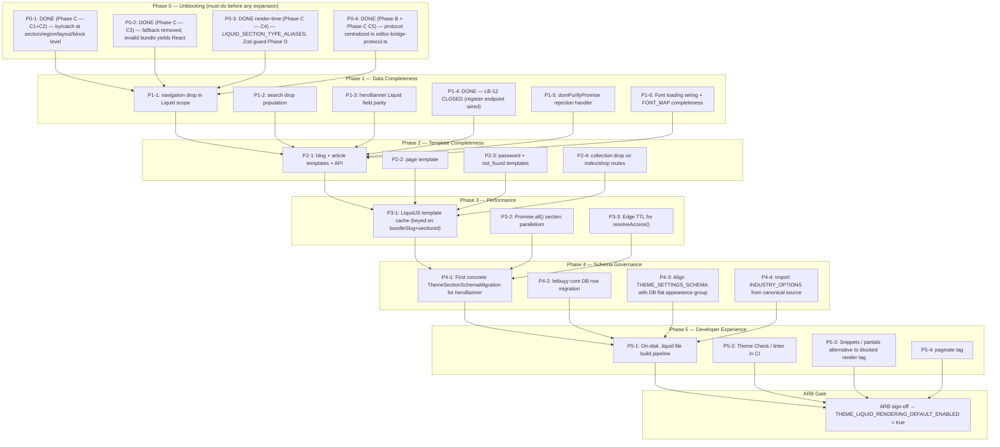

# Master Liquid Migration Plan (PLANNING ONLY)

**Document class:** DISCOVERY — NO IMPLEMENTATION  
**Date:** 2026-07-03  
**Status:** PLANNING ONLY — zero code changes are prescribed or implied  
**Branch:** `stepup/main`  
**Audience:** Architecture Review Board, engineering leads, on-call engineers

---

**Primary sources (all read-only, branch `stepup/main`, 2026-07-03):**

| Source | Domain |
|---|---|
| `docs/storefront-liquid-discovery/11_GAP_ANALYSIS.md` | Consolidated gap analysis |
| `packages/theme-engine/src/theme-governance.ts` | Feature flag, ARB gate, parity array |
| `packages/theme-engine/src/theme-renderer.ts` | LiquidJS engine config, DOMPurify |
| `packages/theme-engine/src/theme-bundle.ts` | Zod schemas, Urban Kicks fixture, 23 sections |
| `packages/theme-engine/src/theme-bundle-core.ts` | letbuyy-core alias layer |
| `packages/theme-engine/src/theme-registry.ts` | 12 base section schemas, THEME_SETTINGS_SCHEMA |
| `packages/theme-engine/src/built-in-section-schemas.ts` | 25 section types |
| `packages/theme-engine/src/theme-presets.ts` | 10 Experiences, EXPERIENCE_REGISTRY |
| `packages/theme-engine/src/industry-experience-map.ts` | Industry → Experience map |
| `packages/theme-engine/src/experience-fonts.ts` | Font registry |
| `packages/theme-engine/src/portable-to-liquid.ts` | Portable-to-Liquid compiler |
| `apps/storefront-runtime/src/lib/theme-engine/template-resolver.ts` | Engine decision |
| `apps/storefront-runtime/src/lib/theme-engine/composition-engine.tsx` | SSR compositor |
| `apps/storefront-runtime/src/lib/theme-engine/liquid-hydration-islands.tsx` | 9 lb-* Web Components |
| `apps/storefront-runtime/src/lib/theme-engine/renderer-registry.tsx` | React section registry |
| `apps/storefront-runtime/src/lib/theme-engine/data-binding-engine.ts` | Section data plan |
| `apps/storefront-runtime/src/lib/store-service.ts` | StoreModel hydration |
| `apps/storefront-runtime/src/proxy.ts` | Multi-tenant middleware |
| `apps/storefront-runtime/src/app/store/[subdomain]/layout.tsx` | Engine-conditional layout |
| `services/api-gateway/src/routes/stores.ts` | Experience auto-apply |
| Scratchpad findings (13 domain reports) | All domains |

---

## Table of Contents

1. [Architecture Overview](#1-architecture-overview)
2. [Current Implementation](#2-current-implementation)
3. [Repository Inventory](#3-repository-inventory)
4. [Runtime Flow](#4-runtime-flow)
5. [Dependency Graph](#5-dependency-graph)
6. [Missing Features](#6-missing-features)
7. [Partial Implementations](#7-partial-implementations)
8. [Technical Debt](#8-technical-debt)
9. [Enterprise Gap Analysis](#9-enterprise-gap-analysis)
10. [Risk Analysis](#10-risk-analysis)
11. [Recommended Migration Order](#11-recommended-migration-order)
12. [Open Questions](#12-open-questions)

---

## 1. Architecture Overview

LetBuyy ships a **dual-renderer storefront** (`apps/storefront-runtime`, Next.js 16, React 19). The production default for every store except Urban Kicks is the React/JSON-contract renderer. A full LiquidJS engine (v10.27.0) is implemented, tested across 16 layers, and gated behind:

- `THEME_LIQUID_RENDERING_DEFAULT_ENABLED = false` (compile-time constant, `packages/theme-engine/src/theme-governance.ts:14`)
- `THEME_LIQUID_PLATFORM_WIDE_FLIP_DECISION = { status: 'deferred', authority: 'ARB' }` (same file, line 16–21)

Migration 180 (`database/supabase/migrations/180_urban_kicks_liquid_theme.sql`) promoted the Urban Kicks theme to first-class Liquid status by writing `rendererEngine='liquid'` into `themes.default_template` — bypassing the global flag for that single theme. This is the current production Liquid surface.

The migration plan below is organized around **progressively expanding that surface** from one theme to all stores, through a sequence of discrete, verifiable, rollback-capable phases.



### Dual-Engine Decision Matrix

| Activation Path | Source | Current Status |
|---|---|---|
| `themes.default_template.rendererEngine = 'liquid'` | DB (migration 180) | ACTIVE — Urban Kicks only |
| `templateConfig.rendererEngine = 'liquid'` | Per-store JSONB (`sites.template_config`) | Available; not used in practice |
| `liquidRenderingCanary = true` | Per-store/theme config variants (11 key aliases across `templateConfig`, `themeSettings`, `releaseManifest`, `rendererManifest`) | Canary path — requires explicit set |
| `THEME_LIQUID_RENDERING_DEFAULT_ENABLED` | Compile-time constant in `theme-governance.ts:14` | `false` — ARB-deferred |
| `?engine=liquid` query param | `resolveDevEngineOverride()` in `template-resolver.ts` | Dev only; ignored in production |

---

## 2. Current Implementation

### Implementation Coverage Table

| Capability Area | Coverage % | Status | Evidence |
|---|---|---|---|
| LiquidJS engine (core tags/filters) | 70% | PARTIAL | `packages/theme-engine/src/theme-renderer.ts`; missing ``, ``, ``, Shopify-specific filters |
| Commerce Liquid drops | 55% | PARTIAL | `composition-engine.tsx`; `navigation` never passed to scope; `search` permanently null |
| Template route coverage | 67% | PARTIAL | 10/15 route types in Liquid (`blog`, `article`, `page`, `password`, `not_found` missing) |
| Theme schema / settings system | 65% | PARTIAL | Dual schema divergence: TypeScript 5-group vs DB flat `appearance` group |
| Section type registry | 72% | PARTIAL | 25 types defined; 20 have Liquid parity; 5 missing parity; `newsletter`↔`newsletter-signup` split |
| Theme editor (merchant UX) | 60% | PARTIAL | `editor-preview-section-frame.tsx`; postMessage inconsistency (C-04 OPEN) |
| Preset / Experience system | 75% | PARTIAL | 10 Experiences defined; font loading not wired; `defaultSections` not applied on experience apply |
| Theme authoring / DX | 15% | MISSING | Zero `.liquid` files on disk; all source in TypeScript string literals (`theme-bundle.ts`) |
| Render pipeline performance | 40% | PARTIAL | `cache: false`; sequential section rendering; no edge template cache |
| Font system | 45% | PARTIAL | `buildGoogleFontsHref()` defined but no call site; 4 fonts missing from `FONT_MAP` |
| Multi-tenancy / theme isolation | 85% | IMPLEMENTED | Urban Kicks branding leak at `store-service.ts:671–673` |
| Security model (XSS / injection) | 90% | IMPLEMENTED | Defense-in-depth: `outputEscape:'escape'` + DOMPurify + `ThemeLiquidSourceSchema` |
| Customer auth in Liquid | 85% | IMPLEMENTED | HS256 JWT resolved to `LiquidCustomerDrop`; LB-12 CLOSED (register endpoint wired) |
| Cart / checkout in Liquid | 50% | PARTIAL | Cart drawer hydrates post-load; SSR totals null (by design); checkout permanently React |
| **Overall Liquid platform readiness** | **~55%** | **PARTIAL** | |

### What Is Verifiably Implemented

- LiquidJS v10.27.0 engine with `outputEscape:'escape'`, `strictFilters:true`, `cache:false`, `dynamicPartials:false` (`theme-renderer.ts`)
- DOMPurify v3.4.9 + jsdom v29.1.1 server-side sanitizer with locked FORBID/ADD_TAGS config (`theme-renderer.ts`)
- 23 Liquid section types generated by `createLiquidParitySectionFiles()` (`theme-bundle.ts`)
- 9 Liquid hydration island Web Components (`lb-add-to-cart`, `lb-cart-drawer`, `lb-search`, `lb-variant-picker`, `lb-review-form`, `lb-wishlist-toggle`, `lb-cart`, `lb-customer-settings`, `lb-address-manager`) (`liquid-hydration-islands.tsx`)
- Urban Kicks Liquid bundle fixture: `createUrbanKicksLiquidThemeBundleFixture()` (`theme-bundle.ts`)
- letbuyy-core alias layer: `createLetbuyyCoreLiquidThemeBundleFixture()` (`theme-bundle-core.ts`)
- 10 named Experiences (Forge, Sense, Aura, Craft, Refresh, Ride, Dawn, Bloom, Nova, Summit) in `EXPERIENCE_REGISTRY` (`theme-presets.ts`)
- Industry → Experience map (9 industries, 18 aliases) with auto-apply at store creation (`industry-experience-map.ts`, `stores.ts:659–673`)
- Experience apply in Theme Editor via `ExperiencePicker.tsx`
- 25 built-in section types with Zod schemas (`built-in-section-schemas.ts`)
- Portable-to-Liquid compiler: `compilePortableToLiquidBundle()` (`portable-to-liquid.ts`)
- 6 custom Liquid filters: `money`, `money_with_currency`, `json`, `asset_url`, `image_url`, `t`
- Drop security: `MAX_LIQUID_DROP_DEPTH=4`, `MAX_LIQUID_DROP_KEYS=80`, `BLOCKED_DROP_KEYS` list
- Liquid bundle DB persistence (migrations 171, 172, 180, 181)
- ARB gate for platform flip (documented in `theme-governance.ts:16–21`)
- 16 test files in `packages/theme-engine/test/`: 12 Liquid layer tests (L2–L13) + 4 additional tests (`theme-engine`, `theme-presets`, `theme-bundle-core`, `experience-fonts`)

### What Is Not Built

| Gap | Evidence |
|---|---|
| On-disk `.liquid` files | All Liquid source is TypeScript string literals in `theme-bundle.ts` |
| Template caching | `cache: false` on every LiquidJS request (`theme-renderer.ts`) |
| ``, `` tags | Not registered in LiquidJS |
| `` / snippets | Blocked at source schema level + `dynamicPartials: false` |
| `linklists`/navigation Liquid object | `StoreModel.navigation` never passed to `buildLiquidScope()` |
| `settings` Liquid object as Shopify-compatible sub-keys | `buildLiquidScope()` passes `settings_data.current` flat dictionary (`theme-renderer.ts:573-576`); however the TypeScript 5-group schema diverges from the DB flat `appearance` group, so merchant-configured values may be absent or miskeyed |
| `predictive_search`, `recommendations`, `gift_card`, `discount`, `checkout` objects | Not implemented |
| Metafields system | No metafields in any drop |
| Font loading (`<link>` injection) | `buildGoogleFontsHref()` implemented but no call site in storefront `<head>` |
| Blog Liquid templates | Gateway REST backend exists (`public-routes.ts:1226` and `:1249`); gap is missing `blog`/`article` template keys in the Liquid bundle and no blog-list index page in the storefront runtime |
| `newsletter`/`newsletter-signup` type reconciliation | Type split between JSON-contract and Liquid bundle |

---

## 3. Repository Inventory

### packages/theme-engine/src/ (13 active source files)

| File | Lines | Role | Status |
|---|---|---|---|
| `theme-bundle.ts` | ~2971 | Zod schemas; Urban Kicks fixture; 23 Liquid section types | IMPLEMENTED |
| `theme-renderer.ts` | ~933 | `LiquidRenderer`; DOMPurify config; 6 filters; drop security | IMPLEMENTED |
| `index.ts` | ~1248 | Barrel exports; `StoreTemplateConfig`; `DEFAULT_THEME_SETTINGS` | IMPLEMENTED |
| `theme-governance.ts` | ~369 | Feature flag; ARB gate; ART-17 parity array; schema migration engine | IMPLEMENTED |
| `theme-registry.ts` | ~734 | 12 base section schemas in `SECTION_SCHEMAS` (announcementBar, heroBanner, featuredProducts, productGrid, categoryGrid, brandMarquee, testimonials, trustBadges, newsletter, appBlockSlot, header, footer); `THEME_SETTINGS_SCHEMA`; `getDefaultStorefrontThemeTemplate()` | IMPLEMENTED (governance-frozen by convention) |
| `built-in-section-schemas.ts` | ~338 | 13 additional section schemas in `ADDITIONAL_BUILT_IN_SECTION_SCHEMAS`; `BUILT_IN_SECTION_SCHEMAS` (Object.freeze) exports 25 total types per `BUILT_IN_SECTION_TYPES` | IMPLEMENTED |
| `theme-presets.ts` | ~523 | 10 Experiences; `EXPERIENCE_REGISTRY`; apply/overlay functions | IMPLEMENTED |
| `theme-bundle-core.ts` | ~83 | letbuyy-core alias; `createLetbuyyCoreLiquidThemeBundleFixture()` | IMPLEMENTED |
| `industry-experience-map.ts` | ~150 | `INDUSTRY_EXPERIENCE_MAP`; 18 aliases; `resolveExperienceForIndustry()` | IMPLEMENTED |
| `experience-fonts.ts` | ~83 | 6-font registry; `buildGoogleFontsHref()` (not wired) | IMPLEMENTED (not integrated) |
| `portable-to-liquid.ts` | ~202 | L3 compiler: portable JSON → `LiquidThemePackageBundle` | IMPLEMENTED |
| `execution-runtime.ts` | ~487 | Section/block composition primitives | IMPLEMENTED |
| `jsdom-runtime.d.ts` | ~15 | Type shim for server-side DOMPurify | SHIM |

### apps/storefront-runtime/src/lib/theme-engine/ (9 files)

| File | Lines | Role | Status |
|---|---|---|---|
| `composition-engine.tsx` | ~516 | SSR compositor; `renderLiquidPlan()`; `buildLiquidCommerceContext()` | IMPLEMENTED |
| `liquid-hydration-islands.tsx` | ~1307 | 9 `lb-*` Web Component custom elements | IMPLEMENTED |
| `template-resolver.ts` | ~309 | `resolveStorefrontTemplate()`; engine canary gate | IMPLEMENTED |
| `renderer-registry.tsx` | ~287 | React section registry (~20 renderers); ART-17 frozen | IMPLEMENTED |
| `data-binding-engine.ts` | ~107 | `buildSectionDataPlan()`; product fetch heuristics | IMPLEMENTED |
| `types.ts` | ~95 | `StorefrontRenderPlan`; `StorefrontRouteType` (17 types: index, product, collection, page, policy, blog, article, cart, search, customer_account, customer_orders, customer_wishlist, customer_settings, customer_addresses, customer_order, password, not_found) | IMPLEMENTED |
| `editor-preview-section-frame.tsx` | ~93 | Editor postMessage frame (postMessage naming bug open) | IMPLEMENTED |
| `content-route.ts` | ~18 | CMS content fallback | IMPLEMENTED |
| `product-route.ts` | ~38 | Product listing/detail fallbacks | IMPLEMENTED |

### Database Migrations (theme-related)

| Migration | Effect | Status |
|---|---|---|
| `000_baseline.sql` | All table definitions; `themes`, `theme_releases`, `theme_editor_drafts`, etc. | IMPLEMENTED |
| `087_theme_template_drafts.sql` | Adds `template_key` + scoped unique constraint to `theme_editor_drafts` | IMPLEMENTED |
| `091_theme_marketplace_stepup.sql` | Marketplace tables: `developer_profiles`, `theme_collections`, `theme_download_artifacts` | IMPLEMENTED |
| `171_liquid_bundle_persistence.sql` | Backfills Urban Kicks Liquid bundle into `themes.default_template.liquidBundle` | IMPLEMENTED |
| `172_liquid_bundle_refresh.sql` | Refreshes bundle to include full template set | IMPLEMENTED |
| `180_urban_kicks_liquid_theme.sql` | Sets `rendererEngine='liquid'`; adds `appearance` settings_schema group | IMPLEMENTED |
| `181_urban_kicks_settings_schema_complete.sql` | Adds `surfaceColor` and `isDark` to settings_schema | IMPLEMENTED |
| `185_v1_site_domains.sql` | `site_domains` + `site_domain_verifications`; RLS | IMPLEMENTED |
| `187_v1_sites_site_settings.sql` | Adds `sites.site_settings` JSONB (appearance bridge) | IMPLEMENTED |

---

## 4. Runtime Flow

### Full Request Trace (Liquid Path)

```mermaid
sequenceDiagram
    participant B as Browser
    participant P as proxy.ts (Edge Middleware)
    participant G as API Gateway (CF Worker)
    participant DB as Supabase Postgres
    participant SR as Next.js Store Page (RSC)
    participant CE as CompositionEngine
    participant LR as LiquidRenderer (theme-engine)
    participant DP as DOMPurify (jsdom, server)
    participant HI as LiquidHydrationIslands (browser)

    B->>P: GET {store}.letbuyy.com/products
    P->>G: GET /v1/internal/store-access/resolve?host=...<br/>(cache: 'no-store', INTERNAL_API_SECRET)
    G->>DB: SELECT sites + site_domains (Hyperdrive)
    G-->>P: StorefrontAccessContext { access_mode, published }
    P->>SR: rewrite → /store/{sub}/products (Next.js route)
    SR->>G: client.storefront.getStore(subdomain)
    G->>DB: SELECT sites JOIN theme_releases WHERE is_current = true
    G-->>SR: WorkerStorePayload { liquidBundle, rendererEngine:'liquid' }
    SR->>SR: mapSupabaseToStore() → StoreModel
    SR->>SR: resolveThemeLiquidRenderingEnabled() → true (rendererEngine='liquid')
    SR->>SR: buildSectionDataPlan() → product fetches from gateway
    SR->>CE: StorefrontCompositionEngine plan sectionData
    CE->>CE: getStorefrontCustomerDrop() (HS256 cookie → gateway)
    CE->>CE: buildLiquidCommerceContext() → LiquidCommerceDrops
    Note over CE: cart.total_price = null (browser_hydrated — canonical ledger rule)
    CE->>LR: LiquidRenderer.render(liquidBundle, drops, ...)
    LR->>LR: parseLiquidThemePackageBundle() (Zod validation — called in LiquidRenderer.render() at theme-renderer.ts:348)
    LR->>LR: createLiquidEngine() (cache:false, new instance per request)
    LR->>LR: renderLiquidTemplateSections() — SEQUENTIAL awaits
    LR->>DP: sanitizeRenderedHtml() per section (FORBID: style, script; ADD: lb-*)
    DP-->>LR: sanitized HTML
    LR-->>CE: { header, contentForLayout, footer }
    CE-->>B: HTML (dangerouslySetInnerHTML) + LiquidHydrationIslands
    B->>HI: customElements.define() x9
    HI->>G: /api/storefront/{sub}/cart (same-origin proxy → Next.js rewrite → gateway)
```

### Engine Decision Logic

The canary decision cascade in `resolveThemeLiquidRenderingEnabled()` (`theme-governance.ts:144–182`) follows this priority order:

1. `templateConfig.rendererEngine === 'liquid'` (set by migration 180 for Urban Kicks) → **ACTIVE today**, with a verified cascade caveat: `resolveRenderableThemeTemplateConfig()` (`packages/theme-engine/src/index.ts:683-704`) lets a store's own renderable `template_config` win over `themes.default_template`, so migration 180 reaches only stores WITHOUT a customized per-store template config; customized Urban Kicks stores continue rendering React unless their stored config itself carries `rendererEngine`
2. `releaseManifest.renderer_engine === 'liquid'` (set by gateway `buildReleaseArtifacts` on publish)
3. Any of 11 canary flag key aliases across `templateConfig`, `themeSettings`, `releaseManifest`, `rendererManifest` (camelCase + snake_case variants of `liquidRenderingCanary` / `liquidCanary`)
4. Fallback: `THEME_LIQUID_RENDERING_DEFAULT_ENABLED = false` → React path

---

## 5. Dependency Graph

### Package-Level Dependencies (Theme Subsystem)

| Dependent | Dependency | Relationship |
|---|---|---|
| `apps/storefront-runtime` | `packages/theme-engine` | Liquid renderer, schemas, Experiences, section schemas |
| `apps/storefront-runtime` | `packages/tenant-core` | Host resolution, `StoreModel` |
| `apps/storefront-runtime` | `packages/auth-core` | HS256 customer session |
| `apps/storefront-runtime` | `packages/api-client` | Gateway HTTP client |
| `apps/storefront-runtime` | `packages/commerce-core` | `ProductModel` type contract |
| `apps/merchant-control-plane` | `packages/theme-engine` | Editor: `ExperiencePicker`, schema validation, draft save |
| `services/api-gateway` | `packages/theme-engine` | `LiquidThemePackageBundleSchema` validation; `applyExperienceToTemplateConfig` |
| `services/api-gateway` | `packages/auth-core` | Customer session verification |
| `packages/theme-engine/theme-bundle-core.ts` | `packages/theme-engine/theme-bundle.ts` | Urban Kicks fixture (alias source) |
| `packages/theme-engine/industry-experience-map.ts` | `packages/theme-engine/theme-presets.ts` | `EXPERIENCE_REGISTRY`, `resolveExperienceForIndustry` |
| `packages/theme-engine/experience-fonts.ts` | `packages/theme-engine/theme-presets.ts` | `listExperiences()` |
| `packages/theme-engine/theme-renderer.ts` | `liquidjs` (npm v10.27.0) | Template rendering |
| `packages/theme-engine/theme-renderer.ts` | `dompurify` v3.4.9 + `jsdom` v29.1.1 | Server-side HTML sanitization |

### Critical Change-Control Hotspots

Any PR that touches the following paths warrants a `graph:intel blast` before merge:

| Symbol / File | Blast Radius | Risk |
|---|---|---|
| `packages/theme-engine/src/theme-governance.ts` | All Liquid-enabled storefronts | Feature flag, ARB gate, parity array |
| `packages/theme-engine/src/theme-renderer.ts` | Every Liquid render on every request | Engine config, sanitizer config, filter registry |
| `packages/theme-engine/src/theme-bundle.ts` | All Liquid bundles in DB + tests | Zod schemas, Urban Kicks fixture |
| `apps/storefront-runtime/src/lib/store-service.ts:671–673` | All Liquid stores | Liquid fallback bundle selection |
| `apps/storefront-runtime/src/lib/theme-engine/template-resolver.ts` | Every storefront request | Engine canary decision |
| `apps/storefront-runtime/src/proxy.ts` | Every storefront request | Multi-tenant middleware |

---

## 6. Missing Features

### 6.1 Liquid Language Gaps

| Missing Feature | Shopify Capability | LetBuyy Status | Migration Classification |
|---|---|---|---|
| `` tag | Server-side pagination | MISSING | PURE-LIQUID |
| `` tag | Native form rendering | MISSING | PURE-LIQUID |
| `` tag / snippets | Template composition | BLOCKED — `ThemeLiquidSourceSchema` forbids it | PURE-LIQUID |
| `` tag | Legacy partial inclusion | BLOCKED | PURE-LIQUID |
| `` tag | Section-in-layout tag | MISSING — sections assembled programmatically | PURE-LIQUID |
| `` / `` | Per-section JS/CSS | MISSING | PURE-LIQUID |
| `linklists` object | Navigation menus | MISSING | PURE-LIQUID |
| `settings` Liquid object (key-path parity) | Global theme settings with Shopify-compatible key paths | PARTIAL — `settings_data.current` is passed to Liquid scope at `theme-renderer.ts:573-576`; however the 5-group TypeScript schema (`colors`, `typography`, `layout`, `header`, `footer`) diverges from the DB flat `appearance` group so per-merchant overrides may not resolve at expected key paths | PURE-LIQUID |
| `product.metafields` | Structured metadata | MISSING — no metafields system | REMAIN-REACT (requires new DB domain) |
| `predictive_search` | AJAX search | MISSING | JS-ISLAND |
| `checkout` Liquid object | Checkout context | MISSING — checkout is permanently React | REMAIN-REACT |

### 6.2 Template Route Coverage Gaps

| Route Type | React Template | Liquid Template | Gap |
|---|---|---|---|
| `index` (home) | IMPLEMENTED | IMPLEMENTED | — |
| `product` | IMPLEMENTED | IMPLEMENTED | — |
| `collection` | IMPLEMENTED | IMPLEMENTED | — |
| `cart` | IMPLEMENTED | IMPLEMENTED | — |
| `customers/login` | IMPLEMENTED | IMPLEMENTED | — |
| `customers/register` | IMPLEMENTED | IMPLEMENTED (form renders; endpoint wired — LB-12 CLOSED) | — |
| `customers/account` | IMPLEMENTED | IMPLEMENTED | — |
| `customers/orders` | IMPLEMENTED | IMPLEMENTED | — |
| `customers/order` | IMPLEMENTED | IMPLEMENTED | — |
| `track` | IMPLEMENTED | IMPLEMENTED | — |
| `blog` | PARTIAL | MISSING | Gateway backend exists (public-routes.ts:1226); missing Liquid template key in bundle |
| `article` | PARTIAL | MISSING | Gateway backend exists (public-routes.ts:1249); missing Liquid template key in bundle |
| `page` | PARTIAL | MISSING | Partial CMS support |
| `password` | PARTIAL | MISSING | — |
| `not_found` | PARTIAL | MISSING | — |

**Template coverage: `StorefrontRouteType` defines 17 route types; this table covers 15 of them (excludes `search` which shares the `collection` Liquid template and `policy` which is served via the `page` path). Of the 15 tracked, 10 are fully implemented in Liquid = 67% of tracked routes.**

### 6.3 Structural Gaps

| Gap | Evidence |
|---|---|
| Font loading not wired | `experience-fonts.ts:buildGoogleFontsHref()` defined; no call site in storefront `<head>` |
| 4 fonts missing from `FONT_MAP` | `apps/storefront-runtime/src/app/store/[subdomain]/layout.tsx` — Cormorant Garamond, Libre Baskerville, Source Sans Pro, Lato absent |
| `letbuyy-core` DB row missing | `theme-bundle-core.ts:44–47` comment: "adding a `letbuyy-core` DB alias row is the documented, deferred follow-up" |
| Blog Liquid templates | The gateway REST backend at `GET /storefront/:subdomain/blog` (public-routes.ts:1226) and `GET /storefront/:subdomain/blog/:slug` (public-routes.ts:1249) is implemented. The gap is that the Liquid theme bundle has no `blog` or `article` template keys, and there is no blog-list index page route in the storefront runtime. |
| `lb-cart` CRUD mutations | `removeFromCart`, `updateQuantity`, `clearCart` not confirmed implemented |
| `defaultSections` on Experiences not applied | `applyExperienceToTemplateConfig()` applies only design tokens; section composition unchanged |
| On-disk `.liquid` files | All Liquid source lives as TypeScript string literals in `theme-bundle.ts` |
| LiquidJS template caching | `cache: false` — every request re-parses from scratch |
| `theme_id = 'modern'` ghost reference | `create-store/route.ts:90`: `theme_id: templateId || 'modern'`; no `modern` row in `themes` table confirmed |

---

## 7. Partial Implementations

| Feature | What Exists | What Is Missing |
|---|---|---|
| **letbuyy-core identity** | `theme-bundle-core.ts` fixture + `THEME_SLUG_ALIASES` resolution | DB migration for `letbuyy-core` row; `store-service.ts:671–673` still calls Urban Kicks fixture |
| **Experience system** | 10 Experiences with Zod schemas, overlay apply, editor picker, auto-apply at store creation (`stores.ts:659–673`) | Font loading wired into `<head>`; `FONT_MAP` completeness; `defaultSections` not applied |
| **Schema migration engine** | Full interface (`ThemeSectionSchemaMigration`), chain-walk up to 20 steps, loop detection | Zero concrete migration objects registered; `migrateThemeTemplateSchemas` is called in the unit test suite (`packages/theme-engine/test/theme-engine.test.ts:158`) and enforced there by the governance validator — but it is **not called in the gateway publish/draft/install path** (`buildReleaseArtifacts`, theme publish routes). The gap is integration with the publish path, not the absence of any call site. |
| **Theme editor Liquid bridge** | Draft route `POST /api/themes/[themeId]/editor/draft` persists `liquidBundle`. **DONE (Phase C — C5):** Protocol centralized in `editor-bridge-protocol.ts`; `CenterPanel` dual-emits legacy+modern; both consuming files import from shared module; contract test in `tests/theme-engine/editor-bridge-contract.test.mjs`. | ~~postMessage naming mismatch~~ CLOSED. Remaining gaps: no Liquid syntax validation in editor; AI hooks are stubs; no template file browser for Liquid source. |
| **Onboarding Experience assignment** | Gateway auto-applies at store creation; onboarding shows industry picker | `ONBOARDING_INDUSTRIES` in `identity-platform` is a hardcoded array, not imported from `INDUSTRY_OPTIONS` (`industry-experience-map.ts:69–81`) |
| **Cart in Liquid path** | `lb-cart-drawer` syncs via browser call after page load | Server-side cart totals always null at SSR; JS-disabled users see no totals |
| **Search drop** | `LiquidCommerceDrops.search` defined in interface | Never populated; permanently null in all render paths (`composition-engine.tsx`) |
| **Navigation in Liquid drops** | `StoreModel.navigation` fetched server-side | Never passed to `buildLiquidScope()`; `composition-engine.tsx` has no `navigation` key in drop assembly |
| **App block slots** | `buildLiquidAppBlocks()` and `buildLiquidAppEmbeds()` implemented | Not exposed as `{{ app_blocks }}` drop in Liquid scope |

---

## 8. Technical Debt

| Debt Item | Severity | Location | Description |
|---|---|---|---|
| ~~Urban Kicks branding leak~~ **DONE (Phase C — C3)** | ~~HIGH~~ CLOSED | `apps/storefront-runtime/src/lib/store-service.ts:670–673` | ~~Fallback bundle still calls `createUrbanKicksLiquidThemeBundleFixture()`~~ Fallback removed; invalid bundle yields `undefined` (React fallback). |
| ~~`newsletter` / `newsletter-signup` type split~~ **DONE render-time (Phase C — C4)** | ~~HIGH~~ PARTIAL | `theme-renderer.ts:256–261`; `portable-to-liquid.ts:46` | Render-time alias `LIQUID_SECTION_TYPE_ALIASES` added; compiler-path alias unchanged. Residual: Zod parse-time guard (Phase D). |
| `heroBanner` Liquid parity gap | HIGH | `theme-bundle.ts:1009–1027` vs `theme-registry.ts:100–111` | Liquid `hero-banner` schema lacks `overlay`, `height`, `textAlign`, `image` fields; React-configured merchants silently lose these settings on Liquid render |
| ~~postMessage naming inconsistency~~ **DONE (Phase B + Phase C — C5)** | ~~HIGH~~ CLOSED | `packages/theme-engine/src/editor-bridge-protocol.ts` (new); `storefront-preview-bridge.tsx`; `editor-preview-section-frame.tsx`; `CenterPanel.tsx` | Protocol centralized in shared module; both sides import constants; CenterPanel dual-emits legacy+modern; contract test enforces the binding. |
| `theme_id = 'modern'` ghost reference | HIGH | `apps/identity-platform/src/app/api/auth/create-store/route.ts:90` | `theme_id: templateId || 'modern'` written to `sites`; `'modern'` row not confirmed in `themes` table |
| `cache: false` on LiquidJS per-request | HIGH | `packages/theme-engine/src/theme-renderer.ts` | Every storefront request re-parses all Liquid section sources; O(sections) parse cost at scale |
| ~~No try/catch around `engine.parseAndRender()`~~ **DONE (Phase C — C1 + C2)** | ~~HIGH~~ CLOSED | `theme-renderer.ts:32, 288–370, 411–487, 619–647`; `composition-engine.tsx:433–479` | Per-section/region/layout/block try/catch implemented; `ThemeRendererStatus` extended with `'error'`; composition-engine catch with `lb:canary:render:fallback` telemetry. 89/89 tests pass. |
| DOMPurify JSDOM singleton no rejection handler | MEDIUM | `theme-renderer.ts` — `domPurifyPromise` module-level singleton | No `.catch()` on the singleton initialization promise; JSDOM failure silently leaves sanitizer uninitialized |
| Sequential section rendering | MEDIUM | `theme-renderer.ts` — `renderLiquidTemplateSections()` | Sections rendered via sequential `await engine.parseAndRender()`; no `Promise.all()`; latency scales linearly with section count |
| Dual schema structure (TypeScript vs DB) | MEDIUM | `theme-registry.ts` (5 groups) vs DB `appearance` group (migration 180) | TypeScript `THEME_SETTINGS_SCHEMA` has 5 groups; Urban Kicks DB schema has 1 flat `appearance` group |
| Duplicate `normalizeSectionType` mapping | MEDIUM | `store-service.ts` (inline) + `data-binding-engine.ts` + `renderer-registry.tsx` | Same type aliases replicated in three files; divergence risk on future section type additions |
| Two draft tables | MEDIUM | `theme_editor_drafts` + `theme_instance_drafts` | Both tables in baseline; `theme_preview_sessions.theme_instance_draft_id` references the latter; no deprecation path |
| `ONBOARDING_INDUSTRIES` hardcoded | MEDIUM | `apps/identity-platform/src/app/onboarding/page.tsx:205–215` | Display labels duplicated from `INDUSTRY_OPTIONS` in `industry-experience-map.ts`; divergence risk |

---

## 9. Enterprise Gap Analysis

The following sections measure LetBuyy's Liquid platform against a Shopify-grade theme platform as of mid-2026.

### Section Parity Status

| Section Type | JSON-Contract (React) | Liquid Parity | Notes |
|---|---|---|---|
| `announcementBar` | IMPLEMENTED | IMPLEMENTED (`announcement-bar`) | Type name differs; normalized by compiler |
| `heroBanner` | IMPLEMENTED | IMPLEMENTED (`hero-banner`) | Field gap: `overlay`, `height`, `textAlign`, `image` missing in Liquid |
| `featuredProducts` | IMPLEMENTED | IMPLEMENTED (`featured-products`) | — |
| `productGrid` | IMPLEMENTED | IMPLEMENTED (`product-grid`) | — |
| `categoryGrid` | IMPLEMENTED | IMPLEMENTED (`category-grid`) | — |
| `brandMarquee` | IMPLEMENTED | IMPLEMENTED (`brand-marquee`) | — |
| `testimonials` | IMPLEMENTED | IMPLEMENTED | Block type key inconsistency: `testimonialCard` in `sample_blocks` (`theme-registry.ts:242`) — note that `blocks_schema` is **absent** for the testimonials section (the editor "Add Block" UI is therefore hidden); drafted blocks carry type `testimonialCard` while the Liquid inline block schema in `theme-bundle.ts:1152` declares type `testimonial`. `sample_blocks` is not `blocks_schema`. |
| `trustBadges` | IMPLEMENTED | IMPLEMENTED (`trust-badges`) | — |
| `newsletter` | IMPLEMENTED | IMPLEMENTED as `newsletter-signup` | Type split MITIGATED at compile time by `PORTABLE_TO_LIQUID_TYPE_OVERRIDES` (`portable-to-liquid.ts:46`). **DONE (Phase C — C4):** also mitigated at render time by `LIQUID_SECTION_TYPE_ALIASES` (`theme-renderer.ts:256–261`); bundles with `type:'newsletter'` now resolve correctly at render time without a compiler pass. Residual: Zod parse-time guard (Phase D). |
| `appBlockSlot` | IMPLEMENTED | IMPLEMENTED (`app-block-slot`) | — |
| `header` | IMPLEMENTED | IMPLEMENTED | — |
| `footer` | IMPLEMENTED | IMPLEMENTED | — |
| `productDetail` | IMPLEMENTED | IMPLEMENTED (`product-detail`) | — |
| `aboutSection` | IMPLEMENTED | IMPLEMENTED (`about-section`) | — |
| `rich-content` / `contentPage` | IMPLEMENTED | PARTIAL — `rich-content` template exists, but `contentPage` type does NOT resolve to it | React aliases `contentPage`→`core.rich-content` (`renderer-registry.tsx:185-187`); the Liquid path has no `contentPage` entry in `PORTABLE_TO_LIQUID_TYPE_OVERRIDES` (`portable-to-liquid.ts:43-53`), so `resolveLiquidSectionType('contentPage')` returns null and the section is dropped |
| `servicesGrid` | IMPLEMENTED | IMPLEMENTED (`services-grid`) | — |
| `skillsSection` | IMPLEMENTED | IMPLEMENTED (`skills-section`) | — |
| `experienceTimeline` | IMPLEMENTED | IMPLEMENTED (`experience-timeline`) | — |
| `contactForm` | IMPLEMENTED | IMPLEMENTED (`contact-form`) | — |
| `ctaSection` | IMPLEMENTED | IMPLEMENTED (`cta-section`) | — |
| `collectionFilter` | IMPLEMENTED | MISSING | Not in `THEME_LIQUID_PORTABLE_SECTION_PARITY` |
| `videoHero` | IMPLEMENTED | MISSING | Not in parity list |
| `faqAccordion` | IMPLEMENTED | MISSING | Not in parity list |
| `instagramFeed` | IMPLEMENTED | MISSING | Not in parity list |
| `portfolioGrid` | IMPLEMENTED | IMPLEMENTED (`portfolio-grid`) | — |

**Section parity: 20/25 types with Liquid counterparts = 80%. The 5 without working Liquid resolution (`collectionFilter`, `contentPage`, `videoHero`, `faqAccordion`, `instagramFeed`) are blockers for any store that uses them before the ARB flip. The `newsletter`↔`newsletter-signup` type split is MITIGATED by `PORTABLE_TO_LIQUID_TYPE_OVERRIDES` in the compiler — defense-in-depth validation in `parseLiquidThemePackageBundle` is still recommended (see R-03). `contentPage` is the cheapest remaining fix — the `rich-content` Liquid template exists and only the `PORTABLE_TO_LIQUID_TYPE_OVERRIDES` mapping is missing.**

### Drop / Object Coverage

| Drop | Available in Liquid | Notes |
|---|---|---|
| `shop` | YES | `id`, `name`, `subdomain`, `url`, `locale`, `currency` |
| `product` | YES | Full product model including `variants`, `reviews`, `in_wishlist` |
| `collection` | PARTIAL | Populated on `/collections/[slug]` routes with real data; a synthetic object (`id='all-products'`) provided on home/shop routes when product sections exist; null only when no product sections are active |
| `customer` | YES | HS256 JWT resolved server-side; null if unauthenticated |
| `cart` | PARTIAL | Always `{ item_count: null, subtotal: null, source: 'browser_hydrated' }` at SSR |
| `order` | YES | Order detail routes only |
| `page` | PARTIAL | Only on account/content routes; not on product/shop routes |
| `blog` | MISSING | No backend API |
| `article` | MISSING | No backend API |
| `navigation` | MISSING | Fetched server-side but never passed to `buildLiquidScope()` |
| `search` | MISSING | Permanently null in `composition-engine.tsx` |
| `linklists` | MISSING | No Shopify-style nav object |
| `settings` | PARTIAL | `buildLiquidScope()` passes `bundle.config.settings_data.current` as the `settings` Liquid object (`theme-renderer.ts:573-576`); however the TypeScript 5-group schema diverges from the DB flat `appearance` group so merchant-customized appearance values may not resolve under expected key paths |
| `predictive_search` | MISSING | Not implemented |
| `recommendations` | MISSING | Not implemented |
| `gift_card` | MISSING | Not implemented |
| `discount` | MISSING | Not implemented |

---

## 10. Risk Analysis

| ID | Risk | Level | Evidence | Affected Surface | Migration Classification |
|---|---|---|---|---|---|
| R-01 | `cache: false` on LiquidJS: every request re-parses all Liquid section templates; CPU/latency spike at production traffic | **CRITICAL** | `packages/theme-engine/src/theme-renderer.ts` — LiquidJS instantiated with `cache: false` per request | All Liquid-enabled storefronts | PURE-LIQUID (Phase 3) |
| R-02 | ~~No try/catch around `engine.parseAndRender()`: malformed Liquid template crashes Next.js server component instead of falling back to React~~ **DONE (Phase C — C1 + C2)** — Per-section/region/layout/block try/catch; `ThemeRendererStatus` extended; composition-engine catch with telemetry. 89/89 tests pass. | ~~CRITICAL~~ **DONE** | `theme-renderer.ts:32, 288–370, 411–487, 619–647`; `composition-engine.tsx:433–479` | ~~Every page render on a Liquid store~~ | CLOSED |
| R-03 | `newsletter` ↔ `newsletter-signup` type split: Liquid render path silently fails to find `newsletter` sections | ~~HIGH — MITIGATED~~ **DONE render-time (Phase C — C4)** | `PORTABLE_TO_LIQUID_TYPE_OVERRIDES` in `portable-to-liquid.ts:43-53`; `LIQUID_SECTION_TYPE_ALIASES` in `theme-renderer.ts:256–261` (render-time alias). Residual: Zod parse-time guard (Phase D). | ~~All stores with a newsletter section~~ Residual Zod guard only | PURE-LIQUID (Phase D — Zod guard) |
| R-04 | `heroBanner` JSON-contract ↔ Liquid schema gap: `overlay`, `height`, `textAlign`, `image` fields absent in Liquid section | **HIGH** | `theme-bundle.ts:1009–1027` vs `theme-registry.ts:100–111` | Merchants who customized hero settings on React | PURE-LIQUID (Phase 1) |
| R-05 | ~~Urban Kicks branding leak: all Liquid stores without an explicit valid bundle inherit Urban Kicks title suffix and CSS class~~ **DONE (Phase C — C3)** — Fallback removed; invalid bundle yields `undefined` (React fallback). | ~~HIGH~~ **DONE** | `apps/storefront-runtime/src/lib/store-service.ts:670–673` | ~~All Liquid stores~~ | CLOSED |
| R-06 | ~~LB-12 open blocker: `customers/register` Liquid template renders; `POST /storefront/customer/register` does not exist~~ **LB-12 CLOSED:** `POST /storefront/customer/register` is implemented in `services/api-gateway/src/routes/storefront/customer-registration.ts` (commit a391c1f4) and wired through `public-routes.ts`. This risk is resolved. | **CLOSED** | `services/api-gateway/src/routes/storefront/customer-registration.ts` | — | CLOSED |
| R-07 | `navigation` drop missing from Liquid scope: Liquid themes cannot render dynamic menus | **HIGH** | `composition-engine.tsx` — `buildLiquidScope` has no `navigation` key | Any Liquid section using `{{ shop.navigation }}` | PURE-LIQUID (Phase 1) |
| R-08 | Font loading not wired: 4 of 10 Experiences render system-font fallback; merchants see incorrect typography | **HIGH** | `experience-fonts.ts::buildGoogleFontsHref()` implemented; no call site; `FONT_MAP` missing 4 families | Experiences Aura, Craft, Dawn, Sense | PURE-LIQUID (Phase 1) |
| R-09 | ~~postMessage naming inconsistency in editor: section selection highlight broken~~ **DONE (Phase B + Phase C — C5)** — Phase B: `StorefrontPreviewBridge` handles legacy message via runtime bridge. Phase C C5: protocol centralized in `editor-bridge-protocol.ts`; both sides import from shared module; CenterPanel dual-emits; contract test enforces binding. | **DONE** | `packages/theme-engine/src/editor-bridge-protocol.ts`; `storefront-preview-bridge.tsx`; `CenterPanel.tsx` | — | CLOSED |
| R-10 | `search` drop permanently null: search sections display nothing | **HIGH** | `composition-engine.tsx` — `search` field never assigned in `buildLiquidCommerceContext()` | Any Liquid template using `{{ search.results }}` | PURE-LIQUID (Phase 1) |
| R-11 | Theme authoring locked behind TypeScript build pipeline: zero `.liquid` files on disk; designers cannot iterate | **HIGH** | `packages/theme-engine/src/theme-bundle.ts` — all Liquid sources as TypeScript string literals | Developer/designer onboarding; theme iteration velocity | PURE-LIQUID (Phase 5) |
| R-12 | DOMPurify JSDOM singleton no rejection handler: silent sanitizer failure if JSDOM init fails | **MEDIUM** | `packages/theme-engine/src/theme-renderer.ts` — `domPurifyPromise` pattern | All Liquid renders | PURE-LIQUID (Phase 1) |
| R-13 | `resolveAccess()` in `proxy.ts` is `cache: 'no-store'` on every request: gateway tenant endpoint becomes SPOF under traffic | **MEDIUM** | `apps/storefront-runtime/src/proxy.ts` — `resolveAccess()` fetch | All storefront requests | REMAIN-REACT (infra) (Phase 3) |
| R-14 | `theme_id = 'modern'` ghost reference: all web-created stores may 404 on theme editor load | **MEDIUM** | `apps/identity-platform/src/app/api/auth/create-store/route.ts:90` | All stores created via web onboarding | PURE-LIQUID (Phase 4) |
| R-15 | `letbuyy-core` DB row missing: DB queries for `theme_id = 'letbuyy-core'` return 0 rows | **MEDIUM** | `packages/theme-engine/src/theme-bundle-core.ts:44–47` | Gateway DB queries using canonical slug | PURE-LIQUID (Phase 4) |
| R-16 | No concrete schema migrations registered: future backward-incompatible section schema changes cannot be migrated | **MEDIUM** | `theme-governance.ts:77–96` | All stored `theme_releases.template_snapshot` records | PURE-LIQUID (Phase 4) |
| R-17 | `` blocked with no snippets system: complex template reuse requires code duplication | **MEDIUM** | `ThemeLiquidSourceSchema` in `theme-bundle.ts`; `dynamicPartials: false` | Theme developer experience | PURE-LIQUID (Phase 5) |
| R-18 | Cart money null at SSR: JS-disabled users never see cart totals | **MEDIUM** | `composition-engine.tsx:291–307` — `item_count: null`, `subtotal: null`, `source: 'browser_hydrated'` | All Liquid stores with cart drawer | JS-ISLAND |
| R-19 | `strictVariables: false`: undefined drop keys render as empty string; Liquid template bugs invisible in logs | **LOW** | `packages/theme-engine/src/theme-renderer.ts` — LiquidJS engine config | Template debugging velocity | PURE-LIQUID |
| R-20 | `BLOCKED_DROP_KEYS` incomplete: `api_key`, `secret_key`, `private_key`, `webhook_secret` not blocked | **LOW** | `theme-renderer.ts:602` | Drop security in edge cases | PURE-LIQUID |
| R-21 | `getCustomerOrderDetailDrop` uses list-and-filter to find a single order: the list is capped at 50 orders by the gateway (`customer-engagement-routes.ts:1035`, `.limit(50)`). The real risk is **correctness for customers with more than 50 orders** — an order older than the 50 most recent will not be found and `getCustomerOrderDetailDrop` will silently return null. **Recommendation:** add a direct order-by-id gateway endpoint (e.g., `GET /storefront/{sub}/orders/:orderId`) rather than the list-and-filter approach. | **LOW** | `apps/storefront-runtime/src/lib/customer-drop.ts:118`; `services/api-gateway/src/routes/storefront/customer-engagement-routes.ts:1035` | Customers with >50 orders (silently returns null on older orders) | REMAIN-REACT (gateway change) |
| R-22 | `X-Lb-Render-Engine` header decoupled from actual render engine: misleading observability | **LOW** | `proxy.ts` vs `template-resolver.ts` resolution order | Monitoring / alerting accuracy | PURE-LIQUID |

---

## 11. Recommended Migration Order

> **Scope of this section:** This is a planning document. All items are classified (PURE-LIQUID / JS-ISLAND / REMAIN-REACT) and ordered. No code changes are prescribed. Classification is based on what must change to realize the migration item; it does not specify how.

### Surfaces That Must Remain React (Non-Negotiable)

These surfaces are architecturally required to stay React and are **explicit non-goals of the Liquid migration**:

| Surface | Reason |
|---|---|
| Checkout (`apps/storefront-runtime/src/.../checkout/`) | Razorpay SDK, idempotency keys, COD flow, and server-authoritative ledger RPCs require React; confirmed by `docs/theme-research/07-react-storefront-elimination-study.md` |
| `CartProvider`, `CustomerAuthProvider`, `WishlistProvider` context wrappers | Client state management for React render path; Liquid path uses Web Component islands for the same functionality |
| `apps/storefront-runtime/src/app/store/[subdomain]/layout.tsx` (frame) | Engine-conditional chrome layer; remains the shell for both paths |
| Theme editor main shell (`apps/merchant-control-plane`) | React application; Liquid preview is iframe-embedded |
| `StorefrontSectionGroupRenderer` (header/footer groups) | Fallback on non-Liquid pages; ART-17 frozen React section renderers |

### Non-Goals (Explicit Exclusions)

The following are outside the scope of this migration plan:

1. Shopify Liquid API-level compatibility (``, ``, ``, `metafields`) unless specifically phased in.
2. App Marketplace (`apps/app-marketplace`), Developer Portal (`apps/developer-portal`), Theme Marketplace — all frozen per CLAUDE.md governance.
3. Metafields system — requires a new DB domain; separate planning track.
4. Subscriptions — not implemented; no migration path from a non-existent domain.
5. Third-party theme authoring — out of scope until Phase 5 is complete.
6. Checkout migration to Liquid — permanently REMAIN-REACT.

---

### Phase 0 — Critical Unblocking (Must Complete Before Any Store Expansion)

These items block production correctness for any Liquid-rendered store beyond Urban Kicks.

| # | Item | Classification | Risk Addressed | Verification Gate |
|---|---|---|---|---|
| P0-1 | ~~Add try/catch around `engine.parseAndRender()` in `theme-renderer.ts`~~ **DONE (Phase C — C1 + C2)** — Per-section/region/layout/block try/catch; `ThemeRendererStatus` extended with `'error'`; composition-engine catch + `lb:canary:render:fallback` telemetry. | PURE-LIQUID | R-02: CLOSED | 89/89 theme-engine tests pass; 19/19 storefront-runtime tests pass |
| P0-2 | ~~Wire `createLetbuyyCoreLiquidThemeBundleFixture()` as the Liquid fallback in `store-service.ts:671–673`~~ **DONE (Phase C — C3)** — Fallback removed entirely; invalid bundle yields `undefined` (React fallback, no branding leak). | PURE-LIQUID | R-05: CLOSED | 19/19 storefront-runtime tests pass |
| P0-3 | ~~Reconcile `newsletter` / `newsletter-signup` type split~~ **DONE render-time (Phase C — C4)** — `LIQUID_SECTION_TYPE_ALIASES` added in `theme-renderer.ts:256–261`; render loop resolves alias before lookup. Cross-reference in `portable-to-liquid.ts:43–44`. Residual: Zod guard at parse time (Phase D). | PURE-LIQUID | R-03/R-04: render-time CLOSED; Zod guard Phase D | 89/89 theme-engine tests pass (`C4 LIQUID_SECTION_TYPE_ALIASES constant` + `C4 newsletter alias resolves at render time`) |
| ~~P0-4~~ | ~~Fix postMessage key mismatch in editor~~ **DONE (Phase B + Phase C — C5)** — Phase B: `StorefrontPreviewBridge` bridges legacy message at runtime. Phase C C5: protocol centralized in `editor-bridge-protocol.ts`; CenterPanel dual-emits; contract test in `tests/theme-engine/editor-bridge-contract.test.mjs` enforces the binding. | DONE | R-09: CLOSED | 5/5 contract test assertions pass (source-verified) |

**Phase 0 rollback strategy:** Each Phase C fix is independently revertable by reverting the Phase C commit. No DB state was touched. The canary gate remains OFF (`THEME_LIQUID_RENDERING_DEFAULT_ENABLED=false`).

**Phase 0 verification gate:** COMPLETE — 89/89 theme-engine tests pass; 19/19 storefront-runtime tests pass; 5/5 editor-bridge contract assertions verified. Urban Kicks benchmark N=25 in 897ms total (avg 36ms, steady-state ~15ms).

---

### Phase 1 — High-Impact Data Completeness

Fixes that make the Liquid drops production-complete before expanding to new stores.

| # | Item | Classification | Risk Addressed | Verification Gate |
|---|---|---|---|---|
| P1-1 | Pass `StoreModel.navigation` into `buildLiquidScope()` as a `navigation` drop object (main/footer/policies nav menus) in `composition-engine.tsx` | PURE-LIQUID | R-07 (HIGH) | Unit test: Liquid scope contains `navigation.main`, `navigation.footer` arrays; existing navigation-using templates render correct `<a>` elements |
| P1-2 | Implement `search` drop population in `buildLiquidCommerceContext()`: wire to `storefront.searchProducts()` or the existing search gateway call on search-route pages | PURE-LIQUID | R-10 (HIGH) | Unit test: on `/shop?search=query`, `LiquidCommerceDrops.search` is non-null and has `results[]`, `terms` |
| P1-3 | Add `heroBanner` Liquid parity gap fields (`overlay`, `height`, `textAlign`, `image`) to the `hero-banner` section schema in `theme-bundle.ts:1009–1027`; ensure the portable-to-liquid compiler maps these fields | PURE-LIQUID | R-04 (HIGH) | Unit test: JSON-contract hero section with `overlay: 0.5`, `height: 'large'` compiles to a Liquid bundle that renders the correct CSS class |
| P1-4 | ~~Resolve LB-12: implement `POST /storefront/customer/register` in the API gateway~~ **DONE — LB-12 CLOSED:** endpoint implemented in `services/api-gateway/src/routes/storefront/customer-registration.ts` (commit a391c1f4), wired through `public-routes.ts`. No further work required. | DONE | R-06 (CLOSED) | — |
| P1-5 | Add rejection handler to `domPurifyPromise` module-level singleton in `theme-renderer.ts`; on JSDOM init failure, log structured error and fall back to returning unmodified (but engine-escaped) HTML | PURE-LIQUID | R-12 (MEDIUM) | Unit test: mock JSDOM init failure → no unhandled promise rejection; `lb:canary:sanitizer-error` event logged |
| P1-6 | Wire `buildExperienceFontLinkHref()` from `experience-fonts.ts` into the Liquid layout head assets; add `Cormorant Garamond`, `Libre Baskerville`, `Source Sans Pro`, `Lato` to `FONT_MAP` in `apps/storefront-runtime/src/app/store/[subdomain]/layout.tsx:21–32` | PURE-LIQUID | R-08 (HIGH) | Visual parity test: Aura experience storefront heading renders in Cormorant Garamond, not system font; confirmed via CSS computed style |

**Phase 1 rollback strategy:** All items are additive changes to the Liquid code path. The React path is untouched. If P1-1 (navigation drop) causes a Liquid render error on a particular store, the existing try/catch from P0-1 catches it and falls back to `UnknownSectionFallback` — the page degrades gracefully rather than crashing.

**Phase 1 verification gate:** Urban Kicks demo renders with all drops populated (navigation menus visible, fonts correct). The `lb:canary:render` log event shows no `fallback` sections. The `customers/register` page completes registration on a Liquid store.

---

### Phase 2 — Template Completeness

Brings template coverage from 67% to 100% of route types.

| # | Item | Classification | Verification Gate |
|---|---|---|---|
| P2-1 | Implement `blog` and `article` Liquid templates; gateway blog API backend already exists (`GET /storefront/{sub}/blog` at public-routes.ts:1226 and `GET /storefront/{sub}/blog/{slug}` at public-routes.ts:1249 — no gateway work needed); add `blog` and `article` template keys to the Liquid bundle and wire a blog-list index route in the storefront runtime | PURE-LIQUID | Unit test: blog route Liquid render returns non-empty HTML with article list |
| P2-2 | Implement `page` Liquid template; populate `page` drop from `ContentService` on all content routes | PURE-LIQUID | Unit test: policy page (`/privacy`) renders correct Liquid `page.content` |
| P2-3 | Implement `password` Liquid template (store password gate page) and `not_found` Liquid template (404 page) | PURE-LIQUID | Manual: attempting to access a password-protected Liquid store shows the password form |
| P2-4 | Improve collection drop on index/shop routes: the `collection` drop on home pages is `null` only when no product sections (`featured-products` or `product-grid`) are active; when those sections exist, a synthetic collection object (`id='all-products'`) is provided. P2-4 work should focus on providing a real **named collection object** for featured-collection widgets rather than fixing a nil drop — the synthetic `all-products` fallback is intentional. | PURE-LIQUID | Unit test: on `/` (index route), a store with a `featuredCollection` setting in a `featured-products` section receives a real named collection drop with the correct `handle`, `title`, and `products_count` |

**Phase 2 rollback strategy:** Templates are additive to the Liquid bundle. If a new template produces a render error, P0-1's try/catch falls back to `UnknownSectionFallback`. No DB state changes required for P2-1 through P2-3.

**Phase 2 verification gate:** All required route types in `StorefrontRouteType` (17 defined) that need a dedicated Liquid template have one in the bundle (`blog`, `article`, `page`, `password`, `not_found` added by this phase). All 12 Liquid layer tests (`liquid-l2` through `liquid-l13`) pass with zero skipped tests.

---

### Phase 3 — Performance

Required before scaling beyond single-tenant or low-traffic testing.

| # | Item | Classification | Risk Addressed | Verification Gate |
|---|---|---|---|---|
| P3-1 | Add in-process LiquidJS template cache keyed on `bundleSlug:sectionId:schemaVersion` with TTL tied to `release_version`; evaluate setting `cache: true` in the LiquidJS engine constructor or implementing a `Map<string, ParsedTemplate>` pre-parse step | PURE-LIQUID | R-01 (CRITICAL) | Load test: p99 Liquid render latency with 7-section page must not increase as traffic scales; before-after comparison required |
| P3-2 | Parallelize section rendering with `Promise.all()` in `renderLiquidTemplateSections()`; current implementation uses sequential `await engine.parseAndRender()` | PURE-LIQUID | Technical debt §sequential rendering | Benchmark: 7-section page render time is ≤ max(individual section render times) + constant overhead, not sum |
| P3-3 | Add edge-level cache with TTL 30–60 s for `resolveAccess()` in `proxy.ts` (keyed on host); on cache miss fall through to gateway | REMAIN-REACT (infra) | R-13 (MEDIUM) | Load test: gateway `/v1/internal/store-access/resolve` receives at most 1 req/60s per host under sustained traffic |

**Phase 3 rollback strategy:** Template cache (P3-1) can be disabled by setting TTL to 0 or reverting the engine constructor change. If parallelism (P3-2) introduces ordering bugs (DOMPurify is stateful per-call), the change is revertable independently. Edge cache (P3-3) is a pure infra addition; reverting removes the cache without breaking any render.

**Phase 3 verification gate:** Load test at simulated production traffic (minimum 100 req/s to a 7-section Liquid storefront) shows p99 latency ≤ 500ms. Gateway tenant-resolution endpoint sees < 1 req/60s per host.

---

### Phase 4 — Schema Governance

Prepares the schema layer for the platform-wide flip and future theme versioning.

| # | Item | Classification | Risk Addressed | Verification Gate |
|---|---|---|---|---|
| P4-1 | Register the first concrete `ThemeSectionSchemaMigration` for the `heroBanner` field additions from Phase 1 (P1-3); define migration trigger at publish-time (`buildReleaseArtifacts` in gateway) | PURE-LIQUID | R-16 (MEDIUM) | Unit test: stored `theme_releases.template_snapshot` with no `overlay` field migrates to include `overlay: 0.5` (default) without data loss |
| P4-2 | Land `letbuyy-core` DB row migration: `INSERT INTO themes (slug, ...) VALUES ('letbuyy-core', ...)` with the same `default_template` as `urban-kicks`; update gateway queries to accept both slugs during transition via `resolveCanonicalThemeSlug()` | PURE-LIQUID (DB migration) | R-15 (MEDIUM) | Migration test: `SELECT * FROM themes WHERE slug = 'letbuyy-core'` returns 1 row; existing stores with `theme_id = 'urban-kicks'` continue to resolve |
| P4-3 | Align `THEME_SETTINGS_SCHEMA` TypeScript 5-group structure with DB `settings_schema` flat `appearance` group, or vice versa; eliminate dual schema divergence; update `getSectionSchemas()` and `getThemeSettingsSchema()` to accept `themeId` and return per-theme schemas | PURE-LIQUID | Technical debt §dual schema structure | Unit test: `collectThemeTemplateValidationIssues()` with a 5-group TypeScript config produces zero schema-mismatch warnings against a DB-backed `runtime.settingsSchema` |
| P4-4 | Consolidate `ONBOARDING_INDUSTRIES` in `apps/identity-platform/src/app/onboarding/page.tsx:205–215` to import `INDUSTRY_OPTIONS` from `industry-experience-map.ts` instead of the hardcoded array | PURE-LIQUID | Technical debt §hardcoded ONBOARDING_INDUSTRIES | Build test: `ONBOARDING_INDUSTRIES.length === INDUSTRY_OPTIONS.length`; no string drift between the two arrays |

**Phase 4 rollback strategy:** P4-2 (DB migration) must be written as a reversible migration. P4-3 and P4-4 are TypeScript-only changes with no DB state impact.

**Phase 4 verification gate:** `node scripts/validate-governance.mjs` passes. `pnpm --filter @letbuyy/theme-engine build` passes. All migration tests in `packages/theme-engine/test/` pass.

---

### Phase 5 — Developer Experience

Prerequisite for third-party theme authoring and sustained theme iteration velocity.

| # | Item | Classification | Risk Addressed | Verification Gate |
|---|---|---|---|---|
| P5-1 | Move Liquid templates from TypeScript string literals in `theme-bundle.ts` to on-disk `.liquid` files under a canonical directory (e.g., `packages/theme-engine/src/liquid/sections/`, `packages/theme-engine/src/liquid/templates/`); define a build step that compiles them into `LiquidThemePackageBundle` via the existing Zod schema | PURE-LIQUID | R-11 (HIGH) | Build test: `pnpm --filter @letbuyy/theme-engine build` produces identical `LiquidThemePackageBundle` JSON before and after migration; `find packages/theme-engine/src -name '*.liquid' | wc -l` ≥ 22 |
| P5-2 | Integrate Shopify Theme Check (or an LiquidJS-compatible linter) into CI; hook into `validate-governance.mjs` or a new `lint:liquid` task | PURE-LIQUID | R-11 | CI: `pnpm lint:liquid` exits 0 on current Liquid template set; any new template with a syntax error fails the check |
| P5-3 | Implement a snippets / partials alternative to the blocked `` tag: evaluate options — a `` custom LiquidJS tag registered at engine construction, or pre-processing shared fragments at `compilePortableToLiquidBundle()` time | PURE-LIQUID | R-17 (MEDIUM) | Unit test: a shared `product-card` fragment is correctly inlined across 3 different section templates without duplication in the bundle source |
| P5-4 | Implement `` tag and `paginate` object for collection page pagination: register a custom LiquidJS tag in `createLiquidEngine()`; wire collection count to gateway's `totalProducts` response | PURE-LIQUID | §6.1 Liquid language gaps | Unit test: collection page with >12 products renders pagination controls; `{{ paginate.current_page }}` is 1 on first load |

**Phase 5 rollback strategy:** P5-1 (template file migration) produces identical bundle output and is therefore safe to revert by restoring the TypeScript string literals. P5-2 and P5-4 are purely additive. P5-3 requires care: the custom tag registration touches `createLiquidEngine()` in `theme-renderer.ts` — the existing render tests serve as the regression baseline.

**Phase 5 verification gate:** A designer with no TypeScript knowledge can author a new Liquid section (by creating a `.liquid` file and adding a `` block), run `pnpm build`, and see the section in the Urban Kicks demo. No TypeScript editing is required.

---

### ARB Gate — Platform-Wide Flip

After all five phases are complete and all verification gates pass, the ARB flip can be requested:

**Required pre-conditions for ARB consideration:**
1. All Phase 0–5 verification gates documented as passing in a pull request.
2. Load test results showing p99 latency ≤ 500ms at target traffic.
3. Visual parity verified for all 15 route types on the Urban Kicks demo.
4. Zero HIGH or CRITICAL risks remaining open in the risk register (§10).
5. `node scripts/validate-governance.mjs` passes on the target branch.
6. All 16 test files in `packages/theme-engine/test/` pass with zero skipped (12 Liquid layer tests + 4 additional).
7. A rollback plan for the global flag (documented; `git revert` or env var flip).

**ARB flip mechanism:** Set `THEME_LIQUID_RENDERING_DEFAULT_ENABLED = true` in `packages/theme-engine/src/theme-governance.ts`. This is a single-line change gated by the ARB review process documented in `THEME_LIQUID_PLATFORM_WIDE_FLIP_DECISION`.

### Flag and Canary Strategy

The migration plan preserves the existing canary hierarchy throughout all phases:

```
Priority 1 (highest): rendererEngine = 'liquid' in DB theme.default_template (Urban Kicks — active today)
Priority 2: rendererEngine = 'liquid' in per-release release_manifest (set by buildReleaseArtifacts on publish)
Priority 3: liquidRenderingCanary = true in per-store templateConfig (opt-in canary for specific stores)
Priority 4 (fallback): THEME_LIQUID_RENDERING_DEFAULT_ENABLED (false until ARB flip)
```

During Phases 0–5, new Liquid stores can be activated at Priority 3 (per-store canary) for controlled testing without touching the ARB-gated global flag. At ARB flip, Priority 4 becomes `true` and all stores render Liquid unless they explicitly set `rendererEngine = 'react'`.

### Editor and Preset Continuity

The theme editor and preset system require the following to remain uninterrupted during migration:

1. **Draft save continuity:** The `POST /api/themes/[themeId]/editor/draft` route persists `liquidBundle` alongside `templateConfig`. Both formats must remain valid throughout all phases. The `validateSafeThemeJson()` bypass for `liquidBundle` (`theme-renderer.ts` comment: "Liquid template keys like `customers/login` exceed the validator limits") must be preserved.
2. **Portable-to-Liquid compiler continuity:** `compilePortableToLiquidBundle()` must remain callable at publish time with any JSON-contract `templateConfig`; merchants on the React path must not need to re-author sections to switch to Liquid.
3. **Experience overlay continuity:** `applyExperienceToTemplateConfig()` writes to both the React `themeSettings` path and the Liquid `config.settings_data.current` path; both must remain populated after Phase 4 schema governance changes.
4. **postMessage bridge continuity (P0-4 RESOLVED):** `StorefrontPreviewBridge` already handles both `LETBUYY_THEME_EDITOR_SELECTION` (legacy) and `letbuyy:theme-editor:section-selected` (namespaced), so both React and Liquid editor previews work. Future cleanup: align `CenterPanel.tsx` sender to the namespaced key; ensure the cleanup change works in both modes.

---

## 12. Open Questions

The following questions remain unanswered after exhaustive static analysis. They require runtime probes, additional code reads, or human knowledge.

1. **RESOLVED: A missing `` causes `stripLiquidSchemaBlocks()` regex to not match**, leaving the raw `` block in the Liquid source string. This malformed source is then passed to `engine.parseAndRender()`, which throws a parse-time error inside LiquidJS — crashing the server component if Risk R-02 (no try/catch around `parseAndRender()`) remains unaddressed. This confirms that P0-1 (adding try/catch) is a prerequisite for safe handling of any manually authored or partially migrated Liquid sections.

2. **RESOLVED (partial): `--font-playfair` is defined** (`apps/storefront-runtime/src/app/globals.css:25`) but resolves to `var(--font-letbuyy-display)`, which is the Geist Sans Latin Ext local font (`apps/storefront-runtime/src/app/layout.tsx:14-16`). It is **not** Playfair Display. Sense experience heading font therefore uses a sans-serif fallback, not a true Playfair Display serif. **Action item:** add a `next/font/google` or `localFont` loader for Playfair Display and wire it to a dedicated `--font-playfair-display` CSS variable (or repurpose `--font-letbuyy-display`) so the Sense experience heading renders the intended serif face.

3. **RESOLVED (partially):** The Urban Kicks seed (`database/supabase/seeds/urban-kicks-theme.sql`) does populate `themes.section_schemas` with 6 stubs (header, heroBanner, categoryGrid, productGrid, trustBadges, footer). Migrations 171–181 do not touch `section_schemas`, so the seed value persists. However, the **TypeScript static schema is still the effective source** on migration-only databases (i.e., CI and staging environments that run migrations but not seeds), because those environments have `section_schemas = '{}'`. The gateway's schema-registry adapter (`schema-registry-execution.adapter.ts:113-116`) falls back from `theme.section_schemas` → `config.section_schemas` → TypeScript static schemas, so the behavior is consistent — but seed-only DB rows are not guaranteed in all environments.

4. **RESOLVED:** `resolveDevEngineOverride()` is guarded by a standard `process.env.NODE_ENV === 'production'` check at `template-resolver.ts:229`. When `NODE_ENV` is `'production'`, the function returns an empty options object immediately, regardless of any `?engine=` query parameter. The `?engine=liquid` override is therefore inert in production deployments.

5. **RESOLVED: The chrome double-render defect has been fixed.** `layout.tsx:119` gates on `renderPlan.rendererEngine === 'liquid'` and lines 218 and 245 render only `{children}` in Liquid mode, skipping both `StorefrontSectionGroupRenderer` calls entirely. `composition-engine.tsx:462` explicitly documents this contract. No React header or footer is injected over the Liquid body on a Liquid-enabled store.

6. **PARTIAL: `aria-*` attributes on `lb-*` elements and standard HTML elements are preserved** via `CUSTOM_ELEMENT_HANDLING` and `USE_PROFILES` in `LIQUID_RENDERED_HTML_DOMPURIFY_CONFIG`. The tag-name allowlist regex (`lb-*` prefix check) passes these elements through, preserving their attributes. **Recommendation:** add `ALLOW_ARIA_ATTR: true` explicitly as belt-and-suspenders for any future custom element types that fall outside the current `tagNameCheck` regex, ensuring aria attributes are never silently dropped on new hydration island types.

7. **Does `themes.default_template.rendererEngine = 'liquid'` (set by migration 180) cascade to all stores on the Urban Kicks theme?** The engine decision reads from `store.templateConfig.rendererEngine`, populated by `mapSupabaseToStore()` from the gateway's store payload. If the gateway loads `themes.default_template` and passes `rendererEngine` through, all Urban Kicks stores would now render Liquid regardless of the global flag — including any stores beyond the demo.

8. **Is the `lb-cart` CRUD mutation surface (`removeFromCart`, `updateQuantity`, `clearCart`) fully implemented in `lb-cart-drawer` and `lb-cart` Web Components?** Phase 5 hydration validation audit noted these as unverified. These must be confirmed before Phase 1 is considered complete.

9. **What is the `templateId = 'modern'` ghost reference resolution?** `create-store/route.ts:90` writes `theme_id: templateId || 'modern'`. If `modern` is not a `themes` table row, the editor load for any web-created store will 404. Neither the gateway route handler nor the `themes` table contents were fully verified.

10. **RESOLVED — SAFE TO PARALLELIZE.** LiquidJS v10.27.0 `parseAndRender()` is re-entrant: each call creates an independent `Context` (including independent `Limiter` instances for `renderLimit` and `memoryLimit`). The `Renderer` class has no shared mutable state between calls. `Promise.all()` over section rendering in `renderLiquidTemplateSections()` is therefore safe. Note: the current implementation is intentionally sequential (`for...of` loop); Phase 3 P3-2 can safely switch to `Promise.all()` for parallel section rendering without re-entrancy concerns.

11. ~~What is the `FEATURE_LIQUID = 'false'` flag in `services/api-gateway/wrangler.toml` production vars?~~ **ANSWERED (2026-07-04): it is dormant.** The flag is declared in the gateway flag union (`services/api-gateway/src/middleware/featureFlags.ts:4`) and set per-env in `wrangler.toml` (staging `"true"`, production `"false"`), but `featureGate()` is instantiated only for `FEATURE_GRAPHQL` and `FEATURE_EXTENSIONS` (`services/api-gateway/src/index.ts:658-663`) — no gateway route checks `FEATURE_LIQUID`. It has no effect on the migration path today; if gateway-level gating is wanted as a migration safety net, it must be wired to routes first (note: when the var is unset entirely, `isGatewayFeatureEnabled()` defaults to ENABLED outside production — `featureFlags.ts:19-26`).

---

*Document generated 2026-07-03 | Branch: stepup/main | Status: DISCOVERY — NO IMPLEMENTATION | Sources: 29 unique source files + 13 domain findings reports + docs/storefront-liquid-discovery/11_GAP_ANALYSIS.md | Auditor: Claude Sonnet 4.6*
