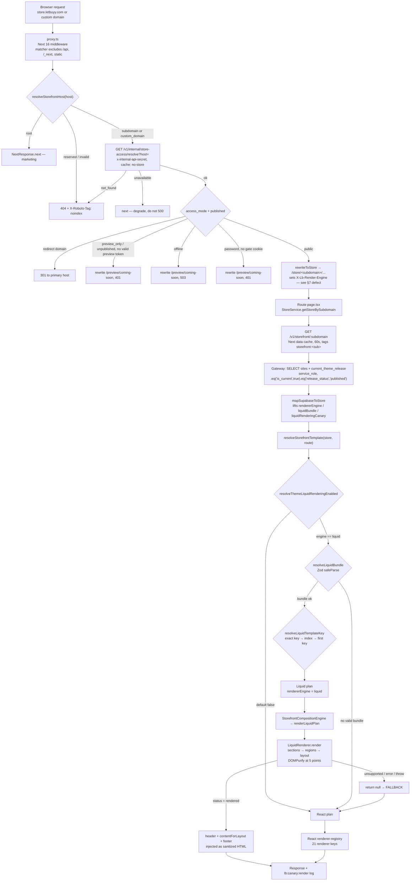

# 02 — Runtime & Route Map

> **What this is.** The physical map of the theme system: which runtimes exist, which are actually
> deployed, how a storefront request travels from a hostname to rendered HTML, which routes exist on
> each engine, how the merchant theme lifecycle reaches the database, and which flags do (and do not)
> control any of it.
>
> Governance context is in [01-governance-and-invariants.md](01-governance-and-invariants.md);
> gate/test status is in [14-test-build-governance-baseline.md](14-test-build-governance-baseline.md).

---

## Status — 2026-08-04

| | |
|---|---|
| **Proven** | The 9-target production deploy matrix; the 10 machine-enforced canonical roots; the full proxy → site-resolution → engine-selection chain with file:line for every hop; the storefront route inventory (16 store-level route directories); the merchant theme route → adapter → table map; every flag definition site and its default. |
| **Proven defects** | `FEATURE_LIQUID` gates nothing (`featureGate()` is instantiated only for `FEATURE_GRAPHQL`/`FEATURE_EXTENSIONS`). `X-Lb-Render-Engine` is derived from an env var declared nowhere in the repo, so it reports `react` for stores that render Liquid. `services/lcis-api` and 19 `packages/lcis-*` workspaces exist outside every governance list. Two gateway **GET** routes perform writes; one of them carries no auth middleware at all. |
| **Unresolved** | Whether the ARB ever decided `FEATURE_LIQUID`'s fate (wire vs. document-as-dormant) — no committed governance record exists. Whether the LCIS tree is an intentional governed tooling tier or an ARCH-R2 violation. Whether staging/production carry a *published* Liquid release (only the local DB was queried). |
| **Method** | Every claim below is anchored to `path:line`, a validator exit code, or a read-only `psql` query against `supabase_db_Letbuyy_Store`. No source file was modified. |

---

## 1. Three different counts of the same topology

`ARCH-R1` says 8. The validator library says 10. The production deploy workflow says 9. All three are
framings of the same set; none is wrong, but only one is machine-enforced.

| Framing | Count | Source | Meaning |
|---|---|---|---|
| `ARCH-R1` prose | **8** canonical runtimes + 2 "supporting surfaces" | `AGENTS.md:64-79` | The extractable runtimes; `platform-console` and `mobile/merchant-app` are described as supporting rather than canonical. |
| Machine-enforced canonical roots | **10** | `scripts/validators/governance-common.mjs:57-101`; `runtime-topology-validator` → `passed (10 canonical runtime roots and 8 topology edges checked)` | 6 app roots + 4 service roots. This is the list validators actually assert against. |
| Production deploy matrix | **9** targets | `.github/workflows/production-deploy.yml:400-409` (Vercel apps), `:331-385` (Worker `wrangler deploy --env production`); `deploy-matrix-topology-validator` → `passed (9 production deploy targets …)` | 5 Vercel Next apps + 4 Cloudflare Workers. |

**Resolution: treat `governance-common.mjs`'s 10 roots as topology truth and the 9-target matrix as
deploy truth.** `ARCH-R1`'s "8" is a narrower prose count of the same set. *(status: proven)*

### 1.1 The 10 canonical roots vs. the 9 deploy targets

| Root | Kind | Deployed? | Target | Role in the theme system |
|---|---|---|---|---|
| `apps/storefront-runtime` | Next app | ✅ | Vercel (`bom1`) | **The only renderer.** Hosts `proxy.ts` host routing, the React section registry, and the Liquid composition engine. |
| `apps/merchant-control-plane` | Next app | ✅ | Vercel (`bom1`) | Theme library, theme editor, appearance/custom-CSS workspace. |
| `apps/identity-platform` | Next app | ✅ | Vercel | Merchant ES256 issuer. No theme surface. |
| `apps/marketing-site` | Next app | ✅ | Vercel | No theme surface — but its `Header` and sitemap link to the **frozen** `themes.letbuyy.com` (`apps/marketing-site/src/lib/public-urls.ts:140-145`, `src/components/Header.tsx:75,85`). |
| `apps/platform-console` | Next app | ✅ | Vercel | Ops console. No theme surface. |
| `apps/mobile/merchant-app` | Flutter | ❌ (not in the web deploy matrix) | — | Flutter theme editor; `CANONICAL_SYSTEMS` marks both editors PROTECT. |
| `services/api-gateway` | Worker | ✅ | Cloudflare | **All theme reads and writes.** `/v1/themes/*`, `/v1/storefront/*`, `/v1/internal/store-access/*`. |
| `services/webhook-service` | Worker | ✅ | Cloudflare | No theme surface. |
| `services/queue-workers` | Worker | ✅ | Cloudflare | Cart-abandonment and outbox jobs emitted by theme publish. |
| `services/mobile-bff` | Worker | ✅ | Cloudflare | Mobile theme-editor BFF. |

`identity-platform` is labelled `services/identity-platform (app root: apps/identity-platform)` at
`AGENTS.md:73`, but **no `services/identity-platform` directory exists** — it is deployed from
`apps/identity-platform` in the Vercel matrix (`production-deploy.yml:402-403`). The `services/`
prefix is a labelling artifact; do not create that directory. *(status: proven)*

### 1.2 Frozen and reserved roots (correctly excluded)

| Root | State | Evidence |
|---|---|---|
| `apps/app-marketplace`, `apps/developer-portal`, `apps/theme-marketplace`, `apps/platform-operations-portal` | **FROZEN** — asserted absent from the production and both staging matrices; filtered out of root `build`/`lint` | `scripts/validators/deploy-matrix-topology-validator.mjs:32-64`; root `package.json` `--filter=!@letbuyy/{…}` |
| `services/{checkout-runtime,event-bus,notification-service,analytics-pipeline,media-service,search-service}` | **RESERVED** — each contains exactly `AGENTS.md` + `runtime.manifest.json` | `ls` of each root; `no-reserved-service-activation-validator.mjs` EXIT=0 |
| `apps/mobile/{shopper-app,operator-app}` | **RESERVED** — manifest-only | same |

---

## 2. The two roots that escape governance entirely

This is a real `ARCH-R2` breach ("MUST NOT add, deploy, or wire any runtime not in ARCH-R1",
`AGENTS.md:81`), and it is **invisible to the gate**.

| Escapee | What it is | Why the gate cannot see it |
|---|---|---|
| `services/lcis-api` (`@letbuyy/lcis-api`) | A real Hono service with `src/`, `test/`, `dist/`, `tsconfig.json`, and a root script `lcis:api: tsx services/lcis-api/src/server.ts` | **No `runtime.manifest.json`** and **no `AGENTS.md`**. `runtime-manifest-validator` counts only the 10 manifests that exist; a root with no manifest is simply not enumerated. It appears in neither `canonicalServiceRoots` nor `reservedServiceRoots`. |
| 19 × `packages/lcis-*` | `lcis-adapters, lcis-business, lcis-cli, lcis-core, lcis-decision, lcis-engineering, lcis-execution, lcis-governance, lcis-live, lcis-mcp, lcis-operations, lcis-orchestration, lcis-performance, lcis-pr-check, lcis-quality, lcis-rootcause, lcis-security, lcis-tracking, lcis-twin` | Declared in `pnpm-workspace.yaml` but absent from `governance-common.mjs:118-160` `workspacePackageRoots`/`domainPackageRoots`, so package-ownership and dependency validators skip them. |

Verified: `ls services/` shows `lcis-api`; `find services apps -name runtime.manifest.json` returns
21 manifests, **none** under `services/lcis-api`; `ls packages | grep -c '^lcis-'` → `19`.
*(status: proven — the breach; **unresolved** — whether the ARB intends LCIS as a governed tooling tier
or wants it relocated out of `services/` and `packages/`)*

**Theme-work consequence:** nothing here touches the render path. But any statement of the form "all
runtimes are governed" is false, and a theme PR that adds an import from an `lcis-*` package will not
be caught by the undeclared-import or dependency-graph validators.

---

## 3. The request path, end to end



**Data-layer note.** The storefront read path contains **no RPC**. Every read is a `service_role`
`SELECT` inside the gateway (`services/api-gateway/src/routes/storefront.ts:344-345`, `:665-680`).
The single RPC in the whole theme surface is `publish_theme_release` — `SECURITY DEFINER`,
`SET search_path=public`, atomic across `theme_releases` + `sites` + `theme_instances` +
`storefront_cache_tags` + `outbox_events` + `audit_activity_events` (verified via
`pg_get_functiondef`). *(status: proven)*

---

## 4. Storefront route table

All paths below are what the shopper types; `proxy.ts` rewrites them to `/store/<subdomain>/…`
before the App Router sees them (`apps/storefront-runtime/src/proxy.ts:165-178`). There are exactly
**15 route sub-directories** under `src/app/store/[subdomain]/`, plus the `[subdomain]` root itself:
`[...path], account, blog, cart, checkout, collections, customers, orders, privacy, product,
products, returns, shipping, shop, terms`
(`find "apps/storefront-runtime/src/app/store/[subdomain]" -maxdepth 1 -mindepth 1 -type d`).

`Template key` is what `resolveStorefrontTemplate` asks the Liquid bundle for. `resolveTemplateKey`
is the identity function for every route type except `index`
(`template-resolver.ts:67-70`), so account routes must pass an **explicit** `templateKey` — and they
do (`apps/storefront-runtime/src/lib/account-liquid.ts:21-48`).

| Route | Runtime | Engines | Route type | Template key | Gateway API | Session required |
|---|---|---|---|---|---|---|
| `/` | storefront-runtime | React **and** Liquid | `index` | `index` | `GET /v1/storefront/:subdomain`, `…/products` | no |
| `/shop` | storefront-runtime | React **and** Liquid | `collection` | `collection` | `…/products` | no |
| `/products` | storefront-runtime | React **and** Liquid | `collection` | `collection` | `…/products` | no |
| `/collections/[slug]` | storefront-runtime | React **and** Liquid | `collection` | `collection` | `…/collections/:slug` | no |
| `/product/[productId]` | storefront-runtime | React **and** Liquid | `product` | `product` | `…/products/:slug` | no |
| `/cart` | storefront-runtime | React **and** Liquid | `cart` | `cart` | `POST/GET/PATCH/DELETE …/cart[/:cartToken]` | no — cart is unauthenticated |
| `/checkout` | storefront-runtime | **React only** | — | — (no `checkout` key in any bundle) | `…/cart/:cartToken/checkout-url` (signed handoff) | no |
| `/checkout/success`, `/checkout/paypal-return` | storefront-runtime | **React only** | — | — | order APIs | no |
| `/blog` | storefront-runtime | React **and** Liquid | `blog` | `blog` | `…/blog` | no |
| `/blog/[slug]` | storefront-runtime | React **and** Liquid | `article` | `article` | `…/blog/:slug` | no |
| `/privacy`, `/terms`, `/shipping`, `/returns` | storefront-runtime | React **and** Liquid | `policy` | `policy` | `…/policies/:policyType` | no |
| `/[slug]` (single segment only) | storefront-runtime | React **and** Liquid | `page` | `resource.assignedTemplateKey` ?? `page` | `…/pages/:slug` | no |
| `/customers/login` | storefront-runtime | React **and** Liquid | `customer_account` | **`customers/login`** (explicit) | `POST /api/customer/login` (BFF) | no |
| `/orders` | storefront-runtime | **React only** | — | — | `POST /api/orders/login` → gateway `POST /customer/order-credential/login` | no — guest order lookup |
| `/account` | storefront-runtime | React **and** Liquid | `customer_account` | **`customers/account`** | `/api/customer/profile` | **yes** (`lb_customer_session`) |
| `/account/orders` | storefront-runtime | React **and** Liquid | `customer_orders` | **`customers/orders`** | `/api/customer/orders` | **yes** |
| `/account/orders/[id]` | storefront-runtime | **Liquid only** (React redirects to the list) | `customer_order` | **`customers/order`** | `/api/customer/orders` | **yes** |
| `/account/addresses` | storefront-runtime | React **and** Liquid | `customer_addresses` | **`customers/addresses`** | `/api/customer/addresses` | **yes** |
| `/account/settings` | storefront-runtime | React **and** Liquid | `customer_settings` | **`customers/settings`** | `/api/customer/profile` | **yes** |
| `/account/wishlist` | storefront-runtime | React **and** Liquid | `customer_wishlist` | **`customers/wishlist`** | `/api/customer/wishlist` | **yes** |
| `/preview/coming-soon` | storefront-runtime | **React only** | — | — (Liquid `password` template unreachable) | `POST /store-access/password` → `POST /v1/internal/store-access/verify` | no |
| 404 boundary | storefront-runtime | **React only** — `not-found.tsx` delegates to the root 404 because Next does not pass `params` | `not_found` | `not_found` (unreachable in prod) | — | no |

**Routes that do not exist at all** — the Liquid bundle ships templates/sections for several of these:

| Missing route | Consequence | Evidence |
|---|---|---|
| `/search` | `search-box.liquid` and `<lb-search>` both navigate to `/search`; the bundle ships a `search` template. There is no page. | `sections/search-box.liquid:2`, `sections/header.liquid:4`; no `search/page.tsx` |
| `/collections` (index) | `list-collections` has no template in either engine and no route. | `ls …/collections` → only `[slug]` |
| `/customers/register` | `POST /api/customer/register` **redirects to `/customers/register`**, which 404s. The `customers/register` template and `customer-register.liquid` are unreachable. | `apps/storefront-runtime/src/app/api/customer/register/route.ts:22`; `[...path]/page.tsx:43` rejects multi-segment paths |
| `/contact` | Both Liquid contact and newsletter forms `POST /contact`. A working gateway endpoint exists (`POST /v1/storefront/:subdomain/contact`) and nothing calls it. | `sections/contact-form.liquid`; `public-routes.ts:1307-1318` |
| password reset / account activation | `TEMPLATE_TYPE_REGISTRY` declares `customers/reset_password` and `customers/activate_account` as "NOT YET IN BUNDLE"; `StorefrontRouteType` has no member for either. | `template-registry.ts:316-343`; `lib/theme-engine/types.ts:5-22` |

*(status: proven)*

---

## 5. Merchant theme lifecycle route table

Merchant UI → Next API proxy (`apps/merchant-control-plane/src/app/api/themes/**`) → `@letbuyy/api-client`
→ gateway `/v1/themes/*` → `ThemeExecutionAdapter` → tables. Every app-side route is a thin proxy;
none touches Supabase directly (that is the `domain-boundary-validator` rule, not `route-ownership-validator`
— see `scripts/validators/domain-boundary-validator.mjs:176-244`).

| Merchant UI page | Next API proxy | Gateway route | Adapter function | Tables written |
|---|---|---|---|---|
| `[store]/online-store/themes` (catalog) | `GET /api/themes?store_name=` | `GET /v1/themes` | inline `SELECT` | none (read) |
| `…/themes` → **Install** click | `POST /api/themes/install` | `POST /v1/themes/:slug/install` | `installTheme` | `store_themes`, `theme_packages`, `theme_package_versions`, `theme_schema_manifests`, `theme_renderer_manifests`, `theme_instances`, `theme_releases`, `sites` |
| `…/themes` → **Publish** click | `POST /api/themes/publish` | `POST /v1/themes/:slug/publish` | `publish` → **RPC `publish_theme_release`** | `theme_releases`, `sites`, `theme_instances`, `theme_instance_drafts`, `storefront_cache_tags`, `outbox_events`, `audit_activity_events` |
| `…/themes/[themeId]/editor` (load) | `GET /api/themes/[themeId]/editor` | `GET /v1/themes/:slug/editor` | `loadEditor` → `ensureThemeInstance` | ⚠️ **`theme_instances` (a GET that writes)** |
| editor — section schema panel | `GET /api/themes/[themeId]/sections` | `GET /v1/themes/:slug/schema` | `getEditableSchema` → `ensureThemePackageRuntime` | ⚠️ **`theme_packages`, `theme_package_versions`, `theme_schema_manifests`, `theme_renderer_manifests` — a GET that writes, with no auth middleware** |
| editor — autosave | `POST /api/themes/[themeId]/editor/draft` | `PUT /v1/themes/:slug/editor/draft` | `saveDraft` | `theme_editor_drafts`, `theme_instance_drafts`, `theme_draft_patches`, `theme_instances` |
| editor — discard draft | `DELETE /api/themes/[themeId]/editor/draft` | `DELETE /v1/themes/:slug/editor/draft` | `deleteDraft` | `theme_editor_drafts` |
| editor — live preview | `POST /api/themes/[themeId]/preview-session` | `POST /v1/themes/:slug/preview-session` | `createPreviewSession` | `theme_preview_sessions` |
| editor — version history | `GET /api/themes/[themeId]/releases` | `GET /v1/themes/:slug/releases` | `listReleases` | none (read) |
| version history → **Rollback** | `POST /api/themes/[themeId]/releases/[releaseId]/rollback` | `POST /v1/themes/:slug/releases/:id/rollback` | `rollbackRelease` | `theme_releases`, `sites` |
| theme library | `GET /api/themes/library` | `GET /v1/themes/library` | `listSiteThemes` | none (read) |
| library → **Create** | `POST /api/themes/library/create` | `POST /v1/themes/library/create` | `createSiteTheme` → `provisionSiteThemePackage` | `themes`, `theme_packages` (`status:'draft'`), `theme_package_versions` |
| library → **Duplicate** | `POST /api/themes/[themeId]/duplicate` | `POST /v1/themes/:slug/duplicate` | `duplicateSiteTheme` | `themes`, `theme_packages`, `theme_package_versions` |
| library → **Rename** | `PATCH /api/themes/[themeId]/rename` | `PATCH /v1/themes/:slug/rename` | `renameSiteTheme` | `themes` |
| library → **Archive** | `POST /api/themes/[themeId]/archive` | `POST /v1/themes/:slug/archive` | `archiveSiteTheme` | `theme_instances` (`instance_status='archived'`) |
| library → **Delete unpublished** | `DELETE /api/themes/[themeId]` | `DELETE /v1/themes/:slug/unpublished` | `deleteUnpublishedSiteTheme` | `theme_instances` (soft-delete) |
| `…/themes/update` | `GET/POST /api/themes/[themeId]/update[-preview]` | `GET/POST /v1/themes/:slug/update[-preview]` | `publishVersionUpdateRelease` | `theme_releases`, `sites` |
| `[store]/appearance` (custom CSS) | `PUT /api/stores/[store]/settings` | — (app-local, engine validator) | — | `sites.site_settings.custom_css` |

Route→adapter map evidence: `services/api-gateway/src/routes/themes.ts:422,518-543,545,564,601-607,609,630,634,648,673,689,703,727,744,1111,1137,1188,1244,1272,1308,1351,1366,1402`;
`services/api-gateway/src/execution/theme-execution.adapter.ts` (single 102 KB `ThemeExecutionAdapter` class).
API-client path table: `packages/typescript/api-client/src/index.ts:5214-5309`. *(status: proven)*

### 5.1 Two structural defects in this lifecycle

| Defect | Evidence | Impact |
|---|---|---|
| **`GET /v1/themes/:slug/schema` has no `authMiddleware` registration and takes no `store_id`.** It reaches `ensureThemePackageRuntime`, which upserts `theme_packages` with `status:'active'` and `theme_package_versions` with `release_status:'published'` — and those exact predicates are what the PUBLIC read policies expose. | `services/api-gateway/src/routes/themes.ts:67-101` (middleware list — `/:slug/schema` absent) vs `:601-607`; `schema-registry-execution.adapter.ts:509,532`; `psql pg_policies` → `theme_packages_public_read qual ((status='active') AND deleted_at IS NULL)` | An unauthenticated caller can create anon-readable catalog rows. Contrast the Phase Q path, which deliberately forces `status:'draft'` (`theme-execution.adapter.ts:1815-1831`). |
| **`installTheme` is not transactional and writes `store_themes` before it validates anything.** It demotes every `store_themes` row, upserts the target as `is_active:true`, and *only then* calls `validateTemplateConfig`, `ensureThemeInstance`, `publishReleaseSnapshot`. `store_themes` also has **no** partial unique index on active state. | `theme-execution.adapter.ts:889-942`; the only `db.rpc` in the file is `publish_theme_release` at `:712`; `psql pg_index` on `store_themes` → `pkey`, `UNIQUE (store_id, theme_id)`, non-unique `(store_id, is_active)` | Any later failure permanently orphans the activation, and two active `store_themes` rows are structurally possible. `theme_instances` and `theme_releases` *do* have DB-enforced one-active/one-current partial unique indexes; `store_themes` does not. |

*(status: proven)*

---

## 6. Where site and theme resolution actually reads from

| Question | Answer | Evidence |
|---|---|---|
| What does the storefront read? | `sites.template_config` plus a **joined** `current_theme_release` | `services/api-gateway/src/routes/storefront.ts:344-345` (`STOREFRONT_SITE_SELECT` includes `template_config`) |
| When is a release attached? | Only when `is_current = true` **AND** `release_status = 'published'` | `storefront.ts:665-680`, `:838-846` |
| Does the render path read `store_themes`? | **No.** | `store_themes` feeds only the installed/active badge in `GET /v1/themes` (`themes.ts:518-543`) |
| Does the render path read `theme_instances`? | **No.** | `loadCurrentThemeRelease` reads `theme_releases` only |
| What happens when no release qualifies? | Falls back to `sites.theme_id` / `sites.template_config` — which is itself Liquid on the live local site | `apps/storefront-runtime/src/lib/store-service.ts:557` |

**Live local state (read-only `psql`, 2026-08-04):** the single site `saai` has
`template_config->>'rendererEngine' = 'liquid'` and a `liquidBundle`; the one `theme_releases` row is
`is_current = true` **but** `release_status = 'superseded'`, so **no release qualifies** and the store
renders from `sites.template_config`. `sites.current_theme_release_id` is `NULL` while
`storefront_release_version = 2`. *(status: proven — this DB is internally inconsistent; see
[05-rendering-pipeline.md](05-rendering-pipeline.md) §7 for the render consequence)*

---

## 7. Every flag that touches theme or Liquid

| Flag / switch | Defined at | Default | Scope | Does it actually gate anything? |
|---|---|---|---|---|
| **`templateConfig.rendererEngine === 'liquid'`** | written by `schema-registry-execution.adapter.ts:173`; read by `theme-governance.ts:154-160` | none — presence *is* the signal | **per store** | ✅ **YES — this is the real switch.** Returns `true` immediately, before any canary check or default. |
| **`release_manifest.renderer_engine === 'liquid'`** | written by `theme-execution.adapter.ts:645-650,669` for **any** release whose config carries a Liquid bundle | none | **per release** | ✅ **YES.** Same short-circuit. No human canary opt-in is required to reach it. |
| `THEME_LIQUID_RENDERING_DEFAULT_ENABLED` (**TypeScript constant**) | `packages/theme-engine/src/theme-governance.ts:14` | `false` | compile-time, **all environments identically** | ✅ Yes, but only as the terminal fallback — reached only when no explicit engine and no canary boolean is present. |
| `liquidRenderingCanary` + 10 sibling keys | `theme-governance.ts:162-181`; coercion at `:125-142` (accepts `1/true/enabled/on/canary` and `0/false/disabled/off`, and objects with `enabled\|liquid_enabled\|liquidEnabled\|canary\|value`) | absent → skipped | per store / theme / release | ✅ Yes when explicitly present. An explicit `false` forces React. `store-service.ts:676-680` deliberately emits `undefined` (never `false`) when absent. |
| `?engine=liquid\|react` | `template-resolver.ts:228-233`; wired at `app/store/[subdomain]/page.tsx:49` | off | dev/preview only | ⚠️ Partly — hard-disabled when `NODE_ENV === 'production'`, and **only the index route wires it**. `?engine=` is ignored on product/collection/cart even in dev. |
| **`FEATURE_LIQUID`** (gateway) | `services/api-gateway/src/middleware/featureFlags.ts:4`; `index.ts:259`; `wrangler.toml:41` `"true"` (dev), `:132` `"true"` (staging), `:248` `"false"` (production) | see left | Worker env | ❌ **NO — decorative.** See §7.1. |
| **`process.env.THEME_LIQUID_RENDERING_DEFAULT_ENABLED`** (env var) | read at `apps/storefront-runtime/src/proxy.ts:175` **only** | undefined everywhere | response header only | ❌ **NO — and it lies.** See §7.2. |
| `THEME_RENDERER_GOVERNANCE_DEFAULT_MODE` | `theme-governance.ts:13` | `'warn'` | engine-wide | ⚠️ Advisory. Renderer-registry audit issues warn, they do not block. Pinned by `theme-governance-validator.mjs:57-99`. |
| `THEME_LIQUID_PLATFORM_WIDE_FLIP_DECISION.status` | `theme-governance.ts:15-21` | `'deferred'`, `authority: 'ARB'` | governance record | ✅ As a *gate constant* — `theme-governance-validator.mjs:63-65` fails the build if the status changes. It does not gate rendering. |
| `operational_feature_flags` table | migration-defined; columns `flag_key, environment, site_id, enabled, kill_switch, rules, rollout_policy` | — | DB | ❌ **0 rows.** No DB-driven flag governs Liquid. *(psql `SELECT * FROM operational_feature_flags LIMIT 20` → 0 rows)* |
| `FEATURE_GRAPHQL`, `FEATURE_EXTENSIONS` | `index.ts:689-698` | env | Worker env | ✅ The **only** two flags with a `featureGate()` instantiation. Neither is theme-related. |

### 7.1 `FEATURE_LIQUID` is a fake kill switch — P0

```
services/api-gateway/src/middleware/featureFlags.ts:4
export type GatewayFeatureFlag = 'FEATURE_GRAPHQL' | 'FEATURE_EXTENSIONS' | 'FEATURE_LIQUID';
```

The type includes it. `Env` includes it (`index.ts:259`). `wrangler.toml` sets it per environment.
But `featureGate()` is instantiated **only** for `FEATURE_GRAPHQL` and `FEATURE_EXTENSIONS`
(`index.ts:689-698`), and `/themes` is mounted with no gate and no environment condition
(`index.ts:55` import, `:726` `api.route('/themes', themesRouter)`). A repo-wide
`rg "featureGate\("` returns exactly those two call sites.

Meanwhile `docs/governance/feature-flag-governance.md:20` documents `FEATURE_LIQUID` as controlling
"Liquid theme bundle upload/rendering and Liquid-backed storefront composition", with an operational
runbook for flipping it.

**Resolution: CODE WINS.** `FEATURE_LIQUID` has zero runtime effect. Production's `"false"` does not
disable Liquid — renderer selection happens entirely storefront-side, per theme. **Do not use
`FEATURE_LIQUID` as a kill switch or rollback lever.** The actual rollback lever, per `THEME-R6`, is
the per-theme `renderer.engine` switch. *(status: proven; the governance doc is **stale-doc**)*

### 7.2 `X-Lb-Render-Engine` reads an undeclared env var and reports the wrong engine — P1

```
apps/storefront-runtime/src/proxy.ts:175
const renderEngine = process.env.THEME_LIQUID_RENDERING_DEFAULT_ENABLED === 'true' ? 'liquid' : 'react';
```

Two distinct mechanisms share this name:

| | Authoritative TS constant | Phantom env var |
|---|---|---|
| Location | `packages/theme-engine/src/theme-governance.ts:14` | `apps/storefront-runtime/src/proxy.ts:175` |
| Value | `false` (compiled in) | **undefined** — `rg` over `config/`, `infrastructure/`, `.github/`, `vercel.json`, `.env.local` finds **no declaration anywhere** |
| Effect | terminal default in the render decision | sets one response header |

Because an explicit `rendererEngine: 'liquid'` flips a store regardless of the env var, and the env
var is never set, **the header reports `react` for every store that actually renders Liquid.** Any
CDN bucketing, canary dashboard, or incident-triage query built on `X-Lb-Render-Engine` is wrong by
construction. The truthful signal is the per-request `lb:canary:render` structured log
(`composition-engine.tsx:660-678`), which reports the engine that actually rendered.
*(status: proven)*

---

## 8. Defect summary for this document

| # | Severity | Defect | Anchor |
|---|---|---|---|
| R-1 | **P0** | `FEATURE_LIQUID` gates nothing; the governance doc says it does. Every runbook naming it as a rollback lever is wrong. | §7.1 |
| R-2 | **P0** | `GET /v1/themes/:slug/schema` has no auth middleware and writes anon-readable catalog rows. | §5.1 |
| R-3 | **P0** | `installTheme` writes `store_themes` before validation, is not transactional, and `store_themes` has no one-active DB constraint. | §5.1 |
| R-4 | **P1** | `X-Lb-Render-Engine` derives from an env var that is declared nowhere; it reports `react` for Liquid pages. | §7.2 |
| R-5 | **P1** | `GET /v1/themes/:slug/editor` mutates `theme_instances` — it calls `ensureThemeInstance(…, activate: store.theme_id === slug)` (`themes.ts:609,630`; `theme-execution.adapter.ts:1152-1159`), so when the requested slug **is** the store's current theme the GET deactivates every other instance for the site (`theme-execution.adapter.ts:378-389`). | §5 |
| R-6 | **P1** | `services/lcis-api` + 19 `packages/lcis-*` are outside every governance list — an ARCH-R2 breach the gate cannot detect. | §2 |
| R-7 | **P2** | Five shopper routes referenced by shipped Liquid markup do not exist: `/search`, `/collections`, `/customers/register`, `/contact`, password-reset. | §4 |
| R-8 | **P2** | `apps/marketing-site` publicly links to `themes.letbuyy.com`, a frozen, de-deployed app. | §1.1 |

---

## 9. Open questions

1. **Has the ARB ever recorded the `FEATURE_LIQUID` decision** — wire it as a real kill switch, or
   document it as intentionally dormant? No committed governance document records a decision; only
   repeated "ARB decision required" entries in the phase-j and phase-ad packages.
   *(status: unresolved)*
2. **Is the LCIS tree a governed tooling tier or an ARCH-R2 violation to be relocated?** Needs an
   explicit ARB call. *(status: unresolved)*
3. **Do staging and production carry a *published* Liquid release?** Only the local DB was queried,
   and its only release is `superseded`. `CANARY_READINESS_ARB_PACKAGE.md` §5 Stage 0 makes
   production apply-state of migration 188 a hard prerequisite, and no repo artifact records it.
   *(status: unresolved)*
4. **What is the correct app-API route inventory to re-pin `domain-boundary-validator` to?** It pins
   129 and finds 188, with three unclassified founding/marketing routes. Re-pinning without review
   would launder 59 unreviewed routes. *(status: unresolved)*
