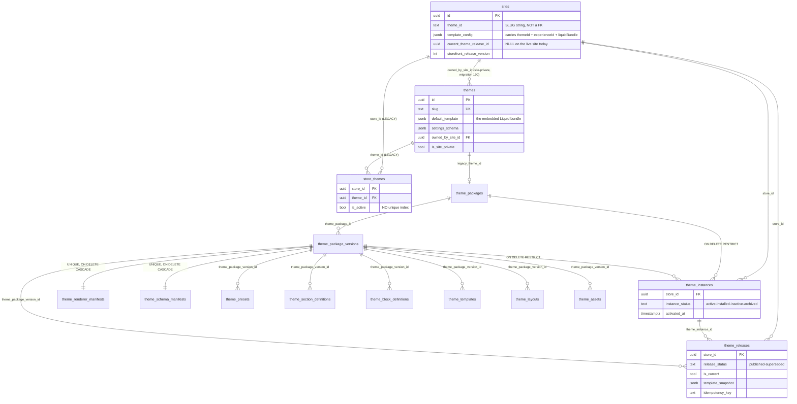

# 03 — The Theme Data Model, As It Actually Exists

> Companion documents: [01-governance-and-invariants.md](01-governance-and-invariants.md) (the law),
> [04-theme-installation-lifecycle.md](04-theme-installation-lifecycle.md) (who writes these tables),
> [07-letbuyy-core-current-state.md](07-letbuyy-core-current-state.md) (what the two catalog rows contain),
> [13-security-and-tenant-isolation.md](13-security-and-tenant-isolation.md) (RLS analysis),
> [14-test-build-governance-baseline.md](14-test-build-governance-baseline.md) (what CI does and does not check).

---

## Status — 2026-08-04

| | |
|---|---|
| **Proven** | The 32-table inventory, every RLS `ENABLE`/`FORCE` flag, every policy predicate, every partial unique index, the contents of migrations 180–193, the rollback-file inventory, and the live row state for site `3f89077b-5b74-426f-825b-c88b85b33fbe` — all read directly from the running local Postgres (`docker exec supabase_db_Letbuyy_Store psql`) and from the migration source files. |
| **Inferred** | That the 13:30:32 mutation of that site's theme rows was executed as raw out-of-band SQL. The inference is strong (see §6.2) but the actor is unknown. |
| **Stale-doc** | Migration `190`'s own header asserts that policies `themes_service_all` and `themes_public_active_read` gate the `themes` table. Neither exists. The DB wins. |
| **Unresolved** | Which environments have migrations 180–193 applied (there is no `schema_migrations` ledger in this database); what executed the 13:30:32 write; whether `store_themes` is meant to be retired or kept as a mirror. |
| **Verification-substrate warning** | **During this document's verification pass the local database was concurrently reset by another process.** A `SELECT count(*) FROM themes` that returned `2` at ~17:10Z returned `ERROR: relation "themes" does not exist` at 17:26:08Z, with `SELECT count(*) FROM pg_tables WHERE schemaname='public'` falling from **414** to **17**, then climbing to **30** as migrations replayed. Every live-DB value in this document was captured *before* that reset. Treat the local DB as an unstable substrate (§6.3). |

---

## 1. The shape of the problem in one paragraph

There are **32 theme tables**. They encode **two competing models of a theme** and **three competing
answers to "which theme is this store using?"**. The legacy pair `themes` + `store_themes` is what the
install path writes first; the canonical registry `theme_packages → theme_package_versions →
{theme_schema_manifests, theme_renderer_manifests, …} → theme_instances → theme_releases` is what the
editor and publish path write; and the storefront render path reads **neither** `store_themes` **nor**
`theme_instances` — it reads `theme_releases` and falls back to `sites.theme_id` /
`sites.template_config`. This is a textbook `R-15` / `WIN-R4` / `ANTI-R1` violation, and it is not
theoretical: the one live site in this database currently disagrees with itself three ways (§4).

---

## 2. All 32 theme tables

Row counts are the live counts captured before the reset. `RLS F?` = `pg_class.relforcerowsecurity`.
Evidence for the whole table: `psql pg_class` / `pg_policies` / `pg_attribute` scans over
`relname LIKE '%theme%' OR relname IN ('store_themes','themes')`, `relkind='r'`, schema `public`.

| # | Table | Rows | Purpose | Key columns | Tenant col | RLS E? | RLS F? | Policies (live) | Verdict |
|---|---|---:|---|---|---|:---:|:---:|---|---|
| 1 | `themes` | 2 | Legacy catalog row; still the **source of `default_template`** (the embedded Liquid bundle) and of `settings_schema` | `slug`, `default_template`, `settings_schema`, `section_schemas`, `renderer_manifest`, `config` | `owned_by_site_id` | ✅ | ❌ | **1** — `Themes are viewable by everyone` `FOR SELECT TO PUBLIC USING (true)` | **LEGACY but load-bearing** |
| 2 | `store_themes` | 2 | Legacy per-store install record | `store_id`, `theme_id`, `is_active`, `config_overrides` | `store_id` | ✅ | ✅ | 4 owner policies (`user_id OR custom_user_id`) + `app_tenant_guc_*` | **LEGACY / vestigial** |
| 3 | `theme_packages` | 2 | Canonical package identity | `slug`, `status`, `legacy_theme_id` | — | ✅ | ❌ | `theme_packages_public_read` `USING (status='active' AND deleted_at IS NULL)` | CANONICAL |
| 4 | `theme_package_versions` | 2 | Canonical immutable version | `theme_package_id`, `version`, `release_status`, `package_manifest`, `checksum` | — | ✅ | ❌ | `theme_package_versions_public_read` `USING (release_status='published' AND deleted_at IS NULL)` | CANONICAL |
| 5 | `theme_schema_manifests` | 2 | The **operative** settings/section/block schema for validation | `theme_package_version_id` (UNIQUE), `settings_schema`, `section_schemas`, `block_schemas` | — | ✅ | ❌ | `theme_schema_manifests_public_read` (EXISTS on a published version) | CANONICAL |
| 6 | `theme_renderer_manifests` | 2 | Renderer key map + approved renderer keys + perf budget | `theme_package_version_id` (UNIQUE), `renderer_manifest`, `approved_renderer_keys` | — | ✅ | ❌ | `theme_renderer_manifests_public_read` (EXISTS on a published version) | CANONICAL |
| 7 | `theme_instances` | 1 | **Canonical per-store installation** | `store_id`, `theme_package_id`, `theme_package_version_id`, `instance_status`, `activated_at`, `active_release_id` | `store_id` | ✅ | ✅ | owner-manage (`user_id OR custom_user_id`), `theme_instances_public_active_read`, `app_tenant_guc_*` | CANONICAL |
| 8 | `theme_releases` | 1 | **Canonical published snapshot** — what the storefront renders | `store_id`, `theme_id`, `release_version`, `release_status`, `is_current`, `template_snapshot`, `settings_snapshot`, `idempotency_key` | `store_id` | ✅ | ✅ | owner-read, `theme_releases_public_current_read` (`is_current AND published`), `service_all`, `app_tenant_guc_*` | CANONICAL |
| 9 | `theme_editor_drafts` | 1 | Per-template editor draft (the older draft spine) | `store_id`, `theme_slug`, `template_key`, `draft_config`, `version` | `store_id` | ✅ | ✅ | 4 owner policies — **`sites.user_id` only, no `custom_user_id`** | TRANSITIONAL (`THEME-R3`: shim → drop) |
| 10 | `theme_instance_drafts` | 0 | Instance-scoped draft (the canonical draft spine) | `store_id`, `created_by`, `locked_by`, `updated_by` | `store_id` | ✅ | ✅ | owner-manage + `app_tenant_guc_*` | CANONICAL |
| 11 | `theme_draft_patches` | 0 | Draft patch log | `store_id`, `actor_id` | `store_id` | ✅ | ✅ | owner-manage + `app_tenant_guc_*` | CANONICAL |
| 12 | `theme_preview_sessions` | 0 | Signed preview tokens | `store_id` | `store_id` | ✅ | ✅ | owner-manage (**`user_id` only**), `service_all`, `app_tenant_guc_*` | CANONICAL |
| 13 | `theme_template_assignments` | 0 | Per-store template → resource binding | `store_id` | `store_id` | ✅ | ✅ | owner-manage + `app_tenant_guc_*` | CANONICAL |
| 14 | `theme_section_definitions` | 19 | Package section schemas + renderer keys + presets | `theme_package_version_id`, `section_key`, `renderer_key` | — | ✅ | ❌ | `*_public_read USING (deleted_at IS NULL)` | CANONICAL (global catalog) |
| 15 | `theme_block_definitions` | 8 | Package block schemas | `theme_package_version_id`, `block_key` | — | ✅ | ❌ | `*_public_read USING (deleted_at IS NULL)` | CANONICAL (global catalog) |
| 16 | `theme_templates` | 11 | Package template JSON | `theme_package_version_id`, template key | — | ✅ | ❌ | `*_public_read USING (deleted_at IS NULL)` | CANONICAL (global catalog) |
| 17 | `theme_layouts` | 1 | Package layout source | `theme_package_version_id` | — | ✅ | ❌ | `*_public_read USING (deleted_at IS NULL)` | CANONICAL (global catalog) |
| 18 | `theme_assets` | 0 | Package static assets | `theme_package_version_id` | — | ✅ | ❌ | `*_public_read USING (deleted_at IS NULL)` | CANONICAL (**empty**) |
| 19 | `theme_presets` | 1 | Package-scoped preset rows | `theme_package_version_id`, `preset_key`, `preset_config` | — | ✅ | ❌ | `theme_presets_public_read USING (deleted_at IS NULL)` | **DEAD** — 1 row (`default` / "Urban Kicks Default"), **zero application readers**; the real preset registry is `EXPERIENCE_REGISTRY` in `packages/theme-engine/src/theme-presets.ts:387-398` (10 Experiences) |
| 20 | `theme_migrations` | 0 | Theme schema-migration runner ledger | `created_by` | — | ✅ | ❌ | `*_service_all` (`auth.role()='service_role'`) | CANONICAL (unused) |
| 21 | `theme_purchases` | 0 | Marketplace purchase record | `user_id`, `theme_id`, `status` | `user_id` | ✅ | ❌ | `tp_service_role TO service_role`, `tp_authenticated_select/insert TO authenticated USING (user_id = auth.uid())` — **correctly scoped by migration 191** | FROZEN (marketplace) |
| 22 | `theme_purchase_receipts` | 0 | Purchase receipts | — | — | ✅ | ❌ | `*_service_all` | FROZEN |
| 23 | `theme_refund_requests` | 0 | Marketplace refunds | `user_id` | `user_id` | ✅ | ❌ | `*_service_all` | FROZEN |
| 24 | `theme_reviews` | 0 | Marketplace reviews | `user_id`, `status` | `user_id` | ✅ | ❌ | `Public can read published theme reviews USING (status='published')`, `Users manage own theme reviews USING (user_id = auth.uid())` | FROZEN |
| 25 | `theme_reports` | 0 | Abuse reports | — | — | ✅ | ❌ | `*_service_all` | FROZEN |
| 26 | `theme_saved_searches` | 0 | Saved marketplace searches | `user_id` | `user_id` | ✅ | ❌ | `*_service_all` | FROZEN |
| 27 | `theme_marketplace_settings` | 0 | Per-user marketplace prefs | `user_id` | `user_id` | ✅ | ❌ | `*_service_all` | FROZEN |
| 28 | `theme_collections` | 0 | Curated marketplace collections | `is_published` | — | ✅ | ❌ | `*_public_read USING (is_published AND deleted_at IS NULL)`, `*_service_all` | FROZEN |
| 29 | `theme_collection_items` | 0 | Collection membership | — | — | ✅ | ❌ | `*_public_read`, `*_service_all` | FROZEN |
| 30 | `theme_developer_listings` | 0 | Developer-portal listings | — | — | ✅ | ❌ | `*_service_all` | FROZEN |
| 31 | `theme_developer_payout_accounts` | 0 | Developer payouts | — | — | ✅ | ❌ | `*_service_all` | FROZEN |
| 32 | `theme_download_artifacts` | 0 | Downloadable theme zips | — | — | ✅ | ❌ | `*_public_metadata_read`, `*_service_all` | FROZEN |

### 2.1 What the inventory proves

| Claim | Status | Evidence |
|---|:---:|---|
| All 32 tables have RLS **ENABLED** | proven | `pg_class.relrowsecurity = true` for all 32 |
| Only **8** have RLS **FORCED** | proven | `relforcerowsecurity = true` for `store_themes`, `theme_draft_patches`, `theme_editor_drafts`, `theme_instance_drafts`, `theme_instances`, `theme_preview_sessions`, `theme_releases`, `theme_template_assignments` |
| 24 tables are ENABLE-only → **`ART-08` / Constitution `R-1` gap** | proven | includes `themes`, `theme_packages`, `theme_package_versions`, `theme_schema_manifests`, `theme_renderer_manifests`, `theme_purchases`, `theme_reviews` |
| Exactly **one** `USING(true)`-to-`PUBLIC` policy remains | proven | `pg_policies` → `themes` \| `Themes are viewable by everyone` \| `{public}` \| `SELECT` \| `qual = true` |
| That policy now covers **tenant data** | proven | migration `190_theme_library_q.sql:41-60` added `themes.owned_by_site_id` + `themes.is_site_private`; `theme-execution.adapter.ts:1944-1954` and `:2071-2081` insert site-private rows with `is_site_private: true` |
| Only **14 of 32** tables carry any tenant column | proven | `pg_attribute` scan for `store_id`/`site_id`/`owned_by_site_id`/`user_id`/`developer_id` |
| `theme_editor_drafts` RLS omits `custom_user_id` | proven | its 4 owner policies reference only `sites.user_id`; every sibling (`theme_instances`, `theme_instance_drafts`, `theme_draft_patches`, `theme_template_assignments`, `store_themes`) uses `(user_id = auth.uid() OR custom_user_id = auth.uid())` |

> **`ART-09` / Constitution `R-3` (`:394`) reads "No policy MUST be `USING(true)` to PUBLIC/anon/authenticated".**
> The `themes` policy is exactly that pattern, on a table that migration 190 turned into a tenant table.
> Full analysis in [13-security-and-tenant-isolation.md](13-security-and-tenant-isolation.md); do not change an RLS
> surface without ARB.

---

## 3. The canonical chain (and the legacy pair beside it)



Read the diagram this way: **the right-hand column is what a theme *is*; the left-hand column is what a
store *has*.** `themes`/`store_themes` are the legacy answer to both questions and are still wired into
the install path ([04-theme-installation-lifecycle.md](04-theme-installation-lifecycle.md) §3).

---

## 4. HEADLINE FINDING — three disagreeing representations of "which theme is active"

There is no single active-theme field. There are three, they are written by different code paths, and on
the one live site in this database **they disagree with each other**.

### 4.1 The three representations

| # | Representation | Written by | Read by | DB guarantee |
|---|---|---|---|---|
| **A** | `store_themes.is_active` | `installTheme` **only** (`theme-execution.adapter.ts:889-908`) | the installed/active **badge** in `GET /v1/themes` (`routes/themes.ts:518-530`) and a marketplace listing (`theme-marketplace-auxiliary-routes.ts:422`) | **none** |
| **B** | `theme_instances.instance_status = 'active'` | `ensureThemeInstance` (install, **editor GET**, draft save), `finalizeInstanceRelease`, `publish_theme_release` | the editor payload; nothing on the storefront | `idx_theme_instances_one_active` |
| **C** | `sites.theme_id` + `theme_releases.is_current AND release_status='published'` | `publish_theme_release` RPC; `publishReleaseSnapshot(Fallback)` | **the storefront** — `loadCurrentThemeRelease` (`routes/storefront.ts:832-846`) then `store-service.ts:557` | `idx_theme_releases_one_current` |

### 4.2 Which one the storefront actually reads — **C**

```ts
// services/api-gateway/src/routes/storefront.ts:838-846  (loadCurrentThemeRelease)
.from('theme_releases')
.eq('store_id', storeId)
.eq('is_current', true)
.eq('release_status', 'published')
```

```ts
// apps/storefront-runtime/src/lib/store-service.ts:557
const themeId = release?.theme_id || (data.theme_id as string) || (rawTemplateConfig.themeId as string) || 'urban-kicks';
```

Status: **proven**. The storefront render path reads `theme_releases`, then falls back to
`sites.theme_id`, then `sites.template_config.themeId`, then the hardcoded literal `'urban-kicks'`. It
**never** queries `store_themes` or `theme_instances`.

Therefore:

- **A (`store_themes.is_active`) is decorative.** It changes a badge in the merchant catalog and nothing else.
- **B (`theme_instances.instance_status`) is editor/publish bookkeeping.** It selects the instance a publish attaches to; it does not decide what a shopper sees.
- **C is authoritative for rendering** — and its two halves (`sites.theme_id` and the current release) can themselves disagree, as they do today.

### 4.3 The live proof — site `3f89077b-5b74-426f-825b-c88b85b33fbe` (`saai`)

Captured 2026-08-04 from `supabase_db_Letbuyy_Store`, before the reset:

```
store_themes:
  letbuyy-core | is_active = t | installed 2026-08-03 13:27:24.74  | updated 13:27:24.74
  urban-kicks  | is_active = f | installed 2026-08-03 13:23:20.114 | updated 13:23:20.115

theme_instances:
  5158a740-70c2-4961-837c-6c9de8c29696 | urban-kicks | active | activated_at = NULL | updated 13:30:32.459926

theme_releases:
  af47e35c-f42b-496c-94bc-bda1d6e06934 | urban-kicks | v1 | superseded | is_current = t | updated 13:30:32.460317

sites:
  subdomain=saai | theme_id='urban-kicks' | current_theme_release_id = NULL |
  storefront_release_version = 2 | published_at = 13:27:24.784507 |
  template_config->>'themeId' = 'letbuyy-core' | template_config->>'experienceId' = 'forge'
```

| Question | Answer given by | Value |
|---|---|---|
| Which theme is active? | `store_themes` (**A**) | **letbuyy-core** |
| Which theme is active? | `theme_instances` (**B**) | **urban-kicks** |
| Which theme is active? | `sites.theme_id` (**C**, fallback half) | **urban-kicks** |
| Which theme is active? | `sites.template_config.themeId` (**C**, snapshot half) | **letbuyy-core** |
| Which release renders? | `theme_releases` (**C**, authoritative half) | **none** — the only release is `is_current=true` **and** `release_status='superseded'`, which `loadCurrentThemeRelease` rejects |

**Consequence, proven:** the site resolves no current release, falls through to
`sites.theme_id`/`sites.template_config`, and therefore renders the **letbuyy-core template snapshot under
the `urban-kicks` theme id**. Two additional impossible-from-code states are present:
`instance_status='active'` with `activated_at = NULL` (every code path couples them —
`ensureThemeInstance:398`, `finalizeInstanceRelease:600-601`, and the RPC's `NOW()`), and
`current_theme_release_id = NULL` alongside `storefront_release_version = 2`.

### 4.4 Framing against the law

| Rule | Text | How this breaches it |
|---|---|---|
| **`R-15`** (`LETBUYY_CONSTITUTION.md:414`) | "There MUST be exactly one canonical system per domain" | Three parallel active-theme representations, none named the winner in code or schema |
| **`WIN-R4`** (`AGENTS.md:146`) | "MUST NOT build a parallel second system for any domain that already has a canonical winner… 'two parallel systems' is the program's #1 anti-pattern" | `store_themes` is a second install record beside `theme_instances`, still written first by `installTheme` |
| **`WIN-R5`** (`AGENTS.md:147`) | "If you discover two systems for one domain, MUST escalate to collapse-not-coexist… MUST NOT leave both live as a permanent design" | Both are live and neither is marked `TRANSITIONAL`/`LEGACY` in the schema |
| **`ANTI-R1`** (`AGENTS.md:314`) | "MUST NOT run 'two of everything'… Collapse to one" | Same |

**There is currently no defined active-theme contract.** See
[04-theme-installation-lifecycle.md](04-theme-installation-lifecycle.md) §7 for the contract as it is
versus what it should be.

---

## 5. Uniqueness constraints — two exist, one does not

| Table | Index | Definition | Status |
|---|---|---|---|
| `theme_instances` | `idx_theme_instances_one_active` | `UNIQUE (store_id) WHERE instance_status='active' AND deleted_at IS NULL` | **proven present** |
| `theme_releases` | `idx_theme_releases_one_current` | `UNIQUE (store_id) WHERE is_current=true AND deleted_at IS NULL` | **proven present** |
| `theme_releases` | `idx_theme_releases_idempotency` | `UNIQUE (store_id, idempotency_key) WHERE idempotency_key IS NOT NULL AND deleted_at IS NULL` | **proven present** (migration 189) |
| `store_themes` | — | *none* | **proven absent** — its only indexes are `store_themes_pkey`, `store_themes_store_id_theme_id_key` (UNIQUE `store_id, theme_id`), and the **non-unique** btree `idx_store_themes_store (store_id, is_active)` |

Single-active on `store_themes` is enforced **only** by `installTheme`'s blanket
`UPDATE store_themes SET is_active=false WHERE store_id=$1` (`theme-execution.adapter.ts:889-892`). A
partial failure in the install tail, a concurrent install, or any out-of-band write produces **two active
rows or zero**, and the database will accept it. That is the mechanism behind the divergence in §4.3.

There is also **no `CHECK` or trigger enforcing `is_current = true ⇒ release_status = 'published'`** —
the invariant that both `theme_releases_public_current_read` and `loadCurrentThemeRelease` silently
assume. Its absence is what let §6 happen.

---

## 6. Migrations 180 → 193

Rollback pairing is required by **`MIG-R3`** (`AGENTS.md:157`): *"Every migration MUST ship a forward AND
a paired rollback (DOWN). A migration without a DOWN is a defect."* Evidence for the column:
`ls database/supabase/rollback/` — only `192_*.rollback.sql` and `193_*.rollback.sql` exist in this range
(`185_v1_site_domains.rollback.sql` is present but outside the theme set).

| # | File | What it does | Rollback? | Drift it introduced |
|---|---|---|:---:|---|
| **180** | `180_urban_kicks_liquid_theme.sql` (52 lines) | Sets `rendererEngine='liquid'`, adds a 10-field `settings.appearance` group to `themes.settings_schema`, sets brand colours in `default_template.themeSettings`, strips the unschematized hero `subtitle` | ❌ | Keyed on `WHERE slug='urban-kicks'`; header (`:14-16`) asks that `seeds/urban-kicks-theme.sql` be mirrored — **never done** |
| **181** | `181_urban_kicks_settings_schema_complete.sql` (32 lines) | Adds the two remaining appearance fields `surfaceColor` + `isDark` via `jsonb_set(..., create_missing=true)` | ❌ | Same seed-mirroring note (`:17-19`), also not done. Widens the code↔DB settings-schema gap: neither field exists in `THEME_SETTINGS_SCHEMA` |
| **186** | `186_v1_scale_commerce_os_coming_soon.sql` (13 lines) | Marks the `scale` and `commerce_os` plans `status='coming_soon', purchasable=false` — **plans, not themes** | ❌ | None for themes. Header states the revert inline but ships no `.rollback.sql` |
| **187** | `187_v1_sites_site_settings.sql` (15 lines) | `ALTER TABLE sites ADD COLUMN IF NOT EXISTS site_settings jsonb NOT NULL DEFAULT '{}'` — the merchant Appearance bridge (brand colour, font, radius, logo, favicon, custom CSS) | ❌ | Adds a **fourth** place theme-ish settings live (`sites.site_settings`, snake_case) beside `themes.settings_schema`, `theme_schema_manifests.settings_schema`, and `template_config.themeSettings`. Header says "Rollback (forward-fix preferred)" — i.e. it explicitly declines `MIG-R3` |
| **188** | `188_letbuyy_core_theme_row.sql` (32 lines) | Creates the `letbuyy-core` `themes` row by `INSERT … SELECT … FROM themes WHERE slug='urban-kicks'`, overriding only `id`/`name`/`slug` | ❌ | **Clones without neutralizing branding, and omits `section_schemas`, `block_schemas`, `renderer_manifest`, `schema_version`, `renderer_version` from the column list** (`:19-32`). Result: `letbuyy-core` has 0 renderer-manifest keys and 0 section-schema keys. See [07-letbuyy-core-current-state.md](07-letbuyy-core-current-state.md) |
| **189** | `189_theme_persistence_idempotency.sql` (51 lines) | `theme_releases.idempotency_key` + `idx_theme_releases_idempotency` | ❌ | Header (`:34-40`) documents its own unclosed TOCTOU residual: the RPC still takes no `p_idempotency_key`, so the key is written *post-publish* by TS |
| **190** | `190_theme_library_q.sql` (48 lines) | Adds `themes.owned_by_site_id` (FK `sites.id ON DELETE SET NULL`) + `themes.is_site_private NOT NULL DEFAULT false` + two partial indexes | ❌ | **The worst drift in the set.** Turns the globally-public `themes` table into a tenant table while its header (`:26-33`) asserts protection from `themes_service_all` and `themes_public_active_read` — **neither policy exists** |
| **191** | `191_theme_purchases_rls_tenant_scope.sql` (93 lines) | Drops the two wide-open `theme_purchases` policies and replaces them with `TO service_role` + `TO authenticated USING (user_id = auth.uid())` | ❌ | None — this migration is correct and verified live. It is the model migration 190 should have followed |
| **192** | `192_theme_engine_actor_fk_users_custom.sql` | Repoints **11** theme actor FKs from `auth.users` to `public.users_custom` | ✅ | None. All 11 verified in `pg_constraint` (`confdeltype='n'` SET NULL for 9, `'a'` NO ACTION for the two `theme_editor_drafts` columns); the other 22 marketplace-era actor FKs already pointed at `users_custom` |
| **193** | `193_theme_registry_settings_schema_sync.sql` | Declares `bodyFontFamily` on both first-party themes and copies `themes.settings_schema` into `theme_schema_manifests.settings_schema` **only where the manifest lacks a top-level `settings` key** | ✅ | None structurally, but it makes `bodyFontFamily` exist in the DB and **not** in `THEME_SETTINGS_SCHEMA` — see §7.2 and [07-letbuyy-core-current-state.md](07-letbuyy-core-current-state.md) §6 |

### 6.1 The MIG-R3 finding, stated plainly

**Eight of the ten migrations in this range ship no rollback: 180, 181, 186, 187, 188, 189, 190, 191.**
Only 192 and 193 are paired. `MIG-R3` calls an unpaired migration "a defect" and mandates a
rollback-pairing validator gating merge for **any migration ≥ 138**; that validator is not blocking these
(see [14-test-build-governance-baseline.md](14-test-build-governance-baseline.md)). Migration 187's
header does not merely omit the rollback — it states a policy of preferring forward-fix, which is a
documented deviation from `MIG-R3` that no ADR authorises.

### 6.2 The live-DB inconsistency and the out-of-band write

Timeline for site `3f89077b-…`, reconstructed from `outbox_events`, `audit_activity_events`, and row
timestamps (all **proven** unless marked):

| Time (UTC, 2026-08-03) | Event | Evidence |
|---|---|---|
| 13:23:20.114–.470 | `urban-kicks` installed. `store_themes` row, `theme_instances` `5158a740`, release `af47e35c` (v1), `theme.release.published` + `theme.installed` outbox, `theme.publish` + `theme.create` audit | `outbox_events`, `audit_activity_events`, row `created_at`s |
| 13:27:24.74–.827 | **`POST /v1/themes/letbuyy-core/install` succeeded in full.** `store_themes.letbuyy-core.is_active=true`; `urban-kicks` demoted (no `updated_at` change, because `adapter:889-892` omits it); release **v2** `f8d47ebe` published; instance `bdaef445` created; `theme.release.published` + `theme.installed` emitted; `sites.published_at` set | `audit_activity_events` (`action='theme.publish'`, `resource_id=f8d47ebe-…`, `metadata.publish_message='Installed LetBuyy Core'`, `request_id=a5950de4-4d30-45f4-807b-819547fa308a`); `outbox_events` payload `theme.release:<site>:2` carrying `theme_instance_id=bdaef445-…` |
| **13:30:32.459926 / .460317 / .463069** | `theme_instances`, then `theme_releases`, then `sites` mutated. Release `f8d47ebe` and instance `bdaef445` **hard-deleted** (not soft-deleted — they are absent entirely). `sites.theme_id` restored to `urban-kicks`. `af47e35c.is_current` set back to `true` **without** clearing `release_status='superseded'`. Instance `5158a740` reactivated with `activated_at=NULL`. `store_themes` **not** reverted | The three `updated_at` values above; **zero** `outbox_events` and **zero** `audit_activity_events` at that timestamp |

**Why the 13:30:32 write is inferred to be out-of-band raw SQL (status: inferred, high confidence):**

1. No gateway code path hard-deletes `theme_releases` or `theme_instances`. The only `DELETE`s in the adapter are `discardSiteThemeScaffold` (on `theme_packages`, `themes`) and `deleteDraft` (on `theme_editor_drafts`); archive/delete of a theme is soft-only (`adapter:2241-2243`, `:2261-2269`, `:2304-2319`, `:2337-2350`).
2. `is_current = true` **AND** `release_status = 'superseded'` is unreachable from `publish_theme_release`: the RPC only ever inserts `('published', TRUE)` together and only ever sets `(is_current=FALSE, 'superseded')` together.
3. `instance_status='active'` with `activated_at = NULL` is unreachable — all three writers couple them.
4. Every code publish/rollback path writes **both** an `outbox_events` row and an `audit_activity_events` row inside the same RPC transaction. There are **none** at 13:30:32.

**Verdict.** Someone ran raw SQL against this database to force the store back to `urban-kicks`, and the
repair was incomplete: it left `store_themes` pointing at `letbuyy-core`, `sites.template_config.themeId`
at `letbuyy-core`, `current_theme_release_id` NULL with `storefront_release_version=2`, and the only
release in a state the storefront refuses to serve.

### 6.3 The local database is not a reliable verification substrate

Stated plainly, because it changes how anyone should read live-DB evidence in this doc set:

- The database contains at least one **manual, unaudited, unversioned mutation** (§6.2) that no migration or code path can produce.
- **During this document's own verification pass the database was reset out from under the queries.** `SELECT count(*) FROM themes` returned `2` early in the pass and `ERROR: relation "themes" does not exist` at `2026-08-04T17:26:08Z`; `pg_tables` in `public` went `414 → 17 → 30` while migrations replayed.
- There is **no `schema_migrations` ledger** in this database, so applied-migration state can only be inferred from data shape (e.g. `theme_schema_manifests.updated_at = 2026-08-03 13:23:13` for `urban-kicks` proves 193 ran locally).

**Do not treat this database as a source of truth for "what the schema is" until it has been reset from
migrations + seeds in a controlled run and the result re-captured.** Every live value in this document is
timestamped to the pre-reset capture and should be re-verified after a clean rebuild.

---

## 7. Fresh-DB drift — what a brand-new database would produce

A fresh database is built by replaying migrations and seeds. It **does not converge** to the state
described above.

| Aspect | This local DB (pre-reset) | A brand-new DB | Evidence |
|---|---|---|---|
| `themes.settings_schema` for `urban-kicks` | `settings.appearance` group with **13 fields** incl. `surfaceColor`, `isDark`, `bodyFontFamily` | `{"settings":{"colors":{"label":"Colors"}}}` — **zero `appearance` fields** | `seeds/urban-kicks-theme.sql` line ~229; `grep -c appearance` over that seed → **0** |
| `theme_schema_manifests.settings_schema` | correct `{settings:{appearance:{fields}}}` shape (repaired by 193) | legacy bare group map `{colors,typography,layout}` with **no top-level `settings`** — exactly the defect 193 exists to fix | `seeds/urban-kicks-theme.sql:368-480` |
| `letbuyy-core` row | present (created by migration 188) | **absent**, unless migration 188 runs *after* the urban-kicks seed | `grep -rn letbuyy-core database/supabase/seeds/` → no matches; `188_…:33-38` inserts nothing when the source row is missing |
| Install validation | passes | **fails** with `ValidationError: Theme template validation failed` on every `themeSettings.*` key | migration 193 header `:3-19` describes this exact failure mode |
| Ordering guarantee | — | **none** — 180/181/188/193 all key off `WHERE slug='urban-kicks'`; their headers (`180:14-16`, `181:17-19`, `193:39-41`) *ask* for migrate-after-seed but nothing enforces it | migration sources |

**Conflict, resolved in favour of source:** migrations 180, 181 and 193 each instruct the reader to
mirror the change into `seeds/urban-kicks-theme.sql`. The mirroring was never done. Consequently the
install-validation defect that 193 repaired **will recur on every fresh environment**, and no
environment provisioned from scratch will have a `letbuyy-core` row unless migration 188 is replayed
after seeding.

---

## 8. Defect register for this document

| ID | Severity | Defect | Primary evidence |
|---|:---:|---|---|
| DM-1 | **P0** | Three disagreeing active-theme representations; no defined contract | §4 |
| DM-2 | **P0** | `themes` carries `USING(true)` to `PUBLIC` while holding site-private tenant rows (`ART-09`, `R-3`) | `pg_policies`; `190_theme_library_q.sql:41-60`; `adapter:1944-1954`, `:2071-2081` |
| DM-3 | **P0** | Live DB self-inconsistent: `af47e35c` is `is_current=true` **and** `superseded`; storefront resolves no release | §4.3, §6.2 |
| DM-4 | **P1** | 24 of 32 theme tables are RLS ENABLE-only, not FORCE (`ART-08`, `R-1`) | `pg_class.relforcerowsecurity` |
| DM-5 | **P1** | `store_themes` has no one-active constraint, unlike its two canonical counterparts | §5 |
| DM-6 | **P1** | No `CHECK`/trigger enforcing `is_current ⇒ published` | §5 |
| DM-7 | **P1** | 8 unpaired migrations in range 180–191 (`MIG-R3`) | §6, `ls database/supabase/rollback/` |
| DM-8 | **P1** | Fresh-DB drift: seeds never mirrored; no `letbuyy-core` seed; install validation regresses | §7 |
| DM-9 | **P1** | Migration 188 clones `letbuyy-core` without `section_schemas`/`block_schemas`/`renderer_manifest`/versions | `188_…:19-32`; `themes` → `letbuyy-core \| 0 rm_keys \| 0 sec_keys`; `theme_renderer_manifests` → `letbuyy-core \| {}` |
| DM-10 | **P2** | `theme_editor_drafts` RLS omits `sites.custom_user_id`, unlike every sibling | `pg_policies` |
| DM-11 | **P2** | `theme_presets` is a dead table (1 row, 0 readers) while the real registry is a frozen TS object | §2 row 19; `rg 'theme_presets'` → seed + baseline DDL + one contract test |
| DM-12 | — | Local DB is an unreliable verification substrate (manual write + concurrent reset) | §6.2, §6.3 |

Fix sequencing is out of scope for this document; it is a current-state record, not a plan.
