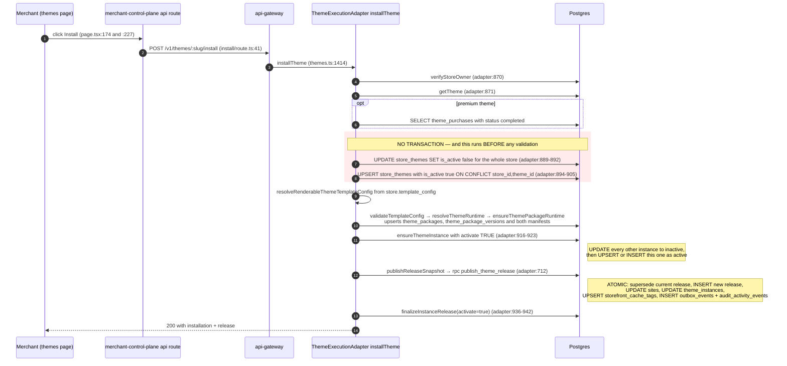
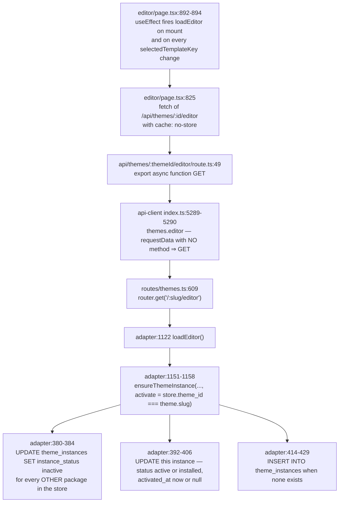

# 04 — Theme Installation, Publish, and Rollback: The Lifecycle As Implemented

> Companion documents: [01-governance-and-invariants.md](01-governance-and-invariants.md) (the law),
> [03-theme-data-model.md](03-theme-data-model.md) (the tables these paths write),
> [07-letbuyy-core-current-state.md](07-letbuyy-core-current-state.md) (what gets installed),
> [13-security-and-tenant-isolation.md](13-security-and-tenant-isolation.md) (auth surface),
> [14-test-build-governance-baseline.md](14-test-build-governance-baseline.md) (what CI covers).

---

## Status — 2026-08-04

| | |
|---|---|
| **Proven** | Every route→adapter mapping, the `authMiddleware` registration list, the full `GET /editor` → `ensureThemeInstance` → `UPDATE theme_instances` call chain, the absence of `authMiddleware` on `GET /:slug/schema`, the write set of `ensureThemePackageRuntime`, `installTheme`'s statement ordering, `saveDraft`'s hardcoded `activate=false`, and the absence of any transaction boundary in the adapter — all read from source at the cited lines. |
| **Proven (live)** | The 13:27:24 `letbuyy-core` install was a real `POST /v1/themes/letbuyy-core/install` (`request_id a5950de4-4d30-45f4-807b-819547fa308a`), evidenced by paired `outbox_events` + `audit_activity_events` rows. |
| **Inferred** | That the 13:30:32 reversal of that install was out-of-band raw SQL. See [03-theme-data-model.md](03-theme-data-model.md) §6.2. |
| **Unresolved** | Whether `GET /:slug/update-preview` also reaches `resolveThemeRuntime` (its header claims read-only; the handler body was not read to completion). Whether the Experiences tab in the merchant editor has ever completed a round trip. Whether `store_themes` is meant to be retired or kept as a mirror — this decision determines the shape of the fix. |
| **Substrate warning** | Live-DB values here were captured before the local database was reset mid-verification (`pg_tables` in `public` went 414 → 17 → 30 at ~17:26Z on 2026-08-04). |

---

## 1. The two P0 defects, stated first

1. **`GET /v1/themes/:slug/editor` mutates tenant state.** A plain HTTP GET, fired automatically by a `useEffect` on merchant-editor mount, deactivates every other `theme_instances` row for the site, and promotes *or demotes* the requested one. §4.
2. **`GET /v1/themes/:slug/schema` is unauthenticated *and* performs registry writes.** It carries no `authMiddleware`, takes no `store_id`, calls no ownership check — and upserts `theme_packages` (`status='active'`), `theme_package_versions` (`release_status='published'`), and both manifests, all of which are immediately anon-readable. §5.

Both violate the plain reading of **`SEC-R1`** (`AGENTS.md:224` — "Everything fails closed… An omitted tenant gate ⇒ deny") and, for #1, the ordinary HTTP contract that GET is safe. Neither is behind a feature flag.

---

## 2. Install — sequence as implemented



**The red block is the defect.** Any failure after it — a validation error, a registry outage, an RPC
error — leaves the store with the previously-active theme demoted and the new theme marked active with
**no instance and no release**. `installTheme` has no rollback and no compensating write.

---

## 3. Publish / activate / rollback — sequence as implemented

```mermaid
sequenceDiagram
    autonumber
    participant M as Merchant (theme editor)
    participant G as api-gateway
    participant A as ThemeExecutionAdapter
    participant R as publish_theme_release<br/>(SECURITY DEFINER RPC)
    participant DB as Postgres

    Note over M,DB: PUBLISH
    M->>G: PUT /api/themes/:id/editor → POST /v1/themes/:slug/publish (editor/page.tsx:1092)
    G->>A: publish (adapter:1369)
    A->>DB: verifyStoreOwner (adapter:1376)
    opt idempotency_key supplied
        A->>DB: SELECT theme_releases by store_id and idempotency_key
        A-->>M: existing release returned, zero mutation (adapter:1384-1400)
    end
    A->>R: rpc publish_theme_release with store_id, theme_id, release_config
    R->>DB: UPDATE theme_releases — is_current FALSE, release_status superseded
    R->>DB: INSERT theme_releases — release_status published, is_current TRUE
    R->>DB: UPDATE sites — theme_id, template_config, current_theme_release_id, storefront_release_version
    R->>DB: UPDATE theme_instances and theme_instance_drafts
    R->>DB: UPSERT storefront_cache_tags and INSERT outbox_events + audit_activity_events
    R-->>A: release_id, release_version, published_at
    A->>DB: enrichPublishedReleaseSnapshot — writes idempotency_key and artifacts post-hoc
    A->>DB: finalizeInstanceRelease

    Note over M,DB: ROLLBACK
    M->>G: POST /v1/themes/:slug/releases/:releaseId/rollback (ThemeUpdatePanel.tsx:434, ThemeLibraryCard.tsx:153)
    G->>A: rollbackRelease (adapter:1560)
    A->>DB: verifyStoreOwner (adapter:1567)
    opt expected_current_release_id supplied
        A->>DB: CAS check — SELECT the current is_current release, 409 on mismatch (adapter:1577-1590)
        Note right of A: KNOWN TOCTOU RESIDUAL, documented in-source at :1573-1576:<br/>TS-level only; two concurrent rollbacks can both pass
    end
    A->>DB: SELECT the target release, scoped by store_id and theme_id
    A->>R: publishReleaseSnapshot with rollback_of_release_id set to the target
    Note right of R: a rollback is a NEW forward release, not an in-place revert
```

Key properties, all **proven**:

- `publish_theme_release` is `SECURITY DEFINER` with `SET search_path=public` and is **the only atomic unit in the entire theme surface**. It supersedes, inserts, updates `sites`, updates instances, and writes the outbox + audit rows in one transaction.
- The RPC selects the instance by `(store_id, theme_slug, deleted_at IS NULL)` ordered *active-first* — **it does not require an active instance**, so a publish can silently attach to an `installed` instance.
- Rollback is modelled as a new forward release carrying `rollback_of_release_id`. There is no in-place revert path.
- `publishReleaseSnapshotFallback` (`adapter:738-860`) is used only when the RPC function is missing. It is **not** atomic and is analysed in §6.3.

---

## 4. P0 #1 — `GET /v1/themes/:slug/editor` mutates tenant state

Every hop below is a **GET**. Verdict from the adversarial verifier: **CONFIRMED, high confidence.**



### 4.1 The three writes a GET performs

| Line | Statement | Effect of a plain GET |
|---|---|---|
| `adapter:380-384` | `UPDATE theme_instances SET instance_status='inactive', updated_at, updated_by WHERE store_id=$1 AND theme_package_id <> $2 AND deleted_at IS NULL` | **Deactivates every other theme instance in the store.** Runs whenever `activate === true` |
| `adapter:392-406` | `UPDATE … instance_status = status, activated_at = activate ? now : null, theme_package_version_id, settings, installed_config, …` | **Promotes *and* demotes.** Opening the editor for a theme that is *not* `sites.theme_id` sets that instance to `instance_status='installed', activated_at=NULL` |
| `adapter:414-429` | `INSERT INTO theme_instances (…)` | **Creates rows** when none exists for the (store, package) pair |

The `activate` argument is `store.theme_id === theme.slug` (`adapter:1157`), so the direction of the
mutation depends on which theme the merchant happens to be *looking at*.

### 4.2 The only guard

```ts
// services/api-gateway/src/execution/theme-execution.adapter.ts:364
if (!runtime.themePackageId || !runtime.themePackageVersionId) return null;
```

The GET is a no-op **only** for themes with no registered package. For site
`3f89077b-5b74-426f-825b-c88b85b33fbe`, `urban-kicks` has a resolved package — so
`GET /v1/themes/urban-kicks/editor` on that site **writes**.

### 4.3 The re-fire hazard

`loadEditor`'s `useCallback` dependency array is `[loadReleases, notify, selectedTemplateKey, store, themeId]`
(`editor/page.tsx:891`). `selectedTemplateKey` changes every time the merchant switches template in the
editor — so the mutating GET re-fires on **every template switch**, not only on mount.

### 4.4 What this is *not*

The adversarial verifier ran an exhaustive sweep for `store_themes` writes across
`services/ apps/ packages/ scripts/ tools/ tests/` and found exactly **two**, both inside `installTheme`,
whose sole caller is `router.post('/:slug/install')`. It also confirmed no RPC and no trigger writes
`store_themes` (`pg_proc` body scan returns only `update_theme_install_count`, which *reads* it and writes
`themes.install_count`).

**Verdict: split.** `theme_instances` — **YES, a GET mutates it.** `store_themes.is_active` — **NO, no GET
can write it.** The 13:27:24 `store_themes` flip on the live site was a genuine `POST …/install`
(`request_id a5950de4-4d30-45f4-807b-819547fa308a`), proven by the paired `theme.release.published` +
`theme.installed` outbox rows and the `theme.publish` audit row.

> One forensic detail worth keeping: the blanket deactivate at `adapter:889-892` **omits `updated_at`**.
> That is why the live `urban-kicks` row shows `is_active=false` with `updated_at == installed_at` — the
> demotion left no timestamp trace at all.

---

## 5. P0 #2 — `GET /v1/themes/:slug/schema` is unauthenticated and writes the registry

### 5.1 The auth gap

`services/api-gateway/src/routes/themes.ts:67-101` registers `authMiddleware` for:
`/media-library`, `/resource-search`, `/library`, `/library/*`, `/:slug/update-preview`, `/:slug/update`,
`/:slug/duplicate`, `/:slug/rename`, `/:slug/archive`, `/:slug/unpublished`, `/packages/upload`,
`/:slug/editor`, `/:slug/editor/*`, `/:slug/publish`, `/:slug/validate`, `/:slug/preview-session`,
`/:slug/releases`, `/:slug/releases/*`, `/:slug/install`, `/:slug/purchase`, `/:slug/purchase/*`,
`/purchases/list`, `/purchases/:purchaseId/receipt`, `/installations/list`, `/downloads/list`,
`/settings`, `/saved-searches`, `/developer/*` — plus `router.use('/', optionalAuth)`.

**`/:slug/schema` is not in that list.** The handler is:

```ts
// services/api-gateway/src/routes/themes.ts:601-607
router.get('/:slug/schema', async (c) => {
    const slug = c.req.param('slug');
    const db = getSupabaseAdmin(c);
    const service = new ThemeExecutionAdapter(db);
    return c.json(success(await service.getEditableSchema(slug)));
});
```

No `auth`, no `store_id`, no `verifyStoreOwner` — and it constructs the adapter with the **admin**
(service-role) client.

### 5.2 The writes it performs

`getEditableSchema` (`adapter:329`) → `schemaRegistry.resolveThemeRuntime` (`adapter:331`) →
`ensureThemePackageRuntime` (`schema-registry-execution.adapter.ts:436-438`). When no package runtime
exists, `ensureThemePackageRuntime` (`:487-600`) upserts:

| Table | Value written | Anon-readable? |
|---|---|---|
| `theme_packages` | `status: 'active'` (`:509`) | **Yes** — `theme_packages_public_read USING (status='active' AND deleted_at IS NULL)` |
| `theme_package_versions` | `release_status: 'published'` (`:532`) | **Yes** — `theme_package_versions_public_read USING (release_status='published' AND deleted_at IS NULL)` |
| `theme_schema_manifests` | full manifest | **Yes** — `EXISTS` on a published version |
| `theme_renderer_manifests` | full manifest | **Yes** — `EXISTS` on a published version |

### 5.3 Why this is worse than it looks

The Phase Q library path deliberately does the opposite. `provisionSiteThemePackage`
(`adapter:1815-1831`) calls `ensureThemePackageRuntime` and then **immediately** forces
`theme_packages.status='draft'`, precisely so a merchant's private theme name never surfaces in the
anon-readable catalog:

```ts
// services/api-gateway/src/execution/theme-execution.adapter.ts:1822-1824
.from('theme_packages')
.update({ status: 'draft', updated_at: new Date().toISOString() })
.eq('id', runtime.themePackageId);
```

The unauthenticated schema route performs the same upsert and **skips the demotion**. Any caller who can
reach the gateway can therefore cause a `themes` row's package to be published into the public catalog by
issuing a GET with its slug.

### 5.4 The stale in-source claim

`theme-execution.adapter.ts:1800-1803` states: *"Phase Q — Theme Library Management. All methods call
`verifyStoreOwner` FIRST (before any `theme_instances` query) and scope ALL subsequent queries by
`store_id`."* That is true **for the Phase Q methods only**. `getEditableSchema` is outside that scope and
is the one adapter method with no `storeId` parameter at all. **Code wins; the comment is scoped
narrower than a reader will assume.**

---

## 6. Every `ThemeExecutionAdapter` method

`services/api-gateway/src/execution/theme-execution.adapter.ts` — 2,530 lines, 102 KB, one class.
**Transactional?** is `No` for every method except where a single call is a `db.rpc` — the only `db.rpc`
in the entire file is `publish_theme_release` at `:712`. There is no `BEGIN`/`COMMIT` and no advisory
lock anywhere in the file.

| # | Method (line) | HTTP verb + route reaching it | Tables written | Txn? | `verifyStoreOwner`? | Can orphan rows? |
|---|---|---|---|:---:|:---:|---|
| 1 | `getEditableSchema` (`:329`) | **GET** `/v1/themes/:slug/schema` — **NO AUTH** | `theme_packages`, `theme_package_versions`, `theme_schema_manifests`, `theme_renderer_manifests` (via `ensureThemePackageRuntime`) | No | **No** (takes no `storeId`) | **Yes** — publishes registry rows for any slug, with no owner and no cleanup |
| 2 | `installTheme` (`:864`) | POST `/v1/themes/:slug/install` (`themes.ts:1402→1414`) | `store_themes`, `theme_packages`*, `theme_package_versions`*, both manifests*, `theme_instances`, `theme_releases`, `sites`, `storefront_cache_tags`, `outbox_events`, `audit_activity_events` | No (RPC step only) | Yes (`:870`) | **Yes** — see §6.1 |
| 3 | `loadEditor` (`:1122`) | **GET** `/v1/themes/:slug/editor` | **`theme_instances`** (+ registry via `resolveThemeRuntime`) | No | Yes (`:1124`) | **Yes** — a read can leave a store with zero active instances |
| 4 | `saveDraft` (`:1208`) | PUT `/v1/themes/:slug/editor/draft` | `theme_editor_drafts`, `theme_instance_drafts`, `theme_draft_patches`, **`theme_instances`** | No | Yes | **Yes** — see §6.2 |
| 5 | `deleteDraft` (`:1320`) | DELETE `/v1/themes/:slug/editor/draft` | `theme_editor_drafts` (hard delete) | No | Yes | No |
| 6 | `publish` (`:1369`) | POST `/v1/themes/:slug/publish` | via RPC: `theme_releases`, `sites`, `theme_instances`, `theme_instance_drafts`, `storefront_cache_tags`, `outbox_events`, `audit_activity_events`; then post-hoc enrichment | **RPC yes**, enrichment no | Yes (`:1376`) | Low — enrichment failure leaves a valid release without `idempotency_key`/artifacts |
| 7 | `listReleases` (`:1533`) | GET `/v1/themes/:slug/releases` | — | n/a | Yes | No |
| 8 | `rollbackRelease` (`:1560`) | POST `/v1/themes/:slug/releases/:releaseId/rollback` | same as publish | RPC yes | Yes (`:1567`) | Low; **documented TOCTOU residual** at `:1573-1576` |
| 9 | `validateDocument` (`:1682`) | POST `/v1/themes/:slug/validate` | — (registry writes possible via `resolveThemeRuntime`) | No | Yes | No |
| 10 | `createPreviewSession` (`:1723`) | POST `/v1/themes/:slug/preview-session` | `theme_preview_sessions` | No | Yes | No |
| 11 | `listSiteThemes` (`:1850`) | GET `/v1/themes/library` | — (pure SELECT) | n/a | Yes (`:1852`) | No |
| 12 | `createSiteTheme` (`:1929`) | POST `/v1/themes/library/create` | `themes` (`is_site_private=true`), `theme_packages` (forced to `draft`), versions + manifests, `theme_instances` | No | Yes (`:1936`) | **Yes** — see §6.4 |
| 13 | `duplicateSiteTheme` (`:2019`) | POST `/v1/themes/:slug/duplicate` | same as `createSiteTheme` | No | Yes (`:2027`) | **Yes** — same |
| 14 | `renameSiteTheme` (`:2149`) | PATCH `/v1/themes/:slug/rename` | `themes` | No | Yes | No |
| 15 | `archiveSiteTheme` (`:2221`) | POST `/v1/themes/:slug/archive` | `theme_instances` (`instance_status='archived'`) | No | Yes (`:2229`) | Leaves `theme_releases` untouched by design; hard-blocks when `sites.theme_id = slug` |
| 16 | `deleteUnpublishedSiteTheme` (`:2285`) | DELETE `/v1/themes/:slug/unpublished` | `theme_instances` (`deleted_at` + status `deleted`) | No | Yes (`:2292`) | Same — soft only |
| 17 | `loadCurrentReleaseBundle` (`:2375`) | GET `/v1/themes/:slug/update-preview` (`theme-update-route.ts:108`) | claimed read-only — **unresolved** whether it reaches `resolveThemeRuntime` | No | Yes | Unknown |
| 18 | `loadTargetPackageVersionBundle` (`:2423`) | same route | same | No | n/a | Unknown |
| 19 | `publishVersionUpdateRelease` (`:2464`) | POST `/v1/themes/:slug/update` (`theme-update-route.ts:212`) | as publish | RPC yes | Yes | Low |

\* via `validateTemplateConfig` → `resolveThemeRuntime` → `ensureThemePackageRuntime`.

Private helpers that write: `ensureThemeInstance` (`:356`), `saveInstanceDraftSnapshot` (`:438`),
`finalizeInstanceRelease` (`:582`), `publishReleaseSnapshot` (`:709`),
`publishReleaseSnapshotFallback` (`:738`), `saveEditorDraftRecord` (`:1033`),
`provisionSiteThemePackage` (`:1815`), `discardSiteThemeScaffold` (`:1839`).

**Ownership verdict:** every store-scoped method calls `verifyStoreOwner` (`:290-312`, a `sites` lookup
by `id` + `(custom_user_id OR user_id)`) as its first statement. `getEditableSchema` is the **sole**
exception — and it is the one reachable without authentication.

### 6.1 `installTheme` — non-transactional, and it flips before it validates

```ts
// services/api-gateway/src/execution/theme-execution.adapter.ts:889-905  (abridged)
await this.db.from('store_themes').update({ is_active: false }).eq('store_id', input.store_id);
const { data: installation, error } = await this.db.from('store_themes')
    .upsert({ store_id, theme_id, is_active: true, config_overrides, installed_at, updated_at },
            { onConflict: 'store_id,theme_id' }).select().single();
```

Only **after** those two writes does it run (`:912-942`): `resolveRenderableThemeTemplateConfig` →
`validateTemplateConfig` → `ensureThemeInstance(..., true)` → `publishReleaseSnapshot` →
`finalizeInstanceRelease`.

| Failure point | Resulting state |
|---|---|
| `validateTemplateConfig` throws (the exact failure migration 193 fixed) | Previous theme demoted; new theme `is_active=true` with **no instance, no release** |
| `ensureThemeInstance` throws | Same, plus a possible half-updated `theme_instances` set |
| `publishReleaseSnapshot` throws | `store_themes` + `theme_instances` flipped, `theme_releases`/`sites` untouched — the storefront keeps rendering the old release while the merchant UI shows the new theme as active |

Because `store_themes` has **no** one-active constraint ([03-theme-data-model.md](03-theme-data-model.md) §5),
the database will happily persist any of these.

### 6.2 `saveDraft` hardcodes `activate = false` — autosave demotes the live instance

```ts
// services/api-gateway/src/execution/theme-execution.adapter.ts:1219-1226
const themeInstance = await this.ensureThemeInstance(
    input.store_id, theme, runtime, userId, templateConfig,
    false,          // ← hardcoded
);
```

With `activate=false`, `ensureThemeInstance` sets `status = 'installed'` and `activated_at = null`
(`:379`, `:398`, `:422`). So **every draft autosave from the theme editor demotes the store's live
instance** from `active` to `installed` and nulls its `activated_at`. Combined with §4, the merchant
editor both promotes (on load) and demotes (on save) the same row, with no code path in between
reconciling them against `sites.theme_id` or the current release.

This is the most plausible *code-path* explanation for the live site's
`instance_status='active', activated_at=NULL` — except that `finalizeInstanceRelease` (`:600-601`) and
the RPC always re-couple the two, which is why the observed combination is still attributed to an
out-of-band write ([03-theme-data-model.md](03-theme-data-model.md) §6.2).

### 6.3 `publishReleaseSnapshotFallback` ignores its insert error

```ts
// services/api-gateway/src/execution/theme-execution.adapter.ts:743
let releaseId: string | null = fallbackReleaseId;      // a locally generated UUID
// :779-802
const { data: release } = await this.db.from('theme_releases').insert({ id: fallbackReleaseId, … })
    .select('id, release_version, published_at').single();   // ← no `error` destructured
```

If the insert fails, `releaseId` remains the locally generated UUID that **does not exist in the table**,
and `:822-823` then writes `sites.current_theme_release_id = releaseId`. When that `sites` update fails,
`:835-851` silently retries with a **minimal** payload that drops both `storefront_release_version` and
`current_theme_release_id`. That produces exactly the half-written `sites` shape observed live
(`current_theme_release_id = NULL` with `storefront_release_version = 2`).

Note the asymmetry: the *supersede* step immediately above (`:770-777`) has a carefully reasoned
`if (supersededError) throw`, with a comment explaining why proceeding would be unsafe. The insert step
directly below it has no such check.

### 6.4 `discardSiteThemeScaffold` swallows cleanup failures

```ts
// services/api-gateway/src/execution/theme-execution.adapter.ts:1839-1848
try {
    if (themePackageId) await this.db.from('theme_packages').delete().eq('id', themePackageId);
    await this.db.from('themes').delete().eq('id', themeId);
} catch {
    // Intentionally ignored — the caller rethrows the real failure.
}
```

`createSiteTheme` and `duplicateSiteTheme` wrap their post-`themes`-row work in `try/catch` and call
this on failure. A failed cleanup leaves an orphan `themes` row that appears in **no** library listing
(it has no instance) yet **permanently holds its slug** — and, because of the `USING(true)` policy on
`themes`, remains anon-readable.

### 6.5 Delete semantics

`archiveSiteTheme` and `deleteUnpublishedSiteTheme` only soft-delete or flag `theme_instances`
(`:2241-2243`, `:2261-2269`, `:2304-2319`, `:2337-2350`); neither touches `theme_releases`; both
hard-block when `sites.theme_id` equals the slug. **No gateway code path hard-deletes `theme_releases` or
`theme_instances`** — the only `DELETE`s in the adapter are `discardSiteThemeScaffold` and `deleteDraft`.
This is the fact that forces the out-of-band-SQL conclusion in
[03-theme-data-model.md](03-theme-data-model.md) §6.2.

---

## 7. The active-theme contract

### 7.1 As it actually is — **undefined and inconsistent**

State this plainly to anyone who asks: **LetBuyy does not currently have an active-theme contract.**
There are three fields that each partially answer "which theme is active", written by different paths,
with different guarantees, and no code or schema names a winner.

| Field | Written by | DB guarantee | Read by the storefront? |
|---|---|---|---|
| `store_themes.is_active` | `installTheme` only | **none** | **No** |
| `theme_instances.instance_status` | install, **editor GET**, draft save, publish RPC | `idx_theme_instances_one_active` | **No** |
| `sites.theme_id` + `theme_releases.is_current AND release_status='published'` | publish RPC, publish fallback, **out-of-band SQL** | `idx_theme_releases_one_current`; **no** `is_current ⇒ published` check | **Yes** |

Observed consequences on the single live site (all proven — see
[03-theme-data-model.md](03-theme-data-model.md) §4.3):

- `store_themes` says `letbuyy-core`; `theme_instances` and `sites.theme_id` say `urban-kicks`; `sites.template_config.themeId` says `letbuyy-core`.
- The one release is `is_current=true` **and** `superseded`, so the storefront resolves **no** release and renders the letbuyy-core snapshot under the urban-kicks theme id.
- `instance_status='active'` with `activated_at=NULL`, a state no code path produces.

Governance framing: this is `R-15` (Constitution `:414`), `WIN-R4`/`WIN-R5` (`AGENTS.md:146-147`) and
`ANTI-R1` (`AGENTS.md:314`). `WIN-R5` is explicit that the correct response to discovering two systems is
**collapse, not harmonise**.

### 7.2 What the contract should be

Not a plan — a statement of the target so the gap is measurable. Any of these requires ARB, since it
touches an RLS-adjacent, money-adjacent-by-proximity, storefront-render-critical surface.

| # | Rule | Enforcement mechanism it needs |
|---|---|---|
| 1 | **One field is authoritative: the current release.** `sites.theme_id` and `sites.template_config.themeId` are derived projections of it, never independently written | Publish RPC becomes the sole writer of all three |
| 2 | `is_current = true ⇒ release_status = 'published'` | `CHECK` constraint or `BEFORE UPDATE` trigger on `theme_releases` — **does not exist today** |
| 3 | `sites.theme_id = current release.theme_id = template_config.themeId` | consistency validator in CI + a reconciler job |
| 4 | Exactly one active instance per site, and `instance_status='active' ⇔ activated_at IS NOT NULL` | `idx_theme_instances_one_active` exists; the coupling `CHECK` does not |
| 5 | `store_themes` is either **removed from the install path** or reduced to a **mirror** written *after* the canonical write succeeds, with `CREATE UNIQUE INDEX … ON store_themes (store_id) WHERE is_active = true` | Requires the retire-or-mirror decision (**unresolved**) |
| 6 | **GET is safe.** `ensureThemeInstance` splits into `ensureThemeInstanceExists` (no activation, no cross-instance deactivation) for `loadEditor`, and an activating variant used only by install/publish/rollback | Code change + a test asserting `GET /editor` performs zero writes |
| 7 | Install is **one transaction**: a `SECURITY DEFINER` `install_theme_for_site(…, p_idempotency_key)` performing validate → `store_themes` → `theme_instances` → release in a single statement | New RPC, paired rollback per `MIG-R3` |
| 8 | `GET /:slug/schema` requires `authMiddleware` + `store_id` + `verifyStoreOwner`; `resolveThemeRuntime` becomes **read-only by default** with an explicit `ensure=true` only on write paths | Route + adapter change |

---

## 8. Defect register for this document

| ID | Severity | Defect | Evidence |
|---|:---:|---|---|
| LC-1 | **P0** | `GET /v1/themes/:slug/editor` deactivates, promotes, demotes and inserts `theme_instances` rows | `themes.ts:609,630`; `adapter:1151-1158`, `:380-384`, `:392-406`, `:414-429` |
| LC-2 | **P0** | `GET /v1/themes/:slug/schema` has no `authMiddleware`, no `store_id`, no ownership check, and writes anon-readable registry rows | `themes.ts:67-101` vs `:601-607`; `schema-registry-execution.adapter.ts:487-600`; `pg_policies` |
| LC-3 | **P0** | `installTheme` is non-transactional and flips `store_themes` **before** validation | `adapter:889-942` |
| LC-4 | **P0** | No defined active-theme contract; three representations disagree on the live site | §7.1 |
| LC-5 | **P1** | `saveDraft` hardcodes `activate=false`, so autosave demotes the live instance | `adapter:1219-1226`, `:379`, `:398` |
| LC-6 | **P1** | `publishReleaseSnapshotFallback` ignores the release insert error and can point `sites` at a nonexistent release | `adapter:779-802`, `:815-851` |
| LC-7 | **P1** | `publish_theme_release` does not require an **active** instance — a publish can attach to an `installed` one | `pg_get_functiondef(publish_theme_release)` |
| LC-8 | **P2** | `discardSiteThemeScaffold` swallows cleanup errors, leaving orphan `themes` rows holding their slug | `adapter:1839-1848` |
| LC-9 | **P2** | Rollback CAS is TS-level only — a documented, unclosed TOCTOU | `adapter:1573-1590` |
| LC-10 | — | `GET /:slug/update-preview` write behaviour unverified | `theme-update-route.ts:108` — **unresolved** |
