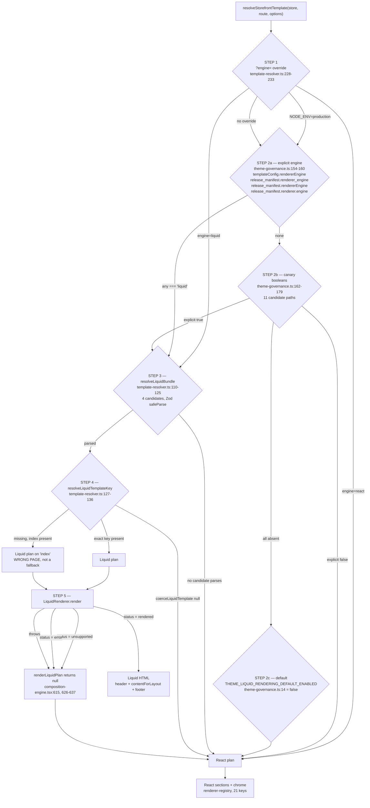

# 05 — Rendering Pipeline

> **What this is.** Exactly how a storefront page becomes HTML: what decides React vs Liquid, how the
> Liquid engine is constructed and locked down, where sanitization happens, what happens when Liquid
> fails, which schema source runtime validation actually uses, and which parts of the pipeline are
> computed and then thrown away.
>
> Routes and runtimes: [02-runtime-and-route-map.md](02-runtime-and-route-map.md).
> Governance: [01-governance-and-invariants.md](01-governance-and-invariants.md).
> Section/template coverage: [06-react-liquid-parity-matrix.md](06-react-liquid-parity-matrix.md).

---

## Status — 2026-08-04

| | |
|---|---|
| **Proven** | The complete five-step render decision, with `file:line` for every branch. The LiquidJS construction options, the six registered filters, the absence of any custom tag. The DOMPurify config verbatim and its five application points. The four-layer fallback and the single `fallback_reason` value that exists. `THEME-R3` is **satisfied** — `RUNTIME_SECTION_SCHEMAS` has zero occurrences in executable code. |
| **Proven defects** | Merchant `custom_css` is validated and stored but **never rendered**. `buildLiquidThemeHeadAssets` output is computed and then **discarded** by `composition-engine`, so the base CSS and the `:root` token block never reach the browser. Two divergent CSS sanitizer implementations exist with different rule sets. `asset_url` rewrites to `/assets/<name>`, a path **no route serves**; `theme_assets` has 0 rows. |
| **Unresolved** | Whether the `custom_css` render path was ever wired and later removed, or never wired. Whether DOMPurify 3.4.9 preserves `<style>` content under `WHOLE_DOCUMENT:true` — the code asserts it does, but no shipped path exercises it. Whether the merchant-side `body/html/:root` selector rule is a deliberate extra restriction or accidental divergence. |
| **Method** | Source read at the cited lines; live read-only `psql` against `supabase_db_Letbuyy_Store`. No file modified. |

---

## 1. The render decision — five steps, in order

This is the whole decision. There is **no environment variable** and **no percentage canary** in the
path. The single entry point is `resolveStorefrontTemplate()`
(`apps/storefront-runtime/src/lib/theme-engine/template-resolver.ts:235-308`), called by every
storefront route.

### Step 1 — dev-only URL override

```
apps/storefront-runtime/src/lib/theme-engine/template-resolver.ts:228-233
export function resolveDevEngineOverride(engine: string | null | undefined) {
  if (process.env.NODE_ENV === 'production' || !engine) return {};
  if (engine === 'liquid') return { liquidEnabled: true };
  if (engine === 'react') return { liquidEnabled: false };
```

`?engine=liquid|react` forces the engine and bypasses everything below. **Hard-disabled in
production** (`:229`). Only **one** route wires it —
`apps/storefront-runtime/src/app/store/[subdomain]/page.tsx:49` — so `?engine=` is silently ignored
on product, collection, cart, blog and account routes even in dev. *(status: proven)*

### Step 2 — `resolveThemeLiquidRenderingEnabled`, precedence (a) → (b) → (c)

`packages/theme-engine/src/theme-governance.ts:144-182`. First match wins.

| Branch | Inputs consulted | Result | Line |
|---|---|---|---|
| **(a) Explicit engine** | `templateConfig.rendererEngine`, `release_manifest.renderer_engine`, `release_manifest.rendererEngine`, `release_manifest.renderer.engine` — lowercased | any `=== 'liquid'` → **`return true` immediately** | `theme-governance.ts:154-160` |
| **(b) Canary booleans** | 11 candidate paths: `templateConfig.liquidRenderingCanary`; `themeSettings.liquidRenderingCanary` / `.liquid_rendering_canary`; `releaseManifest.liquidRenderingCanary` / `.liquid_rendering_canary` / `.liquidCanary` / `.liquid_canary`; the same four under `releaseManifest.renderer` | first **explicit** boolean wins; an explicit `false` **forces React** | `theme-governance.ts:162-179` |
| **(c) Default** | `input.defaultEnabled ?? THEME_LIQUID_RENDERING_DEFAULT_ENABLED` | `false` → React | `theme-governance.ts:181`, constant at `:14` |

Boolean coercion (`readBooleanDecision`, `theme-governance.ts:125-142`) accepts booleans, the strings
`1 / true / enabled / on / canary` and `0 / false / disabled / off`, and objects carrying
`enabled | liquid_enabled | liquidEnabled | canary | value`. *(status: proven)*

### Step 3 — the bundle must exist and Zod-parse

```
apps/storefront-runtime/src/lib/theme-engine/template-resolver.ts:241-246
const liquidEnabled = options.liquidEnabled ?? resolveThemeLiquidRenderingEnabled({ … });
const liquidBundle = liquidEnabled ? resolveLiquidBundle(store) : undefined;
```

`resolveLiquidBundle` (`:110-125`) tries four candidates in order —
`templateConfig.liquidBundle`, `releaseManifest.liquidBundle`, `releaseManifest.themeBundle`,
`releaseManifest.bundle` — and each must pass `LiquidThemePackageBundleSchema.safeParse`. **No valid
bundle → React**, even with `liquidEnabled === true`. *(status: proven)*

### Step 4 — a template key must resolve

```
apps/storefront-runtime/src/lib/theme-engine/template-resolver.ts:127-136
const routeTemplateKey = route.templateKey || resolveTemplateKey(routeType);
if (bundle.templates[routeTemplateKey]) return routeTemplateKey;
if (bundle.templates.index) return 'index';
return Object.keys(bundle.templates)[0] || routeTemplateKey;
```

This is a **silent** fallback, not a failure. A missing `blog` / `policy` / `page` / `not_found`
template does **not** degrade to React — it renders the **homepage body** under that URL. Only if
`coerceLiquidTemplate` returns `null` (`:250`) does the plan fall through to the React chain
(`:273-307`). *(status: proven — this is the mechanism behind the live-store defect in §7)*

### Step 5 — render-time fallback

Even with `plan.rendererEngine === 'liquid'`, a non-`rendered` status or a thrown error makes
`renderLiquidPlan` return `null`
(`apps/storefront-runtime/src/lib/theme-engine/composition-engine.tsx:568`, `:615`, `:626-637`), and
the page renders React chrome + sections (`:661`, `:705-725`). The engine reported in telemetry is
`liquidHtml ? 'liquid' : 'react'` (`:661`). *(status: proven)*

### 1.1 The decision, as a diagram



---

## 2. The critical nuance: "default OFF" does not mean React

`CLAUDE.md` and `ART-17` both describe the posture as *"Liquid default OFF (canary)"*. That is
**literally true and operationally misleading**.

| Claim | Status |
|---|---|
| `THEME_LIQUID_RENDERING_DEFAULT_ENABLED = false` | ✅ True — and it is a **compile-time TypeScript constant**, not an env var (`theme-governance.ts:14`). Local, dev, staging and production all compile the same `false`. |
| The platform-wide flip is deferred | ✅ True — `THEME_LIQUID_PLATFORM_WIDE_FLIP_DECISION = { status: 'deferred', authority: 'ARB' }` (`theme-governance.ts:15-21`), pinned by `theme-governance-validator.mjs:63-65`. |
| Therefore stores render React by default | ❌ **False in practice.** Step 2(a) returns `true` **before** the constant is ever read. |

Why 2(a) fires without anyone opting in:

| Writer | What it writes | Line |
|---|---|---|
| Gateway release build | `renderer_engine: 'liquid'` into `release_manifest` for **any** release whose config carries a Liquid bundle | `services/api-gateway/src/execution/theme-execution.adapter.ts:645-650`, `:669` |
| Theme install | `rendererEngine: liquid ? 'liquid' : 'json-contract'` into `sites.template_config` | `services/api-gateway/src/execution/schema-registry-execution.adapter.ts:173` |
| **Migration 180** | `default_template \|\| jsonb_build_object('rendererEngine','liquid')` on `themes WHERE slug='urban-kicks'` | `database/supabase/migrations/180_urban_kicks_liquid_theme.sql:36-37`, with the header stating at `:5-6`: *"any store on this theme renders Liquid"* |

The migration's intent is explicit, not accidental. Live local DB confirms the outcome:

```
psql: SELECT slug, default_template->>'rendererEngine', (default_template ? 'liquidBundle') FROM themes;
  urban-kicks  | liquid | t
  letbuyy-core | liquid | t
psql: SELECT subdomain, template_config->>'rendererEngine', template_config->>'liquidRenderingCanary' FROM sites;
  saai | liquid | (null)
```

**Effective posture: Liquid-ON-by-theme.** Publishing or installing a theme that carries a Liquid
bundle flips every store on that theme, immediately, with no canary percentage and no human opt-in.
The engine's own unit test only exercises the canary branch, never the `rendererEngine` branch
(`packages/theme-engine/test/theme-engine.test.ts:205-230`), which is why the discrepancy survived.

**Consequence for rollout planning:** anyone reasoning about blast radius from `CLAUDE.md` alone will
underestimate it. The rollback lever named by `THEME-R6` — the per-theme `renderer.engine` switch —
is correct; the lever named by `docs/governance/feature-flag-governance.md:20` (`FEATURE_LIQUID`) is
inert (see [02-runtime-and-route-map.md](02-runtime-and-route-map.md) §7.1). *(status: proven)*

---

## 3. The Liquid engine

| Property | Value | Evidence |
|---|---|---|
| Library | **LiquidJS**, pinned `^10.27.0` | `packages/theme-engine/src/theme-renderer.ts:2`; `packages/theme-engine/package.json` |
| Construction | fresh engine **per render**, inside `LiquidRenderer.render` | `theme-renderer.ts:710-731`, invoked at `:589` |
| Template cache | `cache: true` — LiquidJS LRU, **engine-instance-local**, discarded after each render; sources defensively copied with `String()` | `theme-renderer.ts:730`, `:747-756` |
| **Custom tags** | **none — zero `registerTag` calls in `packages/theme-engine/src`** | `rg 'registerTag'` → 0 hits |
| **Tag allowlist** | **there is none.** All LiquidJS built-in tags are available. | see §3.1 |
| **Custom filters** | exactly **6**: `money`, `money_with_currency`, `json`, `asset_url`, `image_url`, `t` | `theme-renderer.ts:1118-1125` |
| Unknown filters | throw — `strictFilters: true` | `theme-renderer.ts:733` |
| Partials | `dynamicPartials: false` — no computed `` | `theme-renderer.ts:732` |
| Template map | closed over the bundle only: layout + sections + blocks, by `path` | `theme-renderer.ts:747-756` |

### 3.1 Where the "allowlist" actually lives

There is **no tag allowlist**. Isolation is achieved by four other means, and it is worth naming them
precisely because "Liquid is sandboxed by an allowlist" is a claim this codebase does not support:

| Control | Setting | Line |
|---|---|---|
| Output escaping by default | `outputEscape: 'escape'` | `theme-renderer.ts:735` |
| No prototype-chain traversal | `ownPropertyOnly: true` | `theme-renderer.ts:734` |
| No JS truthiness coercion | `jsTruthy: false` | `theme-renderer.ts:736` |
| No dynamic partial resolution | `dynamicPartials: false` | `theme-renderer.ts:732` |
| Fixed template universe | `templates:` map built only from the parsed bundle | `theme-renderer.ts:747-756` |
| Resource limits | `parseLimit: 300_000`, `renderLimit: 250`, `memoryLimit: 2_000_000`, `templateLimit: 20_000` | `theme-renderer.ts:737-739`, `:704-708` |
| Output sanitization | DOMPurify — see §4 | — |

`| raw` is used in **9 bundle files** (12 occurrences) to bypass output escaping — the three
`content_for_*` layout globals, `spotlight`, `product-grid`, `category-grid`, `featured-products`,
`app-block-slot`'s `block.content`, and the `body_html` of `article`/`page`/`policy`. **Every one of
those outputs is subsequently passed through `sanitizeRenderedHtml`**, so the escape bypass is
compensated by DOMPurify, not unguarded. *(status: proven —
`rg '\| raw' packages/theme-engine/examples/letbuyy-core-liquid/files/`; sanitization at
`theme-renderer.ts:477` per-section and `:647` whole-document)*

### 3.2 Objects (drops) exposed to templates

Built by `buildLiquidScope` (`theme-renderer.ts:933-1010`):
`shop`, `request`, `settings` (flat **and** grouped, flat wins), `routes`, `product`, `collection`,
`collections`, `cart`, `customer`, `search`, `order`, `linklists`, `blog`, `article`, `page`, plus
`content_for_layout` / `content_for_header` / `content_for_footer`.

Hardening on the drop layer:

| Control | Value | Line |
|---|---|---|
| `BLOCKED_DROP_KEYS` | `__proto__, constructor, prototype, password, password_hash, access_token, refresh_token, signing_secret, client_secret, api_key, secret_key, private_key, webhook_secret` | `theme-renderer.ts:1030` |
| Settings key filter | identifier-shaped keys only (`/^[a-zA-Z][a-zA-Z0-9_]*$/`), blocked keys dropped | `theme-renderer.ts:1034-1043`, `:966` |
| Drop size limits | depth 4, 80 keys, 100 array items, block nesting 3 | `theme-renderer.ts:1020-1027` |
| `json` filter escapes `<` | `.replace(/</g, '\\u003c')` — prevents `</script>` breakout | `theme-renderer.ts:1121` |

**Note on `routes`:** the drop advertises `search_url: '/search'`, `account_register_url:
'/customers/register'` and `all_products_collection_url: '/products'`
(`theme-renderer.ts:977-993`). Two of those three routes do not exist — see
[02-runtime-and-route-map.md](02-runtime-and-route-map.md) §4. *(status: proven)*

---

## 4. The sanitizer

### 4.1 HTML — DOMPurify, verbatim config

```
packages/theme-engine/src/theme-renderer.ts:229-230
  FORBID_ATTR: ['style'],
  FORBID_TAGS: ['base', 'embed', 'object', 'script'],
```

| Key | Value | Line |
|---|---|---|
| Base profile | `USE_PROFILES: { html: true }` | `:171` |
| `ADD_TAGS` | the 10 `lb-*` hydration elements + `iframe` + `meta` | `:172-176` |
| `ADD_ATTR` | fixed allowlist — `aria-live`, `aria-pressed`, `class`, `content`, the `data-app-block-*` set, `data-lb-*`, `data-base-path`, `data-logout-url`, `data-product-*`, `data-search-url`, `data-section-id`, `data-theme-renderer`, `data-variant-*`, `height`, `href`, `loading`, `name`, `sandbox`, `src`, `title`, `type`, `width` | `:177-218` |
| `CUSTOM_ELEMENT_HANDLING.tagNameCheck` | `/^lb-(?:add-to-cart\|cart-drawer\|search\|variant-picker\|review-form\|wishlist-toggle\|cart\|customer-settings\|address-manager\|logout)$/` | `:221` |
| `attributeNameCheck` | `/^(?:aria-[a-z0-9-]+\|data-[a-z0-9-]+\|class\|id\|role\|slot\|title\|type\|name\|value\|href\|src)$/i` | `:222` |
| `allowCustomizedBuiltInElements` | `false` | `:223` |
| Whole-document variant | `{ …CONFIG, WHOLE_DOCUMENT: true }` | `:233-235` |
| Runtime | JSDOM-backed, **server-only**, lazy module-level singleton | `:1315-1348`; entrypoint `:1351-1367` |
| `uponSanitizeAttribute` hook | drops any `data-*` containing `<` or `>`; drops `href`/`src`/`*url` beginning `javascript:` or `data:text/html` | `:1332-1345` |

The 10 allowed custom elements **exactly match** the 10 islands registered client-side
(`apps/storefront-runtime/src/lib/theme-engine/liquid-hydration-islands.tsx:1330-1341`) — verified as
an exact set match. *(status: proven)*

### 4.2 The five application points

| # | What is sanitized | Line |
|---|---|---|
| 1 | Per-section rendered HTML | `theme-renderer.ts:477` |
| 2 | Per-block rendered HTML | `theme-renderer.ts:911` |
| 3 | App-block embed regions | `theme-renderer.ts:1113` |
| 4 | Configured app-block HTML | `theme-renderer.ts:1212-1213` |
| 5 | The whole layout document (`WHOLE_DOCUMENT: true`) | `theme-renderer.ts:647` |

Point 5 is the one that never reaches a browser — see §6.

### 4.3 The gate that locks the sanitizer

`scripts/validators/theme-governance-validator.mjs:88-100` fails the build if the `dompurify` import
or `LIQUID_RENDERED_HTML_DOMPURIFY_CONFIG` disappears, if `sanitizeRenderedHtml` ever contains a
`.replace(` (i.e. regex sanitization — the `THEME-R4` "DOMPurify not regex" rule), or if
`outputEscape:'escape'` is absent. That validator is currently **EXIT=0**. Additionally,
`theme-linter.ts:3-5,84-104` derives its forbidden-tag/attr deny-lists **from** the DOMPurify config
rather than hardcoding them, so linter and renderer cannot drift. *(status: proven)*

### 4.4 CSS — and the two divergent implementations

The engine's validator, `packages/theme-engine/src/custom-css-sanitizer.ts`, is a 12-stage
fail-closed pipeline:

| Stage | Rule | Line |
|---|---|---|
| size | 50 000-byte cap (`CUSTOM_CSS_MAX_BYTES`) | `:52` |
| bytes | null-byte rejection | `:255-425` |
| markup | HTML comment markers, literal `<`, `</style>` **raw and unicode-decoded** | `:255-425` |
| at-rules | `@import`, `@charset`, `@namespace` blocked | `:255-425` |
| legacy IE/Moz vectors | `expression()`, `behavior:`, `-moz-binding`, `-o-link`, `-o-link-source`, `filter:progid` | `:255-425` |
| `url()` schemes | 10 blocked prefixes: `javascript:`, `vbscript:`, `data:text/html`, `data:text/javascript`, `data:text/ecmascript`, `data:image/svg`, `data:application/javascript`, `data:application/ecmascript`, `data:application/xhtml`, `blob:` | `:203-213` |
| structure | brace balance | `:255-425` |
| scoping | wraps output in `.lb-theme{ … }` | `:255-425` |

**Defect — two implementations.**
`apps/merchant-control-plane/src/components/theme-editor/controls/CustomCssWorkspace.tsx` defines its
**own** `validateCustomCss` (`:316`) and `buildScopedCustomCss` (`:415`); its only imports are
`react` and `@letbuyy/ui` (`:56-57`). The rule sets already diverge:

| Rule | Engine (`custom-css-sanitizer.ts`) | Merchant copy (`CustomCssWorkspace.tsx`) |
|---|---|---|
| 10-prefix unsafe `url()` scheme table | ✅ present | ❌ not obviously covered by its `ATTACK_VECTOR_PATTERNS` |
| Blocks `body` / `html` / `:root` / admin-targeting selectors | ❌ allowed | ✅ blocked (`:281-291`) |

And the two are used on the **same input** by different layers: the Appearance page runs the merchant
copy client-side (`apps/merchant-control-plane/src/app/[store]/appearance/page.tsx:28-31`, `:174`)
while the API route runs the engine copy server-side
(`apps/merchant-control-plane/src/app/api/stores/[store]/settings/route.ts:6`). This violates `WIN-R4`
(one implementation per capability) as written. *(status: proven; **unresolved** — whether the
`body/html/:root` rule is deliberate or accidental, which must be settled before consolidating)*

---

## 5. Fallback behaviour

Four independent guards, from innermost outward:

| # | Guard | Behaviour | Line |
|---|---|---|---|
| 1 | Per-section `try/catch` | emits an HTML-comment placeholder for that section, render continues | `theme-renderer.ts:479-493` |
| 2 | Per-region `try/catch` (`main` / `header` / `footer`) | that region degrades to `''`, the page still assembles | `theme-renderer.ts:595-635` |
| 3 | Layout `parseAndRender` `try/catch` | returns `status: 'error'` | `theme-renderer.ts:639-655` |
| 3b | *All* main sections failed | returns `status: 'error'` rather than an empty body | `theme-renderer.ts:660-671` |
| 4 | Outer `try/catch` in `composition-engine` | returns `null` → React | `composition-engine.tsx:623-637` |

Plus a non-throwing degradation: an unsupported bundle `schema_version`, a missing bundle, or a
missing template key returns `status: 'unsupported'`
(`theme-renderer.ts:547-553`, `:560-572`, `:574-580`).

### 5.1 The render result statuses that exist

| `status` | Meaning | Emitted at |
|---|---|---|
| `rendered` | success | `theme-renderer.ts:685` |
| `unsupported` | no bundle / unparseable `schema_version` / template key not in bundle | `:550`, `:566`, `:579` |
| `error` | layout render threw, or every main section failed | `:653`, `:666` |

Only `rendered` produces Liquid HTML (`composition-engine.tsx:615`).

### 5.2 `fallback_reason` — there is exactly one value

```
apps/storefront-runtime/src/lib/theme-engine/composition-engine.tsx:675
fallback_reason: (liquidHtml === null && plan.rendererEngine === 'liquid') ? 'renderer_returned_null' : null,
```

**`'renderer_returned_null'` is the only non-null value in the codebase.** A React plan also yields
`liquidHtml === null`, but that is the normal path, so the field is `null` there — a deliberate F5 fix
noted in the comment at `:671-674`. The three distinct upstream causes (`unsupported`, `error`,
thrown) all collapse into the same string; the discriminating detail lives only in the separate
`lb:canary:render:fallback` log, which records a 200-character truncation of the error message
(`:627-633`).

**Operational consequence:** you cannot tell "bad bundle" from "template blew up" from
`fallback_reason` alone. `cache_hit` in the same log is hardcoded `null` with the honest comment
*"field present; NOT CONNECTED until per-request render cache is wired"* (`:676`).

### 5.3 The fallback page is not headless

When Liquid fails, `layout.tsx` has already suppressed its React chrome (`layout.tsx:148`, `:265`,
`:292`, keyed on `liquidPage`). `StorefrontCompositionEngine` compensates by re-rendering
header/footer from `plan.sectionGroups` around the React body
(`composition-engine.tsx:705-725`). So a Liquid→React fallback yields a complete page.
*(status: proven)*

---

## 6. What the pipeline computes and then throws away

This is the highest-value finding in this document.

```
packages/theme-engine/src/theme-renderer.ts:585
const themeHeadAssets = buildLiquidThemeHeadAssets(bundle);   // ← one argument
```

```
apps/storefront-runtime/src/lib/theme-engine/composition-engine.tsx:622
return `${header || ''}${contentForLayout}${footer || ''}`;   // ← layoutHtml discarded
```

`buildLiquidThemeHeadAssets` produces `<style data-theme-renderer="liquid">` containing the per-store
`:root` token block plus `LIQUID_THEME_BASE_CSS` (`theme-renderer.ts:243` (base CSS) + `:281` (token block), assembled at `:306-330`). That
string is folded into `content_for_header`, injected into the layout document, sanitized at `:647`
into `layoutHtml` — and then the composition engine returns only `header + body + footer`, dropping
`result.liquid.layoutHtml` entirely.

Three things are lost together:

| Lost | Where it was built | Consequence |
|---|---|---|
| `LIQUID_THEME_BASE_CSS` (~20 base rules) | `theme-renderer.ts:243`, `:281` | Replaced in practice by a **separate hand-maintained stylesheet**, `apps/storefront-runtime/src/app/store/[subdomain]/liquid-theme.css`, imported at `layout.tsx:18` and scoped to `[data-theme-renderer="liquid"]`. Two styling authorities that will drift. |
| The `:root` design-token block | `buildLiquidRootTokenBlock` | Compensated by accident: `layout.tsx:177-200` emits its own inline `<style>` `:root` block **unconditionally**, before the `liquidPage` branch at `:265`. So tokens do reach Liquid pages — via React, not the engine. |
| **Merchant `custom_css`** | the `rawCustomCss` second parameter | **Never supplied.** See §6.1. |

### 6.1 Merchant custom CSS is a write-only feature

| Fact | Evidence |
|---|---|
| `custom_css` is stored in `sites.site_settings` (jsonb) | `database/supabase/migrations/187_v1_sites_site_settings.sql:12-15` |
| It is validated server-side on write with the **engine** validator | `apps/merchant-control-plane/src/app/api/stores/[store]/settings/route.ts:6`, `:39-56` |
| `buildLiquidThemeHeadAssets` accepts `rawCustomCss` as its second parameter and is documented as the *"SAFE-CSS LAW single enforcement point"* whose *"Callers MUST pass the raw stored value"* | `theme-renderer.ts:298-305` |
| The only render-path caller passes **one** argument | `theme-renderer.ts:585` |
| `custom_css` / `customCss` appear **zero** times anywhere in `apps/storefront-runtime/src` | `rg -n 'custom_css\|customCss' apps/storefront-runtime/src` → 0 hits |
| A launch test **pins the broken one-argument form** | `tests/launch/lb-liquid-l2-assets.test.mjs:24` |

Merchant-authored CSS is validated, scoped, stored — and silently dropped. The header comment
describes an intended contract, not shipped behaviour.

**Note the ordering trap in any fix:** threading `custom_css` into `buildLiquidThemeHeadAssets` alone
is insufficient, because `composition-engine.tsx:622` discards the layout document that carries it.
Both must change together, and `lb-liquid-l2-assets.test.mjs:24` must be updated to assert the
two-argument call. This is ARB Stage-0 **Seam 1**, recorded OPEN in
`docs/storefront-theme-platform/phase-ad/CANARY_READINESS_ARB_PACKAGE.md` §5. *(status: proven)*

### 6.2 A knock-on: an untested security assertion

`theme-renderer.ts:323` asserts that DOMPurify allows `<style>` under `USE_PROFILES.html:true` and
that no further sanitization of the CSS text is needed. Because `layoutHtml` is discarded, **no
shipped code path exercises the `WHOLE_DOCUMENT: true` sanitize at `:647`**. The assertion is
plausible and consistent with DOMPurify's documented behaviour, but it is unverified in this
codebase. *(status: **unresolved** — do not describe the whole-document sanitize as validated)*

---

## 7. Schema sources — `THEME-R3` status

`THEME-R3` (`AGENTS.md:277`) requires one schema source, one draft system, one compose path. Three
schema sources have historically been claimed. Here is the actual state:

| Candidate source | Exists in executable code? | Role | Evidence |
|---|---|---|---|
| **Engine `BUILT_IN_SECTION_SCHEMAS`** | ✅ | **The source of truth.** 25 `BUILT_IN_SECTION_TYPES`; composed from `SECTION_SCHEMAS` + `ADDITIONAL_BUILT_IN_SECTION_SCHEMAS`, then frozen. | `packages/theme-engine/src/built-in-section-schemas.ts:3-28`, `:328-332`; consumed directly at `apps/storefront-runtime/src/lib/theme-engine/renderer-registry.tsx:23`, `:45` |
| **Storefront `RUNTIME_SECTION_SCHEMAS`** | ❌ **ZERO occurrences** in any executable file — markdown only | The storefront fork (LEG-045) has already been eradicated. | `rg -n 'RUNTIME_SECTION_SCHEMAS' --glob '!node_modules' --glob '!dist' --glob '!.next'` → only `.md` hits |
| **DB `theme_schema_manifests`** | ✅ | **Extension only.** Merged *after* built-ins, so it can add but never silently replace. | `packages/theme-engine/src/index.ts:800-804` — `{ ...BUILT_IN_SECTION_SCHEMAS, ...input.runtime.sectionSchemas }`; the ordering is asserted by `scripts/validators/theme-governance-validator.mjs:79-81` |

**Verdict: `THEME-R3` is SATISFIED for schema sourcing.** *(status: proven)*

Three canonicalization documents still assert the opposite —
`STRATEGIC_CANONICALIZATION_2026_06_10/CANONICAL_ARCHITECTURE_MATRIX.md:164`,
`THEME_MIGRATION_MASTER_PLAN.md:93,297` and `PRODUCTION_READINESS_GAP_REPORT.md:245` all claim "3
schema sources". **Source wins; those documents are stale.** *(status: stale-doc)*

Supporting detail:

- The DB path is read by `resolveThemeRuntime` in the gateway and falls back to `legacyRuntime` when
  the row or table is missing (`services/api-gateway/src/execution/schema-registry-execution.adapter.ts:436-486`).
- `legacyRuntime`'s fallback `getSectionSchemas(_themeId)` **ignores the slug** and returns the single
  global `SECTION_SCHEMAS` (`packages/theme-engine/src/theme-registry.ts:497-499`), so a `themes` row
  with empty `section_schemas` still validates sections.
- Liquid template validation deliberately **excludes** `liquidBundle`, `releaseManifest` and
  `rendererEngine` from the React-oriented safe-JSON validator, because keys like `customers/login`
  and full section sources would be rejected by its safe-key and 5 000-character limits
  (`packages/theme-engine/src/index.ts:817-825`).
- Live local DB: 2 `theme_schema_manifests` rows, 2 `theme_renderer_manifests` rows, 19
  `theme_section_definitions` rows.

---

## 8. Asset resolution — a pipeline that does not exist

```
packages/theme-engine/src/theme-renderer.ts:1187-1194  (safeLiquidUrl)
if (/^(?:https?:)?\/\//i.test(url)) return url;                       // absolute → pass through
if (url.startsWith('/')) return url;                                   // root-relative → pass through
if (/^[a-z0-9/_.,-]+$/i.test(url)) return `/assets/${url.replace(/^\/+/, '')}`;
return '';
```

Both `asset_url` and `image_url` funnel through this. The third branch rewrites a theme-local asset
name to `/assets/<name>`.

| Check | Result |
|---|---|
| Is there an `/assets/**` route in `apps/storefront-runtime/src/app`? | ❌ `find … -type d -name 'assets*'` → empty |
| Is there one in the gateway? | ❌ `rg "'/assets" services/api-gateway/src` → 0 hits |
| Does the bundle carry assets? | ❌ `bundle.renderer.assets = {}` |
| Does the `theme_assets` table have rows? | ❌ `psql SELECT count(*) FROM public.theme_assets` → **0** |

**Any theme author who uses `asset_url` for a theme-local file gets a dead link.** Nothing in the
linter flags it. Liquid page styling in production therefore comes entirely from the static
`liquid-theme.css` plus the React-emitted `:root` block described in §6. *(status: proven)*

Related tenancy defect on the same table: `theme_assets` has a PUBLIC `SELECT` policy whose only
predicate is `deleted_at IS NULL`, unlike its sibling manifest tables which additionally require
`theme_package_versions.release_status = 'published'`. RLS is also `ENABLE`-only (not `FORCE`) on
`theme_assets`, `theme_renderer_manifests`, `theme_schema_manifests` and `theme_section_definitions`
— an `ART-08/09` shortfall. *(status: proven; harmless today only because the table is empty —
see [13-security-and-tenant-isolation.md](13-security-and-tenant-isolation.md))*

---

## 9. Caching and preview isolation

### 9.1 Caching

| Property | Value | Evidence |
|---|---|---|
| Mechanism | Next.js data cache, `revalidate: 60` | `apps/storefront-runtime/src/lib/store-service.ts:51`, `:110` |
| Tags | `storefront:<subdomain>`, `storefront:<subdomain>:published\|status`, `storefront:store:<storeId>` | `store-service.ts:428-440` |
| Plan-level cache tags | `store:<id>`, `theme:<slug>`, `release:<id>`, `route:<type>:<id>`, `template:<id>` | `template-resolver.ts:255-261`, `:291-297` |
| Tenant scoping | effectively site-scoped — the cached fetch URL is keyed on the subdomain and every tag embeds the subdomain or store id | `store-service.ts:106-112`, `:428-440` |
| KV / Cloudflare cache | **not used** by the storefront render path | no KV binding referenced in `apps/storefront-runtime/src` |
| Liquid template LRU | per-render-instance only — `createLiquidEngine` runs inside every `render()` | `theme-renderer.ts:710-731`, `:589` |

### 9.2 Preview isolation

| Control | Implementation | Evidence |
|---|---|---|
| Preview fetch bypasses the data cache | `fetchWorkerPreviewStore` calls `createStorefrontApiClient()` with **no** `next` init, so preview responses are never cached or tagged | `store-service.ts:442-445` vs the tagged `fetchWorkerStore` at `:428-440` |
| Server-side token check | sha256-hashed token matched against `theme_preview_sessions` filtered by `store_id` **AND** `token_hash` **AND** `expires_at > now()`; the draft config is swapped into an in-memory `previewRelease` and never persisted | `services/api-gateway/src/routes/storefront/public-routes.ts:427-470`, `:529-546` |
| Cookie scoping | host-only (no `domain` attribute), `httpOnly`, `sameSite=lax`, `secure` in production, 15-minute `maxAge`, and the **name itself is namespaced per subdomain** (`lb_theme_preview_<sanitized-subdomain>`) | `apps/storefront-runtime/src/proxy.ts:152-163`; `src/lib/theme-preview-cookie.ts:3-6` |
| Token signature + host binding | `validPreview` verifies the token against `PREVIEW_SIGNING_KEY` with `expectedHost`, and requires `payload.sid === site.site_id` | `proxy.ts:187-196` |
| Cache-tag separation | preview `cache_manifest.tags = [store:<id>, theme:<theme_id>, theme_preview:<session_id>]` — a preview can never share a cache entry with the published storefront | `public-routes.ts:546` |

Preview isolation is the strongest part of this pipeline: it is defended at the cookie name, the
cookie scope, the token signature, the host binding, the DB predicate and the cache tag
independently. *(status: proven)*

---

## 10. Defect summary for this document

| # | Severity | Defect | Anchor |
|---|---|---|---|
| P-1 | **P1** | Merchant `custom_css` is validated and stored but never rendered; the documented "single enforcement point" is called with one argument. | §6.1 |
| P-2 | **P1** | `composition-engine` discards `layoutHtml`, losing the base CSS, the token block and (once wired) custom CSS — and leaving the whole-document DOMPurify pass untested. | §6, §6.2 |
| P-3 | **P1** | Two divergent CSS sanitizers with different rule sets run on the same input at different layers (`WIN-R4`). | §4.4 |
| P-4 | **P1** | A missing Liquid template silently renders the **homepage body** under that URL instead of degrading to React. | §1 Step 4 |
| P-5 | **P2** | `asset_url` emits `/assets/<name>` links that no route serves; `theme_assets` is empty and `bundle.renderer.assets` is `{}`. | §8 |
| P-6 | **P2** | Duplicate styling authority: engine `LIQUID_THEME_BASE_CSS` vs the hand-maintained `liquid-theme.css`. | §6 |
| P-7 | **P2** | `fallback_reason` collapses three distinct failure classes into one string; `cache_hit` is hardcoded `null`. | §5.2 |
| P-8 | **P2** | `theme_assets` public-read policy is looser than its siblings and RLS is `ENABLE`-without-`FORCE` on four catalog tables. | §8 |

---

## 11. Open questions

1. **Was the `custom_css` render path ever wired and then removed, or never wired?** `git log` over
   `apps/storefront-runtime` around `site_settings.custom_css` would settle whether this is a
   regression or unfinished work. *(unresolved)*
2. **Does DOMPurify 3.4.9 preserve `<style>` element content under `WHOLE_DOCUMENT: true`?** The code
   asserts it (`theme-renderer.ts:323`); no shipped path exercises it. *(unresolved)*
3. **Is the merchant-side `body`/`html`/`:root`/admin selector rule deliberate?** If deliberate, the
   engine sanitizer is missing a rule; if accidental, the merchant copy is over-restrictive. A product
   decision is required before consolidating. *(unresolved)*
4. **Is `spotlight.liquid`'s `{{ block.content | raw }}` reachable with attacker-controlled `@app`
   block HTML?** That depends on the app-marketplace ingestion path, which is frozen and out of scope.
   Worth a dedicated pass if the marketplace ever unfreezes. *(unresolved)*
