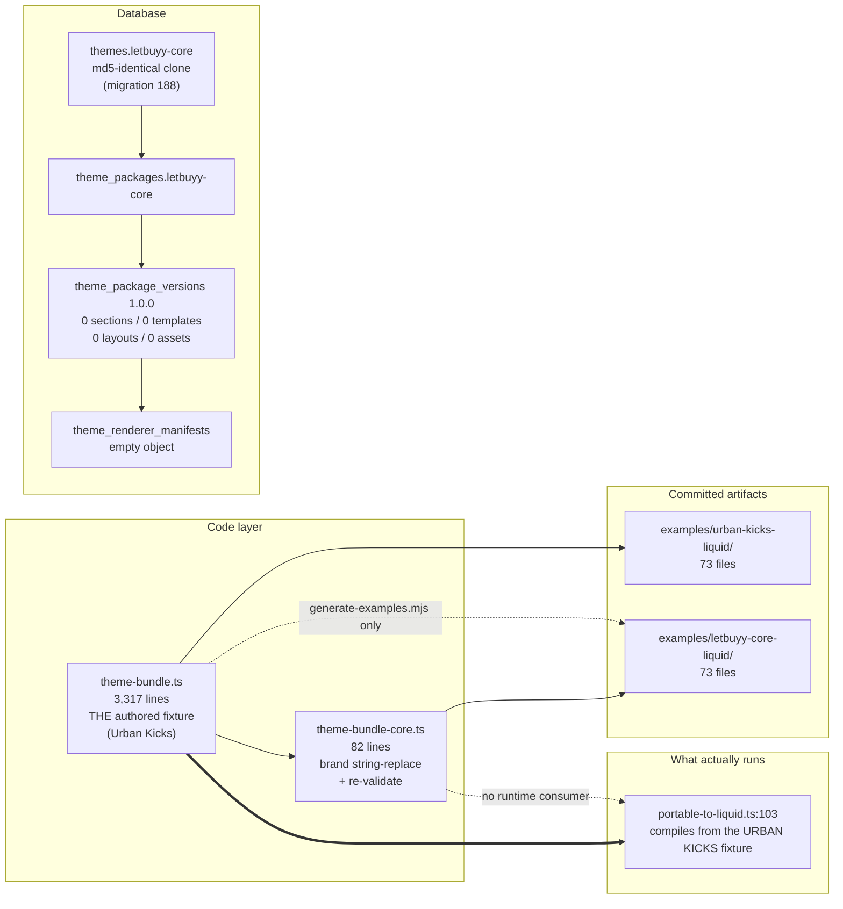

# 07 — `letbuyy-core`: What It Actually Is Today

> Companion documents: [01-governance-and-invariants.md](01-governance-and-invariants.md) (ART-17 / THEME-R1…R6),
> [03-theme-data-model.md](03-theme-data-model.md) (the tables), [04-theme-installation-lifecycle.md](04-theme-installation-lifecycle.md) (how it gets installed),
> [13-security-and-tenant-isolation.md](13-security-and-tenant-isolation.md), [14-test-build-governance-baseline.md](14-test-build-governance-baseline.md).

---

## Status — 2026-08-04

| | |
|---|---|
| **Proven** | The on-disk bundle inventory (71 files under `files/`, 60,408 bytes, no `assets/` directory), the 61/73 byte-identical committed-file split against `urban-kicks-liquid`, the derivation direction (Core is derived from Urban Kicks, not the reverse), the single runtime consumer of each fixture, the contents of `layout/theme.liquid` and `config/settings_schema.json`, migration 188's column list, and the live `themes` / `theme_packages` / `theme_package_versions` row state. All re-verified first-hand on 2026-08-04. |
| **Proven (live DB, pre-reset)** | `themes.letbuyy-core` has md5-identical `config`, `default_template` and `settings_schema` to `urban-kicks`; its `default_template` contains `"Urban Kicks"` and does **not** contain `"LetBuyy Core"`; its package version has 0 sections / 0 templates / 0 layouts / 0 assets; its `theme_renderer_manifests` row is literally `{}`. |
| **Inferred** | Nothing material in this document is inferred. Two judgements are marked as such inline: the readiness score (§9, method stated) and the intent behind migration 188. |
| **Stale-doc** | `theme-bundle-core.ts:16-21` says the DB alias row and the compile-path switch are "deferred follow-ups… kept out of this change". The DB row landed (migration 188); the fixture switch never did. `docs/theme-discovery/10-letbuyy-core-audit.md:689` describes a rename/neutralization that source shows was never performed on the runtime or DB path. |
| **Unresolved** | Whether migration 188's verbatim clone was deliberate (an alias row so slug lookups resolve) or an oversight (it should have carried the neutral-branded fixture). Its header claims the former; the result ships Urban Kicks branding under the LetBuyy Core name. |
| **Substrate warning** | The local database was reset mid-verification (see [03-theme-data-model.md](03-theme-data-model.md) §6.3). Live values here are the pre-reset capture. |

---

## 1. One-sentence answer

**`letbuyy-core` is a cosmetic alias for Urban Kicks that exists at four layers, is neutrally branded at
exactly one of them, and is dead code at runtime.**

---

## 2. `letbuyy-core` at each layer



| Layer | Artifact | What it contains | Neutrally branded? |
|---|---|---|:---:|
| **Code — alias** | `LETBUYY_CORE_THEME_SLUG = 'letbuyy-core'`, `LETBUYY_CORE_BUNDLE_SLUG = 'letbuyy-core-liquid'`, `resolveCanonicalThemeSlug` (`theme-bundle-core.ts:29-41`) | A slug alias map: `urban-kicks → letbuyy-core`, `urban-kicks-liquid → letbuyy-core-liquid` | n/a |
| **Code — fixture** | `createLetbuyyCoreLiquidThemeBundleFixture()` (`theme-bundle-core.ts:66-81`) | The Urban Kicks fixture, JSON-cloned with three brand tokens replaced, then re-validated against `LiquidThemePackageBundleSchema` | ✅ **the only place it is** |
| **Disk — bundle** | `packages/theme-engine/examples/letbuyy-core-liquid/` | 73 committed files (71 under `files/` + `bundle.json` + `manifest.json`), 60,408 bytes of theme sources | ✅ (generated from the fixture) |
| **DB — catalog row** | `themes` where `slug='letbuyy-core'` | An **md5-identical clone** of the `urban-kicks` row's `config`, `default_template` and `settings_schema` | ❌ **carries Urban Kicks branding** |
| **DB — package** | `theme_packages` where `slug='letbuyy-core'`, `status='active'` | Package identity only | ❌ n/a |
| **DB — version** | `theme_package_versions` 1.0.0, `release_status='published'`, `package_manifest.source='legacy-theme'` | **Zero content rows.** 0 section definitions, 0 templates, 0 layouts, 0 assets | ❌ hollow |
| **DB — manifests** | `theme_schema_manifests` (13-field flat `appearance` group), `theme_renderer_manifests` (`{}`) | Schema manifest is populated by migration 193; renderer manifest is an **empty object** | ❌ hollow |
| **Runtime** | — | **Nothing.** `portable-to-liquid.ts:103` compiles from the *Urban Kicks* fixture | ❌ never reached |

---

## 3. Proof that the DB row is a hollow clone

### 3.1 Migration 188 clones without neutralization

```sql
-- database/supabase/migrations/188_letbuyy_core_theme_row.sql:17-32  (abridged)
INSERT INTO public.themes (id, name, slug, site_type, category, description,
    config, default_template, settings_schema, is_active, is_premium,
    letbuyy_pricing_type, supported_site_types, supported_platforms, industry)
SELECT gen_random_uuid(), 'LetBuyy Core', 'letbuyy-core',
    site_type, category, description, config, default_template, settings_schema, …
FROM public.themes WHERE slug = 'urban-kicks'
ON CONFLICT (slug) DO NOTHING;
```

Two consequences follow from that column list, both **proven**:

1. **Only `id`, `name` and `slug` are overridden.** `config`, `default_template` and `settings_schema` are copied verbatim, so every branding string inside the embedded Liquid bundle survives.
2. **Five columns are not cloned at all** — `section_schemas`, `block_schemas`, `renderer_manifest`, `schema_version`, `renderer_version` are absent from the insert list, so they take their table defaults.

### 3.2 The live evidence

| Query | Result |
|---|---|
| `SELECT slug, md5(config::text), md5(default_template::text), md5(settings_schema::text), length(default_template::text) FROM themes;` | `letbuyy-core` and `urban-kicks` produce **identical md5s on all three columns** (`61d0d284…`, `e80035f3…`, `82f5d74a…`) and the same length, `61257` |
| `SELECT slug, default_template::text LIKE '%Urban Kicks%', default_template::text LIKE '%LetBuyy Core%' FROM themes;` | `letbuyy-core \| t \| f` — **contains "Urban Kicks", does not contain "LetBuyy Core"** |
| `SELECT slug, default_template#>>'{liquidBundle,package,slug}' FROM themes;` | `letbuyy-core \| urban-kicks-liquid` |
| `SELECT left(default_template#>>'{liquidBundle,layout,theme}',300) WHERE slug='letbuyy-core';` | contains `<title>{{ shop.name }} - Urban Kicks</title>` |
| `themes` renderer/section key counts | `urban-kicks \| 3 rm_keys \| 6 sec_keys`; `letbuyy-core \| 0 \| 0` |
| `theme_renderer_manifests` for `letbuyy-core` | `{}` (empty object); `urban-kicks` carries a full `sectionRendererMap` |
| per-package content counts | `urban-kicks`: 19 sections / 11 templates / 1 layout; **`letbuyy-core`: 0 / 0 / 0 / 0** |
| `theme_schema_manifests.section_schemas` for `letbuyy-core` | 0 section keys, 0 block keys |
| `SELECT theme_id, count(*) FROM sites GROUP BY theme_id;` | `urban-kicks \| 1` — **no site references `letbuyy-core`** |

**Stated plainly: any merchant who installs "LetBuyy Core" from the catalog gets Urban Kicks branding
rendered on their storefront, with an empty renderer manifest and no approved renderer keys beyond the
`[slug, 'default']` legacy fallback.**

---

## 4. Bundle inventory — `packages/theme-engine/examples/letbuyy-core-liquid/`

`find files -type f | wc -l` → **71**. `find files -type f -exec wc -c {} + | tail -1` → **60,408 bytes
(≈ 60 KB)**. Plus two top-level metadata files (`bundle.json` 108,383 B; `manifest.json` 19,457 B) for a
committed total of **73 files**.

| Group | Files | Bytes | Contents |
|---|---:|---:|---|
| `files/layout/` | 1 | 425 | `theme.liquid` |
| `files/sections/` | **42** | 44,128 | the entire render surface |
| `files/blocks/` | 3 | 498 | `badge.liquid`, `category.liquid`, `product-card.liquid` |
| `files/templates/` | 13 | — | top-level template JSON |
| `files/templates/customers/` | 8 | — | customer-account template JSON (13 + 8 = **21 templates**, 13,691 B combined) |
| `files/config/` | 2 | 1,229 | `settings_schema.json` (1,034 B), `settings_data.json` (195 B) |
| `files/locales/` | 1 | 41 | `en.json` — **two keys total**: `general.cart = "Cart"` |
| `files/` (root) | 1 | 396 | `letbuyy-theme.json` (package descriptor) |
| **`files/assets/`** | **0** | **0** | **The directory does not exist.** No CSS, no JS, no images, no fonts ship with the theme |

`ls files/assets` → `No such file or directory`. `theme_assets` in the database has **0 rows**.
Everything visual therefore depends on `apps/storefront-runtime/.../liquid-theme.css`, which is outside
the theme bundle and outside the theme's control.

---

## 5. Duplication verdict (adversarial verifier #5) — **PARTIAL**, with the premise inverted

The question asked whether `urban-kicks` shares "the core". **The derivation runs the other way.**

| # | Finding | Status | Evidence |
|---|---|:---:|---|
| 1 | **Urban Kicks is the base authoring source; `letbuyy-core` is the derived rebrand** | proven | `wc -l`: `theme-bundle.ts` = **3,317** lines; `theme-bundle-core.ts` = **82** lines. `theme-bundle-core.ts:26-28` imports `createUrbanKicksLiquidThemeBundleFixture` from `./theme-bundle` |
| 2 | **At SOURCE level: shared, not duplicated.** One authored fixture; Core is a JSON string-replace of three brand tokens plus a schema re-validate. The two can never structurally drift | proven | `theme-bundle-core.ts:66-81` |
| 3 | **At COMMITTED-ARTIFACT level: fully duplicated.** File trees byte-identical; **61 of 73 files byte-identical by SHA-256**; the 12 that differ diverge *only* by brand strings | proven | `diff <(find . -type f\|sort) …` → empty; per-file SHA-256 loop → `identical=61 differing=12 total=73`. Differing set: `bundle.json`, `manifest.json`, `files/letbuyy-theme.json`, `files/config/settings_schema.json`, `files/layout/theme.liquid`, and 7 template JSONs (`cart`, `collection`, `footer`, `header`, `index`, `product`, `search`) |
| 4 | **The entire render surface is byte-identical.** All 42 `sections/*.liquid` and all 3 `blocks/*.liquid` are the same file. Of 46 `.liquid` files, only `layout/theme.liquid` differs — by **2 lines** | proven | SHA-256 loop scoped to `sections/ blocks/ layout/` |
| 5 | **The Core fixture is DEAD CODE at runtime** | proven | `rg createLetbuyyCoreLiquidThemeBundleFixture` (excluding md/tests/node_modules/dist) → only its own definition + `examples/generate-examples.mjs:41,52`. The compile path is `portable-to-liquid.ts:103`: `const base = createUrbanKicksLiquidThemeBundleFixture();` — with the comment *"canonical first-party section/block/layout files"*. The storefront demo (`urban-kicks-demo.ts:314`) also calls the Urban Kicks fixture |
| 6 | **Code vs DB conflict.** The code fixture neutralizes branding; migration 188 does not | proven | §3 |

The complete `layout/theme.liquid` diff between the two bundles:

```diff
-  <title>{{ shop.name }} - LetBuyy Core</title>
+  <title>{{ shop.name }} - Urban Kicks</title>
-<body class="lb-theme lb-theme--letbuyy-core">
+<body class="lb-theme lb-theme--urban-kicks">
```

A brand-token filter over `bundle.json`'s 30 differing lines
(`grep -viE 'urban.kicks|letbuyy.core|Urban Kicks|LetBuyy Core'`) leaves **zero** residue.

**Bottom line.** Not duplicated *source* — one fixture, mechanically derived, so drift risk is genuinely
low. But genuinely duplicated *committed artifacts* (146 files encoding ~73 files of unique content) and
a duplicated *DB row*. The duplication is benign for maintenance and harmful for honesty: the "LetBuyy
Core" identity is a cosmetic alias that neither the compile path nor the database delivers. Under
`WIN-R4`/`ANTI-R1` this is a second system for one domain that has not been collapsed.

One further honesty detail: `files/config/settings_data.json` ships
`primaryColor #8B5CF6, accentColor #F59E0B, surfaceColor #F8FAFC` — the Urban Kicks palette. The brand
replace touched slugs and display names only, never the colour defaults. "LetBuyy Core" therefore ships
Urban Kicks' purple/amber palette as its factory defaults.

---

## 6. Template completeness

The on-disk bundle carries **21** templates. Measured against a standard Online-Store-2.0 template set
plus the LetBuyy-specific additions:

| Template | In bundle? | In the DB-persisted bundle? |
|---|:---:|:---:|
| `index` | ✅ | ✅ |
| `product` | ✅ | ✅ |
| `collection` | ✅ | ✅ |
| `cart` | ✅ | ✅ |
| `search` | ✅ | ✅ |
| `header` (LetBuyy) | ✅ | ✅ |
| `footer` (LetBuyy) | ✅ | ✅ |
| `customers/account` | ✅ | ✅ |
| `customers/login` | ✅ | ✅ |
| `customers/register` | ✅ | ✅ |
| `customers/order` | ✅ | ✅ |
| `customers/orders` | ✅ | ✅ |
| `page` | ✅ | ❌ |
| `blog` | ✅ | ❌ |
| `article` | ✅ | ❌ |
| `policy` | ✅ | ❌ |
| `password` | ✅ | ❌ |
| `not_found` (404) | ✅ | ❌ |
| `customers/addresses` | ✅ | ❌ |
| `customers/settings` (LetBuyy) | ✅ | ❌ |
| `customers/wishlist` (LetBuyy) | ✅ | ❌ |
| **`list-collections`** | ❌ | ❌ |
| **`gift_card`** | ❌ | ❌ |
| **`contact`** | ❌ | ❌ |
| **`customers/reset_password`** | ❌ | ❌ |
| **`customers/activate_account`** | ❌ | ❌ |

### 6.1 Two distinct gaps

**Gap A — never authored (5 templates):** `list-collections`, `gift_card`, `contact`,
`customers/reset_password`, `customers/activate_account`. `gift_card` is notable because gift cards are a
first-class LetBuyy money surface (`gift_card_accounts`, `gift_card_ledger_entries`,
`gift_card_redemptions`, and the `issue_gift_card` / `restore_gift_card_on_refund` RPCs) with no
storefront template. `customers/reset_password` and `customers/activate_account` are the two account
templates the customer auth flow needs.

**Gap B — authored but not persisted (9 templates):** the DB-persisted bundle carries **33 sections and
12 templates** while the current code fixture produces **42 sections and 21 templates**. Missing live:
`article`, `blog`, `page`, `policy`, `password`, `not_found`, `customers/addresses`,
`customers/settings`, `customers/wishlist`. Evidence: live psql counts vs
`packages/theme-engine/examples/urban-kicks-liquid/bundle.json`; the checked-in generated seed
`database/supabase/seeds/generated/urban-kicks-liquid-bundle.json` is also **33/12**.

Consequence, proven: `resolveLiquidTemplateKey` falls back to `index`
(`apps/storefront-runtime/src/lib/theme-engine/template-resolver.ts:133-137`), so **nine storefront route
families currently render the home page**. A 404 renders the home page. A blog article renders the home
page. A password page renders the home page.

---

## 7. Quality of `layout/theme.liquid`

The entire layout is 425 bytes:

```liquid
<!doctype html>
<html lang="{{ request.locale | default: "en" }}">
<head>
  <meta charset="utf-8">
  <meta name="viewport" content="width=device-width, initial-scale=1">
  <title>{{ shop.name }} - LetBuyy Core</title>
  {{ content_for_header | raw }}
</head>
<body class="lb-theme lb-theme--letbuyy-core">
  <main id="MainContent">
    {{ content_for_layout | raw }}
  </main>
  {{ content_for_footer | raw }}
</body>
</html>
```

| Expected in a production storefront layout | Present? | Note |
|---|:---:|---|
| Stylesheet link (`{{ 'theme.css' \| asset_url }}` or equivalent) | ❌ | No `assets/` directory exists to link to; all styling comes from `liquid-theme.css` in the storefront app |
| Skip link to `#MainContent` | ❌ | The target `<main id="MainContent">` exists but **nothing links to it**. `rg -in 'skip.?to\|skip-link\|sr-only\|visually-hidden'` over the bundle → **0 hits**. **WCAG 2.4.1 fails** |
| `<meta name="description">` | ❌ | absent |
| Open Graph / Twitter card tags | ❌ | absent |
| Favicon link | ❌ | absent — even though `sites.site_settings` carries a `favicon_url` (migration 187) |
| Canonical URL | ❌ | absent |
| `<header>` landmark in the layout | ❌ | The layout emits no `<header>`/`<footer>` element. Those landmarks come from the *section* partials — `sections/header.liquid:1,3` (`<header>` + `<nav>`) and `sections/footer.liquid:1,3` (`<footer>` + `<nav>`) — injected through `content_for_header` / `content_for_footer` |
| `:focus` / `:focus-visible` styling anywhere in the bundle | ❌ | 0 rules in the bundle, 0 in `LIQUID_THEME_BASE_CSS` (`theme-renderer.ts:243-262`), 0 in `liquid-theme.css`. **WCAG 2.4.7 fails** |
| `alt` on images | ✅ | 5 of 5 `` tags carry `alt` |
| ARIA | ⚠️ | 10 `aria-*` attributes across 5 of 42 section files |
| `<html lang>` | ✅ | `{{ request.locale \| default: "en" }}` |
| Viewport meta | ✅ | present |

There is also a live defect on the head-assets path that makes the missing stylesheet link worse:
`buildLiquidThemeHeadAssets` — the `:root` token block, `LIQUID_THEME_BASE_CSS`, and the single
SAFE-CSS custom-CSS injection point — is computed at `theme-renderer.ts:585` but only attached to
`layoutHtml` (`:673-680`), and `composition-engine.tsx:621-623` returns only
`` `${header}${contentForLayout}${footer}` ``, **discarding `layoutHtml`**. Merchant custom CSS therefore
has no storefront consumer at all (`rg 'customCss|custom_css'` over `apps/storefront-runtime` → 0 hits).

---

## 8. The settings-schema divergence

There are **two schemas of record for the same theme**, and a third shape in the bundle.

| | Code-canonical `THEME_SETTINGS_SCHEMA`<br/>(`theme-registry.ts:436-489`) | Bundle `files/config/settings_schema.json` | Live DB `theme_schema_manifests.settings_schema` |
|---|---|---|---|
| Groups | **5** — `colors`, `typography`, `layout`, `header`, `footer` | **2** — `colors`, `typography` | **1** — a flat `appearance` group |
| Fields | **19** | **5** | **13** |
| Field list | `primaryColor`, `secondaryColor`, `accentColor`, `backgroundColor`, `textColor`, `fontFamily`, `headingFontFamily`, `borderRadius`, `enableAnimations`, `enableShadows`, `behavior`, `logoPlacement`, `displayMode`, `showSearch`, `showCart`, `columns`, `showNewsletter`, `showSocial`, `showPaymentIcons` | `primaryColor`, `accentColor`, **`surfaceColor`**, `headingFontFamily`, **`bodyFontFamily`** | `isDark`, `textColor`, `fontFamily`, `accentColor`, `borderRadius`, `primaryColor`, **`surfaceColor`**, `enableShadows`, **`bodyFontFamily`**, `secondaryColor`, `backgroundColor`, `enableAnimations`, `headingFontFamily` |
| Control types | proper — `color`, `select`, `range`, `toggle` | `color` for colours, `text` for fonts | **every field is `type: "text"`** |
| Which one validates a draft save / publish? | fallback only | never — not read by the gateway | **this one** |

### 8.1 The bundle's own divergence, stated precisely

`files/config/settings_schema.json` declares **2 groups / 5 fields**. It uses `bodyFontFamily` and
`surfaceColor` — **neither of which exists in the canonical `THEME_SETTINGS_SCHEMA`** — while **omitting
`fontFamily`**, which is canonical (`theme-registry.ts:453`). So the shipped bundle and the frozen code
schema disagree on both directions of the typography contract.

### 8.2 Which schema the runtime actually uses

`resolveThemeRuntime` prefers `theme_schema_manifests.settings_schema` when non-empty, then
`themes.settings_schema`, then the code `THEME_SETTINGS_SCHEMA`
(`schema-registry-execution.adapter.ts:473-475`, `:87-109`, `:108`). Since both first-party packages have
a populated manifest, **the flat 13-field `appearance` group is the operative contract** and the
"canonical" 5-group schema is the legacy fallback. `settings-schema-canonical.ts:3-8` names them the
other way round; the naming is inverted relative to reality.

Two direct consequences, both proven:

- `DEFAULT_THEME_SETTINGS` (12 keys, `index.ts:138-151`) validates cleanly against the DB manifests but produces **2 validation issues** against the code schema — `surfaceColor` and `isDark` are undeclared there. Any environment with an empty manifest (a fresh DB, or `letbuyy-core` before 193) rejects the defaults on install, draft save, and publish.
- Because every colour and font field in the manifest is `type: "text"`, `SchemaFormRenderer.tsx` takes `case 'text'` (`:96`) and renders **plain text inputs**. The existing `ColorControl` (`:130`) and `FontPickerControl` (`:226`) are unreachable for global theme settings. Merchants type hex codes into text boxes.

### 8.3 What migration 193 was patching

Migration 193's header (`:3-31`) states the problem in full. Two defects, one symptom:

> `POST /v1/themes/urban-kicks/install` returned
> `ValidationError: Theme template validation failed ["themeSettings.primaryColor is not defined by the theme settings schema", …12 fields]`,
> so no `theme_instances` row was ever created and the merchant Themes page showed "No themes installed yet".

1. **Wrong shape in the registry.** The manifest seeded by `seeds/urban-kicks-theme.sql:368-480` is a bare group map `{ "colors": {…}, "layout": {…}, "typography": {…} }` with **no top-level `settings` key**. `normalizeThemeSettingsSchema` therefore takes its fallback branch and wraps the *whole record* as `settings.general.fields`, so the declared field names become literally `"colors"`, `"layout"`, `"typography"`. `validateThemeSettings` then rejects every real key. **Migrations 180 and 181 had fixed `themes.settings_schema` but never touched the registry copy that actually drives validation** — so the theme looked correct in the catalog and still failed to install.
2. **Undeclared `bodyFontFamily`.** It is a real, consumed setting — `theme-renderer.ts:272` maps it to the `--font-body` custom property — but was absent from `DEFAULT_THEME_SETTINGS`, so migration 181 declared only the other twelve.

193's repair is guarded (`NOT (settings_schema ? 'settings')`) so a correctly-shaped marketplace manifest
is never overwritten, and it is idempotent. **Verified applied:** both manifest rows have a top-level
`settings` key and `settings.appearance.fields.bodyFontFamily`; both `themes` rows have 13 appearance
fields. It ships a paired rollback — one of only two in the 180–193 range.

**But 193 did not close the loop.** `bodyFontFamily` now exists in the DB and in the renderer token map
and still does **not** exist in `THEME_SETTINGS_SCHEMA`. And because `seeds/urban-kicks-theme.sql` was
never mirrored (`grep -c appearance` over the seed → **0**), a fresh database reproduces the exact
install failure 193 was written to fix. See [03-theme-data-model.md](03-theme-data-model.md) §7.

---

## 9. Readiness verdict for `letbuyy-core`

### 9.1 Scoring method (stated so the number is falsifiable)

Ten dimensions, chosen because each is independently required for a merchant to install the theme and a
shopper to see a correct store. Each scores **2 = PASS** (works, evidenced), **1 = PARTIAL** (works with
a named defect), **0 = FAIL** (does not work, or the artifact is absent). Maximum 20. No weighting —
weighting would hide that the failures are concentrated in the layers that matter. This is a
**judgement** built on the proven facts above, not itself a proven fact.

| # | Dimension | Score | Justification |
|---|---|:---:|---|
| 1 | Distinct theme identity | **0** | md5-identical `config`/`default_template`/`settings_schema` to `urban-kicks`; DB row renders `Urban Kicks` branding |
| 2 | Bundle completeness (sections/blocks/layout) | **2** | 42 sections, 3 blocks, 1 layout, schema-valid — this part is genuinely good |
| 3 | Template coverage | **1** | 21 authored, but 5 never authored (incl. `gift_card`, `contact`, 2 account templates) and 9 authored-but-unpersisted → 9 route families render `index` |
| 4 | Assets | **0** | No `assets/` directory; `theme_assets` = 0 rows; no CSS/JS/fonts ship with the theme |
| 5 | DB package content | **0** | `theme_package_versions` for `letbuyy-core`: 0 sections / 0 templates / 0 layouts / 0 assets |
| 6 | Renderer manifest | **0** | `theme_renderer_manifests` row is `{}`; `themes.renderer_manifest` has 0 keys |
| 7 | Settings schema coherence | **0** | Three disagreeing shapes (5/19, 2/5, 1/13); every DB field typed `text`, so colour and font pickers are unreachable |
| 8 | Layout head quality | **0** | No stylesheet link, no skip link, no meta description/OG, no favicon, no canonical; head-assets pipeline discarded by the composition engine |
| 9 | Accessibility | **1** | Landmarks present (via sections) and 5/5 images have `alt`, but zero skip links and zero focus styles → WCAG 2.4.1 and 2.4.7 fail |
| 10 | Runtime reachability | **0** | The neutral fixture has exactly one consumer, `generate-examples.mjs`. `portable-to-liquid.ts:103` compiles from Urban Kicks. New stores are still built with Urban Kicks branding |
| | **Total** | **4 / 20** | |

### 9.2 The blunt verdict

**`letbuyy-core` is not a theme. It is a name.**

The only layer where "LetBuyy Core" means anything is a 82-line file that performs a string replace and
has no runtime consumer. At the database layer it is a verbatim copy of Urban Kicks with five columns
missing, so it is strictly *worse* than the theme it clones. At the runtime layer it is unreachable.
Nothing in production has ever rendered it: `SELECT theme_id, count(*) FROM sites GROUP BY theme_id`
returns `urban-kicks | 1` and nothing else.

Do not describe `letbuyy-core` as working, as the canonical first-party theme, or as ready. The honest
description is: *Urban Kicks is the one real first-party theme; `letbuyy-core` is a duplicated identity
layered over it, complete at the fixture layer and hollow everywhere else.* Under `WIN-R4` / `WIN-R5` /
`ANTI-R1` the correct disposition is a decision — **complete it or collapse it** — not indefinite
coexistence. A merchant-visible catalog entry whose rendered output says "Urban Kicks" should not ship
either way.

---

## 10. Defect register for this document

| ID | Severity | Defect | Evidence |
|---|:---:|---|---|
| CORE-1 | **P1** | `letbuyy-core` DB row is a hollow, non-neutralized clone; installing it ships Urban Kicks branding | §3 |
| CORE-2 | **P1** | Migration 188 omits `section_schemas`, `block_schemas`, `renderer_manifest`, `schema_version`, `renderer_version` from its clone | `188_…:19-32`; live counts |
| CORE-3 | **P1** | Persisted bundle is stale: DB 33 sections / 12 templates vs fixture 42 / 21 → 9 route families fall back to `index` | live psql vs `examples/urban-kicks-liquid/bundle.json`; `template-resolver.ts:133-137` |
| CORE-4 | **P1** | Three disagreeing settings-schema shapes; DB fields all typed `text`, so colour/font pickers are unreachable | §8 |
| CORE-5 | **P1** | No skip link and zero focus styles anywhere in the bundle or storefront CSS — WCAG 2.4.1 + 2.4.7 fail | §7 |
| CORE-6 | **P1** | `buildLiquidThemeHeadAssets` is computed and discarded; merchant custom CSS has no storefront consumer | `theme-renderer.ts:585,673-680`; `composition-engine.tsx:621-623` |
| CORE-7 | **P2** | 146 committed files encode ~73 files of unique content; the Core fixture is dead code | §5 |
| CORE-8 | **P2** | No `assets/` directory and 0 `theme_assets` rows — the theme ships no CSS/JS/fonts | §4 |
| CORE-9 | **P2** | 5 templates never authored, incl. `gift_card` (a live money surface) and the 2 account-recovery templates | §6 |
| CORE-10 | — | Intent behind migration 188's verbatim clone | **unresolved** |
