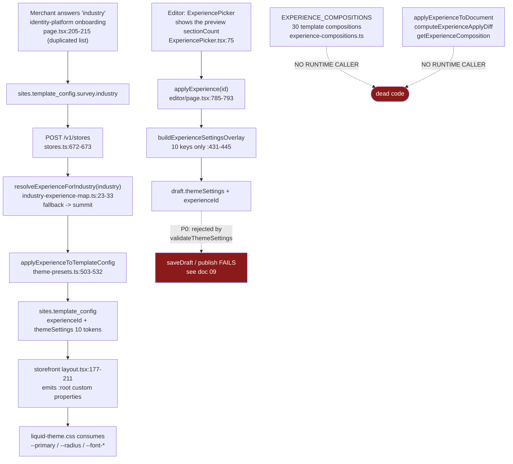

# 08 — Presets & the Industry Map

> **Status of this document — 2026-08-04.**
>
> **Proven.** The authoritative preset list (10 code Experiences), the 9-entry industry map, the
> `theme_presets` table contents (1 row), the fact that no runtime code path calls
> `applyExperienceToDocument` / `computeExperienceApplyDiff` / `getExperienceComposition`, the
> section-type gaps (`collectionFilter`, `faqAccordion`), and the live state of the single tenant
> (`saai` = `forge` tokens over generic default sections). Verified against source, against
> `docker exec supabase_db_Letbuyy_Store psql`, and by executing the theme-engine test suite
> (365 pass / 0 fail).
>
> **Unresolved.** Whether `theme_presets` is intended to become the runtime preset store or is
> slated for deletion (LEG-050); whether the Experiences tab has ever been exercised end-to-end
> by a real merchant; whether the composition layer is meant to ship or to be deleted.
>
> **Tree state.** Every source file cited here was checked with `git diff --numstat` and shows
> **0 content changes vs `HEAD` (`bf35062e`)** — `theme-presets.ts`, `industry-experience-map.ts`,
> `experience-compositions.ts`, `theme-registry.ts`, `theme-engine/src/index.ts`, the editor
> `page.tsx`, `ExperiencePicker.tsx`, `identity-platform/onboarding/page.tsx`. Every line number
> below is therefore valid at both `HEAD` and in the working tree. (This is **not** true of the
> security surface — see [13-security-and-tenant-isolation.md](13-security-and-tenant-isolation.md) §0.)
>
> **Environment caveat.** The local Supabase database was **re-initialised during this session**
> (`select count(*) from public.sites` → `0`). DB **row/content** claims below (the one
> `theme_presets` row, the live `saai` site) were proven during the discovery sweep against the
> populated database and are marked *(proven — pre-reset)*; they are not re-verifiable here until
> it is reseeded.
>
> **Authority.** Subordinate to `GOVERNANCE_REWRITE_2026_06_10/LETBUYY_CONSTITUTION.md` → root
> `AGENTS.md` → local `AGENTS.md`. This document is evidence, never law (`DOC-R2`). See
> [01-governance-and-invariants.md](01-governance-and-invariants.md).

---

## 1. Read this first: "preset" means four different things

Nothing in this repository is more confusing than the word *preset*. Four unrelated registries
carry the name. Only the first one matters for merchant-facing behaviour.

| # | Layer | Where it lives | Count | Who reads it | Status |
|---|---|---|---|---|---|
| **1** | **Experiences** (industry design systems) | `packages/theme-engine/src/theme-presets.ts:387-398` — `EXPERIENCE_REGISTRY` | **10** | Gateway store-creation + merchant editor picker | **The canonical preset set.** Code-only. **0 DB rows.** |
| 2 | `public.theme_presets` table | `database/supabase/migrations/000_baseline.sql` (DDL); written only by `database/supabase/seeds/urban-kicks-theme.sql:700` | **1 row** | **Nobody.** Zero application readers | Dead. Marked `SAFE_DELETE` as LEG-050 |
| 3 | Liquid section-schema `presets` | 42 `.liquid` files in `packages/theme-engine/examples/letbuyy-core-liquid/files/sections/` | 42 (one per file, all trivial defaults) | The section-schema parser | Inert defaults |
| 4 | `SECTION_SCHEMAS[...].presets` | `packages/theme-engine/src/theme-registry.ts:97-99,119-121` | 22 entries across 10 sections | The React section editor | Section-level variants ("Centered Hero", "4-Column Grid") |

> **The critical disambiguation.** Layer 1 and layer 2 share only the word. No Experience id
> (`forge`, `sense`, …) appears in any migration or in `theme_presets`; the one `theme_presets` row
> is a per-package starter config for a theme that is not even the one the live store renders.
>
> Evidence: `rg 'forge|summit|nova' database/supabase/migrations` → **0 hits for experience ids**;
> `psql -c "select preset_key, name from theme_presets"` → `default | Urban Kicks Default` (1 row);
> `rg 'theme_presets'` (excluding `node_modules/dist/.next/docs`) → seeds + baseline DDL +
> `tests/contracts/demo-store-isolation.test.ts:87` only. *(proven; the `psql` row count is
> pre-reset, the two `rg` results were re-verified 2026-08-04)*

### 1.1 The `theme_presets` row, in full

| Column | Value | Evidence |
|---|---|---|
| `preset_key` | `default` | `psql: select p.preset_key, p.name, tp.slug, v.version from theme_presets p join theme_package_versions v … join theme_packages tp …` |
| `name` | `Urban Kicks Default` | same |
| bound package | `urban-kicks` **1.0.0** | same |
| rows for `letbuyy-core` | **0** | `psql` per-version counts → `letbuyy-core 1.0.0: sect_defs=0, presets=0` |

The live store `saai` renders `themeId = letbuyy-core`. So the one preset row in the database is
attached to a package the live store does not use. *(proven — pre-reset)*

---

## 2. THE AUTHORITATIVE LIST — 10 Experiences

Source of truth: `EXPERIENCE_REGISTRY` at `packages/theme-engine/src/theme-presets.ts:387-398`.
Order below is the literal key order of the frozen object (which is also `EXPERIENCE_IDS`).

| # | `id` | `name` | Industry | Primary colour | Radius | Heading / body font | Provenance (`metadata.grounding`) | `defineExperience` at |
|---|---|---|---|---|---|---|---|---|
| 1 | `forge` | Forge | `electronics` | `#1E3A5F` | 8 | Inter / Inter | **research** (`:172`) | `theme-presets.ts:166` |
| 2 | `sense` | Sense | `fashion` | `#1A1A2E` | 4 | Playfair Display / Inter | **research** (`:193`) | `theme-presets.ts:187` |
| 3 | `aura` | Aura | `beauty` | `#C2798B` | 16 | Cormorant Garamond / Lato | designed (`:215`) | `theme-presets.ts:209` |
| 4 | `craft` | Craft | `furniture` | `#3E2723` | 6 | Libre Baskerville / Source Sans Pro | **research** (`:237`) | `theme-presets.ts:231` |
| 5 | `refresh` | Refresh | `food` | `#2D6A4F` | 10 | Inter / Inter | **research** (`:259`) | `theme-presets.ts:253` |
| 6 | `ride` | Ride | `sports` | `#FF4D00` | 6 | Inter / Inter | designed (`:281`) | `theme-presets.ts:275` |
| 7 | `dawn` | Dawn | `books` | `#3B4F6B` | 4 | Libre Baskerville / Source Sans Pro | designed (`:303`) | `theme-presets.ts:297` |
| 8 | `bloom` | Bloom | `pet` | `#E07B39` | 14 | Inter / Inter | designed (`:325`) | `theme-presets.ts:319` |
| 9 | `nova` | Nova | **`null`** (`:346`) | `#8B5CF6` | 10 | Inter / Inter | designed (`:347`) | `theme-presets.ts:341` |
| 10 | `summit` | Summit | `general` | `#00B3B3` | 12 | Inter / Inter | **research** (`:369`) | `theme-presets.ts:363` |

*All rows proven — read directly from source; the id list was additionally proved by executing
`EXPERIENCE_IDS` (→ `["forge","sense","aura","craft","refresh","ride","dawn","bloom","nova","summit"]`,
count 10) and by the assertion "Stream C: the registry defines exactly the 10 named experiences" in
`packages/theme-engine/test/theme-presets.test.ts`.*

### 2.1 Differentiation quality

| Dimension | Finding | Status |
|---|---|---|
| Colour | All 10 `primaryColor` values distinct | proven — `theme-presets.ts:166-383` |
| Radius | 7 distinct values across 10 experiences: `{4, 6, 8, 10, 12, 14, 16}` | proven — same |
| Typography | **Weak.** 6 of 10 use **Inter for both** heading and body (`forge`, `refresh`, `ride`, `bloom`, `nova`, `summit`). Only 4 distinct heading fonts and 3 distinct body fonts across the whole registry | proven — `theme-presets.ts:180-181,202-203,224-225,246-247,268-269,290-291,312-313,334-335,356-357,378-379` |
| Authoring | Each Experience is built by `defineExperience()` from **9 tokens** (6 colours, 2 fonts, `borderRadius`) plus `defaultSections`. `colorSystem`, `typography`, `layout` and `preview` are **derived**, not independently authored | proven — `theme-presets.ts:125-153` |
| Provenance | 5 research-grounded (`forge`, `sense`, `craft`, `refresh`, `summit`), 5 self-declared `designed` | proven — the 10 `grounding:` lines cited above |

---

## 3. The industry map — 9 entries, not 10

`INDUSTRY_EXPERIENCE_MAP` at `packages/theme-engine/src/industry-experience-map.ts:23-33`:

| Industry key | → Experience |
|---|---|
| `electronics` | `forge` |
| `fashion` | `sense` |
| `beauty` | `aura` |
| `furniture` | `craft` |
| `food` | `refresh` |
| `sports` | `ride` |
| `books` | `dawn` |
| `pet` | `bloom` |
| `general` | `summit` |

Two consequences, both proven:

1. **`nova` is NOT industry-reachable.** Its `industry` is `null`
   (`theme-presets.ts:346`), so no industry answer in onboarding can ever select it. It is
   selectable only as an explicit override in the editor's `ExperiencePicker`.
2. **`summit` is `FALLBACK_EXPERIENCE_ID`** (`theme-presets.ts:403`). Any unknown or free-text
   industry resolves to Summit. Executed probe: `override nova -> nova (source=override)`,
   `unknown industry -> summit (source=fallback)`.

`INDUSTRY_OPTIONS` (`industry-experience-map.ts:69-81`) has the same 9 entries and derives its
`experienceId` from the map, so the picker and the resolver cannot drift **inside** the package.

### 3.1 [SAFE-FIX] The duplicated industry list

`apps/identity-platform/src/app/onboarding/page.tsx:205-215` hardcodes its own 9-entry
`ONBOARDING_INDUSTRIES` literal instead of importing `INDUSTRY_OPTIONS` from
`@letbuyy/theme-engine`. The values currently match, but nothing enforces it — the labels and
recommended-experience names are hand-copied. This is a silent drift surface: an eleventh
Experience or a renamed industry key would leave onboarding pointing at a stale list with no test
or validator failing. *(proven — `page.tsx:205-215` vs `industry-experience-map.ts:69-81`)*

> Note when fixing: `identity-platform` already aliases `@letbuyy/theme-engine` in
> `next.config.ts:33`, but importing the barrel into a client component pulls in the `node:crypto`
> problem documented in [09-settings-schema-and-editor.md](09-settings-schema-and-editor.md) §5 —
> apply that guard first.

---

## 4. Per-Experience usability classification

This is the answer to "how many of the 10 actually work". The four columns are independent: an
Experience can validate perfectly and still change nothing structural on the storefront.

| Experience | Validates? | Style layer (colours / radius / fonts) applies? | Section composition applies? | Renders? |
|---|---|---|---|---|
| `forge` | ✅ | ✅ | ❌ (no runtime caller) | ✅ tokens only |
| `sense` | ✅ | ✅ | ❌ | ✅ tokens only |
| `aura` | ✅ | ✅ | ❌ | ✅ tokens only |
| `craft` | ✅ | ✅ | ❌ | ✅ tokens only |
| `refresh` | ✅ | ✅ | ❌ | ✅ tokens only |
| `ride` | ✅ | ✅ | ❌ | ✅ tokens only |
| `dawn` | ✅ | ✅ | ❌ | ✅ tokens only |
| `bloom` | ✅ | ✅ | ❌ | ✅ tokens only |
| `nova` | ✅ | ✅ | ❌ | ✅ tokens only |
| `summit` | ✅ | ✅ | ❌ | ✅ tokens only |
| **Total** | **10 / 10** | **10 / 10** | **0 / 10** | **10 / 10 (cosmetic only)** |

### 4.1 The verdict, stated plainly

- **10 / 10 validate.** Executed: `collectExperienceRegistryIssues() = []`,
  `collectIndustryMapIssues() = []`, `collectExperienceFontIssues() = []`;
  `validateExperience` + `validateExperienceOverlay` pass for all 10. Package suite:
  `tsx --test test/theme-presets.test.ts test/experience-compositions.test.ts test/experience-apply.test.ts test/experience-fonts.test.ts` → **365 pass / 0 fail**. *(proven)*
- **10 / 10 apply the token overlay.** `buildExperienceSettingsOverlay` writes exactly **10 keys**
  — 6 colours + `fontFamily` + `bodyFontFamily` + `headingFontFamily` + `borderRadius`
  (`theme-presets.ts:431-445`). Those tokens reach the browser: the storefront layout emits them as
  `:root` custom properties (`apps/storefront-runtime/src/app/store/[subdomain]/layout.tsx:177-211`)
  which `liquid-theme.css:8-9,17,39` consumes, and Google Fonts are loaded via
  `buildGoogleFontsHref` (`layout.tsx:17,156-175`). *(proven)*
- **0 / 10 apply their section composition.** `EXPERIENCE_COMPOSITIONS` declares complete
  `index` / `product` / `collection` compositions for all 10, and all 10 index compositions are
  structurally unique (`experience-compositions.ts:353-368`). But
  `applyExperienceToDocument`, `computeExperienceApplyDiff` and `getExperienceComposition` have
  **no runtime caller anywhere in the repository**. *(proven)*

Dead-path proof: `rg -n "applyExperienceToDocument|computeExperienceApplyDiff|getExperienceComposition"`
over `apps/ services/ packages/` (excluding `node_modules`, `dist`, `.next`) returns hits only in
`packages/theme-engine/src/experience-apply.ts` (definitions), `experience-compositions.ts:370`,
`packages/theme-engine/test/experience-apply.test.ts`, and **two source comments**:
`apps/merchant-control-plane/src/app/api/themes/[themeId]/editor/ai-customization/route.ts:38`
and `apps/merchant-control-plane/src/components/theme-editor/AICustomizationPanel.tsx:790`.

The only two production apply paths are token overlays:

| Path | Call site | What it writes |
|---|---|---|
| Store creation (gateway, server-authoritative) | `services/api-gateway/src/routes/stores.ts:672-673` — `resolveExperienceForIndustry` + `applyExperienceToTemplateConfig` | 10 tokens + `experienceId` into `sites.template_config` |
| Editor picker (client) | `apps/merchant-control-plane/src/app/[store]/online-store/themes/[themeId]/editor/page.tsx:785-793` — `buildExperienceSettingsOverlay` merge | 10 tokens + `experienceId` into `themeSettings` |

### 4.2 Even if the composition path were wired, it would degrade

The compositions reference section types that do **not exist** in the live Liquid bundle. Resolving
every `SectionSpec` against the 33 sections in `sites.template_config.liquidBundle` (identical to
`database/supabase/seeds/generated/urban-kicks-liquid-bundle.json`):

| Experience | `defaultSections` incompatible | index | product | collection |
|---|---|---|---|---|
| `craft` | `faqAccordion` | ❌ `faqAccordion` | ❌ `faqAccordion` | ❌ `collectionFilter` |
| the other **9** | — | ✅ clean | ✅ clean | ❌ `collectionFilter` |

- `collectionFilter` → `collection-filter` is **absent from the live bundle**, so **all 10**
  collection templates degrade.
- `craft` additionally needs `faqAccordion` → `faq-accordion`, also absent, so **`craft` applies 0
  of its 3 templates cleanly**.
- Net: **0 / 10** would apply all three templates cleanly; 9 / 10 would apply index + product.

*(proven — executed probe against source + the generated bundle; `section-type-map.ts:60-67`
documents the two types as "NOT in current bundle → incompatible" and
`resolveLiquidSectionType` (`:85-94`) returns `null` when the kebab key is absent; `psql` confirmed
pre-reset that the live `liquidBundle` has 33 section keys and contains neither `collection-filter`
nor `faq-accordion` — the same 33/12 counts as the committed
`database/supabase/seeds/generated/urban-kicks-liquid-bundle.json`, which is re-checkable without a
database.)*

Related: **6 of 25** `BUILT_IN_SECTION_TYPES` have no `theme_section_definitions` row —
`announcementBar`, `collectionFilter`, `faqAccordion`, `instagramFeed`, `videoHero`, `appBlockSlot`
— and `announcementBar` **leads every one of the 10 index compositions**
(`experience-compositions.ts:70`). *(proven — `psql theme_section_definitions` → 19 keys, pre-reset;
`built-in-section-schemas.ts:3-29` → 25 types, re-verified 2026-08-04)*

---

## 5. What actually happens when a merchant picks an Experience



---

## 6. [SAFE-FIX] The UI over-promise

`ExperiencePicker.tsx:75` renders, per card:

```tsx
<span>{exp.preview.sectionCount} sections</span>
```

and the apply button label is `Apply {exp.name}`. But the handler wired to it
(`editor/page.tsx:785-793`) writes **only** the 10-key token overlay plus `experienceId`. **No
section is ever added, removed, or reordered.** The merchant is shown a section count that applying
will never produce.

`experience-compositions.ts:1-13` compounds this in the source comment: *"Each Experience defines a
COMPLETE STORE DESIGN: three explicit templates (index/product/collection)"*. That is aspirational,
not shipped. **Source wins:** an Experience currently changes colours, fonts and radius only.
*(proven — conflict recorded as FC4)*

---

## 7. Live proof from the one real tenant

The single site in the local database demonstrates both halves of the finding at once.

| Observation | Value | Evidence |
|---|---|---|
| Sites in DB | **1** | `psql: select count(*) from sites` → 1 |
| Subdomain / store_name | `saai` | `psql: select subdomain, store_name from sites` |
| Survey industry | `electronics` | `psql: select template_config->'survey'->>'industry'` |
| Resolved experience | **`forge`** | `psql: select template_config->>'experienceId'` |
| `themeSettings.primaryColor` | `#1E3A5F` — **exactly Forge** | `psql: jsonb_pretty(template_config->'themeSettings')` |
| `themeSettings.secondaryColor` / `accentColor` / `borderRadius` | `#1E40AF` / `#00B4D8` / `8` — **exactly Forge** | same |
| Rendered sections | `[heroBanner "Urban Kicks", categoryGrid, productGrid, trustBadges]` — **4 generic default sections** | `psql: template_config->'sections'->'template'` |
| Forge's declared index composition | **7 sections** (`announcementBar, heroBanner, categoryGrid, trustBadges, featuredProducts, productGrid, newsletter`) | `experience-compositions.ts:70`+ |
| `rendererEngine` / `themeId` | `liquid` / `letbuyy-core` | `psql: template_config->>'rendererEngine'`, `themeId` |

**The store carries Forge's palette over Urban Kicks' section layout, and its hero still says
"Urban Kicks".** That is the entire gap in one row of data. *(proven — pre-reset; every row in the
table above came from the populated database before it was re-initialised)*

One further subtlety worth knowing before debugging colours: the Experience overlay is written to
`template_config.themeSettings`, **not** into the embedded bundle copy. The site's
`template_config.liquidBundle.config.settings_data.current` still holds the Urban Kicks fixture
defaults (`#8B5CF6` / `#F59E0B` / `#F8FAFC`). Forge wins only because
`layout.tsx` reads `templateConfig.themeSettings`, not the bundle's `settings_data`.
*(proven — `psql: jsonb_pretty(template_config#>'{liquidBundle,config,settings_data,current}')`;
`apps/storefront-runtime/src/lib/store-service.ts:575,592-605` — code re-verified 2026-08-04, the
`psql` read is pre-reset)*

---

## 8. Governance read-out

| Rule | Bearing on this document | Assessment |
|---|---|---|
| **ART-17** (Liquid canonical, React frozen fast-path) | Compositions target Liquid section keys; two of them are unported | The dead composition layer is *not* a React-section addition, so no ART-17 breach — but it also delivers none of the ART-17 benefit |
| **THEME-R3** (one schema source) | Experience compositions reference `BUILT_IN_SECTION_TYPES`; the DB registers only 19 of 25 | Drift between the code section registry and `theme_section_definitions` |
| **THEME-R5** (`theme-engine` canonical for contracts) | `EXPERIENCE_REGISTRY` is correctly located in `packages/theme-engine` | Compliant |
| **`R-15` / DOC-R2** (source wins over docs) | `experience-compositions.ts:1-13` claims a "complete store design" the runtime cannot honour | Doc comment is stale; source wins |

**No deterministic validator guards the registry.** `scripts/validators/` contains no validator
calling `collectExperienceRegistryIssues`, `collectIndustryMapIssues`, `collectExperienceFontIssues`
or `collectSectionTypeMapIssues`. Registry integrity is guarded by package tests only, not by the
107-validator gate. *(proven — see
[14-test-build-governance-baseline.md](14-test-build-governance-baseline.md))*

---

## 9. Open decisions (do not guess — these need an owner)

| # | Question | Why it blocks |
|---|---|---|
| 1 | Is `theme_presets` becoming the runtime preset store (seed the 10 Experiences into it), or is it deleted per LEG-050? | Today presets cannot be added, versioned or A/B-tested without a code deploy. Leaving both layers is the source of the confusion in §1 |
| 2 | Ship the composition layer, or delete it? | `experience-compositions.ts` + `experience-apply.ts` are ~1,300 lines of unreachable code backing a merchant-visible promise. Wiring it requires porting `collectionFilter` + `faqAccordion` first |
| 3 | Has the Experiences tab ever been exercised end-to-end? | The single `theme_editor_drafts` row has no `experienceId` in its `themeSettings` — consistent with *never used* **or** with *used and the save failed* (see the P0 in [09-settings-schema-and-editor.md](09-settings-schema-and-editor.md) §3). Gateway logs would settle it |

---

## 10. Cross-references

- [01-governance-and-invariants.md](01-governance-and-invariants.md) — the authority chain and ART-17/THEME-R1…R6.
- [09-settings-schema-and-editor.md](09-settings-schema-and-editor.md) — why applying an Experience in the editor breaks the next save.
- [13-security-and-tenant-isolation.md](13-security-and-tenant-isolation.md) — RLS posture of `theme_presets` and the other 31 theme tables.
- [14-test-build-governance-baseline.md](14-test-build-governance-baseline.md) — the executed validator/test baseline.
