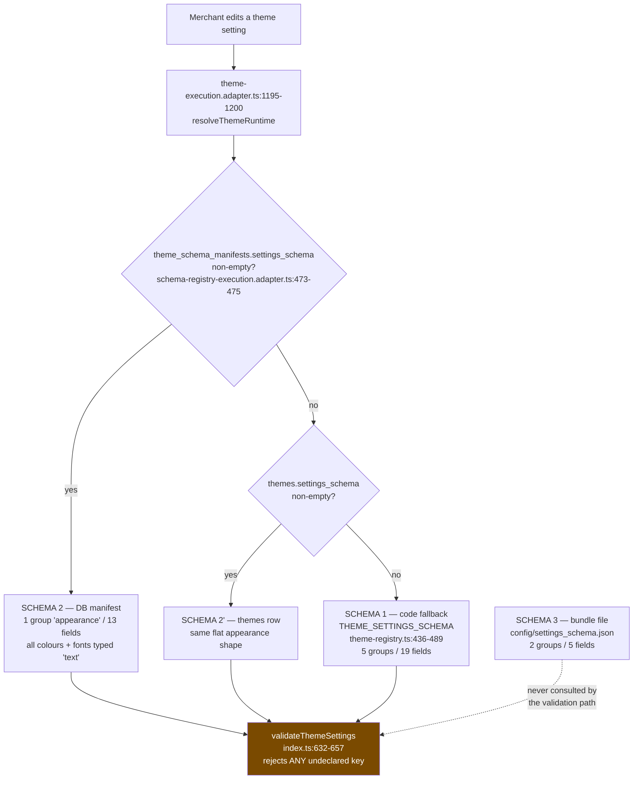

# 09 — Settings Schema & the Merchant Theme Editor

> **Status of this document — 2026-08-04.**
>
> **Proven.** The three divergent settings schemas and their field lists; the
> `DEFAULT_THEME_SETTINGS` incompatibility with the code schema; the `experienceId` P0
> (editor writes a key that `validateThemeSettings` rejects); every colour/font field being typed
> `text` in the DB manifests; the full merchant editor route map (catalog → install → editor →
> draft → preview → publish → releases → rollback); the uncommitted/untracked state of the
> `node:crypto` webpack fix; and the design-system numbers for `liquid-theme.css`.
> `node scripts/validators/validate-design-system.mjs` was **re-executed for this document** on
> 2026-08-04 → **exit 1**.
>
> **Unresolved.** Whether the Experiences tab has ever been exercised end-to-end (§3.3); which
> schema shape is intended to win (§2.4); whether the `node:crypto` working-tree changes are
> deliberate work-in-progress or an accidental omission from a commit (§5).
>
> **Tree state.** `git diff --numstat` shows **0 content changes vs `HEAD` (`ee371182`)** for every
> source file cited here except the two `next.config.ts` files and the untracked storefront webpack
> stub, which are the subject of §6. All other line numbers are valid at both `HEAD` and in the
> working tree. (The *security* surface is a different story — see
> [13-security-and-tenant-isolation.md](13-security-and-tenant-isolation.md) §0.)
>
> **Environment caveat.** The local Supabase database was **re-initialised during this session**
> (`psql: select count(*) from public.sites` → `0`, `themes` → `0`,
> `theme_schema_manifests` → `0` at the time of writing). All DB **structure** claims below were
> re-verified after the reset and reproduce exactly; all DB **row/content** claims (manifest field
> lists, the one `theme_presets` row, the live site) were proven during the discovery sweep against
> the populated database and are **not re-verifiable in this environment until it is reseeded**.
> Each such claim is marked *(proven — pre-reset)*.
>
> **Authority.** Subordinate to `GOVERNANCE_REWRITE_2026_06_10/LETBUYY_CONSTITUTION.md` → root
> `AGENTS.md` → local `AGENTS.md`. Evidence, never law (`DOC-R2`). See
> [01-governance-and-invariants.md](01-governance-and-invariants.md).

---

## 1. There are three settings schemas, and they disagree

`THEME-R3` requires **one** schema source. There are three, and which one the runtime validates
against depends on what happens to be in the database.



*Fallback chain proven at `services/api-gateway/src/execution/schema-registry-execution.adapter.ts:473-475`
(`hasKeys(schemaRecord.settings_schema) ? normalizeThemeSettingsSchema(...) : legacy.settingsSchema`)
and `:108` (`getThemeSettingsSchema` fallback).*

### 1.1 Field-by-field comparison

Legend: ✅ declared · ❌ absent. "Type" columns give the declared control type.

| Field | **Schema 1** — code `THEME_SETTINGS_SCHEMA`<br/>`theme-registry.ts:436-489` | **Schema 2** — both DB manifests<br/>(`urban-kicks` + `letbuyy-core`, byte-identical) | **Schema 3** — bundle<br/>`config/settings_schema.json` |
|---|---|---|---|
| `primaryColor` | ✅ `color` group **colors**, `#000000` | ✅ **`text`** group `appearance` | ✅ `color` group `colors`, `#8B5CF6` |
| `secondaryColor` | ✅ `color`, `#FFFFFF` | ✅ **`text`** | ❌ |
| `accentColor` | ✅ `color`, `#E5E5E5` | ✅ **`text`** | ✅ `color`, `#F59E0B` |
| `backgroundColor` | ✅ `color`, `#FFFFFF` | ✅ **`text`** | ❌ |
| `textColor` | ✅ `color`, `#1A1A2E` | ✅ **`text`** | ❌ |
| `surfaceColor` | ❌ | ✅ **`text`** | ✅ `color`, `#F8FAFC` |
| `isDark` | ❌ | ✅ | ❌ |
| `fontFamily` | ✅ `select` (8 options), `Inter` | ✅ **`text`** | ❌ |
| `headingFontFamily` | ✅ `select` (7 options), `Inter` | ✅ **`text`** | ✅ `text`, `Inter` |
| `bodyFontFamily` | ❌ | ✅ **`text`** (added by migration 193) | ✅ `text`, `Inter` |
| `borderRadius` | ✅ `range` 0–24 step 2, `12` | ✅ | ❌ |
| `enableAnimations` | ✅ `toggle`, `true` | ✅ | ❌ |
| `enableShadows` | ✅ `toggle`, `true` | ✅ | ❌ |
| `behavior` (header) | ✅ `select` `sticky\|scroll\|hide-on-scroll` | ❌ | ❌ |
| `logoPlacement` | ✅ `select` `left\|center` | ❌ | ❌ |
| `displayMode` | ✅ `select` `logo\|name\|both` | ❌ | ❌ |
| `showSearch` | ✅ `toggle`, `true` | ❌ | ❌ |
| `showCart` | ✅ `toggle`, `true` | ❌ | ❌ |
| `columns` (footer) | ✅ `range` 2–4, `3` | ❌ | ❌ |
| `showNewsletter` | ✅ `toggle`, `true` | ❌ | ❌ |
| `showSocial` | ✅ `toggle`, `true` | ❌ | ❌ |
| `showPaymentIcons` | ✅ `toggle`, `true` | ❌ | ❌ |
| **`experienceId`** | ❌ | ❌ | ❌ |
| **Groups / fields** | **5 groups / 19 fields** | **1 group / 13 fields** | **2 groups / 5 fields** |

*Schema 1 proven — read directly from `theme-registry.ts:436-489`. Schema 3 proven — read directly
from `packages/theme-engine/examples/letbuyy-core-liquid/files/config/settings_schema.json`.
Schema 2 proven — pre-reset `psql: select tp.slug, jsonb_pretty(m.settings_schema) from
theme_schema_manifests m …`; `bodyFontFamily` added by
`database/supabase/migrations/193_theme_registry_settings_schema_sync.sql:40-49`.*

### 1.2 The nine fields that exist only in code

`behavior`, `logoPlacement`, `displayMode`, `showSearch`, `showCart` (header) and `columns`,
`showNewsletter`, `showSocial`, `showPaymentIcons` (footer) are declared in Schema 1 and in **no
DB manifest**. Because the DB manifest wins whenever it is non-empty, **the header and footer
settings groups are unreachable for both first-party themes.** A merchant cannot set them, and any
stored value for them would be rejected by `validateThemeSettings`. *(proven)*

### 1.3 What is *not* in any schema

There are **no** settings groups named `spacing`, `border`, `elevation`, `imageRatio`, `card`,
`button` or `merchandising` anywhere. Those concepts exist only as per-section fields (e.g.
`cardStyle` on `productGrid` / `categoryGrid` at `theme-registry.ts:131,207`).
*(proven — `theme-registry.ts:436-489` has exactly 5 groups)*

### 1.4 `settings-schema-canonical.ts` names it backwards

`packages/theme-engine/src/settings-schema-canonical.ts:3-8` calls the 5-group form "the CANONICAL"
and the flat one-group form "the Urban Kicks DB `settings_schema`". In practice the **flat
one-group form is the operative contract** for both first-party themes, and the "canonical" 5-group
schema is only the legacy fallback. The naming is inverted relative to reality. It also derives its
field→group index from `THEME_SETTINGS_SCHEMA` at load time and routes any unknown field into an
`appearance` catch-all (`:21,28-38,68-76`). **Source wins.** *(proven)*

---

## 2. `DEFAULT_THEME_SETTINGS` does not validate against the code schema

`DEFAULT_THEME_SETTINGS` (`packages/theme-engine/src/index.ts:138-151`) has **12 keys**:

```ts
primaryColor #00B3B3 · secondaryColor #008080 · accentColor #A4E500 · backgroundColor #FFFFFF
textColor #1A1A2E · fontFamily Inter · headingFontFamily Inter · borderRadius 12
enableAnimations true · enableShadows true · isDark false · surfaceColor #F9FAFB
```

| Target schema | Result | Evidence |
|---|---|---|
| DB manifests (13 fields) | **PASS** — all 12 declared | `psql` manifest field list *(proven — pre-reset)* |
| Code `THEME_SETTINGS_SCHEMA` (19 fields) | **FAIL — 2 issues.** `surfaceColor` and `isDark` are **not declared** | `index.ts:138-151` vs `theme-registry.ts:439-487` |

`validateThemeSettings` has **no allowlist and no escape hatch** — it pushes an issue for every key
not present in the resolved schema:

```ts
// packages/theme-engine/src/index.ts:648-652
const field = fields[key];
if (!field) {
  issues.push(`themeSettings.${key} is not defined by the theme settings schema`);
  continue;
}
```

**Consequence.** Any environment where `theme_schema_manifests.settings_schema` is empty — a fresh
database before seeds, or a theme package installed without a manifest — falls through to the code
schema and rejects the platform's own defaults on install, draft save, and publish. The claim
"settings defaults are compatible with all manifests" is **half true**. *(proven)*

**[SAFE-FIX]** Add `surfaceColor` to the `colors` group, `isDark` to `layout`, and `bodyFontFamily`
to `typography` in `THEME_SETTINGS_SCHEMA` — the same completion migration 193 already performed on
the DB side — then re-run the theme-engine suite.

---

## 3. **[P0]** The editor writes a key no schema declares

This is the defect that breaks the Experiences feature end-to-end.

### 3.1 The write

```tsx
// apps/merchant-control-plane/src/app/[store]/online-store/themes/[themeId]/editor/page.tsx:785-793
const applyExperience = useCallback((experienceId: string) => {
  const experience = getExperience(experienceId)
  if (!experience) return
  const overlay = buildExperienceSettingsOverlay(experience)
  applyChange((current) => ({
    ...current,
    themeSettings: { ...current.themeSettings, ...overlay, experienceId },
  }))
}, [applyChange])
```

`experienceId` is merged **into `themeSettings`**, and `buildDraftConfig`
(`page.tsx:601,611`) propagates it into `themeSettings` and `settings_data.current`.

### 3.2 The rejection

| Step | Where | Outcome |
|---|---|---|
| 1 | The 900 ms debounce fires `saveDraft` | `editor/page.tsx:956,992` |
| 2 | Gateway `saveDraft` → `validateTemplateConfig` | `services/api-gateway/src/execution/theme-execution.adapter.ts:1218` |
| 3 | `collectThemeTemplateValidationIssues` merges `themeSettings` | `packages/theme-engine/src/index.ts:640-652`, called from `:817` |
| 4 | `validateThemeSettings` finds no `experienceId` field | `index.ts:648-652` |
| 5 | **Issue raised:** `themeSettings.experienceId is not defined by the theme settings schema` | — |

`experienceId` is declared in **no** manifest, in **no** `themes.settings_schema` row, and in **no**
migration (`rg 'experienceId' database/supabase/migrations` → **0 hits**). *(proven)*

> **Effect.** Applying an Experience in the merchant editor makes the very next draft save — and any
> publish — fail validation. **The Experiences tab is functionally broken in the merchant editor.**
> The store-creation path is unaffected because `applyExperienceToTemplateConfig`
> (`theme-presets.ts:503-532`) writes `experienceId` at the `template_config` **root**, not inside
> `themeSettings`.

### 3.3 Fix options

| Option | Change | Size | Risk |
|---|---|---|---|
| **(a)** | Additive idempotent migration declaring `experienceId` in the `appearance` group of both `themes.settings_schema` rows and both `theme_schema_manifests` rows (mirroring migration 193) | medium | touches the schema of record |
| **(b) [SAFE-FIX] — recommended** | Stop writing `experienceId` into `themeSettings`; keep it at the `template_config` root, matching the already-working store-creation path | small | none |

Either way, add a behavioural test that round-trips *apply Experience → saveDraft* against the real
manifest. There is none today.

> **Unresolved.** The single `theme_editor_drafts` row observed pre-reset had **no** `experienceId`
> in its `themeSettings` — equally consistent with "never used" and with "used, and the save
> failed". Gateway logs would settle it.

---

## 4. Editor UX defects

### 4.1 [ARB-GATED] Merchants get text boxes instead of colour and font pickers

Both DB manifests declare **all six colour fields and all three font fields as `type: "text"`**.
`SchemaFormRenderer` switches on the declared type:

| Declared type | `SchemaFormRenderer` branch | Control rendered |
|---|---|---|
| `text` ← **what the manifests declare** | `SchemaFormRenderer.tsx:96` | raw `<input type="text">` |
| `color` | `SchemaFormRenderer.tsx:130` | `ColorControl` — **never reached for global theme settings** |
| `font_picker` | `SchemaFormRenderer.tsx:226` | `FontPickerControl` — **never reached** |
| `select` | `SchemaFormRenderer.tsx:151` | dropdown — never reached for fonts |
| `range` | `SchemaFormRenderer.tsx:171` | slider — not used for `borderRadius` in the manifest |

So the merchant types hex strings by hand into text inputs while a working `ColorControl` sits
unused in the same component. *(proven — manifest types pre-reset; renderer branches re-verified
2026-08-04 via `grep -n "case '"` over `SchemaFormRenderer.tsx`)*

**Fix (ARB-gated, it is a schema-of-record change):** additive idempotent migration setting
`type: 'color'` for the six colour fields, `select`/`font_picker` (options = the 6
`EXPERIENCE_FONT_REGISTRY` families) for the three font fields, and `range` with min/max/step for
`borderRadius`, on both `themes.settings_schema` rows and both `theme_schema_manifests` rows.
Verify `validateThemeFieldValue` accepts the already-stored values under the new types **before**
applying.

### 4.2 [SAFE-FIX] Two phantom section types in the editor

`theme_schema_manifests.section_schemas` for `urban-kicks` holds **provenance metadata**, not
section schemas:

```json
{"source":"database/supabase/seeds/urban-kicks-theme.sql",
 "schemaAuthority":"packages/theme-engine/src/theme-registry.ts"}
```

`hasKeys()` treats it as populated (`schema-registry-execution.adapter.ts:458-460`), and the editor
spreads `editorPayload.sectionSchemas` **last** into its map (`editor/page.tsx:836-840`), injecting
two bogus section types named `source` and `schemaAuthority`. *(proven — pre-reset)*

---

## 5. The merchant editor map

Every merchant-control-plane route is a thin proxy to a `/v1/themes/...` gateway endpoint — no app
route touches the database (`apps/merchant-control-plane/src/app/api/themes/` has **zero**
`getSupabaseAdmin` matches). This satisfies the route-ownership lockstep rule.

| Action | UI call site | App API route | `@letbuyy/api-client` method | Gateway endpoint |
|---|---|---|---|---|
| **Catalog** | `online-store/themes/page.tsx:146` | `api/themes/route.ts:27` | `themes.listCatalog` (`api-client/src/index.ts:5215-5232`) | `GET /v1/themes` |
| **Install** | `themes/page.tsx:174,227` | `api/themes/install/route.ts:27,41` | `themes.install` (`:5287-5288`), optionally preceded by `themes.uploadPackage` (`:5267-5268`) | `POST /v1/themes/{slug}/install` |
| **Load / customize** | `editor/page.tsx:825,841` | `api/themes/[themeId]/editor/route.ts:68,82` | `themes.editor` (`:5289-5290`) | `GET /v1/themes/{slug}/editor` |
| **Save draft** | `editor/page.tsx:956,992` | `api/themes/[themeId]/editor/draft/route.ts:77` | `themes.saveDraft` (`:5291-5296`) | `PUT /v1/themes/{slug}/editor/draft` |
| **Delete draft** | — | same route, `:121` | `themes.deleteDraft` | `DELETE /v1/themes/{slug}/editor/draft` |
| **Preview session** | `editor/page.tsx:1009` | `api/themes/[themeId]/preview-session/route.ts:32` | `themes.previewSession` (`:5297-5298`) | `POST /v1/themes/{slug}/preview-session` |
| **Publish / activate** | `editor/page.tsx:1092-1093` | `api/themes/[themeId]/editor/route.ts:126` | `themes.publish` (`:5299-5300`) | `POST /v1/themes/{slug}/publish` |
| **Releases** | `editor/page.tsx:799` | `api/themes/[themeId]/releases/route.ts:24` | `themes.releases` (`:5301-5302`) | `GET /v1/themes/{slug}/releases` |
| **Rollback** | `ThemeUpdatePanel.tsx:344-347,434`; `ThemeLibraryCard.tsx:153` | `api/themes/[themeId]/releases/[releaseId]/rollback/route.ts:25` | `themes.rollbackRelease` (`:5303-5304`) | `POST /v1/themes/{slug}/releases/{id}/rollback` |
| **Experience picker** | `ExperiencePicker.tsx:11,53,59`, mounted at `editor/page.tsx:46,1457-1459` | — | — | **none — fully client-side** |

*(all proven)*

> **Trap.** `POST /api/themes/publish` is a **different** route: it toggles `sites.status` via
> `stores.publish/update` and does **not** publish the theme
> (`apps/merchant-control-plane/src/app/api/themes/publish/route.ts:30-32`). Do not confuse it with
> the theme publish above. *(proven)*

Rollback is **not** surfaced on the editor page itself — only from `ThemeUpdatePanel` and
`ThemeLibraryCard`.

---

## 6. **[USER-OWNED]** The `node:crypto` client-bundle problem

> ⚠️ **These files are the user's uncommitted working set. Do not modify them.** They are documented
> here because a clean checkout of `HEAD` **builds neither deploy-target app**.

### 6.1 Root cause

```ts
// packages/theme-engine/src/index.ts:41
export * from './theme-packager'   //  (and :46 → './theme-publish', which imports theme-packager)

// packages/theme-engine/src/theme-packager.ts:9
import { createHash } from 'node:crypto'
```

The theme-engine **barrel** re-exports `theme-packager`, whose **top-level** `node:crypto` import
drags a server-only module into every client graph that value-imports anything from
`@letbuyy/theme-engine`. Webpack raises `UnhandledSchemeError` for the `node:` URI. *(proven)*

### 6.2 Why the obvious fixes do not work

Webpack's `NormalModuleFactory` takes the `resolveForScheme` branch for `node:` URIs, so
`resolve.fallback` and `resolve.alias` are **no-ops**. Only a `beforeResolve` rewrite intercepts it:
`NormalModuleReplacementPlugin(/^node:crypto$/, <local stub>)`. Pointing at a **local** stub (rather
than bare `crypto`) also avoids Next's unconditional bare-`crypto` → `crypto-browserify` client
rule. Both configs apply it only when `!isServer`, alongside `serverExternalPackages: ['jsdom']` and
`resolve.fallback.jsdom = false`. *(proven — `git diff apps/storefront-runtime/next.config.ts`
(+44..+68) and `apps/merchant-control-plane/next.config.ts` (+42..+96))*

The fix is effective for both deploy targets because both pin the webpack bundler explicitly —
`"dev": "next dev --webpack"`, `"build": "next build --webpack"`
(`apps/storefront-runtime/package.json:6-7`, `apps/merchant-control-plane/package.json:6-7`).
**Turbopack would bypass the plugin entirely.**

### 6.3 **[P0]** The fix is not committed

Re-verified 2026-08-04 with `git status --porcelain` and `git ls-files`:

| File | Git state |
|---|---|
| `apps/storefront-runtime/next.config.ts` | ` M` — **modified, unstaged** |
| `apps/merchant-control-plane/next.config.ts` | ` M` — **modified, unstaged** |
| `apps/storefront-runtime/src/lib/webpack/` | `??` — **untracked** |
| `apps/merchant-control-plane/src/lib/webpack/node-crypto-client-stub.ts` | tracked (in `git ls-files`) |

**A clean checkout of `HEAD` builds neither app**: `merchant-control-plane` has the stub file but no
plugin wiring; `storefront-runtime` has neither. `EXECUTION_LEDGER.md:245`'s claim that all five
apps "`next build` Compiled successfully" refers to the working tree, not to `HEAD` — and the
source-level `jsdom` fix it credits did not cover `node:crypto` reached via the `theme-packager`
re-export. **Source wins.** *(proven)*

**[SAFE-FIX] (user's call).** Commit both `next.config.ts` changes and
`git add apps/storefront-runtime/src/lib/webpack/node-crypto-client-stub.ts` in one commit, and add
a CI assertion that `next build --webpack` succeeds for both apps — the 107-validator gate does
**not** run app builds (`CLAUDE.md`; see
[14-test-build-governance-baseline.md](14-test-build-governance-baseline.md)).

**[SAFE-FIX] root cause (separate change).** Move the import behind a lazy
`await import('node:crypto')` inside `packageThemeBundle` — mirroring the existing
`import(/* webpackIgnore: true */ 'jsdom')` in `theme-renderer.ts` — or split
`theme-packager`/`theme-publish` out of the client-reachable barrel into a
`@letbuyy/theme-engine/server` subpath export. Then both per-app webpack plugins can be deleted.

Coverage note: `apps/theme-marketplace` has 22 files referencing `@letbuyy/theme-engine` and no
guard, but it is **FROZEN** per `CLAUDE.md` and is not a deploy target. *(proven)*

---

## 7. Design-system compliance of the rendered storefront

The stylesheet that actually paints the Liquid storefront is
`apps/storefront-runtime/src/app/store/[subdomain]/liquid-theme.css`.

| Metric | Value | Required by | Verdict |
|---|---|---|---|
| Lines | 176 | — | — |
| `--lb-*` token references | **0** | `UI-R1` (`--lb-*` tokens only) | ❌ **violation** |
| Raw hex literals | **34** (`#fff` ×15, `#e5e7eb` ×5, `#6d5dfc` ×5, `#111827` ×3, …) | `UI-R1` | ❌ **violation** |
| Raw `px` values | **28** | `UI-R1` | ❌ **violation** |
| `@media` queries | **exactly 1** — `@media (max-width: 760px)` at `liquid-theme.css:172` | `UI-R7` (mobile-first, ~360 px) | ❌ **desktop-first** |
| `:focus` / `:focus-visible` rules | **0** | WCAG 2.4.7 | ❌ |

*All six re-verified 2026-08-04 by direct `grep`/`wc` over the file.*

The same holds one layer up: `LIQUID_THEME_BASE_CSS` (`theme-renderer.ts:243-262`) uses **zero**
`--lb-*` tokens — it declares its own namespace (`--primary`, `--secondary`, `--accent`,
`--surface`, `--background`, `--foreground`, `--font-body`, `--font-display`, `--border-color`) —
and the Liquid Core bundle files use **zero** `--lb-*`, zero `px`, zero `@media`. *(proven)*

### 7.1 Accessibility gaps in the shipped bundle

| Check | Result | Evidence |
|---|---|---|
| Landmarks | ✅ present — `<main id="MainContent">`, `<header>`+`<nav>`, `<footer>`+`<nav>` | `letbuyy-core-liquid/files/layout/theme.liquid:10`; `sections/header.liquid:1,3`; `sections/footer.liquid:1,3` |
| `alt` text | ✅ complete — 5 of 5 `` carry `alt` | `rg` over the bundle |
| **Skip link** | ❌ **none anywhere** — 0 hits for `skip-to` / `skip-link` / `sr-only` / `visually-hidden`, despite `#MainContent` existing as a target | re-verified 2026-08-04 → 0 hits |
| **`:focus-visible`** | ❌ **zero rules** in the bundle, in `LIQUID_THEME_BASE_CSS`, and in `liquid-theme.css` | re-verified 2026-08-04 → 0 hits each |
| ARIA | ⚠️ sparse — 10 `aria-*` attributes across 5 of 42 section files | `rg -o 'aria-[a-z]+'` over `files/sections` |

`apps/storefront-runtime/src/app/globals.css` does contain 5 focus rules (`:249,255,550,625,632`)
but every one is scoped to `.storefront-editor-section-frame` / `.storefront-editor-section-insert`
— **editor chrome only**, never the shopper-facing storefront. **WCAG 2.4.1 and 2.4.7 fail.**
*(proven)*

### 7.2 The design-system gate is RED

Executed for this document on **2026-08-04**:

```
$ node scripts/validators/validate-design-system.mjs
✖ Design-system governance FAILED
EXIT=1
```

| Class | Count | Detail |
|---|---|---|
| HARD invariant violations | **2** | `marketing-site` and `developer-portal`: dark mode must be reachable through the canonical provider toggle |
| Ratchet regressions | **9** | `appCssRawHex` **0 → 156** · `appCssNakedRgbHsl` 572 → 822 · `appLocalLbTokenRedefs` 112 → 339 · `rawPxFontSize` 533 → 612 · `rawPxSpacing` 1365 → 1584 · `tsxInlineStyles` 635 → 673 · `tsxRawHex` **0 → 5** · `tsxArbitraryRadius` 327 → 388 · `tsxArbitraryShadow` 8 → 9 |
| Improvement | 1 | `tailwindPaletteClasses` 588 → 537 |

This contradicts `CLAUDE.md` ("keep the 107-validator gate green") and
`EXECUTION_LEDGER.md:245` ("gate 107/107 PASS"). **Source wins: the gate is RED on the current
working tree.** The ledger's PASS refers to an earlier commit.

The 156 `appCssRawHex` attribute to five files: `developer-portal/globals.css` (58),
`merchant-control-plane/globals.css` (38), **`storefront-runtime liquid-theme.css` (34)**,
`theme-marketplace/footer.css` (24), `theme-locale.module.css` (2).

> ⚠️ **Do not run `--update`.** Regenerating the baseline would silently ratify the drift.

### 7.3 [ARB-GATED] Merchant custom CSS has no storefront consumer

`buildLiquidThemeHeadAssets` — which produces the `:root` token block, `LIQUID_THEME_BASE_CSS`, and
the single SAFE-CSS custom-CSS injection point — is **computed and thrown away**. It is reachable
only through `layoutHtml` (`theme-renderer.ts:585,638-647,673-680`), and the composition engine
returns only `header + contentForLayout + footer`:

```tsx
// apps/storefront-runtime/src/lib/theme-engine/composition-engine.tsx:621-623
return `${header}${contentForLayout}${footer}`
```

Consequently `rg 'customCss|custom_css'` over `apps/storefront-runtime` returns **zero hits** —
the merchant's custom CSS (authored in `CustomCssWorkspace.tsx` / the appearance page, persisted by
migration 187) never reaches any storefront page. *(proven)*

This is ARB-gated because the injection point is the sanitizer boundary: wiring it means routing
`sites.site_settings` custom CSS through `rawCustomCss` so the sanitizer stays the single
enforcement point. See [13-security-and-tenant-isolation.md](13-security-and-tenant-isolation.md).

---

## 8. Defect summary

| # | Severity | Finding | Class |
|---|---|---|---|
| 1 | **P0** | Editor writes `themeSettings.experienceId`; `validateThemeSettings` rejects it → next draft save / publish fails | [SAFE-FIX] (option b) |
| 2 | **P0** | `node:crypto` webpack fix uncommitted + half-untracked; clean `HEAD` builds neither deploy-target app | [USER-OWNED] |
| 3 | P1 | Three settings schemas of record disagree; the winner depends on DB state (`THEME-R3` breach) | [ARB-GATED] |
| 4 | P1 | `DEFAULT_THEME_SETTINGS` fails against the code fallback schema (`surfaceColor`, `isDark`) | [SAFE-FIX] |
| 5 | P1 | All colour + font fields typed `text` → merchants get raw text boxes; `ColorControl` unreachable | [ARB-GATED] |
| 6 | P1 | `liquid-theme.css`: 0 `--lb-*`, 34 hex, 28 px, desktop-first single 760 px breakpoint (`UI-R1`/`UI-R7`) | [SAFE-FIX] |
| 7 | P1 | No skip link, no `:focus-visible` anywhere in the storefront (WCAG 2.4.1 / 2.4.7) | [SAFE-FIX] |
| 8 | P1 | Design-system gate RED: 2 hard + 9 ratchet regressions | [SAFE-FIX] |
| 9 | P1 | Merchant custom CSS has no storefront consumer (`buildLiquidThemeHeadAssets` discarded) | [ARB-GATED] |
| 10 | P2 | `section_schemas` provenance metadata injects phantom `source` / `schemaAuthority` section types | [SAFE-FIX] |
| 11 | P2 | `theme-engine` root cause untouched — every future app importing the barrel hits the same error | [SAFE-FIX] |

---

## 9. Cross-references

- [01-governance-and-invariants.md](01-governance-and-invariants.md) — THEME-R3 (one schema source), THEME-R4 (settings are data, never code), UI governance.
- [08-presets-and-industry-map.md](08-presets-and-industry-map.md) — what the Experience overlay actually writes, and why the picker over-promises.
- [13-security-and-tenant-isolation.md](13-security-and-tenant-isolation.md) — the sanitizer boundary that the custom-CSS injection point belongs to.
- [14-test-build-governance-baseline.md](14-test-build-governance-baseline.md) — the executed validator/build baseline this document's §7.2 extends.
