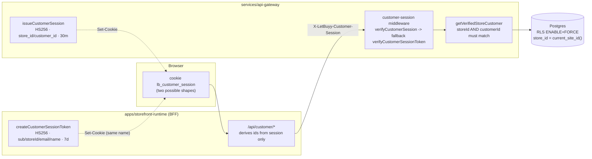

# 10 — Shopper Auth & Account Flows (measured state)

> **Status — 2026-08-04.**
>
> | | |
> |---|---|
> | **Proven** | The full shopper route inventory (24 `page.tsx` files, 16 top-level directories); the live store's 12-key Liquid bundle read from Postgres; both customer-session issuers and their exact claims/TTL/cookie flags; Turnstile + rate-limit placement on the gateway; the unthrottled second credential path; site scoping enforcement; realm (HS256 vs ES256) separation. |
> | **Unresolved** | Which customer-session TTL is the intended contract (30 min vs 7 days) — no ADR found. Whether `POST /api/orders/login` is an intended product surface or legacy. Whether the 12-template bundle is a deliberate canary or a stale artifact. Which host mode (`{store}.letbuyy.com` vs path-based `/store/<sub>`) is production truth for shoppers. |
> | **Not proven / not claimed** | No shopper journey was executed end-to-end against a running storefront in this sweep. Every behavioural statement below is derived from source, from the live Postgres schema, or from a psql read — never from an observed page load. Where a path is stated as broken, the break is derived from code that provably returns an error, not from a reproduction. |
>
> **Authority:** subordinate to `GOVERNANCE_REWRITE_2026_06_10/LETBUYY_CONSTITUTION.md` → root `AGENTS.md` → local `AGENTS.md`. This document is evidence, never law. See [01-governance-and-invariants.md](01-governance-and-invariants.md) for the binding rules and [14-test-build-governance-baseline.md](14-test-build-governance-baseline.md) for the baseline the measurements were taken against.

---

## 1. The runtime that serves shoppers

| Fact | Value | Evidence | Status |
|---|---|---|---|
| Runtime | `apps/storefront-runtime`, Next.js **16.1.6** | `apps/storefront-runtime/package.json:29` | proven |
| Middleware | `src/proxy.ts` **is** the active middleware (Next 16 renamed `middleware.ts` → `proxy.ts`); no `middleware.*` exists | `apps/storefront-runtime/src/proxy.ts:54-56`; `find apps/storefront-runtime -name 'middleware.*'` → empty | proven |
| Handled in `proxy.ts` | host routing, store-access resolution (`public`/`password`/`preview_only`/`offline`), custom-domain 301s, store password gate | `apps/storefront-runtime/src/proxy.ts:180-186,198-209,311-321` | proven |
| Renderer selection | per store; platform default **OFF**; explicit `templateConfig.rendererEngine = 'liquid'` flips a store | `packages/theme-engine/src/theme-governance.ts:14` (`THEME_LIQUID_RENDERING_DEFAULT_ENABLED = false`), `:154-160` | proven |
| Live local store | `saai`, `published`, `rendererEngine = liquid` — **Liquid is the live path locally** | psql: `SELECT subdomain,status,template_config->>'rendererEngine' FROM sites` → `saai \| published \| liquid` | proven |
| Live bundle size | **12** template keys | psql: `SELECT jsonb_object_keys(template_config->'liquidBundle'->'templates') FROM sites WHERE subdomain='saai'` → `cart, collection, customers/account, customers/login, customers/order, customers/orders, customers/register, footer, header, index, product, search` | proven |

`header` and `footer` are chrome, not routes — so the bundle covers **10 addressable routes**. Everything
else on the live Liquid store renders the homepage (see §7).

---

## 2. Screen-by-screen inventory

Legend for **Liquid?**: ✅ template present in the *live* `saai` bundle · ⚠️ template exists in
`packages/theme-engine/examples/letbuyy-core-liquid` but **not** in the live bundle → homepage
fallback · ✖ no template concept for this route.
Legend for **states**: L = loading, E = empty, X = error.

### 2.1 Commerce browse & buy

| Route | React page | Liquid? | Data owner | Gateway API | Session req. | Template / section | Tests | L / E / X |
|---|---|---|---|---|---|---|---|---|
| `/` | `store/[subdomain]/page.tsx` | ✅ `index` | gateway storefront read | `GET /v1/storefront/:subdomain` | none | `index` + 33 sections | `tests/launch/lb-liquid-l4-chrome.test.mjs` (regex) | L n/a (SSR) · E — · X ✖ |
| `/shop` | `shop/page.tsx` | ⚠️ → `index` | product-service | `GET /v1/storefront/:subdomain/products` | none | — | — | L ✅ · E ✅ · X ✖ |
| `/products` | `products/page.tsx` | ⚠️ → `index` | product-service | same | none | — | — | L ✅ · E ✅ · X ✖ |
| `/product/[productId]` | `product/[productId]/page.tsx` + `product-details-client.tsx` | ✅ `product` | gateway product read | `GET /v1/storefront/:subdomain/products/:id` | none | `product-detail.liquid` | `lb-liquid-l5-product.test.mjs` (regex) | React clamps qty to resolved variant stock (`product-details-client.tsx:139-170`); **Liquid renders no availability / sold-out branch at all** | 
| `/collections/[slug]` | `collections/[slug]/page.tsx` | ✅ `collection` | gateway | `GET /:subdomain/collections/:slug` (`public-routes.ts:916`) | none | `collection` | `lb-liquid-l6-collection.test.mjs` (regex) | L ✅ · E ✅ · X ✖ |
| **`/collections`** (index) | **absent** | — | — | no gateway list route exists | — | — | — | route 404s |
| **`/search`** | **absent** | ✅ `search` template ships and is unreachable | — | `GET /:subdomain/products?search=` exists (`public-routes.ts:759-783`) | none | `search-box.liquid` | `lb-liquid-l7-search.test.mjs` (regex only) | **404** |
| `/cart` | `cart/page.tsx` + `cart-client.tsx` | ✅ `cart` | `public.carts` via gateway | `GET/PATCH/DELETE /:subdomain/cart/:cartToken` | none | `cart` | `tests/contracts/server-side-cart.test.ts` (regex) | L ✅ · E ✅ · X ✖ |
| `/checkout` | `checkout/page.tsx` + `checkout-client.tsx` (1160 lines, `'use client'`) | ✖ **themes cannot template checkout** | gateway order-create | `POST /api/orders` → `POST /v1/storefront/:subdomain/orders` | none | — | `tests/launch/lb-checkout-hardening.test.mjs` | see [11-cart-and-checkout-boundary.md](11-cart-and-checkout-boundary.md) |
| `/checkout/success` | `checkout/success/page.tsx` | ✖ | — | — | none | — | — | file's own comment: *"only reached via a stale Stripe redirect"* |
| `/checkout/paypal-return` | `checkout/paypal-return/page.tsx` | ✖ | — | — | none | — | — | provider not in the RPC's accepted set for V1 — see [12-payments-cod-razorpay-gst.md](12-payments-cod-razorpay-gst.md) |

**Search evidence.** `packages/theme-engine/examples/letbuyy-core-liquid/files/sections/header.liquid:4`
and `sections/search-box.liquid:2` both emit `data-search-url="/search"`; no
`apps/storefront-runtime/src/app/**/search/page.tsx` exists. React's "predictive search" is a
`useMemo` filter over at most 100 products already loaded into the layout
(`components/layout/dynamic-header.tsx:84-97`; `lib/product-service.ts:45` → `limit: 100`) — it never
calls the gateway search endpoint. **Status: proven.**

### 2.2 Auth & account

| Route | React page | Liquid? | Data owner | Gateway API | Session req. | Template / section | Tests | L / E / X |
|---|---|---|---|---|---|---|---|---|
| `/customers/login` | `customers/login/page.tsx` (`templateKey: 'customers/login'`) | ✅ `customers/login` | `customer_credentials` | `POST /v1/storefront/customer/login` | none | `customer-login.liquid` | `lb-liquid-l9-auth.test.mjs` (regex on the `action=` string only) | **no-JS POST always 403** — §6 |
| **`/customers/register`** | **absent** (no page route) | ✅ template ships in the live bundle, unreachable | `store_customers` + `customer_credentials` | `POST /v1/storefront/customer/register` | none | `customer-register.liquid` | `lb12-registration.test.mjs` | route 404s; template dead |
| React auth (modal) | `components/account/account-bottom-sheet.tsx` (`'use client'`) | ✖ | — | via BFF | none | mounts `TurnstileWidget` at `:17,294,412` | `tests/auth/*` | JS-only; **no server-rendered React auth form exists** |
| `/account` | `account/page.tsx` | ✅ `customers/account` | gateway customer read | `GET /api/customer/profile` | **yes** — `redirect(basePath)` if anonymous | `customer-account.liquid` | `lb-liquid-l10-account.test.mjs` (regex) | L ✅ · E ✅ · X ✖ |
| `/account/orders` | `account/orders/page.tsx` + `orders-client.tsx` | ✅ `customers/orders` | gateway `customerOrders` | `GET /api/customer/orders` | **yes** | `customer-orders.liquid:5` (`"No orders yet."`) | `lb-liquid-l11-orders.test.mjs` (regex) | L ✅ · E ✅ · **X ✖ — `.catch(() => { })` at `orders-client.tsx:59` shows the empty state on a gateway outage** |
| `/account/orders/[id]` | `account/orders/[id]/page.tsx` — **redirects to the list**; file comment: *"React fallback: no React order-detail page exists yet"* (`:29-30`) | ✅ `customers/order` | gateway | — | **yes** | `customer-order-detail.liquid:9` (`"Order not found."`) | `lb-liquid-l12-tracking.test.mjs` | Liquid-only screen |
| `/account/addresses` | `account/addresses/page.tsx` + `addresses-client.tsx` | ⚠️ → `index` | `customer_addresses` | `GET/POST /api/customer/addresses` | **yes** | — | — | L ✅ · E ✅ · X ✖ |
| `/account/settings` | `account/settings/page.tsx` | ⚠️ → `index` | `store_customers` | `GET/PATCH /api/customer/profile` | **yes** | — | — | L ✅ · E ✅ · X ✖ |
| `/account/wishlist` | `account/wishlist/page.tsx` + `wishlist-client.tsx` | ⚠️ → `index` | `customer_wishlists` | `GET/POST /api/customer/wishlist` | **yes** | — | — | L ✅ · E ✅ · X ✖ |
| `/orders` (guest lookup) | `orders/page.tsx` + `orders-client.tsx` (`'use client'`) | ✖ | `customer_credentials` + orders | `POST /api/orders/login`, `/api/orders/check` | **none** | — | — | **P0 — §5** |
| **forgot / reset password** | **absent everywhere** | ✖ | backend exists | `POST /api/customer/set-password` (`action==='request_reset'`, `:14-33`) | — | — | — | **unreachable — §7.1** |

**Session gating is real.** Every `/account/*` page server-side asserts `if (!isAuthenticated) redirect(basePath)`,
and the gateway independently re-verifies: `getVerifiedStoreCustomer` rejects unless
`session.storeId === storeId && session.customerId === customerId`
(`services/api-gateway/src/routes/storefront/customer-engagement-routes.ts:111-130`). The BFF layer
never trusts a client-supplied identity — `customer_id`/`store_id`/`email` are derived from the
verified session only (`app/api/customer/orders/route.ts:8-14`; `addresses/route.ts:16-26,38-60`;
`profile/route.ts:8-26`; `wishlist/route.ts:9-15`). **Status: proven.**

### 2.3 Content, contact, gates

| Route | React page | Liquid? | Data owner | Session | Notes | Status |
|---|---|---|---|---|---|---|
| `/privacy`, `/terms`, `/shipping`, `/returns` | four hardcoded pages, `routeType="policy"` | ⚠️ → `index` | CMS via gateway | none | `privacy/page.tsx:43-56`; siblings `:52-55` | proven |
| `/[...path]` (CMS page) | `[...path]/page.tsx`, `routeType="page"` | ⚠️ → `index` | CMS | none | `[...path]/page.tsx:44` — `if (!path \|\| path.length !== 1) return notFound()`; multi-segment 404s | proven |
| `/blog`, `/blog/[slug]` | both exist, `routeType="article"` for the detail | ⚠️ → `index` | gateway blog endpoints (`public-routes.ts:1226,1249`) | none | | proven |
| **`/contact`** | **absent** | — | — | — | both Liquid forms POST here; **no route** | proven |
| Newsletter | `components/sections/newsletter.tsx:38-47` — sets `isSubmitted`, issues **no request** | Liquid `newsletter-signup.liquid` posts to `/contact` | — | — | **silent data loss** | proven |
| Contact form | `components/sections/contact-form.tsx:33` — `window.location.href = 'mailto:…'` | Liquid `contact-form.liquid` posts to `/contact` | — | — | **silent data loss** | proven |
| Store password gate | `/preview/coming-soon` (React rewrite from `proxy.ts:180-186`) | Liquid `password` template is **dead** | — | — | `password-gate.liquid:1` says so verbatim: *"password gate rendering requires proxy routing update (Phase F)"* | proven |
| 404 | `store/[subdomain]/not-found.tsx:1-14` delegates to the root React 404 (Next does not pass `params`) | Liquid `not_found` reachable only in editor preview/tests | — | — | | proven |

A **working** contact endpoint exists and has zero callers:
`services/api-gateway/src/routes/storefront/public-routes.ts:1307-1318`
(`POST /storefront/:subdomain/contact` → `form_submissions`, Turnstile-gated). A grep for callers
across `apps/` returns none. Both surfaces render a success state while capturing nothing — this is
data loss, not doc staleness.

### 2.4 Error boundaries

| Fact | Evidence | Status |
|---|---|---|
| Exactly **one** error boundary exists (`app/error.tsx`, 77 lines, working `reset()`) | `apps/storefront-runtime/src/app/error.tsx:1-77` | proven |
| **No** `store/[subdomain]/error.tsx` — a store-scoped failure escalates to the root boundary and loses store chrome/branding | file search returns no store-level `error.tsx` | proven |

---

## 3. The customer session

### 3.1 Issuer A — the gateway (`issueCustomerSession`)

| Property | Value | Evidence |
|---|---|---|
| Algorithm | **HS256**, hand-rolled JWT (`base64url(header).base64url(payload).base64url(sig)`), HMAC-SHA256 via `crypto.subtle` | `packages/auth-core/src/customer-session.ts:46-53`, `:143-152` |
| Secret | **`CUSTOMER_SESSION_SECRET`** (env; not `AUTH_SECRET`) | `services/api-gateway/src/routes/storefront/customer-registration.ts:141-143` |
| Claims | `{ store_id, customer_id, iat, exp }` — **IDs only** | `packages/auth-core/src/customer-session.ts:46-53` |
| TTL | **1800 s (30 min)** — `LETBUYY_CUSTOMER_GATEWAY_SESSION_TTL_SECONDS = 30 * 60` | `packages/auth-core/src/customer-session.ts:4` |
| Cookie | `lb_customer_session`, `httpOnly: true` | `customer-registration.ts:147-149` |
| CSRF | a second, **non-`httpOnly`** cookie `letbuyy_csrf` + an `X-CSRF-Token` response header, same 30-min TTL | `customer-registration.ts:151-155` |
| Alg pin on verify | rejects any token whose `header.alg !== 'HS256'` | `packages/auth-core/src/customer-session.ts:52,83-88` |

### 3.2 Issuer B — the storefront BFF (`createCustomerSessionToken`)

| Property | Value | Evidence |
|---|---|---|
| Algorithm | **HS256** — same family, different payload | `packages/auth-core/src/index.ts:751-770` |
| Claims | `{ sub, storeId, email, name, iat, exp }` — **carries PII** | `packages/auth-core/src/index.ts:751-770` |
| TTL | **604 800 s (7 days)** | `packages/auth-core/src/index.ts:131` |
| Cookie | **`lb_customer_session` — the same name**, `httpOnly` + `sameSite=lax` + `path=/`, `hostOnly: true`, `secure` **only in production** | `packages/auth-core/src/index.ts:129,841-862`; `apps/storefront-runtime/src/lib/session.ts:33-39,58-65` |

### 3.3 Site scoping — enforced, on both sides

| Layer | Check | Evidence | Status |
|---|---|---|---|
| Page (Liquid account render) | `isAuthenticated: session.email && session.storeId === store.id` | `apps/storefront-runtime/src/lib/account-liquid.ts:47` | proven |
| Gateway (every customer read) | `getVerifiedStoreCustomer` rejects when `session.storeId !== storeId \|\| session.customerId !== customerId` | `customer-engagement-routes.ts:111-130` | proven |
| Transport | the BFF forwards the customer cookie to the gateway as `X-LetBuyy-Customer-Session` **only** for `/storefront/customer/*`; internal-only routes use a separate internal-signature path | `apps/storefront-runtime/src/lib/api/client.ts:46-52,69-93` | proven |
| Database | `carts`, `store_customers`, `customer_credentials`, `customer_addresses`, `customer_wishlists` are RLS **ENABLE + FORCE** with per-transaction tenant-GUC policies `store_id = current_site_id()` | psql `pg_class.relrowsecurity/relforcerowsecurity = t,t` for all five; `pg_policies` shows `*_tenant_*_guc` | proven |



---

## 4. P0 — two incompatible HS256 token shapes under one cookie name

**Severity: P1 in the sweep, high-stakes.** Reported here as a headline defect because it is the
root of the auth-surface ambiguity.

| | Issuer A (gateway) | Issuer B (storefront BFF) |
|---|---|---|
| Cookie | `lb_customer_session` | `lb_customer_session` |
| Alg | HS256 | HS256 |
| Claims | `store_id`, `customer_id` | `sub`, `storeId`, `email`, `name` |
| TTL | **30 minutes** | **7 days** |
| Evidence | `packages/auth-core/src/customer-session.ts:4,46-53` | `packages/auth-core/src/index.ts:131,751-770` |

**The divergence is acknowledged in code.** The storefront register route carries this comment at
`apps/storefront-runtime/src/app/api/customer/register/route.ts:1-3` — it re-mints the session
locally *because the gateway's IDs-only token fails `isCustomerSessionPayload`*.

**It does not break auth at runtime**, because the gateway explicitly dual-accepts: it tries
`verifyCustomerSession`, then falls back to `verifyCustomerSessionToken` and maps `payload.sub` →
`customerId` (`services/api-gateway/src/middleware/customer-session.ts:56-68`). **Status: proven.**

**What it costs.**

1. **The effective session lifetime is the maximum of the two, not the minimum.** Any surface that
   mints through issuer B grants a 7-day session under a cookie the gateway also honours — the
   30-minute control is advisory, not enforced.
2. Issuer B's token carries **email and name** in a client-readable JWT payload; issuer A's does not.
3. `ANTI-R1` / `WIN-R4` / `R-15` all forbid two token sources for one domain
   (`AGENTS.md:146,314`; `LETBUYY_CONSTITUTION.md:414` — *"one auth issuer … one token source"*).

**Unresolved:** which TTL is intended. No ADR or governance record states it
(`packages/auth-core/src/customer-session.ts:4` vs `packages/auth-core/src/index.ts:131`; no decision
record located). The answer decides which issuer is deleted — this is a **[ARB-GATED]** call, not an
engineering preference.

---

## 5. P0 — unthrottled password brute-force + order disclosure via `POST /api/orders/login`

**Severity: P0, high-stakes.**

There are **two** credential-verification paths against the same `customer_credentials.password_hash`.
Only one of them is defended.

| | `/customer/login` (defended) | `/customer/order-credential/login` (undefended) |
|---|---|---|
| Entry | React `AccountBottomSheet` / Liquid login form | `POST /api/orders/login` from `/store/[subdomain]/orders` |
| Rate limit | `enforceCustomerAuthRateLimit` — per-IP 30/15 min, per-identity 5/15 min, **fails closed (503)** in production when the limiter backend is down | **none** |
| Turnstile | `requireValidTurnstile`, unconditional | **none** |
| Order of operations | rate-limit → Turnstile → DB → bcrypt | `requireStorefrontInternal` → **bcrypt** |
| On success | issues a session | **returns the customer's full order history** |
| Evidence | `customer-engagement-routes.ts:705-713`; `services/api-gateway/src/middleware/rateLimit.ts:418-478`; `routes/storefront.ts:158-173` | `apps/storefront-runtime/src/app/api/orders/login/route.ts:4-25` → `lib/order-service.ts:76-91` → `customer-engagement-routes.ts:866-901` |

**The only blanket limiter over the undefended path is a generic query-cost bucket** (20 points/sec,
capacity 200) mounted on `/v1/*` with a skip predicate — not an auth-grade limiter
(`services/api-gateway/src/index.ts:681-685`). `authRateLimit` is mounted only on `/auth/*`
(`index.ts:702-709`). **Status: proven.**

**Impact.** An attacker with an email address gets an unmetered bcrypt oracle, and a correct guess
returns order history (addresses, items, amounts) directly — credential stuffing and PII disclosure
in one call. This breaches `SEC-R1` (*everything fails closed*, `AGENTS.md:224`) at the door that
matters most.

**Fix shape (not applied).** Add `enforceCustomerAuthRateLimit({operation:'customer-order-credential-login'})`
+ `requireValidTurnstile` to the gateway handler, mirroring `customer-engagement-routes.ts:705-713`,
and thread a `turnstileToken` through `/api/orders/login`. Better: collapse the path into
`/customer/login` entirely.

**Aggravating factor — the credential store is duplicated.** `store_customers.password_hash` **and**
`customer_credentials.password_hash` both exist. Register/reset write **both**
(`customer-registration.ts:94-137`); login reads **only** `customer_credentials`
(`customer-engagement-routes.ts:731-743`). Whether this is an in-flight migration or permanent
duplication is **unresolved**.

---

## 6. P0 — the Liquid no-JS login/register path can never succeed

**Severity: P0, high-stakes.** This is a proof by construction, not a reproduction.

| Step | Fact | Evidence |
|---|---|---|
| 1 | The Liquid sections are real HTML form POSTs with a hidden `storeId` — and ship **no Turnstile widget and no `turnstileToken` field** | `packages/theme-engine/examples/letbuyy-core-liquid/files/sections/customer-login.liquid:3-8`; `customer-register.liquid:3-9` |
| 2 | The Next API routes **do** implement the no-JS path properly (urlencoded/multipart parsing, 303 back to the same-origin referer with an error query, 303 to `/account` on success) | `app/api/customer/login/route.ts:16-34,40-47,99-101`; `register/route.ts:15-33,39-47,98-100` |
| 3 | The gateway calls `requireValidTurnstile` **unconditionally** on register and login | `customer-registration.ts:40-49`; `customer-engagement-routes.ts:705-713` |
| 4 | `verifyTurnstileToken` returns `false` on a **missing** token — first line of the function | `services/api-gateway/src/middleware/security.ts:219-220` — `if (!token) return false;` (verified by direct read) |
| 5 | It also returns `false` when `TURNSTILE_SECRET_KEY` is unset | `security.ts:226-228` |
| ⇒ | Every no-JS Liquid login/register POST resolves to **403 `TURNSTILE_REQUIRED`** | composition of 1–5 |

The only bypass is the literal token `dev-bypass-token`, accepted **solely** when
`ENVIRONMENT`/`APP_ENV`/`NODE_ENV` is `local` or `development` (`security.ts:199-205,222-224`). It is
not present in the Liquid forms.

**Why the tests did not catch it.** `tests/launch/lb-liquid-l9-auth.test.mjs:14-18` asserts
`assert.match(bundle, /action="\/api\/customer\/login"/)` — it proves the *string* is present in the
bundle. It never issues a POST. Fail-closed Turnstile is correct
(`SEC-R1`); the section that must carry the widget does not.

**Consequence for `THEME-R1`/`ART-17`.** Liquid is the constitutional canonical renderer, and on the
canonical renderer a shopper **cannot create an account or sign in without JavaScript**. React has no
server-rendered auth form at all — its auth is the client-only `AccountBottomSheet`, which *does*
mount `TurnstileWidget` (`components/account/account-bottom-sheet.tsx:17,294,412`). So the working
auth path is JS-only on both engines.

**Fix shape (not applied).** Render managed-mode Turnstile inside the two sections — a
`<div class="cf-turnstile">` emits a `cf-turnstile-response` field that `extractTurnstileToken`
already accepts (`security.ts:213-214`) — and add a behavioural test that POSTs the form body and
asserts a non-403.

---

## 7. Missing screens

| Missing screen | Backend state | Evidence | Consequence |
|---|---|---|---|
| **Forgot password** | implemented, unreachable | `app/api/customer/set-password/route.ts:14-33` (`action==='request_reset'`); grep for `request_reset` under `apps/storefront-runtime/src` returns only that route + `lib/customer-service.ts:99-109`; **no reset landing route anywhere** | a shopper who forgets a password has **no recovery path** |
| **Reset password (confirm)** | implemented, unreachable | same | same |
| — dead branch | `account-bottom-sheet.tsx:129` calls `setPassword()` with **no** `resetToken`; the context immediately rejects: *"Reset link is required to set a password."* (`customer-auth-context.tsx:146-148`) | | UI offers an action that always errors |
| **`/customers/register`** | gateway route exists; **Liquid template ships in the live bundle** | no `customers/register/page.tsx` under `store/[subdomain]` | the register template is unreachable; the only register surface is the React bottom sheet |
| **`/search`** | gateway search exists (`public-routes.ts:759-783`); the composition engine already builds a Liquid `search` drop from `?search=` (`composition-engine.tsx:456-482`) | no page route | the header search box navigates to a **404** |
| **`/collections`** index | no gateway list route either | `ls store/[subdomain]/collections` → only `[slug]` | no browsable collection index |
| **`/contact`** | gateway endpoint exists and is Turnstile-gated (`public-routes.ts:1307-1318`) | no page route, no caller | both contact forms POST into the void |
| **Newsletter capture** | none | `components/sections/newsletter.tsx:38-47` | success UI, zero capture |
| **React order detail** | gateway supports it | `account/orders/[id]/page.tsx:29-30` redirects to the list | order detail is Liquid-only |
| **Liquid addresses / settings / wishlist** | React pages exist | live bundle lacks `customers/{addresses,settings,wishlist}` (the `letbuyy-core` example **does** ship them) | those three routes render the homepage (§8) |

---

## 8. The silent-homepage-fallback defect

**Severity: P0.** On the live Liquid store, a route whose template key is absent from the bundle does
not 404 and does not downgrade to React — it renders the **homepage body** under that URL.

The mechanism, read directly from source at
`apps/storefront-runtime/src/lib/theme-engine/template-resolver.ts:127-137`:

```ts
function resolveLiquidTemplateKey(bundle, route, routeType): string {
    const routeTemplateKey = route.templateKey || resolveTemplateKey(routeType);
    if (bundle.templates[routeTemplateKey]) return routeTemplateKey;
    if (bundle.templates.index) return 'index';          // <-- blanket fallback
    return Object.keys(bundle.templates)[0] || routeTemplateKey;
}
```

Combined with the 12-key bundle read from Postgres, the affected routes on the live `saai` store are:

| Route | Required template key | In live bundle? | Renders |
|---|---|---|---|
| `/blog` | `blog` | ✖ | homepage |
| `/blog/[slug]` | `article` | ✖ | homepage |
| `/privacy` | `policy` | ✖ | homepage |
| `/terms` | `policy` | ✖ | homepage |
| `/shipping` | `policy` | ✖ | homepage |
| `/returns` | `policy` | ✖ | homepage |
| `/[slug]` (CMS page) | `page` | ✖ | homepage |
| `/shop`, `/products` | (list) | ✖ | homepage |
| `/account/addresses` | `customers/addresses` | ✖ | homepage |
| `/account/settings` | `customers/settings` | ✖ | homepage |
| `/account/wishlist` | `customers/wishlist` | ✖ | homepage |
| 404 | `not_found` | ✖ | homepage |
| password gate | `password` | ✖ | never reached — React `/preview/coming-soon` wins (`proxy.ts:180-186`) |

**React stores are not immune.** For a non-Liquid store, `/customers/login` has no matching template
either and falls through `template-resolver.ts:273-288` to `resolveLegacyTemplate` (`:86-96`), which
returns the store's flat homepage sections minus header/footer. psql confirms
`template_config->'templates'` is absent for the only site. **Status: proven.**

**Doc-vs-code conflict, resolved in favour of code.** `letbuyy-core-liquid` *ships* `page`, `policy`,
`blog`, `article`, `not_found`, `password`, `customers/addresses`, `customers/settings`,
`customers/wishlist` — implying 21-template route coverage. The deployed bundle has 12. **Treat live
Liquid route coverage as 10 addressable routes and the `index` fallback as a live defect.**

**Unresolved:** whether the 12-template bundle is a deliberate partial canary under `ART-17` (the
Liquid flip is explicitly per-theme + canary) or a stale publish artifact. That determines whether
the fallback is an accepted canary behaviour or a bug. **[ARB-GATED]**

---

## 9. Realm separation — proven, no crossing

The question: *can any storefront route accept a merchant ES256 token, or any merchant route accept a
customer HS256 token?* **Answer: no, on four independent layers.**

| Layer | Control | Evidence | Status |
|---|---|---|---|
| Customer verifier alg pin | rejects any `header.alg !== 'HS256'`; HMACs against `CUSTOMER_SESSION_SECRET` | `packages/auth-core/src/customer-session.ts:52,83-88` | proven |
| Merchant verifier alg pin | rejects any alg that is not **ES256 or EdDSA**, both at header pre-check and at `jwtVerify` | `services/api-gateway/src/lib/identity-session-verifier.ts:57-58,90,95-96` | proven |
| Middleware separation | the gateway's merchant `authMiddleware` accepts only `internal-session-hmac`, `internal-identity-hmac`, `supabase-bearer` and **never consults `CUSTOMER_SESSION_SECRET`** | `services/api-gateway/src/middleware/auth.ts:189-205,215-279` | proven |
| Principal separation (defense in depth) | merchant routes call `resolveCustomUser` against `users_custom`; store customers live in `store_customers`/`customer_credentials` — a customer principal 403s even if it reached `authMiddleware` | `services/api-gateway/src/lib/auth-user.ts:20-38`; `routes/themes/media-library.ts:102-111` | proven |
| Reverse direction | customer routes use `requireCustomerSession`/`optionalCustomerSession`, reading the cookie or `X-LetBuyy-Customer-Session` and verifying with `CUSTOMER_SESSION_SECRET` — a merchant ES256 token fails the HS256 pin | `services/api-gateway/src/middleware/customer-session.ts:25-53,56-73` | proven |

This satisfies `ART-05` (*identity-platform is the sole asymmetric token issuer*,
`LETBUYY_CONSTITUTION.md:173`) and `SEC-R7` (*no shared symmetric secret across trust domains*,
`AGENTS.md:233`) **for the customer↔merchant boundary**. The remaining single-issuer breach is
**inside** the customer realm — the two HS256 issuers of §4 — not across realms.

Related tenant-isolation findings for the theme/preview surface are in
[13-security-and-tenant-isolation.md](13-security-and-tenant-isolation.md).

---

## 10. Two RLS policies that are constant-true to PUBLIC

| Fact | Evidence | Status |
|---|---|---|
| `customer_credentials` and `customer_addresses` each carry a **PUBLIC-role** policy whose qual is `store_id IN (SELECT sites.id FROM sites WHERE true)` — functionally `USING(true)` for any role that can read `sites` | psql `pg_policies`: *"Store owners manage customer credentials"* / *"Store owners manage customer addresses"*, `roles={public}` | proven |
| Currently **not reachable** via PostgREST: `anon` and `authenticated` hold no table privileges | psql `has_table_privilege(anon\|authenticated, …, 'SELECT')` = `f` on `customer_credentials`, `customer_addresses`, `carts` | proven |
| The gateway reaches these tables as `service_role`, which has `rolbypassrls = true`, so FORCE RLS does **not** constrain gateway reads — isolation there rests entirely on explicit `.eq('store_id', …)` + `getVerifiedStoreCustomer` | psql `SELECT rolname, rolbypassrls FROM pg_roles` → `service_role \| t` | proven |

This breaches **`ART-09`** (`LETBUYY_CONSTITUTION.md:199`) and **`SEC-R6`** (`AGENTS.md:232`) as
written, and the `service_role` posture breaches **`ART-08` / `R-2` / `SEC-R9`**
(`LETBUYY_CONSTITUTION.md:193,393`; `AGENTS.md:235`). The masking is a grant accident, not a control.
**Unresolved:** whether a migration to drop the two legacy policies is already queued.

---

## 11. Test coverage — what actually protects these journeys

| Test | What it proves | What it does **not** prove |
|---|---|---|
| `tests/launch/lb-liquid-l9-auth.test.mjs:14-18` | the string `action="/api/customer/login"` is in the bundle | that the POST succeeds (it 403s — §6) |
| `tests/launch/lb-liquid-l7-search.test.mjs:13-18` | search markup exists | that `/search` resolves (it 404s) |
| `tests/contracts/server-side-cart.test.ts:20-59` | source text matches cart-ownership regexes | that the two cart clients behave identically (they do not — see [11-cart-and-checkout-boundary.md](11-cart-and-checkout-boundary.md)) |
| `tests/theme-engine/liquid-hydration-islands-parity.test.mjs:31-217` | island source parity by regex | runtime parity |
| `tests/e2e/customer-journey.spec.ts:3-10` | nothing locally — **`test.skip` unless a staging storefront is reachable and non-5xx** | any journey |
| `tests/auth/*` (`csrf-contract`, `customer-abuse-controls`, `customer-session-gateway`, `session-verifier`), `tests/launch/lb12-registration.test.mjs` | the strongest coverage in this area | end-to-end journeys |

**Assessment:** journey coverage is overwhelmingly `assert.match(source, /…/)`. Nothing in the suite
fails when the Liquid login form 403s, when `/search` 404s, or when a missing template silently falls
back to the homepage. See [14-test-build-governance-baseline.md](14-test-build-governance-baseline.md)
for the gate-wide picture.

---

## 12. Findings → governing rule

| # | Finding | Severity | Breaches | Gate |
|---|---|---|---|---|
| D-1 | Unthrottled bcrypt oracle + order disclosure on `/customer/order-credential/login` | **P0** | `SEC-R1` (`AGENTS.md:224`) | fix + test; no ARB needed to add a limiter |
| D-2 | Liquid no-JS login/register always 403 (no Turnstile field) | **P0** | `ART-17` intent (`LETBUYY_CONSTITUTION.md:253`), `THEME-R1` | theme-bundle change → theme publish gate |
| D-3 | Missing-template routes silently render the homepage | **P0** | `ART-17` canary discipline; honesty of the render contract | **[ARB-GATED]** — changes renderer fallback policy |
| D-4 | No forgot/reset-password UI; backend unreachable | **P0** | product-completeness, not a named rule | build |
| D-5 | `/search` unreachable; `/customers/register` has no route; `/collections` index absent | **P0** | — | build |
| D-6 | Two HS256 customer-session issuers, one cookie name, 30 min vs 7 days | **P1** high-stakes | `ANTI-R1` (`AGENTS.md:314`), `WIN-R4/R5` (`:146-147`), `R-15` (`LETBUYY_CONSTITUTION.md:414`) | **[ARB-GATED]** — decides which issuer dies |
| D-7 | PUBLIC constant-true policies on `customer_credentials` / `customer_addresses` | **P1** high-stakes | `ART-09` (`:199`), `SEC-R6` (`AGENTS.md:232`) | migration + validator assertion |
| D-8 | Contact + newsletter show success and capture nothing | **P1** | data-loss; `SEC-R1` honesty | build |
| D-9 | Store password gate is JS-only; Liquid `password` template dead | **P1** | — | proxy change |
| D-10 | Account order history swallows fetch errors (`.catch(() => {})`) | **P2** | UI-state completeness (`docs/ui-standards/`) | fix |
| D-11 | No store-level error boundary | **P2** | — | fix |
| D-12 | Inconsistent base-path handling in Liquid sections + hardcoded `/account` redirect | **P2** | — | fix |

---

## 13. Unresolved (carry forward)

1. **Which customer-session TTL is the contract** — 30 min (gateway) or 7 days (storefront)? No ADR
   exists. Decides which issuer is removed. **[ARB-GATED]**
2. **Which host mode is production truth for shoppers** — `{store}.letbuyy.com` (host-only cookie,
   root-relative Liquid hrefs work) or path-based `/store/<subdomain>` (shared `localStorage` *and*
   a shared session cookie across stores on one origin)? Several Liquid sections and the no-JS auth
   redirect only work in the former. This is also a **tenant-isolation** question, not only a routing one.
3. **Is `POST /api/orders/login` an intended product surface** (guest order lookup by email+password)
   or legacy that predates the account system? Intentional ⇒ it needs the same Turnstile + limiter;
   legacy ⇒ delete it.
4. **Is the dual credential store** (`store_customers.password_hash` **and**
   `customer_credentials.password_hash`) an in-flight migration with a target, or permanent duplication?
5. **Was the 12-template Liquid bundle published deliberately as a partial canary**, or is it stale?
   Decides whether the `index` fallback is a bug or accepted canary behaviour under `ART-17`.
6. **Are the two PUBLIC policies pre-GUC leftovers with a migration already queued?**
