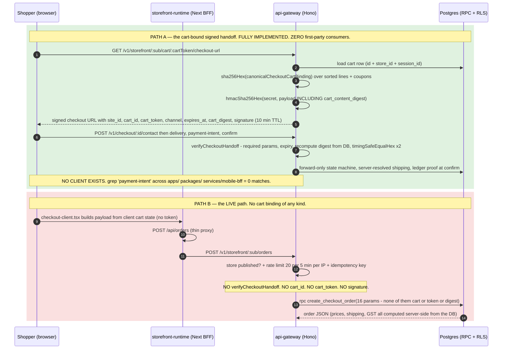

# 11 — Cart & Checkout Boundary (measured state)

> **Status — 2026-08-04.**
>
> | | |
> |---|---|
> | **Proven** | The canonical cart is server-side (`public.carts`, RLS ENABLE+FORCE) with only an opaque token in the browser. Two independent client cart implementations share one `localStorage` namespace, and the Liquid one drops variant identity. No guest→authenticated cart merge exists. Cart mutation routes are unauthenticated and accept a client-supplied `customer_id`/`buyer_email`. The cart-bound signed handoff is fully implemented on both sides and has **zero** first-party consumers. The live order-create door performs no handoff verification. Themes cannot template checkout. |
> | **Unresolved** | Whether the unsigned public order-create is an intended headless/mobile API or purely the legacy React door. Which checkout entry point is canonical for Liquid stores. Whether the two sides of the cart digest should be consolidated behind a shared helper. |
> | **Not proven / not claimed** | No checkout was executed end-to-end. `orders`, `ledger_entries`, `order_tax_lines` and `gst_invoices` all have **zero rows** in the local database (psql `count(*)`), so no money path has been exercised locally. Every statement below derives from source, from `pg_proc.prosrc` on the running Postgres, or from a psql read. |
>
> **Authority:** subordinate to `GOVERNANCE_REWRITE_2026_06_10/LETBUYY_CONSTITUTION.md` → root `AGENTS.md`. Evidence, never law. Companions: [10-shopper-auth-and-account-flows.md](10-shopper-auth-and-account-flows.md) (who the shopper is), [12-payments-cod-razorpay-gst.md](12-payments-cod-razorpay-gst.md) (what happens after the order row exists), [01-governance-and-invariants.md](01-governance-and-invariants.md) (the binding rules).

---

## 1. The canonical cart owner

**The cart is server-owned. The browser holds only an opaque token.**

| Property | Value | Evidence | Status |
|---|---|---|---|
| Table | `public.carts` — columns `id, store_id, customer_id, session_id, items jsonb, coupon_code, checkout_handoff, channel` | psql `\d carts` | proven |
| Token storage | the opaque cart token is `carts.session_id`; index `idx_carts_session` on `(store_id, session_id)` | psql `\d carts`; `services/api-gateway/src/routes/storefront/cart-routes.ts:177` (`cart_token: String(row.session_id)`) | proven |
| Token entropy | `ct_` + 128-bit random uuid hex | `cart-routes.ts:145-147` | proven |
| Owner module | `services/api-gateway/src/routes/storefront/cart-routes.ts`, mounted by `registerStorefrontCartRoutes` | `services/api-gateway/src/routes/storefront/public-routes.ts:201` | proven |
| Pricing authority | the gateway **recomputes every line price and total from the DB** on read | `cart-routes.ts:257-278` | proven |
| RLS | `carts` is **ENABLE + FORCE** with a tenant-GUC policy `store_id = current_site_id()` | psql `pg_class.relrowsecurity/relforcerowsecurity = t,t`; `pg_policies` | proven |

### 1.1 Route surface

| Method | Path | Line | Session required? |
|---|---|---|---|
| `POST` | `/:subdomain/cart` | `cart-routes.ts:446` | **no** |
| `GET` | `/:subdomain/cart/:cartToken` | `:460` | **no** |
| `PATCH` | `/:subdomain/cart/:cartToken` | `:473` | **no** |
| `DELETE` | `/:subdomain/cart/:cartToken` | `:484` *(delete)* | **no** |
| `PUT` | `/:subdomain/cart/:cartToken/buyer-identity` | `:484-504` | **no** |
| `POST` | `/:subdomain/cart/:cartToken/discount-codes` | `:506` | **no** |
| `GET` | `/:subdomain/cart/:cartToken/checkout-url` | `:528` | **no** |

`services/api-gateway/src/routes/storefront.ts:69-81` lists **only** `/customer/wishlist|orders|activity|profile|addresses`
under `requireCustomerSession`. No cart route is in that list. **Status: proven.**

### 1.2 Doc-vs-code correction

Two source comments describe the cart as *"browser-owned (the cart token lives in localStorage)"*
(`store/[subdomain]/cart/page.tsx:10`; `lib/theme-engine/liquid-hydration-islands.tsx:942`). **Code
wins:** the authoritative cart is the `carts` row keyed on `session_id`, the gateway recomputes all
money from the DB, and only the opaque token lives in the browser. The comments understate the model
and invite client-total regressions; they should read *"server-owned cart, browser-held token."*

---

## 2. `WIN-R4` — two cart implementations, one `localStorage` namespace

**Severity: P0.** This is the textbook parallel-system anti-pattern the rulebook names first.

| | React `CartProvider` | Liquid hydration island |
|---|---|---|
| File | `apps/storefront-runtime/src/context/cart-context.tsx` | `apps/storefront-runtime/src/lib/theme-engine/liquid-hydration-islands.tsx` |
| Storage keys | `CART_STORAGE_KEY='lb_cart'`, `CART_TOKEN_STORAGE_KEY='lb_cart_token'` (`:56-57`) | **the same two keys**, plus `'lb_cart_server'` (`:9-11`) |
| Server sync | `:142-145` | `:109-116` |
| Line shape | `cartLineInputFromItem → variant_id: variantId` (`:98-107`) | `liquidCartLineInputFromItem → variant_id: null` (`:86-93`) |

**Both write the same two `localStorage` keys and both POST/PATCH the same server cart endpoint.**
**Status: proven.**

**The concrete data defect:** on the Liquid path — which is the *canonical* renderer under `ART-17`
and the live path on the only published local store — **every synced cart line loses its variant
identity**. A shopper adding "Size M / Blue" and a shopper adding "Size L / Red" produce
indistinguishable cart lines. Downstream, the order-create payload carries whatever `variantId` the
client attached (`checkout-client.tsx:353-357`), so a Liquid-originated cart cannot express variant
choice at all.

**Rule breach.** `WIN-R4` — *"MUST NOT build a parallel second system for any domain that already has
a canonical winner"* (`AGENTS.md:146`) — and `ANTI-R1` (`AGENTS.md:314`). `WIN-R5` (`AGENTS.md:147`)
requires escalation to **collapse, not coexist**.

**Doc-vs-code conflict.** `tests/contracts/server-side-cart.test.ts:20-59` asserts that the React cart
*"uses server cart as source of truth"* and that *"Liquid hydration islands sync add-to-cart through
the same server cart API"* — implying one cart owner. **Code wins:** sharing one server endpoint is
not the same as one cart owner, and the two implementations are demonstrably not behaviourally
equivalent (`variant_id: null` vs `variant_id: variantId`). The test is a regex over source text; it
cannot detect the divergence it is presumed to guard.

**Fix shape (not applied).** Extract a single cart client module under
`apps/storefront-runtime/src/lib` (read/write/sync + storage keys) consumed by both `CartProvider`
and the `lb-cart`/`lb-add-to-cart` islands, and carry `variant_id` from the `lb-variant-picker`
hidden inputs into `liquidCartLineInputFromItem`.

---

## 3. Guest → authenticated cart merge: it does not exist

**Proof of absence** (three independent checks, all proven):

1. Neither cart client ever sets `customer_id` — grep for `customer_id`/`merge` in
   `context/cart-context.tsx` and `lib/theme-engine/liquid-hydration-islands.tsx` returns **no matches**.
2. The only repo callers of `buyer-identity` are `cart-routes.ts` itself and
   `services/api-gateway/src/__tests__/cart.test.ts` — no application code.
3. Login/register syncs the **wishlist only** — `context/customer-auth-context.tsx:130-131,214-233`
   (`syncLocalWishlist`); there is no cart call in the auth success path.

**What it costs.**

| Consequence | Detail |
|---|---|
| `carts.customer_id` is always `NULL` from the storefront | the column exists and is never populated by a first-party client |
| No cross-device continuity | a shopper who builds a cart on mobile and signs in on desktop starts empty |
| Abandonment targeting is broken by construction | `enqueueAbandonmentCheck` is gated on `cart.buyer_email` (`cart-routes.ts:340-382`), which no first-party client sets |
| Analytics cannot attribute carts to customers | the join key is never written |

**Fix shape (not applied).** On successful login/register/reset, call
`PUT /:subdomain/cart/:cartToken/buyer-identity` with a **session-derived** `customer_id` (never a
client-supplied one) and reconcile the returned server cart into `localStorage`. The merge must be
gated on the customer session and must refuse to bind a cart whose `store_id` differs from
`session.storeId`.

---

## 4. Cart mutation routes are unauthenticated and trust client identity

**Severity: P1, high-stakes.**

| Fact | Evidence | Status |
|---|---|---|
| `StorefrontCartMutationSchema` accepts `customer_id` **and** `buyer_email` from the client | `cart-routes.ts:37-44` | proven |
| `persistCart` writes `customer_id: input.customer_id \|\| null` straight through | `cart-routes.ts:394-400` | proven |
| `PUT /:cartToken/buyer-identity` has **no session check** | `cart-routes.ts:484-504` | proven |
| Setting `buyer_email` schedules a cart-abandonment queue job and emits `cart.abandoned` **to that address** | `cart-routes.ts:340-382` (gated only on `cart.buyer_email`) | proven |
| No cart route is under `requireCustomerSession` | `services/api-gateway/src/routes/storefront.ts:69-81` | proven |
| The only protection is the 128-bit cart token | `cart-routes.ts:145-147` | proven |

**Impact.** A caller holding a cart token (obtained trivially by creating one) can:

- bind that cart to an **arbitrary `customer_id`**, poisoning the customer↔cart association; and
- set an **arbitrary `buyer_email`**, causing the platform to send a store-branded abandonment email
  to an address the caller chose — an unauthenticated email-injection primitive against merchant
  domain reputation.

This is the same class of failure as `SEC-R10` (*MUST NOT trust client-submitted role/identity*,
`AGENTS.md:236`) applied to the customer identity rather than the merchant role.

**Fix shape (not applied).** Drop `customer_id`/`buyer_email` from the mutation schema and derive
them from `optionalCustomerSession`; mount `optionalCustomerSession` on `/:subdomain/cart*` and
reject any `customer_id` that does not match the session; require a session for `buyer-identity`.

---

## 5. THE HEADLINE — the signed handoff is real, and nothing uses it

This is verdict #3 of the adversarial sweep: **PARTIAL, high confidence**. Two clauses of `ART-14`,
two different answers.

### 5.1 Both paths, side by side

### 5.2 Clause A — cart-bound and cryptographically signed: **CONFIRMED**

| Component | Fact | Evidence |
|---|---|---|
| Binding | the digest hashes **sorted** line items — `product_id`, `variant_id`, `quantity`, `unit_price_minor`, `line_total_minor` — plus deduped/uppercased/sorted coupon codes, `site_id`, `cart_id`, `cart_token`, `channel`, `expires_at` | `packages/checkout-core/src/index.ts:510-547` (sort `:528-532`, serialize `:534-546`) |
| Signature covers the digest | `canonicalCheckoutHandoffPayload` includes `cart_content_digest`, so mutating the cart after signing invalidates the signature | `packages/checkout-core/src/index.ts:549-559` |
| Signer | `GET /:subdomain/cart/:cartToken/checkout-url` — `sha256Hex` at `cart-routes.ts:547`, `hmacSha256Hex` at `:566`, params emitted `:568-574` | verified by direct read |
| Expiry | **10 minutes** — `new Date(Date.now() + 10 * 60 * 1000)` | `cart-routes.ts:546` (verified by direct read) |
| Verifier | `verifyCheckoutHandoff` — requires all five params (`checkout.ts:232`), rejects expired/unparseable expiry (`:236-239`), loads the cart bound on `id + store_id + session_id` (`:249-256`), **recomputes** the digest from the DB rows and compares constant-time (`:272`), then recomputes the HMAC and compares constant-time (`:286`) | verified by direct read |
| Constant-time primitive | `timingSafeEqualHex` rejects on length mismatch, odd length and non-hex charset, then does a constant-time byte XOR loop | `services/api-gateway/src/lib/crypto.ts:37-50` |
| Fail-closed | secret resolves `CHECKOUT_SIGNING_SECRET` → `AUTH_SECRET` → `STORE_ACCESS_SIGNING_KEY`, rejects `SKIP_NEEDS_HUMAN_` placeholders, returns **503 in production** when absent; uses a labelled sandbox constant locally | `checkout.ts:87-92, 241-246`; `cart-routes.ts:305-310` |
| Gating | all four state routes are gated: contact `checkout.ts:489`, delivery `:515`, payment-intent `:569`, confirm `:600` | verified by direct read |

**This satisfies `ART-14` as written** (`LETBUYY_CONSTITUTION.md:234` — *"a hash of sorted line items
+ coupons + subtotal inside the HMAC"*).

**Three repository documents are stale on this point.** `STRATEGIC_CANONICALIZATION_2026_06_10/STRATEGIC_WINNERS_MASTER_PLAN.md:204`,
`FINAL_ARCHITECTURE_DECISION_RECORD.md:299` and `SHOPIFY_ALIGNMENT_REPORT.md:94` all state that *"the
signed URL does not bind cart contents — cart can be mutated post-signature within the 10-min window
(CHK-001)"*. **Code wins. CHK-001 as written is CLOSED.** Anyone planning work off that finding is
planning against a fixed defect.

### 5.3 Clause B — public order-create gated behind it: **REFUTED**

| Fact | Evidence | Status |
|---|---|---|
| `POST /v1/storefront/:subdomain/orders` creates real orders with **zero** handoff verification | `services/api-gateway/src/routes/storefront/checkout-payment-routes.ts:251` → `:395` `service.createOrder(...)` → `execution/order-execution.adapter.ts:158` `db.rpc('create_checkout_order', ...)`; a grep for `cart_token\|cartToken\|handoff\|cart_digest\|verifyCheckoutHandoff` across that file returns **zero cart-binding matches** | proven |
| The request schema has no cart field at all — it accepts a raw `items[]` of `{productId, variantId, quantity}` | `packages/checkout-core/src/index.ts:45-70` `StorefrontCreateOrderSchema` (fields: customer, items, paymentMethod, deliveryOption, notes, couponCode, giftCardCode, idempotencyKey) | proven |
| Mounted on the **public** storefront router, before `authMiddleware` | `services/api-gateway/src/index.ts:723` (`api.route('/storefront', storefrontRouter)`) vs `:750` (`api.use('/*', authMiddleware)`) | proven |
| Its only gates: store-is-published, per-IP **20 requests / 5 min** on POST, and an idempotency key | `checkout-payment-routes.ts:255-262,267-273`; `public-routes.ts:735-740` | proven |
| **The database cannot compensate** — `create_checkout_order` has 16 parameters and **none** is a cart, token or digest | live psql: `SELECT pg_get_function_arguments(oid) FROM pg_proc WHERE proname='create_checkout_order'` → `p_store_id, p_customer_name, p_customer_email, p_customer_phone, p_shipping_address, p_items, p_payment_method, p_notes, p_coupon_code, p_gift_card_code, p_shipping_method, p_idempotency_key, p_actor_id, p_request_id, p_shipping_rate_id, p_tax_amount` (re-verified 2026-08-04) | proven |
| This is the **live** path, not a legacy one | `checkout-client.tsx:414` `fetch('/api/orders', {method:'POST'})` → `app/api/orders/route.ts:48` → `packages/typescript/api-client/src/index.ts:5429-5430` `POST /storefront/${subdomain}/orders` | proven |
| The signed path has **no** consumer | grep `cart_digest\|checkout-url\|checkoutUrl\|/confirm` over `apps/storefront-runtime/src` → **0 matches**; grep `payment-intent` over `apps/`, `packages/`, `services/mobile-bff` → **0 matches** | proven |

**Verdict, stated precisely:**

> **The `ART-14` signed-handoff clause is CONFIRMED implemented. The `ART-14` "public order-create is
> gated behind the signed handoff" clause is REFUTED.** The P0 is *not* "unsigned handoff" — the
> handoff is correctly signed and correctly cart-bound. The P0 is that the signed handoff is
> **bypassed**: it is an orphaned parallel implementation, and the unsigned public order door remains
> open.

`ART-14` **Forbids** verbatim (`LETBUYY_CONSTITUTION.md:236`): *"An unsigned public order-create
path."* That path is live. `R-11` (`:406`) restates it as a MUST.

**Practical impact.** An unauthenticated caller can `POST` arbitrary `{productId, quantity}`
combinations and create orders (including COD) without ever building a cart, holding a session, or
presenting a signature — capped only by 20 requests / 5 min / IP.

### 5.4 The fairness caveat — server-authoritative *pricing* does hold on the live path

This must not be overstated. On Path B:

| Money input | Authority | Evidence |
|---|---|---|
| Item unit price | **DB** — `v_unit_price := v_product.price`, variant override `COALESCE(NULLIF(v_variant.price,0), v_product.price)` | live psql `pg_get_functiondef('create_order_with_inventory_reservations')` lines 78/93/129 |
| Subtotal / grand total | **DB** — `v_grand_total := GREATEST(COALESCE(v_order.subtotal,0) + v_shipping_amount + v_tax_amount - v_discount_amount, 0)` | live `create_checkout_order` prosrc line 146 |
| Shipping | **server** — rate id validated to belong to the store (`shipping_rates` ⋈ `shipping_zones WHERE sz.site_id = p_store_id`); a foreign rate id raises *"shipping rate not found or does not belong to this store"* | live prosrc lines 62-76; route `checkout-payment-routes.ts:293` |
| GST | **server-computed** in the gateway route (and computed to zero in practice — see [12-payments-cod-razorpay-gst.md](12-payments-cod-razorpay-gst.md) §6) | `checkout-payment-routes.ts:294-368` |
| Gift card | **DB** — `FOR UPDATE` lock, site-scoped, capped at `LEAST(balance, grand_total)` | live prosrc lines 152-182 |

**So an attacker cannot forge prices. They can bypass cart binding entirely. The gap is
authorization/binding, not pricing.** State it that way in any risk write-up; conflating the two
misdirects the fix.

### 5.5 The hosted origin — split verdict

| Claim in repo docs | Truth | Evidence |
|---|---|---|
| *"checkout.letbuyy.com is a GHOST — origin set, no owner"* (`CONVERGENCE_AUDIT_2026_06_10/REPOSITORY_TRUTH_REPORT.md:107,184`) | **TRUE for the origin.** `CHECKOUT_ORIGIN=https://checkout.letbuyy.com` in prod, `checkout-staging.letbuyy.com` in dev/staging — and **no deploy job targets that host** | `services/api-gateway/wrangler.toml:66,157,286`; `.github/workflows/production-deploy.yml:400-408` (matrix = marketing-site, identity-platform, merchant-control-plane, storefront-runtime, platform-console) |
| *"signed URLs are dead links / hosted checkout does not exist"* (`SHOPIFY_ALIGNMENT_REPORT.md:289`, SHOP-003) | **FALSE for the API.** The server side is fully built and mounted: four step routes + a session read, a forward-only state machine, server-resolved shipping, a fail-closed live-PSP guard, and a post-capture ledger proof | `services/api-gateway/src/routes/checkout.ts:487,513,567,598,747`; mounted `index.ts:724`; state machine `packages/checkout-core/src/index.ts:136-160`; shipping `checkout.ts:518-553`; PSP guard `:572-577`; ledger proof `:700-712` |
| `services/checkout-runtime` | **reserved-not-implemented**, 2 files, declares `services/api-gateway` as the current active owner | `services/checkout-runtime/runtime.manifest.json` |

**Split the finding.** *"No hosted origin deployed"* = TRUE. *"Hosted checkout is unbuilt"* = FALSE.
The remaining work is a **UI + DNS + deploy target**, not a from-scratch build — which materially
changes the effort estimate in `PRODUCTION_READINESS_GAP_REPORT.md:225` (W-20, *"15% complete"*).

Consequence under `R-15` / `ANTI-R1`: **two checkout systems are live-adjacent at once** — one
reachable and unsigned, one signed and unreachable. `WIN-R5` (`AGENTS.md:147`) requires naming the
winner and demoting the loser to a `LEGACY` bridge with a scheduled deletion, not leaving both.

---

## 6. What a theme may configure about checkout — and what is platform-fixed

**Themes can template nothing about checkout.** The boundary is enforced in code, not by convention.

| Boundary | Enforcement | Evidence | Status |
|---|---|---|---|
| No `checkout` template type exists | `TEMPLATE_TYPE_REGISTRY` declares exactly **12** base types: `index, product, collection, page, policy, blog, article, cart, search, not_found, password, gift_card` — there is no `checkout` entry | `packages/theme-engine/src/template-registry.ts:105-341` | proven |
| The **only** merchant-configurable checkout surface is branding | `StoreBrandingSchema` is `.strict()` with 6 fields: `logo_url`, `favicon_url`, `primary_color` and `accent_color` constrained to `^#[0-9A-Fa-f]{6}$`, `checkout_theme` enum `system\|light\|dark`, and a scalar token record | `packages/checkout-core/src/index.ts:120-127` | proven |
| Branding is screened for script injection before use | `assertBrandingIsDataOnly` rejects `<script`, `javascript:`, `onerror=` | `packages/checkout-core/src/index.ts:167-173` | proven |
| Theme locale/currency **never** affects the charged amount | theme-engine documents this explicitly; checkout stays server-authoritative INR | `packages/theme-engine/src/theme-locale.ts:243-260` | proven |
| Shipping price is server-resolved even on the hosted path, discarding any client-supplied price | verbatim comment: *"V1 LB-7: server-resolve shipping price; ignore any client-supplied price"* | `services/api-gateway/src/routes/checkout.ts:518-553` | proven |

This is the correct posture and satisfies `THEME-R4` (*branding/theme settings are DATA, never
executable code*, `AGENTS.md`) and `ART-14`'s server-authority intent on the theme axis. It is worth
stating plainly because it bounds the blast radius of all theme work: **no theme change can alter
checkout logic, price, or tax.** The checkout defects in this document and in
[12-payments-cod-razorpay-gst.md](12-payments-cod-razorpay-gst.md) are platform defects, not theme
defects.

**One caveat on `R-12`** (*no third-party / extension / Wasm code in the live checkout path*,
`LETBUYY_CONSTITUTION.md:407`). Repo docs cite `evaluateCheckoutAppFunctions` executing at
`checkout-payment-routes.ts:285` as a live violation (R-11 in
`STRATEGIC_WINNERS_MASTER_PLAN.md:204`). A read of the whole `POST /:subdomain/orders` handler
(`checkout-payment-routes.ts:240-420`) found **no such call** — line 285 sits inside the server-side
GST block, and the handler runs store lookup → idempotency claim → shipping resolve → GST compute →
`service.createOrder`. **Code wins for this route.** The sweep did **not** exhaustively search the
rest of the repo for the extensions runtime, so this is *not* a claim that R-12 is fully closed —
only that the cited evidence no longer supports it. **Status: partially resolved; carried forward as
an open question.**

---

## 7. Cart cleanup lifecycle

| Path | What happens to the server cart | Evidence | Status |
|---|---|---|---|
| **Live path (Path B)** | **nothing** — `clearCart()` is `setItems([])`, pure client state, called after COD success and after Razorpay verify success | `context/cart-context.tsx:239`; `checkout-client.tsx:432` (COD), `:505` (Razorpay verify) | proven |
| **Hosted path (Path A, unreachable)** | the cart row is marked `status='converted'` at the end of `confirm`, after order creation and capture | `services/api-gateway/src/routes/checkout.ts:722-726` | proven |
| Stale-cart expiry | carts are created with a 30-day `expires_at` | `cart-routes.ts:403` (`Date.now() + 30 * 24 * 60 * 60 * 1000`) | proven |

**The defect.** On the live path the server cart row **survives a completed order**. It remains
readable via its token, remains re-presentable, and — critically — **remains re-signable** via
`GET /cart/:cartToken/checkout-url`, because the signer performs no `status` check before signing
(`cart-routes.ts:528-594`). A converted cart can therefore be handed off a second time.

Combined with §4 (unauthenticated mutation), a caller holding a post-purchase cart token retains a
live, mutable, signable object indefinitely inside the 30-day window.

**Fix shape (not applied).** Have the order-create response drive a server cart transition to
`status='converted'` exactly as the hosted `confirm` does (`checkout.ts:722-726`), have `clearCart()`
await it, and make the signer refuse to sign a non-open cart.

---

## 8. Findings → governing rule

| # | Finding | Severity | Breaches | Gate |
|---|---|---|---|---|
| E-1 | Signed cart-bound handoff exists and is **bypassed**; live order-create is unsigned and unbound | **P0** high-stakes | `ART-14` *Forbids: an unsigned public order-create path* (`LETBUYY_CONSTITUTION.md:236`), `R-11` (`:406`) | **[ARB-GATED]** — changes the order-create contract |
| E-2 | Two client cart implementations share one `localStorage` namespace; Liquid drops `variant_id` | **P0** | `WIN-R4` (`AGENTS.md:146`), `WIN-R5` (`:147`), `ANTI-R1` (`:314`), `R-15` (`LETBUYY_CONSTITUTION.md:414`) | refactor + parity test |
| E-3 | Cart mutation routes unauthenticated; client-supplied `customer_id`/`buyer_email`; abandonment email to an attacker-chosen address | **P1** high-stakes | `SEC-R10` (`AGENTS.md:236`), `SEC-R1` (`:224`) | schema + middleware change |
| E-4 | No guest→authenticated cart merge; `carts.customer_id` always NULL | **P1** | — | build |
| E-5 | Hosted checkout API complete, mounted, tested — **no client, no deploy target** | **P1** | `R-15` / `ANTI-R1` (two systems for one domain) | **[ARB-GATED]** — one decision, not two half-live paths |
| E-6 | Cart not marked converted on the live path; a converted cart stays signable | **P2** | `ART-14` server-authority intent | fix alongside E-1 |
| E-7 | Comments describing the cart as "browser-owned" | **P2** | doc-vs-code honesty (`DOC-R2`) | comment fix |

---

## 9. Unresolved (carry forward)

1. **Is the unsigned public `POST /:subdomain/orders` intended to survive** as a documented API
   (mobile / headless / WhatsApp commerce), or is it purely the legacy React door? Nothing in the code
   states the intent. The answer decides whether the fix is *"gate it behind the handoff"* or *"give it
   its own authenticated contract"*. **[ARB-GATED]**
2. **Which checkout entry point is canonical for Liquid stores** — the signed `checkout_url` from
   `GET /cart/:token/checkout-url`, or the in-storefront `/store/[subdomain]/checkout` page the Liquid
   cart island currently links to (`liquid-hydration-islands.tsx:423`, `${basePath}/checkout`)?
3. **Should the two sides of the cart digest be consolidated?** Digest symmetry depends on both sides
   deriving lines from the same `carts.items` JSONB shape. `normalizeCartItems` (`cart-routes.ts:149-163`)
   is a pass-through preserving `product_id/variant_id/quantity/unit_price/line_total`, and
   `coupon_codes` is `[coupon_code]` on both sides — **they agree today**. But the two sides are
   separately maintained (one via `cartFromRow`, one via raw JSONB at `checkout.ts:132-136`) with **no
   shared helper and no round-trip test**. A schema change to cart lines would break the handoff silently.
4. **Was the R-12 checkout-extensions runtime removed deliberately**, or does `evaluateCheckoutAppFunctions`
   still execute elsewhere in the payment path? Absence confirmed only for `POST /:subdomain/orders`.
5. **Which host mode is production truth** — path-based `/store/<subdomain>` serving means all stores
   on one origin share one `localStorage` namespace (`lb_cart`, `lb_cart_token`) and one session cookie.
   See [10-shopper-auth-and-account-flows.md](10-shopper-auth-and-account-flows.md) §13.
