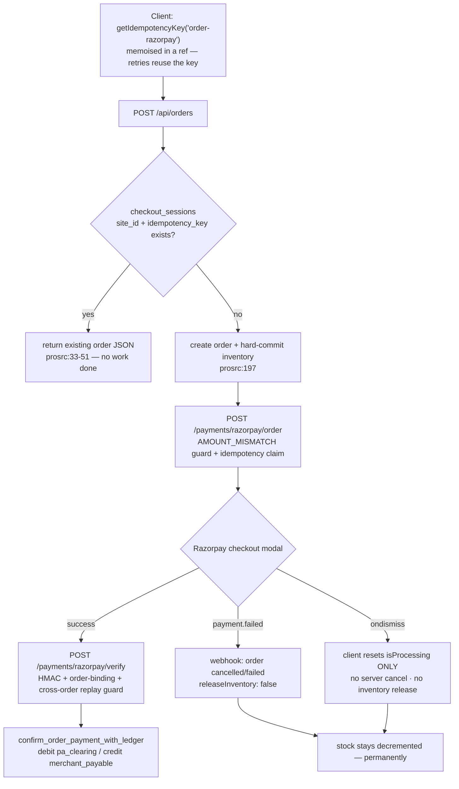

# 12 — Payments, COD, Razorpay & GST (measured state)

> **Status — 2026-08-04.**
>
> | | |
> |---|---|
> | **Proven** | `create_checkout_order`'s full signature, idempotency contract, locking and server-side re-pricing — read from `pg_proc.prosrc` on the running Postgres. `confirm_order_payment_with_ledger` **does** post canonical double-entry (definitive; three repo documents saying otherwise are stale). Razorpay signature verification is correct, server-side and constant-time. Inventory is hard-decremented before payment and never released on failure. GST resolves to zero on every live order. `gst_invoices` has never been written by any code path. COD is not ledgered at confirm. `cod_enabled`/`online_payment_enabled` are never read server-side. Per-merchant Razorpay credentials are written and never decrypted. |
> | **Unresolved** | The COD ledger *direction* (finance question, not engineering). Whether the merchant-credential decrypt side is deferred or was removed. Which payment providers are actually in V1 scope. Whether a staging environment exists where the capture→ledger→invoice chain can be verified against real data. |
> | **Not proven / not claimed** | **No money path has been exercised end-to-end locally.** psql `count(*)`: `orders` = 0, `ledger_entries` = 0, `order_tax_lines` = 0, `gst_invoices` = 0. Every behavioural statement below is derived from SQL function bodies, TypeScript source, or schema — never from an observed transaction. Nothing here should be read as "verified working in production". |
>
> **Authority:** subordinate to `GOVERNANCE_REWRITE_2026_06_10/LETBUYY_CONSTITUTION.md` → root `AGENTS.md`. Evidence, never law. Companions: [11-cart-and-checkout-boundary.md](11-cart-and-checkout-boundary.md) (how the order request arrives), [10-shopper-auth-and-account-flows.md](10-shopper-auth-and-account-flows.md) (who the buyer is), [01-governance-and-invariants.md](01-governance-and-invariants.md) (the binding rules).
>
> **Reading the SQL citations.** `prosrc:N` means line *N* of the function body as it exists in the **running database**, obtained with
> `docker exec supabase_db_Letbuyy_Store psql -U postgres -d postgres -t -A -c "SELECT prosrc FROM pg_proc WHERE proname='<fn>';"`. Every such line number in this document was re-verified on 2026-08-04.

---

## 1. `create_checkout_order` — the canonical order RPC

### 1.1 Signature (live database, verified 2026-08-04)

```
p_store_id uuid, p_customer_name text, p_customer_email text, p_customer_phone text,
p_shipping_address jsonb, p_items jsonb, p_payment_method text,
p_notes text = NULL, p_coupon_code text = NULL, p_gift_card_code text = NULL,
p_shipping_method text = 'standard', p_idempotency_key text = NULL,
p_actor_id uuid = NULL, p_request_id text = NULL, p_shipping_rate_id uuid = NULL,
p_tax_amount numeric = NULL
```

`SECURITY DEFINER` (`prosecdef = t`). **16 parameters, none of them a cart, cart token or handoff
digest** — the database structurally cannot enforce the `ART-14` binding; see
[11-cart-and-checkout-boundary.md](11-cart-and-checkout-boundary.md) §5.3.

### 1.2 Contract

| Property | Fact | Evidence | Status |
|---|---|---|---|
| Idempotency required | raises when the key is null or blank | `create_checkout_order` **prosrc:26** — `RAISE EXCEPTION 'idempotency_key is required'` | proven |
| Replay | looks up `checkout_sessions` on `(site_id, idempotency_key)` and returns the existing order JSON **before doing any work** | **prosrc:33-51** (`FROM checkout_sessions` at :35) | proven |
| Order lock | locks the created order `FOR UPDATE`, raises `'created order not found'` if absent | **prosrc:126-132** (`FOR UPDATE` at :129) | proven |
| Gift-card lock | locks `gift_card_accounts` `FOR UPDATE`, site-scoped, caps at `LEAST(balance, grand_total)`, raises on zero balance | **prosrc:152-182** (`FOR UPDATE` at :157, `LEAST(...)` at :179) | proven |
| `ON CONFLICT` guards | gift-card ledger, gift-card redemption, `checkout_sessions`, `order_line_adjustments` and the payment row all use `ON CONFLICT (site_id, idempotency_key) DO NOTHING` | **prosrc:207, 233, 290, 365, 428, 496** (and `ON CONFLICT (idempotency_key)` at :536) | proven |
| Site scoping | every write inside the function is `site_id`-scoped | same lines | proven |
| Payment-method validation | validates the **name** only, against `('razorpay','stripe','paypal','cod')` | **prosrc:29-31** | proven |

### 1.3 Server-authoritative totals

| Money component | Source | Evidence | Status |
|---|---|---|---|
| Grand total | `v_grand_total := GREATEST(COALESCE(v_order.subtotal,0) + v_shipping_amount + v_tax_amount - v_discount_amount, 0)` | `create_checkout_order` **prosrc:146** | proven |
| Unit price | `v_unit_price := v_product.price` | `create_order_with_inventory_reservations` **prosrc:73** | proven |
| Variant price | `v_unit_price := COALESCE(NULLIF(v_variant.price, 0), v_product.price)` | same, **prosrc:88** | proven |
| Shipping | rate id validated against `shipping_rates ⋈ shipping_zones WHERE sz.site_id = p_store_id`; a foreign id raises *"shipping rate not found or does not belong to this store"* | `create_checkout_order` **prosrc:62-76** (raise at :76) | proven |
| Tax | `v_tax_amount := COALESCE(p_tax_amount, 0)` — the RPC **accepts** the tax from the caller and defaults it to zero | **prosrc:107** | proven |

The client never supplies a price. `PAY-R8` (*MUST recompute totals server-side*, `AGENTS.md:252`)
holds at the RPC layer. **The tax line is the exception that matters** — see §6.

---

## 2. `confirm_order_payment_with_ledger` — does it post to the canonical ledger?

### **Yes. Definitively. Verified against the running database on 2026-08-04.**

| Fact | Evidence | Status |
|---|---|---|
| Calls `post_settlement_ledger_transaction` | `confirm_order_payment_with_ledger` **prosrc:95** — `v_ledger_transaction_id := public.post_settlement_ledger_transaction(...)` | proven |
| Debit leg | **prosrc:102** — `'account_code', 'pa_clearing'` | proven |
| Credit leg | **prosrc:108** — `'account_code', 'merchant_payable'` | proven |
| Keyed on the payment idempotency key | **prosrc:37** — `v_ledger_idempotency_key := COALESCE(NULLIF(p_idempotency_key,''), p_provider_payment_id)`; used at **:88, :99** | proven |
| Stamps the ledger id back onto the payment | **prosrc:128, :163, :167** — `jsonb_build_object('canonical_ledger_transaction_id', v_ledger_transaction_id)` | proven |
| Order locked | **prosrc:29** — `FOR UPDATE` | proven |
| Introduced by | `database/supabase/migrations/168_b1_b2_capture_refund_ledgering.sql` (`CREATE OR REPLACE FUNCTION public.confirm_order_payment_with_ledger`), commit `c428dcf2` *"Implement B1 B2 canonical money ledgering"* | proven |

### 2.1 Refunds also post

| Fact | Evidence | Status |
|---|---|---|
| `complete_order_refund` requires an idempotency key | **prosrc:13-14** — `RAISE EXCEPTION 'idempotency_key is required'` | proven |
| Two `FOR UPDATE` locks | **prosrc:22, :33** | proven |
| Debit `merchant_payable` / credit `refund_clearing` via `post_settlement_ledger_transaction` | **prosrc:78** (call), **:85** (debit), **:91** (credit) | proven |
| `ON CONFLICT (idempotency_key) DO NOTHING` | **prosrc:229** | proven |

### 2.2 Ledger integrity machinery

| Control | Evidence | Status |
|---|---|---|
| Append-only: reject-update / reject-delete triggers on `ledger_entries` and `ledger_transactions` → `reject_ledger_mutation()` | `pg_trigger`: `ledger_entries_reject_update/reject_delete`, `ledger_transactions_reject_update/reject_delete` | proven |
| Balance enforcement: a **DEFERRABLE INITIALLY DEFERRED** constraint trigger `ledger_entries_balance_enforced` → `enforce_ledger_transaction_balance()` | `pg_trigger` | proven |
| Tenancy fails closed inside the ledger writer: `post_settlement_ledger_transaction` resolves the owning site from the source, raises *"ledger source/site mismatch"*, raises *"tenant GUC site_id does not match ledger source ownership"*, then `set_config('app.site_id', …, true)` | live `pg_proc.prosrc` for `post_settlement_ledger_transaction` | proven |
| Account codes are constrained to exactly 8 | psql `\d ledger_accounts` → CHECK `account_code = ANY (ARRAY['pa_clearing','merchant_payable','platform_revenue','gst_payable','cod_receivable','reserve','vendor_payable','refund_clearing'])` | proven |
| RLS ENABLE + FORCE on all ten checkout/money tables checked | psql `pg_class` → `t \| t` for `carts, checkout_sessions, orders, order_items, payment_transactions, payment_attempts, inventory_reservations, ledger_entries, ledger_transactions, gst_invoices` | proven |

### 2.3 Three repository documents are stale on this

| Document | Claim | Verdict |
|---|---|---|
| `AGENTS.md:246` (`PAY-R2`) | *"the legacy `confirm_order_payment_with_ledger` posts **zero** ledger entries despite its name — it becomes an adapter, then LEGACY"* | **STALE.** Code wins. |
| `CONVERGENCE_CLEANUP_2026_06_10/STRATEGIC_WINNERS_FINAL.md:291,299` | *"Fresh read of the actual function body proves zero ledger calls"* | **STALE.** |
| `CONVERGENCE_AUDIT_2026_06_10/DUPLICATE_AUTHORITY_REPORT.md:62` | *"0 ledger lines despite the name"* | **STALE.** |
| `DUPLICATE_AUTHORITY_REPORT.md:63` / `STRATEGIC_WINNERS_MASTER_PLAN.md:204` | *"refunds/COD are un-ledgered"* | **HALF-STALE.** Refunds: false (they post). **COD: still true** — see §7. Split the finding rather than deleting it. |
| `CONVERGENCE_AUDIT_2026_06_10/FOUNDATION_GAP_REPORT.md:153`, `SINGLE_SOURCE_OF_TRUTH_PLAN.md:95` | migration 166 (`create_order_with_inventory_reservations`) is *UNTRACKED* → deploying without it means a checkout outage | **STALE.** `database/supabase/migrations/166_d6_checkout_handoff_inventory.sql` is tracked and the function exists in the live DB (`pg_proc`, `prosecdef = true`, 7 779 chars). |

**`PAY-R2`'s normative rule** (*every capture / refund / COD / tender MUST post to the ledger,
idempotently*) is **SATISFIED for the Razorpay capture path and for refunds**, and **BREACHED for
COD**. Anyone planning work off "un-ledgered capture" is planning against a fixed defect.

---

## 3. Razorpay

| Control | Fact | Evidence | Status |
|---|---|---|---|
| Order creation is server-side | uses platform env credentials; **rejects a client-supplied amount that disagrees with the server order amount** (`AMOUNT_MISMATCH`) | `services/api-gateway/src/routes/storefront/checkout-payment-routes.ts:463-468` (env check), `:482-489` | proven |
| Idempotency-claimed with replay support | begin/replay around the provider call | `checkout-payment-routes.ts:490-502` | proven |
| Signature verification | **HMAC-SHA256** over `` `${providerOrderId}|${providerPaymentId}` `` | `packages/infrastructure/razorpay-adapter/index.ts:347-348` | proven |
| Constant-time comparison | own `timingSafeEqual` XOR loop | `razorpay-adapter/index.ts:223-230` | proven |
| Fail-closed order binding | the verify route rejects unless `order.payment_id === razorpay_order_id`, i.e. the order was bound to a **server-created** Razorpay order → `PAYMENT_REFERENCE_MISMATCH` (409) | `checkout-payment-routes.ts:614-622` | proven |
| Cross-order replay guard | rejects a `razorpay_payment_id` already recorded against a **different** order | `checkout-payment-routes.ts:628-633` (`assertProviderPaymentNotReplayed`); impl `services/api-gateway/src/lib/payment-route-support.ts` | proven |
| Secret source | **only** `c.env.RAZORPAY_KEY_ID` / `c.env.RAZORPAY_KEY_SECRET` (worker env). `wrangler.toml` contains no literal value (only `AI_CREDIT_RAZORPAY_KEY_ID = SKIP_NEEDS_HUMAN_…` at `:275`); the deploy workflow installs them as wrangler secrets | `services/api-gateway/src/index.ts:109`; `.github/workflows/production-deploy.yml:320` (`wrangler secret put`) | proven |

`PAY-R8` and `SEC-R2`/`SEC-R5` hold here. This is the strongest part of the money path.

### 3.1 Webhooks

| Control | Fact | Evidence | Status |
|---|---|---|---|
| Dual verification | a dedicated timing-safe check **plus** the adapter's `webhookVerify`, both HMAC-SHA256 over the raw body against `RAZORPAY_WEBHOOK_SECRET` | `services/webhook-service/src/index.ts:718-737`; `razorpay-adapter/index.ts:440-441` | proven |
| Duplicate absorption | writes `payment_webhook_events` and returns `{duplicate:true}` without reprocessing | `webhook-service/src/index.ts:753-776` | proven |
| Age policy | old-but-**signed** events are processed rather than rejected by age (explicit comment) | `webhook-service/src/index.ts:754-760` | proven |
| Out-of-order refund | a refund webhook arriving **before** the capture webhook is skipped rather than flipping an unpaid order to refunded (`refund_webhook_skipped_order_not_captured`) | `webhook-service/src/index.ts:437-446` | proven |

Note on `SEC-R5`/`PAY-R8`: the rule requires *"enforce a timestamp/replay window"*. Replay is
enforced by event-id idempotency, **not** by a timestamp window — signed-but-old events are accepted
deliberately. That is a defensible design for a payment provider that retries for days, but it is a
literal deviation from the rule text and should be recorded as such rather than glossed.

---

## 4. Headline defect (a) — inventory hard-decremented before payment, never released

**Severity: P1 in the sweep, high-stakes. Constitutionally it is a named prohibition.**

| Step | Fact | Evidence | Status |
|---|---|---|---|
| 1 | Stock is **reserved** with a TTL under `FOR UPDATE`, raising `INSUFFICIENT_INVENTORY` when `available - reserved < quantity` | `reserve_inventory` **prosrc:42** (`FOR UPDATE`), **:49** (raise), **:52** (TTL `LEAST(GREATEST(COALESCE(p_ttl_seconds,1200),60),86400)`) | proven |
| 2 | The **same call** then immediately commits the reservation | `create_order_with_inventory_reservations` **prosrc:110** (reserve) then **:197** (`PERFORM public.commit_inventory_reservation(...)`), audit note at **:222** *"Committed by reserve_inventory -> commit_inventory_reservation"* | proven |
| 3 | Commit hard-decrements | `commit_inventory_reservation` **prosrc:27** — `SET available = GREATEST(available - v_reservation.quantity, 0)` (and `available_quantity` at **:29**) | proven |
| 4 | On `payment.failed` the order moves to cancelled/failed and inventory is **explicitly not released** | `services/webhook-service/src/index.ts:400-412` — `recordGatewayOrderPaymentFailure(..., { releaseInventory: false })` at `:409` | proven |
| 5 | A cancelled/dismissed Razorpay modal only resets client state — no server cancel, no release | `checkout-client.tsx:534-537` (`modal.ondismiss`), `:540-543` (`payment.failed` handler) | proven |
| 6 | The stale-reservation sweeper exists and **cannot help**, because reservations are committed rather than left active | `services/queue-workers/src/inventory-reservations.ts:26` (`db.rpc('expire_inventory_reservations')`); `services/queue-workers/src/index.ts:625-635`; `database/supabase/migrations/141_executable_inventory_reservations.sql:304` | proven |

**Net effect: denial-of-inventory.** An unauthenticated caller can create online-payment orders
through the ungated public door (see [11-cart-and-checkout-boundary.md](11-cart-and-checkout-boundary.md) §5.3),
never pay, and permanently zero a merchant's stock — 20 orders per 5 minutes per IP.

**Rule text, verbatim.** `ART-14` **Forbids**: *"Decrementing stock before payment for pre-pay/COD."*
(`LETBUYY_CONSTITUTION.md:236`). `R-11`: *"inventory uses reserve-with-TTL, not pre-payment
hard-decrement"* (`:406`). `ART-15` requires *"one reserve→commit inventory lifecycle … with the
stale-reservation sweeper **wired**"* (`:240`) — the sweeper is wired and starved.

**Fix shape (not applied, ARB-gated).** Leave the reservation **ACTIVE** for online-payment orders and
commit only at capture; keep the immediate commit for COD. The sweeper then does real work.

---

## 5. Headline defect (b) — GST computes to **zero** on every live order

**Severity: P0, high-stakes.**

| Step | Fact | Evidence | Status |
|---|---|---|---|
| 1 | Server-side GST **is** implemented in the gateway route, from `tax_registrations` (supplier GSTIN + state code) and `tax_rates.rate`, via `calculateGstLine` with intra-state vs inter-state supply type | `services/api-gateway/src/routes/storefront/checkout-payment-routes.ts:294-368` | proven |
| 2 | It is skipped unless `body.customer.address.stateCode` resolves to a valid Indian state code — **there is no fallback to the state NAME** | `checkout-payment-routes.ts:318-320` (`normalizeIndianStateCode(body.customer.address.stateCode ?? null)`); `packages/checkout-core/src/index.ts:727-731` | proven |
| 3 | The React checkout **never sends `stateCode`** — `buildOrderPayload` emits only `{address, city, state, pincode}`; the token `stateCode` appears **nowhere** in `apps/storefront-runtime/src` | `checkout-client.tsx:338-363` (verified by direct read, 2026-08-04); `grep -rn stateCode apps/storefront-runtime/src` → no output | proven |
| 4 | ⇒ `computedTaxAmount` is always `null`, and the RPC defaults it | `create_checkout_order` **prosrc:107** — `v_tax_amount := COALESCE(p_tax_amount, 0)` | proven |

**Result: every order created through the live path carries ₹0 GST**, silently, with no UI signal.
On an India-first commerce platform this is a tax-compliance defect, not a UX gap. It also means
`order_tax_lines` is never populated (psql `count(*)` = 0 locally, consistent with `orders` = 0 — so
the zero-row state is not itself proof, but the code path is).

**Fix shape (not applied).** Add a **server-side** state-name → GST state-code resolver in the gateway
route (do not promote a client-supplied code to authoritative), capture the code at the address step,
and surface the tax line on the checkout summary so a zero is **visible** rather than silent.

---

## 6. Headline defect (c) — GST invoices are **never issued**

**Severity: P0, high-stakes.**

| Fact | Evidence | Status |
|---|---|---|
| `gst_invoices` exists and is **immutable at the DB level** — `BEFORE UPDATE` and `BEFORE DELETE` triggers calling `reject_gst_invoice_mutation()` | `pg_trigger` on `gst_invoices`: `gst_invoices_reject_update`, `gst_invoices_reject_delete` | proven |
| RLS is ENABLE + FORCE on it | psql `pg_class` → `t \| t` | proven |
| **No code path anywhere INSERTs into it** — not one migration, not one TypeScript call site | `grep 'insert into'` over `database/supabase/migrations/*.sql` for `gst_invoices` → none; `rg "from('gst_invoices')"` → only `services/api-gateway/src/routes/tax.ts:144` (a `.select`) | proven |
| Zero rows locally | psql `SELECT count(*) FROM gst_invoices` → **0** | proven |

The immutability machinery, the read API and the table are all built. **The write is missing.** An
India-first commerce platform currently ships **without tax invoices**.

**`ART-15`** requires *"**GST place-of-supply** (CGST/SGST vs IGST + HSN + inclusive/exclusive) +
**immutable GST invoice** (IRN/QR via mock IRP) + TCS are built"* (`LETBUYY_CONSTITUTION.md:240`).
The immutable-invoice clause is **unmet in practice**.

**Fix shape (not applied, ARB-gated).** Add an invoice-issuance step — an **RPC**, so it is covered by
the canonical-ledger-only rule and by the existing immutability triggers — invoked on order confirm,
reusing `generateGstInvoice` from `@letbuyy/checkout-core`.

---

## 7. Headline defect (d) — COD is not ledgered at confirm (`PAY-R2`)

**Severity: P1, high-stakes.**

| Fact | Evidence | Status |
|---|---|---|
| COD orders are created with status `confirmed` immediately (online-payment orders start `pending`) | `create_order_with_inventory_reservations` **prosrc:175** — `CASE WHEN p_payment_method = 'cod' THEN 'confirmed' ELSE 'pending' END` | proven |
| `create_checkout_order` contains **zero** references to `cod_receivable` or `post_settlement_ledger` | live psql: `SELECT prosrc ~ 'cod_receivable', prosrc ~ 'post_settlement_ledger' FROM pg_proc WHERE proname='create_checkout_order'` → `f \| f` (re-verified 2026-08-04) | proven |
| The **only** `cod_receivable` posting is at remittance — and there it is **DEBITED**, with `merchant_payable` credited | `database/supabase/migrations/165_d5_canonical_money_paths.sql:353-395` (`reconcile_cod_remittance_with_ledger`) | proven |

So a COD order is `confirmed` — a real receivable exists economically — and **no ledger transaction is
written**. The account that remittance later relieves is **never credited at origination**.

**`PAY-R2` verbatim** (`AGENTS.md:246`): *"Every capture / refund / COD / tender posting MUST go
through the ledger, idempotently (… COD → `cod_receivable` at confirm, relieved at remittance with
**signed** breaks)."* **`R-5`** (`LETBUYY_CONSTITUTION.md:398`) restates it constitutionally.

**Unresolved — and explicitly a finance question, not an engineering guess.** The remittance posting
**debits** `cod_receivable`, which is the direction one would expect for *relief* only if the account
had been credited at origination — but `PAY-R2` specifies `cod_receivable` **at confirm**, relieved at
remittance. Either the origination entry is simply missing and the remittance sign is right, or the
remittance posting is modelling something else entirely. This needs a finance/ARB read. **[ARB-GATED]**

---

## 8. Headline defect (e) — `cod_enabled` / `online_payment_enabled` are UI-only

**Severity: P1, high-stakes.**

| Fact | Evidence | Status |
|---|---|---|
| Both columns exist on `sites` | psql `information_schema.columns` → `cod_enabled`, `online_payment_enabled` (also `access_mode`, `payment_settings`) | proven |
| They are passed to the React checkout as **client props** | `store/[subdomain]/checkout/page.tsx:34-35` | proven |
| The gateway's `loadPublishedStore` selects **only `id`** | `services/api-gateway/src/routes/storefront.ts:643-647` and `:736-748` | proven |
| So neither the route nor the RPC ever reads them; the RPC validates only the method **name** | `create_checkout_order` **prosrc:29-31** | proven |

**Impact.** A client can order COD from a store that disabled COD, or pay online at a store that
disabled online payments, simply by sending the other `paymentMethod`. Combined with the ungated
public order door ([11-cart-and-checkout-boundary.md](11-cart-and-checkout-boundary.md) §5.3), no
authentication is needed to do it.

This is a `SEC-R1` failure (*an omitted gate ⇒ deny*, `AGENTS.md:224`) expressed as a merchant-setting
bypass. **Fix shape (not applied):** extend the published-store select and reject the disabled method
in the gateway route before calling the RPC — **no money-RPC edit required**, so this one is cheap.

---

## 9. Headline defect (f) — per-merchant Razorpay credentials are collected, encrypted, and never used

**Severity: P1, high-stakes. This is the finding with the largest commercial/regulatory consequence.**

| Fact | Evidence | Status |
|---|---|---|
| Merchant credentials **are** written encrypted to `sites.payment_settings.razorpay.key_secret_ciphertext` | `services/api-gateway/src/routes/stores.ts:432` | proven |
| `encryptPaymentSecret` exists at `services/api-gateway/src/lib/store-payment-config.ts:37` | | proven |
| **There is no decrypt function anywhere** | `rg 'decryptPaymentSecret'` over `services/` and `packages/` → **no matches** | proven |
| The storefront capture path uses **only** the platform keys | `checkout-payment-routes.ts:463`, `:505-508` → `c.env.RAZORPAY_KEY_ID` / `RAZORPAY_KEY_SECRET` | proven |

**Consequence.** Every storefront capture runs on **the single platform Razorpay account**. The
merchant settings UI collects credentials that imply merchant-of-record status; the runtime does not
honour them.

**`ART-11`** (`LETBUYY_CONSTITUTION.md:213`) and **`PAY-R4`** (`AGENTS.md:248`) are explicit: *"money-in
flows to the **merchant's own Razorpay** (merchant = merchant-of-record)"*, and the platform *"never
custodies"*. Running all captures on the platform account is precisely the shape those rules exist to
forbid, and it has licensing implications far beyond code.

**Fix shape (not applied, hard ARB gate).** Either wire per-merchant credential resolution into the
storefront payment routes (decrypt + use, with a documented platform fallback), **or** remove the
merchant credential UI so the settings screen stops implying something untrue. This changes **who is
Merchant of Record** — it is not an engineering decision.

**Unresolved.** The credentials are encrypted with a key that has **no corresponding decrypt function
in the repo**. If merchants have already connected accounts, their ciphertext is currently unreadable
by any code path. Whether the decrypt side is deferred or was removed is unknown.

---

## 10. Retry, duplicate callback, expired and cancelled handling



| Scenario | Handling | Evidence | Verdict |
|---|---|---|---|
| Client retry of the same logical action | idempotency keys are generated **client-side per scope** and memoised in a ref, so a retry reuses the key | `checkout-client.tsx:256-261` (`getIdempotencyKey`) | adequate — but the key is client-chosen, so it protects against accidental retry, not against a hostile caller |
| Duplicate webhook callback | absorbed via `payment_webhook_events`; returns `{duplicate:true}` without reprocessing | `webhook-service/src/index.ts:753-776` | correct |
| Expired handoff (Path A only) | 10-minute TTL enforced **before** any crypto work | `cart-routes.ts:546`; `checkout.ts:236-239` | correct — and unreachable |
| Refund before capture | skipped, logged `refund_webhook_skipped_order_not_captured` | `webhook-service/src/index.ts:437-446` | correct |
| Payment failed | order → cancelled/failed; **inventory not released** | `webhook-service/src/index.ts:400-412` | **defective — §4** |
| Modal dismissed / cancelled | client resets `isProcessing`; **no server-side cancel, no release** | `checkout-client.tsx:534-537,540-543` | **defective — §4** |
| Order confirmation surface | rendered inline as React state (`isSuccess`), not on a dedicated route; `/checkout/success` is a stale Stripe-redirect fallback that just links to `/orders` | `checkout-client.tsx:546-556`; `checkout/success/page.tsx:1-3` | fragile — a refresh loses the confirmation |
| Preview mode | blocked from creating real orders (409) **before** any gateway call | `app/api/orders/route.ts:21-29` | correct |

### 10.1 What the React checkout does not collect

`buildOrderPayload` (`checkout-client.tsx:338-363`) omits **`gstin`** and **`giftCardCode`**, even
though `create_checkout_order` fully supports both (`customer_gstin`; `p_gift_card_code` with
`FOR UPDATE` + ledger + redemption at **prosrc:152-233**) and the `/api/orders` proxy already forwards
them (`app/api/orders/route.ts:53-54`). B2B invoicing and gift-card redemption are therefore
unreachable from the storefront despite being fully built. **UI-only change. Severity P2.**

---

## 11. Provider-mode honesty — unmet on the buyer side

| Fact | Evidence | Status |
|---|---|---|
| Provider mode **is** derived server-side (`sandbox` unless a merchant secret exists and `test_mode` is false) | `services/api-gateway/src/lib/store-payment-config.ts:71-79` (`paymentConfigProviderMode`) | proven |
| The storefront checkout **never receives or renders it** | `grep -rn 'provider_mode\|providerMode' apps/storefront-runtime/src` → **no matches** | proven |
| `ProviderModeBadge` exists **only** in the merchant app; it is **not** exported from `@letbuyy/ui` | `apps/merchant-control-plane/src/components/ProviderModeBadge.tsx`; `ls packages/typescript/ui/src/` contains no provider-mode file | proven |
| The validator that enforces it lists only the merchant path | `scripts/validators/provider-mode-badge-validator.mjs:31,60` | proven |
| There is **no mock/sandbox Razorpay adapter** — no mock/fake/stub path in the adapter, and no `createMockPaymentProvider` anywhere | `grep -ril 'mock\|fake\|stub' packages/infrastructure/razorpay-adapter/` → no files; `rg 'createMockPaymentProvider\|MockPayment\|sandboxProvider'` over `packages/ services/` → no matches | proven |
| The adapter **does** accept an injectable `fetch`, so a stub is cheap to add | `packages/infrastructure/razorpay-adapter/index.ts:288-292` | proven |

**`PAY-R10`** (`AGENTS.md:254`) and **`UI-R6`** (`AGENTS.md:293`) require a truthful `mock/sandbox/live`
badge on **every** money surface. A sandbox-key store today renders a buyer-facing payment flow
**indistinguishable from live**. The validator passes because its surface list does not include the
storefront checkout route — a green gate that does not mean what it appears to mean; see
[14-test-build-governance-baseline.md](14-test-build-governance-baseline.md).

**Second-order consequence:** with no sandbox adapter, the full `order → capture → ledger` chain
**cannot be exercised offline**. Local and CI verification of the money path requires real Razorpay
test credentials — which is why `orders`, `ledger_entries`, `order_tax_lines` and `gst_invoices` all
have zero rows locally, and why nothing in this document is claimed as runtime-verified.

---

## 12. Findings → Constitution Article / AGENTS rule

| # | Finding | Severity | Breaches | Gate |
|---|---|---|---|---|
| P-1 | Inventory hard-decremented before payment; never released on failure ⇒ denial-of-inventory | **P1** high-stakes | `ART-14` *Forbids: decrementing stock before payment* (`LETBUYY_CONSTITUTION.md:236`); `R-11` (`:406`); `ART-15` reserve→commit (`:240`) | **[ARB-GATED]** — money/inventory RPC semantics |
| P-2 | GST computes to **zero** on every live order (`stateCode` never sent, no name fallback) | **P0** high-stakes | `ART-15` GST place-of-supply (`:240`); India-first standards | **[ARB-GATED]** — tax computation |
| P-3 | **GST invoices are never issued** — table + immutability triggers + read API exist, nothing inserts | **P0** high-stakes | `ART-15` *immutable GST invoice* (`:240`) | **[ARB-GATED]** — tax |
| P-4 | COD not ledgered at confirm; `cod_receivable` only touched at remittance, and **debited** there | **P1** high-stakes | `PAY-R2` (`AGENTS.md:246`); `R-5` (`LETBUYY_CONSTITUTION.md:398`); `ART-10` (`:207`) | **[ARB-GATED]** — money path + reconciliation harness + finance sign-off |
| P-5 | `cod_enabled` / `online_payment_enabled` are UI-only (`loadPublishedStore` selects only `id`) | **P1** high-stakes | `SEC-R1` (`AGENTS.md:224`) | route-level fix; **no money-RPC edit** — cheapest of the six |
| P-6 | Per-merchant Razorpay credentials collected + encrypted, **never decrypted**; every capture on the platform account | **P1** high-stakes | `ART-11` *never custody / merchant-is-MoR* (`LETBUYY_CONSTITUTION.md:213`); `PAY-R4` (`AGENTS.md:248`); `R-7` (`:400`) | **[ARB-GATED]** — changes Merchant of Record; licensing implications |
| P-7 | Hosted checkout API complete + mounted, **no client, no deploy target**; unsigned public order door live | **P0** high-stakes | `ART-14` (`:234-236`); `R-11` (`:406`); `R-15` / `ANTI-R1` | **[ARB-GATED]** — see [11-cart-and-checkout-boundary.md](11-cart-and-checkout-boundary.md) §5 |
| P-8 | No provider-mode badge on the storefront money surface | **P2** | `PAY-R10` (`AGENTS.md:254`), `UI-R6` (`:293`) | promote `ProviderModeBadge` into `@letbuyy/ui`; extend the validator surface list |
| P-9 | No mock/sandbox payment adapter — money path unverifiable offline | **P2** | `PAY-R10` verification intent; `ANTI-R11` (working-tree ≠ production state, `AGENTS.md:324`) | dev-only in-memory provider behind an env flag, **never** in production |
| P-10 | React checkout collects no GSTIN and no gift-card code although both are fully supported | **P2** | India-first B2B standards | UI-only |
| P-11 | Webhook replay is event-id based, with **no timestamp window** (signed-but-old events are processed) | **note** | literal deviation from `SEC-R5`/`PAY-R8` text (`AGENTS.md:228,252`) | record the deviation or add a window |
| P-12 | Four repository documents stale on ledgering / CHK-001 / migration 166 | **doc** | `DOC-R2` (source wins) | correct the docs; see §2.3 |

---

## 13. Unresolved (carry forward)

1. **COD ledger direction.** `reconcile_cod_remittance_with_ledger` **debits** `cod_receivable` and
   credits `merchant_payable` at remittance (`165_d5_canonical_money_paths.sql:353-395`), while
   `PAY-R2` specifies `cod_receivable` **at confirm**, relieved at remittance. Is the remittance
   posting modelling something else, or is the origination entry simply missing and the sign wrong?
   **Finance/ARB read required — not an engineering guess.**
2. **Merchant credential decrypt.** Encrypted with a key that has no decrypt function in the repo.
   Deferred, or removed? If merchants have already connected accounts, their ciphertext is unreadable
   by any code path today.
3. **Which providers are in V1 scope?** The storefront ships a `checkout/paypal-return` route and the
   gateway has Cashfree/Stripe/PayPal storefront routes, but `create_checkout_order` accepts only
   `('razorpay','stripe','paypal','cod')` — **`cashfree` would raise "unsupported payment method"**.
   The success page comment says *"V1 ships Razorpay+COD; Stripe deferred (LB-2)"*, which contradicts
   the route surface.
4. **Is there a staging environment where the money tables are populated?** `orders`,
   `ledger_entries`, `order_tax_lines` and `gst_invoices` are all zero locally, so the
   capture→ledger→invoice chain has been verified only by reading SQL. Real-data verification is still
   owed.
5. **Is the unsigned public `POST /:subdomain/orders` an intended headless API** or the legacy React
   door? Decides whether P-7's fix is *gate it* or *give it its own authenticated contract*.
   See [11-cart-and-checkout-boundary.md](11-cart-and-checkout-boundary.md) §9.
