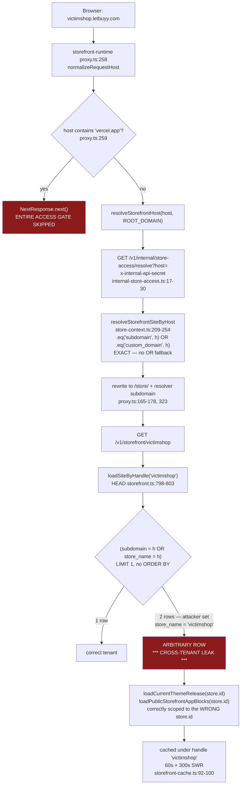

# 13 — Security & Tenant Isolation (Theme / Storefront Surface)

> **Status of this document — 2026-08-04.**
>
> **Proven.** A **P0 cross-tenant leak** in storefront handle resolution (§1) — the query shape,
> the missing collision check on the onboarding write, the per-column-only UNIQUE constraints, and
> the fail-open/fail-closed asymmetry across three sibling loaders are all read directly from
> source and from `pg_constraint`. The RLS posture of all 32 theme tables (§3), the `SET ROLE anon`
> denial proof (§2.1), the validator blind spot (§4), the dead tenant-GUC path (§5), the two
> ownership helpers (§6), the access-gate bypasses (§7), the sanitizer surface and its `iframe`
> hole (§8), and the preview-bridge `document.referrer` fallback (§9).
>
> **⚠️ A remediation is in flight — read §0 before anything else.**
> Between the discovery sweep and the writing of this document, the working tree changed.
> **Findings 1, 2, 6, 7 and 17 now have uncommitted fixes; finding 3 has an untracked, unapplied
> migration; the remaining twelve are unchanged.** Every finding is therefore reported against
> **two states**: `HEAD` (`ee371182` — what a clean checkout gets, and what any deployed build came
> from) and **working tree** (2026-08-04, uncommitted/untracked). §0 is the map.
>
> **Unresolved.** Whether `storefront-runtime` is actually reachable on a `*.vercel.app` hostname
> in production (this sets the severity of §7.1); which database role `HYPERDRIVE`/`DATABASE_URL`
> resolves to at runtime and whether it carries `BYPASSRLS`; whether any deployed environment has
> a Liquid canary tenant (which decides whether §8's findings are live or latent).
>
> **Not executed.** No cross-tenant assertion could be run: the database holds **one** site and
> **zero** preview sessions (§10). Nothing in this document was proven by exploitation — the leak
> is proven structurally, from source + schema constraints.
>
> **Environment caveat.** The local Supabase database was **re-initialised during this session**.
> All *structural* claims (`pg_class`, `pg_policies`, `pg_constraint`, grants) were **re-verified
> after the reset and reproduce exactly**, which additionally proves the RLS posture is
> migration-derived rather than environmental. All *row-level* observations (the single site, the
> theme row counts) were proven pre-reset and are marked *(proven — pre-reset)*.
>
> **Authority.** Subordinate to `GOVERNANCE_REWRITE_2026_06_10/LETBUYY_CONSTITUTION.md` → root
> `AGENTS.md` → local `AGENTS.md`. Evidence, never law (`DOC-R2`). See
> [01-governance-and-invariants.md](01-governance-and-invariants.md).

---

## 0. Remediation state — `HEAD` vs working tree (2026-08-04)

**Nothing below is committed.** `git status --porcelain` shows the security-relevant changes as
unstaged (` M`) or untracked (`??`). **A clean checkout of `HEAD` still carries every original
defect**, and `HEAD` is what any deployed build was produced from.

| # | Finding | State at `HEAD` `ee371182` | State in the working tree | Git state of the fix |
|---|---|---|---|---|
| 1 | Handle-resolution cross-tenant leak (§1) | ⛔ **present** — `git show HEAD:services/api-gateway/src/routes/storefront.ts` still contains the two-column `.or(...)` handle filter at **lines 748 and 802** | ✅ **fixed** — all four loaders now `.eq('subdomain', handle)` / `where subdomain = $1`, with `maybeSingle()` | ` M storefront.ts` (**21+ / 17−**, unstaged) |
| 2 | Onboarding cross-column collision (§1.2) | ⛔ **present** — `git show HEAD:…/onboarding.ts \| grep handleCandidates` → **no match** | ✅ **fixed** — pre-insert check at `onboarding.ts:402-424` → **409 CONFLICT** | ` M onboarding.ts` (**43+ / 8−**, unstaged) |
| 3 | `themes` `USING (true)` + 24 unFORCEd tables (§3.1, §3.2) | ⛔ **present** | ⚠️ **migration written, not applied** — `database/supabase/migrations/196_theme_rls_tenant_hardening.sql` (109 lines) replaces the baseline policy with `themes_public_catalog_read` + `themes_site_owner_read` and FORCEs the 24 tables | `?? 196_…sql` (**untracked**); **live DB still shows the old policy and FORCE=f on 24** |
| 6 | `vercel.app` gate bypass (§7.1) | ⛔ **present** — `host.includes('vercel.app')` → `NextResponse.next()` | ✅ **fixed** — exact-suffix `isVercelDeploymentHost` (`proxy.ts:157-161`) and `/store/*` denied on deployment hosts (`proxy.ts:301-303`) | ` M proxy.ts` (**65+ / 19−**, unstaged) |
| 7 | Proxy fails OPEN (§7.2) | ⛔ **present** — `return NextResponse.next()` on `'unavailable'` | ✅ **fixed** — `holdingPage(req, 503, 'access-unavailable')` (`proxy.ts:304`) | same diff |
| 17 | `store_name` default `'My Store'` on a UNIQUE column (§1.11) | ⛔ 500 on the second nameless onboarding | ✅ now a **409**, via the same collision check | same diff |
| 4 | Validator blind spot (§4) | ⛔ present | ⛔ **unchanged** — `no-public-using-true-validator.mjs:13-19` still hard-exempts `000_baseline.sql` | 0+/0− |
| 5 | Tenant GUC dead on the theme path (§5) | ⛔ present | ⛔ **unchanged** — `rg withTenantTx\|SET LOCAL ROLE` over `routes/themes.ts`, `routes/themes/`, `theme-execution.adapter.ts` → **0 hits** | — |
| 8 | `access_mode` not enforced below the proxy (§7.3) | ⛔ present | ⛔ **unchanged** — `grep -c access_mode public-routes.ts` → **0**; store layout has no `access_mode` reference | — |
| 9 | Urban Kicks base-fixture coupling (§1.7) | ⛔ present | ⛔ **unchanged** — `portable-to-liquid.ts:103` | 0+/0− |
| 10 | `verifyStoreOwner` lacks the session-store binding (§6) | ⛔ present | ⛔ **unchanged** — signature is still `verifyStoreOwner(storeId, userId)` at `theme-execution.adapter.ts:290` | — |
| 11 | `iframe` allowlisted with no host allowlist / no mandatory sandbox (§8.1) | ⛔ present | ⛔ **unchanged** — no `uponSanitizeElement` hook exists | 0+/0− |
| 12 | Preview-bridge `document.referrer` fallback (§9) | ⛔ present | ⛔ **unchanged** — `storefront-preview-bridge.tsx:56-58` | 0+/0− |
| 13 | `user_id`-only owner policies (§3.3) | ⛔ present | ⚠️ **partially addressed** — migration 196 uses `user_id OR custom_user_id` for the new `themes_site_owner_read` only; the three drafts/releases/preview-session policies are untouched | — |
| 14 | `theme_assets_public_read` looser than siblings (§3.4) | ⛔ present | ⛔ **unchanged** | — |
| 15 | `stores.ts:567` unvalidated handle in a PostgREST `.or()` (§1.11) | ⛔ present | ⛔ **unchanged** — `stores.ts:555,567` | 0+/0− |
| 16 | Stale "ES256 merchant auth required" comments (§2.5) | ⛔ present | ⛔ **unchanged** | — |

**Three actions this state demands, in order.**

1. **Commit the in-flight fixes** (findings 1, 2, 6, 7, 17). They are correct and they close the
   only confirmed cross-tenant leak — but until they are committed, a clean checkout and every
   deployed build still leak.
2. **`git add` migration 196 and apply it.** It is untracked, and the live database — replayed
   through `195` after this session's reset — still shows `Themes are viewable by everyone` and
   `FORCE = false` on 24 tables. An untracked, unapplied migration is not a fix.
3. **Do not treat findings 4, 5, 8–16 as addressed.** They were re-verified as unchanged at the
   time of writing.

> The rest of this document describes each defect as it exists **at `HEAD`**, because that is the
> state that must be reviewed, tested and rolled forward. Where the working tree already fixes it,
> the fix is named inline so the reviewer can check it against the description.

---

## 1. **[P0] [ARB-GATED] Cross-tenant storefront leak via handle resolution**

> **State: present at `HEAD` · fixed in the uncommitted working tree.** See §0 rows 1–2 and §1.10.

> **Verdict: CONFIRMED (high confidence).** One tenant can be served another tenant's theme, theme
> release, site config and app blocks. The leak is **not** in RLS and **not** in preview sessions.
> It is in the legacy-compat `subdomain OR store_name` fallback used by every public storefront
> read.

### 1.1 The defective query

> All line numbers in §1.1–§1.6 are **`HEAD` (`ee371182`)** line numbers, obtained with
> `git show HEAD:services/api-gateway/src/routes/storefront.ts`. The working-tree file has been
> edited (see §0 / §1.10) and its line numbers no longer match.

Every public storefront theme read resolves the tenant through `loadSiteByHandle`:

```ts
// HEAD services/api-gateway/src/routes/storefront.ts:798-803
const selectSite = (selectFields: string, includeDeletedAtFilter: boolean) => {
    let query = db
        .from('sites')
        .select(selectFields)
        .or(`subdomain.eq.${normalized},store_name.eq.${normalized}`)
        .limit(1);
```

`.single()` is applied **after** `.limit(1)` (`HEAD storefront.ts:811`), so PostgREST never raises a
multi-row error — it silently returns whichever row the planner produced. **There is no
`.order()`.** The row is then used verbatim as the tenant identity: `public-routes.ts:572-587`
calls `loadCurrentThemeRelease(c, store.id)` and `loadPublicStorefrontAppBlocks(c, store.id)` and
returns `mapPublicStorePayload(store, release)`. **Nothing checks that `store.subdomain` equals the
requested handle.**

The pooled-SQL twin does the same thing in raw SQL:

```sql
-- HEAD services/api-gateway/src/routes/storefront.ts:653-659
select ${STOREFRONT_SITE_RELEASE_SELECT}
  from sites
 where (subdomain = $1 or store_name = $1)
   and status = $2
   and deleted_at is null
 limit 1        -- no ORDER BY
```

*(proven — both blocks read from `git show HEAD:…`, 2026-08-04)*

### 1.2 Why two tenants can match the same handle

`sites.subdomain` and `sites.store_name` are each UNIQUE **per column** — nothing forbids one row's
`store_name` from equalling a different row's `subdomain`:

```
$ docker exec supabase_db_Letbuyy_Store psql -U postgres -d postgres \
    -c "SELECT conname, pg_get_constraintdef(oid) FROM pg_constraint
        WHERE conrelid='public.sites'::regclass AND contype IN ('u','p');"
 sites_pkey           | PRIMARY KEY (id)
 sites_store_name_key | UNIQUE (store_name)
 sites_subdomain_key  | UNIQUE (subdomain)
```

*(re-verified 2026-08-04, after the DB reset — the constraint set is migration-derived. There are
also no CHECK constraints on `store_name`/`subdomain` format and no normalising trigger; the only
non-internal triggers on `sites` are `trg_sites_version` and `update_stores_updated_at`.)*

And `store_name` is **merchant-controlled free text** that onboarding inserts with **no
cross-column collision check**:

```ts
// HEAD services/api-gateway/src/routes/onboarding.ts:401-406
const { data: store, error: storeError } = await db
    .from('sites')
    .insert({
        user_id: customUser.id,
        custom_user_id: customUser.id,
        store_name: attempt.store_name || 'My Store',
        subdomain: attempt.subdomain || `store-${Date.now()}`,
```

- Validation is `store_name: z.string().min(2).max(100).trim()` — **no slug regex, no reserved
  list** (`packages/tenant-core/src/index.ts:267-270`).
- The value flows from `updates.store_name = stepData.store_name`
  (`services/api-gateway/src/routes/onboarding.ts:343`).

**The check is known-necessary and simply missing on this one write.** Two sibling writers do
perform it:

| Writer | Cross-column check? | Evidence |
|---|---|---|
| `POST /v1/stores` | ✅ `.or('subdomain.eq.X,store_name.eq.X')` → 409 CONFLICT | `services/api-gateway/src/routes/stores.ts:648-656`; and `:681` sets `store_name` from the slug-validated subdomain |
| `/auth/custom/subdomains/validate` | ✅ same pre-check | `services/api-gateway/src/routes/auth.ts:722` |
| **onboarding `sites` insert** | ❌ **none at `HEAD`** | `HEAD onboarding.ts:405` |

*(all proven. The working tree now adds the check at `onboarding.ts:402-424` — two `.in()` probes
over `[subdomain, storeName]` against both columns, returning **409 CONFLICT** on any hit. It is
uncommitted; see §0 row 2.)*

### 1.3 Attack narrative

**Threat model: tenant vs tenant.** `/onboarding` is mounted behind `authMiddleware`
(`services/api-gateway/src/index.ts:750` + `:804`), so the attacker must be a signed-up merchant —
which is exactly the multi-tenant threat this platform must resist.

1. Attacker completes onboarding with `subdomain = "attackershop"` and
   `store_name = "victimshop"` — the victim's subdomain. **Both UNIQUE indexes are satisfied.**
2. Attacker publishes their own store (`status = 'published'`).
3. A shopper hits `victimshop.letbuyy.com`. The proxy resolves the host **exactly** and rewrites to
   `/store/victimshop`, which calls `GET /v1/storefront/victimshop`.
4. `loadSiteByHandle('victimshop')` now matches **two rows** and returns one arbitrarily.

Predicate ambiguity demonstrated with literals (no rows were written):

```sql
WITH s(id,subdomain,store_name,status) AS (VALUES
 ('victim-site','victimshop','Victim Store','published'),
 ('attacker-site','attackershop','victimshop','published'))
SELECT id FROM s WHERE (subdomain='victimshop' OR store_name='victimshop') AND status='published';
-> victim-site, attacker-site   (2 rows)
```

### 1.4 What is leaked

Everything the storefront payload carries for the mis-resolved tenant:

| Category | Fields | Evidence |
|---|---|---|
| Theme release | `release_config`, `release_manifest`, `template_snapshot`, `settings_snapshot`, `asset_manifest`, `cache_manifest`, `data_binding_manifest` | `services/api-gateway/src/routes/storefront.ts:849` |
| Site config | `template_config`, `settings`, `theme_settings`, `theme_id`, `theme_config`, brand colours, SEO fields, `currency`, `timezone`, `language` | `STOREFRONT_SITE_SELECT` at `services/api-gateway/src/routes/storefront/public-routes.ts:23-30` |
| Extensions | `app_blocks` | `public-routes.ts:572-587` |

### 1.5 Cache poisoning makes it sticky

The response is cached under **the handle only**:

```ts
// services/api-gateway/src/lib/storefront-cache.ts:92-100
const handle = parts[0] || 'global';
const version = await storefrontCacheVersion(c, handle);
return storefrontCacheKey('storefront-rest', namespace, version, ...parts, params);
```

with `STOREFRONT_CACHE_TTL_SECONDS = 60` and `STOREFRONT_CACHE_SWR_SECONDS = 300`
(`storefront-cache.ts:12-13`). Two consequences:

1. A mis-resolved payload is cached **under the victim's handle** for up to 60 s + 300 s SWR and
   served to every subsequent visitor.
2. The invalidation version is also handle-keyed — so **the attacker's own publishes bump the
   victim's cache slot**.

*(proven)*

### 1.6 The fail-open / fail-closed asymmetry (proof this is a defect, not a design)

Three sibling loaders use the **same** ambiguous predicate and behave **three different ways**:

| Loader (at `HEAD`) | `LIMIT 1`? | `ORDER BY`? | Behaviour on 2 matching rows | Evidence |
|---|---|---|---|---|
| `loadSiteByHandle` (Supabase) | ✅ | ❌ | **Fails OPEN** — arbitrary row served | `HEAD storefront.ts:798-803`, `:811` |
| `loadSiteByHandleFromPooledSql` | ✅ | ❌ | **Fails OPEN** — arbitrary row served | `HEAD storefront.ts:650-662` |
| `loadPublishedStore` (Supabase) | ❌ | ❌ | **Fails CLOSED** — `.single()` errors on 2 rows → `null` → 404 | `HEAD storefront.ts:744-757` |
| `loadPublishedStoreFromPooledSql` | ✅ | ❌ | **Fails OPEN** | `HEAD storefront.ts:640-647` |

Same repository, same predicate, incompatible failure semantics. **The isolation invariant is not
enforced anywhere.** *(proven)*

### 1.7 This is the "Urban Kicks leak" class — and one shape of it is still open

| Shape | State | Evidence |
|---|---|---|
| Store-service fixture fallback (a failed bundle parse fell back to the Urban Kicks demo bundle) | **CLOSED** by commit `70a40c2a` (scope item C3) — now yields `liquidBundle = undefined` | `apps/storefront-runtime/src/lib/store-service.ts:670-673`; `git show --stat 70a40c2a` |
| Compile-time base-fixture coupling — `compilePortableToLiquidBundle` bases **every** Liquid-compiled store on the Urban Kicks demo fixture | **OPEN** — branding/metadata contamination (slug, `<title>` suffix, body class, default `storeName`), *not* another tenant's stored data | `packages/theme-engine/src/portable-to-liquid.ts:10,103` — `const base = createUrbanKicksLiquidThemeBundleFixture();` |
| **Handle-resolution ambiguity (§1.1)** | **OPEN at `HEAD` — real cross-tenant data.** Fixed in the uncommitted working tree (§1.10) | this section |

`docs/theme-discovery/README.md:29,43` and commit `70a40c2a` advertise the leak class as closed
(R-06 / UC-01). **Source wins: the class is not closed** — one shape (`portable-to-liquid.ts:103`)
is untouched at both `HEAD` and in the working tree, and the third shape was only found in this
sweep. Do not treat R-06/UC-01 as resolved. *(proven)*

### 1.8 Where the ambiguity enters — host → site resolution

*The diagram depicts **`HEAD`**. Both red nodes are closed by the uncommitted working-tree changes
(§0 rows 1 and 6).*



**The irony worth internalising:** the proxy resolves the host **exactly** (`store-context.ts:209-226`,
`.eq('subdomain', …)` / `.eq('custom_domain', …).eq('custom_domain_status','active')`) and then the
gateway **re-resolves the same handle ambiguously**. Every downstream query is correctly scoped —
to the wrong `store.id`.

### 1.9 Fix

| Layer | Change | Class | Working tree |
|---|---|---|---|
| Query | Resolve `sites.subdomain` **exactly**. The `store_name` fallback is dead weight — `subdomain` is `NOT NULL` in the live schema, so `subdomain IS NULL` can never happen | [ARB-GATED] — changes public storefront resolution | ✅ **done** (uncommitted) |
| Write | Add the cross-column collision check to the onboarding insert, mirroring `stores.ts:648-656` | [SAFE-FIX] | ✅ **done** (uncommitted) |
| Schema | Add a constraint / partial unique index preventing `store_name` from equalling any other row's `subdomain` — belt to the application braces | [ARB-GATED] — schema change | ❌ **not done** |
| Consistency | Collapse the four loaders onto one helper so failure semantics cannot diverge again | [SAFE-FIX] | ⚠️ all four now use the same predicate, but they are still four separate implementations |
| Test | A regression test asserting the resolved payload's `subdomain` equals the requested handle | [SAFE-FIX] | ❌ **not done** — and it cannot run today (§10) |

### 1.10 What the uncommitted fix actually does

Recorded so a reviewer can check the change against the defect above rather than re-deriving it.

| Loader | Working-tree form |
|---|---|
| `loadSiteByHandle` | `.eq('subdomain', normalized)` + `maybeSingle()` (`storefront.ts:803-815`) — the `.limit(1)` is gone because equality on a UNIQUE NOT NULL column is single-valued |
| `loadSiteByHandleFromPooledSql` | `where subdomain = $1 and status = $2 and deleted_at is null limit 1` (`storefront.ts:658-665`) |
| `loadPublishedStore` | `.eq('subdomain', handle)` + `maybeSingle()` (`storefront.ts:749-759`) |
| `loadPublishedStoreFromPooledSql` | `select id from sites where subdomain = $1 …` (`storefront.ts:649`) |
| Onboarding | `handleCandidates = [subdomain, storeName]`; two `.in()` probes against **both** columns; **409 CONFLICT** on any hit; **500** if either probe errors (fails closed) (`onboarding.ts:402-424`) |

A source comment at `storefront.ts:640-644` now states the invariant explicitly — *"A public
storefront handle resolves against `sites.subdomain` and nothing else"* — which is the right place
for it. **Two gaps remain in the fix:** there is no database-level constraint stopping the
collision from being created by some future writer, and there is no regression test. *(proven —
read from the working tree, 2026-08-04)*

### 1.11 Secondary findings from the same sweep

1. **[SAFE-FIX]** `services/api-gateway/src/routes/stores.ts:555,567` — the handle path param is only
   `.toLowerCase().trim()` (**not** `normalizeStorefrontHandle`, which enforces
   `^[a-z0-9-]{3,80}$` at `packages/tenant-core/src/index.ts:489-493`) before being interpolated
   into a PostgREST `.or()` filter. The chained second `.or()` for ownership is ANDed by PostgREST,
   so this could **not** be turned into a cross-tenant read — but it is a live filter-injection
   primitive. *(proven)*
2. **[SAFE-FIX]** `sites.store_name` is UNIQUE and onboarding defaults it to `'My Store'`
   (`HEAD onboarding.ts:405`), so **the second nameless onboarding hits a unique violation → 500**.
   *(proven. The working tree turns this into a clean **409 CONFLICT** via the new collision check —
   correct HTTP semantics, though the `'My Store'` default still makes the second such merchant
   fail rather than getting a unique name.)*

---

## 2. What was ruled OUT, and why

These were attacked and did not break. Recording them matters as much as the leak: it tells the
next engineer where **not** to spend time.

### 2.1 RLS is not the leak path — but only because of missing GRANTs

`pg_policies` shows genuinely permissive policies on theme tables (§3). **They are all unreachable
from PostgREST** because `anon` and `authenticated` hold no DML grant on any theme table.

```
$ docker exec supabase_db_Letbuyy_Store psql -U postgres -d postgres \
    -c "SELECT grantee, privilege_type, count(*) FROM information_schema.role_table_grants
        WHERE table_schema='public' AND (table_name LIKE '%theme%' OR table_name='store_themes')
        AND grantee IN ('anon','authenticated') GROUP BY 1,2 ORDER BY 1,2;"
 anon          | REFERENCES | 32
 anon          | TRIGGER    | 32
 anon          | TRUNCATE   | 32
 authenticated | REFERENCES | 32
 authenticated | TRIGGER    | 32
 authenticated | TRUNCATE   | 32
```

**Zero `SELECT` / `INSERT` / `UPDATE` / `DELETE` on all 32 tables.** Confirmed empirically:

```
$ docker exec supabase_db_Letbuyy_Store psql -U postgres -d postgres \
    -c "SET ROLE anon; SELECT count(*) FROM public.themes;"
SET
ERROR:  permission denied for table themes
HINT:  Grant the required privileges to the current role with: GRANT SELECT ON public.themes TO anon;
```

*(both re-verified 2026-08-04 after the DB reset; the discovery sweep additionally confirmed the
same denial for `theme_instances` and `theme_releases`)*

Two further facts close this path:
- `current_site_id()` is `SELECT NULLIF(current_setting('app.site_id', true), '')::uuid` → **NULL
  when unset**, so every `app_tenant` GUC policy matches nothing by default.
- `rolbypassrls` is **true** only for `service_role` and `postgres`; `anon`, `authenticated` and
  `app_tenant` are all **false**.

> **This is a grant-shaped safety net, not a policy-shaped one.** A single future
> `GRANT SELECT … TO anon` would silently open every permissive policy in §3. That is the argument
> for fixing the policies rather than relying on the absent grant.

### 2.2 Preview sessions are tenant-bound

| Control | Evidence |
|---|---|
| Token = 2 × `crypto.randomUUID()` (~244 bits); only `sha256Hex(token)` is persisted; plaintext returned once to the owner | `services/api-gateway/src/execution/theme-execution.adapter.ts:1739-1751,1791-1797` |
| Validation is `.eq('store_id', store.id).eq('token_hash', sha256Hex(token)).gt('expires_at', now)` where `store.id` comes from the **request subdomain** | `services/api-gateway/src/routes/storefront/public-routes.ts:433-466` |
| Both draft loaders re-assert the tenant — `theme_instance_drafts` `.eq('store_id', store.id)`; `theme_editor_drafts` `.eq('store_id', store.id).eq('theme_id', session.theme_id)` | `public-routes.ts:476-481,498-504` |
| Minting requires `verifyStoreOwner` **and** an existing saved draft (else `NotFoundError`) | `theme-execution.adapter.ts:1729-1737` |
| Cookie is namespaced per subdomain — `lb_theme_preview_<sanitized-subdomain>` | `apps/storefront-runtime/src/lib/theme-preview-cookie.ts:3-6`; `theme-preview-server.ts:8-14` |

**A token minted for site B returns no row (404) when presented on site A.** *(proven)*

### 2.3 Merchant theme mutations are scoped

Every adapter entry point calls an ownership check **before** any store-scoped query, and filters
by `store_id`: `installTheme`, `loadEditor:1124`, `saveDraft:1215`, `deleteDraft:1322`,
`publish:1376`, `listReleases:1534`, `rollbackRelease:1567` (+ release fetch
`.eq('id', releaseId).eq('store_id', input.store_id)` at `:1593-1596`), `validateDocument:1689`,
`createPreviewSession:1729`, `listSiteThemes:1852`, `createSiteTheme:1936`,
`duplicateSiteTheme:2027` (source instance re-checked at `:2031-2036`), `renameSiteTheme`
(UPDATE `.eq('owned_by_site_id', storeId)`). Merchant-app proxies never touch the DB — they resolve
via `resolveOwnedStoreId` and forward `resolved.storeId`, never the raw browser param
(`apps/merchant-control-plane/src/lib/stores/resolve-owned-store.ts:7-24`;
`rg getSupabaseAdmin apps/merchant-control-plane/src/app/api/themes/` → **no matches**).
Storefront-side mutation is deliberately dead: `POST /api/themes/install` in `storefront-runtime`
returns **410** (`apps/storefront-runtime/src/app/api/themes/install/route.ts:1-16`). *(proven)*

### 2.4 Host routing in the proxy is exact

`services/api-gateway/src/middleware/store-context.ts:209-254` resolves by `.eq('subdomain', …)` or
`.eq('custom_domain', …).eq('custom_domain_status','active')` (plus `site_domains` → `sites.id` for
secondary domains), always with `deleted_at IS NULL`. **No `OR` fallback.** The proxy then rewrites
using the **resolver's** subdomain, not the raw host label (`proxy.ts:165-178,323`), and a request
to site A's host for path `/store/siteB` is re-prefixed to `/store/siteA/store/siteB`
(`proxy.ts:169-171`). Cross-tenant path injection on a tenant host does not resolve. *(proven)*

### 2.5 Issuer separation holds (ART-05)

| Boundary | Pin | Evidence |
|---|---|---|
| Customer sessions | `header.alg === 'HS256'` only, HMAC vs `CUSTOMER_SESSION_SECRET` | `packages/auth-core/src/customer-session.ts:52,83-88` |
| Merchant identity | ES256 / EdDSA only, rejected at both header pre-check and `jwtVerify` | `services/api-gateway/src/lib/identity-session-verifier.ts:57-58,90,95-96` |
| Gateway merchant auth | Accepts only `internal-session-hmac`, `internal-identity-hmac`, `supabase-bearer`; **never** consults `CUSTOMER_SESSION_SECRET` | `services/api-gateway/src/middleware/auth.ts:189-205,215-279` |
| Defence in depth | Every theme mutation calls `resolveCustomUser` against `users_custom`; store customers live in `store_customers`/`customer_credentials`, so a customer principal 403s even if it reached `authMiddleware` | `services/api-gateway/src/lib/auth-user.ts:20-38` |
| Liquid customer drop | Refuses to render when `session.storeId !== storeId` | `apps/storefront-runtime/src/lib/customer-drop.ts:89-95,113-119` |

**[SAFE-FIX] Stale comments.** `services/api-gateway/src/routes/themes.ts:66-67` and
`routes/themes/media-library.ts:8-11` claim "ES256 merchant auth required". The gateway's
`authMiddleware` has **no ES256 verifier** — the ES256/EdDSA pin lives in
`identity-session-verifier.ts`, used by `routes/auth.ts` for session exchange, and the OIDC JWKS
verifier is registered `activeByDefault: false`. The customer-token rejection claim is **accurate
but for a different reason than stated**. Update the comments to name the real verifier chain.
*(proven)*

### 2.6 Theme catalog tables are not per-tenant

`theme_assets`, `theme_templates`, `theme_layouts`, `theme_presets`, `theme_section_definitions`,
`theme_block_definitions` key on `theme_package_version_id`, **not** `store_id` — there is no
per-tenant theme asset to enumerate by guessing another site's id. *(proven —
`psql \d public.theme_assets` and the tenant-column scan in §3)*

---

## 3. RLS posture — all 32 theme tables

Re-verified 2026-08-04 **after** the database reset (`pg_class` + `pg_policies` + `pg_attribute`),
which proves the posture is migration-derived, not environmental. The local database is replayed
through migration `195`; the in-flight `196_theme_rls_tenant_hardening.sql` is untracked and **not
applied**, so this table is both the `HEAD` posture and the live posture.

Legend: **F** = `relforcerowsecurity`. "GUC" = a policy whose `qual` references `current_site_id()`.
"PUBLIC pols" = policies whose `roles` include the PG `PUBLIC` role.

| # | Table | RLS ENABLE | RLS **FORCE** | Tenant column | GUC policy | PUBLIC pols | Notes |
|---|---|:--:|:--:|---|:--:|:--:|---|
| 1 | `store_themes` | ✅ | ✅ | `store_id` | ✅ 1 | 4 | tenant registry member |
| 2 | `theme_draft_patches` | ✅ | ✅ | `store_id` | ✅ 1 | 1 | tenant registry member |
| 3 | `theme_editor_drafts` | ✅ | ✅ | `store_id` | ✅ 1 | 4 | owner policies use **`user_id` only** |
| 4 | `theme_instance_drafts` | ✅ | ✅ | `store_id` | ✅ 1 | 1 | tenant registry member |
| 5 | `theme_instances` | ✅ | ✅ | `store_id` | ✅ 1 | 2 | incl. `theme_instances_public_active_read` |
| 6 | `theme_preview_sessions` | ✅ | ✅ | `store_id` | ✅ 1 | 2 | owner policy uses **`user_id` only** |
| 7 | `theme_releases` | ✅ | ✅ | `store_id` | ✅ 1 | 3 | owner policy uses **`user_id` only**; incl. `theme_releases_public_current_read` |
| 8 | `theme_template_assignments` | ✅ | ✅ | `store_id` | ✅ 1 | 1 | tenant registry member |
| 9 | **`themes`** | ✅ | ❌ | **`owned_by_site_id` + `is_site_private`** | ❌ | 1 | ⛔ **`USING (true)` to PUBLIC** — see §3.2 |
| 10 | `theme_assets` | ✅ | ❌ | — | ❌ | 1 | `USING (deleted_at IS NULL)`; siblings additionally require `release_status='published'` |
| 11 | `theme_block_definitions` | ✅ | ❌ | — | ❌ | 1 | catalog |
| 12 | `theme_collection_items` | ✅ | ❌ | — | ❌ | 2 | catalog |
| 13 | `theme_collections` | ✅ | ❌ | — | ❌ | 2 | catalog |
| 14 | `theme_developer_listings` | ✅ | ❌ | — | ❌ | 1 | marketplace (frozen) |
| 15 | `theme_developer_payout_accounts` | ✅ | ❌ | — | ❌ | 1 | marketplace (frozen) |
| 16 | `theme_download_artifacts` | ✅ | ❌ | — | ❌ | 2 | marketplace (frozen) |
| 17 | `theme_layouts` | ✅ | ❌ | — | ❌ | 1 | catalog |
| 18 | `theme_marketplace_settings` | ✅ | ❌ | `user_id` | ❌ | 1 | **tenant-ish data, no FORCE** |
| 19 | `theme_migrations` | ✅ | ❌ | — | ❌ | 1 | platform |
| 20 | `theme_package_versions` | ✅ | ❌ | — | ❌ | 1 | catalog |
| 21 | `theme_packages` | ✅ | ❌ | — | ❌ | 1 | catalog |
| 22 | `theme_presets` | ✅ | ❌ | — | ❌ | 1 | dead table (see [08](08-presets-and-industry-map.md)) |
| 23 | `theme_purchase_receipts` | ✅ | ❌ | — | ❌ | 1 | marketplace (frozen) |
| 24 | `theme_purchases` | ✅ | ❌ | `user_id` | ❌ | 0 | policies scoped to `{authenticated}` / `{service_role}`; **no FORCE** |
| 25 | `theme_refund_requests` | ✅ | ❌ | `user_id` | ❌ | 1 | **tenant-ish data, no FORCE** |
| 26 | `theme_renderer_manifests` | ✅ | ❌ | — | ❌ | 1 | catalog |
| 27 | `theme_reports` | ✅ | ❌ | — | ❌ | 1 | marketplace (frozen) |
| 28 | `theme_reviews` | ✅ | ❌ | `user_id` | ❌ | 2 | **tenant-ish data, no FORCE** |
| 29 | `theme_saved_searches` | ✅ | ❌ | `user_id` | ❌ | 1 | **tenant-ish data, no FORCE** |
| 30 | `theme_schema_manifests` | ✅ | ❌ | — | ❌ | 1 | catalog |
| 31 | `theme_section_definitions` | ✅ | ❌ | — | ❌ | 1 | catalog |
| 32 | `theme_templates` | ✅ | ❌ | — | ❌ | 1 | catalog |
| | **Totals** | **32 / 32** | **8 / 32** | 14 tables | 8 | — | **24 of 32 are ENABLE-without-FORCE** |

*(proven — single `pg_class` + `pg_policies` + `pg_attribute` query, output reproduced verbatim in
the working notes; the 8 FORCE'd tables are exactly the 8 registered in
`services/api-gateway/src/tenant/tenant-tables.registry.ts`)*

### 3.1 **[ARB-GATED] 24 of 32 are ENABLE-without-FORCE (ART-08/09)**

ART-08/09 require **ENABLE + FORCE** on tenant tables. Six of the unFORCE'd tables carry a tenant
discriminator: `themes` (`owned_by_site_id`), `theme_marketplace_settings`, `theme_purchases`,
`theme_refund_requests`, `theme_reviews`, `theme_saved_searches` (all `user_id`). FORCE matters
because it applies policies **to the table owner too** — without it, an owner-role connection
bypasses policy silently.

> **In flight.** Untracked migration `196_theme_rls_tenant_hardening.sql` (109 lines) adds
> `FORCE ROW LEVEL SECURITY` to all 24. Its header records the owner-safety analysis correctly —
> all 24 tables are owned by `postgres`, and both `postgres` and `service_role` carry `BYPASSRLS`,
> which takes precedence over FORCE, so migration replay and the gateway's `getSupabaseAdmin`
> connection are unaffected. **It is untracked and not applied to the local database.**

### 3.2 **[P0] [ARB-GATED] `public.themes` — `USING (true)` to PUBLIC, now holding tenant data**

```
tablename | policyname                        | roles    | cmd    | qual
themes    | Themes are viewable by everyone   | {public} | SELECT | true
```

This is the **only** `USING (true)`-to-PUBLIC policy on the theme surface (re-verified 2026-08-04;
`theme_purchases.tp_service_role` also has `qual = true` but is scoped to `{service_role}`, which is
correct). It is the literal pattern ART-09 forbids and `R-3` names.

It was tolerable while `themes` was a pure global catalog. **Migration 190 changed that**:

```sql
-- database/supabase/migrations/190_theme_library_q.sql:41-60
-- adds themes.owned_by_site_id (FK sites.id ON DELETE SET NULL)
-- adds themes.is_site_private NOT NULL DEFAULT false
-- adds themes_owned_by_site_id_idx, themes_is_site_private_idx
-- ...and creates NO policy.
```

and `createSiteTheme` / `duplicateSiteTheme` now insert **site-private rows into that same table**
(`services/api-gateway/src/execution/theme-execution.adapter.ts:1944-1954,2071-2081` —
`is_site_private: true, owned_by_site_id: storeId`).

> **Migration 190's own header is wrong.** `190_theme_library_q.sql:26-33` states: *"RLS: no new
> policy needed. `themes_service_all` … covers writes… `themes_public_active_read` … already
> excludes site-private rows … No public `USING(true)`."* **Neither `themes_service_all` nor
> `themes_public_active_read` exists.** The live table has exactly one policy — the baseline
> `USING (true)` one. **DB wins.** *(proven)*

**Live impact today is bounded** by the missing `anon`/`authenticated` SELECT grant (§2.1) — this is
a latent ART-08/09 violation, not an exploited one. It becomes live the moment any grant is added
or any PostgREST-facing role gains SELECT.

**Fix [ARB-GATED]:** replace the baseline policy with a catalog-scoped read, add an owner-scoped
read, `ALTER TABLE public.themes FORCE ROW LEVEL SECURITY`, and register `themes` in the tenant
table registry. Ship with an executable red-team case proving site B cannot SELECT site A's
`is_site_private` theme.

> **In flight — written, untracked, unapplied.**
> `database/supabase/migrations/196_theme_rls_tenant_hardening.sql` does exactly that:
> `DROP POLICY IF EXISTS "Themes are viewable by everyone"`, then
> `themes_public_catalog_read USING (is_active = true AND COALESCE(is_site_private, false) = false)`
> and `themes_site_owner_read` gated on
> `sites.user_id = auth.uid() OR sites.custom_user_id = auth.uid()` (`196:51-72`) — correctly using
> **both** owner columns, unlike the three legacy policies in §3.3. It is idempotent
> (`DROP POLICY IF EXISTS` before every `CREATE POLICY`; `ALTER TABLE … IF EXISTS`).
>
> **Two things are still missing.** (1) The file is **untracked** (`?? …/196_…sql`). (2) It is
> **not applied**: the local database — replayed through `195` after this session's reset — still
> returns `themes | Themes are viewable by everyone | {public} | SELECT | true` and
> `relforcerowsecurity = f` on 24 tables. Re-verified 2026-08-04. An untracked, unapplied migration
> closes nothing. It also does not add the executable red-team case.

### 3.3 [SAFE-FIX] Inconsistent owner predicates

| Predicate | Tables |
|---|---|
| `sites.user_id = auth.uid()` **only** | `theme_editor_drafts` (select/insert/update/delete), `theme_releases_owner_read`, `theme_preview_sessions_owner_manage` |
| `user_id` **OR** `custom_user_id` | `theme_instances`, `theme_instance_drafts`, `theme_draft_patches`, `theme_template_assignments` |

The one live site had `user_id` **NULL** with only `custom_user_id` populated *(proven —
pre-reset)*, so the `user_id`-only policies would **deny the legitimate owner** if any path ever ran
as `authenticated` instead of `service_role`. That they have never fired is itself the finding: the
policies are untested. Migrate the three to
`(sites.user_id = auth.uid() OR sites.custom_user_id = auth.uid())` so the RLS layer matches the
application-layer predicate.

### 3.4 [SAFE-FIX] `theme_assets` is looser than its siblings

`theme_assets_public_read` is gated only on `deleted_at IS NULL`, while
`theme_schema_manifests_public_read` and `theme_renderer_manifests_public_read` additionally join
`theme_package_versions` on `release_status = 'published'`. Unpublished/draft package assets would
be world-readable the moment a SELECT grant appears. *(proven)*

---

## 4. **[SAFE-FIX] The validator blind spot**

`no-public-using-true-validator.mjs` is the gate that should catch §3.2. It **structurally cannot**:

```js
// scripts/validators/no-public-using-true-validator.mjs:13-19
const legacySqlFiles = new Set([
  "database/supabase/migrations/000_baseline.sql",
]);
...
  if (legacySqlFiles.has(entry.path) && !entry.extra) continue;
```

The offending policy is defined at `database/supabase/migrations/000_baseline.sql:24152` — inside
the hard-exempted file. The validator therefore reports **green on a real ART-08/09 violation**.
`Agent A` confirmed all four structural invariant validators
(`identity-sole-issuer`, `no-blanket-service-role`, `no-public-using-true`, `rls-force-coverage`)
exit 0 at current HEAD — that green is **not evidence of absence** here. *(proven)*

The theme surface has no executable red-team coverage either:
`tests/governance/d2-rls-red-team.test.mjs` is a **migration-text lint**, not an executable red
team — it regex-asserts policy names against `163_d2_live_data_leak_rls.sql` and spawns the same
exempted validator. It passes 11/11 and `grep 'theme'` over it returns **nothing**. *(proven — see
[14-test-build-governance-baseline.md](14-test-build-governance-baseline.md))*

**Fix:** replace the file-level exemption with a per-policy allowlist (table + policy name) so every
still-live baseline policy must be justified individually, and drive the check off live
`pg_policies` where a database is available.

---

## 5. **[ARB-GATED] The tenant GUC is dead code on the theme path (ART-08 defence-in-depth reduced to one layer)**

All 8 site-scoped theme tables carry an `app_tenant_guc_*` policy of the form
`store_id = current_site_id()` (§3). **No theme code path ever opens a tenant transaction.**

| Check | Result |
|---|---|
| `rg tenant-context\|withTenantTx` over `services/api-gateway/src` | Appears in wallet / orders / returns / shipping-labels — **no hit in `routes/themes.ts`, `routes/themes/*`, or `execution/theme-execution.adapter.ts`** |
| The only `SET LOCAL ROLE app_tenant` | `services/api-gateway/src/lib/tenant-transaction.ts:29` — never reached from the theme surface |
| What the theme adapter uses instead | `getSupabaseAdmin()` (service_role) throughout |
| `current_site_id()` when the GUC is unset | `SELECT NULLIF(current_setting('app.site_id', true), '')::uuid` → **NULL** → matches nothing |

**Consequence.** The DB half of the ART-08/09 invariant is in place; the **runtime half is not**.
Tenant isolation on the entire theme surface rests on **one** layer — application-level ownership
checks over a `BYPASSRLS` service_role connection. `CLAUDE.md`'s "RLS forced on tenant tables" is
true structurally and inert operationally here. **Source wins.** *(proven)*

The pooled-SQL fast path is a third connection outside RLS: `HYPERDRIVE`/`DATABASE_URL`/
`SUPABASE_DB_URL` (`packages/infrastructure/pooled-sql-adapter/index.ts:11-12,29,51`) is not the
RLS-bound `app_tenant` role, so `storefront.ts:665-682` relies **solely** on its explicit
`store_id = $1` predicate. *(proven; the exact role that URL resolves to at runtime is
**unresolved**)*

**Fix [ARB-GATED]:** route theme mutations through `withTenantTx` (`SET LOCAL ROLE app_tenant` +
`app.site_id`) **after** `verifyStoreOwner`, so the database independently enforces the boundary and
the GUC policies become load-bearing.

---

## 6. **[SAFE-FIX] Two ownership helpers — the weaker one guards the whole theme surface**

```ts
// services/api-gateway/src/lib/auth-user.ts:40-48   (the canonical one)
export async function verifySiteOwnership(db, siteId, customUserId, sessionStoreId?) {
    if (sessionStoreId && sessionStoreId !== siteId) {
        return false;                      // <-- session-store binding
    }
```

```ts
// services/api-gateway/src/execution/theme-execution.adapter.ts:290-297   (the one theme uses)
async verifyStoreOwner(storeId: string, userId: string): Promise<StoreRecord> {
    // no sessionStoreId parameter, no session-store cross-check
```

Both run the same `sites` predicate (`.eq('id', …)` + `.or('custom_user_id.eq.X,user_id.eq.X')` +
`deleted_at IS NULL`). Only `verifySiteOwnership` binds the acting **session** to the target store.

| Helper | Theme call sites |
|---|---|
| `verifySiteOwnership` (**stronger**) | **3 only** — `GET /v1/themes/media-library` (`routes/themes/media-library.ts:117`), `GET /v1/themes/resource-search` (`routes/resource-search.ts:292`), the Phase-AB update/update-preview routes (`routes/themes/theme-update-route.ts:148,268`) |
| `verifyStoreOwner` (**weaker**) | **everything else** — install, editor load, save/delete draft, publish, releases, rollback, preview session, and the 6 Phase-Q library methods (`theme-execution.adapter.ts:870,1124,1215,1322,1376,1534,1567,1689,1729,1852,1936,2027,2157,2229,2292`) |

**Exposure.** A merchant session bound to store X can act on store Y **whenever the same user also
owns Y**. This is not cross-tenant, but it defeats the session-store binding the platform
otherwise enforces, and it makes `CLAUDE.md`'s "service-role gateway access only **behind**
`verifySiteOwnership`" literally false — satisfied in spirit, not by the named function. *(proven)*

Routes that legitimately skip ownership are all non-site-scoped catalog/marketplace endpoints:
`GET /:slug/schema`, `GET /:slug`, `/categories`, `/industries`, `/:slug/reviews`, `/:slug/reports`,
`/:slug/refunds`, `/:slug/downloads/:platform`, `/packages/upload`
(`services/api-gateway/src/routes/themes.ts:545,564,601,815,865,923,969,1034,1067,1366`). Two routes
that accept a `store_id` verify at the route level: `GET /v1/themes?store_id=` and
`POST /v1/themes/library/create` (`themes.ts:517,1151,1203`). *(proven)*

**Fix:** collapse `verifyStoreOwner` onto `verifySiteOwnership` (or thread `auth.user.storeId`
through the adapter), then add a validator asserting no theme route bypasses the canonical helper.

---

## 7. Storefront access gate — two bypasses and a missing enforcement layer

### 7.1 **[P1] [ARB-GATED] Blanket `vercel.app` bypass** — *fixed in the working tree, uncommitted*

```ts
// HEAD apps/storefront-runtime/src/proxy.ts:258-259
const host = normalizeRequestHost(req.headers.get('x-forwarded-host') || req.headers.get('host'));
if (!host || host.includes('vercel.app')) return NextResponse.next();
```

The entire access gate is skipped before `resolveAccess` runs. Because `/store/[subdomain]` is
directly addressable and its layout gates **only** on `status !== 'published'`
(`apps/storefront-runtime/src/app/store/[subdomain]/layout.tsx:88`), **every tenant storefront —
including `access_mode = 'password'` and `access_mode = 'offline'` stores — renders in full from a
Vercel deployment URL, with no gate and no host binding.** *(proven)*

> **Severity is unresolved** and hinges entirely on whether `storefront-runtime` is reachable at a
> `*.vercel.app` hostname in production, or fronted exclusively by Cloudflare with the origin
> locked down. That could not be determined from the repository.

**Fix:** do not blanket-skip. Either resolve the tenant from a path prefix on preview hosts and run
the same gate, or hard-404 all `/store/*` on non-tenant hosts. Add a contract test asserting
`proxy.ts` contains no unconditional host-substring bypass.

> **In flight (uncommitted).** The working tree replaces the substring test with an exact-suffix
> match — `host === 'vercel.app' || host.endsWith('.vercel.app')` (`proxy.ts:157-161`, with a
> comment noting that `includes()` would also match a merchant custom domain such as
> `my-vercel.applications.in`) — and **denies the internal `/store/*` tree on deployment hosts**:
> `return isInternalStorePath(pathname) ? storeNotFound() : NextResponse.next();`
> (`proxy.ts:301-303`). That closes the exposure while keeping deploy smoke checks working.
> **The contract test is still missing.**

### 7.2 **[P1] [ARB-GATED] The proxy fails OPEN** — *fixed in the working tree, uncommitted*

```ts
// HEAD apps/storefront-runtime/src/proxy.ts:267-273
const resolution = await resolveAccess(host);
if (resolution.status === 'unavailable') {
    // Store-access backend/config is unavailable. Continue the request instead
    // of 500ing every storefront page; ...
    return NextResponse.next();
}
```

`resolveAccess` returns `'unavailable'` on **missing config** (`proxy.ts:98-100` — no
`INTERNAL_API_SECRET` / `LETBUYY_API_BASE_URL`), on any **fetch error** (`:104-110`), and on any
**non-OK HTTP status** (`:116-118`). A single gateway blip therefore disables the
password / offline / preview_only gate for **every store** for the duration.

**Fix:** fail **closed** for the gated modes — on `'unavailable'`, serve the coming-soon holding
page (503) for any host classified as `subdomain`/`custom_domain`. Missing signing/secret config
should fail closed at boot, not silently per request.

> **In flight (uncommitted).** The working tree now returns
> `holdingPage(req, 503, 'access-unavailable')` (`proxy.ts:304`) instead of `NextResponse.next()`.
> The three `'unavailable'` producers are unchanged (`proxy.ts:101,111,117`), so missing config
> still fails per-request rather than at boot — acceptable, but weaker than a boot assertion.

### 7.3 **[P1] [ARB-GATED] `access_mode` is not enforced below the proxy**

The gate values live only in the proxy:

```ts
// apps/storefront-runtime/src/proxy.ts:310-321
if ((site.access_mode === 'preview_only' || !site.published || site.status !== 'published') && !preview.valid)
    return holdingPage(req, 401, 'preview-required', site);
if (site.access_mode === 'offline')  return holdingPage(req, 503, 'offline', site);
if (site.access_mode === 'password' && !preview.valid && !(await validGateCookie(req, site, host)))
    return holdingPage(req, 401, 'password-required', site);
```

Below it, nothing knows about `access_mode`:

| Layer | State |
|---|---|
| `/store/[subdomain]` layout | gates only on `status !== 'published'` → `ComingSoonRouter` (`layout.tsx:83-97`) |
| `STOREFRONT_SITE_SELECT` | **does not include `access_mode`** (`public-routes.ts:23-24` — verified column-by-column) |
| `GET /v1/storefront/:subdomain` | filters only on `publishedOnly` (`public-routes.ts:569-592`) |
| DB | `sites.access_mode text DEFAULT 'public'` exists |

So a **password-protected published store is fully readable** via `GET /v1/storefront/:subdomain`,
and via any request that reaches `/store/<subdomain>` without passing the proxy. *(proven)*

**Fix:** add `access_mode` to `STOREFRONT_SITE_SELECT`, make `GET /v1/storefront/:subdomain` require
a valid gate/preview assertion for `password`/`offline`/`preview_only`, and mirror the check in the
store layout as defence in depth.

### 7.4 What does degrade safely

| Behaviour | Evidence |
|---|---|
| Unpublished stores on the direct path return `mapStatusOnlyStore` — id/name/subdomain/logo/status only, **no theme config, no sections** | `apps/storefront-runtime/src/lib/store-service.ts:87-105,502-514` |
| The password gate cookie is re-validated against the **current** `access_mode` on every request, so switching to `preview_only`/`offline` invalidates outstanding cookies inside the TTL window | `apps/storefront-runtime/src/proxy.ts:198-209` |

*(both proven)*

---

## 8. The sanitizer surface

Every place merchant- or theme-authored HTML reaches the DOM:

| # | Egress point | Sanitized? | Evidence |
|---|---|---|---|
| 1 | Per **section** render | ✅ `sanitizeRenderedHtml(String(sectionHtml))` | `packages/theme-engine/src/theme-renderer.ts:477` |
| 2 | Whole **layout document** | ✅ `sanitizeRenderedHtml(rawLayoutHtml, { wholeDocument: true })` | `theme-renderer.ts:647` |
| 3 | Per **block** render | ✅ | `theme-renderer.ts:911` |
| 4 | **App embeds** | ✅ | `theme-renderer.ts:1110-1115` |
| 5 | Configured **header HTML** | ✅ | `theme-renderer.ts:1212-1213` |
| 6 | Storefront `dangerouslySetInnerHTML` (the only one on the theme path) | ✅ receives only already-sanitized `header + contentForLayout + footer` | `apps/storefront-runtime/src/lib/theme-engine/composition-engine.tsx:88-98,621-622,679-687` |
| 7 | Storefront **JSON-LD** blobs (2) | n/a — not merchant HTML; `<` escaped to `<` | `product/[productId]/page.tsx:75`; `collections/[slug]/page.tsx:125` |
| 8 | Storefront-generated **app-block HTML** | ✅ every interpolated value through `escapeHtml`; `sandbox` hard-coded | `composition-engine.tsx:100-131` |

Engine hardening (`THEME-R4` — settings are data, never executable code):

| Control | Value | Evidence |
|---|---|---|
| LiquidJS `outputEscape` | `'escape'` | `theme-renderer.ts:730-742` |
| `ownPropertyOnly` | `true` (blocks prototype reads) | same |
| `dynamicPartials` | `false` (blocks dynamic include path traversal) | same |
| `strictFilters` / `jsTruthy` | `true` / `false` | same |
| Parse / render / memory limits | set | same |
| DOMPurify `FORBID` | `script`, `base`, `embed`, `object`, and the `style` attribute | `theme-renderer.ts:229-231` |
| `uponSanitizeAttribute` hook | strips `javascript:` and `data:text/html` URLs; strips `data-*` values containing angle brackets | `theme-renderer.ts:1328-1341` |
| `\| raw` outputs (`page.body_html`, `article.body_html`, `block.content`, `content_for_layout`) | all sit inside sections or the layout → post-sanitized by #1/#2 | `theme-bundle.ts:936,1781-1785,2591-2592,2714,2734` |

### 8.1 **[P2] [ARB-GATED] The `iframe` hole**

```ts
// packages/theme-engine/src/theme-renderer.ts:170-176
export const LIQUID_RENDERED_HTML_DOMPURIFY_CONFIG: DOMPurifyConfig = {
  USE_PROFILES: { html: true },
  ADD_TAGS: [ ...LIQUID_HYDRATION_CUSTOM_ELEMENTS, 'iframe', 'meta' ],
```

with `'sandbox'` and `'src'` in `ADD_ATTR` (`theme-renderer.ts:217-218`).

`iframe` is **allowlisted**, `src` and `sandbox` are **permitted attributes**, and there is:

- **no `src` host allowlist**, and
- **no mandatory `sandbox`** — permitting the attribute is not the same as requiring it.

The `uponSanitizeAttribute` hook blocks only `javascript:` and `data:text/html`. So merchant- or
theme-authored Liquid can emit an `<iframe src="https://attacker.example">` with **no sandbox** that
survives sanitization. Note the contrast: the storefront's *own* app-block generator hard-codes
`sandbox="allow-forms allow-popups allow-scripts allow-same-origin"`
(`composition-engine.tsx:100-131`) — the engine sanitizer does not. *(proven)*

**Fix:** add an `uponSanitizeElement` hook that (a) drops iframes whose `src` host is not on a
platform allowlist and (b) **forces** `sandbox="allow-scripts allow-forms allow-popups"` —
deliberately **without** `allow-same-origin` — on every surviving iframe. Cover with a theme-engine
security test.

> **Latent vs live is unresolved:** if no deployed environment sets
> `THEME_LIQUID_RENDERING_DEFAULT_ENABLED=true` for a canary tenant, this and the `| raw` findings
> are latent. Liquid default is **OFF** at baseline per
> [01-governance-and-invariants.md](01-governance-and-invariants.md) §2.

---

## 9. **[SAFE-FIX] Preview-bridge `document.referrer` fallback**

```ts
// apps/storefront-runtime/src/app/preview/storefront-preview-bridge.tsx:49-62
function getEditorOrigin(): string {
    const adminUrl = process.env.NEXT_PUBLIC_ADMIN_URL;
    if (adminUrl) { try { return new URL(adminUrl).origin } catch {} }
    if (typeof document !== 'undefined' && document.referrer) {
        try { return new URL(document.referrer).origin } catch {}
    }
    return '';
}
```

The bridge validates `event.origin` against this value and fails closed when it is unknown
(`:99-108,113-119`). But when `NEXT_PUBLIC_ADMIN_URL` is unset it falls back to
`document.referrer`'s origin — so **an arbitrary embedding page becomes the trusted editor**,
receives the `READY` message (which carries the theme's section ids), and can drive selection,
scroll and viewport. *(proven)*

**Fix:** delete the `document.referrer` fallback, fail closed when `NEXT_PUBLIC_ADMIN_URL` is
missing, and assert the env var at build time for `storefront-runtime`.

---

## 10. Two-site isolation test — currently **not runnable**

| Fact | Value | Evidence |
|---|---|---|
| Sites in the DB | **1** (`saai`, `3f89077b-5b74-426f-825b-c88b85b33fbe`, status `published`, `published=false`, `theme_id='urban-kicks'`, `current_theme_release_id` NULL) | `psql select count(*) from sites` → 1 *(proven — pre-reset; the DB has since been reset to **0** sites)* |
| Preview sessions | **0** | `psql select count(*) from theme_preview_sessions` → 0 *(proven — pre-reset and post-reset)* |
| `users_custom` | 2 | *(proven — pre-reset)* |
| Other theme rows | `theme_releases` 1 · `theme_instances` 1 · `themes` 2 · `store_themes` 2 · `theme_editor_drafts` 1 · `theme_instance_drafts` 0 | *(proven — pre-reset)* |
| Owner shape | the one site had `user_id` **NULL**, only `custom_user_id` set | *(proven — pre-reset)* — this is what makes §3.3 invisible |

**No cross-tenant assertion can be executed today.** There is one tenant and no preview session to
cross-present. Any DB-level tenant test written now would run against an almost-empty dataset and
would need positive controls to mean anything.

### 10.1 What a safe second test site requires

Against a **disposable local database only — never production**:

1. A second `users_custom` row (a distinct owner principal).
2. A second `sites` row owned by it, with a **distinct** `subdomain`; then, for the §1 case
   specifically, a third row whose `store_name` equals site A's `subdomain` (this is the collision
   the schema permits).
3. A saved `theme_editor_drafts` row for site B so a preview session can be minted.
4. `INTERNAL_API_SECRET` + gateway running, so `store-access/resolve` participates.

Then assert:

| # | Assertion | Expected |
|---|---|---|
| 1 | `GET /v1/storefront/<siteA.subdomain>` while a site-C row carries `store_name = siteA.subdomain` | resolved payload's `subdomain` **must equal** the requested handle — **this is the §1 regression test** |
| 2 | `POST /v1/themes/:slug/editor/draft` with `siteB.store_id` under site A's session | **403** |
| 3 | A preview token minted for site B presented at `/storefront/<siteA>/theme-preview` | **404** |
| 4 | `GET /v1/themes/media-library?store_id=<siteB>` under site A's session | **403** |
| 5 | Site A's rendered HTML | contains **no** site B section id |
| 6 | `SET ROLE anon; SELECT * FROM themes WHERE is_site_private` | **permission denied** (today) — and after the §3.2 fix, **0 rows** even with a SELECT grant |

---

## 11. Findings register

Every row is stated against **`HEAD` (`ee371182`)**. The **WT** column is the working-tree
state as of 2026-08-04 — ✅ fixed but uncommitted · ⚠️ partially addressed · ⛔ unchanged. See §0.

| # | Sev | Finding (at `HEAD`) | § | Class | WT |
|---|---|---|---|---|:--:|
| 1 | **P0** | **Cross-tenant leak:** `subdomain OR store_name` + `LIMIT 1` with no `ORDER BY`; onboarding inserts merchant-controlled `store_name` with no cross-column collision check | §1 | **[ARB-GATED]** (query + schema) / **[SAFE-FIX]** (onboarding check) | ✅ |
| 2 | **P0** | `public.themes` carries `USING (true)` to PUBLIC while storing site-private themes since migration 190; migration header asserts policies that do not exist | §3.2 | **[ARB-GATED]** | ⚠️ |
| 3 | P1 | 24 of 32 theme tables are ENABLE-without-FORCE, including 6 that carry a tenant discriminator | §3.1 | [ARB-GATED] | ⚠️ |
| 4 | P1 | `no-public-using-true-validator` hard-exempts `000_baseline.sql` → structurally cannot catch #2 | §4 | [SAFE-FIX] | ⛔ |
| 5 | P1 | Theme path never opens a tenant transaction → all 8 `app_tenant` GUC policies are dead code; isolation rests on one layer | §5 | [ARB-GATED] | ⛔ |
| 6 | P1 | `vercel.app` host substring bypasses the entire storefront access gate | §7.1 | [ARB-GATED] | ✅ |
| 7 | P1 | Proxy fails **OPEN** when store-access resolution is unavailable | §7.2 | [ARB-GATED] | ✅ |
| 8 | P1 | `access_mode` not enforced below the proxy (`STOREFRONT_SITE_SELECT` omits it) | §7.3 | [ARB-GATED] | ⛔ |
| 9 | P1 | Urban Kicks base-fixture coupling still open in `portable-to-liquid.ts:103` (branding contamination) | §1.7 | [SAFE-FIX] | ⛔ |
| 10 | P2 | `verifyStoreOwner` (no session-store binding) guards the whole theme surface; `verifySiteOwnership` guards only 3 routes | §6 | [SAFE-FIX] | ⛔ |
| 11 | P2 | Sanitizer allowlists `iframe` + `src` + `sandbox` with no host allowlist and no mandatory sandbox | §8.1 | [ARB-GATED] | ⛔ |
| 12 | P2 | Preview bridge falls back to `document.referrer` as the trusted editor origin | §9 | [SAFE-FIX] | ⛔ |
| 13 | P2 | Three theme RLS owner policies use `user_id` only while siblings use `user_id OR custom_user_id`; the live owner had `user_id` NULL | §3.3 | [SAFE-FIX] | ⚠️ |
| 14 | P2 | `theme_assets_public_read` looser than its sibling manifest policies | §3.4 | [SAFE-FIX] | ⛔ |
| 15 | P2 | `stores.ts:567` interpolates an unvalidated path param into a PostgREST `.or()` filter | §1.11 | [SAFE-FIX] | ⛔ |
| 16 | P2 | Stale "ES256 merchant auth required" comments on theme routes | §2.5 | [SAFE-FIX] | ⛔ |
| 17 | P2 | Onboarding defaults `store_name` to `'My Store'` on a UNIQUE column → second nameless onboarding 500s | §1.11 | [SAFE-FIX] | ✅ |

**Class meanings.** **[ARB-GATED]** — touches RLS, payment/OAuth code, public storefront
resolution, or a schema of record; requires ARB per `CLAUDE.md` and
[01-governance-and-invariants.md](01-governance-and-invariants.md). **[SAFE-FIX]** — additive,
locally verifiable, no invariant surface.

> **A ✅ in the WT column is not a closed finding.** Nothing in that column is committed. Until the
> changes land, `HEAD` — and therefore any build produced from it — carries the defect exactly as
> described. Five of the seventeen findings have an in-flight fix; **twelve do not**, and none of
> the seventeen has a regression test (§10 explains why one cannot be written today).

---

## 12. Cross-references

- [01-governance-and-invariants.md](01-governance-and-invariants.md) — ART-05/08/09/17, THEME-R4 (data-only sandbox), SEC-R1…R11.
- [08-presets-and-industry-map.md](08-presets-and-industry-map.md) — `theme_presets` (§3 row 22) and why it is dead.
- [09-settings-schema-and-editor.md](09-settings-schema-and-editor.md) — the merchant custom-CSS path that terminates at the sanitizer boundary in §8.
- [14-test-build-governance-baseline.md](14-test-build-governance-baseline.md) — the executed validator baseline that §4's blind spot sits inside.
