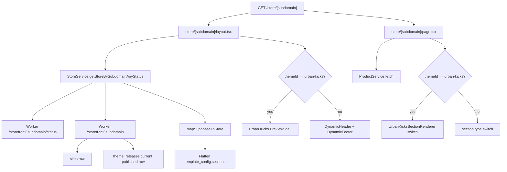
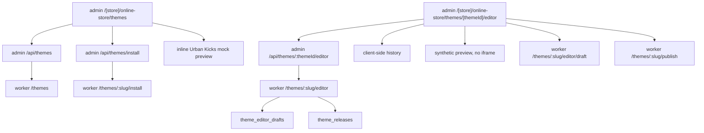
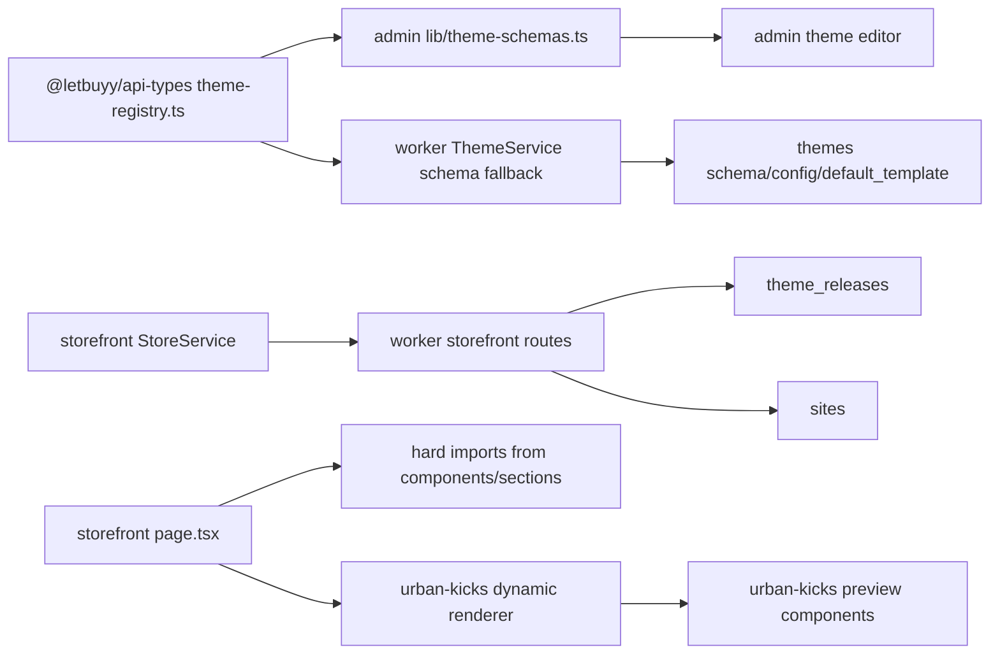

# 01 - Current Theme System Analysis

Generated: 2026-05-22

## Scope

This analysis is source-derived from the current LetBuyy repository. It focuses on:

- Storefront rendering in `apps/web/consumer/storefront`.
- Merchant theme administration and editor surfaces in `apps/web/consumer/admin`.
- Theme marketplace and worker APIs in `backend/workers/api`.
- Theme, draft, release, preview, customer, wishlist, and review persistence in `backend/supabase/migrations`.
- Shared theme contracts in `packages/typescript/api-types`.

## Executive Finding

LetBuyy has a partial theme-management spine, but it is not yet a Shopify-grade theme engine.

The backend already contains useful primitives:

- Theme catalog: `themes`.
- Installed themes: `store_themes`.
- Draft editing: `theme_editor_drafts`.
- Published release snapshots: `theme_releases`.
- Preview token storage: `theme_preview_sessions`.
- Storefront cache tags: `storefront_cache_tags`.
- Worker routes for install, schema, editor load, draft save, publish, releases, rollback, and preview session creation.

The frontend still renders through static React switch statements, hardcoded preview surfaces, static schema registries, inline fallback templates, and a single-homepage section model. The result is theme-connected storefront rendering, not a true database-backed theme operating system.

## Current Data Model Surface

Current tables and JSON columns:

| Surface | Current role | Gap |
|---|---|---|
| `themes` | Platform theme catalog with `config`, optional `default_template`, optional schema fields | Not a normalized theme package with layouts, templates, assets, schemas, migrations, and releases |
| `store_themes` | Installed themes per `sites.id` | Uses `theme_id UUID` and `config_overrides`; not a full theme instance with draft/published config split |
| `sites.template_config` | Store-level published config mirror | Stores large mixed config; not normalized by template, layout, section, block, asset, route, or setting |
| `theme_editor_drafts` | One draft JSON blob per store/theme | No per-page/page-template granularity, collaboration metadata, section-level revisioning, or lock model |
| `theme_releases` | Published JSON snapshot, versioned per store | Good start, but no typed release manifest, migration compatibility, cache manifest, asset manifest, or rollback health checks |
| `theme_preview_sessions` | Token-backed draft preview session | No storefront route consuming live draft token as the canonical preview render path is visible in source |
| `storefront_cache_tags` | Cache invalidation spine | Not wired as a full render cache dependency graph |

Important current migration files:

- `backend/supabase/migrations/009_online_store_themes.sql`
- `backend/supabase/migrations/030_theme_editor_and_payment_events.sql`
- `backend/supabase/migrations/031_enterprise_events_theme_releases.sql`
- `backend/supabase/migrations/023_customer_system.sql`
- `backend/supabase/migrations/025_customer_credentials.sql`
- `backend/supabase/migrations/026_store_customers.sql`
- `backend/supabase/migrations/037_product_reviews_moderation_status.sql`

## Current Theme Rendering Lifecycle

Current lifecycle problems:

- `layout.tsx` branches hard on `themeId === 'urban-kicks'`.
- `page.tsx` imports every known section component at build time and switches on `section.type`.
- Header and footer are not section groups; they are extracted from flattened sections.
- Product sections are the only commerce-aware dynamic content type with meaningful database binding.
- Non-product storefront routes (`shop`, `orders`, auth modal, preview shell) are not resolved through a template engine.
- `getDefaultUrbanKicksSections()` hardcodes a fallback homepage when published stores have no sections.

## Current Admin Theme Flow

Current editor strengths:

- Has sections rail, settings panel, viewport controls, undo/redo history, draft save, and publish.
- Worker validates template configs against theme schemas and blocks unsafe keys/protocols.
- Worker supports draft conflict detection by `base_version`.
- Worker has release and rollback endpoints.

Current editor limitations:

- Center preview is not the real storefront. It renders simplified placeholder components in `CenterPanel.tsx`.
- No iframe runtime, no `postMessage` protocol, no live storefront hydration boundary.
- Right panel edits section settings only; block lifecycle is not complete.
- Section registry is imported from `@letbuyy/api-types`, not loaded from a DB theme package at runtime.
- Editor URL state supports selected section/setting only; it does not address selected page, template, block, responsive override, route preview, or data context.
- Image controls are URL fields, not tenant-scoped media assets.
- No autosave interval, queue, merge, or collaboration ownership model is visible.
- No real page builder, template resolver, or navigation builder is connected to the editor.

## Current Dependency Graph

Key coupling:

- Admin editor and worker validation both depend on `packages/typescript/api-types/src/theme-registry.ts`.
- Storefront section rendering depends on TypeScript union `SectionType`, not a renderer registry from the theme package.
- Urban Kicks storefront uses preview shell/components as live theme infrastructure.
- Theme preview routes import mock products and preview-only context.

## Hardcoded UI Analysis

Current hardcoded surfaces include:

- `apps/web/consumer/admin/src/app/[store]/online-store/themes/page.tsx`
  - Inline desktop and mobile mockups.
  - Hardcoded `URBAN KICKS`, `Streetwear 2026`, brand list, product cards, trust badges, newsletter, and footer.
  - Inline colors, Unsplash images, and prices.
- `apps/web/consumer/admin/src/app/[store]/online-store/themes/[themeId]/editor/page.tsx`
  - `DEFAULT_TEMPLATE` hardcodes Urban Kicks sections, text, URLs, social links, and theme settings.
- `apps/web/consumer/admin/src/components/theme-editor/CenterPanel.tsx`
  - Comment explicitly states previews are simplified placeholders and should render actual storefront components in a full implementation.
  - Hardcoded product names, prices, category names, testimonials, badges, and footer text.
- `packages/typescript/api-types/src/theme-registry.ts`
  - Hardcoded section defaults, presets, sample blocks, brand names, testimonials, social URLs, and image URLs.
- `apps/web/consumer/storefront/src/app/store/[subdomain]/page.tsx`
  - Hardcoded default Urban Kicks sections when config is empty.
  - Switch statement for every known section.
- `apps/web/consumer/storefront/src/app/store/[subdomain]/layout.tsx`
  - Hardcoded font map, dark theme list, CSS variable derivation, and Urban Kicks branch.
- `apps/web/consumer/storefront/src/lib/store-service.ts`
  - Development mock store with Urban Kicks content.
- `apps/web/consumer/storefront/src/app/theme-preview/urban-kicks/**`
  - Preview-only mock products, orders, categories, wishlist, checkout, and auth simulation.

## Fake or Mock System Analysis

Mock/fake systems visible in source:

- Development mock store path for `demo` and `localhost`.
- `theme-preview/urban-kicks` route tree with `MOCK_PRODUCTS`, `MOCK_ORDERS`, preview wishlist, preview checkout, and simulated auth.
- Admin theme card mockups that do not call the real storefront renderer.
- `CenterPanel` preview components with placeholder products and static testimonials.
- `getStoreCustomers` in storefront `customer-service.ts` returns an empty array for admin sync.

These are acceptable prototype aids, but they cannot remain in the final theme engine path. The production builder must render the same renderer used by live storefronts, with draft configs and tenant data.

## Current Theme Routing Flow

Published storefront:

1. Next route receives `/store/[subdomain]`.
2. Storefront app calls worker `/storefront/:subdomain`.
3. Worker loads `sites` by `subdomain` or `store_name`.
4. Worker loads current `theme_releases` row.
5. Storefront maps release config to a flat `StoreTemplateConfig.sections`.
6. Layout and page components branch by theme id and section type.

Theme editor:

1. Merchant opens `/[store]/online-store/themes/[themeId]/editor`.
2. Admin Next route resolves `[store]` to owned `sites.id`.
3. Worker loads theme, draft, current release, and schemas.
4. Client normalizes config to `DEFAULT_TEMPLATE` if shape is missing.
5. Client edits local state.
6. Save draft writes JSON blob.
7. Publish snapshots JSON to `theme_releases` and mirrors to `sites.template_config`.

Missing from routing:

- Page type resolver: `index`, `product`, `collection`, `page`, `blog`, `cart`, `search`, `customers/*`, `policy`.
- Route-to-template assignment.
- Resource-specific alternate templates.
- Navigation menu resolver.
- CMS page slug resolver.
- Preview token resolver that bypasses published state safely.

## Scalability Limitations

- Entire theme instance is stored and validated as one JSON blob.
- No normalized query plan for a single page template.
- No section-level cache dependency graph.
- No page route cache keys.
- No asset manifest with tenant-scoped transformations.
- No renderer manifest that can be lazy-loaded by theme, template, or section type.
- No schema migration layer for installed theme instances after marketplace upgrades.
- No per-template `updated_at` or revision chain for high-scale cache invalidation.
- No event stream for editor mutations other than broad domain events on install/save/publish.
- Static switch statements require deployment for new section types.

## Current Coupling Issues

- Theme schemas are code-owned, not platform-owned.
- Storefront renderer and admin preview are separate implementations.
- Urban Kicks live renderer imports preview components.
- Theme editor assumes one homepage-like `sections.template` array.
- Header/footer are treated as special object slots, not reusable section groups.
- Theme settings are mixed with template config.
- Store preferences are separate screens and not part of a unified storefront config model.
- Customer auth modal is storefront UI, but account/session model is not exposed as theme-configurable customer templates.
- Product grid data selection is implicit; no schema field maps a section to collection/product/query source in a typed way.

## Missing Infrastructure

Required missing layers:

- Theme package manifest.
- Theme instance table.
- Template registry and template assignment table.
- Layout and section group model.
- Section definition registry stored in DB.
- Block definition registry stored in DB.
- Renderer registry with safe component keys and version compatibility.
- Schema compiler and validator independent of static TypeScript constants.
- Page resolver for all storefront route types.
- Navigation/menu builder and renderer.
- CMS page system with slug, SEO, status, template assignment, and publish versioning.
- Media asset manager with tenant scoping.
- Live preview iframe runtime.
- Draft renderer that consumes `theme_editor_drafts`.
- Autosave, undo/redo, and publish transaction model.
- Theme upgrade/migration framework.
- Performance cache graph and edge render strategy.

## Missing Configuration Layers

The final engine needs separate configuration layers:

- Theme definition: immutable marketplace package version.
- Theme preset: install-time starter config.
- Theme instance: store-specific installed copy.
- Draft config: unpublished merchant edits.
- Published release: immutable storefront render snapshot.
- Runtime context: current store, route, customer, locale, currency, market, device, inventory, product data, CMS data.
- Responsive overrides: per setting and per breakpoint.
- Data bindings: product, collection, blog, page, menu, media, metafield, app extension.
- Platform-controlled settings: password protection, SEO defaults, analytics, custom CSS policy, app embeds.

## Missing Schema System

Current schemas are plain TypeScript objects. A production engine needs:

- Versioned JSON Schema for every theme entity.
- Strong schema IDs and migration IDs.
- Setting field types with source bindings, validation, visibility conditions, responsive support, and permissions.
- Section/block availability rules by template type, site type, and plan.
- Schema compile step that generates TypeScript, Zod, Dart, and editor metadata.
- Runtime validation in worker before draft save/publish.
- Compatibility checks before theme install, upgrade, import, or rollback.

## Missing Layout Engine

Current layout is React-coded. Required layout concepts:

- Layouts: `theme`, `checkout`, `customer`, `password`, `minimal`, `embedded-preview`.
- Section groups: `header`, `footer`, optional `announcement`, `aside`.
- Template slots: `main`, `sidebar`, `below_content`, route-specific slots.
- Responsive container policy.
- Header/footer as dynamic section groups, not hardcoded components.
- Rendering order stored in DB with stable IDs.
- Section wrappers that are engine-generated, not hand-coded per preview.

## Current Risk Summary

Highest architectural risks:

1. The editor preview is not the live renderer.
2. Theme schemas are static source code and contain hardcoded defaults.
3. Storefront composition is a component switch, not a registry/pipeline.
4. Theme config is a single JSON blob with only homepage-ish structure.
5. Preview/demo routes can be confused with theme infrastructure.
6. Customer account UI exists, but admin/customer sync is incomplete.
7. Navigation/pages/preferences screens exist visually, but are not part of a unified CMS/theme engine.
8. Theme marketplace install exists, but package versioning and instance migration are not complete.

