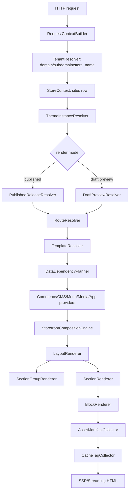
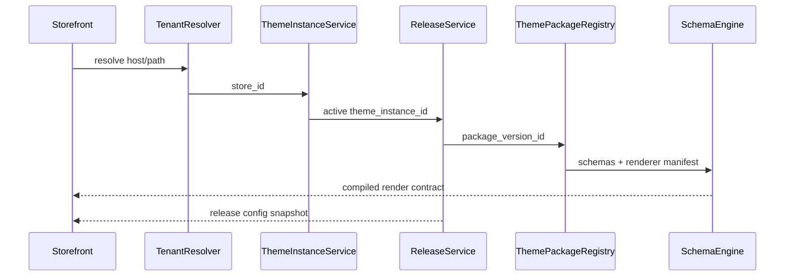
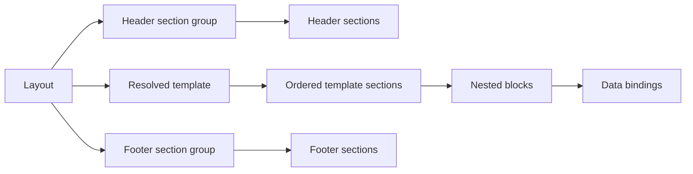
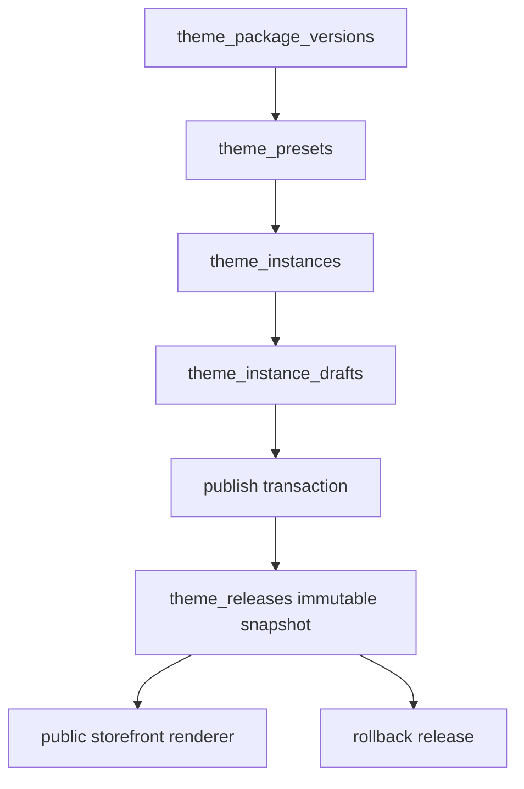
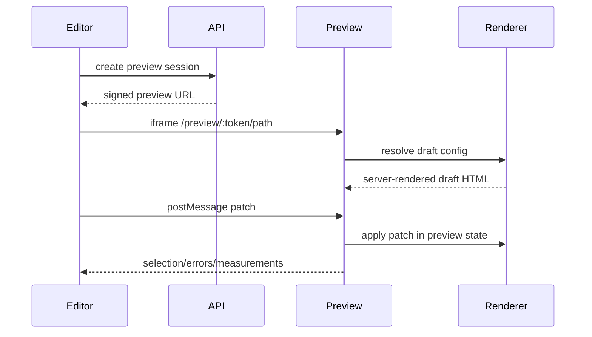

# 03 - Enterprise Theme Engine Architecture

Generated: 2026-05-22

## Target Principle

The storefront must render from database-backed theme instances, template assignments, schemas, settings, sections, blocks, content, navigation, commerce data, and release snapshots. React components are renderer implementations only. They are not the source of store structure.

## Theme Package Model

```text
Theme Package
  theme.json
  layouts
  templates
  section_groups
  sections
  blocks
  snippets
  assets
  settings_schema
  presets
  locales
  migrations
  renderer_manifest
  compatibility_manifest
```

Each package version is immutable after publication.

## Runtime Architecture



## Core Services

| Service | Responsibility |
|---|---|
| `ThemeRegistryService` | Reads immutable theme package versions and renderer manifests |
| `ThemeInstanceService` | Resolves store-installed theme, active theme, draft, release, and overrides |
| `SchemaEngine` | Compiles and validates theme, section, block, setting, template, and data-binding schemas |
| `TemplateResolver` | Maps route/resource/page type to active template instance |
| `PageRenderer` | Builds the render tree from layout, section groups, template sections, and blocks |
| `SectionRegistry` | Maps section type/version to safe renderer key and schema |
| `BlockRegistry` | Maps block type/version to renderer key and schema |
| `DataBindingEngine` | Resolves product, collection, page, media, menu, review, customer, cart, and app data |
| `PreviewEngine` | Serves draft-rendered iframe pages and accepts live patches |
| `ReleaseService` | Publishes immutable snapshots and handles rollback |
| `ThemeMigrationService` | Migrates installed theme instances between package versions |
| `AssetService` | Stores and serves tenant-scoped media and theme assets |
| `CacheDependencyService` | Emits cache tags for route, template, section, block, product, collection, page, and menu data |

## Rendering Lifecycle

1. Normalize host/path/query and identify render mode.
2. Resolve `sites` by custom domain, subdomain, or store name.
3. Enforce store status and password protection.
4. Resolve active `theme_instance`.
5. Resolve config source:
   - Published release for public traffic.
   - Draft config for signed preview.
   - Version-pinned release for rollback preview.
6. Resolve route:
   - `/` -> home template.
   - `/products/:slug` -> product template plus product resource.
   - `/collections/:slug` -> collection template plus collection resource.
   - `/pages/:slug` -> CMS page template.
   - `/policies/:slug` -> policy template.
   - `/account/*` -> customer templates.
   - `/cart`, `/search`, `/blogs/*` -> route-specific templates.
7. Resolve layout and section groups.
8. Resolve template sections and block tree.
9. Validate all section and block settings against package version schemas.
10. Plan data dependencies.
11. Fetch data in scoped batches.
12. Render server components and collect asset/cache manifests.
13. Stream HTML and hydrate only interactive islands.
14. Emit observability events and cache tags.

## Theme Loading Lifecycle



## Storefront Composition Flow



## Theme Registry Architecture

The registry is not a TypeScript constant. It is a DB-backed package index with generated typed artifacts.

Entities:

- `theme_packages`: logical theme identity.
- `theme_package_versions`: immutable version metadata.
- `theme_package_files`: normalized files or manifest entries.
- `theme_renderer_manifests`: safe renderer keys, entrypoints, compatibility.
- `theme_schema_manifests`: compiled schemas.
- `theme_presets`: install-time presets.
- `theme_assets`: package assets.
- `theme_migrations`: package migration scripts.

Runtime contract:

```text
theme_package_version_id
renderer_manifest_version
schema_manifest_version
compatible_engine_version
supported_site_types
supported_template_types
section_types
block_types
asset_manifest
```

## Section Registry Architecture

Each section definition is a package-versioned record:

```text
section_definition
  id
  theme_package_version_id
  type
  name
  category
  schema_version
  renderer_key
  settings_schema
  block_schema_refs
  presets
  availability_rules
  data_requirements
  asset_requirements
  performance_budget
```

Availability rules include:

- Site type.
- Template type.
- Plan.
- Required app installation.
- Required feature flag.
- Allowed parent section groups.
- Maximum instances per template.

## Block Rendering Architecture

Blocks must be rendered through a block registry, not by section-local ad hoc mapping.

Block kinds:

- Section blocks: only valid inside one section type.
- Theme blocks: reusable across sections.
- Static blocks: always present and optionally hideable.
- App blocks: provided by installed apps.
- Nested blocks: block tree children where schema permits.

Block render contract:

```text
BlockRenderContext
  store
  theme
  route
  section
  block
  parent_block
  data
  settings
  responsive
  editor
```

## Dynamic Renderer Architecture

React components are loaded by safe renderer keys:

```text
renderer_key -> module path -> server component -> client islands
```

Rules:

- Theme package defines renderer keys.
- Platform maps approved renderer keys to code.
- Unknown renderer key fails validation before publish.
- App renderers are isolated and permission-scoped.
- Section rendering cannot execute arbitrary merchant-provided JS.
- Custom CSS is scoped and sanitized.

## Theme Persistence Architecture



Configuration layers:

- Package defaults.
- Preset defaults.
- Store instance overrides.
- Draft edits.
- Published release snapshots.
- Runtime route/resource context.

## Multi-Tenant Theme Isolation

Every store-specific entity must include `site_id` or `store_id`.

Isolation rules:

- Public storefront can read only published releases for published stores.
- Draft previews require signed preview token and store/theme binding.
- Merchant editor reads/writes only stores owned by current user.
- Media assets include `store_id`.
- Menus/pages/policies/customers/reviews/orders include `store_id`.
- App blocks resolve installed app configuration by `store_id`.
- Cache keys include `store_id`, release id, route key, locale, currency, market, and device class.

## Theme Instance Architecture

`theme_instances` should represent the installed copy of a theme package for one store.

Required fields:

- `id`
- `store_id`
- `theme_package_id`
- `theme_package_version_id`
- `theme_slug`
- `name`
- `status`: installed, active, archived
- `source`: marketplace, imported, duplicated, generated
- `parent_instance_id`
- `active_release_id`
- `draft_id`
- `settings_data`
- `created_by`
- `updated_by`
- `created_at`, `updated_at`, `deleted_at`

This separates "installed theme" from "published release" and allows duplication, preview, marketplace upgrades, and rollback.

## Preview Architecture



Preview must support:

- Draft config first-load SSR.
- Live patches without full iframe reload.
- Route switching.
- Product/collection/page resource selection.
- Mobile/tablet/desktop viewport.
- Inspector overlay.
- Section/block selection sync.
- Runtime error reporting.

## Draft and Publish Architecture

Draft:

- Section/block mutations saved as patches.
- Full draft snapshot stored for recovery.
- Draft version increments on every committed mutation.
- Autosave queue deduplicates high-frequency edits.
- Conflict detection by `draft_version` and changed path.

Publish:

- Validate config against package schemas.
- Resolve data-binding references.
- Generate release manifest.
- Freeze release snapshot.
- Mark prior release superseded.
- Update active release pointer.
- Emit cache invalidation tags.
- Emit outbox events.

Rollback:

- Validate target release compatibility.
- Publish new release referencing `rollback_of_release_id`.
- Do not mutate historical release snapshots.

## Future Theme Marketplace Support

Marketplace requires:

- Theme package certification.
- Renderer key approval.
- Security scan for assets/scripts/custom code.
- Schema compatibility check.
- Demo store data binding templates.
- Pricing/license records.
- Purchase entitlements.
- Install transaction.
- Theme upgrades with migration previews.
- Reviews, ratings, support URLs, and changelog.
