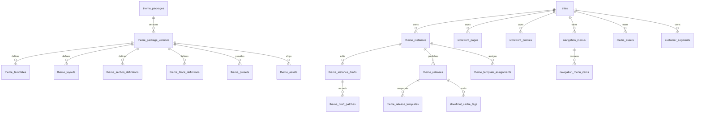

# 04 - Theme Database and Schema Architecture

Generated: 2026-05-22

## Database Principle

Do not add a `stores` table. LetBuyy database ownership remains `sites`; store is a URL and merchant UI term. All new tenant-owned tables must reference `sites(id)` through `store_id` or `site_id`.

## Target ERD



## Core Theme Tables

### `theme_packages`

Platform-wide logical theme identity.

Columns:

- `id UUID PRIMARY KEY`
- `slug TEXT UNIQUE NOT NULL`
- `name TEXT NOT NULL`
- `description TEXT`
- `author_name TEXT`
- `support_url TEXT`
- `documentation_url TEXT`
- `site_types TEXT[] NOT NULL`
- `status TEXT CHECK (draft, review, active, deprecated, disabled)`
- `pricing_type TEXT CHECK (free, paid, subscription, private)`
- `created_at`, `updated_at`, `deleted_at`

### `theme_package_versions`

Immutable package versions.

Columns:

- `id UUID PRIMARY KEY`
- `theme_package_id UUID REFERENCES theme_packages(id)`
- `version TEXT NOT NULL`
- `engine_version TEXT NOT NULL`
- `schema_version TEXT NOT NULL`
- `renderer_manifest JSONB NOT NULL`
- `schema_manifest JSONB NOT NULL`
- `compatibility_manifest JSONB NOT NULL`
- `release_notes TEXT`
- `status TEXT CHECK (draft, published, revoked, deprecated)`
- `published_at TIMESTAMPTZ`
- `created_at`, `updated_at`, `deleted_at`
- `UNIQUE(theme_package_id, version)`

### `theme_instances`

Store-installed theme copy.

Columns:

- `id UUID PRIMARY KEY`
- `store_id UUID NOT NULL REFERENCES sites(id) ON DELETE CASCADE`
- `theme_package_id UUID NOT NULL REFERENCES theme_packages(id)`
- `theme_package_version_id UUID NOT NULL REFERENCES theme_package_versions(id)`
- `theme_slug TEXT NOT NULL`
- `display_name TEXT`
- `status TEXT CHECK (installed, active, archived)`
- `source TEXT CHECK (marketplace, imported, generated, duplicated)`
- `parent_instance_id UUID REFERENCES theme_instances(id)`
- `active_release_id UUID`
- `settings_data JSONB NOT NULL DEFAULT '{}'`
- `metadata JSONB NOT NULL DEFAULT '{}'`
- `created_by UUID`
- `updated_by UUID`
- `created_at`, `updated_at`, `deleted_at`

Indexes:

- `(store_id, status) WHERE deleted_at IS NULL`
- `(store_id, theme_slug) WHERE deleted_at IS NULL`
- Partial unique active theme: `(store_id) WHERE status = 'active' AND deleted_at IS NULL`

### `theme_instance_drafts`

Draft state for a theme instance.

Columns:

- `id UUID PRIMARY KEY`
- `store_id UUID NOT NULL REFERENCES sites(id)`
- `theme_instance_id UUID NOT NULL REFERENCES theme_instances(id)`
- `base_release_id UUID REFERENCES theme_releases(id)`
- `draft_config JSONB NOT NULL DEFAULT '{}'`
- `draft_settings JSONB NOT NULL DEFAULT '{}'`
- `version INTEGER NOT NULL DEFAULT 1`
- `lock_owner_id UUID`
- `lock_expires_at TIMESTAMPTZ`
- `auto_saved_at TIMESTAMPTZ`
- `created_by UUID`
- `updated_by UUID`
- `created_at`, `updated_at`, `deleted_at`
- `UNIQUE(theme_instance_id)`

### `theme_draft_patches`

Append-only mutation log for undo, redo, audit, collaboration, and recovery.

Columns:

- `id UUID PRIMARY KEY`
- `store_id UUID NOT NULL REFERENCES sites(id)`
- `theme_instance_draft_id UUID REFERENCES theme_instance_drafts(id)`
- `draft_version INTEGER NOT NULL`
- `path TEXT NOT NULL`
- `operation TEXT CHECK (add, update, move, delete, duplicate, visibility, setting, data_binding)`
- `before_value JSONB`
- `after_value JSONB`
- `actor_id UUID`
- `client_id TEXT`
- `created_at TIMESTAMPTZ NOT NULL DEFAULT now()`

### `theme_releases`

Current table can evolve rather than being replaced.

Additional required release fields:

- `theme_instance_id UUID REFERENCES theme_instances(id)`
- `theme_package_version_id UUID REFERENCES theme_package_versions(id)`
- `release_manifest JSONB NOT NULL DEFAULT '{}'`
- `template_snapshot JSONB NOT NULL DEFAULT '{}'`
- `settings_snapshot JSONB NOT NULL DEFAULT '{}'`
- `asset_manifest JSONB NOT NULL DEFAULT '{}'`
- `cache_manifest JSONB NOT NULL DEFAULT '{}'`
- `data_binding_manifest JSONB NOT NULL DEFAULT '{}'`
- `schema_manifest_version TEXT`
- `engine_version TEXT`

Keep:

- `store_id`
- `theme_id`
- `release_version`
- `release_status`
- `is_current`
- `release_config`
- `source_draft_id`
- `rollback_of_release_id`
- `published_by`
- `published_at`
- `deleted_at`

## Template and Layout Tables

### `theme_layouts`

Theme package layout definitions.

- `id`
- `theme_package_version_id`
- `layout_key`
- `name`
- `schema`
- `slot_schema`
- `default_section_groups`
- `renderer_key`
- `created_at`, `updated_at`, `deleted_at`

### `theme_templates`

Theme package template definitions.

- `id`
- `theme_package_version_id`
- `template_key`
- `template_type`: index, product, collection, page, blog, article, cart, search, customer_account, policy, password
- `name`
- `layout_key`
- `section_schema`
- `default_sections`
- `data_requirements`
- `created_at`, `updated_at`, `deleted_at`

### `theme_template_assignments`

Store-specific assignment of templates to routes/resources.

- `id`
- `store_id`
- `theme_instance_id`
- `template_key`
- `template_type`
- `resource_type`
- `resource_id`
- `route_pattern`
- `is_default`
- `created_at`, `updated_at`, `deleted_at`

Indexes:

- `(store_id, theme_instance_id, template_type, is_default)`
- `(store_id, resource_type, resource_id)`
- `(store_id, route_pattern)`

## Section and Block Definition Tables

### `theme_section_definitions`

- `id`
- `theme_package_version_id`
- `section_type`
- `name`
- `category`
- `renderer_key`
- `schema_version`
- `settings_schema`
- `blocks_schema`
- `presets`
- `availability_rules`
- `data_requirements`
- `asset_requirements`
- `performance_budget`
- `created_at`, `updated_at`, `deleted_at`

### `theme_block_definitions`

- `id`
- `theme_package_version_id`
- `block_type`
- `name`
- `category`
- `renderer_key`
- `schema_version`
- `settings_schema`
- `child_block_rules`
- `availability_rules`
- `data_requirements`
- `created_at`, `updated_at`, `deleted_at`

## Storefront Content Tables

### `storefront_pages`

Custom CMS pages.

- `id`
- `store_id`
- `title`
- `slug`
- `status`: draft, published, archived
- `content_schema_id`
- `content_data`
- `template_assignment_id`
- `seo_title`
- `seo_description`
- `og_image_asset_id`
- `published_at`
- `created_by`
- `updated_by`
- `created_at`, `updated_at`, `deleted_at`
- `UNIQUE(store_id, slug) WHERE deleted_at IS NULL`

### `storefront_policies`

Policy pages.

- `id`
- `store_id`
- `policy_type`: privacy, refund, shipping, terms, contact, custom
- `title`
- `slug`
- `body_richtext`
- `status`
- `seo_title`
- `seo_description`
- `published_at`
- `created_at`, `updated_at`, `deleted_at`

### `navigation_menus`

- `id`
- `store_id`
- `handle`
- `name`
- `location`: header, footer, mobile, policy, custom
- `status`
- `created_at`, `updated_at`, `deleted_at`
- `UNIQUE(store_id, handle) WHERE deleted_at IS NULL`

### `navigation_menu_items`

- `id`
- `store_id`
- `menu_id`
- `parent_id`
- `label`
- `link_type`: url, page, product, collection, policy, blog, route, app
- `target_resource_id`
- `href`
- `sort_order`
- `is_visible`
- `open_in_new_tab`
- `created_at`, `updated_at`, `deleted_at`

### `media_assets`

- `id`
- `store_id`
- `owner_type`
- `owner_id`
- `asset_type`: image, video, file, font, icon
- `storage_provider`
- `storage_key`
- `public_url`
- `alt_text`
- `metadata`
- `width`
- `height`
- `mime_type`
- `file_size`
- `created_at`, `updated_at`, `deleted_at`

## Runtime Config Architecture

At render time, config is assembled from:

1. Theme package defaults.
2. Theme preset values.
3. Theme instance settings.
4. Template assignment.
5. Draft or release snapshot.
6. Runtime route resource.
7. Tenant platform settings.
8. Customer/session context if allowed.

The renderer should never read editable package defaults directly for public storefronts. It should read immutable release snapshots.

## Schema Versioning Architecture

Every schema has:

- `schema_id`
- `schema_version`
- `theme_package_version_id`
- `entity_type`
- `json_schema`
- `ui_schema`
- `migration_from`
- `migration_to`
- `compatibility_flags`

Validation moments:

- Theme import.
- Theme package publication.
- Theme install.
- Draft save.
- Publish.
- Theme upgrade.
- Rollback.
- Preview render.

## Theme Migration Architecture

Migration record:

- `id`
- `theme_package_id`
- `from_version_id`
- `to_version_id`
- `migration_type`: automatic, assisted, manual
- `migration_schema`
- `steps`
- `dry_run_report`
- `created_at`, `updated_at`

Process:

1. Load installed instance and active release.
2. Dry-run migration against draft and published config.
3. Report breaking changes.
4. Create migrated draft.
5. Merchant previews migrated draft.
6. Publish new release only after validation.
7. Preserve rollback to old package version while compatible.

## Theme Inheritance Architecture

Support inheritance without copying all records:

- Theme package inheritance: child theme references parent package version and overrides definitions.
- Theme instance inheritance: duplicated theme references parent instance and forks only changed config.
- Reusable section inheritance: linked global sections can be placed across templates with local overrides.

Rule:

- Public releases must be flattened immutable snapshots, even if authoring uses inheritance.

## Multi-Tenant Isolation

RLS policies:

- Merchants can read/write only `store_id` they own.
- Public can read only published releases for published sites.
- Service role can write release and cache records.
- Draft preview tokens are hash-stored and time-limited.
- Media assets are scoped by `store_id`.
- Customer-owned entities are scoped by `store_id` and customer id/email.

## Performance Indexing

Recommended indexes:

- `theme_instances(store_id, status) WHERE deleted_at IS NULL`
- `theme_releases(store_id, is_current, release_status) WHERE deleted_at IS NULL`
- `theme_template_assignments(store_id, template_type, is_default) WHERE deleted_at IS NULL`
- `theme_template_assignments(store_id, resource_type, resource_id) WHERE deleted_at IS NULL`
- `storefront_pages(store_id, slug, status) WHERE deleted_at IS NULL`
- `navigation_menus(store_id, handle) WHERE deleted_at IS NULL`
- `navigation_menu_items(menu_id, parent_id, sort_order) WHERE deleted_at IS NULL`
- `media_assets(store_id, owner_type, owner_id) WHERE deleted_at IS NULL`
- `storefront_cache_tags(store_id, tag)`

## Cache Strategy

Cache keys:

```text
storefront:{store_id}:{release_id}:{locale}:{currency}:{market}:{route_hash}:{device_class}
```

Cache tags:

- `store:{store_id}`
- `theme_instance:{theme_instance_id}`
- `release:{release_id}`
- `template:{template_key}`
- `section:{section_instance_id}`
- `product:{product_id}`
- `collection:{collection_id}`
- `page:{page_id}`
- `menu:{menu_id}`
- `media:{asset_id}`

Invalidation sources:

- Theme publish.
- Product update.
- Collection update.
- Page publish.
- Menu update.
- Media replacement.
- App block config update.
- Customer-specific pages should bypass shared cache.

## Query Optimization Strategy

Do not fetch the whole theme graph for every request. Use route-scoped plans:

1. Resolve store and release.
2. Resolve route and template assignment.
3. Load only layout, section groups, template sections, and blocks for that route.
4. Extract data dependencies.
5. Batch commerce and CMS queries.
6. Cache render plan by `release_id + route_type + template_key`.
7. Cache data responses by resource IDs and update tags.

