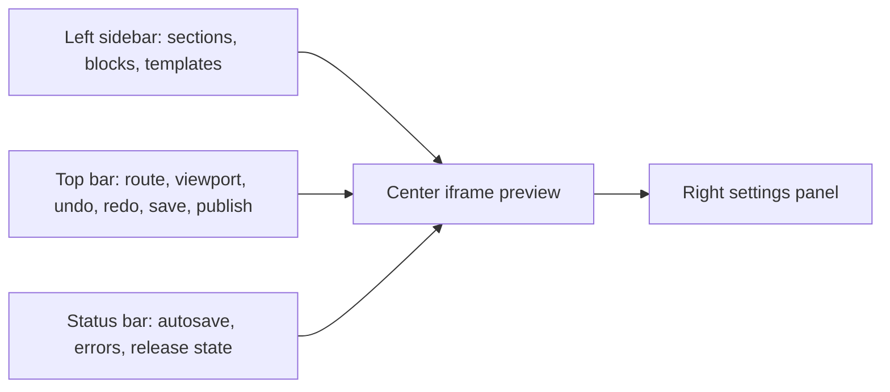
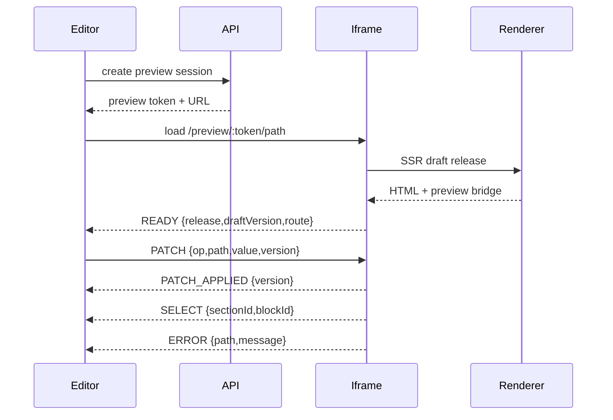
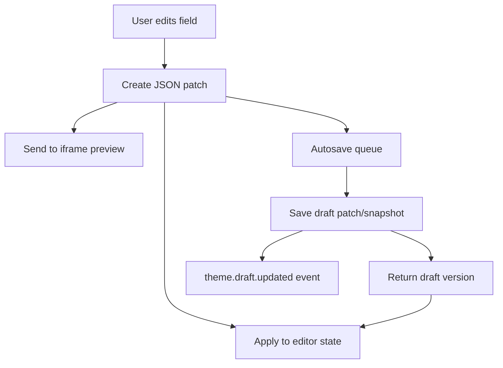
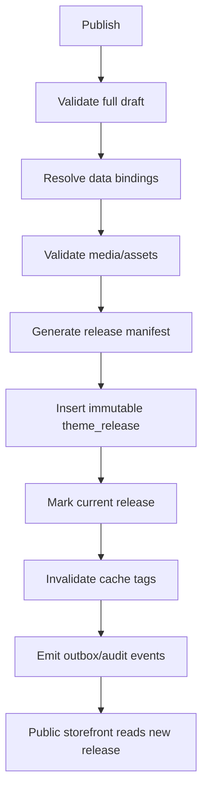

# 05 - Live Store Builder Architecture

Generated: 2026-05-22

## Objective

Build a Shopify-style editor that edits the same theme engine used by the live storefront. The center preview must be an iframe rendering the real storefront in draft mode, not a React mockup.

## Editor Layout



## Left Sidebar

Required features:

- Template selector.
- Page/resource selector.
- Section groups: header, footer, announcement, custom.
- Template sections list.
- Nested blocks list.
- Drag/drop sorting.
- Visibility toggles.
- Duplicate section/block.
- Delete section/block.
- Add section from registry.
- Add block from allowed block types.
- Presets.
- Reusable saved sections.
- App blocks.
- Search/filter by section type.
- Warnings for missing data bindings, invalid settings, app uninstalled, or schema migration required.

## Center Panel

Required features:

- Real iframe storefront preview.
- Desktop, tablet, mobile, and custom viewport.
- Route selector: home, product, collection, page, policy, cart, search, customer.
- Resource selector for product/collection/page templates.
- Draft SSR on initial load.
- Live patch application.
- Section/block hover outlines.
- Click-to-select mapping from iframe to editor.
- Error overlay.
- Loading state for data dependencies.
- Screenshot capture for theme preview cards.
- Network/render performance diagnostics in dev.

## Right Panel

Required dynamic setting controls:

- Text.
- Rich text.
- Image/media upload.
- Video.
- URL/link picker.
- Product selector.
- Collection selector.
- Page selector.
- Menu selector.
- Blog/article selector.
- Color token picker.
- Font picker.
- Spacing controls.
- Radius controls.
- Border controls.
- Shadow controls.
- Layout/grid controls.
- Responsive override controls.
- Visibility conditions.
- Data source/query controls.
- App block settings.
- Accessibility fields like alt text and ARIA labels.

The right panel is generated from schema and selected context:

```text
selected entity -> schema -> UI schema -> control registry -> validation -> patch
```

## iframe Communication Architecture



Message types:

- `READY`
- `ROUTE_CHANGE`
- `SELECT`
- `HOVER`
- `PATCH`
- `PATCH_APPLIED`
- `PATCH_REJECTED`
- `SCROLL_TO`
- `MEASURE`
- `SCREENSHOT`
- `ERROR`
- `HYDRATION_STATUS`

Security:

- Strict origin allowlist.
- Signed preview token.
- Token bound to store id, theme instance id, draft id, and expiry.
- No service role secrets in browser.
- Preview bridge accepts only schema-valid patches.

## Realtime Sync Architecture

State layers:

- Editor local working state.
- Iframe preview state.
- Autosave queue.
- Worker draft snapshot.
- Worker patch log.
- Published release.



Autosave policy:

- Debounce text input.
- Immediate save for structural mutations.
- Coalesce setting updates by path.
- Retry with exponential backoff.
- Persist local unsaved patches in memory only; do not store secrets in localStorage.
- Conflict prompts when server draft version exceeds base version.

## Drag/Drop Architecture

Use structural patches:

```text
move section:
  op: move
  entity: section
  from: template.sections.order[3]
  to: template.sections.order[1]

move block:
  op: move
  entity: block
  section_id: abc
  from: blocks.order[2]
  to: blocks.order[0]
```

Rules:

- Only allowed section types can be dropped into current template/section group.
- Only allowed block types can be dropped into a section/block.
- Static blocks can be hidden but not deleted.
- App blocks require installed app and active permissions.
- Drag operations validate before applying.

## Section Editing Lifecycle

1. Merchant selects a section.
2. Editor loads section schema from compiled package version.
3. Right panel renders settings.
4. Merchant edits field.
5. Schema validates field.
6. Patch updates editor state.
7. Patch updates iframe preview.
8. Autosave stores draft.
9. Publish validates full template.
10. Public release snapshot receives section config.

## Block Editing Lifecycle

1. Merchant expands a section.
2. Block tree loads from section instance.
3. Allowed block types are resolved from schema.
4. Merchant adds/selects/reorders/duplicates/deletes block.
5. Block schema validates settings and nesting.
6. Preview iframe re-renders affected block subtree.
7. Autosave stores patch and draft snapshot.

## Undo/Redo System

Current `useEditorHistory` keeps whole template snapshots. Target model should use patches.

Required:

- Command stack with inverse patches.
- Separate structural and setting commands.
- Merge typing edits.
- Cross-route undo boundary.
- Maximum history size by memory budget.
- Server-side patch log for recovery, not just client memory.

## Draft Persistence

Tables:

- `theme_instance_drafts`: current draft snapshot.
- `theme_draft_patches`: append-only patch log.
- `theme_preview_sessions`: tokenized preview access.

Draft payload:

- Template configs by template id.
- Section groups.
- Theme settings.
- Navigation references.
- CMS references.
- Media references.
- Responsive overrides.
- Data bindings.
- Validation warnings.

## Publish Workflow



Publish blockers:

- Invalid schema.
- Missing required media.
- Broken product/collection/page/menu references.
- Uninstalled app block.
- Theme package version revoked.
- Migration required.
- Store ownership mismatch.

## Performance Optimization

Editor:

- Virtualize long section/block lists.
- Lazy-load setting control groups.
- Send patches, not full config.
- Use iframe route prefetch.
- Render preview with production renderer.

Storefront preview:

- Server-render initial draft.
- Patch only affected subtree where possible.
- Isolate interactive islands.
- Avoid loading editor bundle inside iframe.
- Cache data dependencies even for draft preview.

## Required API Surface

- `GET /themes/:themeInstanceId/editor`
- `POST /themes/:themeInstanceId/preview-session`
- `GET /themes/:themeInstanceId/templates`
- `GET /themes/:themeInstanceId/routes`
- `PATCH /themes/:themeInstanceId/draft`
- `PUT /themes/:themeInstanceId/draft/snapshot`
- `POST /themes/:themeInstanceId/publish`
- `GET /themes/:themeInstanceId/releases`
- `POST /themes/:themeInstanceId/rollback`
- `GET /theme-registry/:packageVersionId/sections`
- `GET /theme-registry/:packageVersionId/blocks`
- `POST /media`
- `GET /menus`
- `GET /storefront-pages`

