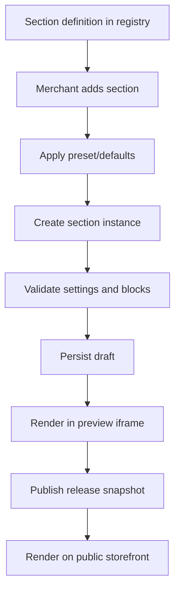
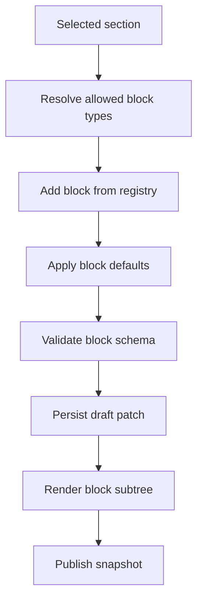

# 06 - Dynamic Section and Block System

Generated: 2026-05-22

## Objective

Sections and blocks must be schema-defined, database-backed, renderer-registered, reusable, responsive, tenant-configurable, and safe to edit live.

## Required Section Families

Commerce:

- Hero banners.
- Featured products.
- Featured collections.
- Product grids.
- Category/collection grids.
- Product recommendations.
- Recently viewed.
- Reviews and ratings.
- Cart upsells.
- Countdown timers.

Media/content:

- Image banners.
- Slideshows.
- Videos.
- Rich text.
- Tabs.
- Accordions.
- FAQ.
- Testimonials.
- Newsletter.
- Blog/article lists.
- Before/after image.
- Logo/brand marquee.

Utility:

- Announcement bars.
- Trust badges.
- Contact forms.
- Custom component sections.
- App blocks.

## Section Definition Schema

Every section definition requires:

```text
section_type
name
category
description
schema_version
renderer_key
settings_schema
blocks_schema
presets
availability_rules
data_requirements
responsive_schema
asset_requirements
performance_budget
accessibility_requirements
```

Settings schema fields must support:

- Type.
- Label.
- Help text.
- Default.
- Required.
- Validation.
- Visibility condition.
- Responsive override support.
- Data binding support.
- Permission requirements.
- Localization support.

## Block Definition Schema

Every block definition requires:

```text
block_type
name
category
schema_version
renderer_key
settings_schema
child_block_rules
availability_rules
data_requirements
responsive_schema
presets
```

Block rules:

- Maximum block count.
- Allowed child block types.
- Allowed parent section/block types.
- Static or removable.
- Hideable or always visible.
- Repeatable or singleton.

## Section Instance Shape

```json
{
  "id": "section_123",
  "type": "product_grid",
  "definition_id": "uuid",
  "schema_version": "1.2.0",
  "disabled": false,
  "settings": {},
  "responsive": {
    "mobile": {},
    "tablet": {},
    "desktop": {}
  },
  "data_bindings": {},
  "blocks": {},
  "block_order": []
}
```

## Block Instance Shape

```json
{
  "id": "block_123",
  "type": "button",
  "definition_id": "uuid",
  "schema_version": "1.0.0",
  "disabled": false,
  "settings": {},
  "responsive": {},
  "data_bindings": {},
  "blocks": {},
  "block_order": []
}
```

## Section Lifecycle



## Block Lifecycle



## Dynamic Rendering System

The renderer receives:

```text
RenderContext
  store
  theme_instance
  release
  route
  template
  section_group
  section
  block
  data
  settings
  responsive
  editor_state
```

Renderers must not fetch arbitrary data themselves. They declare data requirements, and the engine provides data.

Example data binding:

```json
{
  "source": "products",
  "query": {
    "collection_id": "collection_123",
    "sort": "newest",
    "limit": 8
  }
}
```

## Data Binding Types

- Static text setting.
- Media asset.
- Product.
- Product query.
- Collection.
- Collection query.
- CMS page.
- Blog/article.
- Menu.
- Policy.
- Review summary.
- Customer session.
- Cart state.
- App extension data.

## Schema Engine

Responsibilities:

- Compile schema definitions to validation artifacts.
- Generate editor controls.
- Enforce allowed section/block placement.
- Enforce required fields.
- Validate responsive overrides.
- Validate data bindings.
- Sanitize URLs and custom CSS.
- Block unsafe keys and protocol values.
- Generate TypeScript/Zod/Dart types.

## Responsive Architecture

Responsive configuration is not CSS-only. It must be part of section and block state.

Breakpoints:

- `mobile`
- `tablet`
- `desktop`
- optional `wide`

Responsive fields:

- Columns.
- Spacing.
- Padding.
- Alignment.
- Visibility.
- Image crop.
- Text size token.
- Section height.
- Stack/order behavior.

Rules:

- Base value inherited by all breakpoints.
- Breakpoint override stores only changed values.
- Editor shows inherited vs overridden values.
- Publish flattens responsive config into release snapshot.

## Reusable Component Architecture

Reuse types:

- Preset: copy defaults into a new section instance.
- Duplicated section: copy current instance values.
- Saved section: reusable merchant-owned section template.
- Global section: linked section reused across templates.
- Theme block: reusable block type from package.
- App block: reusable app-provided extension.

Propagation policy for linked/global sections:

- Immediate global update.
- Drafted global update.
- Fork local instance.
- Update only selected templates.

## Dynamic Loading Strategy

Renderer manifest maps section/block types to safe renderer keys.

Load policy:

- Server-render static sections.
- Lazy-load client islands only for interactive behavior.
- Dynamic import heavy interactive sections.
- Do not ship editor-only code to public storefronts.
- App blocks load through sandboxed extension adapters.

## Lazy Loading Strategy

- Critical sections above the fold load normally.
- Below-the-fold images use lazy loading.
- Video sections load poster first and player on interaction/viewport.
- Slideshow JS loads only when section exists.
- Reviews/widgets load summary server-side and expanded data lazily.
- App block scripts defer and run in isolated namespace.

## Performance Budget

Each section definition includes:

- Maximum server render time target.
- Maximum client JS size.
- Maximum image count above fold.
- Lazy/defer requirements.
- Cache dependency tags.
- Allowed third-party scripts.

Publish should warn or block when a page exceeds defined budgets.

## Required Registry Categories

Initial registry:

- `commerce.hero`
- `commerce.product_grid`
- `commerce.collection_grid`
- `commerce.featured_product`
- `commerce.recommendations`
- `content.rich_text`
- `content.image_banner`
- `content.video`
- `content.slideshow`
- `content.faq`
- `content.tabs`
- `content.accordion`
- `trust.testimonials`
- `trust.badges`
- `marketing.newsletter`
- `marketing.countdown`
- `layout.announcement_bar`
- `app.block`
- `custom.component`

