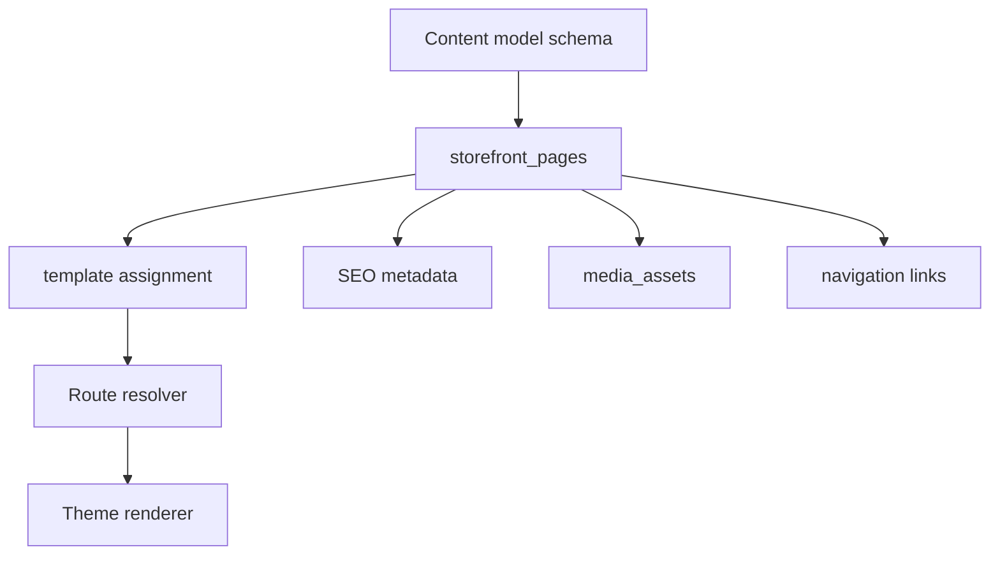
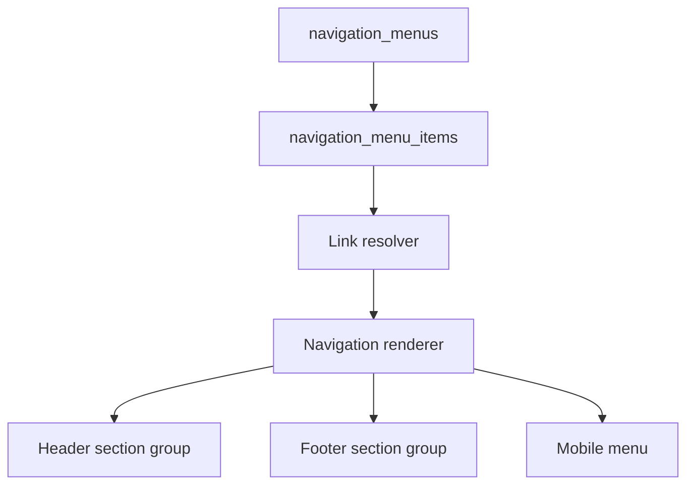

# 07 - Store Content and Navigation Architecture

Generated: 2026-05-22

## Objective

Store content, pages, policies, SEO, menus, and route resolution must be part of the theme engine. Pages cannot remain empty admin shells or hardcoded storefront routes.

## CMS Architecture



## Required Page Types

- About Us.
- Contact.
- FAQ.
- Privacy policy.
- Refund policy.
- Shipping policy.
- Terms of service.
- Landing pages.
- Campaign pages.
- Blog index.
- Blog article.
- Portfolio/resume pages by site type.
- Custom pages.

## Page Builder Architecture

Each page has:

- `store_id`
- `slug`
- `title`
- `status`
- `content_data`
- `template_assignment_id`
- `seo`
- `published_at`
- `revision`

Content can be either:

- Rich-text document rendered inside a page template.
- Full section-composed page using template sections.
- Resource-bound dynamic template for products, collections, blogs, articles, or policies.

## Rich Text Architecture

Use structured rich text, not raw HTML.

Required node support:

- Paragraph.
- Heading.
- List.
- Quote.
- Link.
- Image/media embed.
- Video embed.
- Table.
- Button/link block.
- App/embed block.

Validation:

- Sanitize all HTML output.
- Block scripts and unsafe URLs.
- Preserve accessibility fields.
- Resolve media through `media_assets`.

## Dynamic Routing

Route resolver order:

1. Custom domain/subdomain to `sites`.
2. Store status and password protection.
3. Static commerce routes:
   - `/`
   - `/shop`
   - `/products/:slug`
   - `/collections/:slug`
   - `/cart`
   - `/checkout`
   - `/search`
   - `/orders`
   - `/account/*`
4. CMS pages:
   - `/pages/:slug`
   - custom top-level slugs if no commerce route collision.
5. Policies:
   - `/policies/:policy_type`
6. Blog:
   - `/blogs/:blog_slug`
   - `/blogs/:blog_slug/:article_slug`
7. App routes.
8. 404 template.

All route resolutions return:

```text
store_id
route_type
resource_type
resource_id
template_assignment_id
canonical_url
cache_tags
```

## SEO Architecture

SEO data sources:

- Store defaults.
- Theme defaults.
- Page-specific SEO.
- Product/collection SEO.
- Policy SEO.
- Template fallback.

Required fields:

- Title.
- Description.
- Canonical URL.
- Open Graph title.
- Open Graph description.
- Open Graph image asset.
- Twitter card.
- Robots directives.
- Structured data type.

SEO must be generated server-side from the same route resolver used by rendering.

## Navigation System



Menu locations:

- Header.
- Footer.
- Mobile.
- Policy.
- Account.
- Custom section.

Menu item link types:

- External URL.
- Home.
- Page.
- Product.
- Collection.
- Blog.
- Policy.
- Search.
- Cart.
- Account.
- App route.

## Menu Hierarchy

Menu items support:

- Parent/child nesting.
- Sort order.
- Visibility.
- Draft/published state.
- Link target validation.
- New-tab behavior.
- Badge text.
- Icon.
- Audience/segment rules for future personalization.

## Slug Resolution

Slug rules:

- Unique per store and content type.
- Top-level custom pages cannot collide with reserved commerce routes.
- Slug history table for redirects after changes.
- Canonical URL generated by route resolver.
- Deleted pages return 410 or configured redirect.

Required table:

```text
storefront_slug_redirects
  id
  store_id
  old_slug
  new_slug
  resource_type
  resource_id
  status_code
  created_at
```

## Content Persistence

Tables:

- `storefront_pages`
- `storefront_page_revisions`
- `storefront_policies`
- `navigation_menus`
- `navigation_menu_items`
- `media_assets`
- `storefront_slug_redirects`

Revision model:

- Draft revision.
- Published revision.
- Scheduled revision.
- Archived revision.

## Theme Integration

Themes declare:

- Supported page templates.
- Supported policy templates.
- Default menu locations.
- Required content fields.
- Fallback templates.
- Empty-state section presets.

Rendering:

- Header section group pulls configured `navigation_menu` by location.
- Footer section group pulls footer/policy menus.
- CMS sections bind to page content fields.
- Product/collection templates bind to commerce resources.
- SEO metadata is resolved before render.

## Admin UI Requirements

Pages screen:

- List pages with status, slug, template, updated date.
- Create page.
- Duplicate page.
- Edit page content.
- Assign template.
- Preview draft.
- Publish/unpublish.
- SEO panel.

Navigation screen:

- Menu list by location.
- Nested drag/drop editor.
- Link picker.
- Visibility toggles.
- Broken link warnings.
- Preview by viewport.

Preferences screen:

- Store SEO defaults.
- Social sharing image.
- Favicon.
- Password protection.
- Analytics IDs.
- Search behavior.
- Policy defaults.

All three screens must persist to DB and feed the same render pipeline.

