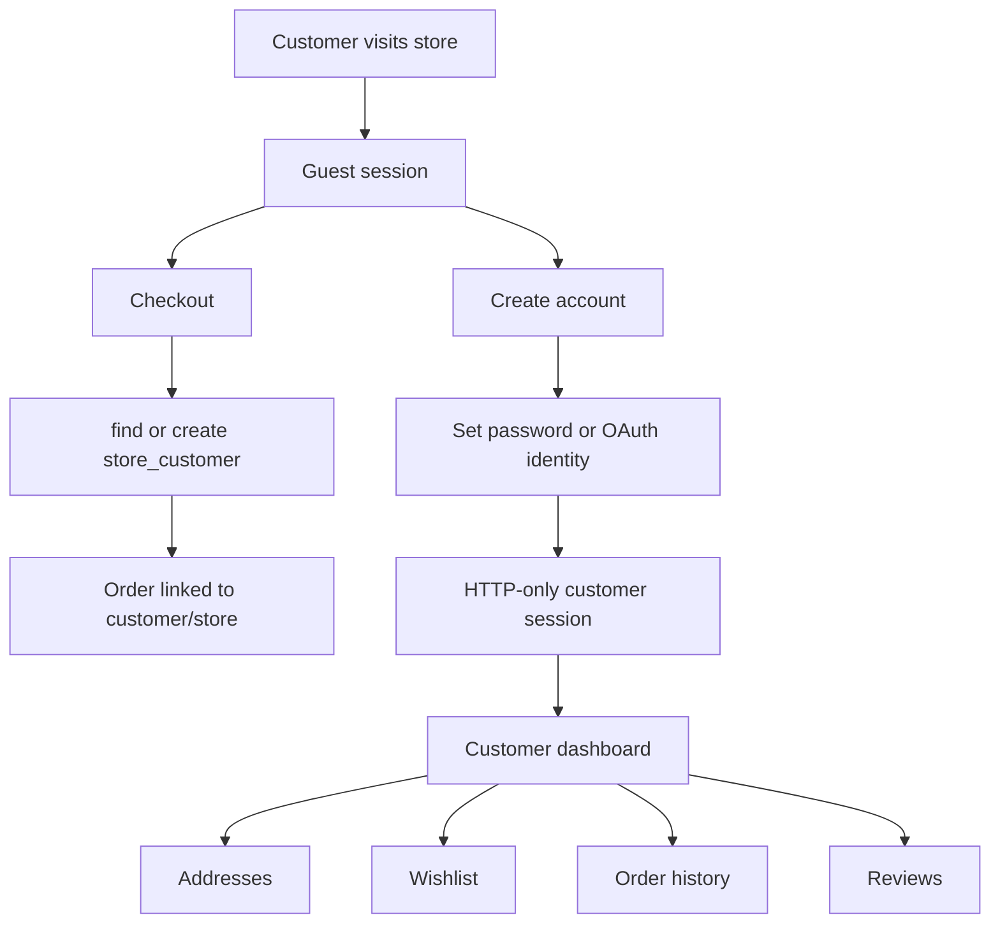

# 09 - Customer Storefront Architecture

Generated: 2026-05-22

## Objective

Customer accounts must be real tenant-scoped storefront accounts, not preview-only modal UI. Customer data must sync with admin customers automatically and remain isolated by store.

## Current Source Findings

Current foundations:

- `store_customers` table exists in `026_store_customers.sql`.
- `customer_wishlists` table exists in `026_store_customers.sql`.
- `customer_addresses` and legacy `wishlists` exist in `023_customer_system.sql`.
- `customer_credentials` exists in `025_customer_credentials.sql`.
- Storefront customer service supports find/create, password, login, wishlist, order stats, and orders.
- Storefront session uses HTTP-only JWT cookie `lb_customer_session`.

Current gaps:

- Customer tables overlap (`customer_credentials`, `store_customers.password_hash`, legacy `wishlists`, `customer_wishlists`).
- Some RLS policies are broad and rely on service role.
- `getStoreCustomers` returns an empty array, so admin customer sync is not complete.
- Customer auth UI is partly theme/shell-driven and preview routes simulate auth.
- No customer account templates are part of the theme engine.

## Customer Lifecycle



## Tenant Customer Isolation

Rules:

- Customer identity is scoped by `store_id`.
- Same email can have accounts in multiple stores.
- Storefront customer session includes `storeId`.
- Every customer API verifies `customer_id + store_id`.
- Orders, addresses, wishlists, reviews, returns, and activity logs include `store_id`.
- Admin customer page queries only merchant-owned store ids.

## Auth Architecture

Account methods:

- Email/password.
- OTP/email magic link.
- Google/Apple in future through store-scoped OAuth mapping.
- Guest checkout upgraded to full account.

Tables:

- `store_customers`: canonical profile.
- `store_customer_identities`: optional external auth identities.
- `store_customer_sessions`: optional server-side session tracking/revocation.
- `customer_addresses`: normalized saved addresses.
- `customer_wishlists`: canonical wishlist table.
- `customer_activity_log`: activity audit.

Recommended consolidation:

- Use `store_customers.password_hash` as canonical password store or migrate to `store_customer_credentials`.
- Deprecate duplicate `customer_credentials` after migration.
- Deprecate legacy `wishlists` in favor of `customer_wishlists`.

## Session Architecture

Current HTTP-only JWT session is a good start.

Required upgrades:

- `SameSite=Lax` is acceptable for storefront account flows; use `Strict` where cross-site redirects are not required.
- Add session id (`sid`) to token.
- Store hashed session id for revocation.
- Bind session to store id.
- Rotate session on login.
- Short-lived access plus refresh cookie for high-risk account actions.
- CSRF protection for state-changing customer APIs.
- Rate limiting for login and password setup.

## Storefront Auth Flow

1. Customer clicks account icon.
2. Theme engine renders customer auth template or modal based on theme setting.
3. Customer enters email.
4. Worker checks `store_customers` scoped by `store_id`.
5. Existing password customer logs in.
6. Guest/no-password customer sets password or receives OTP.
7. Session cookie is set by storefront server route.
8. Wishlist/cart local state syncs to server.
9. Customer dashboard renders from account templates.

The auth modal must not be preview-only and must not grant merchant/admin access.

## Customer Dashboard Architecture

Theme template types:

- `customer_login`
- `customer_register`
- `customer_account`
- `customer_orders`
- `customer_order_detail`
- `customer_addresses`
- `customer_wishlist`
- `customer_profile`

Sections:

- Account summary.
- Order history.
- Saved addresses.
- Wishlist grid.
- Review history.
- Profile settings.
- Return requests.

Data bindings:

- Current customer.
- Customer orders.
- Customer addresses.
- Customer wishlist.
- Customer reviews.

## Order Relationship Mapping

Orders should include:

- `store_id`
- `customer_id`
- `customer_email`
- `customer_phone`
- Snapshot customer fields for historical order integrity.

On order creation:

1. Validate store.
2. Create/find customer by store and email.
3. Link order to `customer_id`.
4. Update `store_customers.total_orders`, `total_spent`, `last_order_at`.
5. Emit `customer.order_created` event.

On account dashboard:

- Query orders by `store_id + customer_id`.
- Fall back to verified email only during migration.

## Wishlist Architecture

Canonical table:

```text
customer_wishlists
  id
  customer_id
  store_id
  product_id
  variant_id
  created_at
  deleted_at
```

Rules:

- Anonymous wishlist may be browser-local but is not durable.
- On login, local wishlist syncs to server through a scoped API.
- Product ids are validated against same store.
- Admin analytics can aggregate wishlist counts by store.

## Review Architecture

Reviews must support:

- `store_id`
- `product_id`
- `customer_id`
- Rating.
- Title/body.
- Images.
- Verification by order item.
- Moderation status.
- Helpful votes.
- Admin moderation.

Rendering:

- Product review summary section.
- Product reviews list app/section.
- Customer review history page.

## Admin Customers Sync

Admin customers page must read from canonical `store_customers`.

Required worker/admin endpoint:

```text
GET /customers?store_id=&search=&status=&limit=&cursor=
```

Response:

- Customer profile.
- Total orders.
- Total spent.
- Last order.
- Last login.
- Wishlist count.
- Review count.
- Marketing opt-in.

Mutations:

- Add tag.
- Add note.
- Disable customer.
- Reset password/force logout.
- Export customer data.

## Theme Integration

Customer account templates are theme templates, not hardcoded pages.

Themes control:

- Login presentation: modal, drawer, page.
- Account dashboard layout.
- Wishlist display.
- Order card style.
- Review prompts.

Platform controls:

- Auth logic.
- Session security.
- Rate limits.
- Tenant isolation.
- Account data access.
