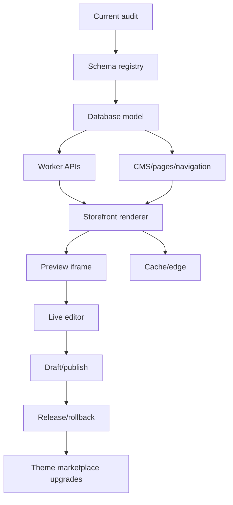

# 10 - Theme Engine Implementation Roadmap

Generated: 2026-05-22

## Objective

Move from the current static/hardcoded theme surfaces to a production theme operating system incrementally, without breaking existing stores.

## Dependency Graph

## Phase 0 - Stabilize Current System

Goals:

- Remove production reliance on preview/mock routes.
- Document all current hardcoded fallbacks.
- Keep current stores rendering.

Tasks:

- Gate mock store and theme preview routes clearly to preview/dev.
- Add tests around current theme publish/release flow.
- Add worker tests for template validation.
- Add smoke tests for `/store/[subdomain]`, `/shop`, `/orders`, and editor load.

## Phase 1 - Schema Registry Foundation

Goals:

- Replace static `SECTION_SCHEMAS` as the source of truth.
- Keep generated TypeScript exports for compatibility.

Tasks:

- Add DB tables for theme package versions, section definitions, block definitions, settings schemas, presets, and renderer manifests.
- Build schema compiler.
- Import current Urban Kicks schemas into DB.
- Generate TypeScript types from DB-backed registry.
- Update worker `ThemeService` to prefer package-version schema manifests.

## Phase 2 - Theme Instance Model

Goals:

- Separate installed theme, draft, and published release.

Tasks:

- Add `theme_instances`.
- Backfill from `store_themes`, `sites.theme_id`, and `theme_releases`.
- Link `theme_releases` to `theme_instance_id` and `theme_package_version_id`.
- Preserve `sites.template_config` as compatibility mirror during transition.
- Update install, duplicate, activate, archive, and rollback flows.

## Phase 3 - Template and Layout Engine

Goals:

- Move from homepage-only sections to route/template rendering.

Tasks:

- Add layout/template/assignment tables.
- Define template types: index, product, collection, page, policy, cart, search, customer.
- Build `TemplateResolver`.
- Build section group model for header/footer.
- Convert current homepage config into `index` template.
- Convert header/footer object slots into section groups.

## Phase 4 - Dynamic Storefront Renderer

Goals:

- Replace `switch(section.type)` with renderer registry and render context.

Tasks:

- Build `StorefrontCompositionEngine`.
- Build `SectionRenderer` and `BlockRenderer` registry.
- Create render context/data dependency planner.
- Implement server-first render pipeline.
- Add dynamic data bindings for product grids, collection grids, menus, and media.
- Render public storefront from release snapshots.

## Phase 5 - Live Preview iframe

Goals:

- Make editor preview the real storefront renderer.

Tasks:

- Implement signed preview route in storefront app.
- Consume `theme_preview_sessions`.
- Render draft config by token.
- Add preview bridge script.
- Implement editor-to-iframe `postMessage` protocol.
- Add selection/hover overlays.
- Add route/resource selector.

## Phase 6 - Editor Rewrite Around Engine

Goals:

- Turn current editor into a real schema-driven builder.

Tasks:

- Replace `CenterPanel` mock preview with iframe.
- Build schema-driven left sidebar for templates, sections, and blocks.
- Build block editing lifecycle.
- Build dynamic right-panel controls.
- Add media picker.
- Add product/collection/page/menu selectors.
- Add responsive override controls.
- Replace full-state undo/redo with patch command stack.
- Add autosave queue and conflict handling.

## Phase 7 - CMS, Pages, Policies, Navigation

Goals:

- Make Online Store > Pages and Preferences real systems.

Tasks:

- Add `storefront_pages`, page revisions, policies, menus, menu items, media assets, slug redirects.
- Build admin pages UI.
- Build navigation editor.
- Build SEO/preferences persistence.
- Wire menu renderer into header/footer section groups.
- Wire page/policy route resolver into storefront renderer.

## Phase 8 - Customer Account Templates

Goals:

- Make customer account UI real and tenant-scoped.

Tasks:

- Consolidate customer credential tables.
- Implement admin customer list from `store_customers`.
- Link orders to `customer_id`.
- Normalize wishlist table.
- Add customer account theme templates.
- Add CSRF/rate limiting for customer mutations.
- Add logout/revoke session support.

## Phase 9 - Theme Marketplace Package Lifecycle

Goals:

- Make marketplace themes installable, upgradeable, previewable packages.

Tasks:

- Build package upload/import pipeline.
- Add renderer manifest certification.
- Add theme migration dry-run.
- Add upgrade preview.
- Add purchase entitlement check.
- Add version changelog and rollback compatibility.
- Generate real preview screenshots from iframe renderer.

## Phase 10 - Edge, Cache, and Scale

Goals:

- Make storefront rendering scale to thousands of stores.

Tasks:

- Implement render-plan cache.
- Implement release snapshot cache.
- Implement route cache tags.
- Add cache invalidation from product, collection, menu, page, media, and theme publish events.
- Add edge-friendly public rendering.
- Add observability metrics for render time, data fetch time, cache hit rate, and hydration errors.

## Migration Strategy

1. Keep existing `sites.template_config` readable.
2. Backfill `theme_instances` for stores with active themes.
3. Convert legacy flat `sections[]` into `index` template plus section groups.
4. Convert current editor object `{ header, footer, template }` into template + section group records.
5. Publish a compatibility release for each active store.
6. Switch storefront resolver to prefer `theme_releases.release_manifest`.
7. Keep compatibility fallback until all active stores have migrated releases.
8. Remove hardcoded fallback templates after migration verification.

## Incremental Rollout Strategy

Rollout order:

1. Internal dev stores.
2. New stores only.
3. One free theme, Urban Kicks.
4. Existing draft stores.
5. Existing published stores with compatibility release.
6. Paid marketplace themes.
7. App blocks/extensions.

Guardrails:

- Feature flags by store id.
- Preview before publish.
- One-click rollback.
- Release health checks.
- Error budget monitoring.

## Performance Impact

Expected costs:

- More DB reads for template and data dependencies.
- More schema validation on draft/publish.
- More preview iframe traffic.

Mitigations:

- Immutable release snapshots.
- Render-plan cache by release/template.
- Batched data dependency loading.
- Route cache tags.
- Server-first rendering.
- Client islands only where needed.
- Lazy section assets.

## Scalability Impact

Target scale:

- Thousands of stores.
- Millions of products.
- Multiple page templates per store.
- Theme marketplace package upgrades.
- Real-time draft editing.

Required platform capabilities:

- Release snapshot immutability.
- Cache invalidation graph.
- Outbox event processing.
- Tenant-scoped data access.
- Observability per store/theme/release.

## Production Risk Analysis

Risks:

- Existing stores render differently after migration.
- Bad schema migration breaks theme instances.
- Preview and published rendering diverge.
- Cache invalidation misses product/menu/theme updates.
- App blocks introduce script/performance/security issues.
- Customer auth changes affect checkout/order tracking.

Controls:

- Compatibility release snapshots.
- Visual regression screenshots.
- Schema dry-run before publish.
- Release rollback.
- Signed preview tokens.
- Strict renderer key allowlist.
- Cache tag integration tests.
- Security review for customer auth and app blocks.

## Infrastructure Changes

Required:

- New Supabase migrations for theme engine tables.
- Worker services for theme registry, instances, templates, renderer manifests, previews, CMS, navigation.
- Storefront preview route.
- Admin editor API updates.
- Media asset upload/storage integration.
- Outbox event consumers.
- Cache invalidation hooks.

## Cache Architecture

Layers:

- DB query cache for package schemas.
- Release snapshot cache.
- Render plan cache.
- Data provider cache.
- Full/partial HTML cache by route.
- Asset CDN.

Cache keys must include:

- Store id.
- Release id.
- Route key.
- Locale.
- Currency.
- Market.
- Device class where layout differs.

## Event Architecture

Events:

- `theme.instance.created`
- `theme.instance.activated`
- `theme.draft.updated`
- `theme.release.published`
- `theme.release.rolled_back`
- `theme.upgrade.available`
- `theme.upgrade.preview_created`
- `storefront.page.published`
- `navigation.menu.updated`
- `media.asset.updated`
- `product.updated`
- `collection.updated`
- `customer.created`
- `customer.logged_in`

Use existing `outbox_events` as the durable event spine.

## Rendering Optimization Strategy

- Render above-the-fold server-side.
- Compile section wrappers from schema.
- Defer noncritical client islands.
- Lazy-load below-the-fold media.
- Batch product and collection queries.
- Use resource-specific cache tags.
- Precompute theme CSS variables per release.
- Precompute menu trees per release/menu update.

## SSR/ISR Architecture

For Next storefront:

- Public pages can use SSR with edge/cache headers initially.
- Move stable release pages to ISR-like cache once cache invalidation is reliable.
- Draft preview remains dynamic.
- Customer/account/cart/checkout pages remain dynamic and private.
- Product/collection pages can be cached by release + resource update tags.

## Hydration Strategy

- No full storefront client app hydration by default.
- Server components for static/composition rendering.
- Client islands for cart, search, account modal, filters, sliders, accordions, video, app blocks.
- Theme editor bridge is preview-only.
- App block scripts are isolated and deferred.

## Preview Deployment Strategy

- Preview route lives in storefront app.
- Draft token is created by worker.
- Preview loads draft from worker/server route.
- Editor iframe points to preview URL.
- Preview bridge connects iframe to editor parent.
- Preview never mutates public release.

## Edge Rendering Strategy

- Use Cloudflare worker APIs for tenant, storefront, commerce, and release data.
- Vercel/Next storefront can cache by release route.
- Long term: move render-plan resolution closer to edge once schema and release snapshots are stable.
- Custom domains route to the same tenant resolver.
- Cache purge by tags from outbox events.

## Definition of Done

The theme engine is production-ready when:

- New section types can be introduced through registry/package version, not hardcoded editor arrays.
- Storefront and editor preview use the same renderer.
- Every public route resolves through theme template assignment.
- Header/footer/navigation are dynamic section groups.
- Pages/policies/menus persist in DB.
- Blocks can be added/reordered/edited/deleted where schema permits.
- Drafts autosave and publish immutable releases.
- Rollback is one-click and verified.
- Customer account pages are tenant-scoped and theme-rendered.
- Theme marketplace installs, upgrades, and migrations are versioned.
- Cache tags invalidate render output correctly.

