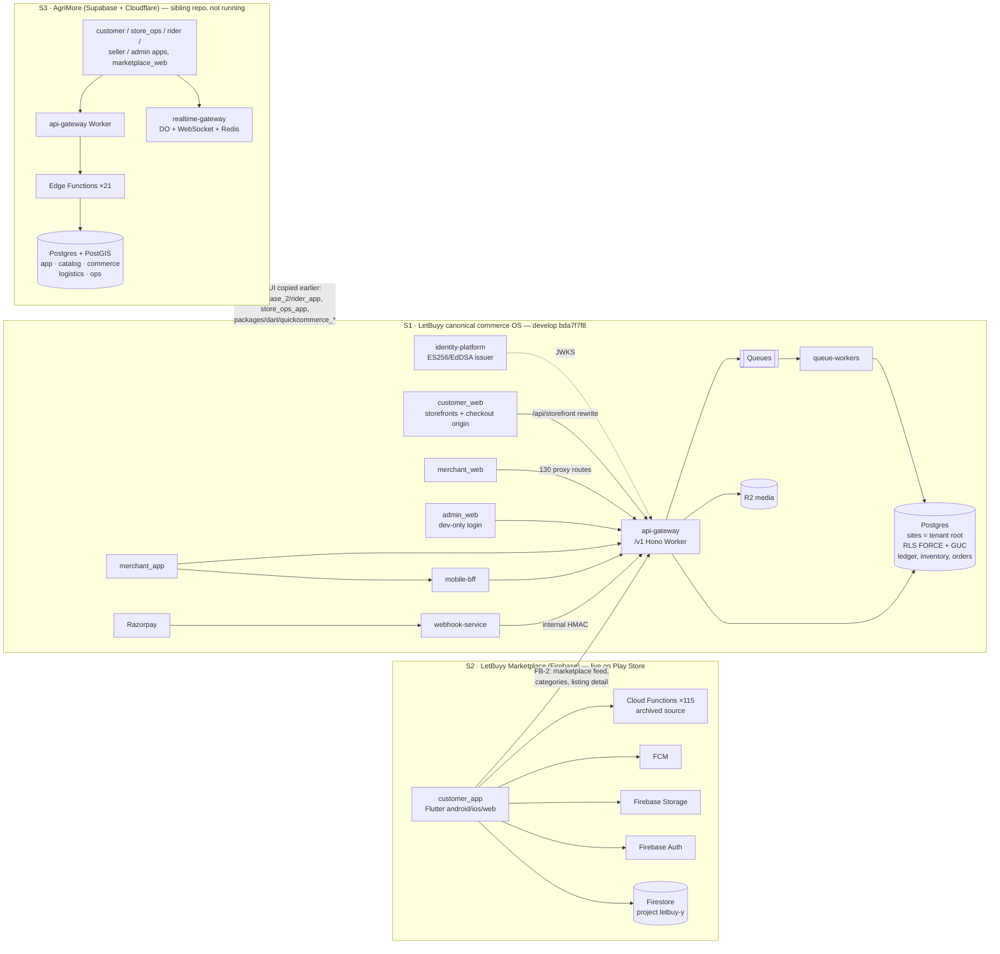

# 01 — Current System Map

Snapshots and evidence rules: see [00-README.md](./00-README.md).

## 1. Project boundaries actually found

The "three systems" of the brief are not three folders. They are three lineages sharing one repository plus one sibling repository:

| System | What it is | Where the code is | Stack | State |
|---|---|---|---|---|
| **S1 — LetBuyy Store Builder / Merchant Platform** | The canonical commerce OS: storefront builder, merchant OS, marketplace backend, identity, ledger | `services/{api-gateway,queue-workers,webhook-service,mobile-bff}`, `apps/{customer_web,merchant_web,identity-platform,admin_web,marketing-site,merchant_app}`, `packages/*`, `database/supabase` | Hono on Cloudflare Workers, Postgres (Supabase shape), Next 16.1.6 / React 19.2.3, Flutter (merchant app), pnpm 10.6.2, Node 20 | actively developed; 111 phase merges since 2026-09-04; tests green; **nothing observed deployed** |
| **S2 — LetBuyy Marketplace (Firebase)** | The shipped customer marketplace app | `apps/customer_app` (183 Dart files), `packages/dart/marketplace_{core,models,services,ui_kit}`; Cloud Functions source archived at `services/compatibility/firebase_bridge` (`823aa5ee` checkout only); rules in `docs/archive/firebase-legacy/` | Flutter (Android, iOS, web), Firebase Auth, Firestore, Storage, Messaging, Analytics, Cloud Functions (Node 20), Razorpay, Google Maps | live on Play Store (`com.letbuyy.letbuyy`, v1.0.10+4013); being retired by owner decision D-10 after every capability is rebuilt canonically; FB-2 already reads the canonical marketplace catalogue |
| **S3 — AgriMore (Supabase + Cloudflare)** | Quick-commerce donor: schema, Edge Functions, Workers, app skeletons, and the clearest product/decision records | `Projects/Start_Up/Agrimore_Supabase` (`foundation-rebuild` @ `6a33bf8`), duplicated at `apps/phase_2/Agrimore_Supabase`; donor UI already inside S1 at `apps/phase_2/{rider_app,store_ops_app}` and `packages/dart/quickcommerce_*` | Supabase Postgres + PostGIS, Supabase Edge Functions (Deno), Cloudflare Workers (api-gateway, realtime-gateway with Durable Objects, media-gateway), Upstash Redis, Typesense, Flutter apps, one Next app | rebuilt skeleton mid-cleanup; no running backend; defects listed in [16-SECURITY-REVIEW.md](./16-SECURITY-REVIEW.md) |

Also present but **not** part of the platform: `apps/{app-marketplace,developer-portal,theme-marketplace,platform-operations-portal}` (FROZEN), six RESERVED service roots and `apps/mobile/*` (manifest-only), `services/lcis-api` + `tools/*` + `packages/lcis-*` (developer tooling), `apps/seller` (an untracked folder from another session), the separate Firebase AgriMore under `Projects/Clients/`.

## 2. Per-application facts

### S1 applications

| App | Framework | Port | Purpose | Backend it talks to | Auth | Deployment target (declared) |
|---|---|---|---|---|---|---|
| `apps/customer_web` | Next 16.1.6 | 9000 | merchant storefronts on `{store}.letbuyy.com` / custom domains; buyer account pages; hosted `checkout.<root>` origin | gateway `/v1/storefront/*` via the rewrite `/api/storefront/:subdomain/*` (`next.config.ts:139-143`); 8 local API routes | per-store customer session (HS256 cookie) | Vercel project `letbuyy-customer-web` (placeholder id) |
| `apps/merchant_web` | Next 16.1.6 | 9001 | merchant OS: 80+ pages under `/[store]/…`; 130 API routes that proxy to the gateway | gateway `/v1/*` | identity-platform merchant session (ES256/EdDSA) | Vercel `letbuyy-merchant-web` → `admin.letbuyy.com` (placeholder id) |
| `apps/identity-platform` | Next 16.1.6 | 9002 | sole asymmetric token issuer: merchant + buyer realms; email OTP signup; JWKS | its own DB access via gateway internal routes | itself | Vercel `letbuyy-identity-platform` → `accounts.letbuyy.com` |
| `apps/admin_web` | Next 16.1.6 | 9007 | operator console: marketplace moderation, merchants, reconciliation, risk | gateway `/v1/internal/console`, `/v1/admin` | magic-link console session (**dev only**) | Vercel (placeholder) |
| `apps/marketing-site` | Next 16.1.6 | 9006 | public marketing | gateway public routes | none | Vercel |
| `apps/merchant_app` | Flutter (`letbuyy_store`, android/ios) | — | merchant OS on mobile, 153 Dart files, 172 tests | gateway + `mobile-bff` | identity cookies (`identityBaseUrl`, `identityCookies` in `lib/services`) | `mobile-merchant-release.yml` (dispatch only) |
| `services/api-gateway` | Hono ^4.7, wrangler ^4.100 | 9010 | modular monolith: ~70 route modules mounted under `/v1` (`src/index.ts:722-857`); execution adapters are the only callers of the money and inventory RPCs | Postgres via Supabase JS + pooled `SET LOCAL ROLE app_tenant` transactions; R2; KV; Queues; Hyperdrive; D1 | JWKS verifiers, internal HMAC, customer and buyer sessions | Worker `letbuyy-api` / `letbuyy-api-staging` |
| `services/queue-workers` | Cloudflare Worker | 9013 | 7 queue consumers + cron `17 */6 * * *` running reservation sweeper, loyalty earn, JTI sweeper, money-ledger reconciliation, SLO telemetry | Postgres, gateway internal | HMAC tenant envelope | Worker |
| `services/webhook-service` | Cloudflare Worker | 9012 | Razorpay ingress with raw-body HMAC and `payment_webhook_events` dedupe; outbound signed app webhooks | gateway internal payment routes | HMAC | Worker `letbuyy-webhook[-staging]` |
| `services/mobile-bff` | Cloudflare Worker | 9011 | `/v1/mobile/dashboard` fan-in for the merchant app | gateway | session token + Turnstile | Worker |
| `database/supabase` | Postgres | local 54322 | 175 migrations (`000_baseline.sql` … `246`), 97 rollbacks, seeds, verification | — | — | **no project exists** by decision D-11 (owner states staging/prod exist — unverified) |

### S2 application

| Item | Fact | Evidence |
|---|---|---|
| App | `apps/customer_app`, Flutter, `letbuyy_marketplace` 1.0.10+4013, android/ios/web; screens have mobile/desktop/web variants | `pubspec.yaml`, `lib/screens/**` |
| Firebase SDKs | `firebase_core`, `firebase_auth`, `cloud_firestore`, `cloud_functions`, `firebase_storage`, `firebase_messaging`, `firebase_analytics` | `pubspec.yaml` |
| Other SDKs | `razorpay_flutter`, `google_maps_flutter`, `geolocator`, `geocoding`, `google_sign_in`, `local_auth`, `google_generative_ai`, `speech_to_text`, `video_player`, `webview_flutter`, `dio`, `http` | `pubspec.yaml` |
| Data access | 29 files call Firestore directly; `packages/dart/marketplace_services` (51 files, 29 Firestore, 8 Auth) and `marketplace_models` (52 files, 44 Firestore) wrap most of it; `lib/data/{canonical_api,marketplace_repository}.dart` (105 lines) is the FB-2 canonical seam reading `/v1/storefront/marketplace/*` | grep |
| Collections used by the app | `products` (19), `addresses` (11), `users` (10), `sellers` (8), `notifications` (7), `saved_reels`, `orders`, `ad_products`, `recently_viewed`, `wishlists`, `seller_followers`, `followers`, `ad_campaigns`, `trending_searches`, `sessions`, `reviews`, `reels`, `loyalty`, `items`, `auth_logs`, `app_updates` | grep `collection('…')` |
| Realtime | 12 `.snapshots()` listeners: notifications, home banners, sponsored products, address sheet, loyalty, support chat, admin service | grep |
| Callable functions used | `sendEmailVerificationOTP`, `verifyEmailOTPAndLogin`, `verifyEmailOTPAndSignup`, `calculateOrderCommission`, `processDeliveredOrderCommission`, `verifyPaymentSignature`, `validateVPA`, `getSavedCards`, `deleteSavedCard`, `sendNewOrderNotificationToSeller` | `packages/dart/marketplace_services/lib/src/**` |
| Cloud Functions (archived source) | 115 exported functions across 24 files: seller auth, admin auth + TOTP, KYC (PAN/Aadhaar extraction, face match), commission, settlement, weekly/auto payouts, wallet, subscriptions + webhook, returns, store deployment (`deployStore`, `serveStore`, `generateStoreHtml`), domain mapping, notifications, analytics aggregation; triggers: 50 `onRequest`, 44 `onCall`, 4 `onCreate`, 3 `onUpdate`, 1 `onWrite`, 1 `onDelete` | `services/compatibility/firebase_bridge/src/*` (`823aa5ee`) |
| Rules | `firestore.rules` 1,141 lines, 95 `match` blocks; several `allow read, write: if true` (see [16](./16-SECURITY-REVIEW.md)) | `services/compatibility/firebase_bridge/config/firestore.rules` |
| Hosting | `firebase.json` hosts `apps/marketplace/build/web` (the Flutter web build) | same dir |
| Payments | Razorpay in-app checkout; signature verified by callable `verifyPaymentSignature`; COD | `lib/screens/checkout/payment_method_screen.dart` |

### S3 applications

| Item | Fact | Evidence |
|---|---|---|
| Apps | `customer_app` (35 Dart files; features address, auth, cart, checkout, discovery, growth, home, notifications, orders, profile, tracking, wallet), `store_ops_app` (18; queue, pick_pack, handoff, inventory, onboarding), `rider_app` (20; assignment, delivery, earnings, shift, auth), `seller_app` (17), `admin_app` (18), `marketplace_web` (Next ^16.1.1, 9 pages). All Flutter apps Android-only, `supabase_flutter` only, no maps SDK | `Agrimore_Supabase:apps/*` |
| Packages | `agrimore_{api,core,design_system,domain,observability,offline,realtime,services}` (86 Dart files); `agrimore_api` client with 30 `/v1/*` endpoints, default base `http://localhost:8787` | `packages/*` |
| Database | 20 migrations, schemas `app`, `catalog`, `commerce`, `logistics`, `ops`; PostGIS zones and stores; RLS enabled on 46 tables, 0 FORCE | `supabase/migrations/*` |
| Backend | Worker `api-gateway` (route policy table + 100-function handler module, Redis idempotency, outbox relay on a 1-minute cron), `realtime-gateway` (Durable Object + WebSocket + Redis presence/geo), `media-gateway` (R2 signed uploads); 21 Edge Functions (2,004 lines) | `workers/*`, `supabase/functions/*` |
| Integrations | Razorpay (Edge Functions), Typesense sync, FCM via service account, Upstash Redis, Sentry/OTel env names, Google Maps key env (unused by rebuilt apps) | `.env.example` names |
| Tests | 13 (worker tests + 3 pgTAP files) | `find` |
| Records | PDR-0001/0002/0003, ADR-0001…0012, `PRODUCTION_LAUNCH_PLAN.md` P0–P9, `SKIPPED_TASKS.md` | `docs/*` |

## 3. Relationships between the systems today

**What the arrows mean in practice.** The only live cross-system integration is FB-2: the Play Store app reads the canonical marketplace catalogue from the S1 gateway while everything else (auth, cart, orders, reels, chat, notifications) stays on Firebase. AgriMore shares nothing at runtime with either; its rider and store-ops UI skeletons were copied into `apps/phase_2` on 2026-09-02 and are wired to an API that does not exist in S1.

## 4. Backend, database, auth, storage, realtime, deployment — side by side

| Concern | S1 | S2 | S3 |
|---|---|---|---|
| API | Hono Worker `/v1`, ~70 route modules; GraphQL storefront behind `FEATURE_GRAPHQL` | 44 callable + 50 HTTP Cloud Functions; direct Firestore reads/writes from the app | Worker route-policy table → Edge Functions → PostgREST/RPC; 48 handler paths in `handlers/api.ts` |
| Database | Postgres; `sites.id` tenant root; 449 `CREATE TABLE` symbols in history; 73 `FORCE RLS`; money and stock only via `SECURITY DEFINER` RPCs | Firestore, 95 collections in rules; app uses ~21 | Postgres + PostGIS; 46 tables with RLS (no FORCE); RPCs in `commerce`, `logistics`, `ops` |
| Auth | identity-platform ES256/EdDSA (merchant, buyer); per-store customer HS256 sessions; operator dev magic link | Firebase Auth: email+password, Google sign-in, email OTP via callables | Supabase Auth OTP; gateway parses `payload.user.id` (bug) |
| Storage | R2 `letbuyy-media-staging`; `media`, `media_assets` tables; signed-upload intents; MIME allowlist | Firebase Storage: `users/<uid>/…` avatars, review images; product images on `firebasestorage.googleapis.com` | R2 via media-gateway with HMAC upload tokens |
| Realtime | none (queues + polling) | 12 Firestore `snapshots()` listeners | Durable Object + WebSocket rooms + Redis presence/geo |
| Notifications | Resend email, Twilio WhatsApp, FCM/APNs push dispatcher, buyer in-app inbox (`buyer_notifications`) | FCM via Cloud Functions (`sendNotificationToUser`, `sendBroadcastNotification`), Firestore `notifications` | `send-notification` Edge Function with FCM service account; `user_devices` tokens |
| Search | Postgres FTS (`to_tsvector`/`search_vector`), search projection queue | Firestore queries + `trending_searches` | Typesense sync function |
| Payments | Razorpay orders/verify/webhooks/refunds; COD; subscriptions; ad credits; ledger | Razorpay via callables; COD; saved cards | Razorpay intents + webhook in Edge Functions; wallet |
| Deployment | Vercel projects (placeholder ids), Workers per env, 17 GitHub workflows, deploy lanes `workflow_dispatch` only | Firebase Hosting for web build; Play Store | wrangler per Worker; `foundation.yml` CI |
| Observability | `audit_logs`, `analytics_events`, `webhook_deliveries`, request ids, OTel/Grafana/Prometheus yaml (declared), SLO catalogue (mostly NOT MEASURED) | Firebase Analytics, `auth_logs`, `adminActivityLogs` | OTel/Sentry env names, `ops.audit_logs`, request/trace ids |

## 5. Major dependency facts worth remembering

- **One package manager for S1** (`pnpm-workspace.yaml`: `apps/*`, `apps/mobile/*`, named packages). S3 has its own `pnpm-workspace.yaml`, `melos.yaml` and `pubspec.yaml` workspace; the nested copy under `apps/phase_2` is invisible to S1 tooling but visible to two validators (see [16](./16-SECURITY-REVIEW.md) §6).
- **Design systems:** S1 `@letbuyy/ui` (38 files, `--lb-*` tokens, ratchet validator) and `packages/dart/ui_kit` (generated mobile tokens); S2 `marketplace_ui_kit` (23 files); S3 `agrimore_design_system` (theme, tokens, widgets).
- **Change-control hotspots** (from `CLAUDE.md`): `getSupabaseAdmin`, `@letbuyy/shared-types`, `@letbuyy/api-client`, `create_checkout_order`.

## 6. What is deployed

From this repository and machine: **unknown**. `develop` has never been pushed (D-12), the deploy workflows are dispatch-only (D-DEPLOY), `config/vercel/projects.json` carries placeholder ids, and the decision register says no dev/staging Supabase exists (D-11). The founder has stated that staging and production Cloudflare and Supabase deployments exist. Until someone with cloud access records the deployed SHAs and applied migration versions, every live claim stays `UNKNOWN_LIVE_STATE`, and all live data must be presumed present.
