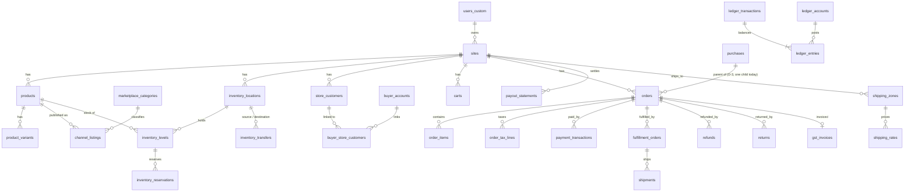
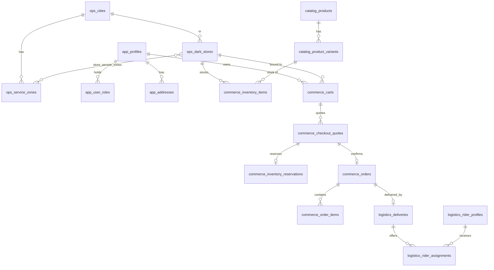

# 05 — Database Map

Three data stores exist: S1 Postgres (canonical), S2 Firestore (live marketplace), S3 Postgres+PostGIS (AgriMore, not running). Only S1 has a tenant boundary enforced by the database.

## 1. S1 — Postgres (Supabase shape), `database/supabase/migrations`

- 175 tracked migrations (`000_baseline.sql` … `246_release_decrements_committed_quantity.sql`), 97 rollbacks under `rollback/`, seeds and verification scripts.
- 449 distinct `CREATE TABLE` symbols appear in history (some dropped or superseded); 279 tables are registered as tenant tables (`services/api-gateway/src/tenant/tenant-tables.registry.ts`, generated); 73 `FORCE ROW LEVEL SECURITY` statements.
- **Tenant root:** `sites.id`. Tenant tables carry `site_id` (older ones `store_id`, a synonym kept by triggers). Policies use `site_id = public.current_site_id()` with the transaction-local GUC `app.site_id`; unset GUC ⇒ zero rows (reproduced by the tenant red-team suite).
- **Platform-level tables** (deliberately no tenant column): `buyer_accounts`, `purchases` (service-role only), `marketplace_categories`, ledger accounts for the platform, `payment_webhook_events`.
- Money and stock mutate only through `SECURITY DEFINER` RPCs ([04 §1.5](./04-API-INVENTORY.md)).

### 1.1 Domain map (tables by family; representative columns)

| Domain | Tables | Ownership boundary |
|---|---|---|
| Tenant / merchant | `sites` (user_id, custom_user_id, subdomain, custom_domain*, published, access_mode, theme_id, trial_*, frozen_at, status), `users_custom` (merchant principal: email, password_hash, auth_provider), `site_memberships`, `site_roles`, `site_role_permissions`, `employees`, `employee_roles`, `employee_permissions`, `employee_invites`, `store_memberships`, `organizations`, `org_memberships`, `org_store_links`, `delegations` (159, unwired), `site_entitlement_overrides`, `site_usage_meters`, `site_api_clients`, `site_gate_attempts` | merchant principal → sites; org layer dormant |
| Identity (buyer) | `buyer_accounts` (email, password_hash, email_verified, status), `buyer_store_customers` (buyer ↔ store_customer ↔ site), `refresh_tokens` (159) | platform |
| Per-store customer | `store_customers` (store_id, email, password_hash, addresses jsonb, totals), `customer_credentials`, `customer_addresses`, `customer_notes`, `customer_tags`, `customer_segments`, `customer_activity_log`, `customer_wishlists`, `customer_dsr_exports`, `customer_whatsapp_messages` | site |
| Catalog | `products` (store_id, price, compare_price, images, category, tags, variants jsonb, stock cache, hsn_code, is_active), `product_variants` (sku, barcode, price, inventory_qty cache, weight), `collections`, `product_collections`, `smart_collections`, `categories`, `metafields`, `media`, `media_assets` | site |
| Listing / marketplace | `channel_listings` (site_id, product_id, channel ∈ storefront/marketplace/instant, status, visibility, marketplace_category_id, pricing_policy jsonb, compliance_flags, version), `channel_listing_moderation_events`, `marketplace_categories`, `marketplace_banners`, `ad_campaigns`, `ad_credit_ledger_entries`, `buyer_product_views`, `seller_followers` | site (listings); platform (categories, banners) |
| Inventory | `inventory_locations` (store_id, name, address, is_default, status), `inventory_levels` (store_id [141], product_id, variant_id, location_id, available, reserved, committed_quantity, unavailable_quantity, incoming, safety_stock_quantity), `inventory_reservations` (TTL, status active/hold/committed/released/expired/fulfilled/cancelled), `inventory_transfers` (+ lines, receipts; status reserved/shipped/partially_received/received/cancelled), `purchase_orders` (+ lines, receipts), `inventory_adjustments` (site_id [245]), `inventory_events`, `inventory_level_duplicate_snapshots`, `restock_events`, `reserves` | site; locations single-owner |
| Cart / checkout | `carts` (store_id, customer_id, session_id, items jsonb, coupon_code, status, expires_at), `checkout_sessions` (hosted), `draft_orders` (+ lines) | site |
| Order | `purchases` (origin_site_id, channel, customer contact, idempotency_key; platform-level), `orders` (store_id/site_id, order_number, customer fields, addresses jsonb, subtotal/shipping/tax/discount/total, status, payment_status, payment_method, payment_id, tracking, fulfillment_status, return_status, refund_status, gst fields, version), `order_items` (snapshot, unit_price, tax breakdown, fulfilled/returned/refunded quantities), `order_tax_lines`, `order_shipping_lines`, `order_line_adjustments`, `order_risk_assessments`, `fulfillment_orders` (+ lines), `shipments`, `shipment_events`, `shipping_labels`, `returns`, `refunds`, `refund_lines`, `refund_attempts`, `refund_transactions` | site; parent platform |
| Fulfilment config | `shipping_zones` (countries, states, zip_codes), `shipping_rates`, `shipping_profiles`, `shipping_serviceability_rules` (pincode, cod limits, weight band, ETA days) | site |
| Payment / ledger | `payment_transactions` (pending…refunded/voided), `payment_attempts`, `payment_tokens`, `payment_credentials`, `payment_webhook_events` (UNIQUE provider+event id), `payments`, `ledger_accounts` (INR only, CHECK account codes), `ledger_transactions` (source_type CHECK, writer_module), `ledger_entries` (side, amount_minor > 0), `money_ledger_site_reconciliations`, `compensation_actions`, `wallet_ledger_entries`, `store_credit_ledger_entries`, `gift_card_accounts`, `gift_card_ledger_entries`, `gift_card_redemptions`, `loyalty_programs`, `loyalty_accounts`, `loyalty_ledger_entries` | site; balances are projections |
| Settlement | `settlements`, `payout_statements`, `payout_items`, `payout_reconciliation_records`, `payout_disputes`, `partner_payout_ledger_entries`, `payouts` | site |
| Billing / plans | `billing_*`, `merchant_billing_invoices`, `subscription_*`, `founding_merchant_allocations` | site |
| Tax | `tax_rates`, `tax_overrides`, `tax_registrations`, `gst_invoices` (immutable) | site |
| Storefront | `themes`, `theme_instances`, `theme_editor_drafts`, `theme_releases`, `theme_preview_sessions`, `theme_*` (30 tables incl. marketplace/developer ones), `site_domains`, `site_domain_verifications`, `site_domain_reviews`, `site_preview_links`, `pages`, `blog_*`, `sender_domains` | site |
| Notification / events | `notifications`, `buyer_notifications`, `webhook_deliveries` (+ partitioned), `outbox_events`, `outbox_events_partitioned`, `outbox_dead_letters`, `outbox_consumptions`, `analytics_events`, `audit_logs` | site / platform |
| Support / ops | `ticket_*`, `risk_*`, `operational_*`, `production_*`, `runtime_*`, `projection_*`, `distributed_*`, `ts_*` (LCIS/telemetry) | mixed |
| KYC | `merchant_kyc_documents` | site |

### 1.2 ER sketch (core commerce)

### 1.3 Gaps for the target model

No `brands`; no `location_listings` (product × node × price); no fulfilment-node kind/custody; no geography anywhere; `inventory_locations.store_id` conflates owner and operator; `channel_listings.pricing_policy` unapplied; no `quotes` on the live checkout path; no delivery, rider or zone tables; `ledger_accounts.account_code` is a fixed CHECK list (new account types are migrations); no `firebase_uid` mapping column anywhere.

## 2. S2 — Firestore (project `letbuy-y`)

Source of truth for the shipped app. Collections in `firestore.rules` (95 match blocks) versus the ones the current app actually touches:

| Collection | Used by app | Purpose | Canonical destination |
|---|---|---|---|
| `users`, `userPreferences`, `sessions`, `auth_logs`, `email_index`, `pending_verifications` | yes | customer profile, prefs, sessions | `buyer_accounts` + profile fields, `buyer_store_customers` links |
| `addresses` | yes | customer addresses (with map picker) | new platform address book (with coordinates) |
| `products`, `categories`, `subcategories`, `category_attributes`, `pending_attributes`, `counters` | yes (products) | seller catalogue | `products`/`product_variants` + `channel_listings` (already canonical for FB-2 reads) |
| `sellers`, `seller_analytics`, `seller_logs`, `seller_email_verifications`, `seller_followers`, `followers`, `store_users`, `stores`, `store_sites`, `store_themes`, `store_events`, `store_visitors`, `store_subscriptions`, `store_auth_requests`, `domain_requests` | partly | seller identity, store builder (retired) | `sites`, `users_custom`, `seller_followers`; store builder already S1 |
| `carts`, `items` | yes | carts | `carts` (Ecommerce basket) |
| `orders`, `transactions`, `invoices` | yes | orders, payments | `purchases`/`orders`/`order_items`/`payment_transactions` |
| `wishlists`, `recently_viewed`, `trending_searches` | yes | engagement | `customer_wishlists`, `buyer_product_views`, search suggestions |
| `reviews`, `reviewStats` | yes | reviews | `reviews` |
| `notifications`, `notification_history`, `push_notifications` | yes | inbox + push | `buyer_notifications` + FCM dispatcher |
| `reels`, `reel_comments`, `reel_likes`, `reel_interactions`, `reel_stats`, `saved_reels` | yes | reels | blocked on media pipeline (ARB) |
| `loyalty`, `loyalty_transactions` | yes | cashback points | `loyalty_*` (merchant-funded, per D-17) |
| `ad_campaigns`, `ad_products`, `ad_impressions`, `ad_clicks`, `ad_wallets`, `ad_wallet_transactions`, `sponsored_banners`, `banners`, `deals`, `coupons` | yes (ads, banners) | ads, promotions | `ad_*`, `marketplace_banners`, `coupons` |
| `support_conversations`, `messages` | yes | support chat | tickets/conversations |
| `return_requests`, `return_reasons`, `return_qc_reports`, `return_settings` | yes | returns | `returns`, `refunds` |
| `wallet_transactions`, `payout_requests`, `subscriptions` | seller side | retired money model | ledger (design only) |
| `kyc_submissions`, `admins`, `admin_otps`, `adminActivityLogs`, `emailChangeOTPs`, `audit_logs` | admin side | admin/KYC | `merchant_kyc_documents`, operator realm |
| `app_updates` | yes | forced update | `mobile-release-routes` |

Storage: `users/<uid>/<file>` avatars, review images; product images referenced as `firebasestorage.googleapis.com` URLs inside product documents.

## 3. S3 — AgriMore Postgres + PostGIS (`Agrimore_Supabase:supabase/migrations`)

| Schema | Tables | Notes |
|---|---|---|
| `app` | `profiles` (id = auth.users, phone, email, default_role, is_blocked), `user_roles` (role ∈ customer/rider/store_operator/seller/admin/super_admin, scope_city_id, scope_store_id), `addresses` (location geography point), `user_devices` (push tokens), `referrals` | roles scoped per store/city |
| `catalog` | `brands`, `categories`, `products` (category, brand, tax_code, search_keywords), `product_variants` (sku, barcode, mrp, default_sale_price, unit_label, weight_g), `product_media`, `product_search_documents`, `home_feed_shelves`, `seller_profiles` | global catalogue, per-store listing designed not built |
| `commerce` | `carts` (user, **store_id**), `cart_items`, `checkout_quotes` (+ items; reservation_id, eta_seconds, expires_at), `payment_intents`, `payment_events`, `orders` (store_id, status enum, payment_status, eta_seconds, quote_id, idempotency_key, version), `order_items`, `order_status_events`, `order_read_models`, `inventory_items` (store, variant, on_hand, reserved, safety_stock, CHECK reserved ≤ on_hand), `inventory_reservations` (+ items), `stock_movements` (append-only trigger), `inventory_events`, `wallet_accounts` (balance, locked), `wallet_locks`, `ledger_entries` (balance_after), `coupons`, `coupon_redemptions` | single-store cart and order |
| `logistics` | `rider_profiles`, `rider_shifts` (start/end geography), `deliveries` (order, store, rider, status enum, pickup/drop geography, version, timestamps), `rider_assignments` (offer_id UNIQUE, status, score, expires_at), `dispatch_attempts`, `delivery_status_events` | versioned transitions |
| `ops` | `cities`, `service_zones` (polygon geography, GiST), `dark_stores` (location point, service_radius_m, target_sla_seconds, accepts_orders), `store_service_zones`, `idempotency_keys`, `outbox_events`, `notifications`, `audit_logs`, `qstash_jobs` (dropped by 000023) | zones seeded via `seed.sql`; no editor |

RLS: 46 `ENABLE`, 49 policies, 0 `FORCE`, 1 `USING (true)`; tenancy through membership helper functions, not a transaction-local GUC.

## 4. Ownership boundaries compared

| Boundary | S1 | S2 | S3 |
|---|---|---|---|
| Merchant data | `site_id` + RLS FORCE + GUC; app guards as second layer | seller-scoped documents; rules 1,141 lines with several `if true` reads/writes | `store_id` + role helper functions; no FORCE |
| Customer data | per-store rows under the site; platform buyer rows without tenant | user-scoped documents | user-scoped rows |
| Money | ledger tables with balance trigger; column-level grants | Firestore counters and wallet documents | `balance_after` column, mutable wallet balance |
| Platform-only | `purchases`, `buyer_accounts` service-role only | admin collections | `ops.*` |

## 5. Seed and fixture strategy

S1: `database/supabase/seeds`, `scripts/governance/run-executable-suites.mjs` builds a fresh database per suite in a throwaway container (`supabase-faithful-bootstrap.mjs` reproduces the Supabase shape: pgcrypto in `extensions`, `service_role` BYPASSRLS, default privileges). S2: none in repo. S3: `supabase/seed.sql` (cities, dark stores), `seed/{dev_seed,synthetic_city_seed}.sql`, pgTAP fixtures.
