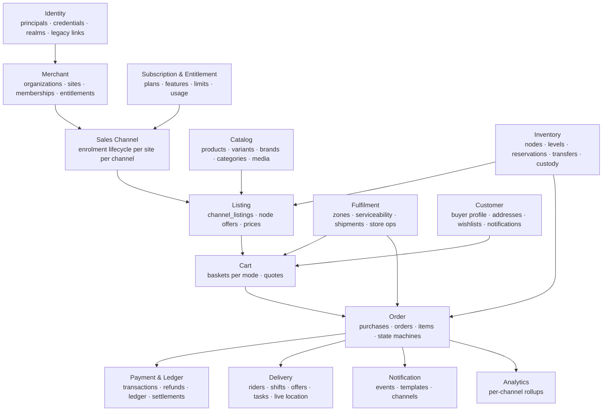

# 08 — Target Domain Model

The model is derived from what exists in S1 (kept), what S3 designed for physical commerce (adapted), and what the founder asked for (channels with their own pricing, fees and plans; dark stores and partner stores; one customer identity). Every domain names one source of truth. Nothing here is code; each "NEW" item is backlog work in [18](./18-IMPLEMENTATION-BACKLOG.md).

## 1. Glossary (canonical terms)

| Term | Meaning | Replaces |
|---|---|---|
| **Merchant** | the legal/business seller account; owns catalogue, stock, orders and money | seller, vendor, business, store (when used for the account) |
| **Organisation** | optional grouping above merchants for multi-brand or multi-entity groups (`organizations`, dormant) | — |
| **Site** | a merchant's tenant record (`sites.id`), and the storefront it may publish; the RLS boundary | store (as tenant), shop |
| **Sales Channel** | where a product is sold: `storefront`, `marketplace`, `quick` (today's `instant`), later `pos` | — |
| **Channel Listing** | a product's presence on one channel with status, visibility and channel price | marketplace listing, quick listing |
| **Fulfilment Node** | a physical inventory location: merchant location, LetBuyy dark store, partner store, hub | warehouse, dark store, supermarket, branch, location |
| **Node Listing (Offer)** | a variant sold at a node with an effective price and sold-here flag | location listing, local price |
| **Custody** | who physically holds stock at a node versus who owns it | consignment |
| **Basket** | a customer's cart for one mode (Ecommerce or Quick) | cart |
| **Purchase** | the parent of one or more orders from a single checkout (platform-level) | — |
| **Order** | one merchant's fulfilment unit inside a purchase | — |
| **Delivery Task** | the rider-side unit for a Quick order | delivery, trip |
| **Buyer** | the platform customer identity (`buyer_accounts`) | user, customer |
| **Store Customer** | a buyer's per-site record and history | customer |
| **Operator** | a LetBuyy platform staff member | admin |
| **Workforce member** | cashier, picker, custodian, rider, sales associate: a scoped membership, not an account type | employee |

## 2. Domains and sources of truth



| Domain | Source of truth (tables / owner) | Exists | Key rules |
|---|---|---|---|
| **Identity** | identity-platform; `users_custom`, `buyer_accounts`, `refresh_tokens`, NEW `identity_legacy_links`, NEW workforce memberships | mostly | one principal per human; realms never cross; no symmetric secrets across domains |
| **Merchant** | `sites` (tenant), `organizations`/`org_memberships`/`org_store_links` (to wire), `employees` → NEW `location_memberships` | partly | every merchant-owned row carries `site_id` under FORCE RLS |
| **Sales Channel** | NEW `site_channel_enrolments(site_id, channel, status ∈ available/selected/configuration_required/verification_required/pending_review/active/suspended/disabled, eligibility jsonb, activated_at)` | no | replaces scattered flags; Quick availability depends on geography and category eligibility |
| **Catalog** | `products`, `product_variants` (+ NEW `brands`, uniqueness on `(site_id, sku)` and barcode policy), `collections`, `categories`, `metafields`, `media` | yes | one master product per merchant; never one record per channel |
| **Listing** | `channel_listings` (status, visibility, moderation, NEW `channel_price_minor`, `channel_compare_price_minor`, `commission_rule_id`), NEW `node_offers(variant_id, node_id, price_minor, is_sold_here, effective_from/to)` | partly | price resolution: node offer → channel listing → product price; snapshot into `order_items` |
| **Inventory** | `inventory_locations` → NEW columns (`kind ∈ merchant_location/dark_store/partner_store/hub`, `operator_party`, `geo point`, `hours`, `capacity`, `accepts_orders`), `inventory_levels`, `inventory_reservations`, `inventory_transfers` (+ `in_transit`, custody acceptance), NEW `custody_agreements`, NEW `stock_movements` reason codes | mostly | available-to-promise = available − active reservations − safety; one consumption moment per channel; never trust caches |
| **Fulfilment** | NEW `service_zones` (polygon/circle, PostGIS), NEW `node_zones`, `shipping_zones/rates/serviceability_rules` (parcel), `fulfillment_orders`, `shipments`, NEW store-ops tasks | partly | serviceability decided server-side at address, quote and commit |
| **Customer** | `buyer_accounts` profile, NEW `buyer_addresses` (with coordinates), `customer_wishlists`, `buyer_notifications`, `store_customers` as per-merchant view | partly | a merchant sees only its own `store_customers`; buyer data is platform-level |
| **Cart** | `carts` (Ecommerce basket, per site today → per purchase scope), NEW `quick_baskets` bound to one node, NEW `quotes` (expiring, reservation-holding) | partly | never merge baskets silently; switching node requotes |
| **Order** | `purchases` → `orders` → `order_items`, `order_tax_lines`, `fulfillment_orders`, `returns`, `refunds`; NEW `order_channel`, `fulfilment_type`, Quick state machine, NEW `order_status_events` | mostly | channel and fulfilment type are columns with CHECKs, not free strings |
| **Payment & Ledger** | `payment_transactions`, `payment_webhook_events`, `ledger_*`, `refunds`, `settlements`, `payout_statements`; NEW ledger account types per founder decisions (commission, custody fee, rider earnings) | yes | every transaction balances; balances are projections; provider evidence before `paid` |
| **Delivery** | NEW `rider_profiles`, `rider_shifts`, `delivery_tasks`, `delivery_offers`, `delivery_status_events`, ephemeral presence/live location (Durable Object + KV/Redis) | no (S3 shapes) | atomic offer acceptance; versioned transitions; participant-only tracking |
| **Subscription & Entitlement** | `billing_*`, `site_entitlement_overrides`, `site_usage_meters`; NEW `plan_features(plan_code, feature_key, limit)` with keys like `STOREFRONT_CHANNEL`, `MARKETPLACE_CHANNEL`, `QUICK_CHANNEL`, `CUSTOM_DOMAIN`, `STAFF_SEATS`, `LOCATIONS` | partly | code asks `hasEntitlement(site, key)`, never `plan === 'premium'` |
| **Notification** | outbox events → queue-workers → Resend / Twilio / FCM / inbox | yes | one event vocabulary ([14 §5](./14-ORDER-FULFILMENT-ARCHITECTURE.md)) |
| **Analytics** | `analytics_events`, rollups; NEW `channel` dimension everywhere | partly | totals aggregate, breakdown by channel |

## 3. Master product, channel listing, node offer, node inventory

```text
products (site_id)                 ← identity: name, description, images, brand, category, tax, attributes
  └── product_variants              ← sku, barcode, weight, dimensions
        ├── channel_listings         ← per channel: status, visibility, channel price, compare price, commission rule
        │      storefront | marketplace | quick | (pos)
        ├── node_offers              ← per fulfilment node: sold here?, effective price window, local id
        └── inventory_levels         ← per node: available, reserved, committed, unavailable, incoming, safety
```

Publishing "Amul Milk 1L" to Storefront ₹65, Marketplace ₹67, Quick ₹69 with 24 at Salem Hub is: one product, one variant, three `channel_listings` rows with prices, one `node_offers` row for Salem Hub, one `inventory_levels` row at Salem Hub. Unpublished = no listing row for that channel.

## 4. Tenancy hierarchy (target)

```text
Platform
  └── Organisation (optional)
        └── Merchant / Site (tenant boundary, site_id)
              ├── Sales Channel enrolments
              ├── Catalog, Listings, Customers, Orders, Money
              └── Fulfilment Nodes owned by the merchant
Platform-operated Fulfilment Nodes (dark stores) and Partner Nodes
  └── hold stock owned by merchants under custody agreements
      (the stock row still belongs to the owning site; the node is operated by another party)
```

The tenant boundary stays `site_id`. A node operated by a partner is represented as a node with `operator_party` different from the owning site; access to operate it comes from a `location_membership`, never from the merchant's ownership of the stock.

## 5. Decisions the model depends on (open)

Per-channel fee and commission model (reverses D-1), custody and merchant-of-record (D-2), cart model (separate baskets recommended), whether Quick's channel value stays `instant` or renames to `quick` (a vocabulary migration), first POS domain. See [17](./17-UNIFICATION-ROADMAP.md) §Decisions.
