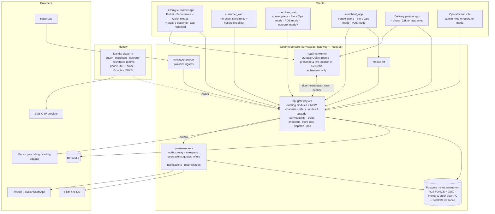

# 09 — Target Architecture

## 1. Principle

One commerce core (S1's gateway + Postgres + ledger + identity), multiple sales channels as domain rows, multiple user experiences as clients. No second authority for orders, stock, money or identity; AgriMore's backend is not imported, its designs are; Firebase shrinks by strangler steps behind the customer app's repository layer.

## 2. Application boundaries

Surfaces are deliberately several executables on one platform: customer app, storefronts, merchant web and app, delivery partner app, operator console. Store Ops and POS are **modes** of the merchant apps gated by location memberships (founder direction 2026-09-19); a standalone Store Ops app is kept only for partner staff who are not merchant members. The operator console is either `admin_web` (D-4) or an operator-realm mode inside `merchant_web` (founder preference stated; not yet recorded) — one console either way.

## 3. Backend boundaries inside the gateway (modular monolith)

| Module (new or extended) | Responsibility | Depends on |
|---|---|---|
| `channels` (NEW) | enrolment lifecycle per site; eligibility evaluation (plan entitlement × geography × category) | Merchant, Subscription, Fulfilment |
| `listings` (extend) | channel listings with prices and commission rule; node offers; price resolution service | Catalog, Inventory |
| `nodes` (extend `inventory`) | fulfilment nodes of four kinds, hours, capacity, custody agreements, transfers with in-transit and partner acceptance | Merchant memberships |
| `serviceability` (NEW) | zones (circle/polygon), node ↔ zone, resolver returning every eligible node with ranking and explanation, revalidation at quote and commit | PostGIS, nodes |
| `quick-checkout` (NEW) | Quick basket bound to a node, quote with expiry holding reservations, confirm via the guarded `create_checkout_order` lineage with `channel = quick`, `fulfilment_type = dark_store|partner_store` | Inventory, Payment |
| `store-ops` (NEW) | accept/decline, pick, pack, ready, handover transitions with location membership checks, tasks queue | Order, nodes |
| `dispatch` (NEW) | rider profiles, shifts, presence ingestion, candidate selection, offers with expiry, atomic acceptance, re-offer, delivery task transitions, proof, earnings postings | Order, Ledger, Realtime |
| `pos` (NEW, later) | terminals, cashier sessions, counter sale, suspended baskets, receipts, shifts | Catalog, Inventory, Payment, memberships |
| `entitlements` (extend billing) | plan features and limits; `hasEntitlement(site, key)` | Subscription |
| existing modules | catalogue, storefront, orders, payments, ledger, settlements, marketing, analytics, identity wiring | — |

Placement rule (adopted from Agrimore ADR-0002 §4 and consistent with the Constitution): logic that must be atomic with data lives in Postgres RPCs; logic that needs secrets, providers or long work lives in Workers; clients never compute authoritative amounts or availability.

## 4. Shared services

| Concern | Decision |
|---|---|
| Authentication | identity-platform issues all realms; gateway verifies with JWKS; HS256 store-customer sessions collapse onto the buyer realm; operator realm replaces the console magic link; Edge-style header trust is never introduced |
| Database | one Postgres; add PostGIS; every new tenant table FORCE RLS + GUC; platform tables service-role only; money/stock via RPC |
| Realtime | one realtime Worker (Durable Object per delivery/order room), state in KV/Redis with TTL; Postgres remains authority; subscription authorisation by participation (buyer of the order, assigned rider, node member, operator) |
| Storage | R2 for all new media; Firebase Storage URLs preserved during migration via a redirect/proxy map |
| Events | existing transactional outbox; new event names for Quick and delivery; consumers idempotent with DLQ |
| Search | Postgres FTS with a location-aware query for Quick (join node availability); Typesense only when measured need appears |
| Notifications | one event → template → channel pipeline in queue-workers; FCM/APNs for push, Resend email, Twilio WhatsApp, in-app inbox |
| Maps | one adapter interface (geocode, reverse geocode, distance/route); provider is a founder choice; cache by geohash |
| Idempotency | existing claims + advisory locks; every new mutating route declares a key scope |

## 5. Frontend relationships

- The customer app keeps its screens and replaces Firestore access behind `packages/dart/marketplace_services` repositories with the canonical API ([11](./11-CUSTOMER-APP-MERGE.md)). Quick mode reuses AgriMore's discovery/address/tracking flows as the second mode of the same screens.
- Storefronts stay theme-rendered on `customer_web`; the platform buyer account links to per-store accounts.
- Merchant web and app add the Sales Channels domain, node management, Store Ops and POS modes ([12](./12-MERCHANT-CONTROL-PLANE.md)).
- Delivery partner app is `phase_2/rider_app` wired to the dispatch module and the realtime Worker.
- One token source (`tokens.ts` → web and generated mobile tokens) with role-level themes; `marketplace_ui_kit` components move into the unified customer kit.

## 6. Code organisation

Keep the current monorepo layout; it already matches the target (`apps/*`, `services/*`, `packages/*`, `database/supabase`). Changes: rename `apps/customer_app`'s display name (package id unchanged); promote `apps/phase_2/rider_app` to a governed app root when it is wired; keep `store_ops_app` only if partner staff need it; remove the 2.2 GB `apps/phase_2/Agrimore_Supabase` copy or replace it with a source-only donor snapshot at a committed SHA. No folder reorganisation for its own sake; the Constitution's runtime map must be amended for any new root.

## 7. Migration philosophy

Strangler, not big bang: the live Play Store app keeps working while, screen by screen, its repositories switch from Firestore to the gateway; Firebase Auth is the last dependency to go (identity link table first, then a dual-accept window, then cutover per D-10 in one release once every capability exists canonically). Quick commerce is added as a new mode behind a serviceability gate, so a failure in Quick never breaks Ecommerce.

## The twenty critical questions

**Q1 Merchant Platform foundation.** S1's `merchant_web` + `merchant_app` on the S1 gateway. Evidence: complete merchant workflows, 130 proxy routes, 59 mobile screens, tenant isolation and money paths tested; S2's seller app is retired; S3's seller app is a 17-file skeleton.

**Q2 Canonical backend.** S1 `services/api-gateway` + Postgres. Evidence: RLS FORCE + GUC reproduced, double-entry ledger with balance trigger, checkout idempotency and oversell race reproduced under real concurrency, Razorpay chain bound server-side, outbox + queues + webhooks. S3 has weaker isolation (no FORCE), an auth parsing defect and a header-trust hop; Firebase has no tenant boundary and a retired money model. Owner decision D-0 already says so.

**Q3 Firebase services.** Migrate: Auth (to identity-platform buyer realm with legacy link), Firestore (to Postgres domains), Storage (to R2 with URL map), Cloud Functions (already superseded or retired), Analytics (to `analytics_events` + product analytics choice). Retain: **FCM as the push transport** (tokens re-registered against buyer principals); `firebase_core` only for messaging. Details in [10](./10-FIREBASE-MIGRATION.md).

**Q4 Preserving the Marketplace UI.** Keep screens; move all data access into `packages/dart/marketplace_services` repositories (29 direct Firestore call sites remain in the app); switch repositories one domain at a time to `@letbuyy/api-client`-style clients against `/v1/storefront/*` and buyer routes; FB-2 already did this for the catalogue.

**Q5 Reusable AgriMore components.** Directly reusable as design/schema: zones + dark store geo columns, delivery/offer/status-event tables and `assign_rider`/`transition_delivery` semantics, quote-with-expiry pattern, store-ops transition set, realtime room + presence pattern, PDR/ADR requirements, `rider_app` and `store_ops_app` UI. Not reusable as code: Workers, Edge Functions, RLS, auth middleware.

**Q6 Customer identity.** One principal at identity-platform; buyer realm (asymmetric, no tenant claim) as the account; phone OTP added; Firebase UIDs mapped through a legacy link table; per-store customers linked, not merged, with consent.

**Q7 Merchant identity / tenant hierarchy.** Platform → Organisation (optional) → Merchant/Site (tenant boundary) → Fulfilment Node → Inventory; memberships scoped per site and per node; platform-operated and partner nodes hold merchant-owned stock under custody agreements.

**Q8 One product, three channels.** `products`/`product_variants` master; one `channel_listings` row per channel with status, visibility and price; `node_offers` for node-specific price and availability; price resolution node → channel → product, snapshotted into `order_items`.

**Q9 Inventory difference.** Ecommerce: reserve-and-commit at order creation at the merchant's default or chosen location, parcel fulfilment. Quick: node-scoped available-to-promise, reservation held by an expiring quote, consumed at confirm, released by sweeper on expiry/failure; never a global stock number.

**Q10 Serviceability.** Customer delivery address (coordinates) → zones (circle default, polygon where needed, PostGIS) → node ↔ zone links → filter by `accepts_orders`, hours, capacity, stock freshness → return every eligible node with deterministic ranking and explanation → customer chooses → revalidate at quote and at commit.

**Q11 Dark stores and partner supermarkets.** One `inventory_locations` entity with `kind`, `operator_party`, geo, hours, capacity; custody agreements link owning merchant and operating party; store-ops access via location memberships; the customer sees "LetBuyy Quick · in partnership with ABC".

**Q12 Carts.** Yes: one Cart domain, separate baskets per mode (Ecommerce basket per purchase scope; Quick basket bound to one node), never merged silently; marketplace multi-merchant handled by the existing parent purchase model.

**Q13 Standard and Quick orders.** Same `purchases` → `orders` → `order_items` tables; `order_channel` and `fulfilment_type` columns; two explicit state machines ([14](./14-ORDER-FULFILMENT-ARCHITECTURE.md)); Quick orders carry a `delivery_task`.

**Q14 Existing order statuses.** S1 `orders.status` CHECK: pending, confirmed, processing, shipped, delivered, cancelled, refunded; `payment_status`: pending, paid, failed, refunded; plus fulfillment_orders, shipments, refunds, returns, reservations, transfers vocabularies. S2 literals: pending, confirmed, processing, shipped, delivered, cancelled, refunded, returned. S3 `commerce.order_status`: draft, quote_created, payment_pending, confirmed, picking, packing, ready_for_pickup, rider_assigned, picked_up, arriving, delivered, cancelled, failed, returned; `logistics.delivery_status`: pending_assignment, assigned, accepted, rejected, arriving_at_store, picked_up, arriving_at_customer, delivered, failed, returned. Full maps in [14](./14-ORDER-FULFILMENT-ARCHITECTURE.md).

**Q15 Strongest implementation per duplicated feature.** See [07 §16](./07-DUPLICATION-ANALYSIS.md): S1 for identity, tenancy, catalogue, inventory, orders, payments, ledger, notifications, storefront, operations backend; S2 for customer UI; S3 for zones, dispatch, store-ops and quick-order design.

**Q16 Retained untouched.** Storefront builder and theme engine; ledger and money RPCs; inventory RPC family; identity issuer; webhook ingress (after two fixes); merchant web/app screens; customer app screens.

**Q17 Adapters only.** Customer app data layer (Firestore → API); `rider_app` and `store_ops_app` API clients; FCM token registration; media URL map; analytics event sink.

**Q18 Genuine rewrites / new builds.** Serviceability resolver, channel enrolment domain, node offers and price resolution, custody and in-transit transfers, Quick quote and checkout, store-ops transitions, dispatch and live tracking, operator login, POS, phone OTP, platform address book, entitlement service.

**Q19 Data migration risks.** Firebase UID → uuid mapping and email collisions; password hash portability; in-flight orders during cutover; media URLs embedded in product documents; Firestore counters vs canonical stock; unknown live data volumes on both Firebase and (per the founder) staging/production Supabase; no `firebase_uid` column today; Google-linked accounts.

**Q20 Migration order.** Decisions → repairs on the existing core → identity (phone OTP, legacy links) → tenant/membership + nodes + custody → catalogue additions (brands, uniqueness) → channel enrolment + listings/offers/pricing + entitlements → serviceability + Quick quote/checkout → store ops → dispatch + delivery app + realtime → customer app repositories switched domain by domain → Firebase cutover → merchant control plane additions land alongside each domain → payments/settlement extensions per fee decision → analytics/notifications → Firebase retirement → hardening. Detailed in [17](./17-UNIFICATION-ROADMAP.md).
