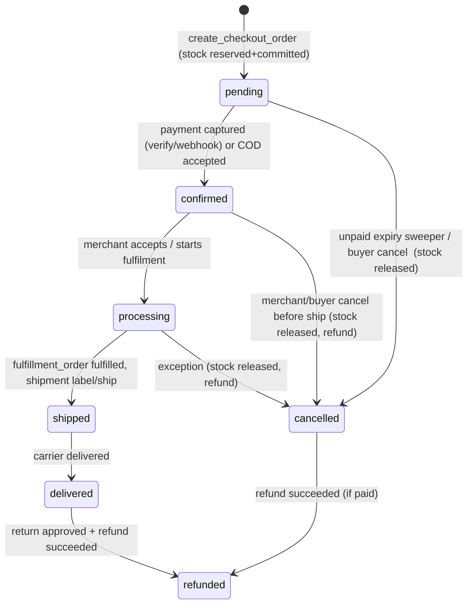
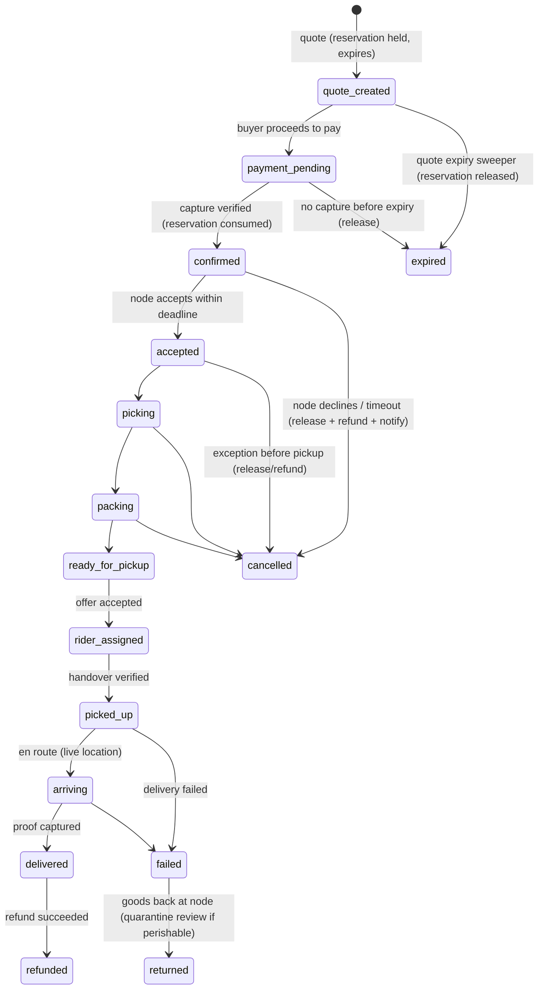
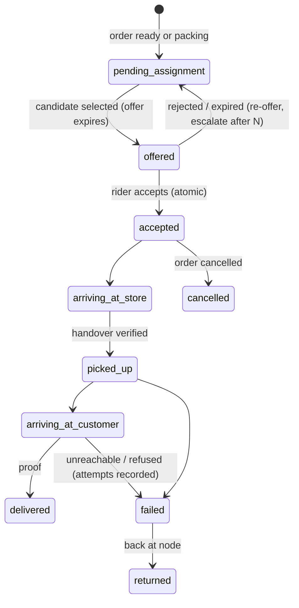

# 14 — Order and Fulfilment Architecture

## 1. Existing status vocabularies (extracted, not invented)

| System | Entity | Values | Source |
|---|---|---|---|
| S1 | `orders.status` | pending, confirmed, processing, shipped, delivered, cancelled, refunded | `000_baseline.sql` CHECK |
| S1 | `orders.payment_status` | pending, paid, failed, refunded | CHECK |
| S1 | `orders.fulfillment_status`, `return_status`, `refund_status` | free text columns with CHECKs elsewhere (unfulfilled, partial, fulfilled…) | baseline |
| S1 | `fulfillment_orders.status` | open, in_progress, partially_fulfilled, fulfilled, cancelled | CHECK |
| S1 | `shipments.status` | label_created, ready_to_ship, shipped, in_transit, out_for_delivery, delivered, failed, cancelled | CHECK |
| S1 | `payment_transactions.status` | pending, processing, authorized, captured, completed, failed, partially_refunded, refunded, voided | CHECK |
| S1 | `refunds.status` | pending, processing, succeeded, failed, cancelled | CHECK |
| S1 | `returns.status` | requested, authorized, rejected, received, inspected, approved, refunded, closed, cancelled | CHECK |
| S1 | `inventory_reservations.status` | active, hold, committed, released, expired, fulfilled, cancelled | CHECK |
| S1 | `inventory_transfers.status` | reserved, shipped, partially_received, received, cancelled | CHECK |
| S1 | `channel_listings.status` | draft, pending_review, approved, rejected (+ archived) | 217 |
| S2 | order status literals in the app | pending, confirmed, processing, shipped, delivered, cancelled, refunded, returned; payment: cod, paid | grep `lib/screens/orders`, providers |
| S3 | `commerce.order_status` | draft, quote_created, payment_pending, confirmed, picking, packing, ready_for_pickup, rider_assigned, picked_up, arriving, delivered, cancelled, failed, returned | `000006` |
| S3 | `commerce.payment_status` | pending, authorized, captured, failed, refunded, partially_refunded, active | `000007` |
| S3 | `logistics.delivery_status` | pending_assignment, assigned, accepted, rejected, arriving_at_store, picked_up, arriving_at_customer, delivered, failed, returned | `000008` |
| S3 | `logistics.rider_status` | offline, available, assigned, on_trip, paused, blocked | `000008` |
| S3 | `rider_assignments.status` | offered, accepted, rejected, expired, cancelled | `000008` |

## 2. Common order domain

```text
purchases (platform)  ──< orders (site) ──< order_items
                                    ├── order_channel      ∈ storefront · marketplace · quick · pos (CHECK)
                                    ├── fulfilment_type    ∈ merchant_shipping · courier · dark_store · partner_store · local_delivery · counter (CHECK)
                                    ├── payment_transactions, refunds, returns, gst_invoices
                                    ├── fulfillment_orders / shipments      (parcel flows)
                                    ├── delivery_tasks                      (Quick flows)
                                    └── order_status_events (NEW: from, to, actor, reason, version)
```

Channel and fulfilment type are columns with CHECK constraints (the Constitution already names `channel` as first-class); the existing `purchases.channel` / `channel_listings.channel` vocabularies are extended in one migration (rename `instant` → `quick` or alias; decision).

## 3. State machines

### 3.1 EcommerceOrder (storefront and marketplace; parcel fulfilment) — existing vocabulary, made explicit



Compatibility map: S2 `returned` → return_status on the order + `returns` rows; S2 `cod` → `payment_method`, not a status.

### 3.2 QuickOrder (dark store / partner store) — adopted from S3, aligned to S1 columns



Mapping to `orders.status` for shared screens: quote_created/payment_pending → pending; confirmed…packing → processing; ready_for_pickup/rider_assigned/picked_up/arriving → shipped (with `fulfilment_type` and `delivery_tasks.status` giving detail); delivered/cancelled/refunded map 1:1; `failed`/`returned` surface through the delivery task and return_status.

### 3.3 DeliveryTask (rider side) — adopted from S3 `logistics.delivery_status`



Every transition takes `expected_version` (S3 pattern) and writes `delivery_status_events`.

### 3.4 Payment — existing `payment_transactions` vocabulary

pending → processing → authorized → captured → completed; captured/completed → partially_refunded → refunded; pending/processing → failed; authorized → voided. Rule: `orders.payment_status = paid` only from verified capture evidence (webhook or verify path that reads provider state), never from a client callback.

### 3.5 Refund — existing `refunds` vocabulary with provider fidelity

pending → processing (provider `created`) → succeeded (provider `processed`) | failed → (retry or manual) ; cancelled. Stock compensation executes once (`release_order_inventory_with_ledger`, proven), keyed by refund id.

## 4. Order flows end to end

**Ecommerce (storefront or marketplace).** Cart → `POST /storefront/:subdomain/orders` (server totals, GST, shipping rate, promotions, gift/loyalty tender, parent purchase, reserve+commit) → Razorpay order bound to total → capture verified → `confirmed` → merchant accepts (`processing`) → fulfilment order → label/ship → carrier tracking → `delivered` → returns/refunds. Merchant app screens exist for every step.

**Quick.** Address → serviceability → node choice → Quick basket → quote (reservation, ETA) → pay → confirm → node accept → pick/pack/ready (Store Ops mode) → dispatch offer → rider accept → handover → live tracking → proof → delivered; exceptions per [13](./13-QUICK-COMMERCE-ARCHITECTURE.md) §5.

**POS (later).** Cashier session → scan/search → basket → tender (cash / provider-confirmed) → counter sale RPC (consume at completion) → receipt; suspended baskets hold no stock; returns/voids with approval.

## 5. Event vocabulary (outbox)

`order.placed`, `payment.captured`, `payment.failed`, `inventory.reserved`, `inventory.committed`, `inventory.released`, `order.accepted`, `order.packed`, `order.ready_for_pickup`, `shipment.shipped`, `shipment.delivered`, `delivery.offered`, `delivery.assigned`, `delivery.rider_arrived`, `delivery.picked_up`, `delivery.out_for_delivery`, `delivery.delivered`, `delivery.failed`, `order.cancelled`, `refund.completed`, `return.requested`. Existing emitters (`event-execution.adapter`, webhook-service domain events, inventory events) are extended, not replaced; consumers stay idempotent with DLQs.

## 6. Defects to fix in the existing flow before Quick is added

Verify path confirms on signature alone (read capture state); refund `created` ≠ `refunded` in the adapter and the `refund.created` webhook route; late capture after unpaid-stock release must re-reserve or hold-and-refund; webhook retry after a failed first attempt must reprocess; unstable fallback event id for refund webhooks. All are inspected-source findings from the audit and the independent review.
